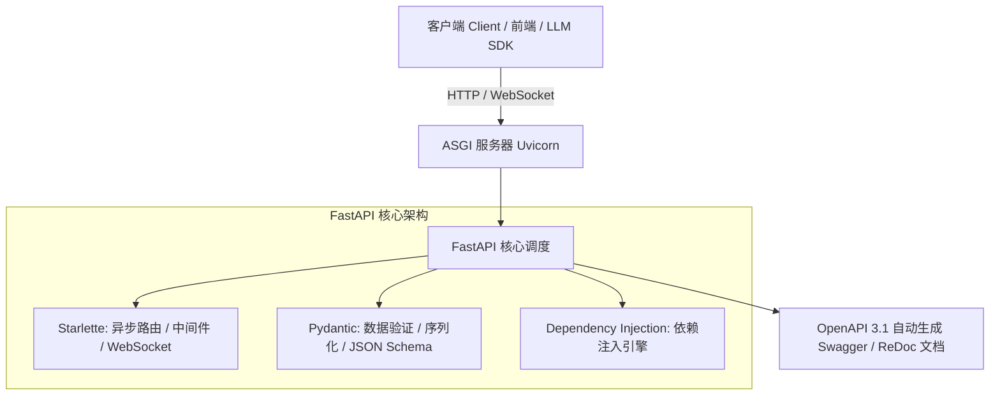
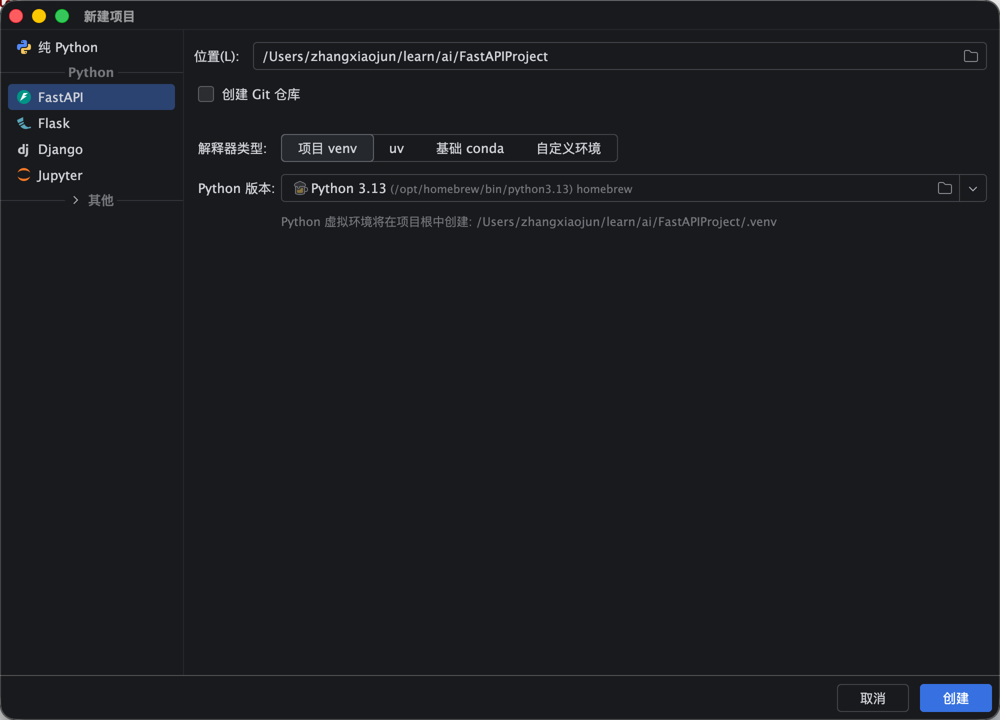
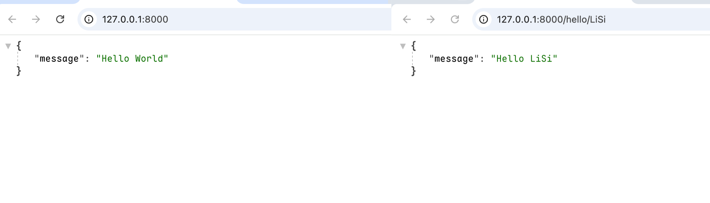
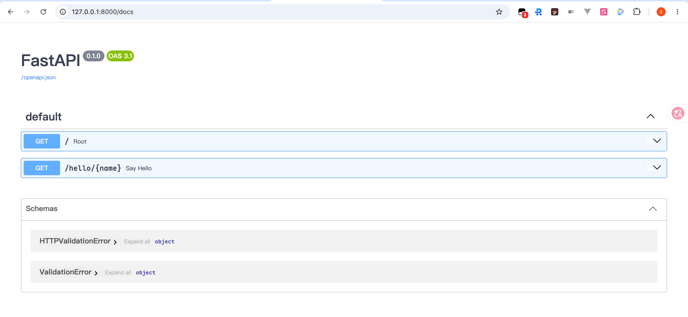
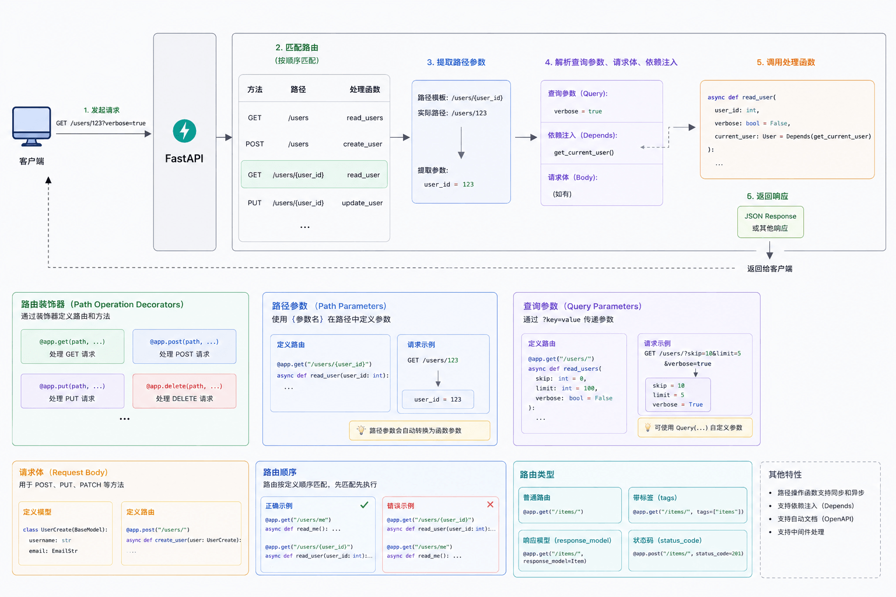
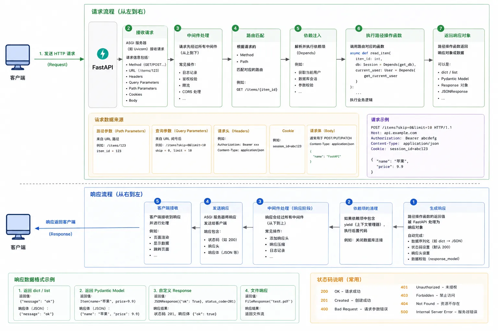

# 快速入门与核心概念 (/docs/ai/fastapi/01-%E5%BF%AB%E9%80%9F%E5%85%A5%E9%97%A8%E4%B8%8E%E6%A0%B8%E5%BF%83%E6%A6%82%E5%BF%B5)

## FastAPI 概述与设计哲学 [#fastapi-概述与设计哲学]

**FastAPI** 是一个现代、快速（高性能）的 Python Web 框架，专门用于构建高效、高可用的 RESTful API 和现代微服务。由 **Tiangolo (Sebastián Ramírez)** 于 2018 年开源，如今已被各大科技公司（如 Microsoft、Uber、Netflix、Google、OpenAI 等）广泛应用于核心服务和 AI 接口开发中。



### 核心优势与特性 [#核心优势与特性]

1. **极致性能**：基于 **Starlette** 和 **Pydantic**，性能可与 **NodeJS** 及 **Go** 相媲美，是目前 Python 生态中最快的 Web 框架之一。
2. **极速开发**：代码编写速度可提升 200% 至 300%，减少约 40% 的人为代码缺陷。
3. **强大的类型系统与 IDE 补全**：全面拥抱 Python 3.10+ 原生类型提示（Type Hints），在 IDE 中享有完美的语法提示、自动补全与错误检查。
4. **内置开箱即用的交互式文档**：基于 **OpenAPI 3.1**（前身 Swagger）规范，自动生成可直接在浏览器测试接口的 **Swagger UI** 和 **ReDoc**。
5. **强大的依赖注入（DI）系统**：提供直观易用的层级依赖注入机制，解耦认证鉴权、数据库会话、安全策略与业务逻辑。
6. **对 AI/LLM 开发的天然友好**：原生支持全异步（`async/await`）、流式响应（Server-Sent Events / SSE）、WebSocket 双向通信，与 LangChain、LangGraph、LlamaIndex 等大模型框架无缝整合。

### Python Web 框架横向对比 [#python-web-框架横向对比]

| 框架        | 架构类型        | 异步支持             | 数据校验与序列化             | 自动生成文档              | 适用场景                            |
| :---------- | :-------------- | :------------------- | :--------------------------- | :------------------------ | :---------------------------------- |
| **FastAPI** | ASGI (异步优先) | 原生一流支持         | 内置 Pydantic 强类型验证     | 内置 Swagger UI / ReDoc   | 现代高并发 API、AI/LLM 接口、微服务 |
| **Flask**   | WSGI (同步为主) | 需额外扩展插件       | 需集成 Marshmallow/Pydantic  | 需依赖 flasgger 等插件    | 小型轻量应用、快速原型设计          |
| **Django**  | WSGI/ASGI       | 近期版本加入部分异步 | Django Forms/DRF Serializers | 需集成 drf-spectacular 等 | 大型全栈 CMS/企业后台管理系统       |
| **Tornado** | 专有异步循环    | 早期异步框架         | 需手动编写                   | 无内置机制                | 早期长轮询与 WebSocket 场景         |

---

## Python 类型提示体系 (Type Hints) [#python-类型提示体系-type-hints]

FastAPI 的核心设计基石是 Python 的 **Type Hints（类型提示）**。FastAPI 依赖类型声明完成：

- **数据转换与解析**：将 HTTP 传输的文本解析为 Python 原生对象（`int`, `float`, `datetime`, `UUID` 等）。
- **数据验证**：自动校验请求参数合法性，校验失败时自动生成精确的错误描述。
- **OpenAPI 文档生成**：将类型直接转换为 OpenAPI 的 JSON Schema。

### 基础类型与容器类型 [#基础类型与容器类型]

```python
# Python 3.10+ 标准语法
def get_user_info(
    name: str,
    age: int,
    height: float,
    is_active: bool,
    tags: list[str],          # 列表，元素均为字符串
    metadata: dict[str, any]  # 字典，键为字符串
) -> dict[str, any]:
    return {"name": name, "age": age, "is_active": is_active}
```

### 联合类型 (Union) 与可选类型 (Optional) [#联合类型-union-与可选类型-optional]

在 Python 3.10 之前，需要引入 `typing.Union` 或 `typing.Optional`；而在 Python 3.10+ 中，推荐直接使用管道符 `|`：

```python
from typing import Optional, Union

# Python 3.10 之前
legacy_var: Optional[str] = None       # 等价于 Union[str, None]

# Python 3.10+ 现代写法（强烈推荐）
modern_var: str | None = None
mixed_id: int | str = "user_1001"
```

### 核心杀手锏：`typing.Annotated` [#核心杀手锏typingannotated]

`Annotated` 是 Python 3.9+ 引入的元数据标注工具。**FastAPI 官方从 0.95 版本起全面推荐使用 `Annotated` 编写接口参数**。

`Annotated` 允许将 **类型声明** 与 **元数据配置（如校验规则、默认值、依赖注入）** 进行解耦绑定：

```python
from typing import Annotated
from fastapi import FastAPI, Query, Path, Depends

app = FastAPI()

# 语法格式：Annotated[类型, 元数据/校验规则/依赖]
UserId = Annotated[int, Path(title="用户ID", ge=1, le=1000000)]
PageSize = Annotated[int, Query(title="每页大小", ge=1, le=100, default=20)]

@app.get("/users/{user_id}")
async def get_user(
    user_id: UserId,
    page_size: PageSize = 20
):
    return {"user_id": user_id, "page_size": page_size}
```


<Callout type="success" title="为什么要优先使用 Annotated？">

1. **代码复用**：可以将常用的校验规则（如 `PageSize`、`CurrentActiveUser`）提取为类型别名，全局复用。
2. **函数签名纯净**：参数有默认值时，函数可以直接在没有 FastAPI 运行时环境中像普通 Python 函数一样被调用测试。

</Callout>


---

## 环境配置与安装 [#环境配置与安装]

### 安装方式 [#安装方式]

推荐在虚拟环境中安装 FastAPI 及其标准依赖：

```bash
# 1. 创建并激活虚拟环境 (Python 3.10+)
python3 -m venv venv
source venv/bin/activate  # Linux/macOS
# .\venv\Scripts\activate  # Windows

# 2. 安装 FastAPI 以及标准工具链
pip install "fastapi[all]"

# 或者使用现代 fastapi-cli (FastAPI 0.110+ 官方推荐)
pip install "fastapi[standard]"
```

---

## 第一个 FastAPI 应用 [#第一个-fastapi-应用]

创建文件 `main.py`：

```python
# main.py
from fastapi import FastAPI

# 1. 创建 FastAPI 应用实例
app = FastAPI(
    title="AI Agent 微服务平台",
    description="基于 FastAPI 构建的高性能大语言模型与 Agent 接口服务",
    version="1.0.0",
    docs_url="/docs",      # Swagger UI 文档路径，设为 None 可关闭
    redoc_url="/redoc"     # ReDoc 文档路径
)

# 2. 定义根路径操作装饰器与函数
@app.get("/", summary="系统健康检查", tags=["系统状态"])
async def root():
    return {
        "status": "healthy",
        "message": "Welcome to FastAPI AI Service!",
        "framework": "FastAPI 0.110+"
    }

# 3. 带参数的操作
@app.get("/items/{item_id}", summary="查询商品详情", tags=["商品模块"])
async def read_item(item_id: int, q: str | None = None):
    return {"item_id": item_id, "query_param": q}
```

---

## OpenAPI 元数据与文档定制 [#openapi-元数据与文档定制]

FastAPI 允许对 OpenAPI 文档进行极其详尽的企业级元数据定制，包括服务条款、联系人、开源许可证、分组标签详细说明等：

```python
from fastapi import FastAPI

tags_metadata = [
    {
        "name": "用户模块",
        "description": "用户账户注册、登录认证、个人资料管理相关接口。",
    },
    {
        "name": "智能体",
        "description": "基于 LLM 与 LangGraph 的 Agent 任务调度与对话流接口。",
        "externalDocs": {
            "description": "Agent 架构白皮书",
            "url": "https://example.com/docs/agent-whitepaper",
        },
    },
]

app = FastAPI(
    title="企业级 AI 开放平台",
    description="""
    ## 欢迎使用企业级 AI 开放平台 API
    本接口文档基于 **OpenAPI 3.1** 标准规范构建，支持：
    * 🚀 **高并发异步处理**
    * 🔐 **OAuth2 + JWT 安全认证**
    * 🤖 **大模型实时打字机流式推送 (SSE)**
    """,
    version="2.0.0",
    terms_of_service="https://example.com/terms/",
    contact={
        "name": "AI 研发中心架构组",
        "url": "https://example.com/support",
        "email": "support@example.com",
    },
    license_info={
        "name": "Apache 2.0",
        "url": "https://www.apache.org/licenses/LICENSE-2.0.html",
    },
    openapi_tags=tags_metadata,
    openapi_url="/api/v1/openapi.json",  # 定制 OpenAPI JSON 路径
    docs_url="/docs",                    # Swagger UI 文档路径
    redoc_url="/redoc"                   # ReDoc 文档路径
)
```

---

## 静态文件挂载 (`StaticFiles`) [#静态文件挂载-staticfiles]

在提供前端 HTML、CSS、JS、图片或供下载的静态资源时，使用 `StaticFiles`：

```python
from fastapi import FastAPI
from fastapi.staticfiles import StaticFiles

app = FastAPI()

# 将本地 ./static 目录挂载到 /static 路径下
# 例如 ./static/images/logo.png 可通过 http://127.0.0.1:8000/static/images/logo.png 访问
app.mount("/static", StaticFiles(directory="static"), name="static")
```

---

## 运行、调试与开发工作流 [#运行调试与开发工作流]

### 命令行运行与热重载 (Hot Reload) [#命令行运行与热重载-hot-reload]

```bash
# 启动方式 1: 官方 fastapi 命令行 (FastAPI 0.110+)
fastapi dev main.py

# 启动方式 2: Uvicorn 经典命令行
uvicorn main:app --reload --host 0.0.0.0 --port 8000
```

### 在 Python 代码中通过代码启动 [#在-python-代码中通过代码启动]

```python
if __name__ == "__main__":
    import uvicorn
    uvicorn.run("main:app", host="127.0.0.1", port=8000, reload=True)
```

## PyCharm 项目搭建 [#pycharm-项目搭建]

**（1）创建项目**



> `新建项目 → FastAPI → 存储位置及项目名称 → 创建虚拟环境 → 创建`


<Callout type="success" title="为什么要创建虚拟环境？">

隔离项目运行环境，避免依赖冲突，保持全局环境的干净和稳定

</Callout>


**（2）运行项目**


**（3） 访问项目**






|地址|文档类型|特点|
|--|--|--|
|[http://127.0.0.1:8000/docs](http://127.0.0.1:8000/docs)|Swagger UI|可交互测试，点击"Try it out"即可发送请求|
|[http://127.0.0.1:8000/redoc](http://127.0.0.1:8000/redoc)|ReDoc|阅读体验好，适合浏览和查阅 API 定义|
|[http://127.0.0.1:8000/openapi.json](http://127.0.0.1:8000/openapi.json)|OpenAPI JSON|原始的 OpenAPI 规范 JSON，可供工具消费|


<Callout type="success" title="如果生产环境需要禁用文档">

```python
from fastapi import FastAPI

# 禁用文档
app = FastAPI(docs_url=None, redoc_url=None)
```

</Callout>


## FastAPI 基本路由 [#fastapi-基本路由]



## FastAPI 请求和响应 [#fastapi-请求和响应]


