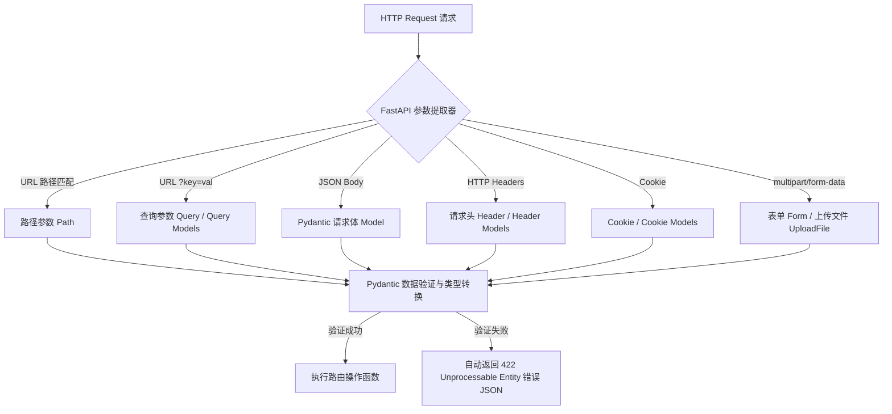

# 请求参数与 Pydantic 模型 (/docs/ai/fastapi/02-%E8%AF%B7%E6%B1%82%E5%8F%82%E6%95%B0%E4%B8%8EPydantic%E6%A8%A1%E5%9E%8B)

在 Web API 开发中，处理客户端发送的各种数据是核心环节。FastAPI 结合 Python 的类型提示与 **Pydantic V2**，提供了极其强大、直观且声明式的数据提取与校验机制。



---

## 路径参数 (Path Parameters) [#路径参数-path-parameters]

### 基础路径参数与类型转换 [#基础路径参数与类型转换]

```python
from fastapi import FastAPI

app = FastAPI()

@app.get("/items/{item_id}")
async def read_item(item_id: int):
    # 若传入 /items/foo，FastAPI 会自动拦截并返回 422 错误
    return {"item_id": item_id, "type": str(type(item_id))}
```

### 路径顺序与枚举类 (Enum) [#路径顺序与枚举类-enum]

```python
from enum import Enum
from fastapi import FastAPI

class ModelName(str, Enum):
    GPT_4O = "gpt-4o"
    CLAUDE_3_5 = "claude-3-5-sonnet"
    DEEPSEEK_V3 = "deepseek-v3"

app = FastAPI()

# 具体固定路由必须定义在参数化路由之前，防止被覆盖
@app.get("/models/me")
async def get_my_model():
    return {"model_name": "current_user_default_model"}

@app.get("/models/{model_name}")
async def get_model(model_name: ModelName):
    if model_name is ModelName.DEEPSEEK_V3:
        return {"model_name": model_name, "provider": "DeepSeek"}
    return {"model_name": model_name, "provider": "Other"}
```

### 文件路径转换器 (`:path`) [#文件路径转换器-path]

```python
@app.get("/files/{file_path:path}")
async def read_file(file_path: str):
    # 请求 /files/data/logs/2026/08/app.log 时，file_path 值为 "data/logs/2026/08/app.log"
    return {"file_path": file_path}
```

---

## 查询参数 (Query Parameters) 与查询参数模型 [#查询参数-query-parameters-与查询参数模型]

### 默认值、可选参数与列表参数 [#默认值可选参数与列表参数]

```python
from typing import Annotated
from fastapi import FastAPI, Query

app = FastAPI()

@app.get("/items/")
async def read_items(
    skip: int = 0,
    limit: int = 10,
    search: str | None = None,
    # 接收多个同名字段: /items/?tags=python&tags=fastapi
    tags: Annotated[list[str], Query()] = []
):
    return {"skip": skip, "limit": limit, "search": search, "tags": tags}
```

### 使用 Pydantic 模型作为查询参数 (Query Parameter Models) [#使用-pydantic-模型作为查询参数-query-parameter-models]

从 FastAPI 0.115+ 起，支持直接将一个 Pydantic 模型作为查询参数集，自动从 URL Query String 中解构字段：

```python
from pydantic import BaseModel, Field, ConfigDict
from typing import Annotated
from fastapi import FastAPI, Query

class FilterParams(BaseModel):
    model_config = ConfigDict(extra="forbid")  # 禁止传入未声明的多余参数

    limit: int = Field(100, gt=0, le=100)
    offset: int = Field(0, ge=0)
    order_by: str = "created_at"
    tags: list[str] = []

app = FastAPI()

# 客户端调用：/products/?limit=20&offset=0&order_by=price&tags=ai&tags=gpu
@app.get("/products/")
async def filter_products(filters: Annotated[FilterParams, Query()]):
    return filters
```

---

## 请求体与 Pydantic 校验模型 [#请求体与-pydantic-校验模型]

### 基础模型与多请求体混合 [#基础模型与多请求体混合]

```python
from pydantic import BaseModel, Field
from typing import Annotated
from fastapi import FastAPI, Body

app = FastAPI()

class Item(BaseModel):
    name: str
    price: float
    description: str | None = None

class User(BaseModel):
    username: str
    full_name: str | None = None

@app.post("/orders/{order_id}")
async def create_order(
    order_id: int,
    item: Item,
    user: User,
    importance: Annotated[int, Body(embed=True)] = 1
):
    # 接收来自 URL 路径的 order_id、以及 JSON Body 中的 item、user 和 importance
    return {"order_id": order_id, "item": item, "user": user, "importance": importance}
```

### 嵌套模型 (Nested Models) 与复杂结构 [#嵌套模型-nested-models-与复杂结构]

```python
from pydantic import BaseModel, HttpUrl

class Image(BaseModel):
    url: HttpUrl
    name: str

class Article(BaseModel):
    title: str
    content: str
    tags: set[str] = set()
    images: list[Image] | None = None  # 嵌套 Image 模型列表

@app.post("/articles/")
async def create_article(article: Article):
    return article
```

---

## 声明请求示例数据 (Request Example Data) [#声明请求示例数据-request-example-data]

在 API 文档中提供清晰的示例数据，能极大方便前端与第三方对接。FastAPI 支持多种声明示例的方式：

```python
from pydantic import BaseModel, Field
from typing import Annotated
from fastapi import FastAPI, Body

app = FastAPI()

# 方式 1：使用 Pydantic Field(examples=[...])
class Item(BaseModel):
    name: str = Field(examples=["MacBook Pro 16寸"])
    description: str | None = Field(default=None, examples=["M4 Max 芯片, 64GB 内存"])
    price: float = Field(examples=[24999.00])
    tax: float | None = Field(default=None, examples=[2499.9])

    # 方式 2：使用 model_config 的 json_schema_extra 统一配置整个模型示例
    model_config = {
        "json_schema_extra": {
            "examples": [
                {
                    "name": "iPhone 16 Pro",
                    "description": "钛金属黑色, 256GB",
                    "price": 7999.00,
                    "tax": 799.9,
                }
            ]
        }
    }

# 方式 3：在路由装饰器或 Body 中指定 openapi_examples
@app.post("/items/custom-example/")
async def add_item(
    item: Annotated[
        Item,
        Body(
            openapi_examples={
                "normal": {
                    "summary": "标准商品示例",
                    "description": "常见配置的商品数据",
                    "value": {"name": "iPad Pro", "price": 6799.00}
                },
                "invalid": {
                    "summary": "特价促销示例",
                    "value": {"name": "Apple Pencil", "price": 999.00, "tax": 0.0}
                }
            }
        )
    ]
):
    return item
```

---

## 额外数据类型 (Extra Data Types) [#额外数据类型-extra-data-types]

FastAPI 支持开箱即用解析 Python 原生高级数据类型：

| 类型        | 说明与输入格式示例                                                  |
| :---------- | :------------------------------------------------------------------ |
| `UUID`      | 标准通用唯一识别码（如 `"123e4567-e89b-12d3-a456-426614174000"`）   |
| `datetime`  | ISO 8601 格式（如 `"2026-08-24T18:00:00Z"`）                        |
| `date`      | 标准日期（如 `"2026-08-24"`）                                       |
| `time`      | 标准时间（如 `"18:30:00"`）                                         |
| `timedelta` | 时间间隔（如传入秒数 `3600`，自动解析为 `timedelta(seconds=3600)`） |
| `Decimal`   | 高精度浮点数，常用于金融金额计算（如 `"99.99"`）                    |
| `bytes`     | 原始二进制字节流                                                    |

```python
from datetime import datetime, time, timedelta
from uuid import UUID
from decimal import Decimal
from typing import Annotated
from fastapi import FastAPI, Body

app = FastAPI()

@app.put("/events/{event_id}")
async def update_event(
    event_id: UUID,
    start_datetime: Annotated[datetime, Body()],
    end_time: Annotated[time, Body()],
    repeat_interval: Annotated[timedelta, Body()],
    price: Annotated[Decimal, Body()]
):
    return {
        "event_id": event_id,
        "start_datetime": start_datetime,
        "end_time": end_time,
        "repeat_interval_seconds": repeat_interval.total_seconds(),
        "price": str(price)
    }
```

---

## Cookie 与 Header 参数模型 [#cookie-与-header-参数模型]

### 单参数形式 [#单参数形式]

```python
from typing import Annotated
from fastapi import FastAPI, Cookie, Header

app = FastAPI()

@app.get("/tracking/")
async def track_client(
    # Header 自动将 user_agent 转换为 User-Agent
    user_agent: Annotated[str | None, Header()] = None,
    x_token: Annotated[list[str] | None, Header()] = None,
    session_id: Annotated[str | None, Cookie()] = None
):
    return {"User-Agent": user_agent, "X-Token": x_token, "session_id": session_id}
```

### 使用 Pydantic 模型封装 Cookie 与 Header [#使用-pydantic-模型封装-cookie-与-header]

```python
from pydantic import BaseModel
from typing import Annotated
from fastapi import FastAPI, Cookie, Header

class CookiesModel(BaseModel):
    session_id: str
    fatebook_tracker: str | None = None

class HeadersModel(BaseModel):
    user_agent: str
    x_trace_id: str | None = None

app = FastAPI()

@app.get("/profile/")
async def get_profile(
    cookies: Annotated[CookiesModel, Cookie()],
    headers: Annotated[HeadersModel, Header()]
):
    return {"cookies": cookies, "headers": headers}
```

---

## 表单数据与文件上传 [#表单数据与文件上传]

接收表单与文件需安装 `python-multipart`：

```bash
pip install python-multipart
```

### 表单数据与表单模型 (`Form`) [#表单数据与表单模型-form]

```python
from pydantic import BaseModel
from typing import Annotated
from fastapi import FastAPI, Form

class UserLoginForm(BaseModel):
    username: str
    password: str

app = FastAPI()

# 方式 1：多字段 Form
@app.post("/login/")
async def login(username: Annotated[str, Form()], password: Annotated[str, Form()]):
    return {"username": username}

# 方式 2：使用 Pydantic 模型作为表单数据 (FastAPI 0.115+)
@app.post("/login/model/")
async def login_with_model(form_data: Annotated[UserLoginForm, Form()]):
    return {"username": form_data.username}
```

### 文件上传 (`UploadFile`) 与表单联合接收 [#文件上传-uploadfile-与表单联合接收]


<Callout type="warn" title="UploadFile vs bytes 选型建议">

- `bytes`：将整个文件一次性读入内存，仅适合几 KB 的微型文件。
- `UploadFile`：基于 SpooledTemporaryFile，小文件在内存，超过限制自动写入硬盘临时文件，支持异步流式处理，**是生产环境唯一推荐的文件上传方式**。

</Callout>


```python
from typing import Annotated
from fastapi import FastAPI, File, UploadFile, Form

app = FastAPI()

@app.post("/files/upload-with-metadata/")
async def upload_file_with_notes(
    file: Annotated[UploadFile, File(description="待处理的文件")],
    token: Annotated[str, Form(description="鉴权 Token")],
    description: Annotated[str | None, Form()] = None
):
    # UploadFile 具备异步接口：read(), write(), seek(), close()
    content = await file.read()
    return {
        "filename": file.filename,
        "content_type": file.content_type,
        "file_size": len(content),
        "token": token,
        "description": description
    }
```
