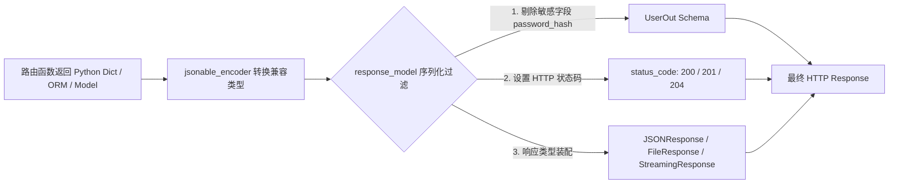

# 响应处理与数据更新 (/docs/ai/fastapi/03-%E5%93%8D%E5%BA%94%E5%A4%84%E7%90%86%E4%B8%8E%E7%8A%B6%E6%80%81%E7%A0%81)

FastAPI 提供了完备的响应机制，涵盖**响应模型脱敏与字段过滤、多模型联合响应、HTTP 状态码声明、路径操作元数据配置、JSON 兼容编码器（jsonable_encoder）以及 PUT/PATCH 数据更新模式**。



---

## 响应模型 (`response_model`) 与字段过滤 [#响应模型-response_model-与字段过滤]

### 基础用法与密码脱敏 [#基础用法与密码脱敏]

```python
from pydantic import BaseModel, EmailStr
from fastapi import FastAPI

app = FastAPI()

class UserIn(BaseModel):
    username: str
    password: str
    email: EmailStr
    full_name: str | None = None

class UserOut(BaseModel):
    username: str
    email: EmailStr
    full_name: str | None = None

# 使用 response_model=UserOut，即使返回了包含 password 的字典，FastAPI 也会自动脱敏
@app.post("/users/", response_model=UserOut)
async def create_user(user: UserIn):
    return user
```

### 字段过滤参数 [#字段过滤参数]

| 参数名                            | 类型       | 说明                                                  |
| :-------------------------------- | :--------- | :---------------------------------------------------- |
| `response_model_exclude_unset`    | `bool`     | 是否过滤掉未显式设置默认值的字段（返回更紧凑的 JSON） |
| `response_model_exclude_defaults` | `bool`     | 是否过滤掉与默认值完全相同的字段                      |
| `response_model_exclude_none`     | `bool`     | 是否过滤掉值为 `None` 的字段                          |
| `response_model_exclude`          | `set[str]` | 显式指定要排除返回的字段名称集合                      |
| `response_model_include`          | `set[str]` | 显式指定仅包含返回的字段名称集合                      |

---

## 额外模型 (Extra Models) 与多类型联合响应 [#额外模型-extra-models-与多类型联合响应]

在现实场景中，不同角色的用户可能返回不同的数据模型，或者接口需要同时支持多种返回类型：

```python
from typing import Union
from pydantic import BaseModel
from fastapi import FastAPI

class CarItem(BaseModel):
    name: str
    speed: int

class PlaneItem(BaseModel):
    name: str
    altitude: int

app = FastAPI()

# 支持返回 CarItem 或 PlaneItem
@app.get("/items/{item_id}", response_model=Union[CarItem, PlaneItem])
async def read_item(item_id: str):
    if item_id == "car":
        return CarItem(name="Tesla Model S", speed=250)
    return PlaneItem(name="Boeing 787", altitude=10000)
```

---

## 路径操作配置 (Path Operation Configuration) [#路径操作配置-path-operation-configuration]

路径操作装饰器提供了大量用于丰富 API 文档与元数据的配置选项：

```python
from fastapi import FastAPI, status
from pydantic import BaseModel

app = FastAPI()

class Item(BaseModel):
    name: str
    price: float

@app.post(
    "/items/",
    response_model=Item,
    status_code=status.HTTP_201_CREATED,
    tags=["商品模块"],
    summary="创建新商品",
    description="创建一个新商品条目，并将数据安全持久化到数据库中。",
    response_description="成功创建的商品完整实体数据",
    deprecated=False,               # 是否在文档中标记为已废弃
    operation_id="create_new_item"  # 自定义生成客户端 SDK 时使用的唯一方法名
)
async def create_item(item: Item):
    return item
```

---

## JSON 兼容编码器 (`jsonable_encoder`) [#json-兼容编码器-jsonable_encoder]

在将数据存入非关系型数据库（如 MongoDB、Redis）或直接组装自定义响应时，经常需要将 `datetime`、`UUID`、`Pydantic Model` 等复杂 Python 数据类型转换为纯 JSON 兼容的类型（如 `str`、`int`、`dict`、`list`）：

```python
from datetime import datetime
from fastapi import FastAPI
from fastapi.encoders import jsonable_encoder
from pydantic import BaseModel

class Order(BaseModel):
    title: str
    created_at: datetime = datetime.now()

fake_db = {}

app = FastAPI()

@app.put("/orders/{order_id}")
async def update_order(order_id: str, order: Order):
    # jsonable_encoder 会将 order 转换为包含 ISO 8601 字符串时间戳的纯 dict
    json_compatible_data = jsonable_encoder(order)
    fake_db[order_id] = json_compatible_data
    return json_compatible_data
```

---

## 数据更新模式：`PUT` 全量替换 vs `PATCH` 局部更新 [#数据更新模式put-全量替换-vs-patch-局部更新]

在官方教程中，明确区分了 **全量替换（PUT）** 与 **局部增量更新（PATCH）** 的最佳工程实现方式：

```python
from fastapi import FastAPI, HTTPException
from fastapi.encoders import jsonable_encoder
from pydantic import BaseModel

app = FastAPI()

class Item(BaseModel):
    name: str
    description: str | None = None
    price: float
    tax: float = 10.5
    tags: list[str] = []

items = {
    "foo": {"name": "Foo", "price": 50.2},
    "bar": {"name": "Bar", "description": "The bartenders", "price": 62, "tax": 20.2},
}

# 1. PUT 全量替换：未提供的字段重置为默认值
@app.put("/items/{item_id}", response_model=Item)
async def update_item_put(item_id: str, item: Item):
    update_item_encoded = jsonable_encoder(item)
    items[item_id] = update_item_encoded
    return update_item_encoded

# 2. PATCH 局部更新：仅更新客户端显式传入的字段
@app.patch("/items/{item_id}", response_model=Item)
async def update_item_patch(item_id: str, item: Item):
    stored_item_data = items.get(item_id)
    if stored_item_data is None:
        raise HTTPException(status_code=404, detail="Item not found")

    stored_item_model = Item(**stored_item_data)
    # 核心：使用 exclude_unset=True 提取客户端显式提供的更新字段
    update_data = item.model_dump(exclude_unset=True)

    # 将更新数据合并并生成新的模型副本
    updated_item = stored_item_model.model_copy(update=update_data)
    items[item_id] = jsonable_encoder(updated_item)
    return updated_item
```

---

## 常用内置响应类与流式响应 [#常用内置响应类与流式响应]

```python
from fastapi import FastAPI
from fastapi.responses import JSONResponse, HTMLResponse, FileResponse, StreamingResponse
import asyncio

app = FastAPI()

# 1. 自定义 JSON 响应
@app.get("/custom-json")
async def custom_json():
    return JSONResponse(content={"msg": "custom"}, status_code=200, headers={"X-App": "FastAPI"})

# 2. 文件安全下载
@app.get("/download/file")
async def download_file():
    return FileResponse(path="./report.pdf", filename="report.pdf", media_type="application/pdf")

# 3. 异步流式输出
async def fake_stream():
    for word in ["FastAPI ", "流式 ", "打字机 ", "测试完成。"]:
        yield word
        await asyncio.sleep(0.1)

@app.get("/stream")
async def stream():
    return StreamingResponse(fake_stream(), media_type="text/plain")
```
