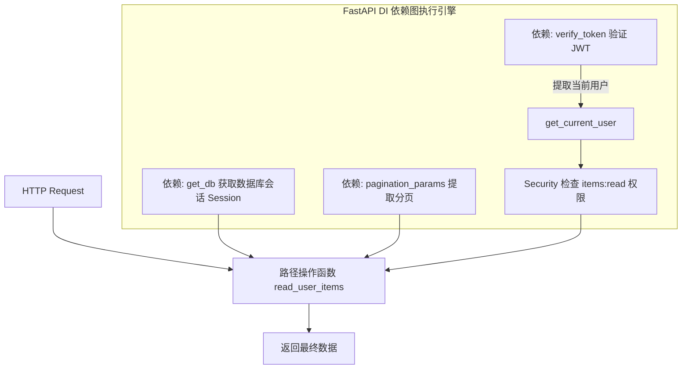

# 依赖注入系统 (/docs/ai/fastapi/04-%E4%BE%9D%E8%B5%96%E6%B3%A8%E5%85%A5%E7%B3%BB%E7%BB%9F)

**依赖注入（Dependency Injection，简称 DI）** 是 FastAPI 最核心的特性之一。它让开发者无需侵入业务代码，即可优雅地实现：

- 共享业务逻辑（如分页、排序、过滤条件提取）
- 共享数据库连接与 ORM 会话生命周期管理
- 权限认证、OAuth2 登录与 JWT 令牌解析
- 细粒度安全作用域（Security Scopes）



---

## 基础函数依赖 (`Depends`) [#基础函数依赖-depends]

```python
from typing import Annotated
from fastapi import FastAPI, Depends

app = FastAPI()

# 定义依赖函数
async def common_pagination(skip: int = 0, limit: int = 20):
    return {"skip": skip, "limit": limit}

PaginationDep = Annotated[dict, Depends(common_pagination)]

@app.get("/users/")
async def read_users(pagination: PaginationDep):
    return {"module": "users", "pagination": pagination}
```

---

## 嵌套依赖与依赖图 (Sub-dependencies) [#嵌套依赖与依赖图-sub-dependencies]

FastAPI 会自动解析多层依赖构成的“依赖树”，并按拓扑顺序依次执行与缓存：

```python
from typing import Annotated
from fastapi import FastAPI, Depends, Header, HTTPException, status

app = FastAPI()

def verify_api_key(x_api_key: Annotated[str | None, Header()] = None):
    if x_api_key != "secret-agent-key-2026":
        raise HTTPException(status_code=status.HTTP_401_UNAUTHORIZED, detail="无效 API Key")
    return x_api_key

def get_tenant_context(
    api_key: Annotated[str, Depends(verify_api_key)],
    x_tenant_id: Annotated[str, Header()]
):
    return {"tenant_id": x_tenant_id, "api_key": api_key}

@app.get("/tenant/resources")
async def get_resources(tenant: Annotated[dict, Depends(get_tenant_context)]):
    return {"status": "ok", "tenant_info": tenant}
```

---

## 类作为依赖 (Classes as Dependencies) [#类作为依赖-classes-as-dependencies]

```python
from typing import Annotated
from fastapi import FastAPI, Depends

app = FastAPI()

class SearchParams:
    def __init__(self, q: str | None = None, page: int = 1, size: int = 10):
        self.q = q
        self.offset = (page - 1) * size
        self.limit = size

# 当类型注解与 Depends 目标一致时，可以直接写 Depends()
@app.get("/search/")
async def search_items(params: Annotated[SearchParams, Depends()]):
    return {"q": params.q, "offset": params.offset, "limit": params.limit}
```

---

## `yield` 依赖与资源清理 [#yield-依赖与资源清理]

```python
from typing import AsyncGenerator
from fastapi import FastAPI, Depends

app = FastAPI()

class DBSession:
    def close(self):
        print("-> [DB] 连接已安全释放关闭")

async def get_db_session() -> AsyncGenerator[DBSession, None]:
    db = DBSession()
    try:
        yield db
    finally:
        db.close()

@app.get("/data/")
async def get_data(db: Annotated[DBSession, Depends(get_db_session)]):
    return {"status": "ok"}
```


<Callout type="info" title="资源释放保障">

即使路由函数在执行过程中抛出了异常（`HTTPException` 或代码异常），`finally` 代码块中的清理逻辑依然**百分之百保证被执行**，绝对防止连接泄露。

</Callout>


---

## OAuth2 + JWT 认证与细粒度权限作用域 (Security Scopes) [#oauth2--jwt-认证与细粒度权限作用域-security-scopes]

FastAPI 官方文档深入讲解了基于 **OAuth2 Scopes** 的细粒度权限体系（类似于 GitHub / Google 授权时的权限范围）：

```python
from typing import Annotated
from fastapi import FastAPI, Depends, HTTPException, Security, status
from fastapi.security import (
    OAuth2PasswordBearer,
    OAuth2PasswordRequestForm,
    SecurityScopes,
)
from jose import JWTError, jwt
from pydantic import BaseModel

SECRET_KEY = "my-secret-key"
ALGORITHM = "HS256"

# 声明支持的作用域与说明
oauth2_scheme = OAuth2PasswordBearer(
    tokenUrl="token",
    scopes={
        "me": "读取当前用户基本信息",
        "items:read": "读取商品列表",
        "items:write": "修改或创建商品",
    },
)

app = FastAPI()

class User(BaseModel):
    username: str
    scopes: list[str] = []

# 安全依赖：校验 Token 并校验是否包含当前路由要求的 SecurityScopes
async def get_current_user(
    security_scopes: SecurityScopes,
    token: Annotated[str, Depends(oauth2_scheme)]
) -> User:
    if security_scopes.scopes:
        authenticate_value = f'Bearer scope="{security_scopes.scope_str}"'
    else:
        authenticate_value = "Bearer"

    credentials_exception = HTTPException(
        status_code=status.HTTP_401_UNAUTHORIZED,
        detail="未能验证凭据",
        headers={"WWW-Authenticate": authenticate_value},
    )
    try:
        payload = jwt.decode(token, SECRET_KEY, algorithms=[ALGORITHM])
        username: str = payload.get("sub")
        token_scopes: list[str] = payload.get("scopes", [])
        if username is None:
            raise credentials_exception
    except JWTError:
        raise credentials_exception

    # 校验当前用户是否具备该接口所要求的全部 scope
    for scope in security_scopes.scopes:
        if scope not in token_scopes:
            raise HTTPException(
                status_code=status.HTTP_403_FORBIDDEN,
                detail="权限不足",
                headers={"WWW-Authenticate": authenticate_value},
            )
    return User(username=username, scopes=token_scopes)

# 使用 Security(...) 声明该接口需要拥有 items:write 权限
@app.post("/items/")
async def create_item(
    current_user: Annotated[User, Security(get_current_user, scopes=["items:write"])]
):
    return {"message": "商品创建成功", "operator": current_user.username}
```
