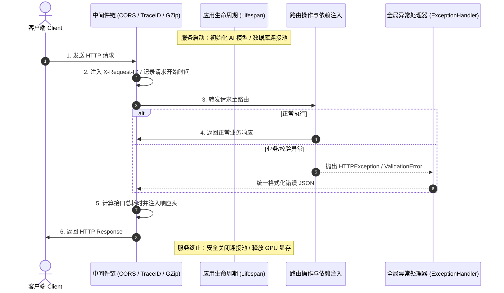

# 中间件与生命周期与异常 (/docs/ai/fastapi/06-%E4%B8%AD%E9%97%B4%E4%BB%B6%E4%B8%8E%E7%94%9F%E5%91%BD%E5%91%A8%E6%9C%9F%E4%B8%8E%E5%BC%82%E5%B8%B8)

在生产级 Web 与 AI 服务开发中，**全局拦截请求、跨域资源共享（CORS）、服务平滑启停、标准化异常响应以及后台异步任务**是不可或缺的底层支撑能力。



---

## 中间件机制 (Middleware) [#中间件机制-middleware]

### 自定义 HTTP 中间件（耗时统计 + 全链路 Trace-ID） [#自定义-http-中间件耗时统计--全链路-trace-id]

```python
import time
import uuid
from fastapi import FastAPI, Request

app = FastAPI()

@app.middleware("http")
async def add_process_time_and_trace_id(request: Request, call_next):
    # 1. 前置处理：生成/提取链路追踪 ID，记录起始时间戳
    request_id = request.headers.get("X-Request-ID", str(uuid.uuid4()))
    start_time = time.perf_counter()
    request.state.request_id = request_id

    # 2. 执行后续路由处理
    response = await call_next(request)

    # 3. 后置处理：计算接口耗时并写入响应头
    process_time = time.perf_counter() - start_time
    response.headers["X-Process-Time"] = f"{process_time:.4f}s"
    response.headers["X-Request-ID"] = request_id

    return response
```

---

## 跨域资源共享 (CORS) [#跨域资源共享-cors]

```python
from fastapi import FastAPI
from fastapi.middleware.cors import CORSMiddleware

app = FastAPI()

origins = [
    "http://localhost:3000",
    "http://localhost:5173",
    "https://your-production-app.com",
]

app.add_middleware(
    CORSMiddleware,
    allow_origins=origins,
    allow_credentials=True,
    allow_methods=["*"],
    allow_headers=["*"],
    expose_headers=["X-Request-ID"],
    max_age=600
)
```

---

## 现代应用生命周期管理 (`lifespan`) [#现代应用生命周期管理-lifespan]

FastAPI 推荐使用基于 `@asynccontextmanager` 的 **`lifespan`（生命周期上下文管理器）**：

```python
from contextlib import asynccontextmanager
from fastapi import FastAPI, Request
import asyncio

class AIModelManager:
    async def load(self):
        print("-> [Lifespan] 正在加载大模型权重至 GPU 显存...")
        await asyncio.sleep(0.5)

    async def cleanup(self):
        print("-> [Lifespan] 正在释放 GPU 资源与连接...")

@asynccontextmanager
async def lifespan(app: FastAPI):
    # Startup
    ai_manager = AIModelManager()
    await ai_manager.load()
    app.state.ai_manager = ai_manager

    yield  # 服务在此对外提供 API 服务

    # Shutdown
    await ai_manager.cleanup()

app = FastAPI(lifespan=lifespan)
```

---

## 异常处理机制 (Exception Handling) [#异常处理机制-exception-handling]

### 覆盖与自定义全局异常处理器 [#覆盖与自定义全局异常处理器]

```python
from fastapi import FastAPI, Request, status
from fastapi.responses import JSONResponse
from fastapi.exceptions import RequestValidationError

app = FastAPI()

class BusinessException(Exception):
    def __init__(self, code: int, message: str):
        self.code = code
        self.message = message

@app.exception_handler(BusinessException)
async def business_exception_handler(request: Request, exc: BusinessException):
    return JSONResponse(
        status_code=status.HTTP_200_OK,
        content={"code": exc.code, "message": exc.message, "success": False}
    )

@app.exception_handler(RequestValidationError)
async def validation_exception_handler(request: Request, exc: RequestValidationError):
    errors = [{"field": " -> ".join(map(str, err["loc"])), "msg": err["msg"]} for err in exc.errors()]
    return JSONResponse(
        status_code=status.HTTP_422_UNPROCESSABLE_ENTITY,
        content={"code": 42200, "message": "参数校验未通过", "errors": errors}
    )
```

---

## 后台任务 (`BackgroundTasks`) [#后台任务-backgroundtasks]

```python
from fastapi import FastAPI, BackgroundTasks
import asyncio

app = FastAPI()

async def send_welcome_email(email: str):
    await asyncio.sleep(1.0)
    print(f"-> [Email] 邮件已发送给: {email}")

@app.post("/register/")
async def register(email: str, background_tasks: BackgroundTasks):
    background_tasks.add_task(send_welcome_email, email=email)
    return {"message": "注册成功，欢迎邮件正在后台发送"}
```


<Callout type="success" title="BackgroundTasks vs Celery 选型指南">

- **BackgroundTasks**：适合与当前进程强相关的轻量异步任务（执行耗时 &lt; 10 秒），无需搭建 Redis/RabbitMQ Broker。
- **Celery / ARQ / RQ**：适合重型分布式计算、定时任务（Cron）、超长时间运行（分钟/小时级）、需要任务失败重试与任务状态持久化的场景。

</Callout>
