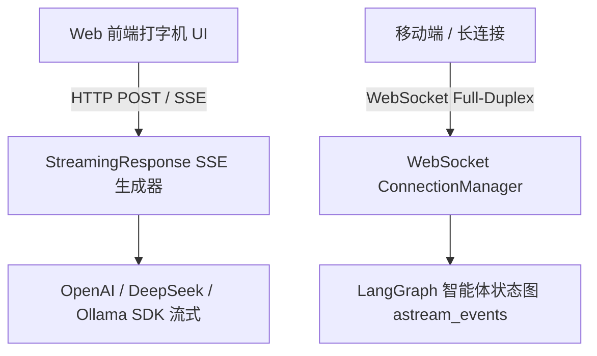

# 高并发异步与 AI 流式实战 (/docs/ai/fastapi/08-%E9%AB%98%E5%B9%B6%E5%8F%91%E5%BC%82%E6%AD%A5%E4%B8%8EAI%E6%B5%81%E5%BC%8F%E5%AE%9E%E6%88%98)

在大语言模型（LLM）与智能体（Agent）开发中，**流式传输 JSON Lines、Server-Sent Events (SSE)、WebSocket 双向长连接以及底层异步调度**是构建现代 AI 微服务的核心。



---

## FastAPI 异步并发执行机制深度剖析 [#fastapi-异步并发执行机制深度剖析]

- **`async def`（异步函数）**：运行在主线程的 `asyncio` 事件循环中，必须配合非阻塞库（如 `httpx`、`aiofiles`、`asyncio.sleep`）。遇到 `await` 时自动让出 CPU 控制权支撑万级并发。
- **`def`（同步函数）**：FastAPI 自动将其派遣到外部线程池（`ThreadPoolExecutor`）执行，避免阻塞主事件循环。


<Callout type="error" title="避免在 async def 中调用同步阻塞代码">

切勿在 `async def` 中调用同步阻塞代码（如 `time.sleep(5)` 或 `requests.get`），否则会导致整个主线程的事件循环被完全卡死！

</Callout>


---

## 流式传输 JSON Lines (`Stream JSON Lines`) [#流式传输-json-lines-stream-json-lines]

FastAPI 官方文档展示了通过 `StreamingResponse` 逐行推送 **JSON Lines (`.jsonl`)** 数据流的模式：

```python
import asyncio
import json
from typing import AsyncGenerator
from fastapi import FastAPI
from fastapi.responses import StreamingResponse

app = FastAPI()

async def json_lines_generator() -> AsyncGenerator[str, None]:
    for i in range(1, 6):
        record = {"event_id": i, "status": "processing", "progress": i * 20}
        # 每行输出一个独立的 JSON 字符串并以 \n 换行
        yield json.dumps(record, ensure_ascii=False) + "\n"
        await asyncio.sleep(0.5)

@app.get("/stream/jsonl")
async def stream_json_lines():
    return StreamingResponse(
        json_lines_generator(),
        media_type="application/x-ndjson"
    )
```

---

## Server-Sent Events (SSE) 服务端推送 [#server-sent-events-sse-服务端推送]

```python
import asyncio
import json
from typing import AsyncGenerator
from fastapi import FastAPI
from fastapi.responses import StreamingResponse

app = FastAPI()

async def sse_event_generator() -> AsyncGenerator[str, None]:
    for i in range(1, 6):
        event_data = {"step": i, "message": f"思考步骤 {i}..."}
        # SSE 标准数据行以 data: 开头，以 \n\n 结尾
        yield f"data: {json.dumps(event_data, ensure_ascii=False)}\n\n"
        await asyncio.sleep(0.5)
    yield "data: [DONE]\n\n"

@app.get("/api/v1/sse/events")
async def stream_sse():
    return StreamingResponse(
        sse_event_generator(),
        media_type="text/event-stream",
        headers={"Cache-Control": "no-cache", "Connection": "keep-alive"}
    )
```

---

## 大模型 (LLM) 真实流式输出实战 [#大模型-llm-真实流式输出实战]

```python
from typing import AsyncGenerator
from fastapi import FastAPI
from fastapi.responses import StreamingResponse
from pydantic import BaseModel
from openai import AsyncOpenAI
import os

app = FastAPI()

client = AsyncOpenAI(
    api_key=os.getenv("OPENAI_API_KEY", "your-key"),
    base_url=os.getenv("OPENAI_BASE_URL", "https://api.openai.com/v1")
)

class ChatRequest(BaseModel):
    prompt: str
    model: str = "gpt-4o"

async def llm_stream_generator(prompt: str, model: str) -> AsyncGenerator[str, None]:
    stream = await client.chat.completions.create(
        model=model,
        messages=[{"role": "user", "content": prompt}],
        stream=True
    )
    async for chunk in stream:
        content = chunk.choices[0].delta.content
        if content:
            yield f"data: {content}\n\n"
    yield "data: [DONE]\n\n"

@app.post("/api/v1/chat/stream")
async def chat_stream(request: ChatRequest):
    return StreamingResponse(
        llm_stream_generator(request.prompt, request.model),
        media_type="text/event-stream",
        headers={"Cache-Control": "no-cache", "Connection": "keep-alive"}
    )
```

---

## WebSocket 全双工长连接实战 [#websocket-全双工长连接实战]

```python
from typing import list
from fastapi import FastAPI, WebSocket, WebSocketDisconnect

app = FastAPI()

class ConnectionManager:
    def __init__(self):
        self.active_connections: list[WebSocket] = []

    async def connect(self, websocket: WebSocket):
        await websocket.accept()
        self.active_connections.append(websocket)

    def disconnect(self, websocket: WebSocket):
        self.active_connections.remove(websocket)

    async def broadcast(self, message: str):
        for connection in self.active_connections:
            await connection.send_text(message)

manager = ConnectionManager()

@app.websocket("/ws/chat/{client_id}")
async def websocket_chat(websocket: WebSocket, client_id: str):
    await manager.connect(websocket)
    await manager.broadcast(f"用户 [{client_id}] 进入了房间")
    try:
        while True:
            data = await websocket.receive_text()
            await manager.broadcast(f"[{client_id}]: {data}")
    except WebSocketDisconnect:
        manager.disconnect(websocket)
        await manager.broadcast(f"用户 [{client_id}] 离开了房间")
```
