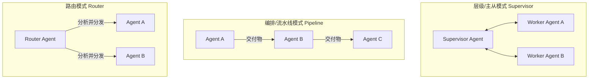
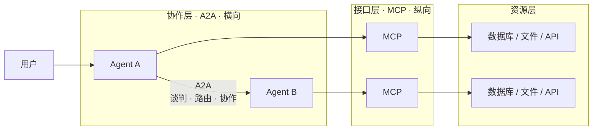

# Agent / 多智能体系统 (/docs/ai/interview/multi-agent)

## 为什么拆成多个 Agent [#为什么拆成多个-agent]

| 瓶颈           | 问题                                                                               | 拆分后解决的问题                  |
| -------------- | ---------------------------------------------------------------------------------- | --------------------------------- |
| Prompt 膨胀    | 单 Agent 处理所有场景导致 System Prompt 臃肿，模型注意力分散（Lost in the Middle） | 每个 Agent 只含几百字的聚焦提示词 |
| 工具选择幻觉   | 面对数十个工具时，选择正确工具的准确率指数级下降                                   | 每个 Agent 仅绑定 3-5 个专属工具  |
| 模型适配不匹配 | 不同阶段对模型能力要求不同（规划需强推理，分类只需轻量模型）                       | 每个 Agent 独立选最优性价比模型   |
| 工程不可控     | 微调一个 Prompt 产生"蝴蝶效应"，破坏其他任务表现                                   | 类似微服务，独立开发、测试、调优  |

## 多智能体架构如何设计 [#多智能体架构如何设计]



| 模式            | 设计                                                                                                                   | 试用场景                   |
| --------------- | ---------------------------------------------------------------------------------------------------------------------- | -------------------------- |
| 路由模式        | 主 Agent 或分类器接收用户输入，分析意图，然后决定将任务分发给某一个特定的专业 Agent。任务完成后直接返回                | 智能客服、多功能个人助理   |
| 编排/流水线模式 | 类似于工厂的流水线（SOP）。一个 Agent 的输出作为下一个 Agent 的输入。通常结合确定性代码（如状态机/工作流引擎）进行编排 | 代码生成与测试             |
| 层级模式        | 由一个 Supervisor Agent 负责拆解任务、分发子任务给多个 Worker Agents，并汇总他们的结果进行审核和最终输出               | 研究报告撰写、复杂数据分析 |


<Callout type="success" title="路由摸鱼与层级模式区分举例">

<Tabs items={["路由模式", "分层模式"]}>
<Tab value="路由模式">

```txt 
开发时预定义好 3 个 Agent：MathAgent、CodeAgent、WriterAgent

用户输入："计算 123 × 456"

Router 决策：
  → 这是数学问题 → 丢给 MathAgent
  → MathAgent 拿到的是**完整的原始输入**："计算 123 × 456"
  → Router 没有拆分、没有规划，只是分类
```

</Tab>
<Tab value="分层模式">

```txt 
开发时同样预定义好一堆 Agent：WeatherAgent、FlightAgent、HotelAgent、WriterAgent

用户输入："帮我规划下周去东京的行程，预算 5000 元"

Supervisor 决策：
  → 拆分 3 个子任务：
      ① 子任务 A：查东京天气             → WeatherAgent
      ② 子任务 B：查航班 + 酒店预算分配   → FlightAgent + HotelAgent
      ③ 子任务 C：根据 A+B 结果写行程     → WriterAgent
  → 并行执行 A、B
  → 汇总 A+B 的结果喂给 C
  → 合成最终输出

⚠️ 这里 WeatherAgent / FlightAgent / HotelAgent 全都是开发时就定义好的。Supervisor 没有"创建"任何新 Agent。
   Supervisor 做的是"规划 + 编排 + 合成"。
```

</Tab>
</Tabs>

</Callout>


## 子智能体划分的原则 [#子智能体划分的原则]

设计多智能体系统时，将复杂任务合理拆分并分配给不同的子智能体是架构成败的关键。通常遵循以下五个黄金划分原则：

1. **按单一职责原则划分 (Single Responsibility Principle, SRP)**：
   - **逻辑**：一个 Agent 应该且仅有一个引起它变化的原因（专注于做一类事情）。
   - **示例**：在电商客服系统中，不要让一个 Agent 既处理退款、又回答商品参数、还去查物流。应拆分为：`退款处理 Agent`、`商品导购 Agent` 和 `物流查询 Agent`。

2. **按工具调用限制划分 (Tool-driven Boundary)**：
   - **逻辑**：大模型能熟练使用的工具数量是有限的（通常建议单 Agent 绑定工具不超过 5 个）。
   - **示例**：如果某个任务需要 15 个外部 API（数据库读写、外部搜索、邮件发送等），应按照工具的使用边界将 Agent 拆分为 3-4 个。专门负责敏感操作（如付款或数据库修改）的 Agent 应该独立出来，便于精细化控制权限和安全审计。

3. **按业务阶段/SOP 划分 (Stage-based / Pipeline Partitioning)**：
   - **逻辑**：沿用企业内成熟的工业标准作业程序（SOP），将线性流转的每个关键节点设计为独立的 Agent。
   - **示例**：软件开发团队工作流：`需求分析 Agent -> 架构设计 Agent -> 代码编写 Agent -> 代码审查 Agent`。

4. **按模型能力与成本要求划分 (Model-to-Cost Boundary)**：
   - **逻辑**：任务的难度不同，对模型推理能力的依赖也不同。将简单任务与复杂任务剥离，分派给不同能力的模型。
   - **示例**：
     - **复杂/高难度任务**（算法推理、架构规划、最终输出审查）：交给强推理模型（如 Claude 3.5 Sonnet 或 GPT-4o）。
     - **简单/高频任务**（数据分类、格式提取、文本翻译）：交给轻量快速模型（如 GPT-4o-mini 或 Gemini Flash）。

5. **按上下文与状态独立性划分 (Context Independence)**：
   - **逻辑**：如果某些子任务不需要知道主任务的完整历史上下文，就可以将其剥离为独立的子 Agent，甚至可以并行运行。
   - **示例**：在撰写一份大型行业报告时，可以把“收集互联网各领域数据”的任务分发给 5 个独立的 **数据搜集子 Agent**，它们各自在极小的上下文中运行，收集完后由 **汇总 Agent** 整合。

## 主智能体与子智能体协作与通信 [#主智能体与子智能体协作与通信]

## A2A 协议与 MCP 的区别 [#a2a-协议与-mcp-的区别]

A2A 与 MCP 并不是竞争关系，而是 **互补的上下层关系**：A2A 解决横向的 Agent 协同，MCP 解决纵向的模型与外部资源对接。

**[A2A](https://a2a-protocol.org/)（Agent-to-Agent Protocol）**：

- **发起方**：Google Cloud 及其生态伙伴（Linux 基金会托管）。
- **定位**：智能体之间互相发现、建立信任、协作的 **横向（Lateral）开放标准**。
- **核心理念**：`Agent A ── A2A ── Agent B`，解决的是 Agent 怎么和另一个 Agent 对话。
- **形象比喻**：两个独立部门的经理之间谈商务合作、任务委托。

**[MCP](https://modelcontextprotocol.io/docs/getting-started/intro)（Model Context Protocol）**：

- **发起方**：Anthropic 主导，开源社区快速采纳。
- **定位**：LLM 与外部工具、数据源之间的 **纵向（Vertical）通用接口层**。
- **核心理念**：`LLM → MCP → 工具 / 数据源 / 外部系统`，解决的是模型怎么调用外部能力。
- **形象比喻**：经理（Model）打开自己的工具箱（Tools）或查阅本地数据库（Data）。


<Callout type="success" title="提示">

MCP 支持两种传输协议：`HTTP`(SSE/Streamable) `STDIO`(标准输入输出)

- **STDIO**: Client 把 MCP Server 当作子进程启动，通过 stdin 发 JSON-RPC 请求，从 stdout 读响应。
  - 适用场景：本地工具、命令行工具、桌面应用

- **HTTP**：Client 通过 HTTP POST 发送 JSON-RPC 请求，Server 通过 SSE（Server-Sent Events） 或 HTTP 响应返回结果。
  - 适用场景：远程服务、云端部署、多客户端共享、Web 环境

**封装与配置**：


<Tabs items={["STDIO 模式", "HTTP (Streamable) 模式"]}>
<Tab value="STDIO 模式">

````python 
# server.py — 一个 MCP Server (STDIO 模式)
from mcp.server.fastmcp import FastMCP

# 创建 MCP Server 实例
mcp = FastMCP("我的工具箱")

# 封装一个工具：查天气
@mcp.tool()
def get_weather(city: str) -> str:
    """查询指定城市的天气"""
    # 这里写真正的业务逻辑
    return f"{city}今天晴，气温30°C"

# 封装一个工具：查数据库
@mcp.tool()
def query_db(sql: str) -> str:
    """执行 SQL 查询"""
    # 连数据库、执行 SQL...
    return "[{id: 1, name: '张三'}]"

# 封装一个资源：API 文档
@mcp.resource("docs://api-guide")
def get_api_docs() -> str:
    """返回 API 使用指南"""
    return "# API 指南\n## 接口1: /users..."

# 封装一个提示模板
@mcp.prompt()
def code_review_prompt(code: str) -> str:
    """代码审查提示词"""
    return f"请审查以下代码，关注安全性和性能：\n```\n{code}\n```"

# 启动！走 STDIO 传输
mcp.run()  # 默认就是 stdio 模式
````

**连接**：

```txt 
{
  "mcpServers": {
    "我的工具箱": {
      "command": "python",
      "args": ["/path/to/server.py"]
    }
  }
}
```

</Tab>
<Tab value="HTTP (Streamable) 模式">

```python 
# server_http.py — 一个 MCP Server (HTTP 模式)
from mcp.server.fastmcp import FastMCP

mcp = FastMCP("我的远程工具箱")

@mcp.tool()
def get_weather(city: str) -> str:
    """查询指定城市的天气"""
    return f"{city}今天晴，气温30°C"

# 启动！走 HTTP 传输
mcp.run(transport="streamable-http", host="0.0.0.0", port=8080)
```

**连接**：

```txt 
{
  "mcpServers": {
    "远程工具箱": {
      "url": "http://localhost:8080/mcp"
    }
  }
}
```

</Tab>
</Tabs>

</Callout>


多维度对比表

| 维度         | A2A (Agent-to-Agent)                                           | MCP (Model Context Protocol)                          |
| :----------- | :------------------------------------------------------------- | :---------------------------------------------------- |
| **协作维度** | 横向：Agent 与 Agent 之间的对等协作                            | 纵向：模型与工具、数据源的接入                        |
| **网络拓扑** | 去中心化、Peer-to-Peer                                         | 中心化、Client-Host-Server                            |
| **通信协议** | 标准 HTTPS/REST，异步 Webhook 或 SSE                           | JSON-RPC 2.0，通过 STDIO 或 HTTP/SSE 传输             |
| **能力描述** | **Agent Card**（`.well-known/agent.json`，声明服务端点与能力） | **Tools / Resources / Prompts**（三位一体的标准接口） |
| **主要能力** | 发现、鉴权、任务委托、多角色协商                               | 调用工具、读取资源、注入提示词                        |
| **典型场景** | 跨企业、跨框架的 Agent 协同                                    | 单个 Agent 内部对接数据库、文件系统、API              |

### 为什么不用 MCP 统一所有能力？ [#为什么不用-mcp-统一所有能力]

“既然 MCP 能让大模型调用工具，为什么不把每个 Agent 包装成 MCP Tool，用 MCP 统一多 Agent 系统？” 主要原因有三点：

1. **自治性差异**：
   - MCP Tool 是 **无状态、被动的**，遵循 “调用 → 执行 → 返回” 的单向链路，不具备自主决策能力。
   - Agent 是 **有状态、主动的**，拥有独立目标、长短期记忆、Reflection 与 ReAct 循环，可以主动决定是否调用其他 Agent。

2. **协作维度差异**：
   - MCP 是 **点对点的资源访问通道**，缺乏管理多 Agent 会话流转、多向广播、状态图拓扑的顶层设计。
   - A2A 天然支持多角色协商、任务委托（Delegation）、SOP 状态机维护等横向协作能力。

3. **上下文爆炸风险**：
   - 若用 MCP 暴露所有 Agent 的底层工具，全部工具 Schema 会被拼进 LLM 上下文，瞬间造成 **上下文窗口饱和** 与注意力偏移。
   - A2A 通过 Agent Card 提供 **高维能力抽象**（只暴露 Agent 的输入输出契约，不暴露底层工具），实现高级别路由寻址。

### 生产落地的最佳组合 [#生产落地的最佳组合]

工业界最科学的架构是 **A2A + MCP 的分层组合**：



- **A2A 层**：负责上层 Agent 间的能力发现、任务分发与协作谈判。
- **MCP 层**：负责单个 Agent 内部与具体数据库、文件系统、物理工具的本地通信。


<Callout type="success" title="一句话总结">

**A2A 管 Agent 之间怎么合作，MCP 管 Agent 内部怎么用工具。** 前者是“经理开会”，后者是“经理用工具箱”。

</Callout>


## ReAct / Planning / Reflection / Self-Reflection [#react--planning--reflection--self-reflection]


<Tabs items={["ReAct", "Planning", "Reflection / Self-Reflection(反思/自省模式)"]}>
<Tab value="ReAct">

**论文**：[ReAct: Synergizing Reasoning and Acting in Language Models](https://arxiv.org/abs/2210.03629)

**核心思想**：把 Chain-of-Thought（连续推理）和 Tool Use（工具调用）交替编织，形成 `思考 → 行动 → 观察 → 思考 → ...` 的循环。

**执行轨迹**：

```txt 
用户问题："2025 年奥斯卡最佳影片是哪部？它的导演还导过哪些获奖影片？"

Step 1
  Thought: 我需要先查 2025 年奥斯卡最佳影片
  Action: search("2025 Oscar Best Picture winner")
  Observation: 《阿诺拉》（Anora）

Step 2
  Thought: 知道是《阿诺拉》了，现在查它的导演是谁
  Action: search("Anora director")
  Observation: Sean Baker

Step 3
  Thought: 导演是 Sean Baker，查他还导过哪些获奖影片
  Action: search("Sean Baker awards")
  Observation: 《佛罗里达乐园》《红色火箭》...

Step 4
  Thought: 信息已经够了，可以回答了
  Final Answer: 《阿诺拉》，导演 Sean Baker，
  其他获奖作品有...
```

**关键特征**:

- 每步都产出 Thought——让模型显式地"说出它在想什么"
- 每步都执行 Action——调用真实工具，拿到真实反馈
- Observation 是工具返回——作为下一步 Thought 的输入
- 没有全局规划——走到哪算哪，可能绕弯路

</Tab>
<Tab value="Planning">

**核心思想**：<mark>先规划，在后执行</mark>。Agent 拿到任务后，<u>不急着动手</u>，而是先生成一个<u>完整的执行计划</u>，然后再按计划逐步执行。

**执行流程**：

```txt 
Phase 1: Plan
输入：纽约 7 月东京旅行攻略
输出：有序步骤列表
  Step 1: 搜索日本 7 月天气
  Step 2: 搜索纽约 -> 东京航班
  Step 3: 搜索东京酒店
  Step 4: 汇总为行程

Phase 2: Execute
对每个 Step：
  → 执行该步骤的具体 Action
  → 收集结果
  → 如某步骤失败 → 可重规划
```

**Plan 的三种常见形态**：

```python 
# 1. 线性计划（简单）
plan = ["step1", "step2", "step3"]

# 2. 树状计划（有分支）
plan = {
    "root": "规划东京行程",
    "children": [
        {"task": "查天气", "deps": []},
        {"task": "查航班", "deps": []},
        {"task": "写行程", "deps": ["查天气", "查航班"]},
    ]
}

# 3. 自适应计划（允许修改）
plan = planner.generate(state)
# 执行中如发现 plan 不可行：
plan = planner.replan(state, failed_step)
```

</Tab>
<Tab value="Reflection / Self-Reflection(反思/自省模式)">

**论文**：

- [Reflexion: Language Agents with Verbal Reinforcement Learning（Shinn et al., 2023）](https://arxiv.org/abs/2303.11366)
- [Self-Refine: Iterative Refinement with Self-Feedback（Madaan et al., 2023）](https://arxiv.org/abs/2303.17651)
- Reflection Agents（LangChain Blog）

**核心思想**：Agent 完成一轮任务后，自己扮演**批评者**审查自己的输出，发现问题后迭代改进。

> 输出层面的自我修正，不是决策层面的修路。

**执行循环**：

```txt 
1. GENERATE ─►  Agent 产生一个初稿
2. CRITIQUE ─►  Agent（或另一个 LLM）审查：
                  - 逻辑有没有漏洞？
                  - 格式是否正确？
                  - 是否遗漏要求？
3. REFINE   ─►  根据批评意见修改输出
4. LOOP?    ─►  达到质量阈值或最大轮次才停止
```



```mermaid
flowchart LR
    Start(["🎯 任务：写一首关于春天的诗"])

    Start --> A1

    subgraph Gen1["① GENERATE"]
        A1["Agent A"] --> D1["📝 初稿：一首关于春天的诗\n（第三句不连贯、缺押韵）"]
    end

    D1 --> R1

    subgraph Reflect1["② REFLECT"]
        R1["Reflection Agent"] --> C1["🔍 批评：第三句意象不连贯，缺少押韵"]
    end

    C1 -->|"❌ 不达标，带着反馈回去"| A2

    subgraph Gen2["③ REFINE"]
        A2["Agent A"] --> D2["📝 修改稿：修正了押韵"]
    end

    D2 --> R2

    subgraph Reflect2["④ REFLECT"]
        R2["Reflection Agent"] --> C2{"质量达标？"}
    end

    C2 -->|"✅ 通过"| Done(["🏁 最终输出"])

    style Start fill:#E3F2FD,stroke:#1976D2
    style Done fill:#E8F5E9,stroke:#388E3C
    style Gen1 fill:#FFF3E0,stroke:#E65100
    style Gen2 fill:#FFF3E0,stroke:#E65100
    style Reflect1 fill:#F3E5F5,stroke:#7B1FA2
    style Reflect2 fill:#F3E5F5,stroke:#7B1FA2
    style C1 fill:#FFEBEE,stroke:#C62828
    style C2 fill:#E8F5E9,stroke:#2E7D32
```

**Reflexion vs Self-Refine 的区别**：

| 维度     | Self-Refine (Madaan)  | Reflexion (Shinn)            |
| -------- | --------------------- | ---------------------------- |
| 反馈来源 | 同一个 Agent 自己评价 | 外部环境 / evaluator         |
| 记忆     | 无持久记忆            | 持久化反思记忆（跨 episode） |
| 适用场景 | 文本质量提升          | 任务成功/失败后的策略改进    |
| 风格     | "再改改这一句"        | "上次失败了，下次换个策略"   |

</Tab>
</Tabs>


| 维度           | ReAct                         | Planning                     | Reflection                       |
| -------------- | ----------------------------- | ---------------------------- | -------------------------------- |
| 时机           | 执行中                        | 执行前                       | 执行后                           |
| 作用域         | 单步                          | 全局任务                     | 单个 / 全局输出                  |
| 输出           | 下一个 Action                 | Plan（步骤列表）             | Critique + 修改建议              |
| 循环           | Thought→Action→Obs            | Plan→Execute→Replan          | Generate→Critique→Refine         |
| 解决的核心问题 | 工具调用与现实反馈如何衔接    | 复杂任务如何不遗漏步骤       | 输出质量如何自检                 |
| 类比           | 开车时看导航走一步看一步      | 出门前看地图规划路线         | 到目的地后回头检查有没有漏带东西 |
| 代表实现       | LangChain ReAct Agent、CrewAI | Plan & Execute、CrewAI Flows | Reflexion、Self-Refine           |

## 了解哪些 Agent 框架？它们各自的优劣？ [#了解哪些-agent-框架它们各自的优劣]

## MCP 的可扩展性体现在哪里? 什么场景适合封装MCP? [#mcp-的可扩展性体现在哪里-什么场景适合封装mcp]

**水平扩展**：一个 Client 接 N 个 Server
**垂直扩展**：一个 Server 暴露 N 个工具
**传输扩展**：STDIO / HTTP
**生态扩展**：社区 Server 直接拿来用
