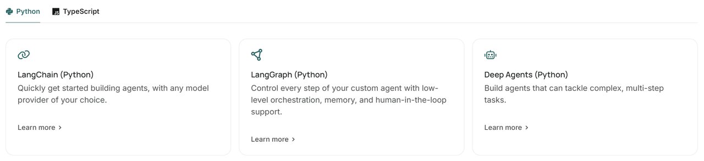
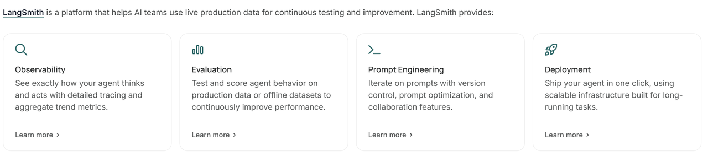

# 架构体系 (/docs/ai/langchain/basic)

LangChain 并不仅仅是一个框架，而是一整个智能体开发平台，包含很多不同的组件。

其中，包含一系列开源的智能体（Agent）开发框架，而且兼容 Python 和 TypeScript 两种语言：

**LangChain**：用于快速构建智能体，可兼容任何模型提供商
**LangGraph**：从底层一步步控制智能体的构建，包括记忆（Memory）、人机协同（HITL）等
**Deep Agents**：用于构建复杂的、处理多步骤的任务的智能体

另外，LangChain 还包含一套帮助人工智能团队利用实时生产数据进行**持续测试和改进**的平台，叫做 LangSmith：

## 什么是 Agent [#什么是-agent]

在人工智能领域，Agent是指一种能够**感知环境、进行推理、自主决策**并采取行动以实现特定目标的**智能系统**。

|特性|传统聊天机器人/LLM|AI Agent|
|--|--|--|
|交互模式|被动响应，问一句答一句|主动规划，以目标为导向|
|执行力|停留在文本生成层面|能操作软件、发送邮件、分析数据|
|自主性|需要人类给出详细步骤|只需给定最终目标，自主寻找路径|

> 如果说大模型（LLM）是“大脑”，那么 Agent 就是“拥有手脚和思维逻辑的独立个体”。它不再只是被动地回答问题，而是能主动拆解任务并调用各种工具来完成工作。

当然，Agent的模式也是在不断演进的：
\- **阶段一**：ReAct + Tool Calling
\- **阶段二**：Reflection + Long Memory
\- **阶段三**：Multi Agent System，MAS
