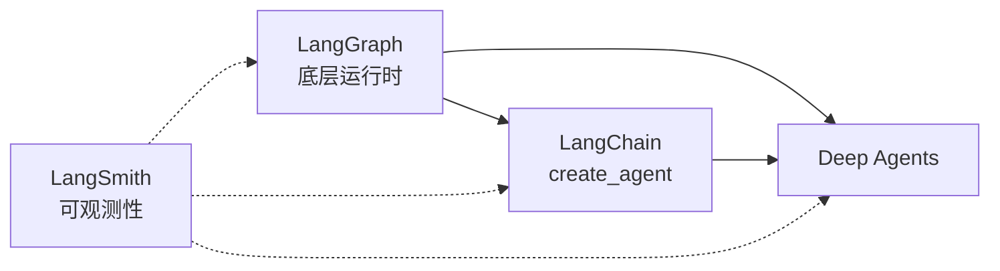
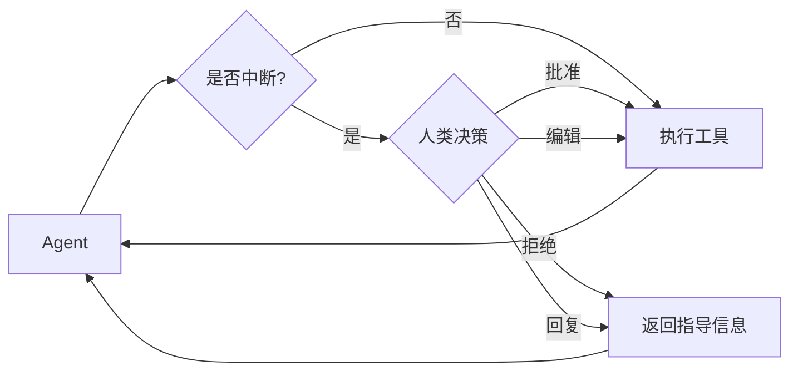

# Deep Agent (/docs/ai/langchain/deep_agent)

## 什么是 Deep Agents [#什么是-deep-agents]

Deep Agents 是 LangChain 生态中一个"**开箱即用**"（batteries-included）的 Agent Harness（智能体框架），能够构建处理**复杂多步骤任务**的智能体，内置了任务规划、虚拟文件系统、子智能体（subagent）派发、长期记忆等能力。

核心定位：**Agent = Model + Harness**。Harness 是模型循环之外的一切——prompt、工具、中间件。

> 官方推荐新需求**优先使用 Deep Agents**，除非你需要完全自定义的 Agent（此时用 `create_agent`）或混合确定性/智能体工作流（此时用 LangGraph）。

### 在 LangChain 生态中的位置 [#在-langchain-生态中的位置]

| 框架                           | 定位                                                             | 适用场景                         |
| ------------------------------ | ---------------------------------------------------------------- | -------------------------------- |
| **Deep Agents**                | 开箱即用的 Harness，内置子智能体、文件系统、上下文压缩、人机协同 | 快速搭建复杂多步骤任务           |
| **LangChain** (`create_agent`) | 高度可定制的 Harness，极简核心                                   | 需要完全自定义 Agent 行为        |
| **LangGraph**                  | 底层编排框架                                                     | 需要混合确定性与智能体工作流     |
| **LangSmith**                  | 可观测性平台                                                     | 追踪、调试、评估所有框架的 Agent |

### 各组件之间的关系 [#各组件之间的关系]



- **LangGraph** 是底层运行时，为上层提供持久化执行、流式处理等基础能力
- **LangChain (`create_agent`)** 在 LangGraph 之上构建 Tool Calling Harness
- **Deep Agents** 在 LangChain 之上构建，是最高层抽象，内置子智能体、文件系统等能力
- **LangSmith** 横向覆盖所有框架（虚线表示可观测，非依赖），提供追踪、调试、评估

## 核心能力总览 [#核心能力总览]

Deep Agents 提供六大内置能力：

| 能力                              | 说明                                               |
| --------------------------------- | -------------------------------------------------- |
| 执行环境（Execution Environment） | 工具调用、虚拟文件系统、可选沙箱、REPL/解释器      |
| 数据连接（Connect to Data）       | 按需加载记忆（Memory）、技能（Skills）和领域知识   |
| 上下文管理（Context Management）  | 自动压缩历史会话，卸载长运行时的大结果             |
| 任务委派（Delegation）            | 委派给通用或专用子智能体，在隔离的上下文窗口中运行 |
| 人机协同（Stay in the Loop）      | 在关键决策点暂停，等待人类审批                     |
| 自我改进（Improve over Time）     | 根据真实使用更新记忆、技能和提示                   |

## 快速入门 [#快速入门]

### 安装 [#安装]

```bash 
pip install deepagents
```

### 最小示例 [#最小示例]

```python 
from deepagents import create_deep_agent


def get_weather(city: str) -> str:
    """获取指定城市的天气"""
    return f"{city} 现在晴天，25°C"


# 创建 Agent
agent = create_deep_agent(
    model="anthropic:claude-sonnet-4-6",
    tools=[get_weather],
    system_prompt="你是一个有用的助手",
)

# 执行
agent.invoke(
    {"messages": [{"role": "user", "content": "北京天气怎么样？"}]}
)
```

`model` 参数使用 `provider:model` 格式，支持 Google、OpenAI、Anthropic、Ollama 等多种模型。

## 执行环境 [#执行环境]

执行环境是 Agent 执行操作的场所，包含四层：

### 工具与 MCP [#工具与-mcp]

通过 `tools=` 参数传入自定义函数、LangChain Tools 或任何 MCP Server 的工具。Deep Agents 完全支持 Model Context Protocol (MCP)。

```python 
from deepagents import create_deep_agent

agent = create_deep_agent(
    model="anthropic:claude-sonnet-4-6",
    tools=[search, fetch_page, run_query],
)
```

### 虚拟文件系统 [#虚拟文件系统]

Harness 提供可配置的虚拟文件系统，支持多种可插拔后端：

| 后端类型               | 说明            |
| ---------------------- | --------------- |
| `StateBackend`（默认） | 内存状态        |
| `FilesystemBackend`    | 本地磁盘        |
| `StoreBackend`         | LangGraph Store |
| `CompositeBackend`     | 路由组合        |
| 自定义后端             | 带权限规则      |

内置文件系统工具：

| 工具         | 说明                                                       |
| ------------ | ---------------------------------------------------------- |
| `ls`         | 列出目录文件（带元数据：大小、修改时间）                   |
| `read_file`  | 读取文件，支持行号、offset/limit（大文件），支持多模态内容 |
| `write_file` | 创建新文件或覆盖已有文件                                   |
| `edit_file`  | 精确字符串替换（支持全局替换模式）                         |
| `delete`     | 删除文件或递归删除目录                                     |
| `glob`       | 模式匹配查找文件（如 `**/*.py`）                           |
| `grep`       | 搜索文件内容，支持多种输出模式                             |
| `execute`    | 在沙箱中执行 Shell 命令                                    |

### 文件权限 [#文件权限]

支持**声明式权限规则**，控制 Agent 对文件/目录的读写访问：

```python 
from deepagents import create_deep_agent
from deepagents.permissions import FilesystemPermission

agent = create_deep_agent(
    model="anthropic:claude-sonnet-4-6",
    permissions=[
        # 允许读写工作区
        FilesystemPermission(operations=["read", "write"], paths=["/workspace/**"], mode="allow"),
        # 拒绝读写敏感文件
        FilesystemPermission(operations=["read", "write"], paths=[".env", "credentials/**"], mode="deny"),
    ],
)
```

规则从上到下求值，第一条匹配的规则生效（first-match-wins）。

### 代码执行 [#代码执行]

Deep Agents 支持两种代码执行方式：

| 方式                         | 适用场景                                                                     |
| ---------------------------- | ---------------------------------------------------------------------------- |
| 沙箱后端（Sandbox Backends） | 需要安装依赖、运行测试、调用 CLI、操作文件系统的完整环境                     |
| 解释器（Interpreters）       | 轻量级编程层——循环、批处理、确定性数据转换、程序化调用工具（QuickJS 运行时） |

### 流式输出 [#流式输出]

通过类型化事件流追踪 Agent 运行：

- `stream.messages` — 消息流
- `stream.tool_calls` — 工具调用流
- `stream.values` — 值流
- `stream.subagents` — 子智能体独立流

## 上下文管理 [#上下文管理]

### 技能（Skills） [#技能skills]

技能用于打包专用工作流、领域知识和自定义指令。每个技能遵循 [Agent Skills 标准](https://agentskills.io/)，存放在含 `SKILL.md` 文件的目录中。

Deep Agents 采用**"渐进式披露"**加载技能：启动时读取 `SKILL.md` 前置元数据，任务需要时才读取完整内容。

```python 
agent = create_deep_agent(
    model="anthropic:claude-sonnet-4-6",
    skills=["./skills/"],  # 技能目录路径
)
```

### 记忆（Memory） [#记忆memory]

记忆用于在对话间保持持久上下文——代码风格、偏好、约定、项目指南。

使用 `AGENTS.md` 文件，通过 `memory=` 参数传入：

```python 
agent = create_deep_agent(
    model="anthropic:claude-sonnet-4-6",
    memory=["./AGENTS.md"],
)
```

与技能（按需加载）不同，记忆文件在**启动时始终加载**，且 Agent 可根据交互更新记忆。

### 摘要与上下文卸载 [#摘要与上下文卸载]

Harness 管理上下文以支持长运行任务在 token 限内完成：

- **输入上下文**：系统提示、记忆、技能、工具提示
- **压缩**：自动卸载和摘要压缩对话历史和大型中间结果
- **隔离**：子智能体隔离繁重子任务，仅返回最终结果
- **长期记忆**：虚拟文件系统中的持久存储跨线程携带信息

### 提示缓存 [#提示缓存]

对 Anthropic 和 Amazon Bedrock 模型，`create_deep_agent` 默认启用提示缓存——系统提示的静态部分（基础指令、记忆、技能）在每次重复调用时复用，降低延迟和成本。

## 委派（Delegation） [#委派delegation]

### 任务规划 [#任务规划]

内置 `write_todos` 工具，让 Agent 在执行过程中维护结构化任务列表。支持状态跟踪（`pending`、`in_progress`、`completed`），持久化在 Agent state 中。

### 子智能体（Subagents） [#子智能体subagents]

内置 `task` 工具让主 Agent 创建临时子智能体处理隔离的子任务：

- **全新上下文**：每次调用创建新 Agent 实例，拥有独立上下文窗口
- **自主执行**：子智能体独立运行直到完成
- **单次交接**：向主 Agent 返回最终结果
- **可配置策略**：使用默认 `general-purpose` 子智能体或自定义
- **状态化消息**：子智能体是无状态的，不能发送多条消息回主 Agent

#### 为什么使用子智能体 [#为什么使用子智能体]

子智能体解决上下文膨胀问题。当工具返回大量输出（网页搜索、文件读取、数据库查询），子智能体隔离这些细节——主 Agent 只收到最终结果，而不是产生结果的所有中间工具调用。

**适用场景：**

- ✅ 多步骤任务会污染主 Agent 上下文
- ✅ 专用领域需要自定义指令或工具
- ✅ 任务需要不同模型能力
- ✅ 需要主 Agent 聚焦高层协调

**不适用场景：**

- ❌ 简单单步任务
- ❌ 需要维护中间上下文
- ❌ 开销大于收益时

#### 自定义子智能体 [#自定义子智能体]

```python 
from deepagents import create_deep_agent

research_subagent = {
    "name": "research-agent",
    "description": "用于深入调研问题",
    "system_prompt": "你是一个优秀的调研员",
    "tools": [internet_search],
    "model": "openai:gpt-5.5",  # 可选，覆盖默认模型
}

agent = create_deep_agent(
    model="google_genai:gemini-3.5-flash",
    subagents=[research_subagent],
)
```

自定义子智能体字段：

| 字段              | 类型                   | 说明                                       |
| ----------------- | ---------------------- | ------------------------------------------ |
| `name`            | `str`                  | 唯一标识，主 Agent 通过此名称调用 `task()` |
| `description`     | `str`                  | 子智能体功能描述（行动导向）               |
| `system_prompt`   | `str`                  | 自定义指令，不继承主 Agent                 |
| `tools`           | `list`                 | 子智能体可用工具（覆盖继承）               |
| `model`           | `str \| BaseChatModel` | 可选，覆盖主 Agent 模型                    |
| `middleware`      | `list`                 | 额外中间件                                 |
| `interrupt_on`    | `dict`                 | 人机协同配置                               |
| `skills`          | `list`                 | 技能路径                                   |
| `response_format` | `ResponseFormat`       | 结构化输出 schema                          |
| `permissions`     | `list`                 | 文件权限规则                               |

#### CompiledSubAgent [#compiledsubagent]

对于复杂工作流，可使用预编译的 LangGraph 图作为子智能体：

```python 
from deepagents import create_deep_agent, CompiledSubAgent
from langchain.agents import create_agent

custom_graph = create_agent(
    model=your_model,
    tools=specialized_tools,
    prompt="专用数据分析师...",
)

custom_subagent = CompiledSubAgent(
    name="data-analyzer",
    description="专用复杂数据分析 Agent",
    runnable=custom_graph,
)
```

#### 动态子智能体 [#动态子智能体]

当 Agent 同时拥有子智能体和解释器（Interpreter）时，可以从代码中调度子智能体——使用循环、分支和并行批处理将工作在多个项目上展开并综合结果。适用于：

- 批处理工作（审查目录中所有文件、分拣工单）
- 需要多角度分析
- 递归分析

## 人机协同（Human-in-the-Loop） [#人机协同human-in-the-loop]

通过 `interrupt_on` 参数配置敏感操作前的人类审批：

```python 
from langchain.tools import tool
from deepagents import create_deep_agent
from langgraph.checkpoint.memory import MemorySaver


@tool
def remove_file(path: str) -> str:
    """删除文件"""
    return f"已删除 {path}"


@tool
def notify_email(to: str, subject: str, body: str) -> str:
    """发送邮件"""
    return f"已发送邮件给 {to}"


# 人机协同需要 checkpointer！
checkpointer = MemorySaver()

agent = create_deep_agent(
    model="anthropic:claude-sonnet-4-6",
    tools=[remove_file, notify_email],
    interrupt_on={
        "remove_file": True,  # 默认：批准、编辑、拒绝、回复
        "notify_email": {"allowed_decisions": ["approve", "reject"]},  # 禁止编辑
    },
    checkpointer=checkpointer,  # 必须！
)
```

`interrupt_on` 的值可以是：

- `True` — 启用中断，默认行为（approve/edit/reject/respond 全允许）
- `False` — 禁用中断
- `InterruptOnConfig` — 自定义配置，通过 `allowed_decisions` 控制审批选项

> **注意**：人机协同**必须**配置 `checkpointer`，常用 `MemorySaver`（开发）或 `SqliteSaver`（生产）。

决策流程：



## create_deep_agent 主要参数 [#create_deep_agent-主要参数]

| 参数              | 说明                                        |
| ----------------- | ------------------------------------------- |
| `model`           | 模型名称（`provider:model` 格式）或模型实例 |
| `system_prompt`   | 自定义 Agent 指令                           |
| `tools`           | 自定义工具列表                              |
| `memory`          | AGENTS.md 文件路径列表                      |
| `skills`          | 技能目录路径列表                            |
| `backend`         | 文件系统后端                                |
| `permissions`     | 文件系统路径级访问控制                      |
| `subagents`       | 自定义子智能体列表                          |
| `middleware`      | 额外中间件                                  |
| `interrupt_on`    | 人机协同配置                                |
| `response_format` | 结构化输出 schema                           |
| `state_schema`    | 自定义图 state schema                       |
| `context_schema`  | 运行时上下文 schema（用户 ID、API Key 等）  |
| `checkpointer`    | 检查点保存器（持久化/人机协同必需）         |
| `store`           | LangGraph Store                             |

## 默认中间件栈 [#默认中间件栈]

Deep Agents 默认启用一组中间件，按顺序执行。常见中间件包括：

- `FilesystemMiddleware` — 文件系统操作和上下文
- `SubAgentMiddleware` — 子智能体调度（`task` 工具）
- `SkillsMiddleware` — 技能加载
- `SummarizationMiddleware` — 上下文压缩/摘要
- `MemoryMiddleware` — 记忆加载
- `PatchToolCallsMiddleware` — 工具调用修补
- `HumanInTheLoopMiddleware` — 人机协同（配置 `interrupt_on` 时添加）

可通过 `excluded_middleware` 排除不需要的中间件（注意：`FilesystemMiddleware` 和 `SubAgentMiddleware` 是必需的脚手架，不可通过此方式删除）。

## 与 LangGraph 的关系 [#与-langgraph-的关系]

Deep Agents 构建在 LangChain 核心构建块之上，使用 **LangGraph 运行时**实现：

- **持久化执行**：通过 Checkpointer 保存/恢复状态
- **流式输出**：实时追踪 Agent 执行
- **人机协同**：通过 LangGraph Interrupt 实现
- **丰富生态**：兼容所有 LangGraph Store/Checkpointer

因此 Deep Agents 是一个**高层抽象**——它在 LangGraph 之上提供了生产就绪的 Harness。

## 生产部署 [#生产部署]

对于生产环境，建议配合 [LangSmith](https://smith.langchain.com) 进行：

- 请求追踪
- Agent 行为调试
- 输出评估

参见 [Going to production](https://docs.langchain.com/oss/python/deepagents/going-to-production)。

## 相关资源 [#相关资源]

- [Deep Agents 官方文档](https://docs.langchain.com/oss/python/deepagents/overview)
- [Deep Agents API Reference](https://reference.langchain.com/python/deepagents/)
- [Deep Agents GitHub](https://github.com/langchain-ai/deepagents)
- [LangChain Agents 文档](https://docs.langchain.com/oss/python/langchain/agents)
- [LangGraph 文档](https://docs.langchain.com/oss/python/langgraph/overview)
- [LangSmith 可观测性](https://docs.langchain.com/langsmith/observability)
