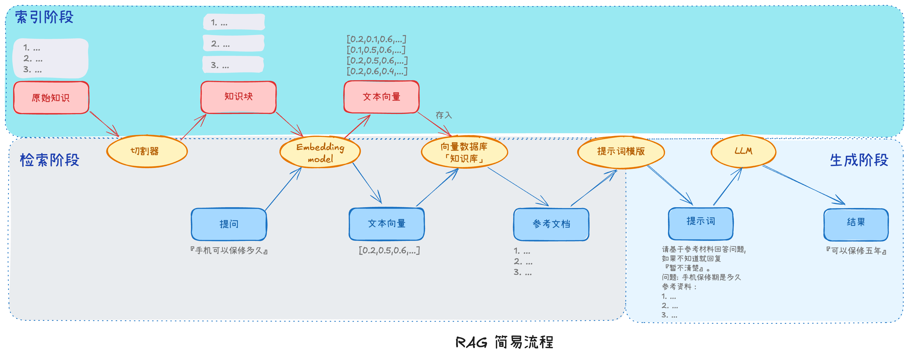
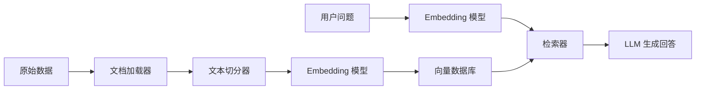
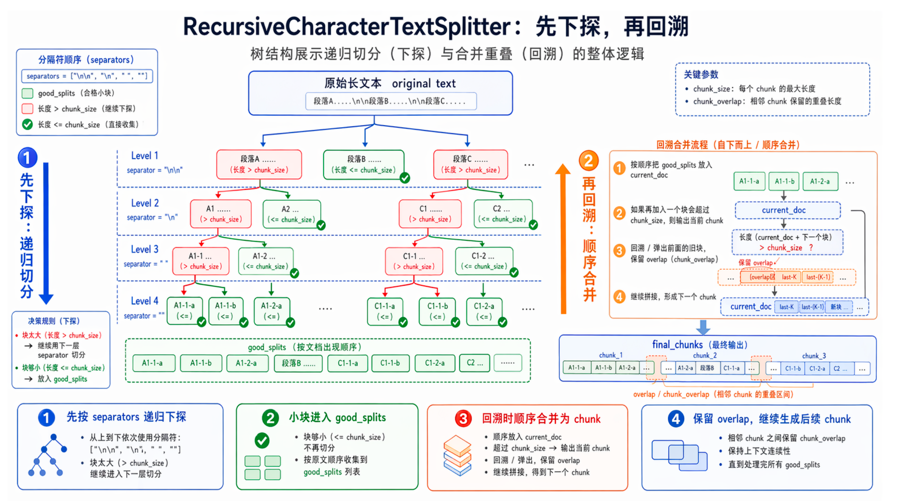
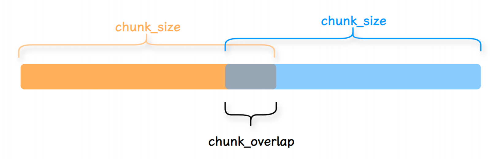
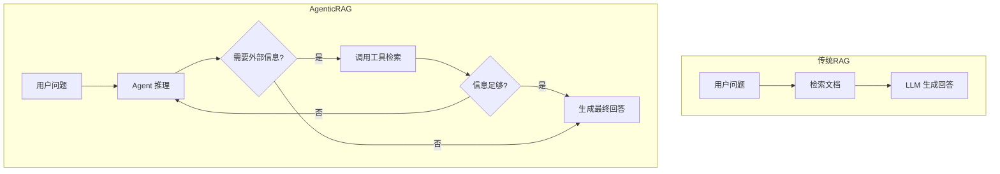

# RAG (/docs/ai/langchain/rag)

## 什么是 RAG [#什么是-rag]

RAG（Retrieval-Augmented Generation，检索增强生成）是一种将**外部知识检索**与**大语言模型生成**相结合的技术。核心思想是：在 LLM 生成回答之前，先从外部知识库中检索相关信息，然后将检索结果作为上下文提供给模型，从而生成更准确、更有依据的回答。

简单来说，RAG 就是让模型"先查资料，再回答问题"。

## 为什么需要 RAG [#为什么需要-rag]

大语言模型存在一些固有的局限性，RAG 可以有效缓解这些问题：

| 问题               | 说明                                       | RAG 如何解决                 |
| ------------------ | ------------------------------------------ | ---------------------------- |
| **知识截止**       | 模型训练数据有时间截止点，无法获知最新信息 | 通过检索实时获取最新知识     |
| **幻觉问题**       | 模型可能"编造"不存在的事实                 | 基于检索到的真实文档生成回答 |
| **领域知识不足**   | 通用模型对专业领域知识覆盖有限             | 接入专业领域的知识库         |
| **上下文长度限制** | 无法将所有相关资料一次性输入模型           | 检索最相关的片段，精准投喂   |
| **无法引用来源**   | 回答缺乏可追溯性                           | 基于检索文档回答，可溯源     |


<Callout type="success" title="提示">

**幻觉问题的严重性**：
&#8195;&#8195;大模型生成内容的不可控，尤其是在**金融**和**医疗领域**等领域，<mark>一次金额评估的错误，一次医疗诊断的失误，哪怕只出现一次都是致命的</mark>。 但对于非专业人士来说可能难以辨识。目前还没有能够百分之百解决这种情况的方案。

**幻觉产生的原因**：

- 训练知识存在偏差，这些错误信息被 LLM 学习后在输出中复现
- LLM 训练时过度泛化，将普通的模式应用在特定场合导致不准确输出
- LLM 本身没有真正学习到训练数据中深层次的含义，导致在一些需要深入理解或复杂推理的任务中出错
- LLM缺乏某些领域的相关知识，在面临这些领域的相关问题时编造不存在的信息

</Callout>


## RAG 优缺点 [#rag-优缺点]

**RAG的优点**：
1）相比提示词工程，RAG有更丰富的上下文和数据样本，可以不需要用户提供过多的背景描述，就能生成比较符合用户预期的答案。
2）相比于模型微调，RAG可以提升问答内容的时效性和可靠性
3）在一定程度上保护了业务数据的隐私性。

**RAG的缺点**：
1）由于每次问答都涉及外部系统数据检索，因此RAG的响应时延相对较高。
2）引用的外部知识数据会消耗大量的模型Token资源。

## 基本架构 [#基本架构]

（1）**索引（Indexing）**
&#8195;&#8195;将外部的知识源（如 PDF 文档、数据库、网页）切分成若干片段（chunks），通过嵌入模型（embedding model）将这些片段转换成向量，存入向量数据库（如 Faiss、Pinecone、Milvus）中，构建可快速搜索的索引。
（2）**检索（Retrieval）**
&#8195;&#8195;当用户提出问题时，首先用相同的嵌入模型将问题转为查询向量，在向量数据库中进行**相似性搜索**，找出与问题语义最相关的前 K 个文档片段。
（3）**增强（Augmentation）**
&#8195;&#8195;把检索到的相关片段与用户的原始问题拼接成一个提示模板（prompt），通常格式为：

```text 
请基于以下参考资料回答用户问题。
参考资料：{检索结果}
问题：{用户问题}
```

（4）**生成（Generation）**
&#8195;&#8195;将组装好的提示送入大语言模型，模型结合外部知识和自身能力生成最终答案。同时，答案可以附带引用来源链接，增强可信度。



## RAG 的典型应用场景 [#rag-的典型应用场景]

| 场景           | 说明                                                 |
| -------------- | ---------------------------------------------------- |
| 企业知识库问答 | 基于公司内部文档、规章制度、产品手册回答员工问题     |
| 客服系统       | 实时从产品文档或历史工单中检索信息，生成个性化回复   |
| 多轮对话助手   | 结合对话历史和外部检索，提供持续且准确的帮助         |
| 科学研究辅助   | 从论文库中检索相关文献，辅助研究者快速获取摘要与结论 |
| 个人知识管理   | 与笔记工具结合，在私人笔记中搜索并生成答案           |

## RAG 核心组件 [#rag-核心组件]

RAG 系统由以下核心组件构成，每个组件都有对应的 LangChain 实现：



### 文档加载器（Document Loaders） [#文档加载器document-loaders]

文档加载器负责从各种数据源读取数据，并将其转换为统一的 `Document` 对象。每个 `Document` 包含两个核心字段：

- `page_content`：文档的文本内容
- `metadata`：元数据（来源、页码等）

```python 
from langchain_core.documents import Document

# Document 的基本结构
doc = Document(
    page_content="这是文档的正文内容",
    metadata={"source": "example.txt", "page": 1}
)
```

#### 常用文档加载器 [#常用文档加载器]

LangChain 提供了丰富的文档加载器，覆盖文件、网页、数据库等多种数据源：

**文件类加载器：**

| 加载器               | 用途                         | 安装包                |
| -------------------- | ---------------------------- | --------------------- |
| `TextLoader`         | 纯文本文件（.txt）           | `langchain-community` |
| `CSVLoader`          | CSV 文件                     | `langchain-community` |
| `PyPDFLoader`        | PDF 文件                     | `pypdf`               |
| `UnstructuredLoader` | 多种格式（PDF/Word/HTML 等） | `unstructured`        |
| `JSONLoader`         | JSON 文件                    | `langchain-community` |
| `DirectoryLoader`    | 批量加载目录下所有文件       | `langchain-community` |
| `MarkdownLoader`     | Markdown 文件                | `unstructured`        |

**网页类加载器：**

| 加载器            | 用途         | 安装包           |
| ----------------- | ------------ | ---------------- |
| `WebBaseLoader`   | 网页内容     | `beautifulsoup4` |
| `SitemapLoader`   | 网站 Sitemap | `beautifulsoup4` |
| `FireCrawlLoader` | 动态渲染网页 | `firecrawl-py`   |

**其他常用加载器：**

| 加载器                  | 用途         | 安装包                |
| ----------------------- | ------------ | --------------------- |
| `NotionDirectoryLoader` | Notion 导出  | `langchain-community` |
| `GitLoader`             | Git 仓库文件 | `langchain-community` |
| `WikipediaLoader`       | 维基百科     | `langchain-community` |
| `ArxivLoader`           | arXiv 论文   | `langchain-community` |

#### 文档加载器使用示例 [#文档加载器使用示例]


<Tabs items={["文本(txt)文件", "CSV文件", "JSON文件", "Word文件", "Markdown文件", "HTML文件", "PDF文件", "网页内容"]}>
<Tab value="文本(txt)文件">

```python 
from langchain_community.document_loaders import TextLoader

loader = TextLoader(
    file_path="example.txt",
    encoding="utf-8",        # 文件编码
    autodetect_encoding=False, # 是否自动检测编码
)
docs = loader.load()
print(docs[0].page_content)
```

**参数说明：**

| 参数                  | 类型   | 默认值    | 说明                                        |
| --------------------- | ------ | --------- | ------------------------------------------- |
| `file_path`           | `str`  | 必填      | 文件路径                                    |
| `encoding`            | `str`  | `"utf-8"` | 文件编码，中文文件常用 `"utf-8"` 或 `"gbk"` |
| `autodetect_encoding` | `bool` | `False`   | 是否自动检测文件编码（需要 `chardet` 包）   |

</Tab>
<Tab value="CSV文件">

```python 
from langchain_community.document_loaders import CSVLoader

loader = CSVLoader(
    file_path="./example.csv",
    encoding="utf-8",          # 文件编码
    source_column=None,        # 指定哪一列作为文档来源（写入 metadata）
    csv_args=None,             # 传递给 csv.reader 的参数
)
docs = loader.load()
print(docs[0].page_content)
```

**参数说明：**

| 参数            | 类型       | 默认值    | 说明                                                |
| --------------- | ---------- | --------- | --------------------------------------------------- |
| `file_path`     | `str`      | 必填      | CSV 文件路径                                        |
| `encoding`      | `str`      | `"utf-8"` | 文件编码                                            |
| `source_column` | `str`      | `None`    | 指定某列作为 `metadata["source"]`，默认使用文件路径 |
| `csv_args`      | `dict`     | `None`    | 传递给 `csv.reader` 的参数，如 `{"delimiter": ","}` |
| `metadata_func` | `Callable` | `None`    | 自定义函数，从每行数据中提取元数据                  |

</Tab>
<Tab value="JSON文件">

```python 
from langchain_community.document_loaders import JSONLoader

loader = JSONLoader(
    file_path="data.json",
    jq_schema=".content",       # 使用 jq 语法提取目标字段
    text_content=False,          # True 时将内容视为纯文本
    json_lines=False,            # True 时按 JSON Lines 格式解析（每行一个 JSON）
)
docs = loader.load()
print(docs[0].page_content)
```

**参数说明：**

| 参数            | 类型       | 默认值  | 说明                                                       |
| --------------- | ---------- | ------- | ---------------------------------------------------------- |
| `file_path`     | `str`      | 必填    | JSON 文件路径                                              |
| `jq_schema`     | `str`      | 必填    | jq 查询表达式，用于提取 JSON 中的目标字段                  |
| `content_key`   | `str`      | `None`  | 指定哪个字段作为 `page_content`，默认使用 jq_schema 的结果 |
| `text_content`  | `bool`     | `True`  | 是否将提取内容视为纯文本（`False` 时保留结构化数据）       |
| `json_lines`    | `bool`     | `False` | 是否按 JSON Lines 格式解析（每行一个独立的 JSON 对象）     |
| `metadata_func` | `Callable` | `None`  | 自定义函数，从原始 JSON 对象中提取元数据                   |

</Tab>
<Tab value="Word文件">

```python 
# 方式一：使用 Unstructured（支持 .doc 和 .docx）
from langchain_community.document_loaders import UnstructuredWordDocumentLoader

loader = UnstructuredWordDocumentLoader(
    file_path="document.docx",
    mode="single",       # "single" 整篇为一个 Document | "elements" 按元素拆分
    strategy="fast",     # "fast" 快速解析 | "hi_res" 高精度（需要额外模型）
)
docs = loader.load()
print(docs[0].page_content)

# 方式二：使用 docx2txt（仅支持 .docx，更轻量）
from langchain_community.document_loaders import Docx2txtLoader

loader = Docx2txtLoader("document.docx")
docs = loader.load()
print(docs[0].page_content)
```

**UnstructuredWordDocumentLoader 参数说明：**

| 参数        | 类型  | 默认值     | 说明                                                                   |
| ----------- | ----- | ---------- | ---------------------------------------------------------------------- |
| `file_path` | `str` | 必填       | Word 文件路径                                                          |
| `mode`      | `str` | `"single"` | `"single"` 整篇合并为一个 Document；`"elements"` 按段落/标题等元素拆分 |
| `strategy`  | `str` | `"fast"`   | 解析策略：`"fast"` 快速解析，`"hi_res"` 高精度（需安装额外模型）       |

> 需要安装：`pip install unstructured python-docx`（UnstructuredWordDocumentLoader）或 `pip install docx2txt`（Docx2txtLoader）

</Tab>
<Tab value="Markdown文件">

```python 
from langchain_community.document_loaders import UnstructuredMarkdownLoader

loader = UnstructuredMarkdownLoader(
    file_path="README.md",
    mode="single",       # "single" 整篇为一个 Document | "elements" 按标题/段落拆分
)
docs = loader.load()
print(docs[0].page_content)
```

**参数说明：**

| 参数        | 类型  | 默认值     | 说明                                                                            |
| ----------- | ----- | ---------- | ------------------------------------------------------------------------------- |
| `file_path` | `str` | 必填       | Markdown 文件路径                                                               |
| `mode`      | `str` | `"single"` | `"single"` 整篇合并为一个 Document；`"elements"` 按标题、段落、代码块等元素拆分 |

> 需要安装：`pip install unstructured`

</Tab>
<Tab value="HTML文件">

```python 
from langchain_community.document_loaders import BSHTMLLoader

loader = BSHTMLLoader(
    file_path="page.html",
    open_encoding="utf-8",           # 文件编码
    bs_kwargs={"features": "html.parser"},  # BeautifulSoup 解析器参数
)
docs = loader.load()
print(docs[0].page_content)

# 如果需要更精细的控制，可以使用 WebBaseLoader
from langchain_community.document_loaders import WebBaseLoader

loader = WebBaseLoader(
    file_path="page.html",
    bs_kwargs={"parse_only": None},  # None 表示解析全部内容
)
docs = loader.load()
```

**BSHTMLLoader 参数说明：**

| 参数            | 类型   | 默认值 | 说明                                                          |
| --------------- | ------ | ------ | ------------------------------------------------------------- |
| `file_path`     | `str`  | 必填   | HTML 文件路径（本地文件）                                     |
| `open_encoding` | `str`  | `None` | 文件编码，如 `"utf-8"`、`"gbk"`                               |
| `bs_kwargs`     | `dict` | `None` | 传递给 BeautifulSoup 的参数，如 `{"features": "html.parser"}` |

> 需要安装：`pip install beautifulsoup4`

</Tab>
<Tab value="PDF文件">

```python 
from langchain_community.document_loaders import PyPDFLoader

loader = PyPDFLoader(
    file_path="document.pdf",
    password=None,             # PDF 密码（加密 PDF 时使用）
    extract_images=False,      # 是否提取图片中的文本（需要 pytesseract）
)
docs = loader.load()  # 每页一个 Document
print(f"共 {len(docs)} 页")
print(docs[0].page_content)  # 第一页内容
```

**参数说明：**

| 参数             | 类型   | 默认值  | 说明                                            |
| ---------------- | ------ | ------- | ----------------------------------------------- |
| `file_path`      | `str`  | 必填    | PDF 文件路径（也支持 URL）                      |
| `password`       | `str`  | `None`  | PDF 密码，用于加密文件                          |
| `extract_images` | `bool` | `False` | 是否提取 PDF 中图片的文字（需要 `pytesseract`） |

> 需要安装：`pip install pypdf`

</Tab>
<Tab value="网页内容">

```python 
from langchain_community.document_loaders import WebBaseLoader

loader = WebBaseLoader(
    web_paths=["https://example.com/article"],  # 支持单个 URL 或 URL 列表
    bs_kwargs=None,          # BeautifulSoup 参数，用于过滤提取内容
    requests_kwargs=None,    # requests 参数，如 headers、proxies
)
docs = loader.load()
print(docs[0].page_content)
```

**参数说明：**

| 参数               | 类型        | 默认值  | 说明                                                                    |
| ------------------ | ----------- | ------- | ----------------------------------------------------------------------- |
| `web_paths`        | `list[str]` | 必填    | 网页 URL 列表，支持同时加载多个页面                                     |
| `bs_kwargs`        | `dict`      | `None`  | 传递给 BeautifulSoup 的参数，可用 `SoupStrainer` 只提取部分内容         |
| `requests_kwargs`  | `dict`      | `None`  | 传递给 `requests.get` 的参数，如 `{"headers": {...}, "proxies": {...}}` |
| `raise_for_status` | `bool`      | `False` | 请求失败时是否抛出异常                                                  |

> 需要安装：`pip install beautifulsoup4`

</Tab>
</Tabs>


**批量加载目录文件：**

```python 
from langchain_community.document_loaders import DirectoryLoader, TextLoader

loader = DirectoryLoader(
    path="./docs",                    # 目录路径
    glob="**/*.md",                   # glob 模式匹配文件
    loader_cls=TextLoader,            # 指定文件加载器类
    loader_kwargs={"encoding": "utf-8"},  # 传递给加载器的参数
    show_progress=True,               # 显示加载进度条
    use_multithreading=True,          # 多线程加载
    max_concurrency=4,                # 最大并发数
    silent_errors=True,               # 跳过加载失败的文件（不抛异常）
)
docs = loader.load()
print(f"共加载 {len(docs)} 个文件")
```

**DirectoryLoader 参数说明：**

| 参数                 | 类型        | 默认值       | 说明                                             |
| -------------------- | ----------- | ------------ | ------------------------------------------------ |
| `path`               | `str`       | 必填         | 目录路径                                         |
| `glob`               | `str`       | `"**/[!.]*"` | glob 模式匹配文件，如 `"**/*.pdf"`、`"*.txt"`    |
| `loader_cls`         | `Loader`    | `TextLoader` | 指定文件加载器类，如 `TextLoader`、`PyPDFLoader` |
| `loader_kwargs`      | `dict`      | `{}`         | 传递给加载器的额外参数                           |
| `show_progress`      | `bool`      | `False`      | 是否显示进度条（需要 `tqdm`）                    |
| `use_multithreading` | `bool`      | `False`      | 是否使用多线程并行加载                           |
| `max_concurrency`    | `int`       | `10`         | 最大并发加载数                                   |
| `silent_errors`      | `bool`      | `False`      | 遇到加载错误时是否跳过（`True` 时不抛异常）      |
| `exclude`            | `list[str]` | `[]`         | 排除的文件模式列表，如 `["*.tmp"]`               |

**手动实现简易加载器：**

如果不想安装额外依赖，也可以手动实现：

```python 
import pypdf
from langchain_core.documents import Document


def load_pdf_pages(file_path: str) -> list[Document]:
    reader = pypdf.PdfReader(file_path)
    return [
        Document(
            page_content=page.extract_text() or "",
            metadata={"source": file_path, "page": i},
        )
        for i, page in enumerate(reader.pages)
    ]

docs = load_pdf_pages("document.pdf")
```

### 文本切分器（Text Splitters） [#文本切分器text-splitters]

文档加载后，往往需要切分成更小的片段（chunks）。原因：

- **模型上下文窗口有限**：过长的文本无法放入上下文
- **检索精度**：较小的片段更容易匹配到相关内容
- **避免信息稀释**：大段文本中关键信息可能被"淹没"

#### 切分策略总览 [#切分策略总览]

LangChain 提供了多种文本切分器，按照切分方式可以分为**三大类**。对于大多数场景，建议从 `RecursiveCharacterTextSplitter` 开始，这是官方推荐的默认选择：

| 类别             | 核心思路                                                       | 包含的切分器                                                                       | 适用场景                      |
| ---------------- | -------------------------------------------------------------- | ---------------------------------------------------------------------------------- | ----------------------------- |
| **基于文本结构** | 利用文本天然的层级结构（段落→句子→单词）递归切分，保持语义连贯 | `RecursiveCharacterTextSplitter`                                                   | **通用文本（推荐默认选择）**  |
| **基于长度**     | 按照字符数或 Token 数量硬性切分                                | `CharacterTextSplitter`、`TokenTextSplitter`                                       | 需要精确控制大小时            |
| **基于文档结构** | 按照文档的格式结构（标题、标签等）切分，保留逻辑组织           | `MarkdownTextSplitter`、`HTMLSectionSplitter`、`RecursiveJsonSplitter`、代码切分器 | Markdown / HTML / JSON / 代码 |
| **基于语义内容** | 利用 Embedding 模型，根据语义相似度找到自然的话题断点          | `SemanticChunker`（实验性）                                                        | 对语义连贯性要求高的场景      |

> `pip install -U langchain-text-splitters` 安装后可使用前三大类切分器。

---

#### 基于文本结构（Text structure-based） [#基于文本结构text-structure-based]

文本天然具有层级结构（段落→句子→单词）。`RecursiveCharacterTextSplitter` 会**从高层到低层递归尝试切分**，尽量保持较大的文本单元不被破坏：

1. 先尝试按 `\n\n`（段落）切分
2. 如果段落仍然过大，按 `\n`（行）切分
3. 如果仍然过大，按 ` `（空格）切分
4. 最后按字符切分



```python 
from langchain_text_splitters import RecursiveCharacterTextSplitter

text_splitter = RecursiveCharacterTextSplitter(
    chunk_size=1000,            # 每个片段的最大字符数
    chunk_overlap=200,          # 相邻片段的重叠字符数（保持上下文连贯）
    length_function=len,        # 长度计算函数（默认按字符数）
    is_separator_regex=False,   # 分隔符是否为正则表达式
    add_start_index=True,       # 在元数据中记录片段在原文的起始位置
)

# 切分 Document 对象
splits = text_splitter.split_documents(docs)
print(f"切分为 {len(splits)} 个片段")

# 也可以直接切分纯文本字符串
chunks = text_splitter.split_text("一段很长的文本...")
```

**参数说明：**

| 参数                 | 类型        | 默认值                          | 说明                                       |
| -------------------- | ----------- | ------------------------------- | ------------------------------------------ |
| `chunk_size`         | `int`       | `4000`                          | 每个片段的最大字符数                       |
| `chunk_overlap`      | `int`       | `200`                           | 相邻片段的重叠字符数，防止跨片段的信息丢失 |
| `length_function`    | `Callable`  | `len`                           | 长度计算函数，可替换为 Token 计数函数      |
| `separators`         | `list[str]` | `["\n\n", "\n", ". ", " ", ""]` | 自定义分隔符列表（按优先级排列）           |
| `is_separator_regex` | `bool`      | `False`                         | 分隔符是否作为正则表达式解析               |
| `add_start_index`    | `bool`      | `False`                         | 是否在 metadata 中记录 `start_index`       |
| `strip_whitespace`   | `bool`      | `True`                          | 是否去除片段首尾空白                       |

---

#### 基于长度（Length-based） [#基于长度length-based]

按照固定的长度（字符数或 Token 数）硬性切分，实现简单且片段大小一致。


<Tabs items={["基于 Token 切分（tiktoken）", "基于字符切分"]}>
<Tab value="基于 Token 切分（tiktoken）">

使用 `tiktoken` 编码器按 Token 数量切分，适合需要对齐模型 Token 限制的场景：

```python 
from langchain_text_splitters import CharacterTextSplitter

text_splitter = CharacterTextSplitter.from_tiktoken_encoder(
    encoding_name="cl100k_base",  # 编码器（cl100k_base 适配 GPT-4/3.5）
    chunk_size=250,               # 最大 Token 数
    chunk_overlap=50,             # 重叠 Token 数
)
splits = text_splitter.split_documents(docs)
```

**参数说明：**

| 参数                 | 类型                | 默认值   | 说明                                                                                            |
| -------------------- | ------------------- | -------- | ----------------------------------------------------------------------------------------------- |
| `encoding_name`      | `str`               | `"gpt2"` | tiktoken 编码器名称：`"cl100k_base"`（GPT-4）、`"p50k_base"`（GPT-3.5）、`"r50k_base"`（GPT-3） |
| `model_name`         | `str`               | `None`   | 直接指定模型名（与 `encoding_name` 二选一）                                                     |
| `chunk_size`         | `int`               | `4000`   | 最大 Token 数                                                                                   |
| `chunk_overlap`      | `int`               | `200`    | 重叠 Token 数                                                                                   |
| `allowed_special`    | `set[str]` \| `str` | `set()`  | 允许的特殊 Token                                                                                |
| `disallowed_special` | `set[str]` \| `str` | `"all"`  | 禁止的特殊 Token                                                                                |

</Tab>
<Tab value="基于字符切分">

```python 
from langchain_text_splitters import CharacterTextSplitter

text_splitter = CharacterTextSplitter(
    separator="\n\n",       # 分隔符（必须指定）
    chunk_size=1000,        # 最大字符数
    chunk_overlap=200,      # 重叠字符数
    length_function=len,    # 长度计算函数
    is_separator_regex=False, # 分隔符是否正则
    strip_whitespace=True,   # 去除首尾空白
)
splits = text_splitter.split_documents(docs)
```

**参数说明：**

| 参数                 | 类型       | 默认值  | 说明                               |
| -------------------- | ---------- | ------- | ---------------------------------- |
| `separator`          | `str`      | 必填    | 分隔符，如 `"\n\n"`、`"。"`、`","` |
| `chunk_size`         | `int`      | `4000`  | 最大字符数                         |
| `chunk_overlap`      | `int`      | `200`   | 重叠字符数                         |
| `length_function`    | `Callable` | `len`   | 长度计算函数                       |
| `is_separator_regex` | `bool`     | `False` | 分隔符是否作为正则表达式           |
| `strip_whitespace`   | `bool`     | `True`  | 是否去除片段首尾空白               |

</Tab>
</Tabs>


---

#### 基于文档结构（Document structure-based） [#基于文档结构document-structure-based]

对于有固定格式的文档，按结构切分可以保留文档的逻辑组织，让每个片段在语义上更内聚。


<Tabs items={["Markdown 文档切分", "HTML 文档切分", "JSON 文档切分", "代码文档切分"]}>
<Tab value="Markdown 文档切分">

按 Markdown 标题（`#`、`##`、`###`）层级切分，每个片段包含一个标题下的完整内容：

```python 
from langchain_text_splitters import MarkdownTextSplitter

splitter = MarkdownTextSplitter(
    chunk_size=1000,       # 最大字符数
    chunk_overlap=100,     # 重叠字符数
)
splits = splitter.split_documents(markdown_docs)
```

也可以更精细地使用 `MarkdownHeaderTextSplitter`，按指定标题层级切分并将标题信息写入 metadata：

```python 
from langchain_text_splitters import MarkdownHeaderTextSplitter

headers_to_split_on = [
    ("#", "一级标题"),
    ("##", "二级标题"),
    ("###", "三级标题"),
]

splitter = MarkdownHeaderTextSplitter(
    headers_to_split_on=headers_to_split_on,
    strip_headers=False,        # 是否在内容中保留标题行
    return_each_line=False,     # False 返回合并后的段落，True 每行一个片段
)
splits = splitter.split_text(markdown_text)
```

</Tab>
<Tab value="HTML 文档切分">

按 HTML 标签切分，可选择只提取特定标签的内容：

```python 
from langchain_text_splitters import HTMLSectionSplitter

headers_to_split_on = [
    ("h1", "Header 1"),
    ("h2", "Header 2"),
]

splitter = HTMLSectionSplitter(
    headers_to_split_on=headers_to_split_on,  # 按标题层级切分
)
splits = splitter.split_text(html_content)
```

也可以使用 `HTMLHeaderTextSplitter` 结合 BeautifulSoup 实现类似 Markdown 的按标题切分。

</Tab>
<Tab value="JSON 文档切分">

按 JSON 结构递归切分，遇到数组或嵌套对象时会深入拆分：

```python 
from langchain_text_splitters import RecursiveJsonSplitter

splitter = RecursiveJsonSplitter(
    max_chunk_size=300,     # 最大字符数
    min_chunk_size=None,    # 最小字符数
)
# 切分 JSON 数据
chunks = splitter.split_json(json_data=data)
# 或切分 JSON 文件中的 Document
docs = splitter.create_documents(texts=[json_string])
```

</Tab>
<Tab value="代码文档切分">

按代码的逻辑结构（函数、类、方法）切分，支持多种编程语言：

```python 
from langchain_text_splitters import Language, RecursiveCharacterTextSplitter

# 支持的语言：Python、Java、JavaScript、Go、Rust、C++ 等
splitter = RecursiveCharacterTextSplitter.from_language(
    language=Language.PYTHON,
    chunk_size=1000,
    chunk_overlap=100,
)
splits = splitter.split_text(python_code)

# 查看支持的语言
# print(list(Language))
```

</Tab>
</Tabs>


---

#### 基于语义内容（Semantic，实验性） [#基于语义内容semantic实验性]

除了上述三类，LangChain 还提供了一种**基于语义的切分方式**。它使用 Embedding 模型计算句子之间的相似度，在语义发生"跳跃"的位置进行切分，使每个片段在语义上更内聚。

默认使用 `SentenceTransformersEmbedding`，也可以在 `langchain_experimental` 中使用更灵活的 `SemanticChunker`：

```python 
# 安装：pip install langchain-experimental
from langchain_experimental.text_splitter import SemanticChunker
from langchain_openai import OpenAIEmbeddings

embeddings = OpenAIEmbeddings(model="text-embedding-3-small")

splitter = SemanticChunker(
    embeddings=embeddings,
    breakpoint_threshold_type="percentile",   # 断点阈值类型
    breakpoint_threshold_amount=95,            # 百分位阈值（百分位类型时使用）
    number_of_chunks=None,                    # 手动指定切分数量
    min_chunk_size=None,                      # 最小片段字符数
)
splits = splitter.create_documents([long_text])
```

**`breakpoint_threshold_type` 参数说明：**

| 类型                   | 说明                                                            |
| ---------------------- | --------------------------------------------------------------- |
| `"percentile"`         | 相邻句子相似度差异超过该百分位时切断（默认 95，值越大片段越多） |
| `"standard_deviation"` | 差异超过 N 个标准差时切断                                       |
| `"interquartile"`      | 差异超过 IQR 时切断                                             |
| `"gradient"`           | 基于相似度梯度的变化率切断                                      |

> **注意：** `SemanticChunker` 在 `langchain_experimental` 中，属于实验性功能。它需要调用 Embedding 模型，速度较慢且有一定成本，但在对语义连贯性要求高的场景（如长文档问答）效果显著优于规则切分。

---

#### 切分参数调优建议 [#切分参数调优建议]

| 参数              | 建议值                | 说明                             |
| ----------------- | --------------------- | -------------------------------- |
| `chunk_size`      | 500 - 1500            | 太小丢失上下文，太大降低检索精度 |
| `chunk_overlap`   | chunk_size 的 10%-20% | 确保跨片段信息不丢失             |
| `add_start_index` | `True`                | 方便定位片段在原文中的位置       |



### Embedding 模型（文本嵌入） [#embedding-模型文本嵌入]

Embedding 模型将文本转换为固定维度的数值向量，使得语义相近的文本在向量空间中距离更近。这是实现**语义检索**的基础。

#### 工作原理 [#工作原理]

1. **向量化** — 模型将每个输入字符串编码为一个高维向量（如 1536 维浮点数组）
2. **相似度计算** — 通过数学度量比较向量间的距离，判断语义的相关性

**常用相似度度量：**

| 度量方式       | 说明                                           | 适用场景                          |
| -------------- | ---------------------------------------------- | --------------------------------- |
| **余弦相似度** | 测量两个向量的夹角（-1 到 1，越接近 1 越相似） | **最常用**，适合绝大多数 RAG 场景 |
| **欧氏距离**   | 测量两点间的直线距离（越小越相似）             | 需要绝对距离的场景                |
| **点积**       | 测量一个向量在另一个向量上的投影大小           | 向量已归一化时等价于余弦相似度    |

#### 初始化 Embedding 模型 [#初始化-embedding-模型]

LangChain 提供了统一的 `Embeddings` 接口，所有提供商的模型使用相同的方法调用。

有两种初始化方式：

**方式一：直接实例化**（传统方式，已在上面各 Tab 中展示）

```python 
from langchain_openai import OpenAIEmbeddings
embeddings = OpenAIEmbeddings(model="text-embedding-3-small")
```

**方式二：`init_embeddings()` 快速初始化**（LangChain v1 推荐）

通过简短的 **provider:model** 字符串选择提供商和模型，LangChain 会自动发现并实例化对应的 Embedding 模型：

```python 
from langchain.embeddings import init_embeddings

# 格式："provider:model_name"
embeddings = init_embeddings("openai:text-embedding-3-small")
embeddings = init_embeddings("openai:text-embedding-3-large")

# 本地 HuggingFace 模型
embeddings = init_embeddings("huggingface:BAAI/bge-m3")
embeddings = init_embeddings("huggingface:sentence-transformers/all-mpnet-base-v2")

# Ollama 本地服务
embeddings = init_embeddings("ollama:nomic-embed-text")
```

**关键优势：**

| 对比维度      | 直接实例化                      | `init_embeddings()`             |
| ------------- | ------------------------------- | ------------------------------- |
| 需要          | 从每个提供商的包中导入对应类    | 只导入一个函数                  |
| 写法复杂度    | `OpenAIEmbeddings(model="...")` | `init_embeddings("openai:...")` |
| 类型检查/补全 | ✅ 完整的 IDE 支持和类型提示    | 运行时根据字符串动态查找        |
| 适用场景      | 需要自定义配置参数时            | 快速原型、多提供商切换时        |

> **`init_embeddings()` vs `init_chat_model()`** 是 LangChain v1 中推荐的统一初始化方式。注意 LangChain 会自动推断提供商 —— 如传 `"openai:text-embedding-3-small"` 会调用 `langchain-openai` 包，传 `"huggingface:BAAI/bge-m3"` 会调用 `langchain-huggingface` 包。

---

下面按不同提供商展示具体的初始化方法和参数：


<Tabs items={["OpenAI（托管）", "Hugging Face（本地/开源）", "Ollama（本地服务）", "中文场景推荐（BGE）"]}>
<Tab value="OpenAI（托管）">

```python 
# 安装：pip install langchain-openai
from langchain_openai import OpenAIEmbeddings

embeddings = OpenAIEmbeddings(
    model="text-embedding-3-small",  # 模型名称
    dimensions=1536,                # 输出维度（可选，默认为模型最大维度）
    openai_api_key=None,            # API Key（默认从环境变量读取）
)

# 将单个查询转换为向量
vector = embeddings.embed_query("什么是 RAG？")
print(f"向量维度: {len(vector)}")        # 1536
print(f"前5个值: {vector[:5]}")         # [0.0123, -0.0045, ...]

# 批量将多个文档转换为向量（更高效，一次性请求）
documents = ["RAG 的定义", "向量数据库", "检索增强生成"]
doc_vectors = embeddings.embed_documents(documents)
print(f"文档数量: {len(doc_vectors)}")    # 3
print(f"每个向量维度: {len(doc_vectors[0])}")  # 1536
```

**参数说明：**

| 参数         | 类型  | 默认值                     | 说明                                                                  |
| ------------ | ----- | -------------------------- | --------------------------------------------------------------------- |
| `model`      | `str` | `"text-embedding-ada-002"` | 模型名称：`"text-embedding-3-small"`、`"text-embedding-3-large"`      |
| `dimensions` | `int` | `None`                     | 输出向量维度（`text-embedding-3-*` 支持截断，可设为 256/512/1024 等） |
| `chunk_size` | `int` | `1000`                     | 单次请求批量处理的文本数量（文档较多时自动分批）                      |

</Tab>
<Tab value="Hugging Face（本地/开源）">

```python 
# 安装：pip install langchain-huggingface sentence-transformers
from langchain_huggingface import HuggingFaceEmbeddings

embeddings = HuggingFaceEmbeddings(
    model_name="sentence-transformers/all-mpnet-base-v2",  # HuggingFace 模型 ID
    model_kwargs={"device": "cpu"},     # 模型加载参数：cpu / cuda / mps
    encode_kwargs={
        "normalize_embeddings": True,   # 归一化向量（启用后可用点积代替余弦相似度）
        "batch_size": 32,               # 批处理大小（GPU 上可调大）
    },
    cache_folder="./model_cache",       # 模型缓存目录
)

vector = embeddings.embed_query("什么是 RAG？")
print(f"向量维度: {len(vector)}")  # 768 (all-mpnet-base-v2)

# 批量向量化
chunks = ["文档片段一", "文档片段二", "文档片段三"]
vectors = embeddings.embed_documents(chunks)
```

**参数说明：**

| 参数            | 类型   | 默认值  | 说明                                                                        |
| --------------- | ------ | ------- | --------------------------------------------------------------------------- |
| `model_name`    | `str`  | 必填    | HuggingFace 模型 ID，如 `"BAAI/bge-m3"`、`"intfloat/multilingual-e5-large"` |
| `model_kwargs`  | `dict` | `{}`    | 模型加载参数，如 `{"device": "cuda"}`                                       |
| `encode_kwargs` | `dict` | `{}`    | 编码参数，如 `{"normalize_embeddings": True, "batch_size": 64}`             |
| `show_progress` | `bool` | `False` | 显示编码进度条                                                              |

> 部分开源模型需要区分 Query 和 Document 前缀提示词（如 E5、BGE 系列），可通过 `encode_kwargs={"prompt": "passage: "}` 配置。

</Tab>
<Tab value="Ollama（本地服务）">

```python 
# 安装：pip install langchain-ollama
# 先运行：ollama pull nomic-embed-text
from langchain_ollama import OllamaEmbeddings

embeddings = OllamaEmbeddings(
    model="nomic-embed-text",
    base_url="http://localhost:11434",  # Ollama 服务地址
)

vector = embeddings.embed_query("什么是 RAG？")
print(f"向量维度: {len(vector)}")  # 768
```

</Tab>
<Tab value="中文场景推荐（BGE）">

```python 
from langchain_huggingface import HuggingFaceEmbeddings

# BGE-M3：支持多语言，8192 Token 上下文，1024 维
embeddings = HuggingFaceEmbeddings(
    model_name="BAAI/bge-m3",
    model_kwargs={"device": "cuda"},
    encode_kwargs={"normalize_embeddings": True},
)

# BGE-small-zh：轻量级中文模型，速度快
embeddings_cn = HuggingFaceEmbeddings(
    model_name="BAAI/bge-small-zh-v1.5",
    encode_kwargs={"normalize_embeddings": True},
)
# bge-small-zh-v1.5: 512 维，适合快速原型和中文场景
```

</Tab>
</Tabs>


#### 核心方法 [#核心方法]

`Embeddings` 接口提供两个核心方法，所有实现（OpenAI、HuggingFace、Ollama 等）用法一致：

| 方法                                | 返回值              | 说明                                       |
| ----------------------------------- | ------------------- | ------------------------------------------ |
| `embed_query(text: str)`            | `list[float]`       | 将单个查询/句子转换为一个向量              |
| `embed_documents(texts: list[str])` | `list[list[float]]` | 将多个文档转换为向量列表（**批量更高效**） |

```python 
# 典型 RAG 流程中的用法
from langchain_openai import OpenAIEmbeddings

embeddings = OpenAIEmbeddings(model="text-embedding-3-small")

# 1. 索引阶段：批量嵌入文档片段（推荐用 embed_documents）
doc_chunks = [doc.page_content for doc in splits]
doc_vectors = embeddings.embed_documents(doc_chunks)
print(f"已嵌入 {len(doc_vectors)} 个文档片段")

# 2. 查询阶段：嵌入用户问题（用 embed_query）
query_vector = embeddings.embed_query("什么是 RAG？")
print(f"查询向量维度: {len(query_vector)}")
```

> **性能提示：** 索引大批量文档时，优先使用 `embed_documents` 而非循环调用 `embed_query`。OpenAI 等 API 提供商会自动批处理，LangChain 默认 `chunk_size=1000`，远快于逐条调用。

#### 常用 Embedding 模型对比 [#常用-embedding-模型对比]

| 模型                         | 提供商    | 维度      | 上下文长度 | 特点                                  |
| ---------------------------- | --------- | --------- | ---------- | ------------------------------------- |
| `text-embedding-3-large`     | OpenAI    | 3072      | 8191       | 最高精度，成本较高                    |
| `text-embedding-3-small`     | OpenAI    | 1536      | 8191       | 性价比高，**推荐起步选择**            |
| `text-embedding-ada-002`     | OpenAI    | 1536      | 8191       | 旧版，不推荐新项目                    |
| `embed-english-v3.0`         | Cohere    | 1024      | 512        | 英文场景精度高                        |
| `BAAI/bge-m3`                | BAAI      | 1024      | 8192       | 开源首选，支持多语言和稀疏检索        |
| `BAAI/bge-small-zh-v1.5`     | BAAI      | 512       | 512        | 轻量中文模型                          |
| `intfloat/multilingual-e5-*` | Microsoft | 384-1024  | 512        | 开源多语言，需配合 query/passage 前缀 |
| `nomic-embed-text-v1.5`      | Nomic     | 768       | 8192       | 开源，可本地部署（Ollama 一键拉取）   |
| `Qwen/Qwen3-Embedding-*`     | Alibaba   | 1024-3584 | 8192       | 阿里开源，中英文优秀                  |

#### 进阶用法 [#进阶用法]

**截断向量维度**（减小存储 & 加速检索）：

```python 
# text-embedding-3 系列支持截断输出维度，质量损失可控
embeddings = OpenAIEmbeddings(
    model="text-embedding-3-large",
    dimensions=256,  # 从 3072 截断到 256，大幅节省存储和计算
)
```

**缓存 Embedding 结果**（避免重复计算，加速开发）：

```python 
# 安装：pip install langchain-classic
from langchain_classic.embeddings import CacheBackedEmbeddings
from langchain_classic.storage import LocalFileStore

underlying_embeddings = OpenAIEmbeddings(model="text-embedding-3-small")

# 使用本地文件系统缓存（开发环境）
store = LocalFileStore("./cache/")
# 生产环境建议使用 RedisStore / SQLStore 等持久化存储

cached_embedder = CacheBackedEmbeddings.from_bytes_store(
    underlying_embeddings,
    store,
    namespace="text-embedding-3-small",  # 不同模型使用不同命名空间，避免冲突
)

# 首次调用会请求 API 并缓存结果
vector = cached_embedder.embed_query("什么是 RAG？")
# 二次调用直接从缓存读取，几乎无耗时
```

**自定义相似度计算**：

```python 
import numpy as np

def cosine_similarity(vec1, vec2):
    """计算两个向量的余弦相似度"""
    return np.dot(vec1, vec2) / (np.linalg.norm(vec1) * np.linalg.norm(vec2))

query_vec = embeddings.embed_query("什么是 RAG？")
doc_vec = embeddings.embed_documents(["RAG 是检索增强生成技术"])[0]
sim = cosine_similarity(query_vec, doc_vec)
print(f"相似度: {sim:.4f}")  # 越接近 1 越相似
```

#### 选择模型时的考量因素 [#选择模型时的考量因素]

在实际项目中选择 Embedding 模型时，需要从多个维度综合权衡：

**① 质量（Quality）**

参考 [MTEB 排行榜](https://huggingface.co/spaces/mteb/leaderboard)，它从检索、聚类、分类、重排序等多个维度对 Embedding 模型进行基准测试，是行业标准参考。按你的语言和任务筛选（RAG 场景以检索任务为主）。

> ⚠️ 排行榜分数不一定能直接迁移到自己的数据。选定模型后建议在自有数据上跑小规模评估。

**② 成本（Cost）**

| 类型           | 计费方式                      | 适用场景                                          |
| -------------- | ----------------------------- | ------------------------------------------------- |
| **托管 API**   | 每百万 tokens 几美分到 \$0.15 | 查询量大但不想运维基础设施                        |
| **本地开源**   | 零调用成本（硬件一次性投入）  | 数据敏感不能出域、低预算长期运行                  |
| **自托管服务** | 硬件 + 运维成本               | 中等规模生产（单 GPU 用 TEI 托管通常比 API 便宜） |

**③ 延迟（Latency）**

| 方式                 | 单次请求耗时                       |
| -------------------- | ---------------------------------- |
| 托管 API（网络传输） | ~50-200ms                          |
| 本地小模型（CPU）    | ~10-100ms（如 `all-MiniLM-L6-v2`） |
| 本地大模型（CPU）    | ~50-500ms                          |
| 本地（GPU）          | 通常更快于往返托管 API             |

批量索引时吞吐量比单次延迟更重要，可用 `encode_kwargs={"batch_size": 64}` 调优。

**④ 向量维度（Dimensionality）**

| 维度  | 典型模型                                | 存储 & 计算成本 | 精度趋势 |
| ----- | --------------------------------------- | --------------- | -------- |
| 384   | `all-MiniLM-L6-v2`                      | 最低            | 入门级   |
| 512   | `bge-small-*`                           | 低              | 小型够用 |
| 768   | `all-mpnet-base-v2`, `nomic-embed-text` | 中等            | 良好     |
| 1024  | `bge-large`, Cohere v3, Voyage          | 中高            | 高       |
| 1536  | `text-embedding-3-small`, Qwen3-0.6B    | 高              | 很高     |
| 3072+ | `text-embedding-3-large`, Qwen3-4B/8B   | 最高            | 最高     |

`text-embedding-3-*` 系列支持**维度截断**：可将 3072 维截断到 256/512/1024 等，质量损失可控，是节省存储和检索计算的好手段。

**⑤ 上下文长度（Context Length）**

| Token 限制 | 典型模型                                                                     |
| ---------- | ---------------------------------------------------------------------------- |
| 512        | 经典 Sentence Transformers（`all-mpnet-base-v2`, classic BGE）               |
| 8192       | `bge-m3`, `nomic-embed-text`, `Qwen3-Embedding`, OpenAI `text-embedding-3-*` |

如果 chunk 较长（满页技术文档、法律条款），必须选长上下文模型；短 chunk 时 512 限制基本够用。

**⑥ 多语言支持**

| 类型       | 推荐模型                                                              |
| ---------- | --------------------------------------------------------------------- |
| 开源多语言 | `BAAI/bge-m3`, `intfloat/multilingual-e5-*`, `Qwen/Qwen3-Embedding-*` |
| 托管多语言 | Cohere `embed-multilingual-v3`, OpenAI `text-embedding-3-*`           |

**⑦ Query/Document 前缀提示词**

E5、BGE、Qwen3-Embedding、GTE 等系列在训练时区分 Query 和 Document。以 E5 为例，Document 前需加 `"query: "` 前缀，Query 前需加 `"passage: "` 前缀。用错前缀是常见的质量退化原因，需在 `encode_kwargs` 中显式配置：

```python 
from langchain_huggingface import HuggingFaceEmbeddings

embeddings = HuggingFaceEmbeddings(
    model_name="intfloat/e5-large-v2",
    encode_kwargs={"prompt": "passage: "},          # 文档端前缀
    query_encode_kwargs={"prompt": "query: "},     # 查询端前缀（部分版本支持）
)
```

#### 超越单向量稠密嵌入 [#超越单向量稠密嵌入]

单向量稠密嵌入是 RAG 的默认范式，但在某些场景下可以考虑更高级的方案：

**① 稀疏检索 & 混合检索（Hybrid Retrieval）**

稠密向量在处理精确匹配查询（产品编码、命名实体、代码标识符）时不如关键词索引有效。混合检索将稠密向量索引与 BM25 或稀疏神经索引（如 SPLADE、`BAAI/bge-m3` 输出的稀疏向量）结合，取长补短：

| 检索方式        | 优势                           | 局限                         |
| --------------- | ------------------------------ | ---------------------------- |
| **稠密向量**    | 语义理解强、跨语言、改写鲁棒   | 精确匹配差（ID、专业术语）   |
| **稀疏 (BM25)** | 精确匹配强、无需模型、解释性好 | 同义词/改写不鲁棒            |
| **混合检索**    | 两者兼顾，覆盖语义和精确匹配   | 需要维护两套索引，复杂度略高 |

**② 晚期交互 & 多向量（Late Interaction / Multi-Vector）**

ColBERT 风格的模型为**每个 token** 都生成一个向量（而非每个 chunk 一个），然后在查询时通过晚期交互方式计算 token 级别的相关性分数：

| 类型       | 特点                                        | 代价                 |
| ---------- | ------------------------------------------- | -------------------- |
| **单向量** | 每 chunk 一个向量，存储小、速度快，实现简单 | 精确度上限较低       |
| **多向量** | 每 token 一个向量，对复杂查询精度更高       | 存储更大、索引更复杂 |

当前开源模型：`jinaai/jina-colbert-v2`、`answerdotai/answerai-colbert-small-v1`、`lightonai/LateOn`。使用这些模型需要专门的索引支持（Vespa、Qdrant 多向量功能、或 PyLate）。LangChain 内置检索器以单向量嵌入为目标。

> ⚠️ 这些方案目前处于较前沿的阶段，除非有明确证据表明单向量检索在你的场景不够用，否则建议先用简单方案建立基线，再按需升级。

### 向量数据库（Vector Stores） [#向量数据库vector-stores]

向量数据库用于存储 Embedding 向量，并提供高效的相似度检索能力。

#### 常用向量数据库 [#常用向量数据库]

| 数据库                | 类型            | 特点                                |
| --------------------- | --------------- | ----------------------------------- |
| `FAISS`               | 内存            | Facebook 开源，高性能，适合本地开发 |
| `ChromaDB`            | 内存/持久化     | 轻量级，开箱即用                    |
| `InMemoryVectorStore` | 内存            | LangChain 内置，无需额外安装        |
| `Pinecone`            | 云服务          | 托管服务，无需运维                  |
| `Weaviate`            | 自托管/云       | 支持混合检索                        |
| `Milvus`              | 自托管          | 高性能，适合大规模数据              |
| `PGVector`            | PostgreSQL 扩展 | 利用现有 PostgreSQL                 |
| `Qdrant`              | 自托管/云       | Rust 实现，高性能                   |

#### 使用示例 [#使用示例]

```python 
from langchain_core.vectorstores import InMemoryVectorStore
from langchain_openai import OpenAIEmbeddings

# 创建向量库并存储文档
embeddings = OpenAIEmbeddings()
vectorstore = InMemoryVectorStore.from_documents(
    documents=splits,
    embedding=embeddings,
)

# 也可以分步操作
vectorstore = InMemoryVectorStore(embeddings)
vectorstore.add_documents(splits)
```

### 检索器（Retrievers） [#检索器retrievers]

检索器是 RAG 系统中负责根据用户问题查找相关文档的组件。`VectorStore` 可以直接转换为检索器：

```python 
# 将向量库转换为检索器
retriever = vectorstore.as_retriever(
    search_type="similarity",  # 检索类型
    search_kwargs={"k": 4},    # 返回前 4 个最相关的结果
)

# 使用检索器
docs = retriever.invoke("什么是 RAG？")
for doc in docs:
    print(doc.page_content[:100], "...")
```

#### 检索类型 [#检索类型]

| 检索类型                     | 说明                                 |
| ---------------------------- | ------------------------------------ |
| `similarity`                 | 基于向量相似度检索（默认）           |
| `mmr`                        | 最大边际相关性（平衡相关性和多样性） |
| `similarity_score_threshold` | 带相似度阈值的检索                   |

```python 
# MMR 检索：避免返回过于相似的结果，提高多样性
retriever = vectorstore.as_retriever(
    search_type="mmr",
    search_kwargs={"k": 4, "fetch_k": 20, "lambda_mult": 0.5},
)
```

## 完整 RAG 实战示例 [#完整-rag-实战示例]

### 传统 RAG 流程 [#传统-rag-流程]

下面是一个完整的 RAG 系统实现，包含文档加载、切分、存储、检索和生成：

```python 
from langchain_core.documents import Document
from langchain_core.vectorstores import InMemoryVectorStore
from langchain_openai import OpenAIEmbeddings, ChatOpenAI
from langchain_text_splitters import RecursiveCharacterTextSplitter
from langchain_community.document_loaders import WebBaseLoader
from langchain_core.prompts import ChatPromptTemplate
from langchain_core.output_parsers import StrOutputParser
from langchain_core.runnables import RunnablePassthrough
import bs4

# 1. 加载文档
loader = WebBaseLoader(
    web_paths=["https://example.com/article"],
    bs_kwargs={"parse_only": bs4.SoupStrainer(class_=("post-content",))},
)
docs = loader.load()

# 2. 切分文档
text_splitter = RecursiveCharacterTextSplitter(
    chunk_size=1000,
    chunk_overlap=200,
    add_start_index=True,
)
splits = text_splitter.split_documents(docs)

# 3. 创建向量库并存储
embeddings = OpenAIEmbeddings(model="text-embedding-3-small")
vectorstore = InMemoryVectorStore.from_documents(
    documents=splits,
    embedding=embeddings,
)

# 4. 创建检索器
retriever = vectorstore.as_retriever(search_kwargs={"k": 4})

# 5. 构建 RAG 链
llm = ChatOpenAI(model="gpt-4o-mini")

prompt = ChatPromptTemplate.from_template("""
基于以下上下文回答问题。如果上下文中没有相关信息，请说明你不确定。

上下文：
{context}

问题：{question}
""")


def format_docs(docs):
    return "\n\n".join(doc.page_content for doc in docs)


rag_chain = (
    {"context": retriever | format_docs, "question": RunnablePassthrough()}
    | prompt
    | llm
    | StrOutputParser()
)

# 6. 提问
answer = rag_chain.invoke("这篇文章的主要观点是什么？")
print(answer)
```

### 使用 LCEL 组装 RAG 链 [#使用-lcel-组装-rag-链]

LangChain 的 LCEL（LangChain Expression Language）提供了声明式的链式调用语法，用 `|` 操作符将各组件串联起来，非常直观：

```python 
# 上面的 RAG 链可以用更简洁的方式表达
rag_chain = (
    {"context": retriever | format_docs, "question": RunnablePassthrough()}
    | prompt
    | llm
    | StrOutputParser()
)

# 流式输出
for chunk in rag_chain.stream("解释一下 RAG 的工作原理"):
    print(chunk, end="", flush=True)
```

## 进阶 RAG 技术 [#进阶-rag-技术]

### 文档预处理 [#文档预处理]

在切分前，可以对文档进行预处理来提升质量：

```python 
import bs4
from langchain_community.document_loaders import WebBaseLoader

# 使用 BeautifulSoup 过滤器只提取关键内容
loader = WebBaseLoader(
    web_paths=["https://example.com/article"],
    bs_kwargs={
        "parse_only": bs4.SoupStrainer(
            class_=("post-title", "post-content", "post-meta")
        )
    },
)
docs = loader.load()
```

### 多查询检索（Multi-Query） [#多查询检索multi-query]

同一个问题可以有不同的表述方式。多查询检索通过 LLM 生成多个查询变体，扩大检索覆盖面：

```python 
from langchain_core.prompts import ChatPromptTemplate
from langchain_openai import ChatOpenAI

llm = ChatOpenAI(model="gpt-4o-mini")

multi_query_prompt = ChatPromptTemplate.from_template(
    "你是一个 AI 助手。请为以下问题生成 3 个不同角度的检索查询，每行一个：\n"
    "问题：{question}"
)

# 生成多个查询
chain = multi_query_prompt | llm | StrOutputParser()
queries = chain.invoke({"question": "RAG 的优势是什么？"}).strip().split("\n")

# 用所有查询进行检索，合并去重
all_docs = []
seen = set()
for query in queries:
    for doc in retriever.invoke(query):
        if doc.page_content not in seen:
            seen.add(doc.page_content)
            all_docs.append(doc)
```

### 上下文压缩（Contextual Compression） [#上下文压缩contextual-compression]

检索到的文档片段可能包含无关内容。上下文压缩通过 LLM 提取或压缩文档中的关键信息：

```python 
from langchain.retrievers import ContextualCompressionRetriever
from langchain.retrievers.document_compressors import LLMChainExtractor
from langchain_openai import ChatOpenAI

llm = ChatOpenAI(model="gpt-4o-mini")
compressor = LLMChainExtractor.from_llm(llm)

compression_retriever = ContextualCompressionRetriever(
    base_compressor=compressor,
    base_retriever=retriever,
)

# 返回的文档只包含与问题相关的内容
compressed_docs = compression_retriever.invoke("RAG 的核心组件有哪些？")
```

## Agentic RAG [#agentic-rag]

传统 RAG 是"检索-生成"的线性流程。**Agentic RAG** 将 Agent 的推理能力引入 RAG，让模型自主决定**何时检索**、**检索什么**、以及**检索结果是否足够**。

### 传统 RAG vs Agentic RAG [#传统-rag-vs-agentic-rag]



### 实现示例 [#实现示例]

```python 
from langchain.agents import create_agent
from langchain.tools import tool
from langchain_core.vectorstores import InMemoryVectorStore
from langchain_openai import OpenAIEmbeddings

# 假设已有 vectorstore
retriever = vectorstore.as_retriever()


@tool
def search_knowledge_base(query: str) -> str:
    """搜索知识库，获取与查询相关的文档内容。当需要查找内部知识时使用此工具。"""
    docs = retriever.invoke(query)
    return "\n\n".join(doc.page_content for doc in docs)


# 创建带检索工具的 Agent
agent = create_agent(
    model="gpt-4o-mini",
    tools=[search_knowledge_base],
    system_prompt=(
        "你是一个专业的问答助手。你可以使用 search_knowledge_base 工具"
        "来搜索知识库获取信息。请基于检索到的信息回答问题。"
    ),
)

# Agent 会自主决定是否需要检索
response = agent.invoke({
    "messages": [("human", "RAG 和微调有什么区别？")]
})
```

### Agentic RAG 的优势 [#agentic-rag-的优势]

| 特性       | 传统 RAG         | Agentic RAG          |
| ---------- | ---------------- | -------------------- |
| 检索时机   | 固定在生成前     | Agent 自主决定       |
| 查询策略   | 直接使用用户问题 | 可改写、分解查询     |
| 结果判断   | 无               | 判断是否需要再次检索 |
| 多工具调用 | 不支持           | 支持多种检索工具     |
| 复杂问题   | 效果一般         | 可分步推理           |

## RAG vs 微调（Fine-tuning） [#rag-vs-微调fine-tuning]

RAG 和微调是两种让模型掌握特定知识的主要方式，各有优劣：

| 维度           | RAG                        | 微调                   |
| -------------- | -------------------------- | ---------------------- |
| **知识更新**   | 实时更新，修改知识库即可   | 需要重新训练模型       |
| **成本**       | 无需训练，运行时成本较高   | 训练成本高，推理成本低 |
| **可解释性**   | 可追溯到具体来源文档       | 难以追溯知识来源       |
| **适用场景**   | 知识频繁更新、需要引用来源 | 特定风格/格式的生成    |
| **幻觉控制**   | 较好，基于检索文档生成     | 仍有幻觉风险           |
| **上下文长度** | 受模型上下文窗口限制       | 知识内化在模型参数中   |

**简单决策**：如果知识频繁更新或需要引用来源，选择 RAG；如果需要模型学习特定的输出风格或格式，选择微调。两者也可以结合使用。

## 学习资源 [#学习资源]

- [LangChain RAG 教程](https://python.langchain.com/docs/tutorials/rag/)
- [RAG From Scratch 系列](https://github.com/langchain-ai/rag-from-scratch)
- [LangChain 检索文档](https://python.langchain.com/docs/concepts/retrieval/)
- [LangChain 文本切分器](https://python.langchain.com/docs/how_to/recursive_text_splitter/)
- [LangChain 文档加载器集成](https://python.langchain.com/docs/integrations/document_loaders/)
