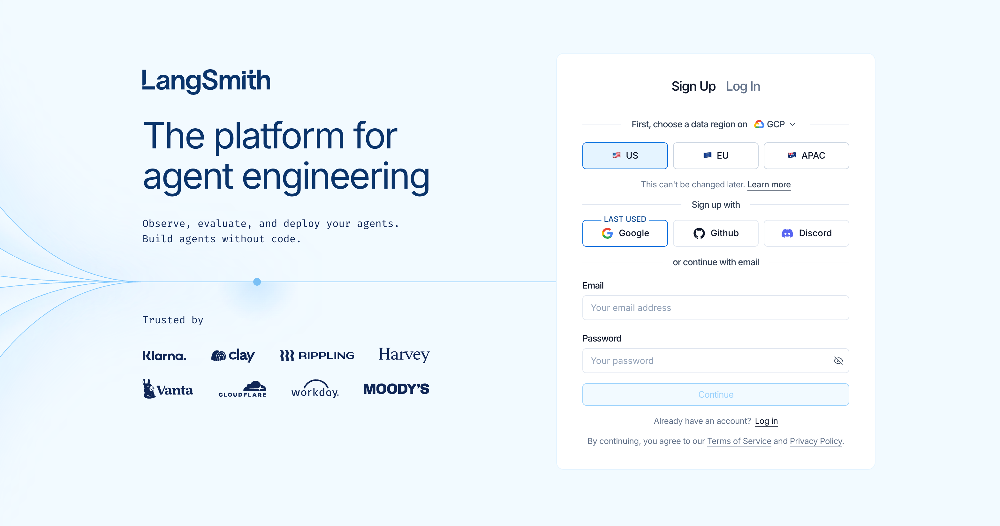
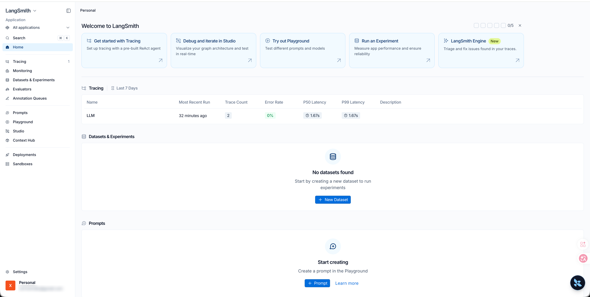
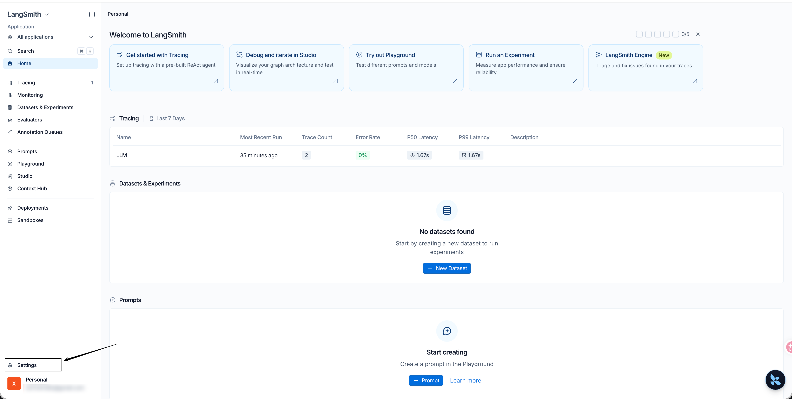
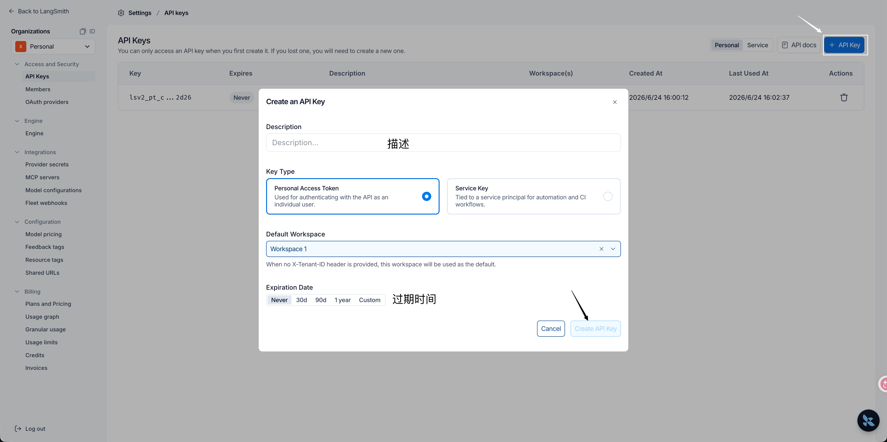
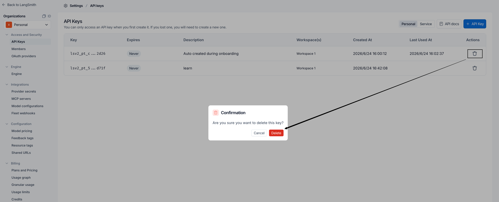
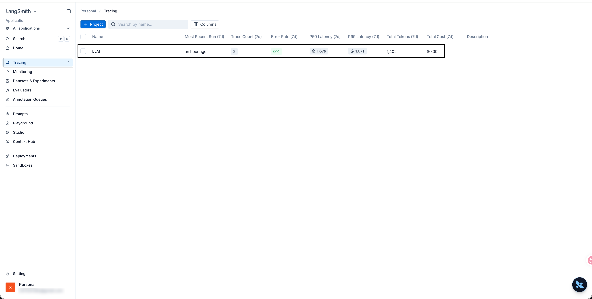
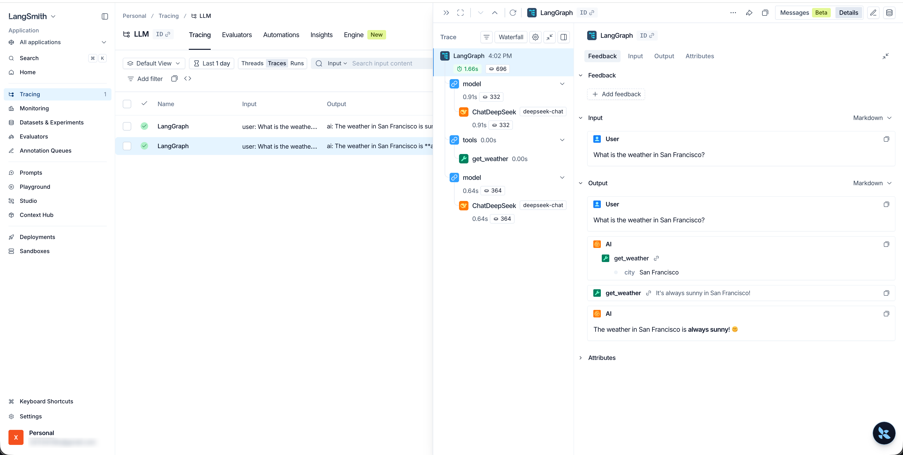
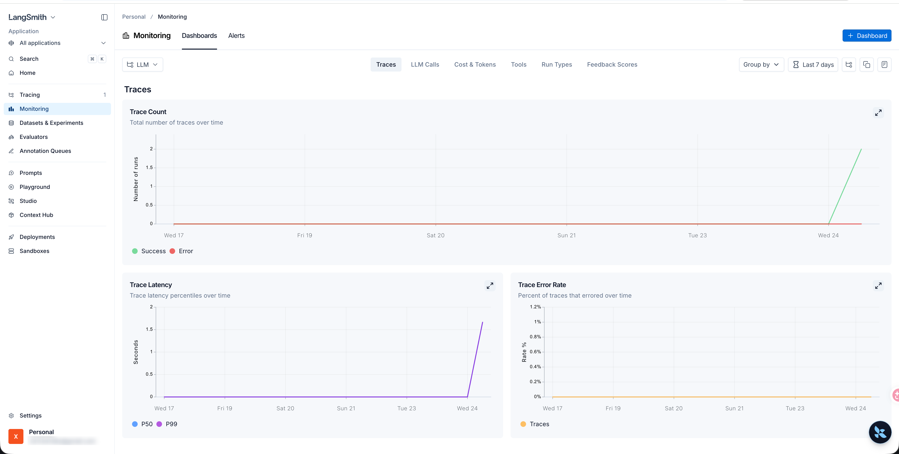

# LangSmith (/docs/ai/langsmith)

## 概述 [#概述]

### 什么是 LangSmith [#什么是-langsmith]

LangSmith 是 LangChain 生态系统中专门用于 LLM **应用调试、监控、评估和管理** 的平台。
**追踪**：记录每次 LLM 调用的详细信息
**监控**：实时查看应用性能
**调试**：排查问题和优化性能
**评估**：系统化 LLM 应用

### 具体功能 [#具体功能]

#### 核心应用与开发 [#核心应用与开发]

##### Tracing 追踪 [#tracing-追踪]

**功能**：这是 LangSmith 最核心的功能。它会完整记录你大模型应用的每一次调用链路（Trace）
**作用**：当你的 Agent（智能体）或 RAG 系统运行变慢或报错时，点击进入对应的项目，你可以看到每一步具体的 Prompt 是什么、模型返回了什么、消耗了多少 Token，以及每一个链条节点的耗时，非常方便**排查 Bug 和优化性能**。

##### Monitoring 监控 [#monitoring-监控]

**功能**：提供生产环境的高级数据可视化看板
**作用**：帮你从宏观角度监控应用在一段时间内的运行状况。你可以看到**Token 消耗趋势、QPS（每秒请求数）、错误率、平均延迟（Latency）以及成本预估**。适合应用上线后观察系统的稳定性和开销。

##### Datasets & Experiments 数据集与实验 [#datasets--experiments-数据集与实验]

**功能**：用于管理测试数据集并运行对比实验
**作用**：你可以把用户的真实输入、特定的边界情况（Edge Cases）存为数据集。当你修改了 Prompt 或更换了底层大模型时，可以在这里运行**自动化对比测试**，直观看到新旧版本在同一批测试集上的表现差异。

##### Evaluators 评估器 [#evaluators-评估器]

**功能**：配置和自动化评估任务
**作用**：大模型的输出往往难以用传统的断言（Assert）来测试。这里允许你配置基于规则（如关键词匹配）或基于模型（LLM-as-a-judge）的评估指标（如：答案相关性、是否包含幻觉等），对追踪到的数据或实验结果进行自动打分。

##### Annotation Queues 标注队列 [#annotation-queues-标注队列]

**功能**：人工反馈与数据清洗工具
**作用**：在应用开发或初上线阶段，你可以把一部分痕迹（Traces）发送到标注队列中，让团队中的核心成员、业务专家或人工客服进行**手动打分、纠正回答或贴标签**，这些高质量的人工标注数据后续可直接用于微调模型或充当测试集。

#### 提示词与调试工具 [#提示词与调试工具]

##### Prompts 提示词管理 [#prompts-提示词管理]

**功能**：类似提示词版的 GitHub
**作用**：把 Prompt 从代码中解耦出来，统一在云端管理。你可以在这里对 Prompt 进行版本控制（如 v1 、 v2 ），直接在代码中通过 API 动态拉取最新的提示词。它还支持团队协作和 Prompt 的分享。

##### Playground 演练场 [#playground-演练场]

**功能**：一个网页端的模型交互界面
**作用**：无需写任何代码，直接在这里选择不同的模型（如 OpenAI、Anthropic 或是本地模型），快速微调并测试你的 Prompt 效果，还可以一键将调整好的 Prompt 保存到上方的 Prompts 仓库中。

##### Studio 工作室 [#studio-工作室]

**功能**：通常与 LangGraph 深度集成，提供可视化的图形交互界面
**作用**：如果你的应用是基于图结构（Graph-based）的复杂复杂 Agent 架构，Studio 可以让你**可视化地看到状态机（State）在各个节点之间的流转**，甚至支持在某个节点“暂停”，手动修改数据后再继续向下执行，是调试复杂智能体交互的利器。

##### ContextHub 上下文中心 [#contexthub-上下文中心]

**功能**：管理全局上下文或通用组件配置
**作用**：用于存放可在多个项目或 Prompt 中复用的公共上下文模板、全局变量或系统预设提示。

#### 部署与沙盒 [#部署与沙盒]

##### Deployments 部署 [#deployments-部署]

**功能**：一键将你的 LangChain 应用或 LangGraph Agent 部署为线上可用的 API 服务（通常依托于LangGraph Cloud）
**作用**：提供开箱即用的生产端点，帮你处理高并发、队列管理和状态持久化，让你专注于编写业务逻辑。

##### Sandboxes 沙盒 [#sandboxes-沙盒]

**功能**：提供轻量级的在线运行和测试环境
**作用**：在不污染生产环境的前提下，供开发人员安全地试运行、测试新部署的 Agent 或执行自动化脚本。

## 使用 [#使用]

### 注册或登录 [#注册或登录]

（1）访问官网：[https://smith.langchain.com/](https://smith.langchain.com/)



（2）注册或者登录

（3）登录成功



### API_KEY 管理 [#api_key-管理]

（1）打开设置



（2）创建 API_KEY




<Callout type="success" title="提示">

注意：点击 copy 将API_KEY保存到剪贴板并关闭弹窗，API_KEY 只在上述窗口出现一次，关闭弹窗后回到设置页面，此后就无法在官网查看 API_KEY 的内容了，请妥善保存。

</Callout>


（3）删除



### 环境变量 [#环境变量]

```python 
# 是否启用监控功能
LANGSMITH_TRACING=true

# 监控WebUI地址
LANGSMITH_ENDPOINT=https://api.smith.langchain.com

# API_KEY
LANGSMITH_API_KEY=<YOUR_API_KEY>

# 自定义项目名称
LANGSMITH_PROJECT="LLM"
```

## 监控指标 [#监控指标]

添加上述环境变量后，在程序中通过 load_dotenv() 加载，而后运行 LangChain 代码，LangSmith 会自动记录运行指标，并同步至后台服务，我们可以在 LangSmith 官网查看运行记录。

示例：

```python 
from langchain.agents import create_agent
from dotenv import load_dotenv

load_dotenv()

def get_weather(city: str) -> str:
    """Get weather for a given city."""
    return f"It's always sunny in {city}!"


agent = create_agent(
    model="deepseek-chat",
    tools=[get_weather],
    system_prompt="You are a helpful assistant",
)

# Run the agent
agent.invoke(
    {"messages": [{"role": "user", "content": "What is the weather in San Francisco?"}]}
)
```






