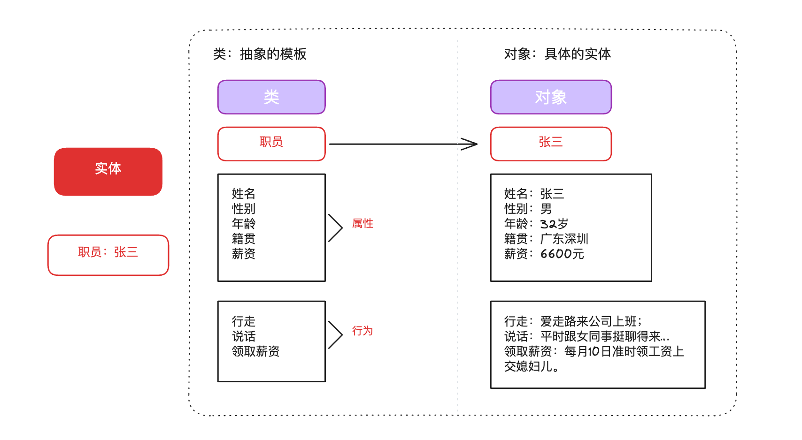

# Python 进阶 (/docs/ai/python)

## 面向对象基础 [#面向对象基础]

**面向过程**：解决问题的过程中，会把**所需的步骤**都列出来，然后**按照步骤写代码**挨个实现，这种过程化的叙事思维，就是面向过程思想。

**面向对象**：视角不再是步骤过程，而是另外一个视角：操作对象，这里的对象可以理解为：冰箱、手机等一些现实实体事物。

**面向对象的三大特性**：
&#8195;封装：（大白话）把属性和方法封装在一起，仅提供对外的方法让别人去访问。好处：简化编程
&#8195;继承：（大白话）孩子可使用老爹的东西。好处：代码复用
&#8195;多态：（大白话）同样一个函数在不同场景下表现出不同形态。好处：解耦合，可扩展

### 三大特性 [#三大特性]

#### 封装 [#封装]

**封装就是隐藏对象的属性和实现细节，仅对外公开接口**，控制在程序中属性的读和修改的访问级别，将抽象得到的数据和行为（或功能）相结合。形成一个有机的整体，也就是将数据与操作数据的源代码进行有机的结合，形成“类”，其中数据和函数都是类的成员。

封装的目的是简化编程，增强安全性：
&#8195;使用者不必了解具体的实现细节，而只是要通过外部接口
&#8195;以特定的访问权限来使用类的成员

#### 继承 [#继承]

在现实生活中，继承一般指的是子女继承父辈的财产，如：子承父业等；
在面向对象中，继承也是面向对象的基本特征之一；
继承就是子类继承父类的属性和方法，使得子类对象（实例）具有父类的特征和行为。只要是继承关系，那么都满足：is-a 关系

#### 多态 [#多态]

多态是指不同类的对象对同一消息做成响应，即同一消息可根据发送对象的不同而采用多种不同的行为方式。
举例：键盘的同一个按键，在不同的软件里，功能不同。

### 面向对象中的重要概念 [#面向对象中的重要概念]

Python 是一门面向对象的语言（也是一门面向过程的语言）。要掌握面向对象的基本语法，则首先需要掌握两个重要的概念：类、对象。
**类**：对现实事物的**抽象**描述
**对象**：现实事物的**具体**体验



#### 类 [#类]

```python 
# 定义一个汽车类
class Car:
    # 类属性（所有对象共享）
    wheels = 4

    # 构造方法 __init__（创建对象时自动调用）
    def __init__(self, brand, color, speed=0):
        # 实例属性（每个对象独有的数据）
        self.brand = brand  # 品牌
        self.color = color  # 颜色
        self.speed = speed  # 速度，初始为0

    # 实例方法（操作对象的行为）
    def accelerate(self, amount):
        self.speed += amount
        print(f"{self.color}的{self.brand}加速了，当前速度：{self.speed}km/h")

    def brake(self):
        self.speed = 0
        print(f"{self.color}的{self.brand}刹车停下了")

    def show_info(self):
        print(f"品牌：{self.brand}，颜色：{self.color}，速度：{self.speed}km/h，轮子数：{self.wheels}")
```


<Callout type="success" title="定义类">

```python 
class 类名:
  # 类属性

  # 定义方法
  def 方法():
    print('方法体')
```

`self` 是 python 内置的关键字，用于指向对象实例本身（代表本类当前对象的引用，哪个对象调用，self 就代表谁）。一个类可实例化多个对象，用于区分哪个对象调用了类的方法。1.在 `类外` 访问类中的行为，需要通过 `对象名.` 的方式访问2.在 `类内` 访问类中的行为，需要通过 `self.` 的方式访问

> 类内设置属性，要结合魔法方法`__init__()`实现

定义类的三种格式：

```python 
# 格式一
class 类名:

# 格式二
class 类名():

# 格式三（优先）
class 类名(父类名):
```

</Callout>


#### 对象 [#对象]

```python 
from Car import Car

car1 = Car("宝马", "黑色")
car2 = Car("特斯拉", "白色")

# 调用方法
car1.show_info()  # 品牌：宝马，颜色：黑色，速度：0km/h，轮子数：4
car1.accelerate(60)  # 黑色的宝马加速了，当前速度：60km/h
car1.accelerate(30)  # 黑色的宝马加速了，当前速度：90km/h
car1.brake()  # 黑色的宝马刹车停下了

print("---")

car2.accelerate(100)  # 白色的特斯拉加速了，当前速度：100km/h
car2.show_info()  # 品牌：特斯拉，颜色：白色，速度：100km/h，轮子数：4

# 访问属性
print(car1.brand)  # 宝马
print(Car.wheels)  # 4（通过类名访问类属性）
```


<Callout type="success" title="对象使用">

```python 
# 实例化
对象名 = 类()

# 调用方法或属性
对象名.方法名()
对象名.属性

# 设置属性
对象名.属性 = 属性值

from Car import Car

car1 = Car("宝马", "黑色")
# 访问属性
print(car1.brand) # 宝马

car1.brand = "特斯拉" # 修改属性
car1.name = "专属车" # 新属性
print(car1.brand) # 特斯拉
print(car1.name) # 专属车
```

> Java 靠写多个构造方法（重载），Python 靠给默认值，一个 `__init__` 就能兼容有参和无参
>
> ```python :no-line-numbers
>  # Python：不能写多个 __init__，但默认值一个搞定
>  class Car:
>      def __init__(self, brand="未知", color="白色"):
>          self.brand = brand
>          self.color = color
>
>  # 等价于 Java 的两个构造方法
>  Car()                  # 无参 → 默认值
>  Car("宝马", "黑色")     # 有参 → 传什么用什么
> ```

</Callout>


### 魔法方法 [#魔法方法]

Python 内置的函数，在满足特定的场景下，会被**自动调用**。

#### \_\_init\_\_() [#__init__]

在创建对象的时候，会自动触发该类的 `__init__()函数`。

**无参**：

```python 
class Car:
    def __init__(self):
        print('我是无参init魔法方法')


car = Car()
# 输出：我是无参init魔法方法
```

**有参**：

```python 
class Car:
    def __init__(self, brand, color):
        self.brand = brand
        self.color = color
        print('我是有参init魔法方法')

    def show(self):
        print(f'{self.brand} {self.color}')


car = Car('宝马', '黑色')
car.show()
# 输出：我是有参init魔法方法
# 输出：宝马 黑色
```

#### \_\_str\_\_() [#__str__]

在使用 print 输出对象时，默认打印对象的内存地址；如实现了`__str__()` 方法，print 就自动调用该方法。

```python 
class Car:
    def __init__(self, brand, color):
        """
        汽车类初始化
        :param brand: 品牌
        :param color: 颜色
        """
        self.brand = brand
        self.color = color

    def __str__(self):
        return f'{self.brand} {self.color}'


car = Car('宝马', '黑色')
print(car)
# 输出：宝马 黑色
```

#### \_\_del\_\_() [#__del__]

在删除对象时（调用 del 删除对象或文件执行结束后），Python 解释器会默认调用`__del__()`方法。

```python 
class Car:
    def __init__(self, brand, color):
        """
        汽车类初始化
        :param brand: 品牌
        :param color: 颜色
        """
        self.brand = brand
        self.color = color

    def __del__(self):
        print(f"{self} 被删除了!")


car = Car('宝马', '黑色')
del car
# 输出：<__main__.Car object at 0x0000016F290AABA0> 被删除了!
```

### 继承 [#继承-1]

#### 单继承 [#单继承]

面向对象中的继承指的是子类继承父类的**属性和方法**。单继承就是一个子类只能继承一个父类，不能继承多个类。

```python 
# 父类
class Animal(object):
    def __init__(self, name):
        self.name = name

    def speak(self):
        print("动物叫")

# 子类继承父类
class Dog(Animal):
    def bark(self):
        print("汪汪叫")

# 创建子类对象
dog = Dog("小狗")
dog.speak()  # 动物叫（继承自父类）
dog.bark()   # 汪汪叫（子类特有的方法）
```

> 在 Python 中，所有类默认继承 object 类，它是**顶级类或基类**；其它子类叫做派生类。继承的作用：提高代码复用率，减少代码冗余

#### 多继承 [#多继承]

多继承就是一个类同时**继承了多个父类**，并且同时具备**所有父类的属性和方法**。

```python 
class Father(object):
    def __init__(self):
        self.sex = '男'

    def run(self):
        print('短跑健将!')


class Mother(object):
    def __init__(self):
        self.sex = '女'

    def sing(self):
        print('百灵鸟!')

    def run(self):
        print('妈妈短跑健将!')


class Son(Father, Mother):
    def play(self):
        print('打游戏!')


son = Son()
print(son.sex) # 男
son.run() # 短跑健将!
son.sing() # 百灵鸟!
son.play() # 打游戏!
```


<Callout type="success" title="提示">

如果一个类继承了多个父类，并且这多个父类中存在**同名方法**，此时子类调用该方法，优先继承第一个父类的同名属性和方法。
例如上面的例子中`class Son(Father, Mother)`，父类都定义了`run()` 方法，但是**Father 在前**，所以`son.run()` 优先继承父类 Father 的`run()`方法。

我们可以通过`类名.__mro__`属性或`类名.mro()`方法查看继承顺序。

```python 
# class Son(Father, Mother)
print(Son.__mro__)
# (<class '__main__.Son'>, <class '__main__.Father'>, <class '__main__.Mother'>, <class 'object'>)
print(Son.mro())
# [<class '__main__.Son'>, <class '__main__.Father'>, <class '__main__.Mother'>, <class 'object'>]

# class Son(Mother, Father)
print(Son.__mro__)
# (<class '__main__.Son'>, <class '__main__.Mother'>, <class '__main__.Father'>, <class 'object'>)
print(Son.mro())
# [<class '__main__.Son'>, <class '__main__.Mother'>, <class '__main__.Father'>, <class 'object'>]
```

除此之外，还有**多层继承**，所谓的多层继承就是 A 继承了 B，B 继承了 C，以此类推

</Callout>


## 面向对象高级 [#面向对象高级]

### 子类重写父类 [#子类重写父类]

重写也叫**覆盖**，就是当子类属性或方法与父类的属性或方法名字相同时，从父类继承下来的成员可以重新定义。子类重写父类的属性和方法，优先会调用子类的属性和方法。

```python 
class Father(object):
    def __init__(self):
        self.hobby = '游泳'

    def run(self):
        print('短跑健将!')


class Son(Father):
    def __init__(self):
        super().__init__()
        self.hobby = '看电影'

    def run(self):
        print('短跑菜鸡!')


son = Son()
print(son.hobby) # 看电影（属性重写）
son.run() # 短跑菜鸡!（方法重写）
```

### 子类访问父类成员 [#子类访问父类成员]

当子类重写了父类的方法或属性后，如果仍想调用或保留父类的行为，通常有以下两种方式：

#### 1. 使用 `super()` 函数（推荐） [#1-使用-super-函数推荐]

`super()` 会返回一个代理对象，它将方法调用委托给当前类的父类（或 MRO 中的下一个类）。这是 Python 中最常用、最推荐的方式。

##### 调用父类的普通方法 [#调用父类的普通方法]

```python 
class Father(object):
    def run(self):
        print("父亲在跑步...")

class Son(Father):
    def run(self):
        # 1. 先保留并执行父类的行为
        super().run()
        # 2. 再执行子类特有的行为
        print("儿子在跑步，并且跑得更快！")

son = Son()
son.run()
# 输出：
# 父亲在跑步...
# 儿子在跑步，并且跑得更快！
```

##### 在构造函数 `__init__` 中调用父类的属性初始化 [#在构造函数-__init__-中调用父类的属性初始化]

```python 
class Father(object):
    def __init__(self, name):
        self.name = name
        self.hobby = "钓鱼"

class Son(Father):
    def __init__(self, name, age):
        # 调用父类的构造方法，初始化从父类继承的属性
        super().__init__(name)
        self.age = age

son = Son("小明", 18)
print(son.name)   # 小明
print(son.hobby)  # 钓鱼
print(son.age)    # 18
```

#### 2. 通过父类类名直接调用（不推荐） [#2-通过父类类名直接调用不推荐]

除了 `super()`，也可以直接使用 `父类名.方法名(self, ...)` 显式调用。**需要手动传入 `self` 实例**。这种方式虽然可行，但在多继承或复杂的类继承关系中，容易导致父类方法被重复调用，因此一般不推荐。

```python 
class Father(object):
    def run(self):
        print("父亲在跑步...")

class Son(Father):
    def run(self):
        # 显式使用父类名调用，必须手动传入 self
        Father.run(self)
        print("儿子在跑步...")
```


<Callout type="success" title="为什么不推荐使用父类名直接调用？">

**硬编码类名**：如果父类名字改变，子类中所有显式调用的地方都需要修改，不利于维护。
**多继承下的钻石继承问题**：在复杂的多继承结构中，使用父类名调用会导致某个祖先类的方法被重复执行多次，而 super() 能够结合 MRO（方法解析顺序）确保每个祖先类的方法只被调用一次。

</Callout>


## 闭包和装饰器 [#闭包和装饰器]

## 网络编程与多线程 [#网络编程与多线程]

## 生成器与正则表达式 [#生成器与正则表达式]

## 算法详解-链表 [#算法详解-链表]

## 算法详解-二叉树 [#算法详解-二叉树]

## 拓展内容-快速排序 [#拓展内容-快速排序]
