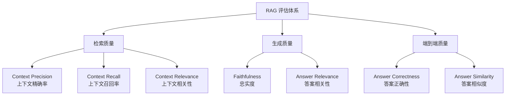
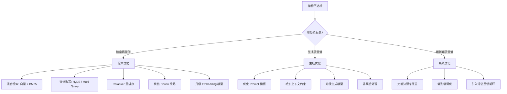
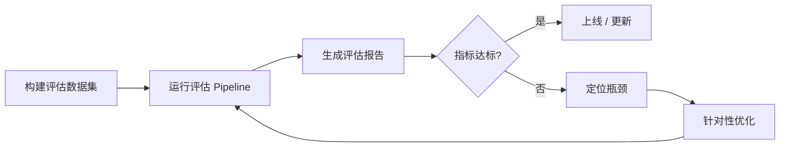

# RAG 进阶 (/docs/ai/rag_advanced)

## 基础 [#基础]


<Cards>
  <Card title="RAG 基础" href="/docs/ai/langchain/rag" description="RAG LangChain" />
</Cards>


## RAG 架构优化 [#rag-架构优化]

```mermaid
flowchart LR
    A["📄 原始文档（PDF/Word/HTML/数据库）"] --> B["文档解析 | 清洗"]
    B --> C["文本分块（Chunking）"]
    C --> D["Embedding 编码"]
    D --> E["向量数据库存储"]

    F["👤 用户 Query"] --> G["Query 预处理"]
    G --> H["向量检索"]
    E --> H
    H --> I["Top-K Chunks"]
    I --> J["上下文组装 Prompt"]
    J --> K["LLM 生成答案"]
    K --> L["后处理 | 返回"]
````

**各组件职责速查**:

| 组件      | 职责               | 常见问题                  |
| --------- | ------------------ | ------------------------- |
| 文档解析  | 提取结构化文本     | 表格/图片丢失、乱码       |
| Chunking  | 切割成适当大小片段 | 语义截断、Chunk 过长/过短 |
| Embedding | 语义向量化         | 领域偏差、多语言质量差    |
| 向量检索  | 找出最相关 Chunks  | 召回率低、噪声多          |
| LLM 生成  | 基于上下文回答     | 幻觉、忽略上下文          |

### 文档解析与预处理 [#文档解析与预处理]

#### 主流解析库对比 [#主流解析库对比]

文档解析是 RAG 流水线的第一道关卡，解析质量直接决定最终结果。核心挑战在于：

- **PDF 的双重性**：文本型 PDF（可复制文字）vs 图像型 PDF（扫描件）
- **复杂布局**：多栏排版、表格嵌套、页眉页脚、图文混排
- **格式多样性**：DOCX/PPTX/HTML/Markdown/图片 等格式统一处理

| 工具             | 定位               | 优势                                | 劣势                 | 适用场景             |
| ---------------- | ------------------ | ----------------------------------- | -------------------- | -------------------- |
| **unstructured** | 通用文档解析       | 支持格式最全(25+)，社区活跃         | 复杂 PDF 表格效果差  | 多格式文档批量处理   |
| **docling**      | IBM 出品，PDF 专精 | 表格结构保留好，Markdown 输出质量高 | 速度较慢，内存占用高 | 高质量 PDF 学术/报告 |
| **marker**       | 基于 Nougat 改进   | 公式识别优秀，速度快                | 对非英文支持弱       | 学术论文、含公式文档 |
| **MinerU**       | 上海AI Lab 出品    | 中文 PDF 最强，布局分析精准         | 依赖重，部署复杂     | 中文文档、复杂排版   |

#### 表格解析 [#表格解析]

表格是文档中信息密度最高、也最难处理的结构。RAG 场景下表格的核心挑战：

- **表头关联**：行/列标题与数据的语义关联丢失
- **合并单元格**：跨行/列合并导致的信息丢失
- **序列化策略**：如何将二维表格转为 LLM 可理解的线性文本

表格序列化的主流策略：

1. **Markdown 表格**：保留视觉结构，适合 LLM 理解（首选）
2. **行展开法**：每行转为"列名: 值"的描述句（表格超长时用）
3. **HTML 表格**：保留合并单元格信息（精确保留结构）
4. **自然语言描述**：用 LLM 将表格转为段落（最贵但最易理解）

#### OCR [#ocr]

OCR（光学字符识别）质量是扫描件 PDF 解析的瓶颈。优化方向：

- **预处理**：图像去噪、二值化、旋转校正（显著提升低质量扫描件效果）
- **引擎选择**：PaddleOCR（中文最优）> Tesseract（多语言开源）> 商业 API
- **后处理**：拼写纠错、版式还原、低置信度过滤


<Callout type="success" title="提示">

**解析工具选型决策树：**

```txt 
输入文档类型？
├── 中文复杂 PDF（报告/合同/书籍）→ MinerU（精度最高，需 GPU）
├── 多格式批量处理（PDF/Word/PPT/HTML）→ unstructured（strategy="hi_res"）
├── 学术论文/含数学公式 → marker 或 docling
└── 扫描件/图片 → PaddleOCR（中文）/ Tesseract（多语言）
```

**关键生产参数：**

- unstructured `strategy`: 开发用 `"fast"`，生产用 `"hi_res"`（慢 5-10x，但表格/图片质量差距巨大）
- PaddleOCR `det_limit_side_len`: 普通文档用 `960`，密集小字（如报表）用 `1280`
- **解析并发**：建议 `min(cpu_count, 8)` 进程并行，单进程内避免多线程（GIL + CUDA 冲突）
- **解析缓存**：以文件 MD5 为 key 缓存解析结果，避免重复解析（解析通常是流水线最慢环节，可节省 90%+ 时间）
- **失败降级**：解析超时设为 120s，`hi_res` 失败时降级到 `fast` 策略

</Callout>


### 智能分块策略 [#智能分块策略]


<Tabs items={["固定大小分块（Fixed-Size Chunking）", "递归字符分块（Recursive Character Splitting）", "语义分块（Semantic Chunking）", "命题分块（Propositions Chunking）", "层级分块（Hierarchical Chunking / RAPTOR）", "Late Chunking"]}>
<Tab value="固定大小分块（Fixed-Size Chunking）">

最简单的分块策略：按固定 token/字符数切割，加入 overlap 保证上下文连贯。

**适用场景**：同质化文档（纯文本新闻、客户评论、日志数据）  
**缺点**：不考虑语义边界，可能从句子中间截断，破坏完整性

```python 
from langchain.text_splitter import TokenTextSplitter

def fixed_size_chunking(
    text: str,
    chunk_size: int = 512,      # 每块最大 token 数
    chunk_overlap: int = 50,    # 重叠 token 数（建议为 chunk_size 的 10%）
) -> list[str]:
    """
    基于 Token 数量的固定大小分块
    使用 tiktoken，与 OpenAI 模型计数一致
    """
    splitter = TokenTextSplitter(
        chunk_size=chunk_size,
        chunk_overlap=chunk_overlap,
        encoding_name="cl100k_base",  # GPT-4/ChatGPT 的 tokenizer
    )
    return splitter.split_text(text)
```

</Tab>
<Tab value="递归字符分块（Recursive Character Splitting）">

LangChain 默认分块策略。按优先级尝试不同分隔符（`\n\n` → `\n` → `.` → ` `），在最大尺寸约束下尽量保留自然边界。

**适用场景**：通用文档（最常用、最稳健的基线方法，**实际生产首选**）

```python 
from langchain.text_splitter import RecursiveCharacterTextSplitter

def recursive_chunking(
    text: str,
    chunk_size: int = 1000,
    chunk_overlap: int = 200,
    language: str = "zh",
) -> list[dict]:
    """
    递归字符分块，返回带位置信息的 chunk 列表
    中文场景增加中文标点作为分隔符
    """
    if language == "zh":
        separators = ["\n\n", "\n", "。", "！", "？", "；", "，", " ", ""]
    else:
        separators = ["\n\n", "\n", ".", "!", "?", ";", ",", " ", ""]

    splitter = RecursiveCharacterTextSplitter(
        chunk_size=chunk_size,
        chunk_overlap=chunk_overlap,
        separators=separators,
        length_function=len,          # 按字符数（也可改为 token 计数函数）
        is_separator_regex=False,
    )

    chunks = splitter.create_documents([text])
    return [
        {
            "text": chunk.page_content,
            "start_index": chunk.metadata.get("start_index", 0),
        }
        for chunk in chunks
    ]
```

</Tab>
<Tab value="语义分块（Semantic Chunking）">

基于 Embedding 相似度的动态分块算法：

1. 将文本按句子切分
2. 计算相邻句子（含 buffer 窗口）的 Embedding 相似度
3. 相似度显著下降处（超过均值 + k×标准差）作为分块边界

**优势**：语义完整性高，chunk 内部主题一致，避免人工设定边界  
**劣势**：依赖 Embedding 模型质量；计算成本高于固定分块（约慢 10x）

```python 
from sklearn.metrics.pairwise import cosine_similarity
import numpy as np
import re
from sentence_transformers import SentenceTransformer

class SemanticChunker:
    def __init__(
        self,
        model_name: str = "BAAI/bge-m3",
        breakpoint_threshold: float = 0.5,  # k 值：越大断点越少（chunk 越大）
        buffer_size: int = 1,               # 合并相邻 N 句计算 embedding（减少边界噪声）
    ):
        self.model = SentenceTransformer(model_name)
        self.threshold = breakpoint_threshold
        self.buffer_size = buffer_size

    def _split_sentences(self, text: str) -> list[str]:
        """按句子切分文本，支持中英文混合"""
        sentences = re.split(r'(?<=[。！？.!?])\s*', text)
        return [s.strip() for s in sentences if s.strip()]

    def _get_embeddings(self, sentences: list[str]) -> np.ndarray:
        return self.model.encode(
            sentences,
            batch_size=32,
            show_progress_bar=False,
            normalize_embeddings=True,
        )

    def chunk(self, text: str) -> list[str]:
        sentences = self._split_sentences(text)
        if len(sentences) <= 1:
            return sentences

        # 合并相邻句子后再计算 embedding（减少单句边界效应）
        combined = []
        for i in range(len(sentences)):
            start = max(0, i - self.buffer_size)
            end = min(len(sentences), i + self.buffer_size + 1)
            combined.append(" ".join(sentences[start:end]))

        embeddings = self._get_embeddings(combined)

        # 计算相邻 embedding 的余弦距离
        distances = []
        for i in range(len(embeddings) - 1):
            sim = cosine_similarity([embeddings[i]], [embeddings[i + 1]])[0][0]
            distances.append(1 - sim)  # 距离 = 1 - 相似度

        # 动态断点：超过 均值 + threshold×标准差 的位置
        mean_dist = np.mean(distances)
        std_dist = np.std(distances)
        breakpoints = [
            i for i, d in enumerate(distances)
            if d > mean_dist + self.threshold * std_dist
        ]

        # 按断点切分为 chunks
        chunks = []
        prev = 0
        for bp in breakpoints:
            chunks.append(" ".join(sentences[prev:bp + 1]))
            prev = bp + 1
        chunks.append(" ".join(sentences[prev:]))

        return [c for c in chunks if c.strip()]


# 使用示例
if __name__ == "__main__":
    chunker = SemanticChunker(model_name="BAAI/bge-m3", breakpoint_threshold=0.5)
    text = (
        "这是第一段关于机器学习的内容。深度学习是机器学习的子领域。神经网络是深度学习的基础。\n\n"
        "接下来我们讨论 RAG 系统。检索增强生成是 LLM 的重要扩展。向量数据库是 RAG 的核心组件。"
    )
    chunks = chunker.chunk(text)
    for i, c in enumerate(chunks):
        print(f"Chunk {i+1} ({len(c)}字): {c[:60]}...")
```

</Tab>
<Tab value="命题分块（Propositions Chunking）">

由 Dense X Retrieval 论文提出。将文档分解为**原子性命题（atomic propositions）**：每个命题是一个完整、自包含的事实陈述，无需上下文即可理解。

**优势**：命题粒度极细，检索精度最高；每个命题自包含，避免代词歧义  
**劣势**：需要 LLM 进行命题提取，成本高（约 0.001 元/命题）；粒度过细可能丢失上下文

```python 
from langchain_core.prompts import ChatPromptTemplate
from langchain_openai import ChatOpenAI
from pydantic import BaseModel, Field
import tenacity

class Propositions(BaseModel):
    propositions: list[str] = Field(description="从文本中提取的原子命题列表")


PROPOSITION_PROMPT = """将以下文本分解为一系列简洁、完整、自包含的事实命题。

要求：
1. 每个命题应表达一个独立的事实，无需上下文即可理解
2. 命题应完整：包含主语、谓语、宾语
3. 将代词替换为具体名词（如"它"→"该系统"，"这"→"该模型"）
4. 避免模糊表述，保持具体性
5. 每个命题控制在 1-2 句话以内

文本：{text}

请以 JSON 格式输出命题列表。"""


def proposition_chunking(text: str, llm_model: str = "gpt-4o-mini") -> list[str]:
    """命题分块：将文本分解为原子命题"""
    llm = ChatOpenAI(model=llm_model, temperature=0)
    structured_llm = llm.with_structured_output(Propositions)
    prompt = ChatPromptTemplate.from_template(PROPOSITION_PROMPT)
    chain = prompt | structured_llm
    result = chain.invoke({"text": text})
    return result.propositions


@tenacity.retry(
    stop=tenacity.stop_after_attempt(3),
    wait=tenacity.wait_exponential(multiplier=1, min=4, max=10),
)
def batch_proposition_chunking(
    chunks: list[str],
    llm_model: str = "gpt-4o-mini",
) -> list[str]:
    """对预分块后的文本批量提取命题（含自动重试）"""
    all_propositions = []
    for chunk in chunks:
        if len(chunk) < 50:         # 过短的直接保留
            all_propositions.append(chunk)
            continue
        props = proposition_chunking(chunk, llm_model)
        all_propositions.extend(props)
    return all_propositions
```

</Tab>
<Tab value="层级分块（Hierarchical Chunking / RAPTOR）">

RAPTOR（Recursive Abstractive Processing for Tree-Organized Retrieval）核心思想：

1. 将文档分为小 chunk（**叶节点**）
2. 对叶节点聚类，用 LLM 生成摘要（**父节点**）
3. 递归向上构建摘要树
4. 检索时同时在**所有层级**检索，支持细节查询（叶节点）和宏观查询（摘要节点）

**优势**：解决了"既要细粒度又要宏观理解"的两难问题

```python 
from sklearn.mixture import GaussianMixture
import numpy as np
from sentence_transformers import SentenceTransformer
from langchain_openai import ChatOpenAI

class HierarchicalChunker:
    def __init__(
        self,
        embed_model: str = "BAAI/bge-m3",
        llm_model: str = "gpt-4o-mini",
        max_cluster_size: int = 10,    # 每个簇最多多少个 chunk
        n_levels: int = 3,             # 层级数
    ):
        self.embedder = SentenceTransformer(embed_model)
        self.llm = ChatOpenAI(model=llm_model, temperature=0)
        self.max_cluster_size = max_cluster_size
        self.n_levels = n_levels

    def _cluster_chunks(self, chunks: list[str]) -> list[list[str]]:
        """用 GMM 软聚类，自动确定最优簇数"""
        embeddings = self.embedder.encode(chunks, normalize_embeddings=True)
        n_components = max(2, len(chunks) // self.max_cluster_size)
        n_components = min(n_components, len(chunks) - 1)

        gmm = GaussianMixture(n_components=n_components, covariance_type="full", random_state=42)
        gmm.fit(embeddings)
        labels = gmm.predict(embeddings)

        clusters = {}
        for i, label in enumerate(labels):
            clusters.setdefault(label, []).append(chunks[i])
        return list(clusters.values())

    def _summarize_cluster(self, chunks: list[str]) -> str:
        """用 LLM 对一组 chunk 生成摘要（父节点）"""
        combined = "\n\n".join(chunks)
        prompt = f"请对以下文本内容进行简洁摘要，保留核心信息（200字以内）：\n\n{combined}\n\n摘要："
        response = self.llm.invoke(prompt)
        return response.content

    def build_tree(self, leaf_chunks: list[str]) -> dict:
        """构建层级摘要树，返回各层节点"""
        tree = {"level_0": leaf_chunks}
        current_level = leaf_chunks

        for level in range(1, self.n_levels + 1):
            if len(current_level) <= 1:
                break
            clusters = self._cluster_chunks(current_level)
            summaries = [self._summarize_cluster(cluster) for cluster in clusters]
            tree[f"level_{level}"] = summaries
            current_level = summaries

        return tree

    def get_all_nodes(self, tree: dict) -> list[dict]:
        """提取所有节点，用于构建向量索引"""
        nodes = []
        for level, chunks in tree.items():
            level_num = int(level.split("_")[1])
            for chunk in chunks:
                nodes.append({
                    "text": chunk,
                    "level": level_num,
                    "is_summary": level_num > 0,
                })
        return nodes
```

</Tab>
<Tab value="Late Chunking">

Late Chunking 是 JinaAI 提出的创新方法，解决传统分块丢失上下文的问题：

- **传统方式**：先分块 → 分别 Embed → 丢失跨块上下文
- **Late Chunking**：先对**完整文档** Embed（获得全局上下文感知的 token embeddings）→ 再在 embedding 层面分块（对每块的 token embedding 做 mean pooling）

**优势**：保留了长程上下文信息，尤其适合代词指代、专有名词跨句引用的场景  
**要求**：必须使用支持长上下文的模型（如 jina-embeddings-v3 或 BGE-M3）

```python 
import torch
from transformers import AutoTokenizer, AutoModel
import numpy as np

class LateChunkingEmbedder:
    """Late Chunking 完整实现"""

    def __init__(self, model_name: str = "jinaai/jina-embeddings-v3"):
        self.tokenizer = AutoTokenizer.from_pretrained(model_name, trust_remote_code=True)
        self.model = AutoModel.from_pretrained(model_name, trust_remote_code=True)
        self.model.eval()
        if torch.cuda.is_available():
            self.model = self.model.cuda()

    def embed_with_late_chunking(
        self,
        text: str,
        chunk_boundaries: list[tuple[int, int]],  # [(char_start, char_end), ...]
    ) -> list[np.ndarray]:
        """
        Late Chunking 编码
        chunk_boundaries: 字符级别的分块边界列表
        """
        # Step 1：对完整文档 tokenize（保留 token→字符 的位置映射）
        encoding = self.tokenizer(
            text,
            return_tensors="pt",
            return_offsets_mapping=True,   # 关键：获取 token 对应的字符位置
            truncation=True,
            max_length=8192,
        )

        input_ids = encoding["input_ids"]
        attention_mask = encoding["attention_mask"]
        offset_mapping = encoding["offset_mapping"][0]  # (seq_len, 2)

        if torch.cuda.is_available():
            input_ids = input_ids.cuda()
            attention_mask = attention_mask.cuda()

        # Step 2：前向传播，获取所有 token 的上下文感知 embedding
        with torch.no_grad():
            outputs = self.model(input_ids=input_ids, attention_mask=attention_mask)

        token_embeddings = outputs.last_hidden_state[0]  # (seq_len, hidden_dim)

        # Step 3：将字符边界映射到 token 边界，做 mean pooling
        chunk_embeddings = []
        for char_start, char_end in chunk_boundaries:
            token_mask = [
                idx for idx, (ts, te) in enumerate(offset_mapping.tolist())
                if te > char_start and ts < char_end
            ]
            if not token_mask:
                continue

            chunk_token_embs = token_embeddings[token_mask]  # (n_tokens, dim)
            chunk_emb = chunk_token_embs.mean(dim=0)
            chunk_emb = torch.nn.functional.normalize(chunk_emb, dim=-1)
            chunk_embeddings.append(chunk_emb.cpu().numpy())

        return chunk_embeddings
```

</Tab>
</Tabs>


---

| 分块策略      | chunk_size 建议    | overlap 建议  | 适用场景           |
| ------------- | ------------------ | ------------- | ------------------ |
| 固定大小      | 256-512 tokens     | 10%-20%       | 快速原型、同质文本 |
| 递归字符      | 512-1024 chars     | 100-200 chars | **通用默认方案**   |
| 语义分块      | 动态（均值约 500） | 无需 overlap  | 主题多样的长文档   |
| 命题分块      | ~100 chars/命题    | N/A           | 高精度知识库问答   |
| 层级分块      | 叶 256 + 摘要动态  | 0             | 多粒度检索需求     |
| Late Chunking | 与语义分块配合     | N/A           | 上下文依赖强的文档 |

**经验法则：**

- 不同业务最优 chunk_size 差异巨大，必须用 **Ragas** 在真实数据上实测
- 生产中可并存多种粒度（层级分块），支持不同类型问题
- overlap 过大会引入噪声，过小会导致上下文断裂，10%-20% 是经验最优区间

### Embedding 模型选型与微调 [#embedding-模型选型与微调]

Embedding 模型将文本映射到高维向量空间，决定语义相似度计算质量。选型核心考量：维度、最大输入长度、多语言支持、推理速度。

| 模型                       | 维度 | 最大长度 | 中文能力   | MTEB 排名 | 推荐场景                          |
| -------------------------- | ---- | -------- | ---------- | --------- | --------------------------------- |
| **BGE-M3**                 | 1024 | 8192     | ★★★★★ | Top 5     | **中文 RAG 首选**，多语言，三模式 |
| **BGE-large-zh**           | 1024 | 512      | ★★★★★ | Top 10    | 纯中文，速度快，资源少时用        |
| **E5-mistral-7b**          | 4096 | 32768    | ★★★     | Top 3     | 英文长文档                        |
| **GTE-Qwen2-7B**           | 3584 | 32768    | ★★★★★ | Top 3     | 中英文长文档，**质量最高**        |
| **text-embedding-3-large** | 3072 | 8192     | ★★★★   | Top 10    | 无 GPU 时用 API                   |

**BGE-M3 的三种检索模式**（核心差异化特性）：

- **Dense（稠密）**：常规向量检索，速度最快
- **Sparse（稀疏）**（SPLADE-like）：稀疏向量，可替代 BM25，精确匹配强
- **ColBERT**：多向量检索，每个 token 一个向量，效果最好但存储成本高

### 混合检索 [#混合检索]

BM25 与 Dense 检索的互补性：

|          | BM25                                        | Dense                        |
| -------- | ------------------------------------------- | ---------------------------- |
| **优势** | 精确关键词匹配，专有名词/缩写效果好，可解释 | 语义理解，同义词泛化，多语言 |
| **劣势** | 无语义理解，词汇不匹配即 0 分               | 对低频词/新术语泛化差        |
| **适合** | 产品型号、人名、术语                        | 概念查询、意图理解           |

混合检索通过 **RRF（Reciprocal Rank Fusion）** 融合两路结果，公式：

$$\text{RRF}(d) = \sum_{r \in R} \frac{1}{k + \text{rank}_r(d)}$$


<Callout type="success" title="提示">

| 符号                | 含义                                          |
| ------------------- | --------------------------------------------- |
| $d$                 | 某个文档                                      |
| $R$                 | 所有检索路数的集合（如 BM25、向量检索两路） |
| $\text{rank}_r(d)$ | 文档 $d$ 在第 $r$ 路检索结果中的排名（从 1 开始） |
| $k$                 | 平滑常数，通常取 60                           |

假设文档 $d$ 在两路检索中的排名：

- BM25 排名第 3
- 向量检索排名第 1

取 $k = 60$：

$$\text{RRF}(d) = \frac{1}{60 + 3} + \frac{1}{60 + 1} = \frac{1}{63} + \frac{1}{61} \approx 0.01587 + 0.01639 = 0.03226$$

最终按 RRF 分数降序排列，取 Top-K 作为混合检索结果。

- **BM25/Dense 权重**：业务初期建议 BM25:Dense = 3:7；可通过 A/B 测试在业务数据上调优
- **RRF k=60**：论文推荐值，通常无需调整（调整收益极小）

</Callout>


## Query 优化技术 [#query-优化技术]

### Query Rewriting（查询改写） [#query-rewriting查询改写]

用户原始 query 常存在问题：

- 拼写错误、口语化表达（"怎么弄" → "如何配置"）
- 歧义、代词指代（"它的参数"）
- 过于简短，缺乏检索关键词

改写策略：用 LLM 将原始 query 扩展/规范化，增加同义词，明确歧义。


<details>
<summary>示例</summary>

```python 
from langchain_core.prompts import ChatPromptTemplate
from langchain_openai import ChatOpenAI

REWRITE_PROMPT = """你是一个搜索查询优化专家。请将用户的原始问题改写为更适合文档检索的查询。

改写要求：
1. 保留原始问题的核心意图
2. 展开缩写和口语化表达
3. 添加可能相关的同义词/近义词
4. 如果问题有歧义，选择最可能的解释
5. 输出 1-3 个改写版本，每行一个

原始问题：{query}

改写版本："""

def rewrite_query(query: str, llm_model: str = "gpt-4o-mini") -> list[str]:
    """LLM 查询改写，返回多个改写版本"""
    llm = ChatOpenAI(model=llm_model, temperature=0.3)
    prompt = ChatPromptTemplate.from_template(REWRITE_PROMPT)
    chain = prompt | llm
    result = chain.invoke({"query": query})
    return [q.strip() for q in result.content.strip().split("\n") if q.strip()]


def rewrite_and_retrieve(query: str, retriever, top_k: int = 5) -> list[dict]:
    """改写 + 检索 + 结果去重融合"""
    rewrites = rewrite_query(query)
    all_results = []
    seen_texts = set()

    # 对每个改写版本检索，去重融合
    for rewritten_query in [query] + rewrites:
        results = retriever.retrieve(rewritten_query, top_k=top_k)
        for r in results:
            text_key = r["text"][:100]
            if text_key not in seen_texts:
                seen_texts.add(text_key)
                all_results.append(r)

    return all_results[:top_k * 2]
```

</details>


### HyDE（假设文档嵌入） [#hyde假设文档嵌入]

HyDE（Hypothetical Document Embeddings）核心思路：

1. 用 LLM 根据 query 生成一篇**假设性文档**（LLM 认为能回答该 query 的文档片段）
2. 对假设文档进行 Embedding（而非对 query 直接 Embedding）
3. 用假设文档的 Embedding 去检索真实文档

**为什么有效**：query 和文档在语义空间分布不同（一问一答），假设文档与真实文档更接近（同为陈述型文本），缩小 query-doc 分布差距（asymmetric gap 问题）。


<details>
<summary>示例</summary>

```python 
HYDE_PROMPT = """请根据以下问题，生成一段可能包含该问题答案的文档片段。
注意：生成的是"可能的文档内容"，而非直接回答问题。内容应具体、专业。

问题：{query}

文档片段（200字左右）："""

def hyde_search(
    query: str,
    retriever,
    embed_model,
    llm_model: str = "gpt-4o-mini",
    top_k: int = 5,
    n_hypothetical: int = 3,   # 生成多个假设文档取平均，减少 LLM 随机性影响
) -> list[dict]:
    """HyDE 检索：生成假设文档 → Embed → 检索"""
    import numpy as np

    llm = ChatOpenAI(model=llm_model, temperature=0.7)
    prompt = ChatPromptTemplate.from_template(HYDE_PROMPT)
    chain = prompt | llm

    # 生成多个假设文档
    hypothetical_docs = [chain.invoke({"query": query}).content for _ in range(n_hypothetical)]

    # 编码并取平均（平均向量比单个更稳定）
    hyp_embeddings = embed_model.encode(hypothetical_docs, normalize_embeddings=True)
    avg_embedding = hyp_embeddings.mean(axis=0)
    avg_embedding = avg_embedding / np.linalg.norm(avg_embedding)

    # 用平均 embedding 检索
    return retriever.retrieve_by_embedding(avg_embedding, top_k=top_k)
```

</details>


### Multi-Query（多路查询） [#multi-query多路查询]

对同一问题从不同角度生成多个 query，各自独立检索后对结果取并集（去重），提高召回率。

核心思路：用户的问题可能只命中了文档的某种表述方式，多角度查询增加命中概率。


<details>
<summary>示例</summary>

```python 
from langchain.retrievers.multi_query import MultiQueryRetriever

def multi_query_retrieval(
    query: str,
    vectorstore,
    top_k: int = 5,
    llm_model: str = "gpt-4o-mini",
) -> list[dict]:
    """
    多路查询检索（LangChain 原生支持）
    自动生成 3 个变体查询 + 原始查询，共 4 路检索
    """
    llm = ChatOpenAI(model=llm_model, temperature=0.7)

    retriever = MultiQueryRetriever.from_llm(
        retriever=vectorstore.as_retriever(search_kwargs={"k": top_k}),
        llm=llm,
        include_original=True,   # 包含原始 query 的检索结果
    )

    docs = retriever.invoke(query)

    # 去重（按文本内容）
    seen_texts = set()
    unique_docs = []
    for doc in docs:
        if doc.page_content not in seen_texts:
            seen_texts.add(doc.page_content)
            unique_docs.append({"text": doc.page_content, "metadata": doc.metadata})

    return unique_docs
```

</details>


### Step-Back Prompting（后退提示） [#step-back-prompting后退提示]

Step-Back 思路：对于具体问题，先"退一步"提出更抽象的背景问题，同时检索背景知识和具体细节，融合后回答。

**适用场景**：需要理解原理才能回答细节的问题（如"为什么 HNSW 的 M=32 比 M=16 精度高"需要先理解 HNSW 原理）


<details>
<summary>示例</summary>

```python 
STEP_BACK_PROMPT = """你是一个专家，请将以下具体问题抽象为一个更宏观的背景问题。

具体问题：{question}

更宏观的背景问题（一句话）："""

def step_back_retrieval(
    query: str,
    retriever,
    llm_model: str = "gpt-4o-mini",
    top_k: int = 5,
) -> dict:
    """Step-Back 检索：背景知识 + 具体细节双路检索"""
    llm = ChatOpenAI(model=llm_model, temperature=0)
    prompt = ChatPromptTemplate.from_template(STEP_BACK_PROMPT)
    chain = prompt | llm

    step_back_q = chain.invoke({"question": query}).content.strip()
    print(f"原始查询: {query}")
    print(f"后退查询: {step_back_q}")

    specific_results = retriever.retrieve(query, top_k=top_k)
    background_results = retriever.retrieve(step_back_q, top_k=top_k)

    # 融合去重（具体结果优先）
    seen = set()
    unique_results = []
    for r in specific_results + background_results:
        text_key = r["text"][:100]
        if text_key not in seen:
            seen.add(text_key)
            unique_results.append(r)

    return {
        "step_back_query": step_back_q,
        "results": unique_results[:top_k],
    }
```

</details>


#### 生产环境注意事项 [#生产环境注意事项]

| 技术            | 延迟增加    | 效果提升 | 成本增加       | 推荐场景                 |
| --------------- | ----------- | -------- | -------------- | ------------------------ |
| Query Rewriting | +100-300ms  | ★★★      | 低（gpt-mini） | **默认开启**             |
| HyDE            | +300-500ms  | ★★★★     | 中             | 专业领域知识库           |
| Multi-Query     | +500-1000ms | ★★★★     | 中-高          | 高召回需求（客服、搜索） |
| Step-Back       | +300-500ms  | ★★★      | 中             | 需要背景知识辅助时       |

- **生产建议**：Query Rewriting 成本最低、副作用最小，应默认开启
- HyDE 对知识密集型任务（医疗、法律、技术文档）效果显著，但存在幻觉风险（假设文档内容不准确）
- Multi-Query 的 n_queries 建议设 3（>3 边际收益递减，延迟线性增加）

---

## Re-ranking 重排序 [#re-ranking-重排序]

### 两阶段检索架构 [#两阶段检索架构]

检索分两阶段，分别优化速度和精度：

**阶段一（召回）**：Bi-Encoder 快速检索 top-100
**阶段二（精排）**：Cross-Encoder 精细评分 top-100，取 top-5

```txt 
Bi-Encoder:   Enc(query) · Enc(doc)  → 内积（快，O(1)，但精度有限）
Cross-Encoder: Enc([query ⊕ doc])   → 联合编码（慢，但 query-doc 交叉注意力，精度高）
```

**为什么 Cross-Encoder 更准确**：Bi-Encoder 独立编码，无法看到 query 和 doc 的交互；Cross-Encoder 联合编码，注意力机制可以直接对比两者的词汇和语义关系。

### Cross-Encoder Re-ranking [#cross-encoder-re-ranking]


<details>
<summary>示例</summary>

```python 
from sentence_transformers import CrossEncoder
import time

class CrossEncoderReranker:
    def __init__(
        self,
        model_name: str = "BAAI/bge-reranker-v2-m3",
        device: str = "cuda",
        max_length: int = 512,  # 超长文档用 1024，但延迟翻倍
    ):
        self.model = CrossEncoder(model_name, max_length=max_length, device=device)

    def rerank(
        self,
        query: str,
        documents: list[str],
        top_k: int = 5,
        batch_size: int = 32,
    ) -> list[dict]:
        """Cross-Encoder 批量重排序"""
        if not documents:
            return []

        pairs = [(query, doc) for doc in documents]

        t0 = time.time()
        scores = self.model.predict(pairs, batch_size=batch_size, show_progress_bar=False)
        print(f"Reranked {len(documents)} docs in {(time.time()-t0)*1000:.1f}ms")

        ranked_results = sorted(zip(documents, scores), key=lambda x: x[1], reverse=True)

        return [
            {"text": doc, "rerank_score": float(score)}
            for doc, score in ranked_results[:top_k]
        ]
```

</details>


### BGE-Reranker 系列对比与使用 [#bge-reranker-系列对比与使用]

```python 
# BGE Reranker 模型选型（按延迟从低到高）：
# ┌─────────────────────────────┬────────┬──────────┬───────────────────────┐
# │ 模型                        │ 延迟   │ 精度     │ 推荐场景              │
# ├─────────────────────────────┼────────┼──────────┼───────────────────────┤
# │ bge-reranker-base           │ 最快   │ 一般     │ 延迟 < 100ms 场景    │
# │ bge-reranker-large          │ 中等   │ 较好     │ 平衡默认选择          │
# │ bge-reranker-v2-m3          │ 中等   │ 优秀     │ ★ 中英文均优，推荐   │
# │ bge-reranker-v2-gemma       │ 最慢   │ 最高     │ 离线精排场景          │
# └─────────────────────────────┴────────┴──────────┴───────────────────────┘

from FlagEmbedding import FlagReranker

def init_bge_reranker(model_name: str = "BAAI/bge-reranker-v2-m3") -> FlagReranker:
    return FlagReranker(model_name, use_fp16=True, device="cuda")


def bge_rerank(
    reranker: FlagReranker,
    query: str,
    documents: list[str],
    top_k: int = 5,
) -> list[dict]:
    """BGE Reranker 重排序（normalize=True 输出 0-1 分数）"""
    pairs = [[query, doc] for doc in documents]

    t0 = time.time()
    scores = reranker.compute_score(pairs, normalize=True)
    print(f"Reranked {len(documents)} docs: {(time.time()-t0)*1000:.1f}ms")

    ranked = sorted(zip(documents, scores), key=lambda x: x[1], reverse=True)
    return [{"text": doc, "score": float(score)} for doc, score in ranked[:top_k]]
```

### ColBERT 多向量检索 [#colbert-多向量检索]

ColBERT（Contextualized Late Interaction over BERT）兼顾精度和效率：

- **存储阶段**：文档中每个 token 各自生成一个向量，存储 (seq_len, dim) 矩阵
- **检索阶段**：MaxSim 操作——对 query 每个 token，找文档所有 token 向量中的最大相似度，求和

$$\text{Score}(q, d) = \sum_{i=1}^{|q|} \max_{j=1}^{|d|} ; \mathbf{q}_i \cdot\mathbf{d}_j$$

**优势**：接近 Cross-Encoder 精度，但延迟接近 Bi-Encoder；对长文档效果尤佳

```python 
from FlagEmbedding import BGEM3FlagModel
import numpy as np

def colbert_score(query_vecs: np.ndarray, doc_vecs: np.ndarray) -> float:
    """ColBERT MaxSim 评分"""
    sim_matrix = query_vecs @ doc_vecs.T  # (q_len, d_len)
    max_sims = sim_matrix.max(axis=1)     # 每个 query token 的最大相似度
    return float(max_sims.sum())


def colbert_rerank(
    model: BGEM3FlagModel,
    query: str,
    documents: list[str],
    top_k: int = 5,
    batch_size: int = 8,
) -> list[dict]:
    """使用 BGE-M3 的 ColBERT 向量进行重排序"""
    query_output = model.encode(
        [query], return_dense=False, return_sparse=False, return_colbert_vecs=True
    )
    query_vec = query_output["colbert_vecs"][0]  # (q_len, 1024)

    scores = []
    for i in range(0, len(documents), batch_size):
        batch = documents[i:i + batch_size]
        doc_output = model.encode(
            batch, return_dense=False, return_sparse=False, return_colbert_vecs=True
        )
        for doc_vec in doc_output["colbert_vecs"]:
            scores.append(colbert_score(query_vec, doc_vec))

    ranked = sorted(zip(documents, scores), key=lambda x: x[1], reverse=True)
    return [{"text": doc, "colbert_score": float(score)} for doc, score in ranked[:top_k]]
```

### 完整两阶段检索流水线 [#完整两阶段检索流水线]

```python 
import time

class TwoStageRetriever:
    """生产级两阶段检索：混合召回 → Cross-Encoder 精排"""

    def __init__(
        self,
        retriever: HybridRetriever,
        reranker: CrossEncoderReranker,
        recall_top_k: int = 50,   # 第一阶段召回数（建议 final_top_k 的 10x）
        final_top_k: int = 5,     # 最终返回数
    ):
        self.retriever = retriever
        self.reranker = reranker
        self.recall_top_k = recall_top_k
        self.final_top_k = final_top_k

    def retrieve(self, query: str) -> dict:
        """两阶段检索，附带延迟统计"""
        # 阶段一：快速召回
        t0 = time.time()
        recalled_docs = self.retriever.retrieve(query, top_k=self.recall_top_k)
        recall_latency = (time.time() - t0) * 1000

        # 阶段二：精细重排
        t1 = time.time()
        doc_texts = [d["text"] for d in recalled_docs]
        reranked = self.reranker.rerank(query, doc_texts, top_k=self.final_top_k)
        rerank_latency = (time.time() - t1) * 1000

        return {
            "results": reranked,
            "latency": {
                "recall_ms": round(recall_latency, 1),
                "rerank_ms": round(rerank_latency, 1),
                "total_ms": round(recall_latency + rerank_latency, 1),
            },
            "stats": {"recalled": len(recalled_docs), "returned": len(reranked)},
        }
```

#### 延迟对比（参考值，A100 GPU，单条 query） [#延迟对比参考值a100-gpu单条-query]

| 方法                   | 延迟（100 文档） | 精度 NDCG@10 |
| ---------------------- | ---------------- | ------------ |
| Bi-Encoder only        | ~10ms            | 基线         |
| + BM25 混合检索        | ~15ms            | +5-10%       |
| + Cross-Encoder rerank | ~150-300ms       | +15-25%      |
| + BGE-Reranker-v2-m3   | ~200-400ms       | +15-25%      |
| + ColBERT (BGE-M3)     | ~50-100ms        | +12-20%      |

#### 生产环境注意事项 [#生产环境注意事项-1]

- **召回数量黄金比例**：recall_top_k = final_top_k × (10-20)，即要 top-5 则召回 50-100 条
- **max_length 选择**：日常场景 512 足够；长文档（合同/报告）用 1024（延迟约翻倍）
- **流式返回**：先推送 Bi-Encoder top-5（低延迟），后台重排完成后推送更新（改善体验）
- **模型热加载**：Cross-Encoder 加载一次约 3-5s，必须作为服务常驻，不能按需加载

---

## 向量数据库生产优化 [#向量数据库生产优化]

### HNSW 参数调优 [#hnsw-参数调优]

HNSW（Hierarchical Navigable Small World）是最主流的 ANN（近似最近邻）索引算法，在精度和速度上取得最优平衡。

**三个关键参数：**

| 参数                | 作用阶段 | 默认值 | 调优建议                                               |
| ------------------- | -------- | ------ | ------------------------------------------------------ |
| **M**               | 建索引   | 16     | 低维(&lt;256)用16，高维(>512)用32；越大精度越高，内存越多 |
| **ef_construction** | 建索引   | 100    | 100（默认）；高精度场景用200；只影响写入速度           |
| **ef_search**       | 查询     | 10     | 实时场景50-100，离线精排200+；直接影响检索延迟         |

**内存估算（Qdrant HNSW）：**

```txt 
1M 向量 × 1024维 × float16 = 2GB（向量）
+ M=16 的图连接 ≈ 0.5GB
INT8量化后向量部分 = 0.5GB
总计：约 1GB（INT8）~ 2.5GB（float16）
```

```python 
from qdrant_client import QdrantClient
from qdrant_client.models import (
    VectorParams, Distance, HnswConfigDiff,
    OptimizersConfigDiff, QuantizationConfig,
    ScalarQuantizationConfig, ScalarType,
)

def create_optimized_collection(
    client: QdrantClient,
    collection_name: str,
    dim: int = 1024,
    expected_count: int = 1_000_000,
) -> None:
    """创建生产级优化的向量集合（含量化、HNSW 调优）"""

    # 根据数据量动态调整参数
    m, ef_construct = (16, 100) if expected_count < 1_000_000 else (32, 200)

    client.create_collection(
        collection_name=collection_name,
        vectors_config=VectorParams(
            size=dim,
            distance=Distance.COSINE,
            hnsw_config=HnswConfigDiff(
                m=m,
                ef_construct=ef_construct,
                on_disk=False,     # 数据量 < 可用内存时 False（快）
                payload_m=16,
            ),
            quantization_config=QuantizationConfig(
                scalar=ScalarQuantizationConfig(
                    type=ScalarType.INT8,  # INT8 量化：内存减少 4x，速度提升 2-3x，精度损失 <2%
                    quantile=0.99,         # 截断 1% 异常值后量化（更精准）
                    always_ram=True,       # 量化后的向量常驻内存
                )
            ),
        ),
        optimizers_config=OptimizersConfigDiff(
            indexing_threshold=20000,    # 累积此数量后才建 HNSW（少量数据用暴力搜索更准）
            memmap_threshold=1_000_000,  # 超过此量使用 memmap（内存映射）
            flush_interval_sec=5,        # 每 5 秒刷盘（减少数据丢失风险）
            max_segment_size=200_000,    # 每个 segment 最大条数（影响合并频率）
        ),
        shard_number=2,          # 分片数（单节点也可用多分片提升并发）
        replication_factor=2,    # 副本数（生产至少 1 副本保证高可用）
    )

    # 设置实时查询的 ef_search
    client.update_collection(
        collection_name=collection_name,
        hnsw_config=HnswConfigDiff(ef=100),  # 实时 100，离线精排可调到 200
    )


def benchmark_ef_search(
    client: QdrantClient,
    collection_name: str,
    test_vectors: list[list[float]],
    ef_values: list[int] = [25, 50, 100, 200],
) -> list[dict]:
    """压测不同 ef_search 的延迟，为生产参数选择提供数据依据"""
    import numpy as np

    results = []
    for ef in ef_values:
        client.update_collection(
            collection_name=collection_name,
            hnsw_config=HnswConfigDiff(ef=ef),
        )

        latencies = []
        for vec in test_vectors[:100]:
            t0 = time.time()
            client.search(collection_name=collection_name, query_vector=vec, limit=10)
            latencies.append((time.time() - t0) * 1000)

        results.append({
            "ef": ef,
            "p50_ms": round(np.percentile(latencies, 50), 2),
            "p99_ms": round(np.percentile(latencies, 99), 2),
        })
        r = results[-1]
        print(f"ef={ef:3d}: p50={r['p50_ms']:.1f}ms, p99={r['p99_ms']:.1f}ms")

    return results
```

### Metadata Filter（元数据过滤） [#metadata-filter元数据过滤]

在向量检索时结合元数据 pre-filtering，实现精准召回。典型场景：

- 多租户隔离（用户只能访问自己部门的文档）
- 时间范围过滤（只检索最近 30 天文档）
- 文档类型过滤（只在合同文档中检索）
- 权限控制（按标签过滤）

> ⚠️ **关键**：必须先为过滤字段创建 Payload 索引，否则会触发全量扫描，延迟从毫秒级退化到秒级！


<details>
<summary>示例</summary>

```python 
from qdrant_client.models import Filter, FieldCondition, MatchValue, Range
from datetime import datetime

def search_with_filters(
    client: QdrantClient,
    collection_name: str,
    query_vector: list[float],
    department: str = None,
    doc_type: str = None,
    date_after: datetime = None,
    top_k: int = 10,
) -> list[dict]:
    """带元数据过滤的向量检索"""
    conditions = []

    if department:
        conditions.append(
            FieldCondition(key="metadata.department", match=MatchValue(value=department))
        )
    if doc_type:
        conditions.append(
            FieldCondition(key="metadata.doc_type", match=MatchValue(value=doc_type))
        )
    if date_after:
        conditions.append(
            FieldCondition(
                key="metadata.created_at",
                range=Range(gte=date_after.timestamp())
            )
        )

    search_filter = Filter(must=conditions) if conditions else None

    results = client.search(
        collection_name=collection_name,
        query_vector=query_vector,
        query_filter=search_filter,
        limit=top_k,
        with_payload=True,
        search_params={
            "hnsw_ef": 100,   # 查询时动态设置 ef（可按场景调整）
            "exact": False,   # False=HNSW近似检索（快）；True=暴力搜索（超慢但精确）
        },
    )

    return [{"text": r.payload["text"], "score": r.score} for r in results]


def create_payload_indexes(client: QdrantClient, collection_name: str) -> None:
    """
    为过滤字段创建 Payload 索引（必须！）
    未建索引字段过滤 = 全量扫描 = 性能灾难
    """
    # Keyword 索引（用于精确匹配：department、doc_type、status）
    for field in ["metadata.department", "metadata.doc_type", "metadata.status"]:
        client.create_payload_index(
            collection_name=collection_name,
            field_name=field,
            field_schema="keyword",
        )

    # Float 索引（用于范围查询：时间戳、分数）
    client.create_payload_index(
        collection_name=collection_name,
        field_name="metadata.created_at",
        field_schema="float",
    )

    print("✅ Payload 索引创建完成")
```

</details>


### 增量更新策略 [#增量更新策略]

生产环境文档库是动态变化的，需要高效处理：

- **新增文档**：添加新向量点
- **文档更新**：删除旧版本 + 插入新版本（Qdrant 支持 upsert）
- **文档删除**：按 ID 或按元数据批量删除
- **批量更新**：合并小批量为大批量，减少 IO 开销


<details>
<summary>示例</summary>

```python 
from qdrant_client.models import PointStruct, FilterSelector
import hashlib
import uuid

class VectorStoreManager:
    """生产级向量存储管理器，支持完整增量更新生命周期"""

    def __init__(self, client: QdrantClient, collection_name: str, embed_model):
        self.client = client
        self.collection_name = collection_name
        self.embed_model = embed_model

    def _doc_id_to_uuid(self, doc_id: str) -> str:
        """将业务 doc_id 确定性映射为 UUID（Qdrant 要求）"""
        return str(uuid.UUID(bytes=hashlib.md5(doc_id.encode()).digest()))

    def upsert_documents(self, documents: list[dict], batch_size: int = 100) -> None:
        """
        批量 Upsert 文档（存在则更新，不存在则插入）
        documents: [{"doc_id": str, "text": str, "metadata": dict}]
        """
        for i in range(0, len(documents), batch_size):
            batch = documents[i:i + batch_size]
            texts = [d["text"] for d in batch]

            # 批量 Embedding（比逐条快 10x+）
            embeddings = self.embed_model.encode(texts, batch_size=32, normalize_embeddings=True)

            points = [
                PointStruct(
                    id=self._doc_id_to_uuid(doc["doc_id"]),
                    vector=emb.tolist(),
                    payload={
                        "text": doc["text"],
                        "doc_id": doc["doc_id"],
                        "metadata": doc.get("metadata", {}),
                    }
                )
                for doc, emb in zip(batch, embeddings)
            ]

            # wait=False 异步写入（提高吞吐量）；重要数据用 wait=True
            self.client.upsert(
                collection_name=self.collection_name,
                points=points,
                wait=False,
            )

        print(f"✅ Upserted {len(documents)} documents")

    def delete_documents(self, doc_ids: list[str]) -> None:
        """按 doc_id 批量删除"""
        point_ids = [self._doc_id_to_uuid(doc_id) for doc_id in doc_ids]
        self.client.delete(
            collection_name=self.collection_name,
            points_selector=point_ids,
            wait=True,
        )

    def delete_by_metadata(self, field: str, value: str) -> None:
        """
        按元数据批量删除（最常用：删除某文件的所有 chunks）
        例：delete_by_metadata("source_file", "report_2024.pdf")
        """
        self.client.delete(
            collection_name=self.collection_name,
            points_selector=FilterSelector(
                filter=Filter(
                    must=[FieldCondition(key=f"metadata.{field}", match=MatchValue(value=value))]
                )
            ),
            wait=True,
        )

    def incremental_update(
        self,
        new_documents: list[dict],
        updated_documents: list[dict],
        deleted_doc_ids: list[str],
    ) -> dict:
        """
        增量更新：删除 → 更新 → 新增（顺序执行保证一致性）
        """
        stats = {"deleted": 0, "updated": 0, "inserted": 0}

        if deleted_doc_ids:
            self.delete_documents(deleted_doc_ids)
            stats["deleted"] = len(deleted_doc_ids)

        if updated_documents:
            # 先删旧版，再插新版（避免脏读）
            old_ids = [d["doc_id"] for d in updated_documents]
            self.delete_documents(old_ids)
            self.upsert_documents(updated_documents)
            stats["updated"] = len(updated_documents)

        if new_documents:
            self.upsert_documents(new_documents)
            stats["inserted"] = len(new_documents)

        return stats
```

</details>


### 分片与集群策略 [#分片与集群策略]

```txt 
分片策略决策：
- 数据量 < 5M 向量（~5GB @ 1024dim float16）: 单节点，shard_number=1-2
- 5M - 50M 向量：单/多节点，shard_number=3-5
- > 50M 向量：多节点集群，每节点 2-3 分片，节点数 = ceil(总分片数/3)
```

```python 
def create_sharded_collection(
    client: QdrantClient,
    collection_name: str,
    dim: int,
    n_shards: int = 3,
    n_replicas: int = 2,
) -> None:
    """创建分片集合（适用于多节点集群部署）"""
    client.create_collection(
        collection_name=collection_name,
        vectors_config=VectorParams(size=dim, distance=Distance.COSINE),
        shard_number=n_shards,             # 分片均匀分布到集群所有节点
        replication_factor=n_replicas,     # 副本数（高可用保障）
        write_consistency_factor=1,        # 写一致性=1（最终一致性，写入更快）
    )


def get_collection_health(client: QdrantClient, collection_name: str) -> dict:
    """获取集合健康状态（用于监控告警）"""
    info = client.get_collection(collection_name)
    total = info.vectors_count or 0
    indexed = info.indexed_vectors_count or 0

    return {
        "vectors_total": total,
        "vectors_indexed": indexed,
        "index_ratio": indexed / total if total > 0 else 0,  # <0.9 时告警
        "segments_count": info.segments_count,
        "status": info.status,
        "optimizer_status": str(info.optimizer_status),
    }
```

#### 生产环境注意事项汇总 [#生产环境注意事项汇总]

| 参数               | 推荐值                       | 说明                                      |
| ------------------ | ---------------------------- | ----------------------------------------- |
| HNSW M             | 16（&lt;1M条），32（>1M条）     | M 越大：精度↑，内存↑，建索引速度↓         |
| ef_construction    | 100（默认），200（高精度）   | 只影响写入质量，不影响查询延迟            |
| ef_search          | 50-100（实时），200+（离线） | 直接影响查询延迟，调优必测                |
| INT8 量化          | **强烈推荐开启**             | 内存节省 4x，速度提升 2-3x，精度损失 &lt;2%  |
| indexing_threshold | 20000                        | 小于此数用暴力搜索（小数据集反而更精确）  |
| write wait         | False（批量），True（重要）  | 批量导入用 False，单条重要写入用 True     |
| Payload 索引       | **必须创建**                 | 未索引字段过滤 = 全量扫描 = 延迟从 ms → s |
| 分片数             | ceil(data_size_GB / 5)       | 每分片建议 ~5GB 数据                      |

**监控告警建议（Qdrant）：**

- `index_ratio < 0.9`：索引积压，检查 `indexing_threshold` 设置
- `p99 latency > 200ms`：调大 `ef_search` 或考虑扩容
- 内存使用率 > 80%：开启 INT8 量化，或将 `on_disk=True`，或扩容
- `segments_count > 100`：触发手动合并（`optimizer.optimize()`）

## 评估指标 [#评估指标]

RAG 系统的评估需要覆盖 **检索** 和 **生成** 两个核心环节，形成完整的评估体系。

### 评估体系总览 [#评估体系总览]



| 评估维度       | 核心问题                                   | 关键指标                       |
| -------------- | ------------------------------------------ | ------------------------------ |
| **检索质量**   | 检索到的内容是否正确、是否全面？           | Precision、Recall、Relevance   |
| **生成质量**   | 生成的答案是否忠于上下文、是否回答了问题？ | Faithfulness、Answer Relevance |
| **端到端质量** | 最终答案是否正确？                         | Correctness、Similarity        |

### 检索质量评估 [#检索质量评估]

#### Context Precision（上下文精确率） [#context-precision上下文精确率]

衡量检索到的上下文中，**与问题相关的比例**。即"检索到的内容里有多少是真正有用的"。

$$
\text{Context Precision} = \frac{|\text{检索到的相关文档}|}{|\text{检索到的全部文档}|}
$$

实际计算中，考虑排名位置的加权版本：

$$
\text{Context Precision@K} = \frac{1}{K} \sum_{k=1}^{K} \frac{\text{Precision@k} \times \text{rel}(k)}{1}
$$

其中 $\text{rel}(k)$ 表示第 $k$ 个文档是否相关（0 或 1），$\text{Precision@k}$ 表示前 $k$ 个文档中的精确率。


<Callout type="success" title="提示">

**指标低的原因**：Embedding 模型语义理解不足、检索策略不当（如纯向量检索缺少关键词匹配）、Chunk 切分导致语义断裂。
**优化方向**：使用混合检索（向量 + BM25）、优化 Embedding 模型、调整 Top-K 参数、改进 Chunk 策略。

</Callout>


#### Context Recall（上下文召回率） [#context-recall上下文召回率]

衡量所有相关文档中，**被检索到的比例**。即"该找到的内容是否都找到了"。

$$
\text{Context Recall} = \frac{|\text{检索到的相关文档}|}{|\text{全部相关文档}|}
$$


<Callout type="success" title="提示">

**指标低的原因**：知识库覆盖不全、查询改写（Query Rewriting）缺失、Embedding 模型对某些领域语义不敏感、Top-K 设置过小。
**优化方向**：增加知识库覆盖、使用查询扩展（HyDE、Multi-Query）、增大 Top-K、使用多路召回。

</Callout>


#### Context Relevance（上下文相关性） [#context-relevance上下文相关性]

衡量检索到的上下文与用户问题的 **整体相关程度**，通常由 LLM 进行打分评判。

$$
\text{Context Relevance} = \frac{1}{N} \sum_{i=1}^{N} \text{LLM\_Score}(\text{chunk}_i, \text{query})
$$


<Callout type="success" title="提示">

**指标低的原因**：用户查询意图模糊、Chunk 切分过大（包含大量无关信息）、缺乏查询意图理解。
**优化方向**：加入查询意图分类、优化 Chunk 大小与重叠、使用 Reranker 对结果重排序。

</Callout>


### 生成质量评估 [#生成质量评估]

#### Faithfulness（忠实度） [#faithfulness忠实度]

衡量生成的答案是否 **忠于检索到的上下文**，不包含上下文之外的"幻觉"信息。这是 RAG 最核心的指标。

$$
\text{Faithfulness} = \frac{|\text{答案中可被上下文支撑的声明数}|}{|\text{答案中的全部声明数}|}
$$

评估流程：

1. 将答案拆分为若干独立声明（Claims）
2. 逐一检查每个声明是否能从上下文中找到支撑
3. 计算有支撑的声明占比

**示例**：

> - **上下文**：「公司成立于 2020 年，注册资本 500 万」
> - **答案**：「公司成立于 2020 年，注册资本 500 万，位于北京」
> - **声明 1**：公司成立于 2020 年 → ✅ 有支撑
> - **声明 2**：注册资本 500 万 → ✅ 有支撑
> - **声明 3**：位于北京 → ❌ 无支撑（幻觉）
> - **Faithfulness = 2/3 ≈ 0.67**
>
> **指标低的原因**：LLM 幻觉严重、Prompt 未约束"仅基于上下文回答"、上下文信息不足导致模型自行补充。
>
> **优化方向**：在 Prompt 中明确要求"仅基于提供的上下文回答，若信息不足则回答不知道"、使用更强的模型、增加上下文信息量。

#### Answer Relevance（答案相关性） [#answer-relevance答案相关性]

衡量生成的答案是否 **真正回答了用户的问题**，而非答非所问。

$$
\text{Answer Relevance} = \frac{1}{N} \sum_{i=1}^{N} \cos(\text{LLM\_gen\_q}_i, \text{original\_q})
$$

评估方法：让 LLM 根据答案反向生成若干可能的问题，计算这些问题与原始问题的语义相似度。相似度越高，说明答案越切题。


<Callout type="success" title="提示">

**指标低的原因**：查询理解不足、答案过于笼统或偏离主题、Prompt 模板设计不当。
**优化方向**：优化 Prompt 模板、加入查询意图识别、对答案进行相关性后处理。

</Callout>


### 端到端评估 [#端到端评估]

#### Answer Correctness（答案正确性） [#answer-correctness答案正确性]

衡量最终答案与标准答案（Ground Truth）的 **正确程度**，需要标注数据支撑。

$$
\text{Answer Correctness} = \frac{|\text{正确且相关的事实}|}{|\text{正确事实}| + |\text{错误事实}| + |\text{遗漏事实}|}
$$

通常结合 LLM 评判和 F1 分数计算。

#### Answer Similarity（答案相似度） [#answer-similarity答案相似度]

衡量生成答案与标准答案的 **语义相似度**。

$$
\text{Answer Similarity} = \cos(\text{Embedding}(\text{generated}), \text{Embedding}(\text{ground\_truth}))
$$

### 指标速查表 [#指标速查表]

| 指标               | 评估对象 | 计算方式                | 取值范围 | 越高越好 |
| ------------------ | -------- | ----------------------- | -------- | -------- |
| Context Precision  | 检索结果 | 相关文档 / 检索文档     | [0, 1]   | ✅       |
| Context Recall     | 检索结果 | 检索到的相关 / 全部相关 | [0, 1]   | ✅       |
| Context Relevance  | 检索结果 | LLM 打分                | [0, 1]   | ✅       |
| Faithfulness       | 生成答案 | 有支撑的声明 / 全部声明 | [0, 1]   | ✅       |
| Answer Relevance   | 生成答案 | 反向问题相似度          | [0, 1]   | ✅       |
| Answer Correctness | 端到端   | F1 / LLM 评判           | [0, 1]   | ✅       |
| Answer Similarity  | 端到端   | 语义余弦相似度          | [0, 1]   | ✅       |

### 综合优化策略 [#综合优化策略]

当各项指标偏低时，可按以下方向逐步优化：



**优化优先级建议**：

1. **先调检索，再调生成** — 检索是基础，检索不到正确信息，生成再好也无用
2. **先调 Prompt，再换模型** — Prompt 优化成本最低，效果立竿见影
3. **先加 Reranker，再改检索策略** — Reranker 是性价比最高的检索优化手段
4. **建立评估-优化闭环** — 定期评估 → 发现瓶颈 → 针对优化 → 再次评估

### 评估框架 [#评估框架]

| 框架                                                   | 语言      | 核心特点                              | 适用场景       |
| ------------------------------------------------------ | --------- | ------------------------------------- | -------------- |
| [RAGAS](https://github.com/explodinggradients/ragas)   | Python    | 业界标准，指标全面，支持 LLM-as-Judge | 通用 RAG 评估  |
| [TruLens](https://github.com/truera/trulens)           | Python    | 可观测性强，支持实时监控和反馈        | 生产环境监控   |
| [DeepEval](https://github.com/confident-ai/deepeval)   | Python    | 类 Pytest 风格，易于集成 CI/CD        | 自动化测试     |
| [LangSmith](https://smith.langchain.com/)              | Python/TS | LangChain 官方平台，可视化强          | LangChain 生态 |
| [Phoenix (Arize)](https://github.com/Arize-ai/phoenix) | Python    | 可观测性 + 追踪，支持 OpenTelemetry   | 调试与分析     |
| [rag-eval](https://github.com/rapidsai/rag-eval)       | Python    | NVIDIA 出品，支持多种检索器           | 大规模评估     |

#### RAGAS 快速上手 [#ragas-快速上手]

```bash 
pip install ragas
```

```python 
from ragas import evaluate
from ragas.metrics import (
    context_precision,
    context_recall,
    faithfulness,
    answer_relevancy,
)
from datasets import Dataset

# 准备评估数据
eval_data = Dataset.from_dict({
    "question": ["公司的退货政策是什么？"],
    "answer": ["7天无理由退货，需保持商品完好。"],
    "contexts": [["本公司支持7天无理由退货政策..."]],
    "ground_truth": ["7天无理由退货，商品需保持完好。"],
})

# 运行评估
result = evaluate(
    eval_data,
    metrics=[context_precision, context_recall, faithfulness, answer_relevancy],
)
print(result)
# {'context_precision': 0.95, 'context_recall': 0.90, 'faithfulness': 1.0, 'answer_relevancy': 0.92}
```

#### DeepEval 快速上手 [#deepeval-快速上手]

```bash 
pip install deepeval
```

```python 
from deepeval import assert_test
from deepeval.metrics import FaithfulnessMetric, AnswerRelevancyMetric
from deepeval.test_case import LLMTestCase

test_case = LLMTestCase(
    input="公司的退货政策是什么？",
    actual_output="7天无理由退货，需保持商品完好。",
    retrieval_context=["本公司支持7天无理由退货政策..."],
)

# 类 Pytest 风格断言
assert_test(test_case, [FaithfulnessMetric(threshold=0.8)])
```

### 自动化评估流程 [#自动化评估流程]

将评估集成到 RAG 系统的开发和运维流程中：



**评估数据集构建要点**：

- **数量**：至少 50-100 条覆盖典型场景的 QA 对
- **多样性**：覆盖简单事实、复杂推理、多文档聚合、无答案场景
- **标注**：每条需有 `question`、`ground_truth`、`reference_contexts`
- **维护**：随知识库更新定期补充新样本
