# 命令列表 (/docs/backend/arthas/command)

## 基本命令 [#基本命令]

### help [#help]

**作用**：查看命令帮助信息

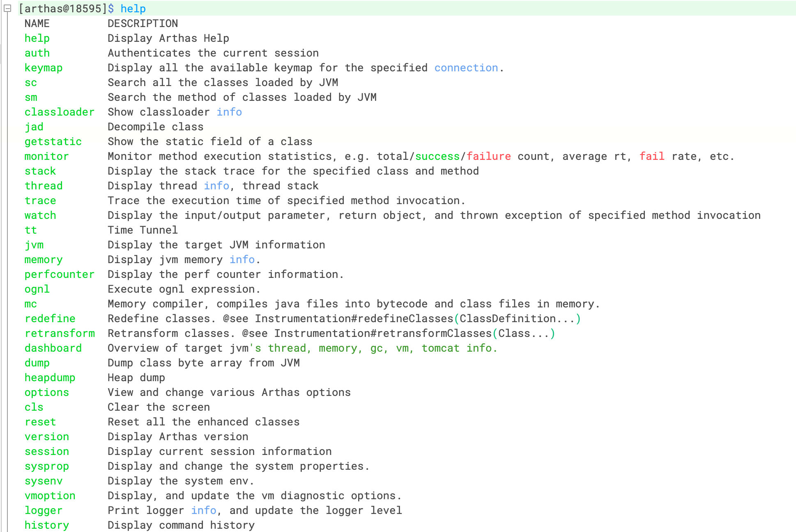

### cat [#cat]

**作用**：打印文件内容，和 linux 中的 cat 命令类似；如果没有写路径，则显示当前目录下的文件

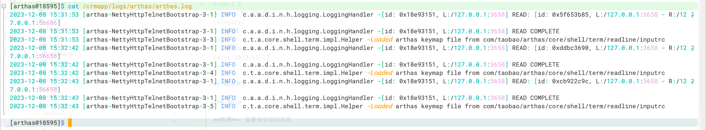

### grep [#grep]

**作用**：匹配查找，和 linux 里的 grep 命令类似，但它只能用于管道命令

**语法**：

| 参数列表          | 作用                                 |
| ----------------- | ------------------------------------ |
| `-n`              | 显示行号                             |
| `-i`              | 忽略大小写查找                       |
| `-m` 行数         | 最大显示行数，要与查询字符串一起使用 |
| `-e` "正则表达式" | 使用正则表达式查找                   |

> 查找包含 java 的行，返回带行号，且返回 10 条

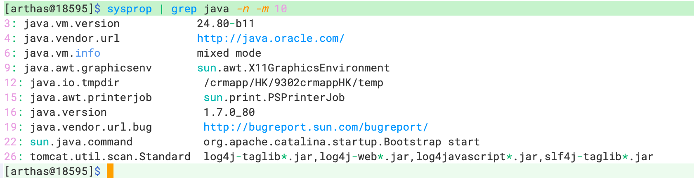

### pwd [#pwd]

**作用**：显示当前工作目录，和 linux 命令类似 (pwd: Print Working Directory)

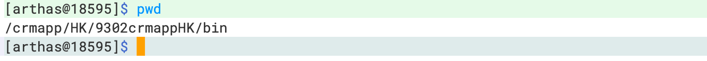

### cls [#cls]

**作用**：清空当前屏幕区域

### session [#session]

**作用**：查看当前会话的信息

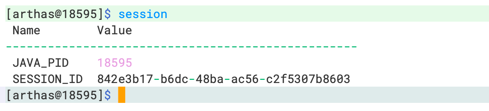

### reset [#reset]

**作用**：重置增强类，将被 Arthas 增强过的类全部还原

```sh 
# 还原指定类
reset Test
# 还原所有以List结尾的类
reset *List
# 还原所有类
rest
```

### version [#version]

**作用**：输出当前目标 Java 进程所加载的 Arthas 版本号

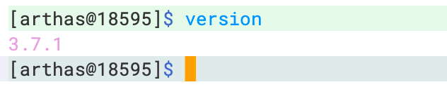

### history [#history]

**作用**：打印命令历史

### quit [#quit]

**作用**：退出当前 Arthas 客户端，其它 Arthas 客户端不会受到影响

### stop [#stop]

**作用**：关闭 Arthas 服务端，所有 Arthas 客户端全部退出

### keymap [#keymap]

**作用**：Arthas 快捷键列表及自定义快捷键

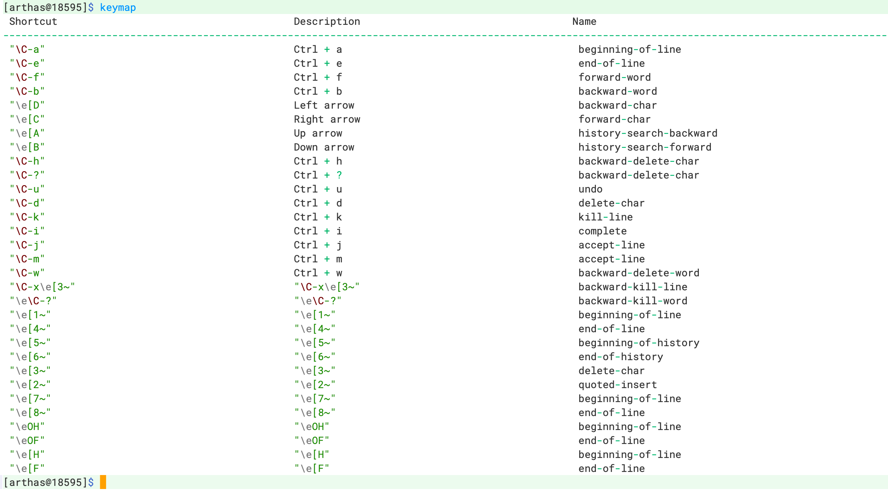

## jvm 相关 [#jvm-相关]

### dashboard 仪表板 [#dashboard-仪表板]

**作用**：显示当前系统的实时数据面板

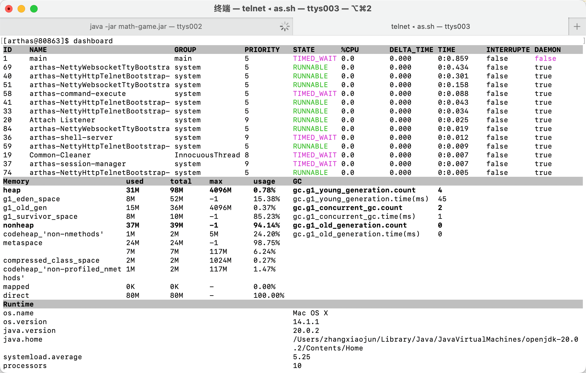

> 数据说明：
> &#8195;ID：Java 级别的线程 ID
> &#8195;NAME：线程名
> &#8195;GROUP：线程组名
> &#8195;PRIORITY：线程优先级（1~10），数字越大，优先级越高
> &#8195;STATE：线程的状态
> &#8195;CPU%：线程占用的 cpu 使用率，采样 100ms
> &#8195;TIME：线程运行总时间，数据格式为`分:秒` > &#8195;INTERRUPTED：线程当前的中断位状态
> &#8195;DAEMON：是否为 daemon 线程

### thread 线程 [#thread-线程]

**作用**：查看当前 JVM 中的线程堆栈信息

**参数说明**：

| 参数名称      | 参数说明                                |
| ------------- | --------------------------------------- |
| `数字`        | 线程 ID                                 |
| `[n:]`        | 指定最忙的前 N 个线程并打印堆栈         |
| `[b]`         | 找出当前阻塞其它线程的线程              |
| `[i <value>]` | 指定 cpu 占比统计的采样间隔，单位为毫秒 |
| `--all`       | 显示所有匹配的线程                      |

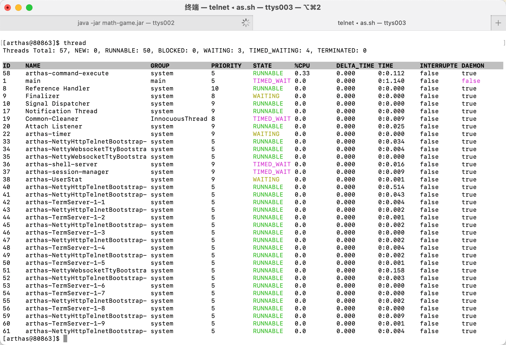

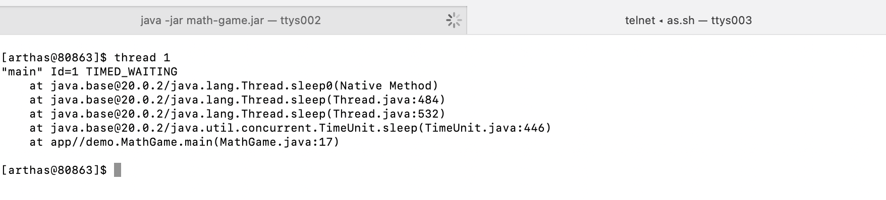

### jvm 虚拟机 [#jvm-虚拟机]

**作用**：查看当前 JVM 的信息

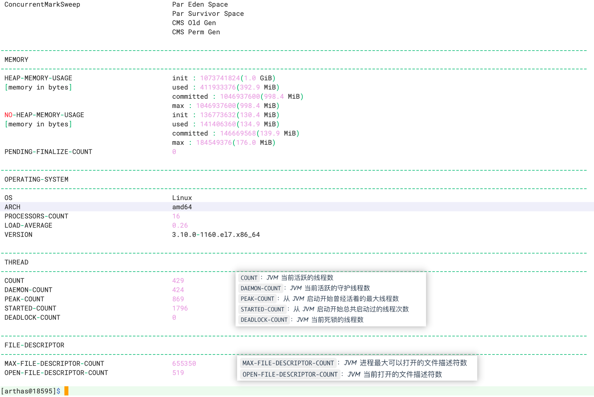

**THREAD 相关**：
`COUNT`：JVM 当前活跃的线程数
`DAEMON-COUNT`：JVM 当前活跃的守护线程数
`PEAK-COUNT`：从 JVM 启动开始曾经活着的最大线程数
`STARTED-COUNT`：从 JVM 启动开始总共启动过的线程次数
`DEADLOCK-COUNT`：JVM 当前死锁的线程数

**文件描述符相关**:
`MAX-FILE-DESCRIPTOR-COUNT`：JVM 进程最大可以打开的文件描述符数
`OPEN-FILE-DESCRIPTOR-COUNT`：JVM 当前打开的文件描述符数

### sysprop 系统属性 [#sysprop-系统属性]

**作用**：查看和修改当前 JVM 中的系统属性

```sh 
# 显示所有系统属性
sysprop

# 显示指定系统属性
sysprop user.name
```

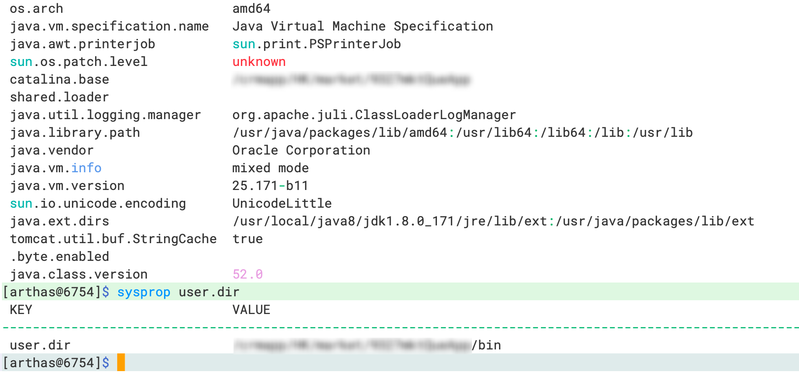

## class/classloader 相关 [#classclassloader-相关]

## monitor/watch/trace 相关 [#monitorwatchtrace-相关]
