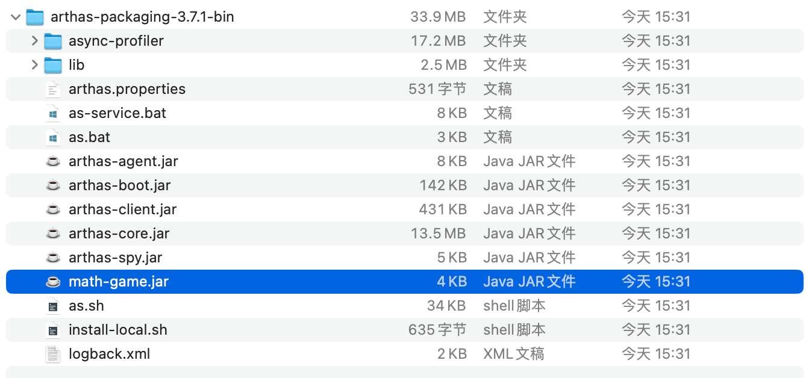
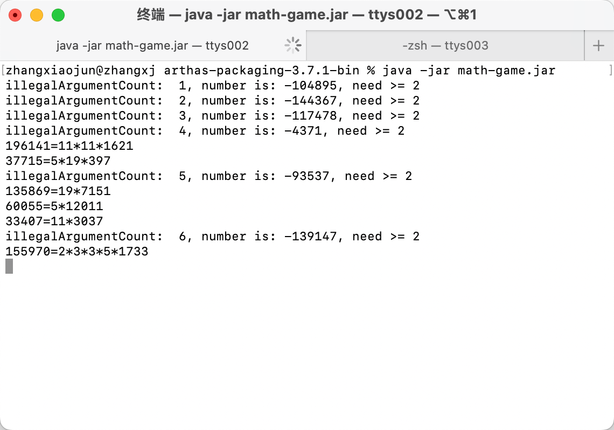
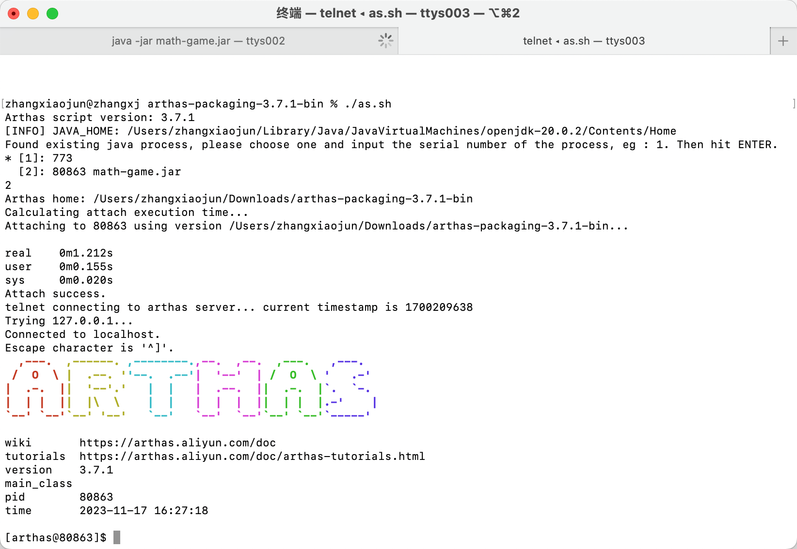
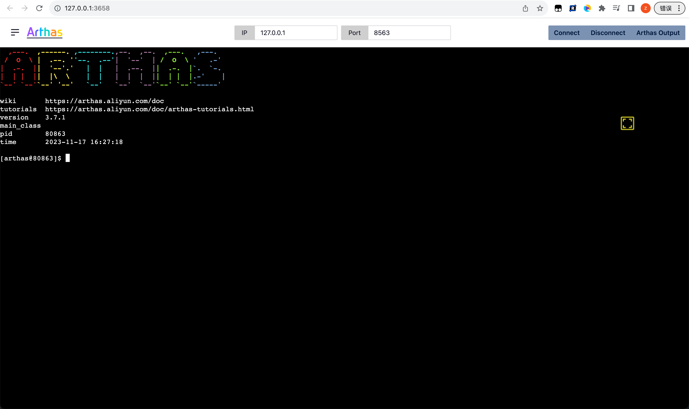
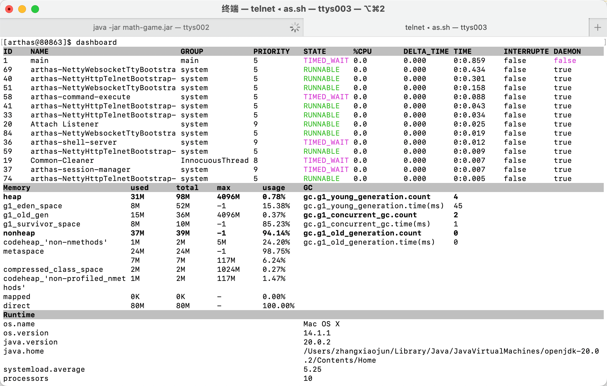
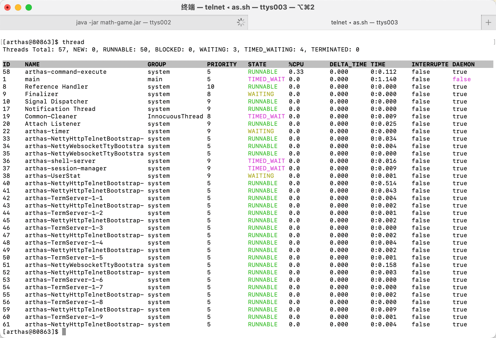
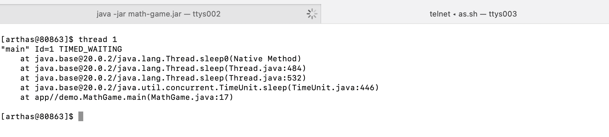
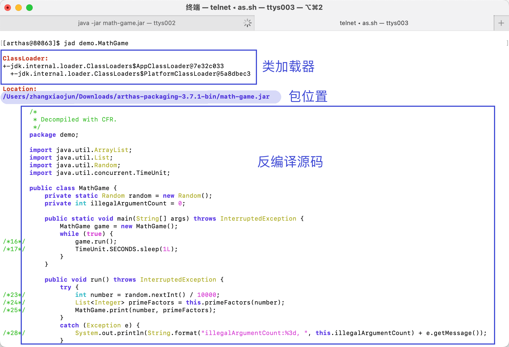
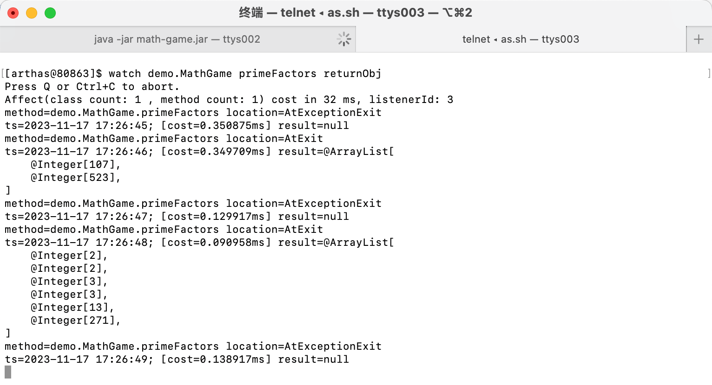

# 快速入门 (/docs/backend/arthas/guide)

## 案例 [#案例]

### 准备代码 [#准备代码]

&#8195;&#8195;全量安装时，解压后的目录下有个文件`math-game.jar`，我们使用`java -jar`的方式运行它来做后面的测试。

> 以下是一个简单的 Java 程序，每隔一秒生成一个随机数，再执行质因数分解，并打印出分解结果。


<details>
<summary>案例代码</summary>

```java 
package demo;

import java.util.ArrayList;
import java.util.List;
import java.util.Random;
import java.util.concurrent.TimeUnit;

public class MathGame {
    private static Random random = new Random();
    // 用于统计生成的不合法变量的个数
    public int illegalArgumentCount = 0;

    public static void main(String[] args) throws InterruptedException {
        MathGame game = new MathGame();
        // 死循环，每过 1 秒调用 1 次下面的方法(不是开启一个线程)
        while (true) {
            game.run();
            TimeUnit.SECONDS.sleep(1);
        }
    }

    // 分解质因数
    public void run() throws InterruptedException {
        try {
            // 随机生成 1 万以内的整数
            int number = random.nextInt() / 10000;
            // 调用方法进行质因数分解
            List<Integer> primeFactors = primeFactors(number);
            // 打印结果
            print(number, primeFactors);
        } catch (Exception e) {
            System.out.println(String.format("illegalArgumentCount:%3d, ",
                    illegalArgumentCount) + e.getMessage());
        }
    }

    // 打印质因数分解的结果
    public static void print(int number, List<Integer> primeFactors) {
        StringBuffer sb = new StringBuffer(number + "=");
        for (int factor : primeFactors) {
            sb.append(factor).append('*');
        }
        if (sb.charAt(sb.length() - 1) == '*') {
            sb.deleteCharAt(sb.length() - 1);
        }
        System.out.println(sb);
    }

    // 计算number的质因数分解
    public List<Integer> primeFactors(int number) {
        // 如果小于 2 ，则抛出异常，并且计数加 1
        if (number < 2) {
            illegalArgumentCount++;
            throw new IllegalArgumentException("number is: " + number + ", need >=
                    2");
        }
        // 用于保存每个质数
        List<Integer> result = new ArrayList<Integer>();
        // 分解过程，从 2 开始看能不能整除
        int i = 2;
        while (i <= number) { // 如果i大于number就退出循环
            // 能整除，则i为一个因数，number为整除的结果再继续从 2 开始
            if (number % i == 0) {
                result.add(i);
                number = number / i;
                i = 2;
            } else {
                i++; // 否则i++
            }
        }
        return result;
    }
}
```

</details>




### 启动 Demo [#启动-demo]

```sh 
java -jar math-game.jar
```



### 启动 arthas [#启动-arthas]

&#8195;&#8195;新开一个终端标签页，启动 arthas 选择需要粘附的进程。这里粘附的就是上一步的演示案例`math-game.jar`。粘附成功如下图所示。



> 如果端口号被占用，可以通过以下命令换成另一个端口号执行
>
> ```sh :no-line-numbers
> java -jar arthas-boot.jar --telnet-port 9998 --http-port -1
> ```

### 通过浏览器连接 arthas [#通过浏览器连接-arthas]

&#8195;&#8195;Arthas 目前支持 Web Console，用户在 attach 成功之后，可以直接访问：[http://127.0.0.1:3658/](http://127.0.0.1:3658/)。可以填入 IP，远程连接其它机器上的 arthas。默认情况下，arthas 只监听 127.0.0.1，所以如果想从远程连接，则可以使用`--target-ip` 参数指定 IP。



### dashboard 仪表板 [#dashboard-仪表板]

输入 dashboard(仪表板)，按回车，会展示当前进程的信息，按`ctrl + c`可以中断执行。

> 注：输入前面部分字母，按 tab 可以自动补全命令



> 上面截图总体分为三部分：
> &#8195;① 显示 JVM 中运行的所有线程：所在线程组，优先级，线程的状态，CPU 的占用率，是否是后台进程等
> &#8195;② 显示的 JVM 内存的使用情况
> &#8195;③ 操作系统的一些信息和 Java 版本号

### thread 线程 [#thread-线程]

**查看线程**：


**查看 ID 为 1 的线程**：


### jad 反编译 [#jad-反编译]

```sh 
jad demo.MathGame
jad --source-only demo.MathGame  # 只打印源码
```



### watch 函数执行数据观测 [#watch-函数执行数据观测]

```sh 
watch demo.MathGame primeFactors returnObj
```



### 退出 [#退出]

&#8195;&#8195;如果只是退出当前的连接，可以用`quit`或者`exit`命令。Attach 到目标进程上的 arthas 还会继续运行，端口会保持开放，下次连接时可以直接连接上。

&#8195;&#8195;如果想完全退出 arthas，可以执行`stop`命令。
