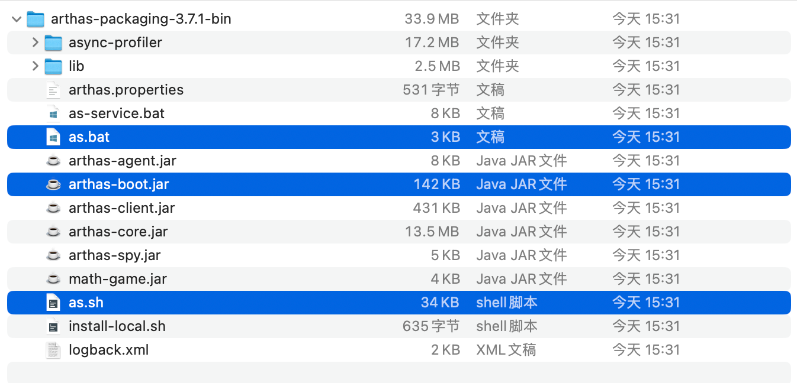

# 概述 (/docs/backend/arthas/introduce)

&#8195;&#8195;Arthas 是 Alibaba 开源的 Java 诊断工具，能帮助开发人员快速定位并解决 Java 开发过程中遇到的问题。

当你遇到以下类似问题而束手无策时，Arthas 可以帮助你解决：  
&#8195;① 这个类从哪个 jar 包加载的？为什么会报各种类相关的 Exception？
&#8195;② 我改的代码为什么没有执行到？难道是我没 commit？分支搞错了？
&#8195;③ 遇到问题无法在线上 debug，难道只能通过加日志再重新发布吗？
&#8195;④ 线上遇到某个用户的数据处理有问题，但线上同样无法 debug，线下无法重现！
&#8195;⑤ 是否有一个全局视角来查看系统的运行状况？
&#8195;⑥ 有什么办法可以监控到 JVM 的实时运行状态？
&#8195;⑦ 怎么快速定位应用的热点，生成火焰图？
&#8195;⑧ 怎样直接从 JVM 内查找某个类的实例？

&#8195;&#8195;Arthas 支持`JDK 6+`，支持 Linux/Mac/Windows，采用命令行交互模式，同时提供丰富的 Tab 自动补全功能，进一步方便进行问题的定位和诊断。

## 快速安装 [#快速安装]

官网文档地址：[Arthas Install](https://arthas.aliyun.com/doc/install-detail.html)

### 使用 arthas-boot（推荐） [#使用-arthas-boot推荐]

下载`arthas-boot.jar`，然后用`java -jar`的方式启动：

```shell 
curl -O https://arthas.aliyun.com/arthas-boot.jar
java -jar arthas-boot.jar
```

打印帮助信息：

```shell 
java -jar arthas-boot.jar -h
```

> 如果下载速度比较慢，可以使用 aliyun 的镜像：
>
> ```shell :no-line-numbers
> java -jar arthas-boot.jar --repo-mirror aliyun --use-http
> ```

### 使用`as.sh` [#使用assh]

&#8195;&#8195;Arthas 支持在 Linux/Unix/Mac 等平台上一键安装，请复制以下内容，并粘贴到命令行中，敲`回车`执行即可：

```shell 
curl -L https://arthas.aliyun.com/install.sh | sh
```

> &#8195;&#8195;上述命令会下载启动脚本文件`as.sh`到当前目录，你可以放在任何地方或将其加入到 $PATH 中。直接在 shell 下面执行`./as.sh`，就会进入交互界面。也可以执行`./as.sh -h`来获取更多参数信息。

## 全量安装 [#全量安装]

&#8195;&#8195;上面的快速安装方式，你会发现下载的包很小，但是在实际运行的时候还会去下载一些额外的包，如果你的设备访问互联网很慢，可以使用下面的全量安装方式。

&#8195;&#8195;最新版本下载：[Arthas](https://arthas.aliyun.com/download/latest_version?mirror=aliyun)

&#8195;&#8195;解压后的目录有`arthas-boot.jar`，然后用`java -jar`的方式启动；此外还有脚本`as.sh`(Linux/Unix/Mac)和`as.bat`(windows)，各自运行平台脚本的方式也可以启动。

> 主机解压命令：`unzip arthas-packaging-bin.zip`，当启动时，在`arthas-packaging-bin`同级目录下，有个`log`的文件夹，这个用于记录`arthas`日志。



## 卸载 [#卸载]

① Linux/Unix/Mac 平台

```shell 
rm -rf ~/.arthas/
rm -rf ~/logs/arthas
```

② Windows 平台直接删除用户目录下面的`.arthas`和`logs/arthas`目录
