# 索引的数据结构 (/docs/backend/database/advanced/data_structure_of_index)

## 为什么使用索引 [#为什么使用索引]

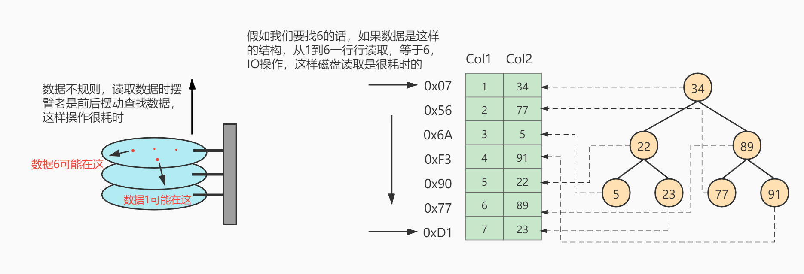

假如给数据使用`二叉树`这样的数据结构进行存储，如下图所示：

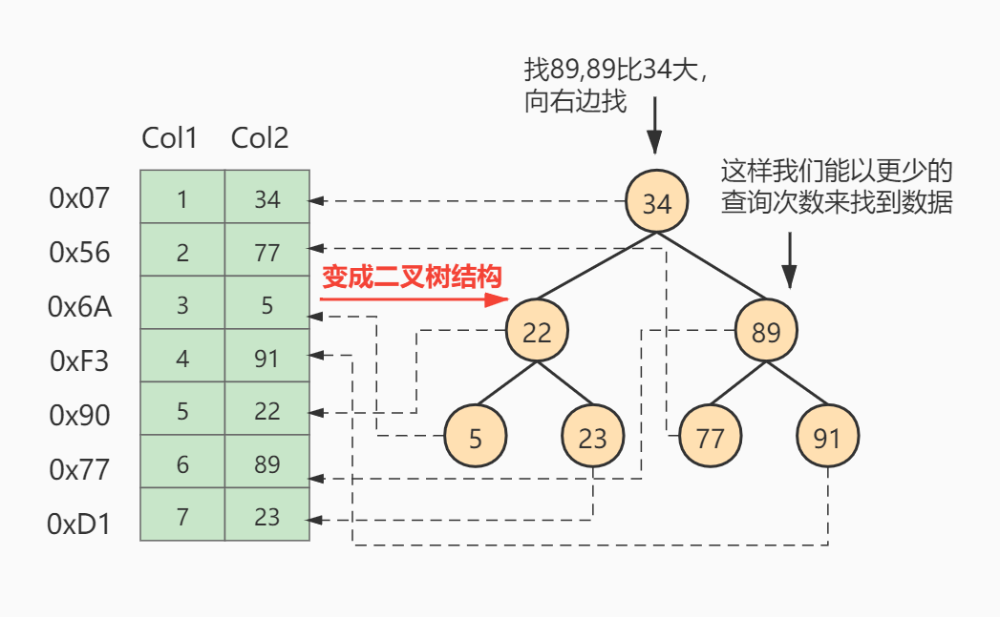

## 索引的优缺点 [#索引的优缺点]

### 索引概述 [#索引概述]

MySQL 官方对索引的定义为：<mark>索引(Index)是帮助 MySQL 高效获取数据的数据结构。</mark>

### 优点 [#优点]

① 类似图书馆建书目索引，<mark>提高数据检索的效率，降低数据库的 IO 成本</mark>，这也是创建索引最主要的原因；  
② 通过创建唯一索引，可以保证数据库表中每一行数据的唯一性；  
③ 在实现数据的参考完整性方面，可以加速表和表之间的连接。换句话说，对于有依赖关系的子表和父表联合查询时，可以提高查询速度；  
④ 在使用分组和排序子句进行数据查询时，可以显著减少查询分组和排序的时间，降低了 CPU 的消耗。

### 缺点 [#缺点]

① 创建索引和维护索引要耗费时间，并且随着数据量的增加，所耗费的时间也会增加；  
② 索引需要占用磁盘空间，除了数据表占用数据空间之外，每一个索引还要占用一定的物理空间，存储在磁盘上，如果有大量的索引，索引文件就可能比数据文件更快达到最大文件尺寸；  
③ 虽然索引大大提高了查询速度，但同时却会降低更新表的速度。当对表的数据进行增加、删除和修改的时候，索引也要动态地维护，这样就降低了数据维护的速度。

**<u>因此，选择使用索引时，需要综合考虑索引的优缺点</u>**。

## InnoDB 中索引的推演 [#innodb-中索引的推演]

### 索引之前的查找 [#索引之前的查找]

先看一个精准匹配的例子：

```sql 
SELECT [ 列名列表 ] FROM 表名 WHERE 列名 = xxx;
```

#### 在一个页中的查找 [#在一个页中的查找]

#### 在很多页中的查找 [#在很多页中的查找]

&#8195;&#8195;在没有索引的情况下，不论是根据主键列或者其它列的值进行查找，由于我们并不能快速的定位到记录所在的页，所以只能<mark>从第一个页</mark>沿着<mark>双向链表</mark>一直往下找，在每一个页中根据我们上面的查找方式去查找指定的记录。因为要遍历所有的数据页，所以这种方式显然是<mark>超级耗时</mark>的。这是`索引`应运而生。

### 设计索引 [#设计索引]

建一个表：

```sql 
CREATE TABLE index_demo(
  c1 INT,
  c2 INT,
  c3 CHAR(1),
  PRIMARY KEY(c1)
) ROW_FORMAT = Compact;
```

这个新建的`index_demo`表中有两个`INT`类型的列，一个`CHAR(1)`类型的列，而且规定了`c1`列作为主键，此外这个表使用`Compact`行格式来实际存储记录。下面是简化的`index_demo`表的行格式示意图：

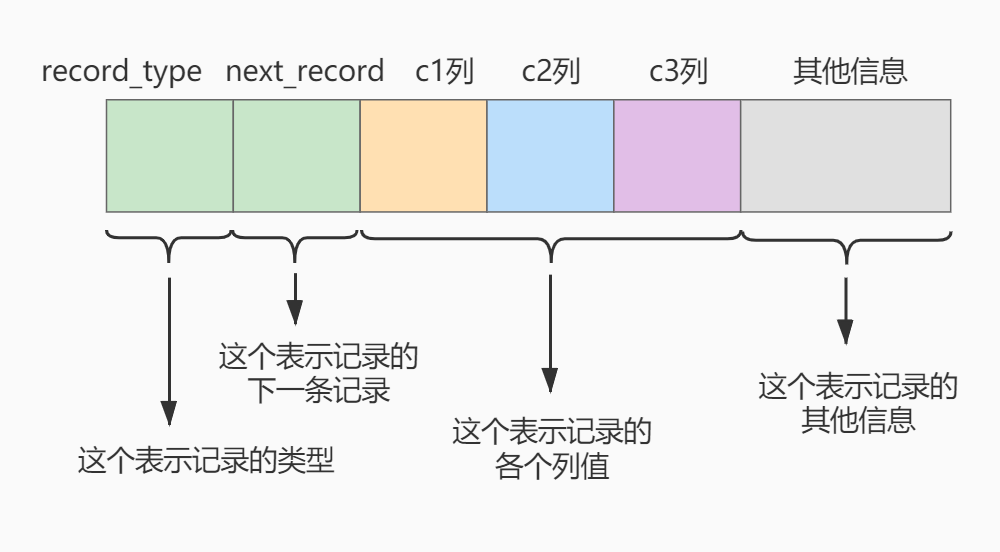

只在示意图里展示记录的这几个部分：

① `record_type`: 记录头信息的一项属性，表示记录的类型，`0`表示<mark>普通</mark>记录，`2`表示<mark>最小</mark>记录，`3`表示<mark>最大</mark>记录，`1`暂时还没用过；

② `next_record`: 记录头信息的一项属性，表示下一条地址相对于本条记录的地址偏移量，我们用箭头来表明下一条记录是谁；

③ `各列的值`: 这里只记录在 index_demo 表中的三个列，即：c1、c2、c3；

④ `其它信息`: 除了上述三种信息以外的所有信息，包括其他隐藏列的值以及记录的额外信息。

将记录格式示意图的其他信息项暂时去掉并把它竖起来的效果是下面这样:

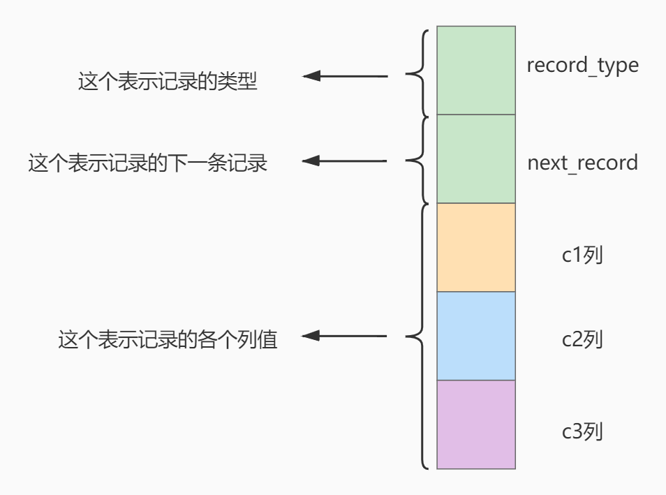

把一些记录放到页里的示意图就是下面这样：

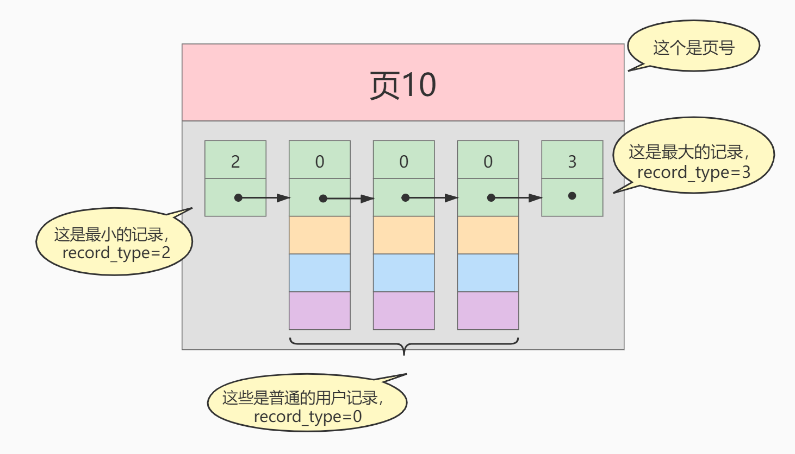

#### 一个简单的索引设计方案 [#一个简单的索引设计方案]

&#8195;&#8195;我们在根据某个搜索条件查找一些记录时为什么要遍历所有的数据页呢？因为各个页中的记录并没有规律，我们并不知道我们搜索条件匹配那些页中的记录，所以不得不一次遍历所有的数据页。所以如果我们想要快速的定位到需要查找的记录在哪些数据页中该怎么办？我们可以为快速定位记录所在的数据页而建立一个目录，建这个目录必须完成下面这些事：

① 下一个数据页中的用户记录的主键值必须大于上一个页中的用户记录的主键值

② 给所有页建立一个目录项


<Callout type="success" title="为上面几个页做好的目录如下">

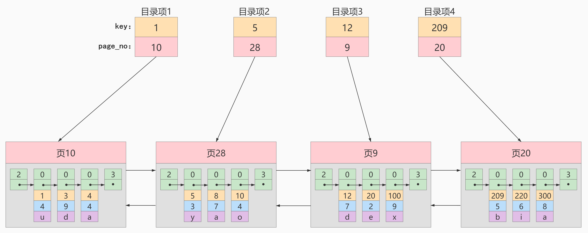

&#8195;&#8195;以`页28`为例，它对应`目录项2`，这个目录项中包含着该页的页号`28`以及该页中用户记录的做好主键值`5`。我们只需要把几个目录项在物理存储器上连续存储(比如：数组)，就可以实现根据主键值快速查找某条记录的功能。比如：查找主键值为`20`的记录，具体查找步骤分为两步：
&#8195;① 先从目录项中根据<mark>二分法</mark>快速确定出主键值为`20`的记录在`目录项3`中(因为`12 < 20 < 209`)，它对应的页是`页9`；
&#8195;② 再根据前面说的在页中查找记录的方式去`页9`中定位具体的记录。

至此，针对数据页做的简易目录就完成了。这个目录有一个别名，称为`索引`。

</Callout>


#### InnoDB 中的索引方案 [#innodb-中的索引方案]

(1) **迭代一次**：目录记录的页

我们把前面使用到的目录项放到数据页中的样子如下：

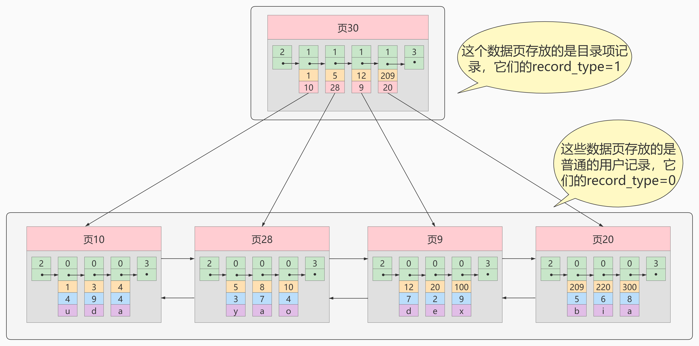

从图中可以看出来，我们新分配了一个编号为 30 的页来专门存储目录项记录。这里再次强调目录项记录和普通的用户记录的差异：

**不同点**：
&#8195;① 目录项记录的`record_type = 1`，而普通用户记录的`record_type = 0`；
&#8195;② 目录项记录只有<mark>主键值和页的编号</mark>两个列，而普通的用户记录的列是用户自己定义的，可能包含很多列，另外还有 InnoDB 自己添加的隐藏列；
&#8195;③ (了解)记录头信息里还有一个叫`min_rec_mask`的属性，<mark>只有在存储目录项记录的页中的主键值最小的目录项记录的 min_rec_mask 值为 1</mark>，其他的记录的 min_rec_mask 的值都是 0。

**相同点**：两者用的都是一样的数据页，都会为主键生成 Page Directory(页目录)，从而在按照主键值进行查找时可以使用二分法来加快查询速度。

<u>现在以查找主键为 20 的记录为例，根据某个主键值去查找记录的步骤就可以大致拆分为下面步骤</u>：
&#8195;① 先到存储目录项记录的页，也就是页 30 中通过二分法快速定位到对应目录项，因为 12 &lt; 20 &lt; 209，所以定位到对应的记录在页 9；
&#8195;② 再到存储用户记录的页 9 中根据二分法快速定位到主键值为 20 的用户记录。

---

(2) **迭代两次**：多个目录项记录的页

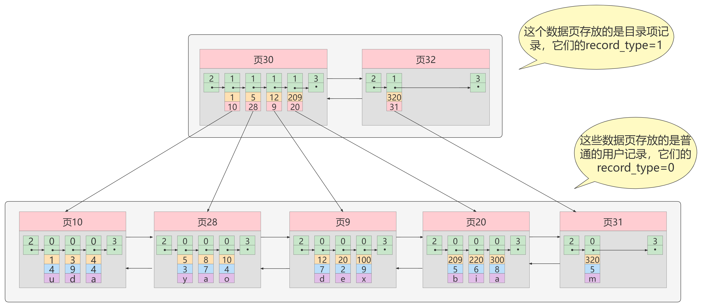

从图中可以看出，我们插入了一条主键值为 320 的用户记录之后需要两个新的数据页：

- 为存储改用户记录而新生成了`页31`
- 因为原先存储目录项记录的`页30`的容量已满(假设一个页只能存储四条目录项记录)，所以不得不需要一个新的`页32`来存放`页31`对应的目录项。

现在因为存储目录项记录的页不止一个，所以如果我们想根据主键值查找一条用户记录大致需要 3 个步骤，以查找主键值为 20 的记录为例：

① 确定<mark>目录项记录页</mark>

> 现在存储目录项记录的页有两个，即页 30 和页 32，又因为页 30 表示的目录项的主键值的范围是[1, 320)，页 32 表示的目录项的主键值不小于 320，所以主键值 20 的记录对应的目录项记录在页 30 中。

② 通过目录项记录页<mark>确定用户记录真实所在的页</mark>

③ 在真实存储用户记录的页中定位到具体的记录

---

(3) **迭代三次**：目录项记录页的目录页(给目录建目录)

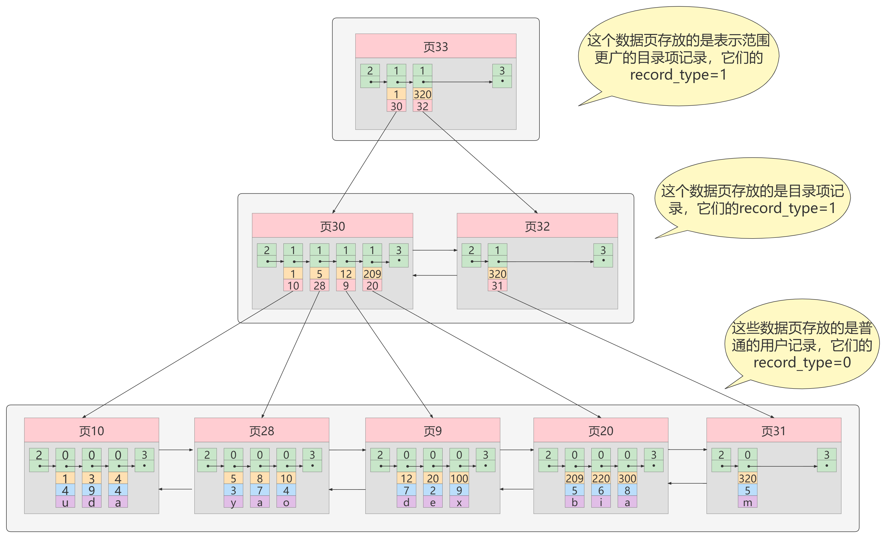

如图，我们生成了一个存储更高级目录项的`页33`，这个页中的两条记录分别代表页 30 和页 32，如果用户记录在主键值[1, 320)之间，则到页 30 查找具体记录；如果大于 320 则去页 32 找记录。

可以用下边这个图来描述它，这个数据结构就叫<mark>B+树</mark>。

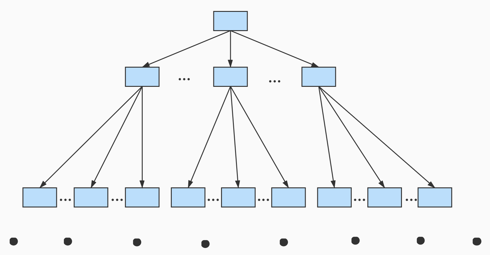

(4) **B+Tree**

&#8195;&#8195;一个 B+树的节点其实可以分为好多层，规定最下边的那层，也就是存放我们用户记录的那层为第`0`层，之后往上依次加。之前我们做了一个非常极端的假设：存放用户记录的页最多存放`3`条记录，存放目录项记录的页最多存放`4`条记录。其实真实环境中一个页存放的记录数量是非常大的，假设所有存放用户记录的叶子节点代表的数据页可以存放`100`条用户记录，所有存放目录项记录的内节点代表的数据页可以存放`1000`条目录项记录，那么：

- 如果 B+树只有一层，也就是只有 1 个用于存放用户记录的节点，最多能存放`100`条记录
- 如果 B+树有两层，最多存放`100 * 1000 = 10,0000`条记录
- 如果 B+树有三层，最多存放`100 * 1000 * 1000 = 1,0000,0000`条记录
- 如果 B+树有四层，最多存放`100 * 1000 * 1000 * 1000 = 1000,0000,0000`条记录

&#8195;&#8195;假设的四层 B+树能存放的记录数十分庞大！实际不可能存如此之多，所以一般情况下，我们<mark>用到的 B+树都不会超过 4 层</mark>，那我们通过主键值去查找某条记录最多只需要做 4 个页面的查找(查找三个目录页和一个数据页)，又因为在每个页面内有所谓的 Page Directory(页目录)，所以在页面内也可以通过<mark>二分法</mark>实现快速定位记录。

### 常见索引概念 [#常见索引概念]

索引按照物理实现方式，可以分为：聚簇(聚集)索引和非聚簇(聚集)索引。也把非聚簇索引称为二级索引或者辅助索引。

#### 聚簇索引 [#聚簇索引]

**特点**：
① 使用记录主键值的大小进行记录和页的排序，包括三个方面的含义：
&#8195;-- 页内的记录是按照主键的大小顺序排成一个<mark>单向链表</mark>
&#8195;-- 各个存放<mark>用户记录的页</mark>也是根据页中用户记录的主键大小顺序排成一个<mark>双向链表</mark>
&#8195;-- 存放<mark>目录项记录的页</mark>分为不同的层次，在同一层次中的页面也是根据页目录项记录的主键大小顺序排成一个<mark>双向链表</mark>

② B+树的<mark>叶子节点</mark>存储的就是完整的用户记录
&#8195;-- 所谓完整的用户记录，就是指这个记录中存储了所有列的值(包括隐藏列)

---

**优点**：
① <mark>数据访问更快</mark>，因为聚簇索引将索引和数据保存在同一个 B+树中，因此从聚簇索引中获取数据比非聚簇索引更快
② 聚簇索引对于主键的<mark>排序查找</mark>和<mark>范围查找</mark>速度非常快
③ 按照聚簇索引排序顺序，查询显示一定范围数据的时候，由于数据都是紧密相连，数据库不用从多个数据块中提取数据，所以<mark>节省了大量的 IO 操作</mark>

---

**缺点**：
① <mark>插入速度严重依赖于插入顺序</mark>，按照主键的顺序插入是最快的方式，否则将会出现页分裂，严重影响性能。因为，对于 InnoDB 表，我们一般都会定义一个**自增的 ID 列最为主键**
② <mark>更新主键的代价很高</mark>，因为将会导致被更新的行移动。因此，对于 InnoDB 表，我们一般定义**主键为不可更新**
③ <mark>二级索引访问需要两次索引查找</mark>，第一次找到主键，第二次根据主键值找到行数据

#### 非聚簇索引(辅助索引、二级索引) [#非聚簇索引辅助索引二级索引]

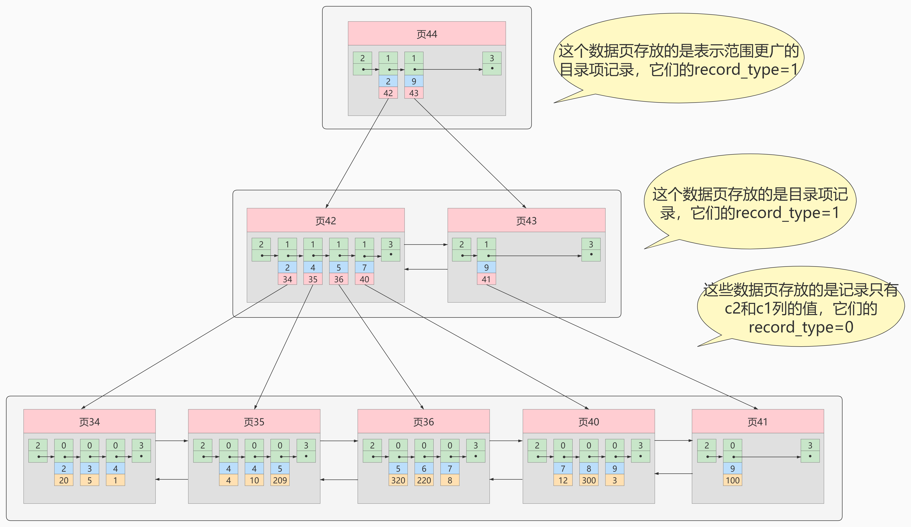

**概念**：我们根据这个以 c2 列大小排序的 B+树只能确定我们要查找的主键值，所以如果我们想根据 c2 列的值查找到完整的用户记录的话，仍然需要到聚簇索引中再查一遍，这个过程称为<mark>回表</mark>。也就是根据 c2 列的值查询一条完整的用户记录需要使用到<mark>2</mark>棵 B+树。

**问题**：为什么我们还需要一次回表操作呢？直接把完整的用户记录放叶子节点不行吗？

**回答**：如果把完整的用户记录放在叶子节点是可以不用回表，但是太占地方了，相当于每建立一棵树 B+树都需要把所有的用户记录再都拷贝一遍，这就有点太浪费存储空间了。

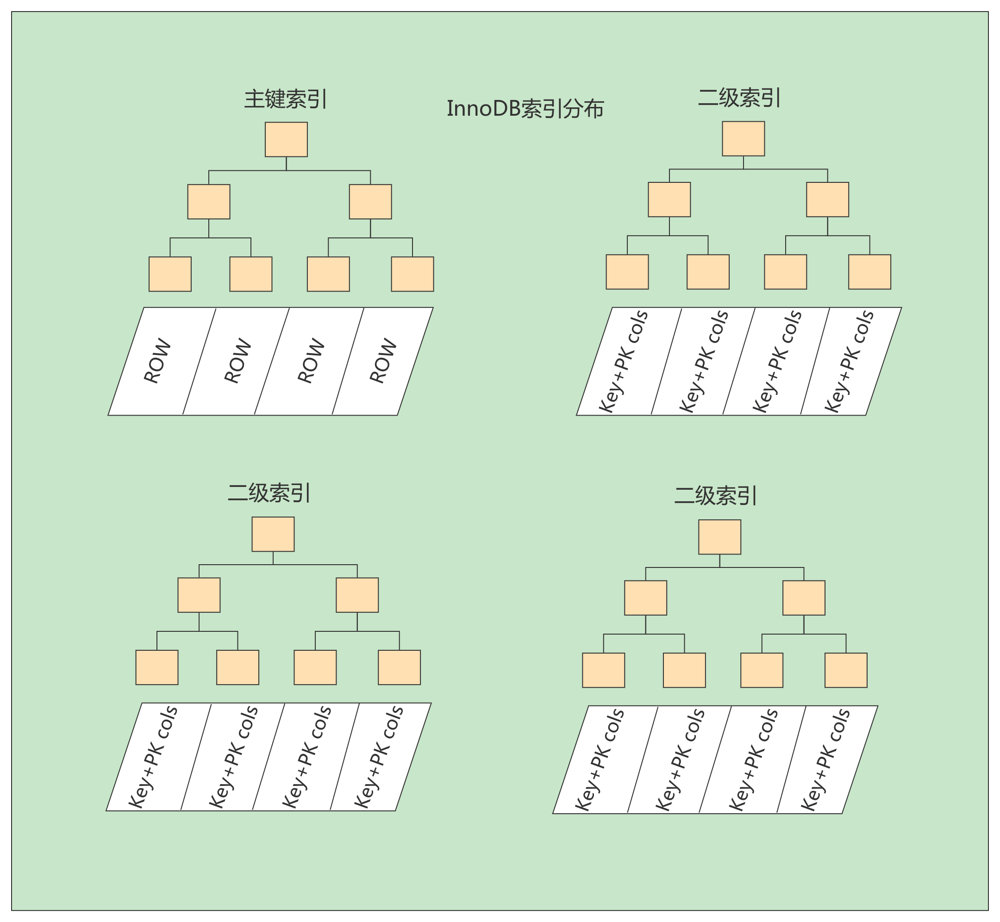

小结：聚簇索引与非聚簇索引的原理不同，在使用上也有一些区别：

① 聚簇索引的叶子节点存储的就是我们的`数据记录`，非聚簇索引的叶子节点存储的是`数据位置`。非聚簇索引不会影响数据表的物理存储顺序；
② 一个表<mark>只能有一个聚簇索引</mark>，因为只能有一种排序存储的方式，但可以有<mark>多个非聚簇索引</mark>，也就是多个索引提供数据检索；
③ 使用聚簇索引的时候，数据的查询效率不高，但如果对数据进行插入、删除、更新等操作，效率会比非聚簇索引低。

##### 联合索引 [#联合索引]

&#8195;&#8195;我们也可以同时以多个列的大小作为排序规则，也就是同时为多个列建立索引，比方说我们想让 B+树按照`c2和c3列`的大小进行排序，这个包含两层含义：
&#8195;① 先把各个记录和页按照 c2 列进行排序
&#8195;② 在 c2 列记录相同的情况下，采用 c3 列进行排序

&#8195;&#8195;注意一点，以 c2 和 c3 列大小为排序规则建立的 B+树称为`联合索引`，本质上也是一个二级索引。它的意思与分别为 c2 和 c3 列分别建立索引的表述是不同的，不同点如下：
&#8195;① 建立联合索引只会建立如上图一样的一棵 B+树
&#8195;② 为 c2 和 c3 列分别建立索引会分别以 c2 和 c3 列的大小为排序规则建立两棵 B+树

### InnoDB 的 B+树索引的注意事项 [#innodb-的-b树索引的注意事项]

① **根页面位置万年不动**
② **内节点中目录项记录的唯一性**
③ **一个页面最少存储两条记录**

## MyISAM 中的索引方案 [#myisam-中的索引方案]

**B 树索引适用存储引擎如表所示**：

| 索引/存储引擎 | MyISAM | InnoDB | Memory |
| ------------- | ------ | ------ | ------ |
| B-Tree 索引   | 支持   | 支持   | 支持   |

&#8195;&#8195;即使多个存储引擎支持同一种类型的索引，但是他们的实现原理也是不同的。InnoDB 和 MyISAM 默认的索引是 B-Tree 索引，而 Memory 默认的索引是 Hash 索引。

&#8195;&#8195;MyISAM 引擎使用<mark>B+Tree</mark>作为索引结构，叶子节点的 data 域存放的是<mark>数据记录的地址</mark>。

### MyISAM 索引的原理 [#myisam-索引的原理]

下面是 MyISAM 索引的原理图：

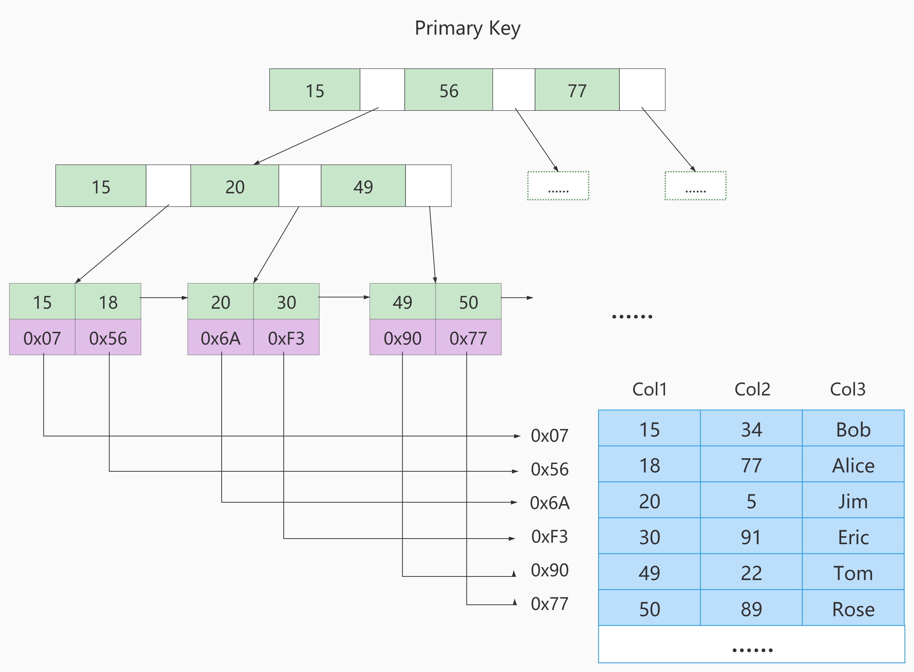

如果我们在 col2 上建立一个二级索引，则索引的结构如下图所示：

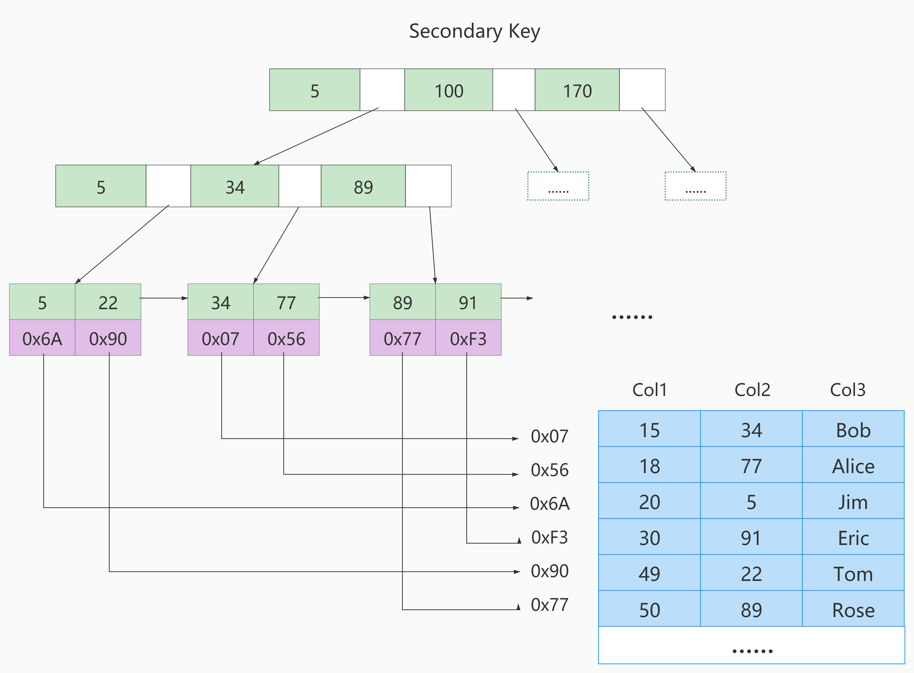

### MyISAM 和 InnoDB 对比 [#myisam-和-innodb-对比]

MyISAM 的索引方式都是"非聚簇"的，与 InnoDB 包含一个聚簇索引是不同的，小结两种引擎中索引的区别：
&#8195;① 在 InnoDB 存储引擎中，我们只需要根据主键值对`聚簇索引`进行一次查找就能找到对应记录，而在 MyISAM 中却需要进行一起`回表`操作，意味着 MyISAM 中建立的索引相当于全部都是`二级索引`；
&#8195;② InnoDB 的数据文件本身就是索引文件，而 MyISAM 索引文件和数据文件是<mark>分离的</mark>，索引文件仅保存数据记录的地址；
&#8195;③ InnoDB 的非聚簇索引 data 域存储相应记录`主键的值`，而 MyISAM 索引记录的是`地址`。换句话说，InnoDB 的所有非聚簇索引都引用主键作为 data 域；
&#8195;④ MyISAM 的回表操作是十分快速的，因为是拿着地址偏移量直接到文件中取数据的，反观 InnoDB 是通过获取主键之后再去聚簇索引里找记录，索然说也不慢，但是比不上直接用地址去访问；
&#8195;⑤ InnoDB 要求表<mark>必须有主键</mark>(MyISAM 可以没有)。如果没有显式指定，则 MySQL 系统会自动选择一个可以非空且唯一标识数据记录的列作为主键。如果不存在这种列，则 MySQL 自动为 InnoDB 表生成一个隐含字段作为主键，这个字段长度为 6 个字节，类型为长整型。

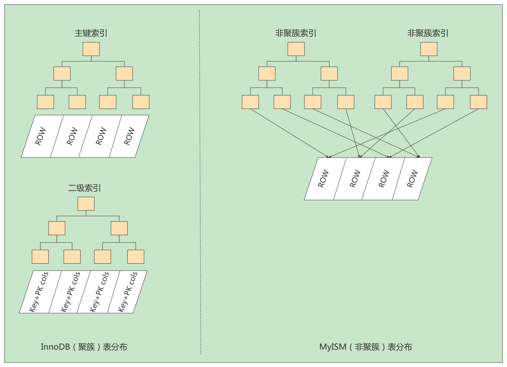

## 索引的代价 [#索引的代价]

索引是个好东西，可不能乱建，它在空间和时间上都会有消耗：

① **空间上的代价**
&#8195;&#8195;每建立一个索引都要为它建立一棵 B+树，每一棵 B+树的每一个节点都是一个数据页，一个页默认会占用`16kb`的存储空间，一棵很大的 B+树由许多数据页组成，那就是很大一片存储空间。

② **时间上的代价**
&#8195;&#8195;每次对表中的数据进行`增、删、改`操作时，都需要去修改各个 B+树索引。而且我们讲过，B+树每层节点都是按照索引列的值`从小到大的顺序排序`而成的`双向链表`。不论是叶子节点中的记录，还是内节点中的记录(也就是不论是用户记录还是目录项记录)都是按照索引列的值从小到大的顺序而形成了一个单向链表。而增、删、改操作可能回对节点和记录的排序造成破坏，所以存储引擎需要额外的时间进行一些`记录移位、页面分裂、页面回收`等操作来维护好节点和记录的排序。如果我们建立了许多索引，每个索引对应的 B+树都要进行相关的维护操作，会给性能拖后腿。

## MySQL 数据结构选择的合理性 [#mysql-数据结构选择的合理性]

### 全表遍历 [#全表遍历]

### Hash 结构 [#hash-结构]

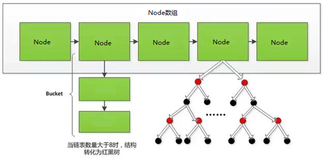

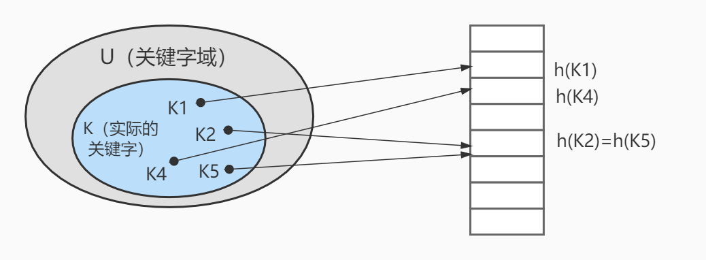

上图中哈希函数 h 有可能将两个不同的关键字映射到相同的位置，这叫做<mark>碰撞</mark>，在数据库中一般采用<mark>链接法</mark>来解决。在链接法中，将散列到同一槽位的元素放在一个链表中，如下图所示：

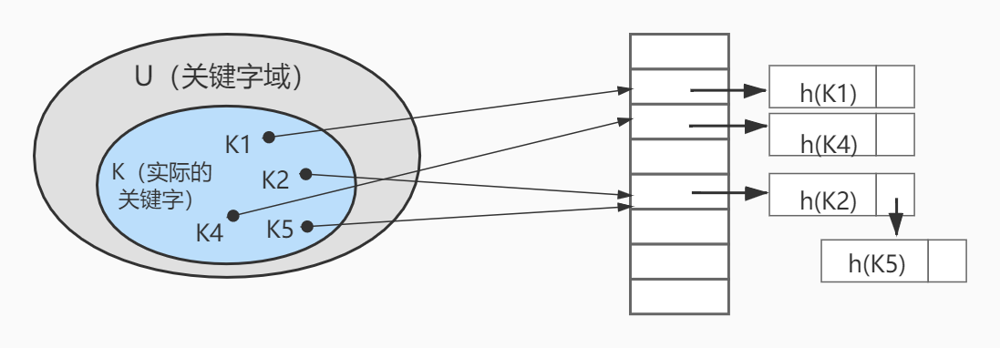

**实验**：体会数组和 hash 表的查找方面的效率区别

```java 
// 算法复杂度 O(n)
@Test
public void testOne() {
  int[] arr = new int[100000];
  for(int i = 0;i < arr.length;i ++) {
    arr[i] = i + 1;
  }
  long start = System.currentTimeMillis();
  for(int j = 1;j <= 100000;j ++) {
    int temp = j;

    for(int i = 0;i < arr.length;i ++) {
      if(temp == arr[i]) {
        break;
      }
    }
  }
  long end System.currentTimeMillis();
  System.out.println("time:" + (end - start));  // time: 823
}

// 算法复杂度 O(1)
@Test
public void testTwo() {
  HashSet<Interger> set = new HashSet<>(100000);
  for(int i = 0;i < 100000;i ++) {
    set.add(i + 1);
  }
  long start = System.currentTimeMillis();
  for(int j = 1;j <= 100000;j ++) {
    int temp = j;
    boolean contains = set.contains(temp);
  }
  long end System.currentTimeMillis();
  System.out.println("time:" + (end - start));  // time: 5
}
```

<u>Hash 结构效率高，那为什么索引结构要设计成树形呢？</u>

Hash 索引适用于存储引擎如表所示：

| 索引/存储引擎 | MyISAM | InnoDB | Memory   |
| ------------- | ------ | ------ | -------- |
| Hash 索引     | 不支持 | 不支持 | <mark>支持</mark> |

**Hash 索引的适用性**：

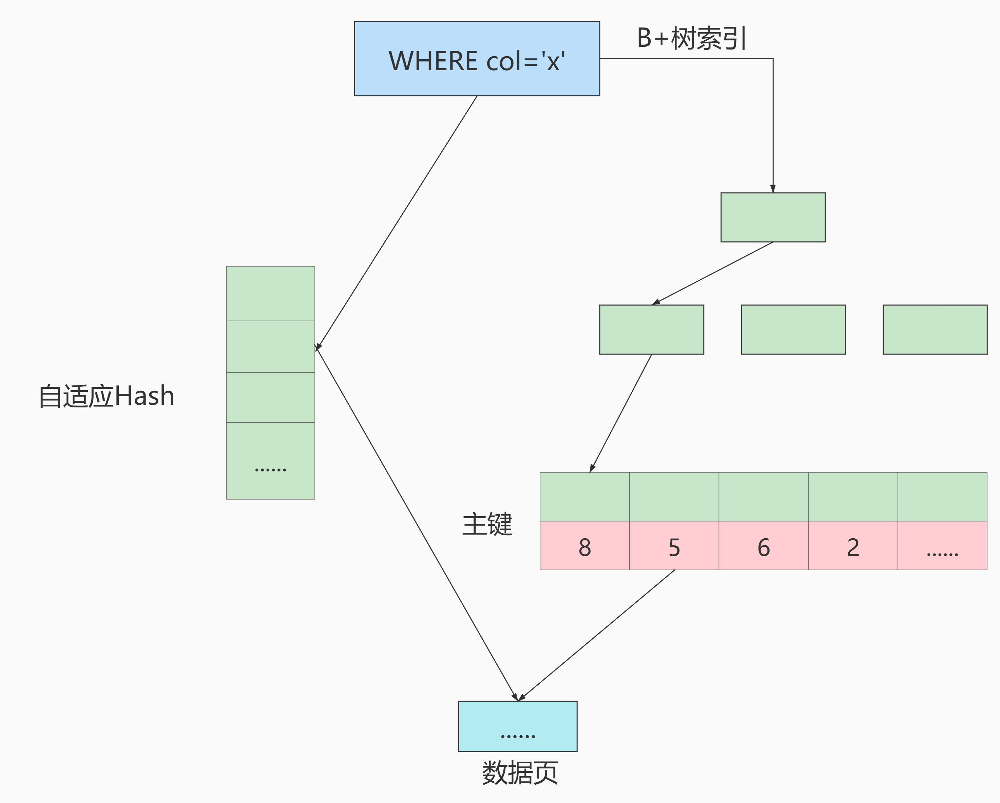

采用自适应 Hash 索引目的是方便根据 SQL 的查询条件加速定位到叶子节点，特别是当 B+树比较深的时候，通过自适应 Hash 索引可以明显提高数据的检索效率。

我们可以通过`innodb_adaptive_hash_index`变量来查看是否开启了自适应 Hash，比如：

```sql 
mysql> show variables like '%adaptive_hash_index';
+----------------------------+-------+
| Variable_name              | Value |
+----------------------------+-------+
| innodb_adaptive_hash_index | ON    |
+----------------------------+-------+
1 row in set (0.00 sec)
```

### 二叉搜索树 [#二叉搜索树]

我们利用二叉树作为索引结构，那么磁盘的 IO 次数和索引树的高度是相关的。

① 二叉搜索树的特点

② 查找规则

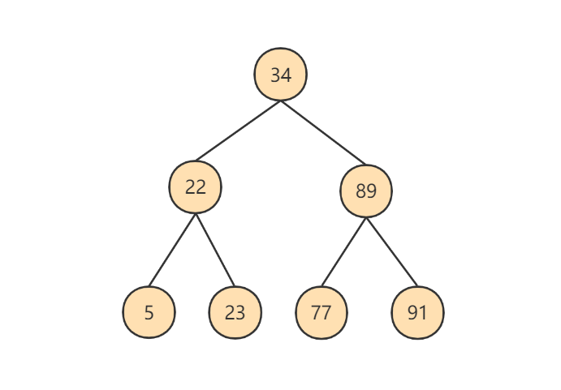

创造出来的二分搜索树如下图所示：

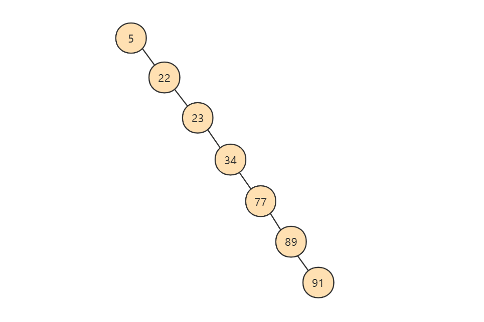

为了提高查询效率，就需要<mark>减少磁盘 IO 数</mark>。为了减少磁盘 IO 的次数，就需要尽量<mark>降低树的高度</mark>，需要把原来"瘦高"的树结构变的"矮胖"，树的每层的分叉越多越好。

### AVL 树 [#avl-树]

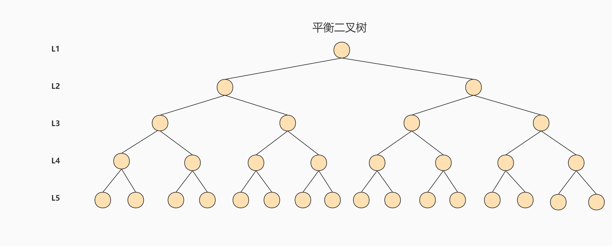

针对同样的数据，如果我们把二叉树改成 M 叉树(M > 1) 呢？当 M=3 时，同样的 31 个节点可以由下面的三叉树来进行存储：

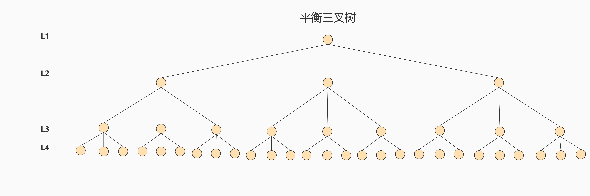

### B-Tree [#b-tree]

B 树的结构如下图所示：

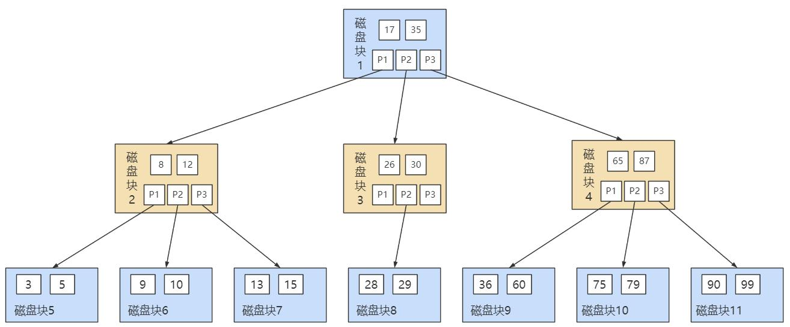

**一个 M 阶的 B 树(M>2)有以下特性**：
① 根节点的儿子数的范围是[2, M]
② 每个中间节点包含 k-1 个关键字和 k 个孩子，孩子的数量 = 关键字的数量 + 1，k 的取值范围为[ceil(M/2), M]
③ 叶子节点包括 k-1 个关键字(叶子节点没有孩子)，k 的取值范围为[ceil(M/2), M]
④ 假设中间节点节点的关键字为 Key[1], Key[2],...,Key[k-1]，且关键字按照升序排序，即 Key[i]&lt;Key[i+1]。此时 k-1 个关键字相当于划分了 k 个范围，也就是对应着 k 个指针，即为 P[1], p[2],...,P[K]。其中 P[1]指向关键字小于 Key[1]的子树，P[i]指向关键字属于(Key[i-1], Key[i])的子树，P[k]指向关键字大于 Key[k-1]的子树
⑤ 所有叶子节点位于同一层

&#8195;&#8195;上面那张图所表示的 B 树就是一棵 3 阶的 B 树。我们可以看下磁盘块 2，里面的关键字为(8, 12)，它有三个孩子(3, 5)，(9, 10)和(13, 15)，你能看到(3, 5)小于 8，(9, 10)在 8 到 12 之间，而(13, 15)大于 12，刚好符合刚才我们给出的特征。

&#8195;&#8195;然后我们来看下如何用 B 树进行查找。假设我们想要查找的关键字是 9，那么步骤可以分为下面几步：
&#8195;&#8195;&#8195;① 我们与根节点的关键字(17, 35)进行比较，9 小于 17 那么得到指针 P1；
&#8195;&#8195;&#8195;② 按照指针 P1 找到磁盘块 2，关键字为(8, 12)，因为 9 在 8 和 12 之间，所以我们得到指针 P2；
&#8195;&#8195;&#8195;③ 按照指针 P2 找到磁盘块 6，关键字为(9, 10)，然后找到了关键字 9。

&#8195;&#8195;你能看出来在 B 树的所有过程中，我们比较的次数并不少，但如果把数据读取出来然后再内存中进行比较，这个时间就是可以忽略不计的。而读取磁盘块本身需要进行 I/O 操作，消耗的时间比在内存中进行比较所需要的时间要多，是数据查找用时的重要因素。<mark>B 树相比于平衡二叉树来说磁盘 I/O 操作要少</mark>，在数据查询中比平衡二叉树效率要高。所以<mark>只要树的高度足够低，IO 次数足够少，就能够提高查询性能</mark>。

**再举例一**：

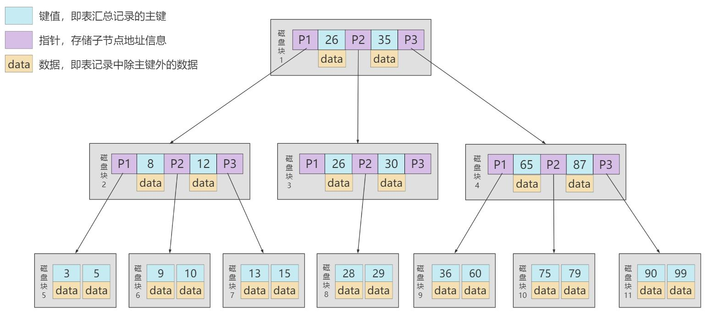

### B+Tree [#btree]

B+Tree 是在 B-Tree 基础上的一种优化，使其更适合实现外存储索引结构，InnoDB 存储引擎就是用 B+Tree 实现其索引结构。

**B+树和 B 树的差异**：
① 有 k 个孩子的节点就有 k 个关键字，也就是孩子数量 = 关键字数，而 B 树中，孩子数量 = 关键字数 + 1；
② 非叶子节点的关键字也会同时存在子节点中，并且是在子节点中所有关键字的最大(或最小)；
③ 非叶子节点仅用于索引，不保存数据记录，跟记录有关的信息都放在叶子节点中，而 B 树中，<mark>非叶子节点既保存索引，也保存数据记录</mark>；
④ 所有关键字都在叶子节点出现，叶子节点构成一个有序链表，而且叶子节点本身按照关键字的大小从小到大顺序链接。

> B 树和 B+树都可以作为索引的数据结构，在 MySQL 中采用的是 B+树，但 B 树和 B+树各自有自己的应用场景，不能说 B+树完全比 B 树好，反之亦然。

**思考题：为了减少 IO，索引树会一次性加载吗？**
**思考题：B+树的存储能力如何？为何说一般查找行记录，最多只需 1~3 次磁盘 IO？**
**思考题：为什么说 B+树比 B-树更适合实际应用中操作系统的文件索引和数据库索引?**
**思考题：Hash 索引和 B+树索引的区别**
**思考题：Hash 索引与 B+树索引是在建索引的时候手动指定的吗？**

### R 树 [#r-树]

&#8195;&#8195;R-Tree 在 MySQL 很少使用，仅支持<mark>geometry 数据类型</mark>，支持该类型的存储引擎只有 MyISAM、BDB、InnoDB、NDB、Archive 几种。举例 R 树在现实领域中能够解决的例子：查找 20 英里以内的餐厅。如果没有 R 树你会怎么解决？一般情况下我们会把餐厅坐标(x, y)分为两个字段存放在数据库中，一个字段记录经度，另一个字段记录纬度。这样的话我们就需要遍历所有的餐厅获取其位置信息，然后计算是否满足要求。如果一个地区有 100 家餐厅的话，我们就要进行 100 次位置计算操作了，如果应用到谷歌、百度地图这种超大数据库中，这种方法便必定不可行了。R 树就很好的<mark>解决了这种高纬度空间搜索问题</mark>。它把 B 树的思想很好的扩展到了多维空间，采用了 B 树分割空间的思想，并在添加、删除操作时采用合并、分解结点的方法，保证树的平衡性。因此，R 树就是一棵用来<mark>存储高维数据的平衡树</mark>。相当于 B-Tree，R-Tree 的优势在于范围查找。

| 索引/存储引擎 | MyISAM | InnoDB | Memory     |
| ------------- | ------ | ------ | ---------- |
| R-Tree 索引   | 支持   | 支持   | <mark>不支持</mark> |

### 附录：算法的时间复杂度 [#附录算法的时间复杂度]

同一问题可用不同算法解决，而算法的质量优劣将影响到算法乃至程序的效率。算法分析的目的在于选择合适算法和改进算法。

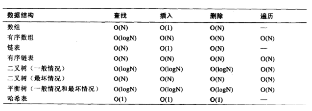
