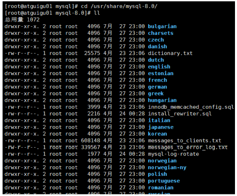
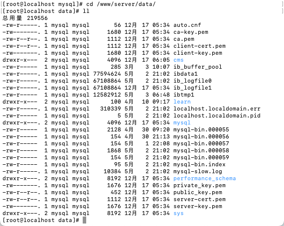

# MySQL的数据目录 (/docs/backend/database/advanced/dir_of_mysql)

## MySQL8 的主要目录结构 [#mysql8-的主要目录结构]

```sh 
[root@zhangxj ~] % find / -name mysql
```

### 数据库文件的存放路径 [#数据库文件的存放路径]

**MySQL 数据库文件的存放路径**：

```sql 
mysql> show variables like 'datadir';
+---------------+-------------------+
| Variable_name | Value             |
+---------------+-------------------+
| datadir       | /www/server/data/ |
+---------------+-------------------+
1 row in set (0.01 sec)
```

> 此处以自己实际情况为准，我的存放在`/www/server/data/`路径下

### 相关命令目录 [#相关命令目录]

**相关命令目录**：`/usr/bin（mysqladmin、mysqlbinlog、mysqldump等命令）和/usr/sbin`

```sh 
[root@localhost /]# cd /usr/bin
[root@localhost bin]# find . -name 'mysqladmin*'
./mysqladmin
[root@localhost bin]# find . -name 'mysqldump*'
./mysqldump
./mysqldumpslow
```

### 配置文件目录 [#配置文件目录]

**配置文件目录**：`/usr/share/mysql-8.0（命令及配置文件），/etc/mysql（如my.cnf）`



## 数据库和文件系统的关系 [#数据库和文件系统的关系]

### 查看默认数据库 [#查看默认数据库]

查看当前主机上有哪些数据库：

```sql 
mysql> show databases;
```

可以看到有 4 个数据库是属于 MySQL 自带的系统数据库：

① `mysql`

&#8195;&#8195;MySQL 系统自带的核心数据库，它存储了 MySQL 的用户账号和权限信息，一些存储过程、事件的定义信息，一些运行过程中产生的日志信息，一些帮助信息以及时区信息等。

② `information_schema`

&#8195;&#8195;MySQL 系统自带的数据库，这个数据库保存着 MySQL 服务器<mark>维护的所有其他数据库的信息</mark>，比如有哪些表、哪些视图、哪些触发器、哪些列、哪些索引等等。这些信息并不是真实的用户数据，而是一些描述性信息，有时候也称之为<mark>元数据</mark>。在系统数据库`information_schema`中提供了一些以`innodb_sys`开头的表，用户表示内部系统表。

```sql 
mysql> SHOW TABLES LIKE 'innodb_sys%';
+--------------------------------------------+
| Tables_in_information_schema (innodb_sys%) |
+--------------------------------------------+
| INNODB_SYS_DATAFILES                       |
| INNODB_SYS_VIRTUAL                         |
| INNODB_SYS_INDEXES                         |
| INNODB_SYS_TABLES                          |
| INNODB_SYS_FIELDS                          |
| INNODB_SYS_TABLESPACES                     |
| INNODB_SYS_FOREIGN_COLS                    |
| INNODB_SYS_COLUMNS                         |
| INNODB_SYS_FOREIGN                         |
| INNODB_SYS_TABLESTATS                      |
 +--------------------------------------------+
10 rows in set (0.00 sec)
```

③ `performance_schema`

&#8195;&#8195;MySQL 系统自带的数据库，这个数据库主要保存 MySQL 服务器运行过程中的一些状态信息，可以用来<mark>监控 MySQL 服务的各类性能指标</mark>。包括统计最新执行了哪些语句，在执行过程中的每个阶段都花费了多长时间，内存的使用情况等信息。

④ `sys`

&#8195;&#8195;MySQL 系统自带的数据库。这个数据库主要是通过<mark>视图</mark>的形式把`information_schema`和`performance_schema`结合起来，帮助系统管理员和开发人员监控 MySQL 的技术性能。

### 数据库在文件系统中的表示 [#数据库在文件系统中的表示]

我的主机上数据目录如下：



&#8195;&#8195;这个数据目录下的文件和子目录比较多，除了`information_schema`这个系统数据库外，其他的数据库在<mark>数据目录</mark>下都有对应的子目录。

以`learn`这个数据库为例：


<Tabs items={["MySQL 5.7", "MySQL 8.0"]}>
<Tab value="MySQL 5.7">

```shell 
[root@localhost data]# cd learn
[root@localhost learn]# ll
总用量 300
-rw-r----- 1 mysql mysql     61 3月  22 09:52 db.opt
-rw-r----- 1 mysql mysql   8982 4月  10 09:17 employees.frm
-rw-r----- 1 mysql mysql 180224 4月  11 12:04 employees.ibd
-rw-r----- 1 mysql mysql   8684 3月  29 09:14 student.frm
-rw-r----- 1 mysql mysql  98304 3月  29 09:13 student.ibd
```

</Tab>
<Tab value="MySQL 8.0">

```shell 
[root@localhost data]# cd learn
[root@localhost learn]# ll
总用量 280
-rw-r----- 1 mysql mysql 180224 4月  11 12:04 employees.ibd
-rw-r----- 1 mysql mysql  98304 3月  29 09:13 student.ibd
```

</Tab>
</Tabs>


### 表在文件系统中的表示 [#表在文件系统中的表示]

#### InnoDB 存储引擎模式 [#innodb-存储引擎模式]

##### 表结构(InnoDB) [#表结构innodb]

&#8195;&#8195;为了保存表结构，`InnoDB`在数据目录下对应的数据库子目录下创建了一个专门用于描述表结构的文件，文件名是这样的：`表名.frm`

例如：我们在`learn`数据库下创建一个名为`test`的表：

```sql 
CREATE TABLE test (
  col INT
);
```

&#8195;&#8195;那么在数据库`learn`对应的子目录下就会创建一个名为`test.frm`的用于描述表结构的文件。`.frm`文件的格式在不同的平台上都是相同的。这个是以二进制格式存储的，直接打开是乱码。

##### 表中数据和索引(InnoDB) [#表中数据和索引innodb]

① 系统表空间(system tablespace)

&#8195;&#8195;默认情况下，InnoDB 会在数据库目录下创建一个名为`ibdata1`、大小为`12M`的文件，这个文件就是对应的`系统表空间`在文件系统上的表示。注意这个文件是<mark>自扩展文件</mark>，当不够用的时候会自己增加文件大小。

&#8195;&#8195;如果你想让系统表空间对应文件系统上多个实际文件，或者仅仅觉得原来的`ibdata1`这个文件名难听，那么可以在 MySQL 启动时配置对应的文件路径以及它们的大小，比如修改`my.cnf`配置如下：

```text 
[server]
# 分别创建大小512M，文件名为data1、data2的两个文件
innodb_data_file_path=data1:512M;data2:512M:autoextend
```

② 独立表空间(file-per-table tablespace)

&#8195;&#8195;在 MySQL 5.6 以及之后的版本中，InnoDB 并不会默认的把各个表的数据存储在系统表空间中，而是<mark>为每一个表建立一个独立表空间</mark>，也就是说我们创建多少个表，就有多少个独立表空间。使用独立表空间来存储表数据的话，会在该表所属数据库对应的子目录下创建一个表示该独立表空间的文件，文件名和表名相同，只不过添加了一个`.ibd`的扩展名而已，所以完整的名称为：`表名.ibd`。

例如：我们在`learn`数据库下创建一个名为`test`的表：

```sql 
CREATE TABLE test (
  col INT
);
```

&#8195;&#8195;在对应的子目录下就会生成`test.frm`、`test.ibd`的两个文件，其中`test.ibd`文件就用来存储`test`表中的数据和索引。

③ 系统表空间与独立表空间的设置

&#8195;&#8195;可以自己指定使用<mark>系统表空间</mark>还是<mark>独立表空间</mark>来存储数据，这个功能由启动参数`innodb_file_per_table`控制，比如说我们想刻意将表数据都存储到系统表空间时，可以在启动 MySQL 服务器的时候这样配置：

```text 
[server]
# 0：代表使用系统表空间； 1：代表使用独立表空间
innodb_file_per_table=0
```

默认情况：

```sql 
mysql> show variables like 'innodb_file_per_table';
+-----------------------+-------+
| Variable_name         | Value |
+-----------------------+-------+
| innodb_file_per_table | ON    |
+-----------------------+-------+
1 row in set (0.01 sec)
```

④ 其它类型的表空间

&#8195;&#8195;随着 MySQL 的发展，除了上述两种老牌表空间之外，现在还新提出了一些不同类型的表空间，比如通用表空间（general tablespace）、临时表空间（temporary tablespace）等。

#### MyISAM 存储引擎模式 [#myisam-存储引擎模式]

##### 表结构(MyISAM) [#表结构myisam]

&#8195;&#8195;在存储表结构方面，`MyISAM`和`InnoDB`一样，也是在数据目录下对应子目录下创建一个专门用于描述表结构的文件：`表名.frm`

##### 表中数据和索引(MyISAM) [#表中数据和索引myisam]

&#8195;&#8195;在 MyISAM 中的索引全部都是<mark>二级索引</mark>，该存储引擎的<mark>数据和索引是分开存放</mark>的。所以在文件系统中也是使用不同的文件来存储数据文件和索引文件，同时表数据都存放在对应的数据库子目录下。假如`test`表使用`MyISAM`存储引擎的话，那么在它所在数据库对应的目录下会为`test`表创建这三个文件：

```text 
test.frm 存储表结构
test.MYD 存储数据(MYData)
test.MYI 存储索引(MYIndex)
```

### 小结 [#小结]

举例：`数据库a`，`表b`

① 如果表`b`采用`InnoDB`，对应数据目录的子目录下会产生一个或两个文件：

&#8195;&#8195;`b.frm`：描述表结构文件，字段长度等

&#8195;&#8195;如果采用<mark>系统表空间</mark>模式，数据信息和索引都存储在`ibdata1`中

&#8195;&#8195;如果采用<mark>独立表空间</mark>模式，对应子目录下还会生成一个`b.ibd`文件，用于存储数据信息和索引信息

② 如果表`b`采用`MyISAM`，对应数据目录的子目录下会产生三个文件：

&#8195;&#8195;MySQL 5.7 中：`b.frm`：描述表结构文件，字段长度等；  
&#8195;&#8195;MySQL 8.0 中：`b.xxx.sdi`：描述表结构文件，字段长度等

&#8195;&#8195;`b.MYD`：数据信息文件，存储数据信息(如果采用独立表空间结构)

&#8195;&#8195;`b.MYI`：存放索引信息文件
