# InnoDB数据存储结构 (/docs/backend/database/advanced/innodb_data_strore_structure)

## 数据库的存储结构：页 [#数据库的存储结构页]

&#8195;&#8195;索引结构给我们提供了高效的索引方式，不过索引信息以及数据记录都是保存在文件上的，确切的说是存储在页结构中。另一方面，索引是在存储引擎中实现的，MySQL 服务器上的存储引擎负责对表中数据的读取和写入工作。不同存储引擎中<mark>存放的格式</mark>一般是不同的，甚至有的存储引擎比如 Memory 都不用磁盘来存储数据。
&#8195;&#8195;由于<mark>InnoDB 是 MySQL 默认的存储引擎</mark>，所以下面主要介绍 InnoDB 存储引擎的数据存储结构。

### 磁盘与内存交互基本单位：页 [#磁盘与内存交互基本单位页]

&#8195;&#8195;InnoDB 将数据划分为若干个页，InnoDB 页的大小默认是 16KB。
&#8195;&#8195;以<mark>页</mark>作为磁盘和内存之间交互的<mark>基本单位</mark>，也就是一次最少从磁盘中读取 16KB 的内容到内存中，一次最少把内存中的 16KB 内容刷新到磁盘中，也就是说，**在数据库中，不论读一行，还是读多行，都是将这些行所在的页进行加载，也就是说，数据库管理存储空间的基本单位是页(Page)，数据库 I/O 操作的最小单位是页。** 一个页中可以存储多个行记录。

> 记录是按照行来存储的，但是数据库的读取并不以行为单位，否则一次读取(也就是一次 I/O 操作)只能处理一行记录，效率会非常低。

### 页结构概述 [#页结构概述]


&#8195;&#8195;页 a、页 b、页 c、...、页 n 这些页可以<mark>不在物理结构上相连</mark>，只要通过<mark>双向链表</mark>相关联即可。每个数据页中的记录会按照主键值从小到大的顺序组成一个<mark>单向链表</mark>，每个数据页都会为存储在它里边的记录生成一个<mark>页目录</mark>，在通过主键查找某条记录的时候可以在页目录中<mark>使用二分法</mark>快速定位到对应的槽，然后再遍历该槽对应的分组中的记录即可快速找到指定的记录。

### 页的大小 [#页的大小]

&#8195;&#8195;不同的数据库管理系统(简称 DBMS)的页的大小不同。比如在 MySQL 的 InnoDB 存储引擎中，默认页的大小是`16KB`，我们可以通过下面的命令进行查看：

```sql 
mysql> show variables like '%innodb_page_size%';
+------------------+-------+
| Variable_name    | Value |
+------------------+-------+
| innodb_page_size | 16384 |
+------------------+-------+
1 row in set (0.0355 sec)
```

&#8195;&#8195;SQL Server 中页的大小为`8KB`，而在 Oracle 中我们用术语 <mark>"块"(Block)来代表页</mark>，Oracle 支持的块大小为`2KB、4KB、8KB、16KB、32KB 和 64KB`。

### 页的上层结构 [#页的上层结构]

&#8195;&#8195;另外在数据库中，还存在着区(Extent)、段(Segment)和表空间(Tablespace)的概念。行、页、区、段、表空间的关系如下所示：

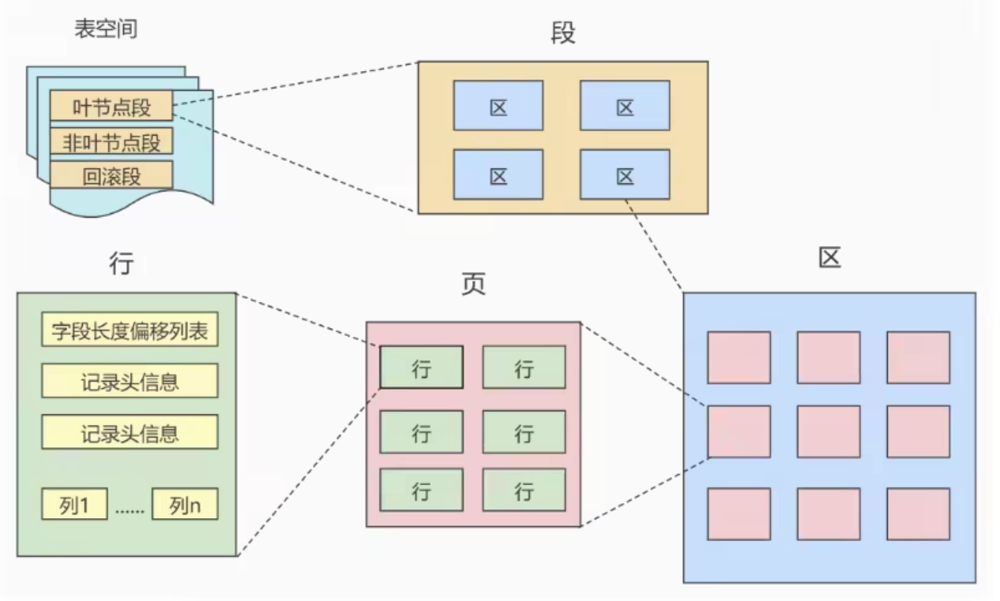

&#8195;① 区(Extent)是比页大一级的存储结构，在 InnoDB 存储引擎中，一个区会分配<mark>64 个连续的页</mark>。因为 InnoDB 中的页大小默认是 16kb，所以一个区的大小就是`16kb * 64 = 1MB`；
&#8195;② 段(Segment)由一个或多个区组成，区在文件系统是一个连续分配的空间(在 InnoDB 中是连续的 64 个页)，不过在段中不要求区与区之间是相邻的。<mark>段是数据库中的分配单位，不同类型的数据库对象以不同的段形式存在。</mark>当我们创建数据表、索引的时候，就会相应的创建对应的段，比如创建一张表时会创建一个表段，创建一个索引时会创建一个索引段；
&#8195;③ 表空间(Tablespace)是一个逻辑容器，表空间存储的对象是段，在一个表空间中可以有一个或多个段，但是一个段只能属于一个表空间。数据库有一个或多个表空间组成，表空间从管理上可以划分为`系统表空间`、`用户表空间`、`撤销表空间`、`临时表空间`等。

## 页的内部结构 [#页的内部结构]

页如果按照类型划分的话，常见的有`数据页(保存 B+树节点)`、`系统页`、`Undo 页`和`事务数据页`等。数据页是我们最常使用的页。

数据页的 16KB 大小的存储空间被划分为七个部分，分别是`文件头(File Header)`、`页头(Page Header)`、`最大最小记录(Infimum+Supremum)`、`用户记录(User Records)`、`空闲空间(Free Space)`、`页目录(Page Directory)`和`文件尾(File Tailer)`。

页结构的示意图如下图所示：

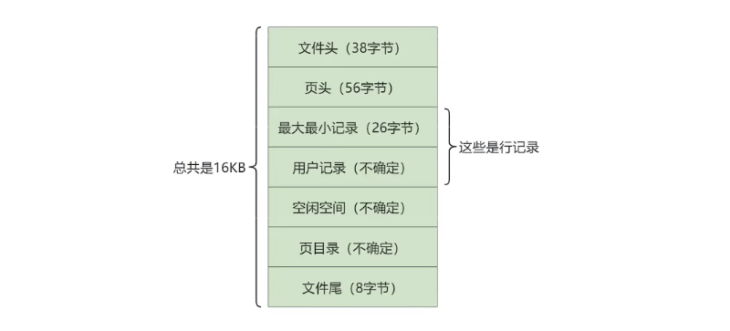

这七个部分作用分别如下：

| 名称             | 占用大小 | 说明                                 |
| ---------------- | -------- | ------------------------------------ |
| File Header      | 38 字节  | 文件头，描述页的信息                 |
| Page Header      | 56 字节  | 页头，页的状态信息                   |
| Infimum+Supremum | 26 字节  | 最小和最大记录，这是两个虚拟的行记录 |
| User Records     | 不确定   | 用户记录，存储行记录内容             |
| Free Space       | 不确定   | 空闲记录，页中还没有被使用的空间     |
| Page Directory   | 不确定   | 页目录，存储用户记录的相对位置       |
| File Trailer     | 8 字节   | 文件尾，校验页是否完整               |

### 文件头和文件尾 [#文件头和文件尾]

首先是文件<mark>通用部分</mark>，也就是`文件头`和`文件尾` 。

#### 文件头(File Header) [#文件头file-header]

**作用**：描述各种页的通用信息。（比如页的编号、其上一页、下一页是谁等）
**大小**：`38字节`

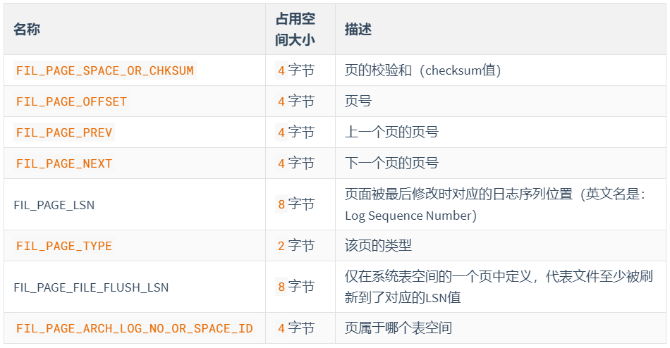

> ① `FIL_PAGE_SPACE_OR_CHKSUM(4字节)`：代表当前页面的校验和(checksum)
> ::: details 展开查看"校验和"说明
> **什么是校验和**？
> &#8195;&#8195;就是对于一个很长的字节串来说，我们会通过某种算法来计算一个比较短的值来代表这个很长的字节串，这个比较短的值就称为校验和。在比较两个很长的字节串之前，先比较这两个长字节串的校验和，如果校验和都不一样，则两个长字节串肯定是不同的，所以省去了直接比较两个比较长的字节串的时间损耗。<u>文件头部和文件尾部都有属性：`FIL_PAGE_SPACE_OR_CHKSUM`</u>
>
> **作用**：
> &#8195;&#8195;InnoDB 存储引擎以页为单位把数据加载到内存中处理，如果该页中的数据在内存中被修改，那么在修改后的某个时间需要把数据同步到磁盘中，但是在同步了一半的时候假如停电了，造成了该页传输的不完整。
> &#8195;&#8195;为了检测一个页是否完整(也就是在同步的时候有没有发生只同步一部分的尴尬情况)，这时可以通过文件尾的校验和(checksum 值)与文件头的校验和做比对，如果两个值不相等则证明页的传输有问题，需要重新进行传输，否则认为页的传输已经完成。
>
> **具体的**：
> &#8195;&#8195;每当一个页面在内存中修改了，在同步之前就要把它的校验和算出来，因为 File Header 在页面的前边，所以校验和会被首先同步到磁盘，当完全写完时，校验和也会被写到页的尾部，如果完全同步成功，则页的首部和尾部的校验和应该是一致的。如果写了一半儿断电了，那么在 File Header 中的校验和就代表着已经修改过的页，而在 File Trailer 中的校验和代表着原先的页，二者不同则意味着同步中间出了错。这里，校验方式就是采用 Hash 算法进行校验。
> :::
> ② `FIL_PAGE_OFFSET(4字节)`：每一个页都有一个单独的页号，就跟你的身份证号码一样，InnoDB 通过页号可以<mark>唯一定位</mark>一个页
> ③ `FIL_PAGE_PREV(4字节) 和 FIL_PAGE_NEXT(4字节)`：InnoDB 都是以页为单位存放数据的，如果数据分散到多个不连续的页中存储的话需要把这些页关联起来，`FIL_PAGE_PREV` 和 `FIL_PAGE_NEXT` 就分别代表本页的上一个和下一个页的页号。这样通过建立一个双向链表把许许多多的页就都串联起来了，保证这些页之间不需要是物理上的连续，而是逻辑上的连续。
> 
> ④ `FIL_PAGE_TYPE(2字节)`：代表当前页的类型，InnoDB 有很多类型的页，如下所示：
> 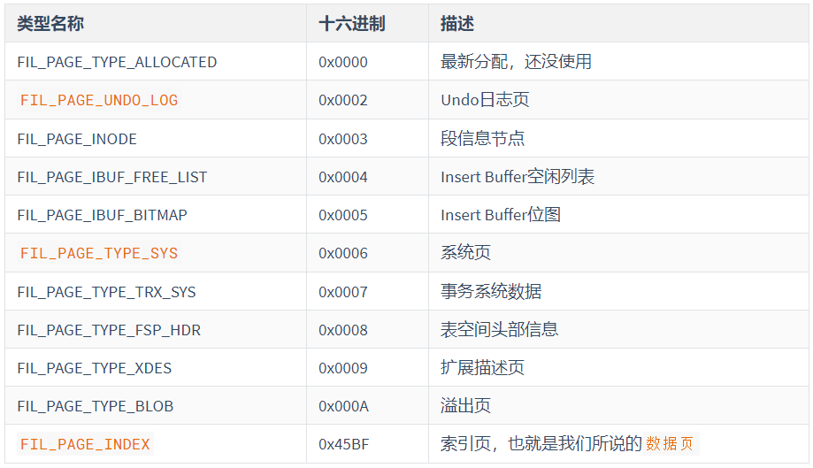
> ⑤ `FIL_PAGE_LSN(8字节)`：页面被最后修改时对应的日志序列位置(英文名是：Log Sequence Number)

#### 文件尾(File Trailer) [#文件尾file-trailer]

① **前 4 个字节代表页的校验和**：这个部分是和 File Header 中的校验和相对应的。
② **后 4 个字节代表页面被最后修改时对应的日志序列位置(LSN)**：这个部分也是为了校验页的完整性的，如果首部和尾部的 LSN 值校验不成功的话，就说明同步过程出现了问题。

### 空闲空间、用户记录和最小最大记录 [#空闲空间用户记录和最小最大记录]

页的主要作用是存储记录，所以`最大和最小记录`和`用户记录`部分占了页结构的主要空间。

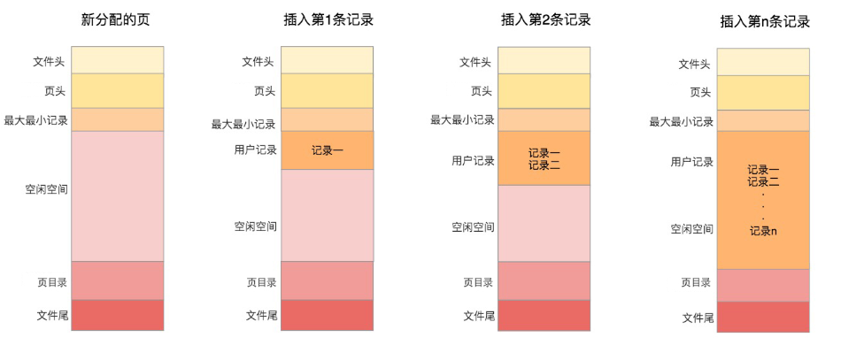

#### 空闲空间(Free Space) [#空闲空间free-space]

&#8195;&#8195;我们自己存储的记录会按照指定的<mark>行格式</mark>存储到`User Records`部分。但是在一开始生成页的时候，其实并没有 User Records 这个部分，<mark>每当我们插入一条记录，都会从 Free Space 部分，也就是尚未使用的存储空间中申请一个记录大小的空间划分到 User Records 部分</mark>，当 Free Space 部分的空间全部被 User Records 部分替代掉之后，也就意味着这个页使用完了，如果还有新的记录插入的话，就需要去<mark>申请新的页</mark>了。

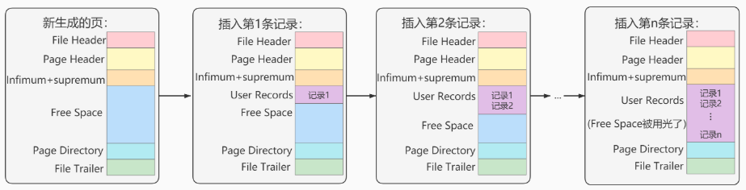

#### 用户记录(User Records) [#用户记录user-records]

&#8195;&#8195;`User Records`中的这些记录按照<mark>指定的行格式</mark>一条一条摆在`User Records`部分，相互之间形成<mark>单链表</mark>。


<Callout type="success" title="用户记录里的一条条数据如何记录？">

详情请查看记录行格式的[记录头信息](/docs/backend/database/advanced/innodb_data_strore_structure#记录头信息5-字节)。

</Callout>


### 最小和最大记录(Infimum + Supremum) [#最小和最大记录infimum--supremum]


<Callout type="success" title="记录可以比较大小吗？">

&#8195;&#8195;记录可以比大小，对于一条完整的记录来说，比较记录的大小就是比较主键的大小。比方说我们插入的 4 行记录的主键值分别是：1、2、3、4，这也就意味着这 4 条记录是从小到大依次递增。

</Callout>


&#8195;&#8195;InnoDB 规定的最小记录与最大记录这两条记录的构造十分简单，都是由 5 字节大小的记录头信息和 8 字节大小的一个固定的部分组成的，如图所示：

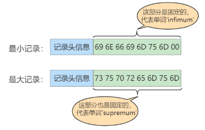

&#8195;&#8195;这两条记录<mark>不是我们自己定义的记录</mark>，所以它们并不存放在页的`User Records`部分，他们被单独放在一个称为`Infimum + Supremum`的部分，如图所示：

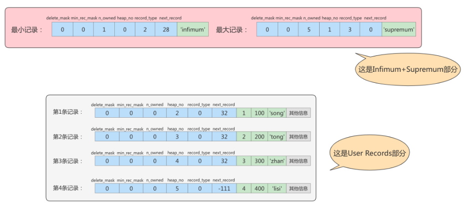

### 页目录和页头 [#页目录和页头]

#### 页目录(Page Directory) [#页目录page-directory]

**为什么需要页目录？**
&#8195;&#8195;在页中，记录是以单向链表的形式进行存储的。单向链表的特点就是插入、删除非常方便，但是检索效率不高，最差的情况下需要遍历链表上的所有节点才能完成检索。因此在页结构中专门设计了页目录这个模块，专门给记录做一个目录，通过二分查找法的方式进行检索，提升效率。

---

**需求：根据主键值查找页中的某条记录，如何实现快速查找呢？**

```sql 
SELECT * FROM page_demo WHERE c1 = 3;
```

> ① **方式一：顺序查找**  
> &#8195;&#8195;从 Infimum 记录（最小记录）开始，沿着链表一直往后找，总有一天会找到（或者找不到），在找的时候还能投机取巧，因为链表中各个记录的值是按照从小到大顺序排列的，所以当链表的某个节点代表的记录的主键值大于你想要查找的主键值时，你就可以停止查找了，因为该节点后边的节点的主键值依次递增。<mark>（如果一个页中存储了非常多的记录，这么查找性能很差。）</mark>
> ② **方式二：使用页目录，二分法查找**  
> &#8195;1) 将所有的记录分成几个组，这些记录包括最小记录和最大记录，但不包括标记为"已删除"的记录。
> &#8195;2) 第一组，也就是最小记录所在的分组只有 1 个记录；最后一组，就是最大记录所在的分组，会有 1-8 条记录；其余的组记录数量在 4-8 条之间。 <mark>（这样做的好处是，除了第 一组（最小记录所在组）以外，其余组的记录数会尽量平分。）</mark>
> &#8195;3) 在每个组中最后一条记录的头信息中会存储该组一共有多少条记录，作为 n_owned 字段。
> &#8195;4) 页目录用来存储每组最后一条记录的地址偏移量，这些地址偏移量会按照先后顺序存储起来，每组的地址偏移量也被称之为槽（slot），每个槽相当于指针指向了不同组的最后一个记录。

---

举例一：

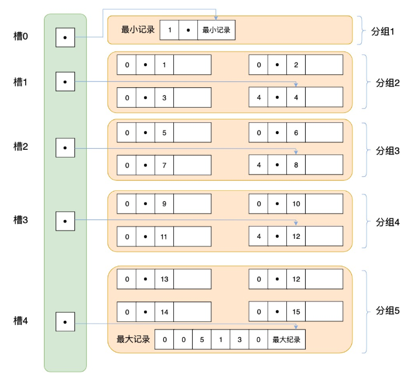

举例二：
现在的 page_demo 表中正常的记录共有 6 条，InnoDB 会把它们分成两组，第一组中只有一个最小记录，第二组中是剩余的 5 条记录。如下图：

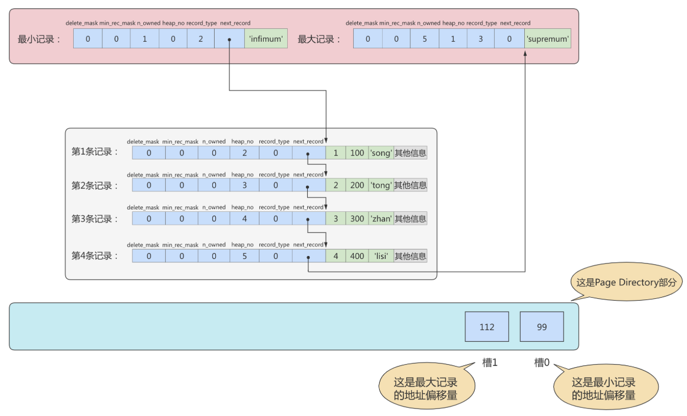

> 最小记录为一组，剩余记录为一组(第一至第四及最大记录组成)


<Callout type="success" title="提示">

从这个图中我们需要注意这么几点：
① 现在页目录部分中有两个槽，也就意味着我们的记录被分成了两个组，槽 1 中的值是 112，代表最大记录的地址偏移量（就是从页面的 0 字节开始数，数 112 个字节）；槽 0 中的值是 99，代表最小记录的地址偏移量。
② 注意最小和最大记录的头信息中的 n_owned 属性
&#8195;&#8195;- 最小记录的 n_owned 值为 1，这就代表着以最小记录结尾的这个分组中只有 1 条记录，也就是最小记录本身。
&#8195;&#8195;- 最大记录的 n_owned 值为 5，这就代表着以最大记录结尾的这个分组中只有 5 条记录，包括最大记录本身还有我们自己插入的 4 条记录。

</Callout>


用箭头指向的方式替代数字，这样更易于我们理解，修改后如下：

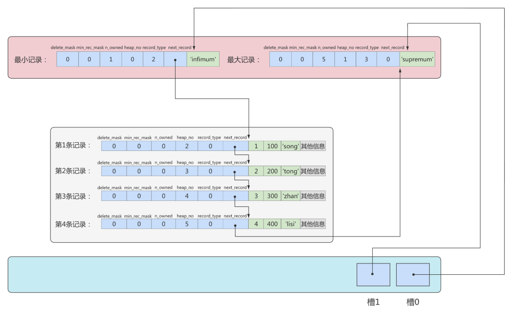

再换个角度看一下：（单纯从逻辑上看一下这些记录和页目录的关系）

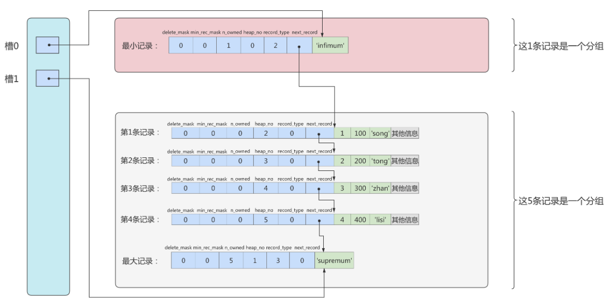

---

① **页目录分组的个数如何确定?（为什么最小记录的 n_owned 的值为 1，而最大记录的 n_owned 的值为 5 呢？）**
&#8195;&#8195;InnoDB 规定：对于最小记录所在的分组只能有一条记录，最大记录所在的分组拥有的记录条数只能在 1~8 条之间，剩下的分组中记录条数范围只能在 4~8 条之间。

分组是按照下面的步骤进行：
&#8195;(1) 初始情况下一个数据页里只有最小记录和最大记录两条记录，它们分别属于两个分组；
&#8195;(2) 之后每插入一条记录，都会从页目录中找到主键值比本记录的主键值大并且差值最小的槽，然后把该槽对应的记录的 n_owned 值加 1，表示本组内又添加了一条记录，直到该组中的记录数等于 8 个；
&#8195;(3) 在一个组中的记录数等于 8 个后再插入一条记录时，会将组中的记录拆分成两个组，一个组中 4 条记录，另外一个 5 条记录。这个过程会在页目录中新增一个槽来记录这个新增分组中最大的那条记录的偏移量。

② **页目录结构下如何快速查找记录?**
现在向 page_demo 表中添加最多的数据，如下：

```sql 
INSERT INTO page_demo VALUES
(5, 500, 'zhou'), (6, 600, 'chen'),
(7, 700, 'deng'), (8, 800, 'yang'),
(9, 900, 'wang'), (10, 1000, 'zhao'),
(11, 1100, 'qian'), (12, 1200, 'feng'),
(13, 1300, 'tang'), (14, 1400, 'ding'),
(15, 1500, 'jing'), (16, 1600, 'quan');
```

添加了 12 条记录，现在页里一共有 18 条记录了(包括最小和最大记录)，这些记录被分成 5 个组，如下图所示：

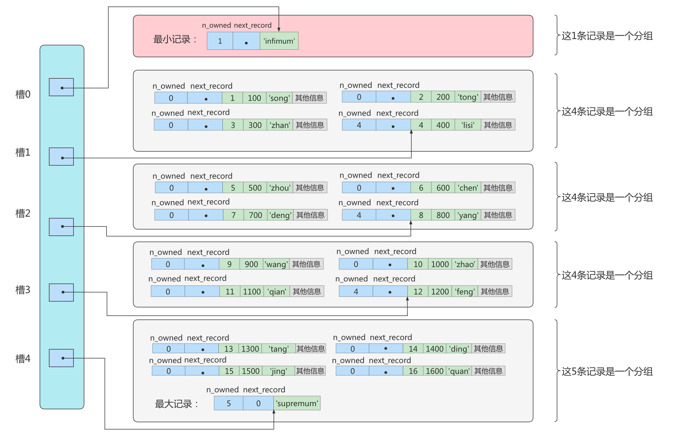

> &#8195;&#8195;这里只保留了 16 条记录的记录头信息中的 hn_owned 和 next_record 属性，省略了各个记录之间的箭头。
> &#8195;&#8195;现在看怎么从这个页目录中查找记录，因为各个槽代表的记录的主键都是从小到大的顺序，所以我们可以使用二分法来快速查找。5 个槽的编号分别是：0、1、2、3、4，所以初始情况下最低的槽位就是 low=0，最高就是 high=4.比方说我们想要查找的主键记录为`6`，过程是这样的：
> ❶ 计算中间槽的位置：(0 + 4) / 2 = 2，所以查看槽 2 对应记录的主键值为 8，又因为 8 > 6，所以设置 hight=2，low 保持不变；
> ❷ 重新计算中间槽的位置：(0 + 2) / 2 = 1，所以查看槽 1 对应的主键值为 4，又因为 4 &lt; 6,所以，设置 low=1，hight 保持不变；
> ❸ 槽 1 的主键记录为 4 是该槽的最大值，槽 2 的主键记录为 8，也是最大值，所以记录在槽 2 中；又因为槽 1 的最大记录是 4，它的下一条记录就是槽 2 的最小记录，沿着最小记录单向链表遍历槽 2 中的记录即可找到目标值。<mark>（由于一个组中包含的记录条数只能是 1~8 条，所以遍历一个组中的记录的代价是很小的。）</mark>

##### 小结 [#小结]

在一个数据页中查找指定主键值的记录的过程分为两步：
❶ 通过二分法确定该记录所在的槽，并找到该槽所在分组中主键值最小的那条记录；
❷ 通过记录的 next_record 属性遍历该槽所在的组中的各个记录。

#### 页头(Page Header) [#页头page-header]

&#8195;&#8195;为了能得到一个数据页中存储的记录的状态信息，比如本页中已经存储了多少条记录，第一条记录的地址是什么，页目录中存储了多少个槽等等，特意在页中定义了一个叫 `Page Header`的部分，这个部分占用固定的 56 个字节，专门存储各种状态信息。

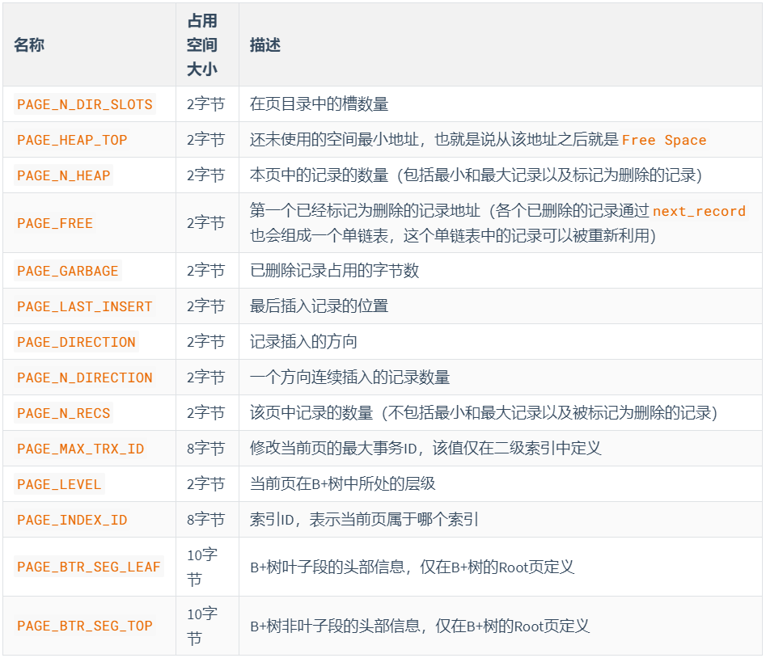

> ① `PAGE_DIRECTION`：假如新插入的一条记录的主键值比上一条记录的主键值大，我们说这条记录的插入方向是右边，反之则是左边。用来表示最后一条记录插入方向的状态就是 `PAGE_DIRECTION`。
> ② `PAGE_N_DIRECTION`：假设连续几次插入新记录的方向都是一致的，InnoDB 会把沿着同一个方向插入记录的条数记下来，这个条数就用`PAGE_N_DIRECTION`这个状态表示。当然，如果最后一条记录的插入方向改变了的话，这个状态的值会被清零重新统计。

### 从数据页的角度看 B+树如何查询 [#从数据页的角度看-b树如何查询]

一棵 B+树按照节点类型可以分成两部分：  
1.叶子节点,B+树最底层的节点，节点高度为 0，存储行记录；  
2.非叶子节点，节点的高度大于 0，存储索引键和页面指针，并不存储记录本身。

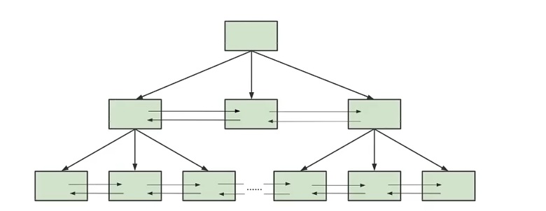

当我们从页结构来理解 B+树的结构的时候，可以帮助我们理解一些通过索引进行检索的原理：

① **B+树是如何进行记录检索的?**
&#8195;&#8195;如果通过 B+树的索引查询行记录，首先是从 B+树的根开始，逐层检索，直到找到叶子节点，也就是找到对应的数据页为止，将数据页加载到内存中，页目录中的槽（slot)采用`二分查找`的方式先找到一个粗略的记录分组，然后再在分组中通过`链表遍历`的方式查找记录。

② **普通索引和唯一索引在查询效率上有什么不同?**
&#8195;&#8195;我们创建索引的时候可以是普通索引，也可以是唯一索引，那么这两个索引在查询效率上有什么不同呢?

&#8195;&#8195;唯一索引就是在普通索引上增加了约束性，也就是关键字唯一，找到了关键字就停止检索。而普通索引，可能会存在用户记录中的关键字相同的情况，根据页结构的原理，当我们读取一条记录的时候，不是单独将这条记录从磁盘中读出去，而是将这个记录所在的页加载到内存中进行读取。InnoDB 存储引擎的页大小为 16KB，在一个页中可能存储着上千个记录，因此在普通索引的字段上进行查找也就是在内存中多几次 "判断下一条记录"的操作，对于 CPU 来说，这些操作所消耗的时间是可以忽略不计的。所以对一个索引字段进行检索，采用普通索引还是唯一索引在检索效率上基本上没有差别。

## InnoDB 行格式(或记录格式) [#innodb-行格式或记录格式]

&#8195;&#8195;我们平时的数据以行为单位来向表中插入数据，这些记录在磁盘上的存放方式也被称为`行格式`或者`记录格式`。InnoDB 存储引擎设计了 4 种不同类型的行格式，分别是<u>Compact、Redundant、Dynamic 和 Compressed</u>行格式。

查看 MySQL8 的默认行格式：

```sql 
mysql> select @@innodb_default_row_format;
+-----------------------------+
| @@innodb_default_row_format |
+-----------------------------+
| dynamic                     |
+-----------------------------+
1 row in set (0.03 sec)
```

也可以使用如下语法查看具体表使用的行格式：

```sql 
show table status like '表名'\G
```

### 指定行格式语法 [#指定行格式语法]

```sql 
# 建表时指定
CREATE TABLE table_name (column info...) ROW_FORMAT = 行格式名称;

# 建表后修改
ALTER TABLE table_name ROW_FORMAT = 行格式名称;
```

### Compact 行格式 [#compact-行格式]

&#8195;&#8195;在 MySQL 5.1 版本中，默认是设置为 Compact 行格式。一条完整的记录其实可以被分为记录的额外信息和记录的真实数据两大部分。

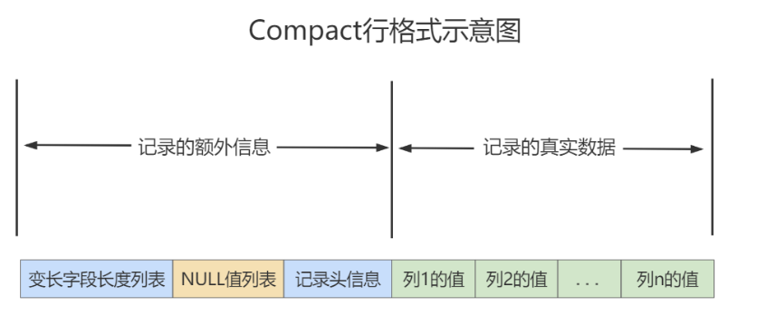

#### 可变字段长度列表 [#可变字段长度列表]

&#8195;&#8195;MySQL 支持一些变长的数据类型，例如：`VARCHAR(M)`、`VARBINARY(M)`、`TEXT`、`BLOB`类型，这些数据类型修饰列为<mark>变长字段</mark>，变长字段中存储多少字节的数据不是固定的，所以我们在存储真实数据的时候需要顺便把这些数据占用的字节数也存起来。<u>在 Compact 行格式中，把所有变长字段的真实数据占用的字节长度都放在记录的开头部位，从而形成一个变长字段长度列表。</u>


<Callout type="warn" title="注意">

这里存储的变长长度和字段顺序是相反的。比如，两个`varchar`字段在表结构的顺序是 a(10)、b(15)，那么在变长字段长度列表中存储的长度顺序就是 15、10，是反过来的！

</Callout>


---

**举例**：
&#8195;&#8195;以`record_test_table`表中的第一条记录举例，假设`record_test_table`表的`col1、col2、col4`列都是`VARCHAR(8)`类型的，所以这三个列的值的长度都需要保存在记录开头处。注意`record_test_table`表中的各个列都使用的是 ascii 字符集（每个字符只需要 1 个字节来进行编码）。


&#8195;&#8195;又因为这些长度值需要按照列的逆序存放，所以最后变长字段长度列表的字节串用十六进制表示的效果就是（各个字节之间实际上没有空格，用空格隔开只是方便理解）：`06 04 08`，把这个字节串组成的变长字段长度列表填入上边的示意图中的效果就是：


#### NULL 值列表 [#null-值列表]

&#8195;&#8195;Compact 行格式会把可以为 NULL 的列统一管理起来，存在一个标记为 NULL 值列表中。如果表中没有允许存储 NULL 的列，则 NULL 值列表也不存在了。


<Callout type="success" title="为什么定义 NULL 值列表？">

&#8195;&#8195;之所以要存储 NULL 是因为数据都是需要对齐的，如果没有标注出来 NULL 值的位置，就可能在查询数据的时候出现混乱。如果使用一个特定的符号放到相应的数据位表示的空值的话，虽然能达到效果，但是这样很浪费空间，所以直接就在行数据的头部开辟出一块空间专门用来记录该行数据哪些是非空数据，哪些是空数据，格式如下：

```text 
1.二进制位的值是 1 时，代表该列的值 为 NULL
2.二进制位的值是 0 时，代表该列的值 不为 NULL
⚠️ 注意：同样顺序也是反过来的存放的
```

</Callout>


---

**举例**：
&#8195;&#8195;字段 a、b、c，其中 a 是主键，在某一行中存储的数依次是`a = 1、b = null、c = 2`。那么 Compact 行格式中的 NULL 值列表中存储：01。第一个 0 表示 c 不为 null，第二个 1 表示 b 是 null。<u>这里之所以没有 a 是因为数据库会自动跳过主键，因为主键肯定是非 NULL 且唯一的，在 NULL 值列表的数据中就会自动跳过主键。</u>

record_test_table 的两条记录的 NULL 值列表就如下：

| col1    | col3 | col4   |
| ------- | ---- | ------ |
| zhangsi | lisi | wanger |
| zhaowu  | NULL | NULL   |


#### 记录头信息(5 字节) [#记录头信息5-字节]

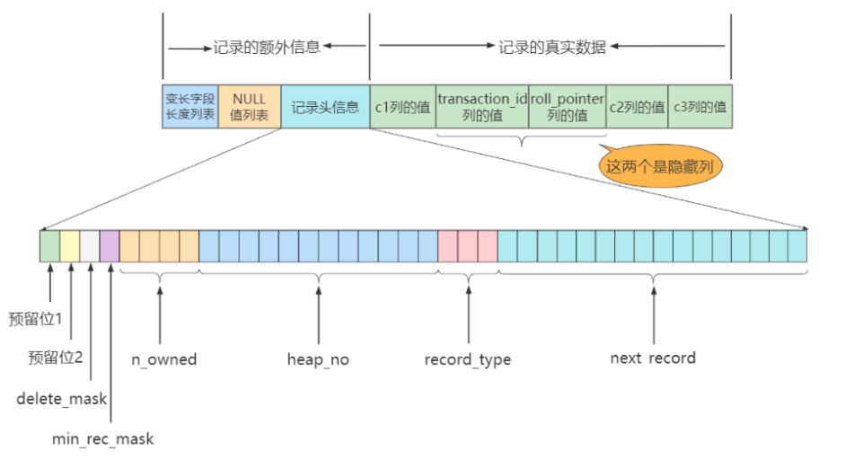

| 名称            | 大小(bit) | 描述                                                                                              |
| --------------- | --------- | ------------------------------------------------------------------------------------------------- |
| `预留位1`       | 1         | 没有使用                                                                                          |
| `预留位2`       | 1         | 没有使用                                                                                          |
| `delete_mask`   | 1         | 标记该记录是否被删除                                                                              |
| `mini_rec_mask` | 1         | B+树的每层非叶子节点中的最小记录都会添加该标记                                                    |
| `n_owned`       | 4         | 表示当前记录拥有的记录数                                                                          |
| `heap_no`       | 13        | 表示当前记录在记录堆的位置信息                                                                    |
| `record_type`   | 3         | 表示当前记录的类型，`0`表示普通记录，`1`表示 B+树非叶子节点记录，`2`表示最小记录，`3`表示最大记录 |
| `next_record`   | 16        | 表示下一条记录的相对位置                                                                          |

> `delete_mask`：标记当前记录是否被删除，值为`0`：代表没有被删除；值为`1`：代表被删除了；
> `mini_rec_mask`：B+树的每层非叶子节点中的最小记录都会添加该标记，其值为`1`。若是`0`代表并不是非叶子节点中的最小记录；
> `record_type`：表示当前记录的类型，一共有四种类型的记录；
> `heap_no`：表示当前记录在本页中的位置；
> `n_owned`：页目录中每个组中最后一条记录的头信息中会存储该组一共有多少条记录，作为`n_owned`字段；
> `next_record`：记录头信息里该属性非常重要，它表示从当前记录的真实数据到下一条记录的真实数据的地址偏移量；

---


<Callout type="success" title="提示">

① **被删除的记录为什么还在页中存储呢？**
&#8195;&#8195;你以为数据被删除了，其实它还存在与磁盘上。这些被删除的记录之所以不被立即从磁盘上移除，是因为移除它们之后其它的记录在磁盘上需要<mark>重新排列，导致性能消耗</mark>。所以只是打一个删除标记，所有被删除的记录都会组成一个所谓的`垃圾链表`，在这个链表中的记录占用的空间称之为`可重用空间`，之后如果有新记录插入到表中的话，可能把这些被删除的记录占用的存储空间覆盖掉。

② **怎么不见`heap_no`值为 0 和 1 的记录呢？**
&#8195;&#8195;MySQL 会自动给每页里加两个记录，由于这两个记录并不是我们自己插入的，所以有时候也称为<mark>伪记录</mark>或者<mark>虚拟记录</mark>。这两个伪记录一个代表`最小记录`，用`0`表示，另一个代表`最大记录`，用`1`表示。

</Callout>


---

**举例**：
假设`page_demo`表结构如下：

```sql 
CREATE TABLE page_demo (
  c1 INT,
  c2 INT,
  c3 VARCHAR(100),
  PRIMARY KEY(c1)
) CHARSET = ascii ROW_FORMAT = Compact;

# 插入记录
INSERT INTO page_demo VALUES
(1, 100, 'song'), (2, 200, 'tong'), 
(3, 300, 'zhan'), (4, 400, 'lisi');
```


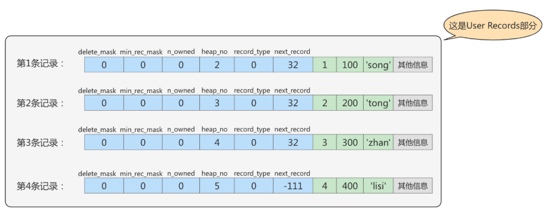

#### 记录的真实数据 [#记录的真实数据]

| 列名             | 是否必须 | 占用空间 | 描述                    |
| ---------------- | -------- | -------- | ----------------------- |
| `row_id`         | 否       | 6 字节   | 行 ID，唯一标识一条记录 |
| `transaction_id` | 是       | 6 字节   | 事务 ID                 |
| `roll_pointer`   | 是       | 7 字节   | 回滚指针                |

> 实际上这几个列的真正名称其实是：`DB_ROW_ID、DB_TRX_ID、DB_ROLL_PTR`。

&#8195;&#8195;一个表没有手动定义主键，则会选取一个 Unique 键作为主键，如果连 Unique 键都没有定义的话，则会为表默认添加一个名为 row_id 的隐藏列作为主键。所以 row_id 是在没有自定义主键以及 Unique 键的情况下才会存在的。

### Dynamic 和 Compressed 行格式 [#dynamic-和-compressed-行格式]

### Redundant 行格式 [#redundant-行格式]
