# 卸载与安装 (/docs/backend/database/advanced/install_and_uninstall)

## 安装前说明 [#安装前说明]

### Linux 系统及工具准备 [#linux-系统及工具准备]

CentOS6 和 CentOS7 在 MySQL 的使用中的区别：

|          | CentOS6  | CentOS7   |
| -------- | -------- | --------- |
| 防火墙   | iptables | firewalld |
| 启动服务 | service  | systemctl |

### 查看是否安装过 MySQL [#查看是否安装过-mysql]

MySQL 版本查看：

```sh 
mysql --version
```

如果你是用 rpm 安装，检查一下 rpm package：

```sh 
rpm -qa | grep -i mysql # -i 忽略大小写
```

检查 mysql service：

```sh 
systemctl status mysqld.service
```

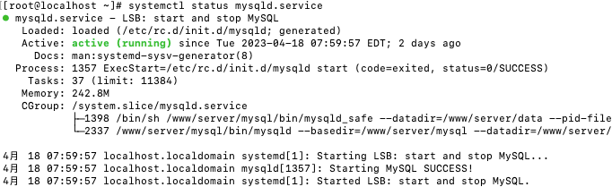

### MySQL 的卸载 [#mysql-的卸载]

① 关闭 mysql 服务

```sh 
systemctl stop mysqld.service
```

② 查看当前 mysql 安装状态

```sh 
rpm -qa | grep -i mysql
# 或
yum list installed | grep mysql
```

③ 卸载上述命令查询出的已安装程序

```sh 
yum remove mysql-xxx mysql-xxx
```

④ 删除 mysql 相关文件

```sh 
# 查找相关文件
find / -name mysql

# 删除
rm -rf xxx
```

⑤ 删除`my.cnf`

```sh 
rm -rf /etc/my.cnf
```

## MySQL 的 Linux 版的安装 [#mysql-的-linux-版的安装]


<Callout type="success" title="MySQL 的四大版本">

**MySQL Community Server 社区版本**，开源免费，自由下载，但不提供官方技术支持，适用于大多数普通用户。

**MySQL Enterprise Edition 企业版本**，需付费，不能在线下载，可以试用 30 天。提供了更多的功能和更完备的技术支持，更适合于对数据库的功能和可靠性要求较高的企业客户。

**MySQL Cluster 集群版**，开源免费。用于架设集群服务器，可将几个 MySQL Server 封装成一个 Server。需要在社区版或企业版的基础上使用。

**MySQL Cluster CGE 高级集群版**，需付费。

</Callout>


### 下载 MySQL 指定版本 [#下载-mysql-指定版本]

① 下载地址：[https://dev.mysql.com/downloads/](https://dev.mysql.com/downloads/)

② 点击`MySQL Community Server`

③ 在`General Availability(GA) Releases`中选择适合的版本

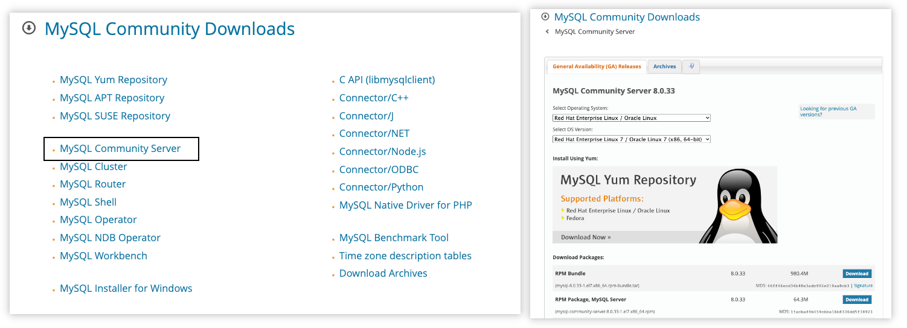

### Linux 系统下安装 MySQL 的几种方式 [#linux-系统下安装-mysql-的几种方式]

#### rpm 命令 [#rpm-命令]

使用 rpm 命令安装扩展名为`.rpm`的软件包，其包的格式一般如下：


---

#### yum 命令 [#yum-命令]

需联网，从 互联网获取 的 yum 源，直接使用 yum 命令安装

---

#### 编译安装源码包 [#编译安装源码包]

针对`tar.gz`这样的压缩格式，要用`tar`命令来解压；如果是其它压缩格式，就使用其它命令

### CentOS7 下检查 MySQL 依赖 [#centos7-下检查-mysql-依赖]

① 检查`/tmp`临时目录权限(必不可少)

由于安装过程中，会通过 mysql 用户在/tmp 目录下新建 tmp_db 文件，所以需要给它设置较大的权限，执行：

```sh 
chmod -R 777 /tmp
```

② 安装前检查依赖，不存在则需要安装

```sh 
rpm -qa | grep libaio
rpm -qa | grep net-tools
```

### 安装过程 [#安装过程]

① 将安装程序拷贝到`/opt`目录下

```sh 
# 以抽离出来的mysql8为例，使用rpm安装
rpm -ivh mysql-community-common-8.0.25-1.el7.x86_64.rpm
rpm -ivh mysql-community-client-plugins-8.0.25-1.el7.x86_64.rpm
rpm -ivh mysql-community-libs-8.0.25-1.el7.x86_64.rpm
rpm -ivh mysql-community-client-8.0.25-1.el7.x86_64.rpm
rpm -ivh mysql-community-server-8.0.25-1.el7.x86_64.rpm
```


<Callout type="success" title="提示">

① 必须按照上面顺序执行  
② 如果没有检查 mysql 依赖环境，在安装 mysql-community-server 会报错  
③ 命令说明

> rpm：Redhat Package Manage，通过 RPM 的管理，用户可以把源代码包装成以 rpm 为扩展名的文件形式，易于安装  
> -i：--install，安装软件包  
> -v：--verbose，提供更多的详细信息输出  
> -h：--hash，软件包安装的时候列出哈希标记，展示进度条

④ 可能遇到的报错，使用`yum remove mysql-libs`，清除之前安装过的依赖即可

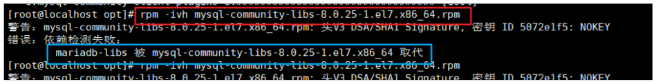

</Callout>


② 查看 MySQL 版本

```sh 
# 查看版本
mysql --version

# 查看是否安装成功
rpm -qa|grep -i mysql
```

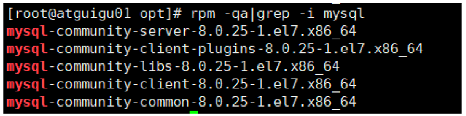

③ 服务的初始化

为了保证数据库目录与文件的所有者为 mysql 登录用户，如果你是以 root 身份运行 mysql 服务，需要执
行下面的命令初始化：

```sh 
mysqld --initialize --user=mysql
```

> 说明： `--initialize` 选项默认以"安全"模式来初始化，则会为 root 用户生成一个密码并将 该密码标记为过期，登录后你需要设置一个新的密码。生成的 临时密码 会往日志中记录一份

查看密码：

```sh 
# root@localhost: 后面就是初始化的密码
cat /var/log/mysqld.log
```

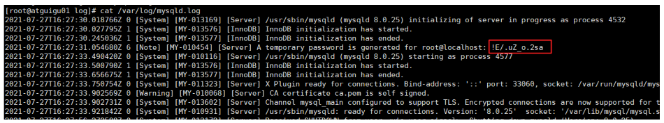

④ 启动 MySQL，查看状态

```sh 
# .service后缀可以省略
# 启动
systemctl start mysqld.service
# 关闭
systemctl stop mysqld.service
# 重启
systemctl restart mysqld.service
# 查看状态
systemctl status mysqld.service
```


<Callout type="success" title="提示">

mysqld 这个可执行文件就代表着 MySQL 服务器程序，运行这个可执行文件就可以直接启动一个服务器进程

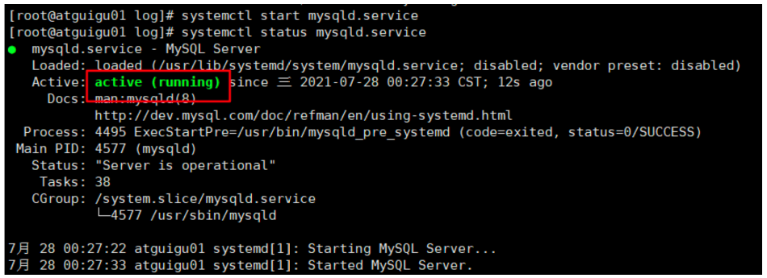

查看进程：`ps -ef | grep mysqld`

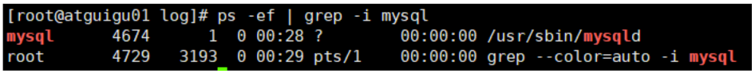

</Callout>


⑤ 查看服务是否自启动

```sh 
systemctl list-unit-files|grep mysqld.service
```

> 默认是 enable，如果不是可以运行下面命令进行设置：

```sh 
# 开启自启动
systemctl enable mysqld.service
# 关闭自启动
systemctl disable mysqld.service
```

## MySQL 登录 [#mysql-登录]

### 首次登录 [#首次登录]

通过命令`mysql -hlocalhost -P3306 -uroot -p`进行登录，在`Enter password:`输入初始化密码(上面 mysqld.log 中获取的密码)

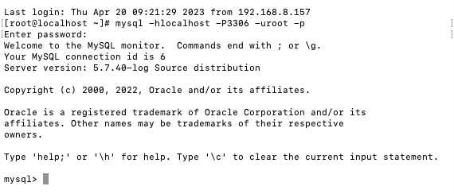

### 修改密码 [#修改密码]

因为初始化密码默认是过期的，所以查看数据库会报错，修改密码：

```sql 
ALTER USER 'root'@'localhost' IDENTIFIED BY 'new_password';
```


<Callout type="success" title="提示">

5.7 版本之后（不含 5.7），mysql 加入了全新的密码安全机制，设置新密码太简单会报错。

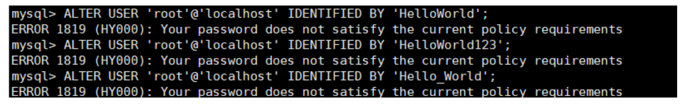

改为更复杂的密码规则之后，设置成功，可以正常使用数据库了


</Callout>


### 设置远程登录 [#设置远程登录]

在远程连接 MySQL 数据库时，可能会遇到连接不上的情况，需要进行问题排查。

---

#### <u>确认网络</u> [#确认网络]

```sh 
# 检查与远程主机网络是否通畅
ping ip_addr

# 检查远程主机端口是否开放
telnet ip_addr port
```

**关闭防火墙或开放端口**：

方式一：关闭防火墙

```sh 
# CentOS6
service iptables stop

# CentOS7
systemctl status firewalld.service # 查看状态
systemctl start firewalld.service # 开启
systemctl stop firewalld.service # 关闭
systemctl enable firewalld.service #设置开机启用防火墙
systemctl disable firewalld.service #设置开机禁用防火墙
```

方式二：开放端口

```sh 
# 查看开放的端口号
firewall-cmd --list-all

# 设置开放的端口号
firewall-cmd --add-service=http --permanent
firewall-cmd --add-port=3306/tcp --permanent

# 重启防火墙
firewall-cmd --reload
```

#### <u>Linux 下修改配置</u> [#linux-下修改配置]

在 Linux 系统 MySQL 下测试，可以看到 root 用户的当前主机配置信息为 localhost

```sql 
use mysql;
select Host,User from user;

+-----------+---------------+
| Host      | User          |
+-----------+---------------+
| localhost | mysql.session |
| localhost | mysql.sys     |
| localhost | root          |
+-----------+---------------+
3 rows in set (0.00 sec)
```


<Callout type="success" title="修改 Host 为通配符%">

&#8195;&#8195;Host 列指定了允许用户登录所使用的 IP，比如`user=root Host=192.168.1.1`，表示 root 用户只能通过 192.168.1.1 的客户端去访问。 `user=root Host=localhost`表示只能通过本机客户端去访问。而`%`是个通配符，如果`Host=192.168.1.%`，就表示只要 IP 地址前缀是`192.168.1.`的客户端都可以连接。如果`Host=%`，表示所有 IP 都有连接权限。

```sql 
update user set host = '%' where user ='root';
# 刷新权限
flush privileges;
```

<mark>注意：在生产环境下不能为了省事将 host 设置为%，这样做会存在安全问题，具体的设置可以根据生产环境的 IP 进行设置</mark>。

</Callout>


&#8195;&#8195;进行上面排查后，重新进行连接，如果连接报错`'caching_sha2_password' cannot be loaded`，分析是 MySQL 密码加密方法变了。解决方法参考 ：[基础篇环境搭建](/docs/backend/database/base/environment_building#authentication-plugin-caching_sha2_password-cannot-be-loaded)

## MySQL 8 的密码轻度评估(了解) [#mysql-8-的密码轻度评估了解]

### MySQL 不同版本设置密码(可能出现) [#mysql-不同版本设置密码可能出现]

MySQL5.7 中：成功

```sql 
mysql> alter user 'root' identified by 'abcd1234';
Query OK, 0 rows affected (0.00 sec)
```

MySQL8.0 中：失败

```sql 
mysql> alter user 'root' identified by 'abcd1234';
ERROR 1819 (HY000): Your password does not satisfy the current policy requirements
```

### MySQL 8 之前的安全策略 [#mysql-8-之前的安全策略]

在 MySQL 8.0 之前，MySQL 使用的是 validate_password 插件检测、验证账号密码强度，保障账号的安全性。

#### 方式一：在参数文件 my.cnf 中添加参数 [#方式一在参数文件-mycnf-中添加参数]

```sql 
[mysqld]
plugin-load-add=validate_password.so
# ON/OFF/FORCE/FORCE_PLUS_PERMANENT: 是否使用该插件(及强制/永久强制使用)
validate-password=FORCE_PLUS_PERMANENT
```

> ① plugin library 中的 validate_password 文件名的后缀名根据平台不同有所差异。 对于 Unix 和 Unix-like 系统而言，它的文件后缀名是`.so`，对于 Windows 系统而言，它的文件后缀名是`.dll`
>
> ② 修改参数后必须重启 MySQL 服务才能生效
>
> ③ 参数 FORCE_PLUS_PERMANENT 是为了防止插件在 MySQL 运行时的时候被卸载。当你卸载插件时就会报错。如下所示：

```sql 
mysql> SELECT PLUGIN_NAME, PLUGIN_LIBRARY, PLUGIN_STATUS, LOAD_OPTION
       FROM INFORMATION_SCHEMA.PLUGINS
       WHERE PLUGIN_NAME = 'validate_password';
+-------------------+----------------------+---------------+----------------------+
| PLUGIN_NAME       | PLUGIN_LIBRARY       | PLUGIN_STATUS | LOAD_OPTION          |
+-------------------+----------------------+---------------+----------------------+
| validate_password | validate_password.so | ACTIVE        | FORCE_PLUS_PERMANENT |
+-------------------+----------------------+---------------+----------------------+
1 row in set (0.00 sec)

mysql> UNINSTALL PLUGIN validate_password;
ERROR 1702 (HY000): Plugin 'validate_password' is force_plus_permanent and can not be unloaded
```

#### 方式二：运行时命令安装 [#方式二运行时命令安装]

```sql 
INSTALL PLUGIN validate_password SONAME 'validate_password.so';
```

> 此方法也会注册到元数据，也就是 mysql.plugin 表中，所以不用担心 MySQL 重启后插件会失效

### MySQL 8 的安全策略 [#mysql-8-的安全策略]

#### validate_password 说明 [#validate_password-说明]

&#8195;&#8195;MySQL 8.0 引入了服务器组件（Components）这个特性，validate_password 插件已用服务器组件重新实现。8.0.25 版本的数据库中，默认自动安装 validate_password 组件。

<mark>未安装插件前，执行如下两个指令</mark>，执行效果：

```sql 
mysql> show variables like 'validate_password%';
Empty set (0.02 sec)

mysql> SELECT * FROM mysql.component;
ERROR 1146 (42S02): Table 'mysql.component' doesn't exist
```

<mark>安装插件后，执行如下两个指令</mark>，执行效果：

```sql 
mysql> SHOW VARIABLES LIKE 'validate_password%';
+--------------------------------------+--------+
| Variable_name                        | Value  |
+--------------------------------------+--------+
| validate_password.check_user_name    | ON     |
| validate_password.dictionary_file    |        |
| validate_password.length             | 8      |
| validate_password.mixed_case_count   | 1      |
| validate_password.number_count       | 1      |
| validate_password.policy             | MEDIUM |
| validate_password.special_char_count | 1      |
+--------------------------------------+--------+

mysql> SELECT * FROM mysql.component;
+--------------+--------------------+------------------------------------+
| component_id | component_group_id | component_urn                      |
+--------------+--------------------+------------------------------------+
| 1            | 1                  | file://component_validate_password |
+--------------+--------------------+------------------------------------+
1 row in set (0.00 sec)
```

关于`validate_password`组件对应的系统变量说明：

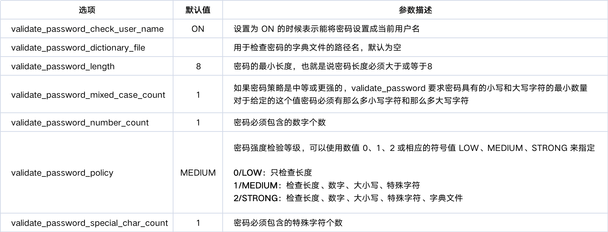

> 提示：组件和插件的默认值可能有所不同。例如，MySQL 5.7. validate_password_check_user_name 的默认值为 OFF。

#### 修改安全策略 [#修改安全策略]

修改密码验证安全强度：

```sql 
SET GLOBAL validate_password_policy = LOW;
SET GLOBAL validate_password_policy = MEDIUM;
SET GLOBAL validate_password_policy = STRONG;
SET GLOBAL validate_password_policy = 0; # For LOW
SET GLOBAL validate_password_policy = 1; # For MEDIUM
SET GLOBAL validate_password_policy = 2; # For HIGH

# 注意：如果是插件的话，SQL为set global validate_password_policy = LOW
```

此外，还可以修改密码中字符的长度：

```sql 
SET GLOBAL validate_password_length = 1;
```

#### 密码强度测试 [#密码强度测试]

&#8195;&#8195;如果你创建密码是遇到`Your password does not satisfy the current policy requirements`，可以通过函数组件去检测密码是否满足条件： 0-100。当评估在 100 时就是说明使用上了最基本的规则：大写+小写+特殊字符+数字组成的 8 位以上密码

```sql 
mysql> SELECT VALIDATE_PASSWORD_STRENGTH('weak');
+------------------------------------+
| VALIDATE_PASSWORD_STRENGTH('weak') |
+------------------------------------+
|                                 25 |
+------------------------------------+
```


<Callout type="warn" title="注意">

如果没有安装 validate_password 组件或插件的话，那么这个函数永远都返回 0。 关于密码复杂度对应的密码复杂度策略。如下表格所示：

| Password Test Return                      | Value |
| ----------------------------------------- | ----- |
| Length &lt; 4                                | 0     |
| Length ≥ 4 and &lt; validate_password.length | 25    |
| Satisfies policy 1 (LOW)                  | 50    |
| Satisfies policy 2 (MEDIUM)               | 75    |
| Satisfies policy 3 (STRONG)               | 100   |

</Callout>


### 卸载插件或组件 [#卸载插件或组件]

**卸载插件**：

```sql 
UNINSTALL PLUGIN plugin_name
# 例如
UNINSTALL PLUGIN validate_password;
```

**卸载组件**：

```sql 
UNINSTALL COMPONENT component_name [, component_name ] ...
# 例如
UNINSTALL COMPONENT 'file://component_validate_password';
```

## 字符集的相关操作 [#字符集的相关操作]

### 修改 MySQL 5.7 字符集 [#修改-mysql-57-字符集]

#### 修改步骤 [#修改步骤]

&#8195;&#8195;在 MySQL8.0 版本之前，默认字符集为`latin1`，`utf8`字符集指向的是`utf8mb3`。网站开发人员在数据库设计的时候往往会将编码修改为 utf8 字符集。如果遗忘修改默认的编码，就会出现乱码的问题。从 MySQL8.0 开始，数据库的默认编码将改为`utf8mb4`，从而避免上述乱码的问题。

**查看默认使用的字符集**：

```sql 
show variables like 'character%';
```

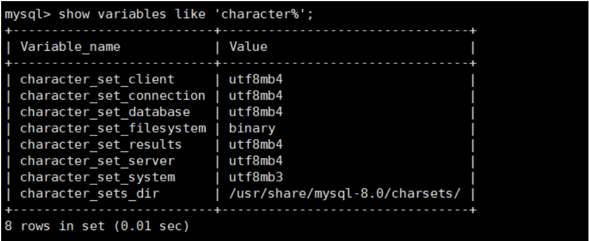

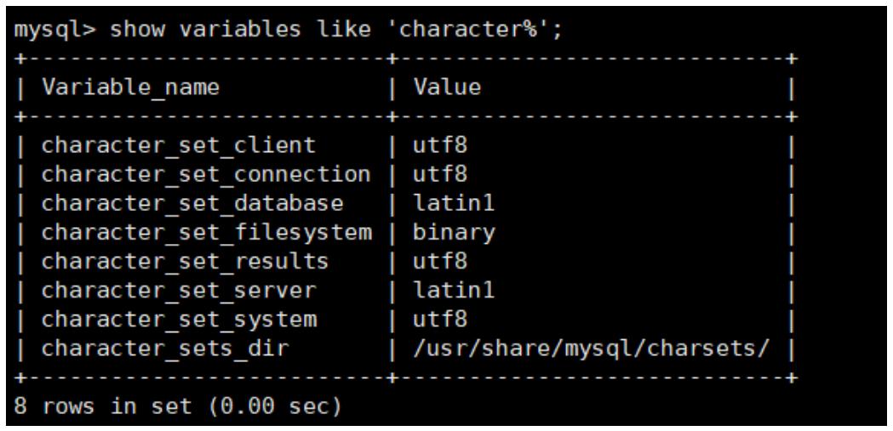

> MySQL 5.7 默认的客户端和服务器都用了<mark>latin1</mark> ，不支持中文，保存中文会报错。

**修改字符集**：

```sql 
# 找到MySQL配置文件
vim /etc/my.cnf

# 文件中增加中文字符集配置
character_set_server=utf8

# 重启MySQL服务
systemctl restart mysqld
```

> 注意：此处修改后，原库和原表的设定不会发生变化，参数修改只对新建的数据库生效。

#### 已有库或表字符集变更 [#已有库或表字符集变更]

```sql 
# 修改已创建数据库的字符集
alter database database_name character set 'character_name';
# 例如
alter database proddb character set 'utf8';

# 修改已创建数据表的字符集
alter table table_name convert to character set 'character_name';
# 例如
alter table employees convert to character set 'utf8';
```

> 注意：原有的数据如果是用非`utf8`编码的话，数据本身编码不会发生改变。已有数据需要导出或删除，然后重新插入。

### 各级别的字符集 [#各级别的字符集]

MySQL 有四个级别的字符集和比较规则，分别是：服务器级别、数据库级别、表级别、列级别

```sql 
show variables like 'character%';
```

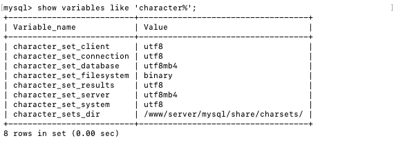

| 字符集级别                 | 说明                                                                                |
| -------------------------- | ----------------------------------------------------------------------------------- |
| `character_set_server`     | 服务器级别的字符集                                                                  |
| `character_set_database`   | 当前数据库的字符集                                                                  |
| `character_set_client`     | 服务器解码请求时使用的字符集                                                        |
| `character_set_connection` | 服务器处理请求时会把请求字符串从 character_set_client 转为 character_set_connection |
| `character_set_results`    | 服务器向客户端返回数据时使用的字符集                                                |

---

#### 服务器级别：`character_set_server` [#服务器级别character_set_server]

&#8195;&#8195;启动服务器程序时通过启动选项或者在服务器程序运行过程中使用 SET 语句修改这两个变量的值，在配置文件中可以这么写：

```text 
[server]
character_set_server=gbk # 默认字符集
collation_server=gbk_chinese_ci # 对应的默认字符集的比较规则
```

&#8195;&#8195;当服务器启动的时候读取这个配置文件后这两个系统变量的值便修改了。

---

#### 数据库级别：`character_set_database` [#数据库级别character_set_database]

&#8195;&#8195;创建和修改数据库的时候可以指定该数据库的字符集和比较规则，具体语法如下：

```sql 
CREATE DATABASE 数据库名
  [[DEFAULT] CHARACTER SET 字符集名称]
  [[DEFAULT] COLLATE 比较规则名称];

ALTER DATABASE 数据库名
  [[DEFAULT] CHARACTER SET 字符集名称]
  [[DEFAULT] COLLATE 比较规则名称];
```

---

#### 表级别 [#表级别]

&#8195;&#8195;在创建和修改表的时候指定表的字符集和比较规则，语法如下：

```sql 
CREATE TABLE 表名 (列的信息)
  [[DEFAULT] CHARACTER SET 字符集名称]
  [COLLATE 比较规则名称]]

ALTER TABLE 表名
  [[DEFAULT] CHARACTER SET 字符集名称]
  [COLLATE 比较规则名称]
```

> 如果创建和修改表的语句中<mark>没有指明字符集和比较规则，将使用该表所在数据库的字符集和比较规则作为该表的字符集和比较规则</mark>。

---

#### 列级别 [#列级别]

&#8195;&#8195;对于存储字符串的列，同一个表中的不同的列也可以有不同的字符集和比较规则。我们在创建和修改列定义的时候可以指定该列的字符集和比较规则，语法如下：

```sql 
CREATE TABLE 表名(
  列名 字符串类型 [CHARACTER SET 字符集名称] [COLLATE 比较规则名称],
  其他列...
);

ALTER TABLE 表名
  MODIFY 列名 字符串类型 [CHARACTER SET 字符集名称] [COLLATE 比较规则名称];
```

---

#### 小结 [#小结]

我们介绍的这 4 个级别字符集和比较规则的联系如下：  
&#8195;① 如果<mark>创建或修改列</mark>时没有显式的指定字符集和比较规则，则该列<mark>默认用表</mark>的字符集和比较规则；  
&#8195;② 如果<mark>创建表时</mark>没有显式的指定字符集和比较规则，则该表<mark>默认用数据库的</mark>字符集和比较规则；  
&#8195;③ 如果<mark>创建数据库时</mark>没有显式的指定字符集和比较规则，则该数据库<mark>默认用服务器的</mark>字符集和比较规则。

### 字符集与比较规则(了解) [#字符集与比较规则了解]

#### utf8 与 utf8mb4 [#utf8-与-utf8mb4]

&#8195;&#8195;utf8 字符集表示一个字符需要使用 1 ～ 4 个字节，但是我们常用的一些字符使用 1 ～ 3 个字节就可以表示了，而字符集表示一个字符所用的最大字节长度，在某些方面会影响系统的存储和性能，所以设计 MySQL 的设计者偷偷的定义了两个概念：  
&#8195;① `utf8mb3`：阉割过的 utf8 字符集，只使用 1 ～ 3 个字节表示字符。  
&#8195;② `utf8mb4`：正宗的 utf8 字符集，使用 1 ～ 4 个字节表示字符。

#### 比较规则 [#比较规则]

```sql 
# 字符集查看
show charset;

# 比较规则查看
show collation;
```

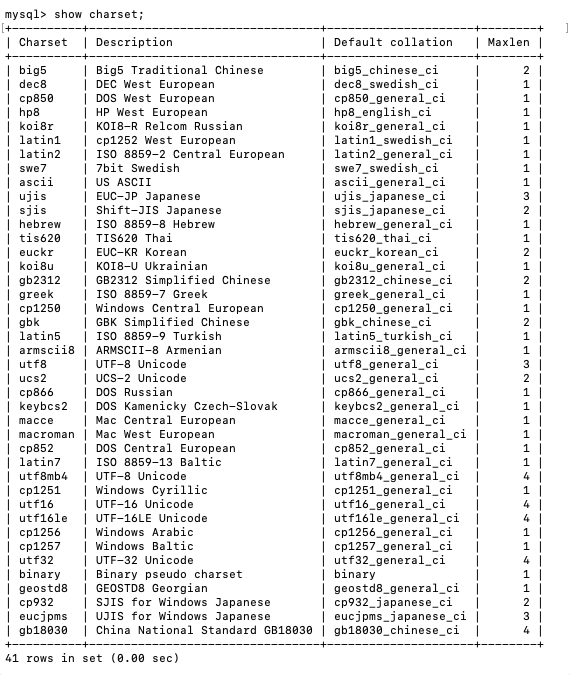

> 最后一列`Maxlen`，它代表该种字符集表示一个字符最多需要几个字节

&#8195;&#8195;上表中，MySQL 版本一共支持 41 种字符集，其中的`Default collation`列表示这种字符集中一种默认的比较规则，里面包含着该比较规则主要作用于哪种语言，比如`utf8_polish_ci`表示以波兰语的规则比较，`utf8_spanish_ci`是以西班牙语的规则比较，`utf8_general_ci`是一种通用的比较规则。后缀表示该比较规则是否区分语言中的重音、大小写。具体如下：

| 后缀   | 英文释义             | 描述             |
| ------ | -------------------- | ---------------- |
| `_ai`  | `accent insensitive` | 不区分重音       |
| `_as`  | `accent sensitive`   | 区分重音         |
| `_ci`  | `case insensitive`   | 不区分大小写     |
| `_cs`  | `case sensitive`     | 区分大小写       |
| `_bin` | `binary`             | 以二进制方式比较 |

**常用操作**：

```sql 
# 查看UTF-8字符集
SHOW CHARSET LIKE 'utf8%';
# 查看UTF-8字符集的比较规则
SHOW COLLATION LIKE 'utf8%';

# 查看服务器的字符集和比较规则
SHOW VARIABLES LIKE '%_server';
# 查看数据库的字符集和比较规则
SHOW VARIABLES LIKE '%_database';

# 查看具体数据库的字符集
SHOW CREATE DATABASE database_name;

# 修改具体数据库的字符集
ALTER DATABASE database_name DEFAULT CHARACTER SET '字符集' COLLATE '比较规则';

# 查看表的字符集
show create table table_name;
# 查看表的比较规则
show table status from database_name like 'real_table_name';
# 修改表的字符集和比较规则
ALTER TABLE table_name DEFAULT CHARACTER SET '字符集' COLLATE '比较规则';
```

### 请求到响应过程中字符集的变化 [#请求到响应过程中字符集的变化]

| 系统变量                   | 描述                                                                                |
| -------------------------- | ----------------------------------------------------------------------------------- |
| `character_set_client`     | 服务器解码请求时使用的字符集                                                        |
| `character_set_connection` | 服务器处理请求时会把请求字符串从 character_set_client 转为 character_set_connection |
| `character_set_results`    | 服务器向客户端返回数据时使用的字符集                                                |

总结图示：


## SQL 大小写规范 [#sql-大小写规范]

### Windows 和 Linux 平台区别 [#windows-和-linux-平台区别]

&#8195;&#8195;在 SQL 中，关键字和函数名是不用区分字母大小写的，比如 SELECT、WHERE、ORDER、GROUP BY 等关键字，以及 ABS、MOD、ROUND、MAX 等函数名。

&#8195;&#8195;不过在 SQL 中，你还是要确定大小写的规范，因为在 Linux 和 Windows 环境下，你可能会遇到不同的大小写问题。 <mark>windows 系统默认大小写不敏感</mark> ，但是 <mark>linux 系统是大小写敏感的</mark>。

通过如下命令查看：

```sql 
mysql> SHOW VARIABLES LIKE '%lower_case_table_names%';
+------------------------+-------+
| Variable_name          | Value |
+------------------------+-------+
| lower_case_table_names | 1     |
+------------------------+-------+
1 row in set (0.04 sec)
```

> `lower_case_table_names`参数值的设置：  
> &#8195;① 默认为 0，大小写敏感；  
> &#8195;② 设置 1，大小写不敏感。创建的表，数据库都是以小写形式存放在磁盘上，对于 sql 语句都是转换为小写对表和数据库进行查找；  
> &#8195;③ 设置 2，创建的表和数据库依据语句上格式存放，凡是查找都是转换为小写进行。


<Callout type="success" title="提示">

**MySQL 在 Linux 下数据库名、表名、列名、别名大小写规则是这样的**：  
&#8195;① 数据库名、表名、表的别名、变量名是严格区分大小写的；  
&#8195;② 关键字、函数名称在 SQL 中不区分大小写；  
&#8195;③ 列名（或字段名）与列的别名（或字段别名）在所有的情况下均是忽略大小写的；

**MySQL 在 Windows 的环境下全部不区分大小写**

</Callout>


### Linux 下大小写规则设置 [#linux-下大小写规则设置]

&#8195;&#8195;想设置为大小写不敏感时，要在`my.cnf`这个配置文件`[mysqld]`中加入`lower_case_table_names=1`，然后重启服务器，但是要在重启数据库实例之前就需要将原来的数据库和表转换为小写，否则将找不到数据库名。

&#8195;&#8195;此外此方式适用于 MySQL 5.7，在 MySQL 8 下禁止在重新启动服务时将其值设置成不同于初始化时设置的值。如果非要修改，修改步骤为：

```text 
1.停止MySQL服务
2.删除数据目录，即删除 /var/lib/mysql 目录
3.在MySQL配置文件(/etc/my.cnf)中添加 lower_case_table_names=1
4.启动MySQL服务
```

### SQL 编写建议 [#sql-编写建议]


<Callout type="success" title="有关命名规范的建议：">

&#8195;① 关键字和函数名称全部大写；  
&#8195;② 数据库名、表名、表别名、字段名、字段别名等全部小写；  
&#8195;③ SQL 语句必须以分号结尾。

</Callout>


&#8195;&#8195;数据库名、表名和字段名在 Linux MySQL 环境下是区分大小写的，因此建议你统一这些字段的命名规则，比如全部采用小写的方式。

&#8195;&#8195;虽然关键字和函数名称在 SQL 中不区分大小写，也就是如果小写的话同样可以执行。但是同时将关键词和函数名称全部大写，以便于区分数据库名、表名、字段名。

## sql_mode 的合理设置 [#sql_mode-的合理设置]

### 宽松模式与严格模式 [#宽松模式与严格模式]

#### 宽松模式 [#宽松模式]

&#8195;&#8195;如果设置的是宽松模式，那么我们在插入数据的时候，即便是给了一个错误的数据，也可能会被接受，并且不报错。

**应用场景**：通过设置 sql mode 为宽松模式，来保证大多数 sql 符合标准的 sql 语法，这样应用在不同数据库之间进行 迁移 时，则不需要对业务 sql 进行较大的修改。

> 列举：我在创建一个表时，该表中有一个字段为 name，给 name 设置的字段类型时 char(10) ，如果我在插入数据的时候，其中 name 这个字段对应的有一条数据的 长度超过了 10 ，例如`1234567890abc`，超过了设定的字段长度 10，那么不会报错，并且取前 10 个字符存上，也就是说你这个数据被存为了`1234567890`，而`abc`就没有了。但是我们给的这条数据是错误的，因为超过了字段长度，但是并没有报错，并且 mysql 自行处理并接受了，这就是宽松模式的效果。

---

#### 严格模式 [#严格模式]

&#8195;&#8195;出现上面宽松模式的错误，应该报错才对，所以 MySQL5.7 版本就将 sql_mode 默认值改为了严格模式。所以<mark>在生产等环境中，我们必须采用的是严格模式</mark>，进而开发、测试环境的数据库也必须要设置，这样在开发测试阶段就可以发现问题。并且我们即便是用的 MySQL5.6，也应该自行将其改为严格模式。

> 开发经验 ：MySQL 等数据库总想把关于数据的所有操作都自己包揽下来，包括数据的校验，其实开发中，我们应该在自己 开发的项目程序级别将这些校验给做了 ，虽然写项目的时候麻烦了一些步骤，但是这样做之后，我们在进行数据库迁移或者在项目的迁移时，就会方便很多。


<Callout type="warn" title="改为严格模式后可能会存在的问题">

&#8195;&#8195;若设置模式中包含了 `NO_ZERO_DATE` ，那么 MySQL 数据库不允许插入零日期，插入零日期会抛出错误而不是警告。例如，表中含字段 TIMESTAMP 列（如果未声明为 NULL 或显示 DEFAULT 子句）将自动分配 DEFAULT '0000-00-00 00:00:00'（零时间戳），这显然是不满足 sql_mode 中的 `NO_ZERO_DATE` 而报错。

</Callout>


### 模式查看和设置 [#模式查看和设置]

查看当前的 sql_mode：

```sql 
select @@session.sql_mode; # 会话变量
select @@global.sql_mode; # 全局变量

show variables like 'sql_mode';
```

设置方式：

```sql 
SET GLOBAL sql_mode = 'modes...'; # 全局
SET SESSION sql_mode = 'modes...'; # 当前会话

-- 例如
# 改为严格模式(只在当前会话中生效，关闭当前会话就不生效了)
SET SESSION sql_mode='STRICT_TRANS_TABLES';

# 改为严格模式(在当前服务中生效，重启MySQL服务后失效。)
SET GLOBAL sql_mode='STRICT_TRANS_TABLES';
```

永久设置方式：

在`my.cnf`文件(Windows 环境下是`my.ini`文件)中增加：

```sh
[mysqld]
sql_mode=ONLY_FULL_GROUP_BY,STRICT_TRANS_TABLES,NO_ZERO_IN_DATE,NO_ZERO_DATE,ERROR_FOR _DIVISION_BY_ZERO,NO_ENGINE_SUBSTITUTION
```

然后<mark>重启 MySQL</mark>。

&#8195;&#8195;当然生产环境上是禁止重启 MySQL 服务的，所以采用<mark>临时设置方式 + 永久设置</mark>方式来解决线上的问题，那么即便是有一天真的重启了 MySQL 服务，也会永久生效了。

#### 常用的 sql_mode [#常用的-sql_mode]

(1) **ONLY_FULL_GROUP_BY**：

> GROUP BY 聚合查询中如果 SELECT 中的列没在 GROUP BY 子句中，那么这个 SQL 是非法的

(2) **NO_AUTO_VALUE_ON_ZERO**：

> 在自增列上插入数值 0 时，实际插入的值为 0。如果不设置该模式则在自增列上插入数值 0 或 NULL 时都会插入实际自增的值

(3) **NO_ENGINE_SUBSTITUTION**：

> 指定的存储引擎不存在则报错，如果不设置该模式则在指定的存储引擎不存在时使用 InnoDB 引擎

(4) **ANSI**：

> 宽松模式，会更改不符合条件的数据。也就是说数据如果不符合定义的类型或长度，会对数据的类型进行调整或截断保存，报 warning 警告。对于以除数为 0 的计算结果为值的字段值，数据库会用 NULL 值代替

(5) **STRICT_TRANS_TABLES**：

> 支持事务的引擎（如 InnoDB）严格检查数据类型，不支持事务的引擎（如 MyISAM）批量操作时，根据第 1 条数据是否成功决定后面的数据类型检查失败时是否使用宽松模式处理。也就是说：如果第 1 条执行成功，那么后面的操作即使数据类型检查失败也使用宽松模式处理；如果第 1 条执行失败，那么即使后面的操作数据类型检查成功也不执行

(6) **STRICT_ALL_TABLES 或 TRADITIONAL**：

> 支持事务的引擎（如 InnoDB）严格检查数据类型，不支持事务的引擎（如 MyISAM）批量操作时，数据类型检查失败的那条数据之后的所有数据操作都不执行，即使数据类型检查失败的那条数据之后有检查成功的数据，这些成功的数据也不执行

(7) **NO_ZERO_IN_DATE**：

> 在 STRICT 模式下，日期中的月、日不能为 0，但 0000-00-00 除外

(8) **NO_ZERO_DATE**：

> 在 STRICT 模式下，日期不能设置为 0000-00-00

(9) **ERROR_FOR_DIVISION_BY_ZERO**：

> 除数不能为 0，如果不设置该模式则返回 NULL

(10) **NO_AUTO_CREATE_USER**：

> 禁止创建密码为空的新用户

(11) **PIPES_AS_CONCAT**：

> 将"||"视为字符串的连接操作符而非或运算符

(12) **ANSI_QUOTES**：

> 可以用双引号来括数据库的对象名，比如表名，列表，这样就不能用双引号来引用字符串了
