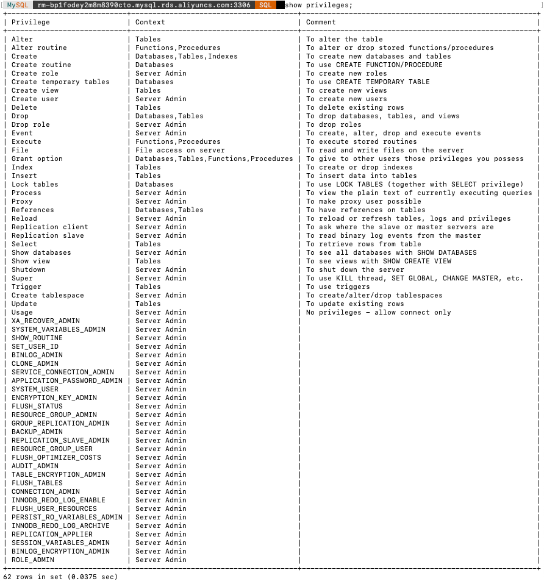
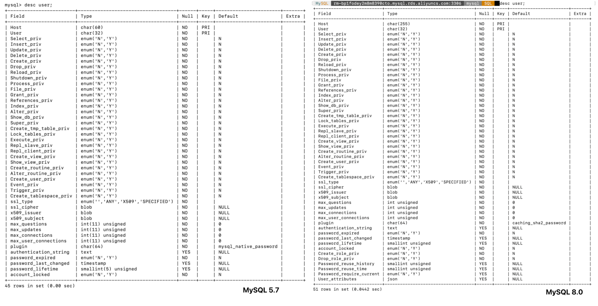
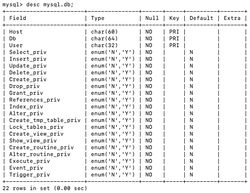
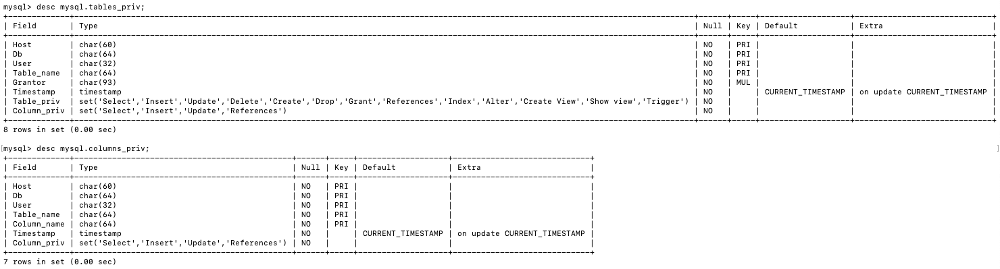
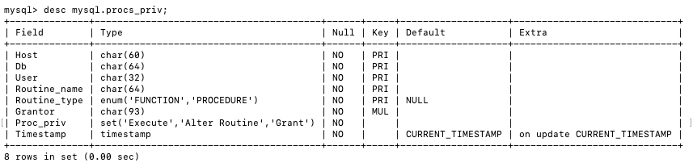
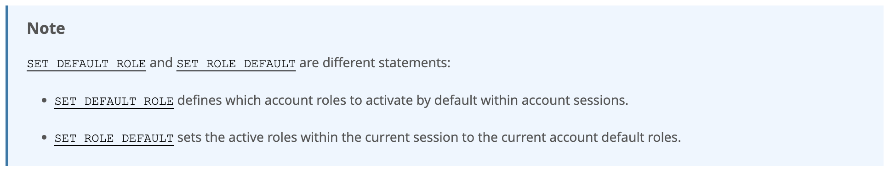

# 用户与权限管理 (/docs/backend/database/advanced/user_and_privilege)

## 用户管理 [#用户管理]

### 登录 MySQL 服务器 [#登录-mysql-服务器]

启动 MySQL 服务器后，可以通过 mysql 命令来登录 MySQL 服务器，命令如下：

```sh 
mysql -h hostname|hostIP -P port -u username -p databasename -e 'query_sql'

# 例如
mysql -hlocalhost -P3306 -uroot -p mysql -e 'select host,user from user'
```

命令中参数说明：  
&#8195;`-h hostname|hostIP`：连接主机，hostname 为主机，hostIP 为主机 IP  
&#8195;`-P port`：端口，默认 3306，不使用该参数则自动连接 3306  
&#8195;`-u username`：登录的用户名  
&#8195;`-p password`：登录的密码，省略 password 会提示输入密码  
&#8195;`databasename`：指明连接哪一个数据库  
&#8195;`-e 'query_sql'`：登录 MySQL 服务器后可执行该语句，然后退出 MySQL 服务器

### 查看用户 [#查看用户]

```sql 
# 查看该表的全部信息
SELECT * FROM mysql.user;

# 查看host、user信息
SELECT host, user FROM mysql.user;
```

### 创建用户 [#创建用户]

CREATE USER 语句的基本语法形式如下：

```sql 
CREATE USER 用户名 [IDENTIFIED BY '密码'][, 用户名 [IDENTIFIED BY '密码']]

# 例如
CREATE USER lihua IDENTIFIED BY '123123'; # 默认host是 %
CREATE USER 'lihua'@'localhost' IDENTIFIED BY '123456';
```

说明：  
&#8195;① 用户名参数表示新建用户的账户，由`用户(User)`和`主机名(Host)`构成；  
&#8195;② `[]`表示可选，可以指定用户登录时不需要密码验证，不过此方式不安全，不推荐使用。如果指定密码，需要指定明文密码；  
&#8195;③ `CREATE USER`语句可以同时创建多个用户。

### 修改用户 [#修改用户]

修改用户名：

```sql 
UPDATE mysql.user SET USER = 'lihua' WHERE USER = 'liming';
FLUSH PRIVILEGES; # 刷新权限，否则不生效
```

### 删除用户 [#删除用户]

#### 方式一：DROP(推荐) [#方式一drop推荐]

```sql 
DROP USER user[, user]...;
# 例如
DROP USER liming; # 默认删除host为%的用户
DROP USER 'liming'@'localhost';
```

#### 方式二：DELETE [#方式二delete]

```sql 
DELETE FROM mysql.user WHERE host = 'hostname' AND user = 'username';
FLUSH PRIVILEGES;

# 例如
DELETE FROM mysql.user WHERE host = 'localhost' AND user = 'lihua';
FLUSH PRIVILEGES;
```


<Callout type="warn" title="注意">

不推荐使用`DELETE FROM`的方式来删除用户，因为系统会有残留信息保留。而`DROP`命令会删除用户以及对应的权限，执行命令后你会发现 mysql.user 表和 mysql.db 表的相应记录都消失了。

</Callout>


### 设置当前用户密码 [#设置当前用户密码]

**旧的写法**：

```sql 
# 修改当前用户的密码(MySQL 5.7 有效)
SET PASSWORD = PASSWORD('123456');
```

**推荐写法**：

① 使用`ALTER USER`命令来修改当前用户密码

```sql 
ALTER USER USER() IDENTIFIED BY 'new_password';
```

② 使用`SET`语句来修改当前用户密码

```sql 
# 自动将密码加密在赋值给当前用户
SET PASSWORD = 'new_password';
```

### 修改其它用户密码 [#修改其它用户密码]

① 使用`ALTER`语句来修改

```sql 
ALTER USER user [IDENTIFIED BY 'new_password'][, user [IDENTIFIED BY 'new_password']]...;
```

② 使用`SET`命令来修改

```sql 
SET PASSWORD FOR 'username'@'hostname' = 'new_password';
```

③ 使用`UPDATE`语句来修改 <mark>(不推荐)</mark>

```sql 
UPDATE mysql.user SET authentication_string = PASSWORD('new_password')
WHERE user = 'username' AND host = 'hostname';
```

### MySQL 8 密码管理(了解) [#mysql-8-密码管理了解]

官网手册说明：[MySQL 8.0](https://dev.mysql.com/doc/refman/8.0/en/password-management.html#password-expiration-policy)

#### 密码过期策略 [#密码过期策略]

&#8195;&#8195;在 MySQL 中，数据库管理员可以<mark>手动设置</mark>账号密码过期，也可以单独建立一个<mark>自动</mark>密码过期策略。过期策略可以是<mark>全局</mark>的，也可以为<mark>每个账号</mark>设置单独的过期策略。

**全局设置**：

```sql 
ALTER USER user PASSWORD EXPIRE;

# 例如：设置lihua密码过期
ALTER USER 'lihua'@'localhost' PASSWORD EXPIRE;
```

&#8195;**方式 ①：**：使用 SQL 语句更改该变量并持久化

```sql 
# 建立全局策略，设置密码每隔180天过期
SET PERSIST default_password_lifetime = 180;
```

&#8195;**方式 ② ：**：配置文件 my.cnf 中进行维护

```sh 
[mysqld]
# 建立全局策略，设置密码每隔180天过期
default_password_lifetime=180
```

---

**单独设置**：

&#8195;&#8195;每个账号既可以延用全局密码过期策略，也可以单独设置策略。在`CREATE USER`和`ALTER USER`语句上加入`PASSWORD EXPIRE`选项可实现单独设置策略。

示例如下：

```sql 
# 设置lihua账号密码每90天过期
CREATE USER 'lihua'@'localhost' PASSWORD EXPIRE INTERVAL 90 DAY;
ALTER USER 'lihua'@'localhost' PASSWORD EXPIRE INTERVAL 90 DAY;

# 设置密码永不过期
CREATE USER 'lihua'@'localhost' PASSWORD EXPIRE NEVER;
ALTER USER 'lihua'@'localhost' PASSWORD EXPIRE NEVER;

# 延用全局密码过期策略
CREATE USER 'lihua'@'localhost' PASSWORD EXPIRE DEFAULT;
ALTER USER 'lihua'@'localhost' PASSWORD EXPIRE DEFAULT;
```

#### 密码重用策略 [#密码重用策略]

&#8195;&#8195;MySQL 允许对重复使用以前的密码进行限制。重用限制可以根据密码更改的次数、经过的时间或两者都建立。重用策略可以全局建立，单个帐户可以设置为服从全局策略，也可以使用特定的每个帐户行为覆盖全局策略。

**全局设置**：

&#8195;**方式 ①**：使用 SQL

```sql 
# 设置不能选择最近使用过的6个密码
SET PERSIST password_history = 6;
# 设置不能选择最近365天内的密码
SET PERSIST password_reuse_interval = 365;
```

&#8195;**方式 ②**：修改 my.cnf 配置文件

```sh 
[mysqld]
password_history=6
password_reuse_interval=365
```

---

**单独设置**：

```sql 
# 不能使用最近5个密码
CREATE USER 'lihua'@'localhost' PASSWORD HISTORY 5;
ALTER USER 'lihua'@'localhost' PASSWORD HISTORY 5;

# 不是使用最近365天内的密码
CREATE USER 'lihua'@'localhost' PASSWORD REUSE INTERVAL 365 DAY;
ALTER USER 'lihua'@'localhost' PASSWORD REUSE INTERVAL 365 DAY;

# 即不能使用最近5个密码，也不能使用365天内的密码
CREATE USER 'lihua'@'localhost'
  PASSWORD HISTORY 5
  PASSWORD REUSE INTERVAL 365 DAY;

ALTER USER 'lihua'@'localhost'
  PASSWORD HISTORY 5
  PASSWORD REUSE INTERVAL 365 DAY;
```

## 权限管理 [#权限管理]

### 权限列表 [#权限列表]

MySQL 权限列表查看：

```sql 
show privileges;
```



---

下面简单说明一下各个权限的作用，其余说明见上面的权限列表图：

① `CREATE 和 DROP权限`  
&#8195;&#8195;可以创建新的数据库和表，或删除(移掉)已有的数据库和表。如果将 MySQL 数据库中的 DROP 权限授予某用户，用户就可以删除 MySQL 访问权限保存的数据库。

② `SELECT、INSERT、UPDATE 和 DELETE权限`  
&#8195;&#8195;允许在一个数据库现有的表上实施操作。

③ `SELECT权限`  
&#8195;&#8195;只有在它真正从一个表中检索行时才被用到。

④ `INDEX权限`  
&#8195;&#8195;允许创建或删除索引，INDEX 适用于已有的表。如果具有某个表的 CREATE 权限，就可以在 CREATE TABLE 语句中定义索引。

⑤ `ALTER权限`  
&#8195;&#8195;可以使用 ALTER TABLE 来更改表的结构和重新命名表。

⑥ `CREATE ROUTINE 和 EXECUTE权限`  
&#8195;&#8195;创建保存的程序(函数和程序)。`ALTER ROUTINE权限`用来更改和删除保存的程序，`EXECUTE权限`用来执行保存的程序。

⑦ `GRANT权限`  
&#8195;&#8195;允许授权给其它用户，可用于数据库、表和保存的程序。

⑧ `FILE权限`  
&#8195;&#8195;使用户可以使用 LOAD DATA INFILE 和 SELECT...INTO OUTFILE 语句读或写服务器上的文件，任何被授予 FILE 权限的用户都能读或写 MySQL 服务器上的任何文件(说明用户可以读任何数据库目录下的文件，因为服务器可以访问这些文件)。

### 授予权限的原则 [#授予权限的原则]

权限控制主要是出于安全因素，因此需要遵循以下几个经验原则：  
&#8195;&#8195;① 只授予能<mark>满足需要的最小权限</mark>，防止用户干坏事。比如用户只要查询，就只给 SELECT 权限，不需要给 UPDATE、INSERT 等权限；  
&#8195;&#8195;② 创建用户时<mark>限制用户的登录主机</mark>，一般是限制成指定 IP 或内网 IP 段；  
&#8195;&#8195;③ 为每个用户<mark>设置满足密码复杂度的密码</mark>；  
&#8195;&#8195;④ <mark>定期清理不需要的用户</mark>，回收权限或删除用户。

### 授予权限 [#授予权限]

给用户授权的方式有两种。分别是通过把<mark>角色赋予用户给用户授权</mark>和<mark>直接给用户授权</mark>。用户是数据库的使用者，我们可以通过给用户授予访问数据库中资源的权限，来控制使用者对数据库的访问，消除安全隐患。

**授权命令**：

```sql 
GRANT 权限1, 权限2, ... 权限n ON 数据库名称.表名称 TO 用户名@用户地址 [IDENTIFIED BY '密码口令'];
```

> 该权限如果发现没有该用户，则会直接新建一个用户

例如：

```sql 
# 给本地登录用户lihua授予test库下所有表增删改查的权限
GRANT SELECT, DELETE, UPDATE, INSERT ON test.* TO 'lihua'@'localhost';

# 给网络登录用户zhangsan授予所有库所有表的全部权限，密码设置123 (注意：这里唯独不包含grant的权限)
GRANT ALL PRIVILEGES ON *.* TO 'zhangsan' @'%' IDENTIFIED BY '123';
```


<Callout type="success" title="提示">

① 如果要赋予`GRANT`权限，添加参数`WITH GRANT OPTION`这个选项，表示用户可以将自己拥有的权限授权给别人；  
`GRANT SELECT, DELETE, UPDATE, INSERT ON test.* TO 'lihua'@'localhost' WITH GRANT OPTION;`

② 可以使用`GRANT`重复给用户添加权限，此时权限叠加。

</Callout>


### 查看权限 [#查看权限]

**查看当前用户权限**：

```sql 
SHOW GRANTS;
# 或
SHOW GRANTS FOR CURRENT_USER;
# 或
SHOW GRANTS FOR CURRENT_USER();
```

**查看某用户的全局权限**：

```sql 
SHOW GRANTS FOR 'user'@'主机地址';

# 如
show grants for 'lihua'@'localhost';
```

### 收回权限 [#收回权限]

收回权限就是取消已经赋予用户的某些权限。收回用户不必要的权限可以在一定程度上保证系统的安全性。MySQL 中使用`REVOKE`语句取消用户的某些权限。使用之后用户的记录将从 db、host、tables_priv 和 column_priv 表中删除，但是用户的记录仍然在 user 表中保存（删除 user 表中记录使用 DROP USER 语句）。

**回收权限**：

```sql 
REVOKE 权限1, 权限2, ... 权限n ON 数据库名称.表名称 FROM 用户名@用户地址;
```

举例：

```sql 
# 回收lihua的全库全表的所有权限
REVOKE ALL PRIVILEGES ON *.* FROM 'lihua'@'%';

REVOKE SELECT,INSERT,UPDATE,DELETE ON mysql.* FROM 'lihua'@'%';
```


<Callout type="success" title="提示">

① 回收权限后需要用户重新登录才能生效；

② 在用户从 user 表删除之前，应该收回相应用户的所有权限。

</Callout>


## 权限表 [#权限表]

### user 表 [#user-表]

user 表时 MySQL 中最重要的一个权限表，用于记录用户账户和权限信息，其字段如下：



> 不同版本字段数量可能略微不同

这些字段可以分为四类，分别是范围列(或用户列)、权限列、安全列和资源控制列。

#### 范围列(或用户列) [#范围列或用户列]

`host`：表示连接类型  
&#8195;`%`：表示所有远程通过 TCP 方式的连接  
&#8195;`IP地址`：通过指定 ip 地址进行 TCP 方式的连接  
&#8195;`机器名`：通过指定网络中的机器名进行 TCP 方式的连接  
&#8195;`::1`：IPv6 的本地 ip 地址，等同于 IPv4 的 127.0.0.1  
&#8195;`localhost`：本地方式通过命令行方式的连接

`user`：表示用户名，同一用户名通过不同方式连接权限是不一样的

`password`：密码  
&#8195;① 所有密码串通过 password(明文字符串)生成的密文字符串。MySQL 8.0 在用户管理方面增加了角色管理，默认的密码加密方式也做了调整，由之前的 SHA1 改为了 SHA2，不可逆。同时加上 MySQL 5.7 的禁用用户和用户过期功能，MySQL 在用户管理方面的功能和安全性都较之前版本大大的增强了。  
&#8195;② MySQL 5.7 及之后版本的密码保存到 authentication_string 字段中，不在使用 password 字段。

#### 权限列 [#权限列]

`Grant_priv字段`：表示是否拥有 GRANT 权限

`Shutdown_priv字段`：表示是否拥有停止 MySQL 服务的权限

`Super_priv字段`：表示是否拥有超级权限

`Execute_priv字段`：表示是否拥有 EXECUTE 权限。用户该权限，可以执行存储过程和函数

`Select_priv、Insert_priv`等：为该用户所拥有的权限

#### 安全列 [#安全列]

&#8195;&#8195;安全列只有 6 个字段，其中两个是 ssl 相关的(ssl_type、ssl_cipher)，用于<mark>加密</mark>；两个是 x509 相关的(x509_issuer、x509_subject)用于<mark>标识用户</mark>；另外两个 Plugin 字段用于<mark>验证用户身份</mark>的插件，该字段不能为空。如果为空，服务器就是用内建授权验证机制验证用户身份。

#### 资源控制列 [#资源控制列]

&#8195;&#8195;资源控制列的字段用来<mark>限制用户使用的资源</mark>，包含 4 个字段，分别为：  
&#8195;&#8195;&#8195;① `max_questions`：用户每小时允许执行的查询操作次数；  
&#8195;&#8195;&#8195;② `max_updates`：用户每小时允许执行的更新操作次数；  
&#8195;&#8195;&#8195;③ `max_connections`：用户每小时允许执行的连接操作次数；  
&#8195;&#8195;&#8195;④ `max_user_connections`：用户允许同时建立的连接次数。

### db 表 [#db-表]

查看 db 表的基本结构：

```sql 
desc mysql.db;
describe mysql.db;
```

① 用户列

&#8195;&#8195;db 表用户列有 3 个字段，分别是 Host、Db、User。这三个字段分别表示主机名、数据库名和用户名，表示从某个主机连接某个用户对某个数据库的操作权限，这 3 个字段的组合构成了 db 表的主键。

② 权限列

&#8195;&#8195;Create_routine_priv 和 Alter_routine_priv 这两个字段决定用户是否具有创建和修改存储过程的权限。



### tables_priv 表和 columns_priv 表 [#tables_priv-表和-columns_priv-表]

&#8195;&#8195;tables_priv 表用来对表设置操作权限，columns_priv 表用来对表的某一列设置权限。tables_priv 表和 columns_priv 表结构如下：

```sql 
desc mysql.tables_priv;
desc mysql.columns_priv;
```



tables_priv 表共 8 个字段，columns_priv 表 7 个字段，其中：  
&#8195;&#8195;① `Host`、`Db`、`User`、`Table_name`分别表示主机名、数据库名、用户名和表名；  
&#8195;&#8195;② `Timestamp`表示修改该记录的时间；  
&#8195;&#8195;③ `Column_priv`表示对表中的列的操作权限；  
&#8195;&#8195;④ tables_priv 表的`Grantor`表示修改该记录的用户；  
&#8195;&#8195;⑤ tables_priv 表的`Table_priv`表示对象的操作权限；  
&#8195;&#8195;⑥ columns_priv 表的`Column_name`表示列的名字。

### procs_priv 表 [#procs_priv-表]

procs_priv 表可以对存储过程和存储函数设置操作权限，表结构如下：

```sql 
desc mysql.procs_priv;
```



## 访问控制(了解) [#访问控制了解]

### 连接核实阶段 [#连接核实阶段]

&#8195;&#8195;当用户试图连接 MySQL 服务器时，服务器基于用户的身份以及用户是否能提供正确的密码验证身份来确定接受或者拒绝连接。即客户端用户会在连接请求中提供用户名、主机地址、用户密码，MySQL 服务器接收到用户请求后，会<mark>使用 user 表中的 host、user 和 authentication_string 这个 3 个字段匹配客户端提供信息</mark>。

&#8195;&#8195;服务器只有在 user 表记录的 Host 和 User 字段匹配客户端主机名和用户名，并且提供正确的密码才接受连接。<mark>如果连接核实没有通过，服务器就完全拒绝访问；否则，服务器接受连接，然后进入阶段二等待用户请求</mark>。

### 请求核实阶段 [#请求核实阶段]

&#8195;&#8195;一旦建立了连接，服务器就进入了访问控制的阶段二，也就是请求核实阶段。对此连接上进来的每个请求，服务器检查该请求要执行什么操作、是否有足够的权限来执行它，这正是权限表中的权限列发挥作用的地方。这些权限可以来自 user、db、tables_priv 和 columns_priv 表。

&#8195;&#8195;确定权限时，MySQL 首先检查 user 表，如果指定的权限没有在 user 表中被授予，那么 MySQL 就会继续检查 db 表，db 表是下一安全层级，其中的权限限定与数据库层级，在该层级的 SELECT 权限权限允许用户查看指定数据库的所有表中的数据；如果在该层级没有找到限定的权限，则继续检查 tables_priv 表以及 columns_priv 表，如果所有权限表都检查完毕，但还是没有找到允许的操作权限，MySQL 将返回错误信息，用户请求的操作不能执行，操作失败。


<Callout type="success" title="提示">

MySQL 通过向下层级的顺序(从 user 到 columns_priv 表)检查权限表，但并是所有的权限都要执行该操作。例如，一个用户登录到 MySQL 服务器后只执行对 MySQL 的管理操作，此时只涉及管理权限，因此 MySQL 只检查 user 表。另外，如果请求的权限操作不被允许，MySQL 也不会继续检查下一层级的表。

</Callout>


## 角色管理(MySQL 8) [#角色管理mysql-8]

### 角色的理解 [#角色的理解]

&#8195;&#8195;<mark>角色是在 MySQL8.0 中引入的新功能。引入它的目的是方便管理拥有相同权限的用户</mark>。恰当的权限设定，可以确定数据的安全性，这里至关重要的。


### 创建角色 [#创建角色]

创建角色使用`CREATE ROLE`语句，语法如下：

```sql 
CREATE ROLE 'role_name'[@'host_name'][,'role_name'[@'host_name']]...
```

角色名称的命名规则和用户名类似。如果`host_name`省略，默认为`%`，`role_name`<mark>不可省略</mark>，不可为空。

举例：创建一个经理的角色

```sql 
CREATE ROLE 'manager'@'localhost';
```

### 给角色赋予权限 [#给角色赋予权限]

创建角色之后，默认这个角色是没有任何权限的，我们需要给角色授权，其语法结构为：

```sql 
GRANT privileges ON table_name TO 'role_name'[@'host_name'];
```

> 上面的 privileges 代表权限的名称，实际命令替换为相应的权限，多个权限用逗号分隔。具体权限参照：[权限列表](/docs/backend/database/advanced/user_and_privilege#权限管理)

举例：

```sql 
# 给经理角色授权只读的权限
GRANT SELECT ON test.employees TO 'manage'@'localhost';
```

### 查看角色的权限 [#查看角色的权限]

赋予角色权限后，通过`show grants`语句来查看权限是否创建成功：

```sql 
SHOW GRANTS FOR 'role_name';

# 举例
> show grants for 'manager'@'localhost';
+----------------------------------------------------------------------+
| Grants for manager@localhost                                         |
+----------------------------------------------------------------------+
| GRANT USAGE ON *.* TO `manager`@`localhost`                          |
| GRANT SELECT, INSERT ON `learn`.`employees` TO `manager`@`localhost` |
+----------------------------------------------------------------------+
2 rows in set (0.0404 sec)
```

> 只要创建角色，就会默认赋予`USAGE`权限，即连接登录数据库的权限。下面的语句说明角色 manager 对表 employees 具有增和查的权限。

### 回收角色的权限 [#回收角色的权限]

&#8195;&#8195;角色授权后，可以对角色的权限进行维护，对权限进行添加或撤销。添加权限可以使用`GRANTS`语句，撤销角色或角色权限可以使用`REVOKE`语句。<mark>修改角色的权限，会影响拥有该角色的账户的权限。</mark>

撤销角色权限的语法结构：

```sql 
# privileges：同理它代表具体的权限
REVOKE privileges ON table_name FROM 'role_name';
```

举例：

```sql 
# 撤销manager对表employees的INSERT, UPDATE, DELETE权限
REVOKE INSERT, UPDATE, DELETE ON test.employees FROM 'manager'@'localhost';

# 角色权限查看
show grants for 'manager'@'localhost';
```

### 删除角色 [#删除角色]

当对角色需要维护时，可能需要对之前的一些角色进行清理，删除一些不会再使用的角色。删除角色基本结构：

```sql 
DROP ROLE role_name [, role_name]...

# 举例
DROP ROLE 'manager'; # 默认删除'manager'@'%'
DROP ROLE 'manager'@'localhost';
```


<Callout type="warn" title="注意：如果你删除了角色，那么用户也就失去了通过这个角色所获得的所有权限。">


</Callout>


### 给用户赋予角色 [#给用户赋予角色]

角色创建并授权后，要赋给用户并处于<mark>激活状态</mark>才能发挥作用。给用户添加角色可使用`GRANT`语句，语法如下：

```sql 
GRANT role_name [, role_name, ...] TO user_name [, user_name, ...];
```

> role_name 代表角色，user_name 代表用户。可将多个角色同时赋给多个用户，用逗号分隔开即可。

示例：

```sql 
# 给用户lihua添加manager的权限
GRANT 'manager' TO 'lihua'@'localhost';
GRANT 'manager'@'localhost' TO 'lihua'@'localhost';
```

### 激活角色 [#激活角色]

**方式一**：使用`set default role`命令激活角色

```sql 
SET DEFAULT ROLE
    {NONE | ALL | role [, role ] ...}
    TO user [, user ] ...

# 举例
SET DEFAULT ROLE ALL TO 'lihua'@'localhost';
```

参数说明：  
`NONE`：将默认值设置为无 (无角色)  
`ALL`：将默认设置为授予该帐户的所有角色


<Callout type="success" title="官方提示二者区别">

[`SET DEFAULT ROLE`](https://dev.mysql.com/doc/refman/8.0/en/set-default-role.html)和[`SET ROLE DEFAULT`](https://dev.mysql.com/doc/refman/8.0/en/set-role.html)的区别：


</Callout>


---

**方式二**：将`activate_all_roles_on_login`设置为`ON`

默认情况：

```sql 
mysql> show variables like 'activate_all_roles_on_login';
+-----------------------------+-------+
| Variable_name               | Value |
+-----------------------------+-------+
| activate_all_roles_on_login | OFF   |
+-----------------------------+-------+
1 row in set (0.0347 sec)
```

设置：

```sql 
SET GLOBAL activate_all_roles_on_login = ON;
```

> 这条 SQL 语句的意思是，对<mark>所有角色永久激活</mark>。运行这条语句后，用户才真正拥有了赋予角色的所有权限。

### 撤销用户的角色 [#撤销用户的角色]

撤销用户角色语法如下：

```sql 
REVOKE role_name FROM user_name;
```

示例：

```sql 
# 撤销用户lihua的manager权限
REVOKE 'lihua' FROM 'manager'; # 默认 %
REVOKE 'lihua'@'localhost' FROM 'manager'@'localhost';

# 撤销后查询用户角色是否还存在 -> 不存在
SHOW GRANTS FOR 'lihua'@'localhost';
```

### 设置强制角色(mandatory role) [#设置强制角色mandatory-role]

**方式一**：服务启动前设置

```sql 
[mysql]
mandatory_roles='role_name_1, role_name_2@localhost';
```

**方式二**：运行时设置

```sql 
# 系统重启后依然有效
SET PERSIST mandatory_roles = 'role_name_1, role_name_2@localhost';
# 系统重启后失效
SET GLOBAL mandatory_roles = 'role_name_1, role_name_2@localhost';
```

### 小结 [#小结]

MySQL 主要管理角色的语句如下：

| 语句                                             | 作用                                       |
| ------------------------------------------------ | ------------------------------------------ |
| `CREATE ROLE`和`DROP ROLE`                       | 创建和删除角色                             |
| `GRANT`和`REVOKE`                                | 给角色或者账户分配权限                     |
| `SHOW GRANTS`                                    | 显示账户/角色所拥有的权限或角色            |
| `SET DEFAULT ROLE`                               | 设置账户默认使用什么角色                   |
| `SET ROLE`                                       | 改变当前会话的角色                         |
| `CURRENT_ROLE()`函数                             | 显示当前会话的角色                         |
| `mandatory_roles`和`activate_all_roles_on_login` | 允许定义用户登录时强制的或者激活授权的角色 |
