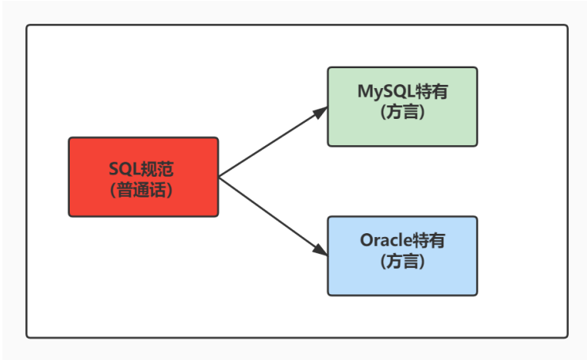

# 数据查询 (/docs/backend/database/base/data_query)

## SQL 概述 [#sql-概述]

### SQL 背景 [#sql-背景]

&#8195;&#8195;SQL（Structured Query Language，结构化查询语言）是使用关系模型的数据库应用语言，<mark>与数据直接打交道</mark>（即用于访问和处理数据库的标准计算机语言），由 `IBM` 上世纪 70 年代开发出来，后由美国国家标准局(`ANSI`)开始着手制定 SQL 标准，先后有 `SQL-86` ，`SQL-89` ，`SQL-92` ，`SQL-99` 等标准。

&#8195;&#8195;SQL 有两个重要的标准，分别是 `SQL92` 和 `SQL99`，它们分别代表了 92 年和 99 年颁布的 SQL 标准，我们今天使用的 SQL 语言依然遵循这些标准。

&#8195;&#8195;不同的数据库生产厂商都支持 SQL 语句，但都有特有内容。



### SQL 语言排行榜 [#sql-语言排行榜]

TIOBE 排行榜：[https://www.tiobe.com/tiobe-index/](https://www.tiobe.com/tiobe-index/)

### SQL 分类 [#sql-分类]

SQL 语言在功能上主要分为如下 3 大类：

**DDL(数据定义语言，Data Definition Languages)**：用于定义 SQL 模式、表、视图、索引等数据库对象结构；主要的语句关键字包括 `CREATE`、`DROP`、`ALTER`、`RENAME`、`TRUNCATE` 等。

**DML(数据操作语言，Data Manipulation Language)**：用于添加、删除、更新和查询数据库记录；主要的语句关键字包括 `INSERT`、`DELETE`、`UPDATE`、`SELECT` 等。

**DCL(数据控制语言，Data Control Language)**：用于定义数据库、表、字段、用户的访问权限和安全级别。主要的语句关键字包括 `GRANT`、`REVOKE`、`COMMIT`、`ROLLBACK`、`SAVEPOINT` 等。

> 因为查询语句使用的非常频繁，所以很多人把查询语句单拎出来称为 DQL(数据查询语言，Data Query Language)。  
> 还有单独将 `COMMIT`、`ROLLBACK` 取出来称为 TCL(事务控制语言，Transaction Control Language)。

## SQL 语言规则与规范 [#sql-语言规则与规范]

### 基本规则 [#基本规则]

(1) SQL 可以写在一行或者多行；为了提高可读性，各子句分行写，必要时使用缩进

(2) 每条命令以`;`或`\g`或`\G`

(3) 关键字不能被缩写也不能分行

(4) 关于标点符号  
① 必须保证所有的()、单引号、双引号是成对结束的  
② 必须使用英文状态下的半角输入方式  
③ 字符串型和日期时间类型的数据可以使用单引号表示  
④ 列的别名，尽量使用双引号，而且不建议省略 as

### SQL 大小写规范(建议遵循) [#sql-大小写规范建议遵循]

(1) <mark>MySQL 在 Windows 环境下是大小写不敏感的</mark>

(2) <mark>MySQL 在 Linux 环境下是大小写敏感的</mark>

- 数据库名、表名、表的别名、变量名是严格区分大小写的
- 关键字、函数名、列名(或字段名)、列的别名(字段的别名)是忽略大小写的

(3) 推荐采用统一的书写规范

- 数据库名、表名、表别名、字段名、字段别名等都小写
- SQL 关键字、函数名、绑定变量等都大写

### 注释 [#注释]

```sql 
单行注释 #注释文字(MySQL特有的方式)
单行注释 -- 注释文字(--后面必须包含一个空格)
多行注释 /* 注释文字 */
```

### 命名规则 [#命名规则]

(1) 数据库、表名不得超过 30 个字符，变量名限制为 29 个

(2) 必须只能包含`A-Z, a-z, 0-9, _` 共 63 个字符

(3) 数据库名、表名、字段名等对象中间不要包含空格

(4) 同一个 MySQL 软件中，数据库不能同名；同一个库中，表不能重名；同一个表中，字段不能重名

(5) 必须保证你的字段没有和保留字、数据库系统或常用方法冲突。如果坚持使用，请在 SQL 语句中使用着重号(`)引起来

(6) 保持字段名和类型的一致性，在命名字段并为其指定数据类型的时间一定要保证一致性。假如数据类型在一个表里是整数，那在另一个表可就别变成其它类型了

### 数据导入命令 [#数据导入命令]

**方式一**：在命令行客户端登录 MySQL，使用`source`指令导入

```sql 
# source 文件的全路径名
mysql> source d:\mysqldb.sql

mysql> desc title_info;
+-------------+--------------+------+-----+---------+-------+
| Field       | Type         | Null | Key | Default | Extra |
+-------------+--------------+------+-----+---------+-------+
| uuid        | varchar(200) | NO   | PRI | NULL    |       |
| type        | varchar(1)   | NO   |     | NULL    |       |
| question    | varchar(500) | NO   | MUL | NULL    |       |
| options     | json         | NO   |     | NULL    |       |
| answer      | varchar(500) | NO   |     | NULL    |       |
| create_time | datetime     | NO   |     | NULL    |       |
| login_no    | varchar(10)  | NO   |     | NULL    |       |
| remark      | varchar(100) | YES  |     | NULL    |       |
+-------------+--------------+------+-----+---------+-------+
8 rows in set (0.05 sec)
```

**方式二**：基于具体的图形化界面的工具可以导入数据

## 数据查询 [#数据查询]

### 基本 SELECT 语句 [#基本-select-语句]

```sql 
SELECT *|字段名|表达式 FROM 表名 [WHERE 条件 [ORDER BY 字段名]]

-- *: 选择表中的所有字段
-- 字段名: 选择表中的字段名称，可以选择多个字段，各个字段间用逗号分隔
-- 表达式: 由字段、函数等组成
-- 表名:  指定包含字段的表
-- WHERE条件: 查询的条件，可以通过该条件进行行选择
-- ORDER BY 字段名: 数据排序，默认升序(ASC)，若希望降序则是DESC

# 没有任何子句
SELECT 4;
# 伪表
SELECT 4 FROM DUAL;
# 返回全部列
SELECT * FROM departments;
# 返回特定的列
SELECT department_name, departments_id FROM departments;
```


<Callout type="success" title="提示">

&#8195;&#8195;一般情况下，最好不要使用通配符'\*'。使用通配符虽然可以节省输入查询语句的时间，但是获取不需要的列数据通常会降低查询和所使用的应用程序的效率。通配符的优势是，当不知道所需要的列的名称时，可以通过它获取它们。

在生产环境下，<mark>不推荐</mark>你直接使用`SELECT  *` 进行查询。

</Callout>


### 列的别名 [#列的别名]

&#8195;&#8195;在 SELECT 所选字段后面可以指定别名，字段名和别名之间用空格分开。在默认情况下，别名标题用大写字母显示，如果别名中包含空格或者特殊字符(如#或\&)，或者大小写敏感，需要将别名放在双引号("")中，也可以使用<mark>可选</mark>关键字`AS`表示别名。

```sql 
SELECT first_name name, salary AS "salary", salary*12 "yearly salary" FROM employees;
```

### 去除重复行 [#去除重复行]

&#8195;&#8195;为了在结果中出去相同的行，在 SELECT 子句中的 SELECT 关键字后<mark>紧跟`DISTINCT`关键字</mark>。在`DISTINCT`关键字后面，可以指定多个字段，`DISTINCT`关键字影响所有被选定的字段组合的结果。

```sql 
SELECT DISTINCT department_id,salary FROM employees;
```

### 空值参与运算 [#空值参与运算]

&#8195;&#8195;所有运算符或列值遇到`null`值，运算的结果都为`null`。在 MySQL 里面，<mark>空值不等于空字符串</mark>，一个空字符串的长度是 0 ，而一个空值的长度是空，而且在 MySQL 里面，空值是占用空间的。

### 着重号 [#着重号]

```sql 
mysql> SELECT * FROM ORDER;
ERROR 1064 (42000): You have an error in your SQL syntax; check the manual thatcorresponds to your MySQL server version for the right syntax to use near 'ORDER' atline 1

mysql> SELECT * FROM `ORDER`;
```


<Callout type="success" title="提示">

我们需要保证表中的字段、表名等没有和保留字、数据库系统或常用方法冲突。如果真的相同，请在 SQL 语句中使用一对``(着重号)引起来。

</Callout>


### 查询常数 [#查询常数]

&#8195;&#8195;在 SELECT 查询结果中增加一列固定的常数列，这列的取值是我们指定的，而不是从数据表中动态取出的。

```sql 
SELECT '深圳' as address, last_name FROM employees;
```

## 显示表结构 [#显示表结构]

使用`DESCRIBE`或`DESC`命令，查看表结构。

```sql 
DESC title_info;
DESCRIBE title_info;

mysql> desc title_info;
+-------------+--------------+------+-----+---------+-------+
| Field       | Type         | Null | Key | Default | Extra |
+-------------+--------------+------+-----+---------+-------+
| uuid        | varchar(200) | NO   | PRI | NULL    |       |
| type        | varchar(1)   | NO   |     | NULL    |       |
| question    | varchar(500) | NO   | MUL | NULL    |       |
| options     | json         | NO   |     | NULL    |       |
| answer      | varchar(500) | NO   |     | NULL    |       |
| create_time | datetime     | NO   |     | NULL    |       |
| login_no    | varchar(10)  | NO   |     | NULL    |       |
| remark      | varchar(100) | YES  |     | NULL    |       |
+-------------+--------------+------+-----+---------+-------+
8 rows in set (0.05 sec)
```

> File：表字段名称  
> Type：表字段类型  
> Null：是否可以存放 NULL 值  
> Key：索引  
> Default：默认值  
> Extra：表示可以获取的与给定列有关的附加信息

## 过滤数据 [#过滤数据]

```sql 
SELECT 字段1, 字段2 FROM 表名 WHERE 过滤条件;

SELECT uuid, question FROM title_info WHERE `type` = 'S';
```
