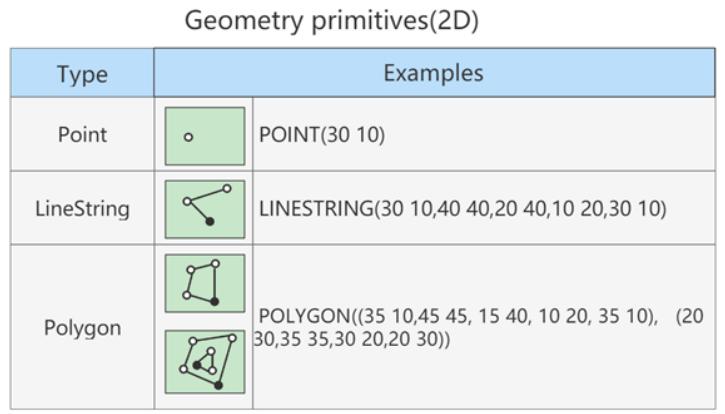
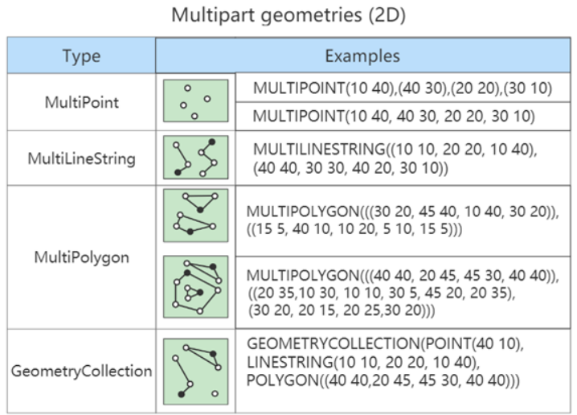

# MySQL数据类型 (/docs/backend/database/base/data_type)

## MySQL 中的数据类型 [#mysql-中的数据类型]

| 类型             | 类型举例                                                                                                                      |
| ---------------- | ----------------------------------------------------------------------------------------------------------------------------- |
| 整数类型         | `TINYINT`、`SMALLINT`、`MEDIUMINT`、`INT(或 INTEGER)` 、`BIGINT`                                                              |
| 浮点类型         | `FLOAT`、`DOUBLE`                                                                                                             |
| 定点数类型       | `DECIMAL`                                                                                                                     |
| 位类型           | `BIT`                                                                                                                         |
| 日期时间类型     | `YEAR`、`TIME`、`DATE`、`DATETIME`、`TIMESTAMP`                                                                               |
| 文本字符串类型   | `CHAR`、`VARCHAR`、`TINYTEXT`、`TEXT`、`MEDIUMTEXT`、`LONGTEXT`                                                               |
| 枚举类型         | `ENUM`                                                                                                                        |
| 集合类型         | `SET`                                                                                                                         |
| 二进制字符串类型 | `BINARY`、`VARBINARY`、`TINYBLOB`、`BLOB`、`MEDIUMBLOB`、`LONGBLOB`                                                           |
| JSON 类型        | `JSON 对象`、`JSON 数组`                                                                                                      |
| 空间数据类型     | 单值:`GEOMETRY` `POINT` `LINESTRING` `POLYGON`<br /><br />集合:`MULTIPOINT` `MULTILINESTRING` `MULTIPOLYGON` `GEOMETRYCOLLECTION` |

常见数据类型的属性如下：

| MySQL 关键字         | 含义                     |
| -------------------- | ------------------------ |
| `NULL`               | 数据列可包含 NULL 值     |
| `NOT NULL`           | 数据列不允许包含 NULL 值 |
| `DEFAULT`            | 默认值                   |
| `PRIMARY KEY`        | 主键                     |
| `AUTO_INCREMENT`     | 自动递增，适用于整数类型 |
| `UNSIGNED`           | 无符号                   |
| `CHARACTER SET name` | 指定字符集               |

## 整数类型 [#整数类型]

### 类型介绍 [#类型介绍]

整数类型一共有 5 种，包括`TINYINT`、`SMALLINT`、`MEDIUMINT`、`INT(INTERGER)`和`BIGINT`。

它们的区别如下：

| 整数类型           | 字节 | 有符号数取值范围          | 无符号数取值范围 |
| ------------------ | ---- | ------------------------- | ---------------- |
| `TINYINT`          | 1    | - 128 ~ 127               | 0 ~ 255          |
| `SMALLINT`         | 2    | - 32768 ~ 32767           | 0 ~ 65535        |
| `MEDIUMINT`        | 3    | - 8388608 ~ 8388607       | 0 ~ 16777215     |
| `INT`<br />`INTEGER` | 4    | - 2147483648 ~ 2147483647 | 0 ~ 4294967295   |
| `BIGINT`           | 8    | -2<sup>63</sup> ~ 2<sup>63</sup>-1          | 0 ~ 2<sup>64</sup>-1      |

### 可选属性 [#可选属性]

`M`:  
&#8195;&#8195;表示显示宽度，M 的取值范围是( 0 , 255 )。例如，int( 5 )：当数据宽度小于 5 位的时候在数字前面需要用字符填满宽度。该项功能需要配合`ZEROFILL`使用，表示用`0`填满宽度，否则指定显示宽度无效。


<Callout type="success" title="如果设置了显示宽度，那么插入的数据宽度超过显示宽度限制，会不会截断或插入失败？">

&#8195;&#8195;<mark>不会对插入的数据有任何影响</mark>，还是按照类型的实际宽度进行保存，即显示宽度与类型可以存储的值范围无关。 <mark>从 MySQL 8. 0. 17 开始，整数数据类型不推荐使用显示宽度属性</mark>。

</Callout>


&#8195;&#8195;整型数据类型可以在定义表结构时指定所需要的显示宽度，如果不指定，则系统为每一种类型指定默认的宽度值。

```sql 
CREATE TABLE test_int ( x TINYINT, y SMALLINT, z MEDIUMINT, m INT, n BIGINT );

# MySQL 5.7中显示如下，MySQL 8中不再显示范围
mysql> desc test_int;
+-------+--------------+------+-----+---------+-------+
| Field | Type         | Null | Key | Default | Extra |
+-------+--------------+------+-----+---------+-------+
| x     | tinyint(4)   | YES  |     | NULL    |       |
| y     | smallint(6)  | YES  |     | NULL    |       |
| z     | mediumint(9) | YES  |     | NULL    |       |
| m     | int(11)      | YES  |     | NULL    |       |
| n     | bigint(20)   | YES  |     | NULL    |       |
+-------+--------------+------+-----+---------+-------+
5 rows in set (0.01 sec)
```

`TINYINT`有符号数和无符号数的取值范围分别为 -128 ~ 127 和 0 ~ 255 ，由于负号占了一个数字位，因此`TINYINT`默认的显示宽度为 4 。同理，其他整数类型的默认显示宽度与其有符号数的最小值的宽度相同。

```sql 
CREATE TABLE test_int ( f1 INT, f2 INT ( 5 ), f3 INT ( 5 ) ZEROFILL );

INSERT INTO test_int ( f1, f2, f3 ) VALUES ( 1, 123, 123 );
INSERT INTO test_int ( f1, f2 ) VALUES ( 123456, 123456 );
INSERT INTO test_int ( f1, f2, f3 )VALUES ( 123456, 123456, 123456 );

mysql> desc test_int;
+-------+--------------------------+------+-----+---------+-------+
| Field | Type                     | Null | Key | Default | Extra |
+-------+--------------------------+------+-----+---------+-------+
| f1    | int(11)                  | YES  |     | NULL    |       |
| f2    | int(5)                   | YES  |     | NULL    |       |
| f3    | int(5) unsigned zerofill | YES  |     | NULL    |       |
+-------+--------------------------+------+-----+---------+-------+
3 rows in set (0.01 sec)

mysql> SELECT * FROM test_int;
+--------+--------+--------+
| f1     | f2     | f3     |
+--------+--------+--------+
|      1 |    123 |  00123 |
| 123456 | 123456 | NULL   |
| 123456 | 123456 | 123456 |
+--------+--------+--------+
3 rows in set (0.01 sec)
```

`UNSIGNED`:  
&#8195;&#8195;无符号类型(非负)，所有的整数类型都有一个可选的属性 <mark>UNSIGNED（无符号属性）</mark>，无符号整数类型的最小取值为 0 。所以，如果需要在 MySQL 数据库中保存非负整数值时，可以将整数类型设置为无符号类型。  
&#8195;&#8195;INT 类型默认显示宽度为 INT(11)，无符号 INT 类型默认显示宽度为 INT(10)

```sql 
CREATE TABLE test_int ( f1 INT UNSIGNED );

mysql> desc test_int;
+-------+------------------+------+-----+---------+-------+
| Field | Type             | Null | Key | Default | Extra |
+-------+------------------+------+-----+---------+-------+
| f1    | int(10) unsigned | YES  |     | NULL    |       |
+-------+------------------+------+-----+---------+-------+
1 row in set (0.01 sec)
```

`ZEROFILL`:  
&#8195;&#8195;0 填充,（如果某列是 ZEROFILL，那么 MySQL 会<mark>自动</mark>为当前列添加 UNSIGNED 属性），如果指定了 ZEROFILL 只是表示不够 M 位时，用 0 在左边填充，如果超过 M 位，只要不超过数据存储范围即可。  
&#8195;&#8195;原来，在 int(M) 中，M 的值跟 int(M) <mark>所占多少存储空间并无任何关系</mark>。int(3)、int(4)、int(8) 在磁盘上都是占用 4 bytes 的存储空间。也就是说，int(M)，必须和 UNSIGNED ZEROFILL 一起使用才有意义。如果整数值超过 M 位，就按照实际位数存储，只是无须再用字符 0 进行填充。

### 适用场景 [#适用场景]

`TINYINT`：一般用于<mark>枚举数据</mark>，比如系统设定取值范围很小且固定的场景。

`SMALLINT`：可以用于<mark>较小范围</mark>的统计数据，比如统计工厂的固定资产库存数量等。

`MEDIUMINT`：用于<mark>较大整数</mark>的计算，比如车站每日的客流量等。

`INT 或 INTEGER`：<mark>取值范围足够大</mark>，一般情况下不用考虑超限问题，用得最多。比如商品编号。

`BIGINT`：只有当你处理<mark>特别巨大</mark>的整数时才会用到。比如双十一的交易量、大型门户网站点击量、证券公司衍生产品持仓等。

### 如何选择 [#如何选择]

&#8195;&#8195;在评估用哪种整数类型的时候，你需要考虑`存储空间`和`可靠性`的平衡问题：一方面，用占用字节数少的整数类型可以节省存储空间；另一方面，要是为了节省存储空间，使用的整数类型取值范围太小，一旦遇到超出取值范围的情况，就可能引起系统错误，影响可靠性。

&#8195;&#8195;举个例子，商品编号采用的数据类型是 INT。原因就在于，客户门店中流通的商品种类较多，而且，每天都有旧商品下架，新商品上架，这样不断迭代，日积月累。

&#8195;&#8195;如果使用 SMALLINT 类型，虽然占用字节数比 INT 类型的整数少，但是却不能保证数据不会超出范围 65535 。相反，使用 INT，就能确保有足够大的取值范围，不用担心数据超出范围影响可靠性的问题。

&#8195;&#8195;你要注意的是，在实际工作中，<mark>系统故障产生的成本远远超过增加几个字段存储空间所产生的成本</mark>。因此，我建议你首先确保数据不会超过取值范围，在这个前提之下，再去考虑如何节省存储空间。

## 浮点类型 [#浮点类型]

### 类型介绍 [#类型介绍-1]

浮点数和定点数类型的特点是可以处理小数，MySQL 支持的浮点数类型，分别是`FLOAT(单精度浮点数)`、`DOUBLE(双精度浮点数)`、`REAL`；

> `REAL`默认就是`DOUBLE`。如果你把 SQL 模式设定为启用`REAL_AS_FLOAT`，那么，MySQL 就认为`REAL`是`FLOAT`。如果要启用可以通过以下 SQL 语句实现：

```sql 
# 查询当前配置的sql_mode
show variables like 'sql_mode';

SET sql_mode = "REAL_AS_FLOAT";
```

| 类型     | 字节 | 说明         | 格式                                    |
| -------- | ---- | ------------ | --------------------------------------- |
| `FLOAT`  | 4    | 单精度浮点型 | 1 位符号(S)，8 位指数(E)，23 位小数(M)  |
| `DOUBLE` | 8    | 双精度浮点型 | 1 位符号(S)，11 位指数(E)，52 位小数(M) |

> 扩展：浮点型计算标准-[IEEE 754](https://baike.baidu.com/item/IEEE%20754/3869922)


<Callout type="success" title="提示">

① `FLOAT`和`DOUBLE`这两种数据类型的区别  
`FLOAT`占用字节数少，取值范围小；`DOUBLE`占用字节数多，取值范围也大。

② 为什么浮点数类型的无符号数取值范围，只相当于有符号数取值范围的一半，也就是只相当于有符号数取值范围大于等于零的部分呢？  
MySQL 存储浮点数的格式为：符号(S)、尾数(M)和阶码(E)。因此，无论有没有符号，MySQL 的浮点数都会存储表示符号的部分。因此，所谓的无符号数取值范围，其实就是有符号数取值范围大于等于零的部分。

</Callout>


### 数据精度 [#数据精度]

(1) MySQL 允许使用非标准语法 <mark>(其他数据库未必支持)</mark>：`FLOAT(M,D)`或`DOUBLE(M,D)`。`M`称为<mark>精度</mark>，`D`称为<mark>标度</mark>。(M, D)中`M = 整数位 + 小数位`，`D = 小数位`。(D &lt;= M &lt;= 255，0 &lt;= D &lt;= 30)

> 例如，定义为`FLOAT(5, 2)`的一个列可以显示为 -999.99 ~ 999.99，如果超过这个范围会报错。

(2) `FLOAT`和`DOUBLE`类型在不指定(M, D)时，默认会按照实际的精度（由实际的硬件和操作系统决定）来显示

> 说明：浮点类型，也可以加`UNSIGNED`，但是不会改变数据范围，例如：`FLOAT(3, 2) UNSIGNED`仍然只能表示 0 ~ 9.99 的范围

(3) 不管是否显式设置了精度(M, D)，这里 MySQL 的处理方案如下：

- 存储时，整数部分超出了范围，MySQL 就会报错，不允许存这样的值
- 存储时，小数点部分若超出范围，分以下情况：
  - 若四舍五入后，整数部分没有超出范围`eg:FLOAT(5, 2) → 999.009 → 999.01`
  - 若四舍五入后，整数部分超出范围，则 MySQL 报错，并拒绝处理`eg:FLOAT(5, 2) → 999.995 → 报错`


<Callout type="warn" title="注意">

从 MySQL 8. 0. 17 开始，FLOAT(M,D) 和 DOUBLE(M,D)用法在官方文档中已经明确<mark>不推荐</mark>使用，将来可能被移除。另外，关于浮点型 FLOAT 和 DOUBLE 的 UNSIGNED 也不推荐使用了，将来也可能被移除。

</Callout>


**示例**：

```sql 
CREATE TABLE test_double (
  f1 FLOAT,
  f2 FLOAT (5,2),
  f3 DOUBLE,
  f4 DOUBLE (5,2)
);

INSERT INTO test_double VALUES
(123.456, 123.456, 123.4567, 123.45);

# Out of range value for column 'f2' at row 1 → f2 整数部分超范围
INSERT INTO test_double VALUES
(123.456, 1234.456, 123.4567, 123.45);
```

### 精度误差 [#精度误差]

&#8195;&#8195;浮点数类型有个缺陷，就是不精准。比如，我们设计一个表，有 f1 这个字段，插入值分别为 0.47, 0.44, 0.19，我们期待的运行结果是： 0. 47 + 0. 44 + 0. 19 = 1.1 。而使用 sum 之后查询：

```sql 
CREATE TABLE test_double (f1 DOUBLE);
INSERT INTO test_double VALUES (0.47), (0.44), (0.19);

mysql> SELECT SUM(f1) FROM test_double;
+--------------------+
| SUM(f1)            |
+--------------------+
| 1.0999999999999999 |
+--------------------+
1 row in set (0.04 sec)

mysql> SELECT SUM(f1) = 1.1, 1.1 = 1.1 FROM test_double;
+---------------+-----------+
| SUM(f1) = 1.1 | 1.1 = 1.1 |
+---------------+-----------+
|             0 |         1 |
+---------------+-----------+
1 row in set (0.04 sec)
```


<Callout type="success" title="提示">

&#8195;&#8195;虽然误差很小，但确实有误差。为什么会存在这样的误差呢？  
&#8195;&#8195;问题还是出在 MySQL 对浮点类型数据的存储方式上，MySQL 用 4 个字节存储 FLOAT 类型数据，用 8 个字节来存储 DOUBLE 类型数据。无论哪个，都是采用二进制的方式来进行存储的，如果尾数不是 0 或 5（比如 9.624），你就无法用一个二进制数来精确表达。进而，就只好在取值允许的范围内进行四舍五入。

&#8195;&#8195;在编程中，如果用到浮点数，要特别注意误差问题，因为<mark>浮点数是不准确的</mark>，所以我们要避免使用"="来判断两个数是否相等。同时，在一些对精确度要求较高的项目中，千万不要使用浮点数，不然会导致结果错误，甚至是造成不可挽回的损失。

</Callout>


## 定点类型 [#定点类型]

| 数据类型                                               | 字节数   | 含义                   |
| ------------------------------------------------------ | -------- | ---------------------- |
| `DECIMAL(M,D)`<br />`或 DEC(M,D)`<br />`或 NUMERIC(M,D)` | M+2 字节 | 有效范围由 M 和 D 决定 |

> 使用`DECIMAL(M, D)`的方式表示高精度小数。其中，M 被称为精度，D 被称为标度（0 &lt;= M &lt;= 65，0 &lt;= D &lt;= 30，D &lt; M）。例如，定义 DECIMAL(5, 2)的类型，表示该列取值范围是 -999.99 ~ 999.99。

(1) MySQL 中的定点数类型只有 DECIMAL 一种类型；  
(2) DECIMAL(M, D)的最大取值范围与 DOUBLE 类型一样，但是有效的数据范围是由 M 和 D 决定的；  
(3) 定点数在 MySQL 内部是以字符串的形式进行存储，这就决定了它一定是精准的；  
(4) 当 DECIMAL 类型不指定精度和标度时，<mark>其默认为 DECIMAL(10, 0)</mark>。当数据的精度超出了定点数类型的精度范围时，则 MySQL 同样会进行四舍五入处理。


<Callout type="success" title="浮点数与定点数对比">

&#8195;&#8195;浮点数相对于定点数的优点是在长度一定的情况下，浮点类型取值范围大，但是不精准，适用于需要取值范围大，又可以容忍微小误差的科学计算场景（比如计算化学、分子建模、流体动力学等）；  
&#8195;&#8195;定点数类型取值范围相对小，但是精准，没有误差，适合于对精度要求极高的场景（比如涉及金额计算的场景）。

</Callout>


利用定点数解决上面浮点数精确丢失问题：

```sql 
CREATE TABLE test_double (f1 DECIMAL(3, 2));
INSERT INTO test_double VALUES (0.47), (0.44), (0.19);

mysql> SELECT SUM(f1) FROM test_double;
+---------+
| SUM(f1) |
+---------+
| 1.10    |
+---------+
1 row in set (0.04 sec)
```

## 位类型 [#位类型]

BIT 类型中存储的是二进制值，类似 010110 。

| 二进制字符串类型 | 长度 | 长度范围     | 占用空间             |
| ---------------- | ---- | ------------ | -------------------- |
| `BIT(M)`         | M    | 1 &lt;= M &lt;= 64 | 约为(M + 7)/8 个字节 |

> `M`是表示二进制的位数，位数最小值为 1 ，最大值为 64，<mark>如果没有指定(M)，默认是 1 位</mark>

**示例**：

```sql 
CREATE TABLE test_bit (
  f1 BIT,
  f2 BIT (5),
  f3 BIT (64)
);

INSERT INTO test_bit(f1) VALUES( 1 );

# Data too long for column 'f1' at row 1
INSERT INTO test_bit(f1) VALUES( 2 );

INSERT INTO test_bit(f2) VALUES( 23 );
```

注意：  
(1) 在向 BIT 类型的字段插入数据时，一定要确保数据在 BIT 类型支持的范围内  
(2) 使用`SELECT`查询位字段时，可以使用 BIN()或 HEX()函数进行读取

## 日期与时间类型 [#日期与时间类型]

&#8195;&#8195;MySQL 有多种表示日期和时间的数据类型，不同的版本可能有所差异，MySQL 8. 0 版本支持的日期和时间类型主要有：YEAR 类型、TIME 类型、DATE 类型、DATETIME 类型和 TIMESTAMP 类型。

| 类型        | 名称      | 字节 | 日期格式              |
| ----------- | --------- | ---- | --------------------- |
| `YEAR`      | 年        | 1    | `YYYY` 或 `YY`        |
| `TIME`      | 时间      | 3    | `HH:MM:SS`            |
| `DATE`      | 日期      | 3    | `YYYY-MM-DD`          |
| `DATETIME`  | 日期 时间 | 8    | `YYYY-MM-DD HH:MM:SS` |
| `TIMESTAMP` | 日期 时间 | 4    | `YYYY-MM-DD HH:MM:SS` |

### YEAR 类型 [#year-类型]

在 MySQL 中，YEAR 有以下几种存储格式：  
(1) 以 4 位字符串或数字格式表示 YEAR 类型，其格式为 YYYY，最小值为 1901 ，最大值为 2155  
(2) 以 2 位字符串格式表示 YEAR 类型，最小值为 00 ，最大值为 99  
&#8195;&#8195;1) 当取值为 01 到 69 时，表示 2001 到 2069；  
&#8195;&#8195;2) 当取值为 70 到 99 时，表示 1970 到 1999；  
&#8195;&#8195;3) 当取值整数的 0 或 00 添加的话，那么是 0000 年；  
&#8195;&#8195;4) 当取值是日期/字符串的'0'添加的话，是 2000 年。


<Callout type="warn" title="注意">

从 MySQL 5.5.27 开始，2 位格式的 YEAR 已经不推荐使用。YEAR 默认格式就是"YYYY"，没必要写成 YEAR(4)，从 MySQL 8.0.19 开始，不推荐使用指定显示宽度的 YEAR(4)数据类型。

</Callout>


### DATE 类型 [#date-类型]

&#8195;&#8195;DATE 类型表示日期，没有时间部分，格式为`YYYY-MM-DD`，其中，`YYYY`表示年份，`MM`表示月份，`DD`表示日期。需要 3 个字节的存储空间。在向 DATE 类型的字段插入数据时，同样需要满足一定的格式条件。

(1) 以`YYYY-MM-DD`格式或者`YYYYMMDD`格式表示的字符串日期，其最小取值为`1000-01-01`，最大取值为`9999-12-03`。<mark>`YYYYMMDD`格式会被转化为`YYYY-MM-DD`格式</mark>

(2) 以`YY-MM-DD`格式或者`YYMMDD`格式表示的字符串日期，此格式中，年份为两位数值或字符串满足<mark>YEAR 类型</mark>的格式条件，具体参见<u>[YEAR 类型](/docs/backend/database/base/data_type#year-类型)</u>介绍

(3) 使用`CURRENT_DATE()`或者`NOW()`函数，会插入当前系统的<mark>日期</mark>

### TIME 类型 [#time-类型]

&#8195;&#8195;TIME 类型用来表示时间，不包含日期部分。在 MySQL 中，需要 3 个字节的存储空间来存储 TIME 类型的数据，可以使用`HH:MM:SS`格式来表示 TIME 类型，其中，`HH`表示小时，`MM`表示分钟，`SS`表示秒。

在 MySQL 中，向 TIME 类型的字段插入数据时，也可以使用几种不同的格式：

(1) 可以使用带有冒号的<mark>字符串</mark>，比如`D HH:MM:SS`、`HH:MM:SS`、`HH:MM`、`D HH:MM`、`D HH`或`SS`格式，都能被正确地插入 TIME 类型的字段中。其中 D 表示天，其最小值为 0，最大值为 34。如果使用带有 D 格式的字符串插入 TIME 类型的字段时，D 会被转化为小时，计算格式为`D * 24 + HH`。当使用带有冒号并且不带 D 的字符串表示时间时，表示当天的时间，比如`12:10`表示`12:10:00`，而不是`00:12:10`

(2) 可以使用不带有冒号的<mark>字符串或者数字</mark>，格式为`HHMMSS`或者`'HHMMSS'`。如果插入一个不合法的字符串或者数字，MySQL 在存储数据时，会将其自动转化为`00:00:00`进行存储。比如`1210`，MySQL 会将<mark>最右边的两位</mark>解析成秒，表示`00:12:10`，而不是`12:10:00`

(3) 使用`CURRENT_TIME()`或者`NOW()`，会插入当前系统的<mark>时间</mark>

### DATETIME 类型 [#datetime-类型]

&#8195;&#8195;DATETIME 类型在所有的日期时间类型中占用的存储空间最大，总共需要 8 个字节的存储空间。在格式上为 DATE 类型和 TIME 类型的组合，可以表示为`YYYY-MM-DD HH:MM:SS`，其中`YYYY`表示年份，`MM`表示月份，`DD`表示日期，`HH`表示小时，`MM`表示分钟，`SS`表示秒。

在 MySQL 中，在向 DATETIME 类型的字段插入数据时，同样需要满足一定的格式条件：

(1) 以`YYYY-MM-DD HH:MM:SS`或`YYYYMMDDHHMMSS`格式的字符串插入 DATETIME 类型的字段时，最小值为`1000-01-01 00:00:00`，最大值为`9999-12-03 23:59:59`

> 以`YYYYMMDDHHMMSS`格式的数字插入 DATETIME 类型的字段时，会被转化为`YYYY-MM-DD HH:MM:SS`格式。

(2) 以`YY-MM-DD HH:MM:SS`或`YYMMDDHHMMSS`格式的字符串插入 DATETIME 类型的字段时，两位数的年份规则符合 YEAR 类型的规则，具体参见<u>[YEAR 类型](/docs/backend/database/base/data_type#year-类型)</u>介绍

(3) 使用函数`CURRENT_TIMESTAMP()`和`NOW()`，可以向 DATETIME 类型的字段插入系统的当前<mark>日期和时间</mark>

### TIMESTAMP 类型 [#timestamp-类型]

&#8195;&#8195;TIMESTAMP 类型也可以表示日期时间，其显示格式与 DATETIME 类型相同，都是`YYYY-MM-DD HH:MM:SS`，需要 4 个字节的存储空间。但是 TIMESTAMP 存储的时间范围比 DATETIME 要小很多，只能存储`1970-01-01 00:00:01 UTC`到`2038-01-19 03:14:07 UTC`之间的时间。其中，UTC 表示世界统一时间，也叫作世界标准时间。

&#8195;&#8195;向 TIMESTAMP 类型的字段插入数据时，当插入的数据格式满足`YY-MM-DD HH:MM:SS`和`YYMMDDHHMMSS`时，两位数值的年份同样符合 YEAR 类型的规则条件，只不过表示的时间范围要小很多。

&#8195;&#8195;如果向 TIMESTAMP 类型的字段插入的时间超出了 TIMESTAMP 类型的范围，则 MySQL 会抛出错误信息。


<Callout type="success" title="提示">

存储数据的时候需要对当前时间所在的时区进行转换，查询数据的时候再将时间转换回当前的时区。因此，使用 TIMESTAMP 存储的同一个时间值，在不同的时区查询时会显示不同的时间。

</Callout>


### 开发中经验 [#开发中经验]

&#8195;&#8195;<mark>用得最多的日期时间类型，就是 DATETIME</mark>。虽然 MySQL 也支持 YEAR（年）、 TIME（时间）、DATE（日期），以及 TIMESTAMP 类型，但是在实际项目中，尽量用 DATETIME 类型。因为这个数据类型包括了完整的日期和时间信息，取值范围也最大，使用起来比较方便。毕竟，如果日期时间信息分散在好几个字段，很不容易记，而且查询的时候，SQL 语句也会更加复杂。

&#8195;&#8195;此外，一般存<mark>注册时间、商品发布时间等</mark>，不建议使用 DATETIME 存储，而是使用<mark>时间戳</mark>，因为 DATETIME 虽然直观，但不便于计算。

## 文本字符串类型 [#文本字符串类型]

MySQL 中，文本字符串总体上分为`CHAR`、`VARCHAR`、`TINYTEXT`、`TEXT`、`MEDIUMTEXT`、`LONGTEXT`、`ENUM`、`SET`等类型。

| 文本字符串类型 | 值的长度 | 长度范围          | 占用的存储空间         |
| -------------- | -------- | ----------------- | ---------------------- |
| `CHAR(M)`      | M        | 0 &lt;= M &lt;= 255     | M 个字节               |
| `VARCHAR(M)`   | M        | 0 &lt;= M &lt;= 65535   | `实际长度` + 1 个字节  |
| `TINYTEXT`     | L        | 0 &lt;= L &lt;= 255     | L + 2 个字节           |
| `TEXT`         | L        | 0 &lt;= L &lt;= 65535   | L + 2 个字节           |
| `MEDIUMTEXT`   | L        | 0 &lt;= L &lt;= 2<sup>24</sup>-1 | L + 3 个字节           |
| `LONGTEXT`     | L        | 0 &lt;= L &lt;= 2<sup>32</sup>-1 | L + 4 个字节           |
| `ENUM`         | L        | 1 &lt;= L &lt;= 65535   | 1 或 2 个字节          |
| `SET`          | L        | 0 &lt;= L &lt;= 64      | 1、2、3、4 或 8 个字节 |

### CHAR 与 VARCHAR 类型 [#char-与-varchar-类型]

| 字符串(文本)类型 | 特点     | 长度 | 长度范围        | 占用的存储空间          |
| ---------------- | -------- | ---- | --------------- | ----------------------- |
| `CHAR(M)`        | 固定长度 | M    | 0 &lt;= M &lt;= 255   | M 个字节                |
| `VARCHAR(M)`     | 可变长度 | M    | 0 &lt;= M &lt;= 65535 | `(实际长度 + 1)` 个字节 |

**CHAR 类型**：

(1) CHAR(M) 类型一般需要预先定义字符串长度。<mark>如果不指定 M，则表示长度默认是 1 个字符</mark>。

(2) 如果保存时，数据的实际长度比 CHAR 类型声明的长度小，则会在`右侧填充空格`以达到指定的长度。当 MySQL 检索 CHAR 类型的数据时，CHAR 类型的字段<mark>会去除尾部的空格</mark>。

(3) 定义 CHAR 类型字段时，<mark>声明的字段长度即为 CHAR 类型字段所占的存储空间的字节数</mark>。

---

**VARCHAR 类型**：

(1) VARCHAR(M) 定义时，<mark>必须指定长度 M，否则报错</mark>。

(2) MySQL4.0 版本以下，VARCHAR(20)：指的是 20 字节，如果存放 UTF8 汉字时，只能存 6 个（每个汉字 3 字节）；MySQL5.0 版本以上，VARCHAR(20)：指的是 20 字符。

(3) 检索 VARCHAR 类型的字段数据时，会保留数据尾部的空格。<mark>VARCHAR 类型的字段所占用的存储空间为字符串实际长度加 1 个字节</mark>。

---

占用空间比较：

| Value      | CHAR(4) | Storage Required | VARCHAR(4) | Storage Required |
| ---------- | ------- | ---------------- | ---------- | ---------------- |
| ''         | ' '     | 4 bytes          | ''         | 1 byte           |
| 'ab'       | 'ab '   | 4 bytes          | 'ab'       | 3 bytes          |
| 'abcd'     | 'abcd'  | 4 bytes          | 'abcd'     | 5 bytes          |
| 'abcdefgh' | 'abcd'  | 4 bytes          | 'abcd'     | 5 bytes          |

```sql 
CREATE TABLE vc (v VARCHAR(4), c CHAR(4));

INSERT INTO vc VALUES ('ab  ', 'ab  ');

# 尾部空格保留情况
mysql> SELECT CONCAT('(', v, ')'), CONCAT('(', c, ')') FROM vc;
+---------------------+---------------------+
| CONCAT('(', v, ')') | CONCAT('(', c, ')') |
+---------------------+---------------------+
| (ab  )              | (ab)                |
+---------------------+---------------------+
1 row in set (0.06 sec)
```


<Callout type="success" title="CHAR 和 VARCHAR 如何选择?">

| 类型         | 特点     | 空间上       | 时间上 | 适用场景             |
| ------------ | -------- | ------------ | ------ | -------------------- |
| `CHAR(M)`    | 固定长度 | 浪费存储空间 | 效率高 | 存储不大，速度要求高 |
| `VARCHAR(M)` | 可变长度 | 节省存储空间 | 效率低 | 非 CHAR 的情况       |

**情况 1**：存储很短的信息。比如门牌号码 101、201……这样很短的信息应该用 char，因为 varchar 还要占个 byte 用于存储信息长度，本来打算节约存储的，结果得不偿失。

**情况 2**：固定长度的。比如使用 uuid 作为主键，那用 char 应该更合适。因为他固定长度，varchar 动态根据长度的特性就消失了，而且还要占个长度信息。

**情况 3**：十分频繁改变的 column。因为 varchar 每次存储都要有额外的计算，得到长度等工作，如果一个非常频繁改变的，那就要有很多的精力用于计算，而这些对于 char 来说是不需要的。

**情况 4**：具体存储引擎中的情况：

① `MyISAM` 数据存储引擎和数据列：MyISAM 数据表，最好使用固定长度(CHAR)的数据列代替可变长度(VARCHAR)的数据列。这样使得整个表静态化，从而使数据检索更快，用空间换时间。  
② `MEMORY` 存储引擎和数据列：MEMORY 数据表目前都使用固定长度的数据行存储，因此无论使用 CHAR 或 VARCHAR 列都没有关系，两者都是作为 CHAR 类型处理的。  
③ `InnoDB` 存储引擎，建议使用 VARCHAR 类型。因为对于 InnoDB 数据表，内部的行存储格式并没有区分固定长度和可变长度列（所有数据行都使用指向数据列值的头指针），而且主要影响性能的因素是数据行使用的存储总量，由于 char 平均占用的空间多于 varchar，所以除了简短并且固定长度的，其他考虑 varchar。这样节省空间，对磁盘 I/O 和数据存储总量比较好。

</Callout>


### TEXT 类型 [#text-类型]

| 文本字符串类型       | 特点     | 长度 | 长度范围                     | 占用的存储空间 |
| -------------------- | -------- | ---- | ---------------------------- | -------------- |
| `TINYTEXT`小文本     | 可变长度 | L    | 0 &lt;= L &lt;= 255                | L + 2 个字节   |
| `TEXT`文本           | 可变长度 | L    | 0 &lt;= L &lt;= 65535              | L + 2 个字节   |
| `MEDIUMTEXT`中等文本 | 可变长度 | L    | 0 &lt;= L &lt;= 16777215           | L + 3 个字节   |
| `LONGTEXT`大文本     | 可变长度 | L    | 0 &lt;= L&lt;= 2<sup>32</sup>-1(相当于 4GB) | L + 4 个字节   |

(1) 在 MySQL 中，TEXT 用来保存文本类型的字符串，总共包含 4 种类型，分别为 `TINYTEXT`、`TEXT`、`MEDIUMTEXT`和`LONGTEXT`类型。

(2) 在向 TEXT 类型的字段保存和查询数据时，系统自动按照实际长度存储，不需要预先定义长度。这一点和 VARCHAR 类型相同。

(3) 由于实际存储的长度不确定，<mark>MySQL 不允许 TEXT 类型的字段做主键</mark>。遇到这种情况，你只能采用 CHAR(M)或者 VARCHAR(M)。

---


<Callout type="success" title="开发中经验">

&#8195;&#8195;TEXT 文本类型，可以存比较大的文本段，搜索速度稍慢，因此如果不是特别大的内容，建议使用 CHAR、VARCHAR 来代替。还有 TEXT 类型不用加默认值，加了也没用。而且 text 和 blob 类型的数据删除后容易导致"空洞"，使得文件碎片比较多，所以频繁使用的表不建议包含 TEXT 类型字段，建议单独分出去，单独用一个表。

</Callout>


## ENUM 类型 [#enum-类型]

&#8195;&#8195;ENUM 类型也叫作枚举类型，ENUM 类型的取值范围需要在定义字段时进行指定。设置字段值时，ENUM 类型只允许从成员中<mark>选取单个值</mark>，不能一次选取多个值。

| 文本字符串类型 | 长度 | 长度范围        | 占用的存储空间 |
| -------------- | ---- | --------------- | -------------- |
| `ENUM`         | L    | 1 &lt;= L &lt;= 65535 | 1 或 2 个字节  |

> 当其包含 1~255 个成员时，需要一个字节存储  
> 当其包含 256~65535 个成员时，需要两个字节存储

**示例**：

```sql 
CREATE TABLE test_enum(
  season ENUM('春','夏','秋','冬','unknow')
);

INSERT INTO test_enum VALUES('春'),('秋');

# 忽略大小写
INSERT INTO test_enum VALUES('UNKNOW');

# 允许按照角标的方式获取指定索引位置的枚举值
INSERT INTO test_enum VALUES('1'),( 3 );

# Data truncated for column 'season' at row 1
INSERT INTO test_enum VALUES('ab');

# 当ENUM类型的字段没有声明为NOT NULL时，插入NULL也是有效的
INSERT INTO test_enum VALUES(NULL);
```

## SET 类型 [#set-类型]

&#8195;&#8195;SET 表示一个字符串对象，<mark>可以包含 0 个或多个成员</mark>，但成员个数的上限为 64 。<mark>设置字段值时，可以取取值范围内的 0 个或多个值</mark>。  
当 SET 类型包含的成员个数不同时，其所占用的存储空间也是不同的，具体如下：

| 成员个数范围（L 表示实际成员个数） | 占用的存储空间 |
| ---------------------------------- | -------------- |
| 1 &lt;= L &lt;= 8                        | 1 个字节       |
| 9 &lt;= L &lt;= 16                       | 2 个字节       |
| 17 &lt;= L &lt;= 24                      | 3 个字节       |
| 25 &lt;= L &lt;= 32                      | 4 个字节       |
| 33 &lt;= L &lt;= 64                      | 8 个字节       |

**示例**：

```sql 
CREATE TABLE test_set(
  s SET ('A', 'B', 'C')
);

INSERT INTO test_set (s) VALUES ('A'), ('A,B');

# 插入重复的SET类型成员时，MySQL会自动删除重复的成员
INSERT INTO test_set (s) VALUES ('A,B,C,A');

# 向SET类型的字段插入SET成员中不存在的值时，MySQL会抛出错误。
INSERT INTO test_set (s) VALUES ('A,B,C,D');
```

## 10.二进制字符串类型 [#10二进制字符串类型]

&#8195;&#8195;MySQL 中的二进制字符串类型主要存储一些二进制数据，比如可以存储图片、音频和视频等二进制数据。

&#8195;&#8195;MySQL 中支持的二进制字符串类型主要包括`BINARY`、`VARBINARY`、`TINYBLOB`、`BLOB`、`MEDIUMBLOB`和`LONGBLOB`类型。

### BINARY 与 VARBINARY 类型 [#binary-与-varbinary-类型]

| 二进制字符串类型 | 特点     | 值的长度            | 占用空间    |
| ---------------- | -------- | ------------------- | ----------- |
| `BINARY(M)`      | 固定长度 | M (0 &lt;= M &lt;= 255)   | M 个字节    |
| `VARBINARY(M)`   | 可变长度 | M (0 &lt;= M &lt;= 65535) | M+ 1 个字节 |

(1) `BINARY`和`VARBINARY`类似于`CHAR`和`VARCHAR`，只是它们存储的是二进制字符串。

(2) `BINARY(M)`为固定长度的二进制字符串，M 表示最多能存储的字节数，取值范围是 0~255 个字符。如果未指定 M，表示只能存储 1 个字节。例如`BINARY(8)`，表示最多能存储 8 个字节，如果字段值不足 M 个字节，将在右边填充`\0`以补齐指定长度。

(3) `VARBINARY(M)`为可变长度的二进制字符串，M 表示最多能存储的字节数，总字节数不能超过行的字节长度限制 65535 ，另外还要考虑额外字节开销，`VARBINARY`类型的数据除了存储数据本身外，还需要 1 或 2 个字节来存储数据的字节数。<mark>`VARBINARY`类型必须指定 M，否则报错</mark>。

### BLOB 类型 [#blob-类型]

| 二进制字符串类型 | 值的长度 | 长度范围                           | 占用空间     |
| ---------------- | -------- | ---------------------------------- | ------------ |
| `TINYBLOB`       | L        | 0 &lt;= L &lt;= 255                      | L + 1 个字节 |
| `BLOB`           | L        | 0 &lt;= L &lt;= 65535（相当于 64KB）     | L + 2 个字节 |
| `MEDIUMBLOB`     | L        | 0 &lt;= L &lt;= 16777215 （相当于 16MB） | L + 3 个字节 |
| `LONGBLOB`       | L        | 0 &lt;= L &lt;= 4294967295（相当于 4GB） | L + 4 个字节 |

BLOB 是一个二进制大对象，可以容纳可变数量的数据。

MySQL 中的 BLOB 类型包括`TINYBLOB`、`BLOB`、`MEDIUMBLOB`和`LONGBLOB`， 4 种类型，它们可容纳值的最大长度不同。可以存储一个二进制的大对象，比如图片、音频和视频等。


<Callout type="success" title="提示">

需要注意的是，在实际工作中，往往不会在 MySQL 数据库中使用 BLOB 类型存储大对象数据，通常会将图片、音频和视频文件存储到服务器的磁盘上，并将图片、音频和视频的访问路径存储到 MySQL 中。

</Callout>


**<u>`TEXT`和`BLOB`的使用注意事项</u>**：

在使用`text`和`blob`字段类型时要注意以下几点，以便更好的发挥数据库的性能：

① `BLOB`和`TEXT`值也会引起自己的一些问题，特别是执行了大量的删除或更新操作的时候。删除这种值会在数据表中留下很大的"空洞"，以后填入这些"空洞"的记录可能长度不同。为了提高性能，建议定期使用`OPTIMIZE TABLE`功能对这类表进行碎片整理。

② 如果需要对大文本字段进行模糊查询，MySQL 提供了前缀索引。但是仍然要在不必要的时候避免检索大型的`BLOB`或`TEXT`值。例如，`SELECT *`查询就不是很好的想法，除非你能够确定作为约束条件的`WHERE`子句只会找到所需要的数据行，否则，你可能毫无目的地在网络上传输大量的值。

③ 把`BLOB`或`TEXT`列分离到单独的表中。在某些环境中，如果把这些数据列移动到第二张数据表中，可以让你把原数据表中的数据列转换为固定长度的数据行格式，那么它就是有意义的。这会减少主表中的碎片，使你得到固定长度数据行的性能优势。它还使你在主数据表上运行`SELECT *`查询的时候不会通过网络传输大量的`BLOB`或`TEXT`值。

## JSON 类型 [#json-类型]

&#8195;&#8195;JSON 可以将 JavaScript 对象中表示的一组数据转换为字符串，然后就可以在网络或者程序之间轻松地传递这个字符串，并在需要的时候将它还原为各编程语言所支持的数据格式。在 MySQL 5.7 中，就已经支持 JSON 数据类型。在 MySQL 8.x 版本中，JSON 类型提供了可以进行自动验证的 JSON 文档和优化的存储结构，使得在 MySQL 中存储和读取 JSON 类型的数据更加方便和高效。

```sql 
CREATE TABLE test_json(
  js json
);

INSERT INTO test_json ( js ) VALUES
( '{"name":"lihua", "age":18, "address":{"province":"shenzhen","city":"nanshan"}}' );
```

**取值方法**：

```sql 
-- 取某个具体值：单层json
# 方式一：A->'$.B'的方式提取
SELECT js -> '$.name',js -> '$.age' FROM test_json;
# 方式二：json_extract
SELECT json_extract(js, '$.name') FROM test_json;

-- 取某个具体值：多层json
# json_unquote：去引号
SELECT json_unquote(json_extract(json_extract(js, '$.address'), '$.province')) FROM test_json;
```

## 空间类型 [#空间类型]

MySQL 空间类型扩展支持地理特征的生成、存储和分析。这里的地理特征表示世界上具有位置的任何东西，可以是一个实体，例如一座山；可以是空间，例如一座办公楼；也可以是一个可定义的位置，例如一个十字路口等等。

MySQL 中使用 Geometry（几何）来表示所有地理特征。Geometry 指一个点或点的集合，代表世界上任何具有位置的事物。

MySQL 的空间数据类型（Spatial Data Type）对应于 OpenGIS 类，包括单值类型：`GEOMETRY`、`POINT`、`LINESTRING`、`POLYGON` 以及集合类型：`MULTIPOINT`、`MULTILINESTRING`、`MULTIPOLYGON`、`GEOMETRYCOLLECTION`。

---

**单值类型**：  
Geometry 是所有空间集合类型的基类，其他类型如 POINT、LINESTRING、POLYGON 都是 Geometry 的子类。

Point，顾名思义就是点，有一个坐标值。例如 POINT(121.213342 31.234532)，POINT(30 10)，坐标值支持 DECIMAL 类型，经度（longitude）在前，维度（latitude）在后，用空格分隔。

LineString，线，由一系列点连接而成。如果线从头至尾没有交叉，那就是简单的（simple）；如果起点和终点重叠，那就是封闭的（closed）。例如 LINESTRING(30 10,10 30,40 40)，点与点之间用逗号分隔，一个点中的经纬度用空格分隔，与 POINT 格式一致。

Polygon，多边形。可以是一个实心平面形，即没有内部边界，也可以有空洞，类似纽扣。最简单的就是只有一个外边界的情况，例如 POLYGON((0 0,10 0,10 10, 0 10))。



---

**集合类型**：  
MultiPoint、MultiLineString、MultiPolygon、GeometryCollection 这 4 种类型都是集合类，是多个 Point、LineString 或 Polygon 组合而成。



## 小结 [#小结]

&#8195;&#8195;在定义数据类型时，如果确定是整数，就用 INT；如果是小数，一定用定点数类型 DECIMAL(M,D)； 如果是日期与时间，就用 DATETIME。

&#8195;&#8195;这样做的好处是，首先确保你的系统不会因为数据类型定义出错。不过，凡事都是有两面的，可靠性好，并不意味着高效。比如，TEXT 虽然使用方便，但是效率不如 CHAR(M) 和 VARCHAR(M)。

---

《阿里巴巴 Java 开发手册》- MySQL 数据库

【强制】小数类型为`decimal`，禁止使用`float`和`double`。  
说明：`float`和`double`在存储的时候，存在精度损失的问题，很可能在值的比较时，得到不正确的结果。如果存储的数据范围超过`decimal`的范围，建议将数据拆成整数和小数分开存储。

【强制】如果存储的字符串长度几乎相等，使用`char`定长字符串类型。

【强制】`varchar`是可变长字符串，不预先分配存储空间，长度不要超过 5000，如果存储长度大于此值，定义字段类型为`text`，独立出来一张表，用主键来对应，避免影响其它字段索引效率。

【强制】表达是与否概念的字段，必须使用`is_xxx`的方式命名，数据类型是`unsigned tinyint`
（1 表示是，0 表示否）。  
 说明：任何字段如果为非负数，必须是`unsigned`。  
 注意：POJO 类中的任何布尔类型的变量，都不要加 is 前缀，所以，需要在`<resultMap>`设置从`is_xxx`到`Xxx`的映射关系。数据库表示是与否的值，使用`tinyint`类型，坚持`is_xxx`的命名方式是为了明确其取值含义与取值范围。  
 正例：表达逻辑删除的字段名`is_deleted`，1 表示删除，0 表示未删除。
