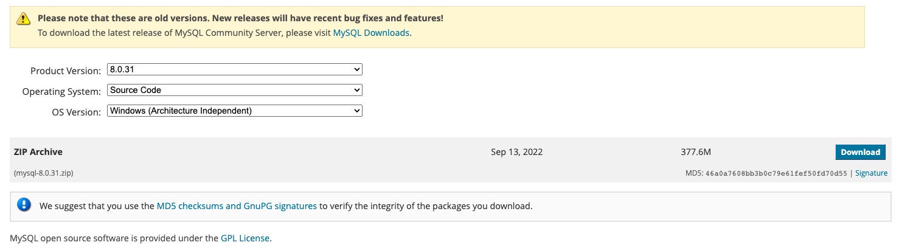
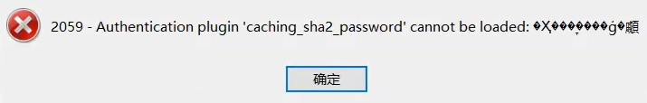
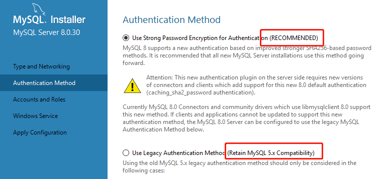

# 环境搭建 (/docs/backend/database/base/environment_building)

## 安装与卸载 [#安装与卸载]


<Callout type="success" title="提示">

请自行百度！

</Callout>


## 初识 MySQL [#初识-mysql]

### 服务的启动与停止 [#服务的启动与停止]

```shell 
# 启动 MySQL 服务命令
net start MySQL服务名

# 停止 MySQL 服务命令
net stop MySQL服务名
```

### 登录与退出 [#登录与退出]

```sh 
mysql -h 主机名 -P 端口号 -u 用户名 -p密码
# eg: mysql -h locahost -P 3306 -u root -pabc123

# 退出登录
quit 或 exit

# 版本查看
mysql -V 或 mysql --version
# 登录后也可使用如下查询
select version();
```


<Callout type="success" title="提示">

① `-p`与密码之间不能有空格，其他参数空格可有可无  
② 密码建议在下一行输入，保证安全

```sh 
mysql -h locahost -P 3306 -u root -p
Enter password:****
```

③ 客户端和服务器在同一台机器上，由于是本机连接，可省略`-h`参数；若端口号也未修改，则`-P 3306`也可省略，简写为`mysql -u root -p`

</Callout>


### MySQL 演示使用 [#mysql-演示使用]

```sh 
# 查看数据库
show databases;

# 创建数据库
create database dbtest;
# 删除数据库
drop database dbtest;
# 使用数据库
use dbtest;
# 查看数据库表
show tables;
```

### MySQL 的编码设置 [#mysql-的编码设置]

**查看**：

```sh 
# 查看编码命令
show variables like 'character_%';
show variables like 'collation_%';
```

**修改**：

```sh 
# MySQL数据目录下 my.ini 配置文件
[mysql] # 大概63行左右，在其下添加
...
default-character-set=utf8 # 默认字符集

[mysqld] # 大概76行左右，在其下添加
...
character-set-server=utf8
collation-server=utf8_general-ci
```

### MySQL 目录结构 [#mysql-目录结构]

**主要目录结构**:

| 目录结构                                     | 说明                                           |
| -------------------------------------------- | ---------------------------------------------- |
| `bin`目录                                    | 所有 MySQL 的可执行文件                        |
| MySQLInstanceConfig.exe                      | 数据库的配置向导，在安装时出现的内容           |
| `data`目录                                   | 系统数据库所在的目录                           |
| `my.ini`文件                                 | MySQL 的主要配置文件                           |
| c:\ProgramData\MySQL\MySQL Server 8.0\data\  | 用户创建的数据库所在的目录(路径按自己实际而定) |

### MySQL 源码 [#mysql-源码]

下载地址：[https://downloads.mysql.com/archives/community/](https://downloads.mysql.com/archives/community/)



## 常见问题解决 [#常见问题解决]

### 错误 ERROR:没有选择数据库就操作表格和数据 [#错误-error没有选择数据库就操作表格和数据]

```sql 
ERROR 1046 (3D000): No database selected

解决方案一：就是使用 "USE 数据库名;" 语句，这样接下来的语句就默认针对这个数据库进行操作
解决方案二：就是所有的表对象前面都加上"数据库."
```

### 命令行客户端的字符集问题 [#命令行客户端的字符集问题]

```sh 
# 表结构省略，重点在于下面的ERROR信息
mysql> INSERT INTO dbtest VALUES(1, '张三', '男');
ERROR 1366 (HY000):Incorrect string value: '\xD5\xC5\xC8\xFD' for column 'name' at row 1
```

> MySQL 5.7 版本中无法存放中文，因为其默认字符集是`latin1`，而 MySQL 8.0 版本则默认为`utf8`

### Authentication plugin 'caching_sha2_password' cannot be loaded [#authentication-plugin-caching_sha2_password-cannot-be-loaded]

&#8195;&#8195;有些图形界面工具，特别是旧版本的图形界面工具，在连接 MySQL8 时出现`Authentication plugin 'caching_sha2_password' cannot be loaded`错误



**原因**：  
&#8195;&#8195;MySQL 8 之前版本的传统加密规则为`mysql_native_password`，而 MySQL 8 之后提供了新的加密方式`caching_sha2_password`



**解决**：  
(1) 升级图形化工具使其支持  
(2) 用户登录密码加密规则还原为`mysql_native_password`

```sh 
# 使用mysql数据库
USE mysql;

# 修改'root'@'localhost'用户的密码规则和密码（以自己实际修改）
ALTER USER 'root'@'localhost' IDENTIFIED WITH mysql_native_password BY 'abc123';

# 刷新权限
FLUSH PRIVILEGES;
```
