# 多表查询 (/docs/backend/database/base/multi_table_query)

<Callout type="success" title="提示">

<mark>多表查询</mark>，也称为关联查询，指两个或更多个表一起完成查询操作。  
**前提条件**：这些一起查询的表之间是有关系的(一对一、一对多)，它们之间一定是有关联字段，这个关联字段可能建立了外键，也可能没有建立外键。

</Callout>


## 笛卡尔积 [#笛卡尔积]

&#8195;&#8195;如果连接条件无效或者遗漏，其结果就是一个笛卡尔积，其中所有行的组合都被显示出来，即第一个表中的所有行连接到第二个表中的所有行。  
&#8195;&#8195;笛卡尔积会产生大量的行，例如第一个表中有 100 条记录，第二个表中有 200 条记录，使用笛卡尔积，结果就是两者相乘的 20000 条记录。一般来说这样的数据没有什么用，所以要避免此类情况出现。

## 等值 / 非等值连接 [#等值--非等值连接]

### 等值连接 [#等值连接]

```sql 
SELECT
  table1.column, table2.column
FROM
  table1, table2
WHERE
  table1.column1 = table2.column1;
```

&#8195;&#8195;在多表连接查询的 SELECT 子句中，字段名前面用表名可以使语义清楚，并且加快数据库访问，提高性能；<mark>如果相同的字段名出现在多个表中，字段名必须加表名，否则会引起冲突。</mark> 为了将 N 个表连接在一起，至少需要 N-1 个连接条件。

### 多表等值连接 [#多表等值连接]

```sql 
SELECT
  table1.column, table2.column, table3.column
FROM
  table1, table2, table3
WHERE
  table1.column1 = table2.column1
  AND table1.column2 = table3.column2;
```

&#8195;&#8195;在 SQL 语句中的`WHERE`子句里，用`AND`将两个连接条件结合起来，像这样的连接称为多表的等值查询。其核心表是`table1`，分别通过`column1`与表`table2`关联，通过`column2`与表`table3`关联。

### 非等值连接 [#非等值连接]

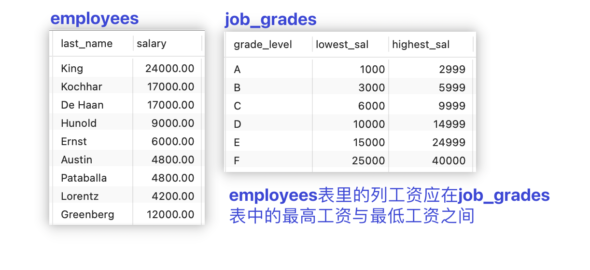

```sql 
SELECT
  e.last_name, e.salary, j.grade_level
FROM
  employees e, job_grades j
WHERE
  e.salary BETWEEN j.lowest_sal AND j.highest_sal;
```

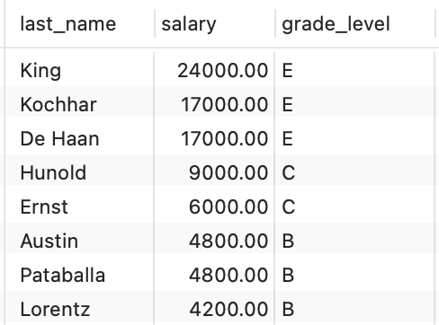

## 表别名 [#表别名]

&#8195;&#8195;为了提高性能、避免字段名冲突，在多表连接查询的 SELECT 子句中，应该以`表名.字段名`的方式命名。不过这么写比较繁琐，可以使用表别名解决。  
&#8195;&#8195;表别名就是给表起了另外一个名字，不过字段别名通常是为了显示字段标题易于理解而起，而表别名是为了让 SQL 语句简单、易读。<mark>注意给表取别名后则不能使用"表名.字段名"的形式了，而需要使用"表别名.字段名"。</mark>

**示例**：

```sql 
# 将表table1 取别名a，并将表table2 取别名b
SELECT
  a.column, b.column
FROM
  table1 a, table2 b
WHERE
  a.column1 = b.column2;
```

## 自连接(自关联) [#自连接自关联]

```sql 
# 查询员工编号，员工姓名及其对应管理者的编号和姓名
SELECT
  a.employee_id '员工编号',
  a.first_name '员工名',
  a.last_name '员工姓',
  b.employee_id '管理者编号',
  b.first_name '管理者名',
  b.last_name '管理者姓'
FROM
  employees a,
  employees b
WHERE
  a.manager_id = b.employee_id;
```

&#8195;&#8195;将同一张`employees`表通过别名看成了两张不同的表；将别名 a 的表看成员工表，别名 b 的表看成领导表，在将两表进行连接。

## 内连接 [#内连接]

**内连接**：在标准 SQL 中，将多个表连接，仅返回匹配条件的行的连接。简单来说，就是查询出来的结果在两个或多个表里都有与之匹配的记录。

**SQL92 语法**：

```sql 
/*
说明：employees 共107条记录，其中last_name = 'Grant'的员工没有部门
这条记录在部门表不匹配，所以内连接应该返回106条记录
*/
# 查询员工及其对应的部门信息
SELECT
  e.last_name,
  d.department_name
FROM
  employees e,
  departments d
WHERE
  e.department_id = d.department_id;
```

**SQL99 语法**：

```sql 
/*
说明：employees 共107条记录，其中last_name = 'Grant'的员工没有部门
这条记录在部门表不匹配，所以内连接应该返回106条记录
*/
# 查询员工及其对应的部门信息
SELECT
  e.last_name,
  d.department_name
FROM
  employees e
  INNER JOIN departments d ON e.department_id = d.department_id;
```


<Callout type="success" title="提示">

① `INNER`可以省略！

② **自然连接**：如果两个表中，<mark>有相同的字段名且字段的数据类型相同</mark>，则可以使用自然连接实现两个表之间的等值连接，自然连接是一种特殊的等值连接。

```sql 
SELECT
  e.last_name,
  d.department_name
FROM
  employees e
  NATURAL JOIN departments d;
```

③ **USING 子句**：上面的 SQL，除了可以使用自然连接，还可以使用`USING`子句来明确指定连接字段。

```sql 
SELECT
  e.last_name,
  d.department_name
FROM
  employees e
  JOIN departments d USING(department_id);
```

</Callout>


## 外连接 [#外连接]

**外连接**：合并具有同一列的两个及以上的表的行，结果集中除了包含一个表与另一个表匹配的行之外，还查询出了左表或右表中不匹配的行。

**外连接的分类**：左外连接(`LEFT [OUTER] JOIN ... ON`)、右外连接(`RIGHT [OUTER] JOIN ... ON`)、全外连接(`FULL [OUTER] JOIN ... ON`)，但是<mark>MySQL 在 SQL99 语法中不支持全外连接(满外连接)</mark>。


<Callout type="warn" title="注意">

MySQL 不支持 SQL92 语法中外连接的写法(<mark>使用+</mark>)，但是 Oracle 中这样的写法可以！MySQL 支持 SQL99 语法中使用`JOIN ... ON`的方式实现多表的查询。

```sql 
/*
说明：employees 共107条记录，其中last_name = 'Grant'的员工没有部门
这条记录在部门表不匹配，左连接后应该全部返回
*/
# 查询所有员工编号，员工姓名及其对应管理者的编号和姓名【左连接】
SELECT
  e.last_name,
  d.department_name
FROM
  employees e,
  departments d
WHERE
  e.department_id = d.department_id(+);
```

</Callout>


### 左外连接 [#左外连接]

```sql 
/*
说明：employees 共107条记录，其中last_name = 'Grant'的员工没有部门
这条记录在部门表不匹配，左连接后应该全部返回
*/
# 查询员工及其对应的部门信息
SELECT
  e.last_name,
  d.department_name
FROM
  employees e
  LEFT OUTER JOIN departments d ON e.department_id = d.department_id;
```

> 左表匹配数据全部展示，右表不匹配的数据展示为 NULL

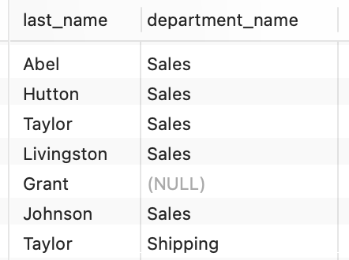

### 右外连接 [#右外连接]

```sql 
/*
说明：employees 共107条记录，其中last_name = 'Grant'的员工没有部门
departments 表中27条记录，其中16个部门没有员工
采用右连接后应该返回 106 + 16 = 122 条记录
*/
# 查询员工及其对应的部门信息
SELECT
  e.last_name,
  d.department_name
FROM
  employees e
  RIGHT OUTER JOIN departments d ON e.department_id = d.department_id;
```

> 右表匹配数据全部展示，左表不匹配的数据展示为 NULL

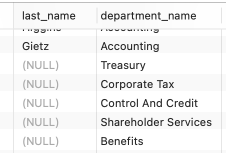


<Callout type="success" title="提示">

① `OUTER`可以省略！

② 有相同的字段名且字段的数据类型相同可以使用`USING`子句。

</Callout>


## UNION 的使用 [#union-的使用]

合并查询结果利用 UNION 关键字，可以给出多条 SELECT 语句，并将它们的结果组合成单个结果集。合并时，两个表对应的列数和数据类型必须相同，并且相互对应。各个 SELECT 语句之间使用 UNION 或 UNION ALL 关键字分隔。

**语法格式**：

```sql 
SELECT column,... FROM table
UNION [ALL]
SELECT column,... FROM table
```

| UNION                                    | UNION ALL                                  |
| ---------------------------------------- | ------------------------------------------ |
| 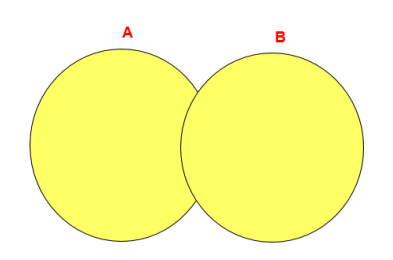             | 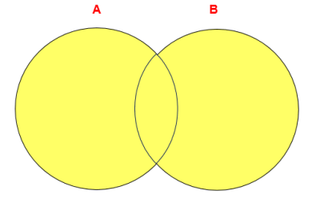           |
| 返回两个查询的结果集的并集，去除重复记录 | 返回两个查询的结果集的并集，不去除重复记录 |


<Callout type="warn" title="注意">

执行 UNION ALL 语句时所需要的资源比 UNION 语句少。如果明确知道合并数据后的结果数据不存在重复数据，或者不需要去除重复的数据，则尽量使用 UNION ALL 语句，以提高数据查询的效率。

</Callout>


## SQL JOINS(总结) [#sql-joins总结]

假设有`TableA`和`TableB`两张表，示例数据如下图所示，且红色高亮部分表示两个表的匹配数据。

参考地址：[https://learnsql.com/blog/sql-joins/](https://learnsql.com/blog/sql-joins/)


<details>
<summary>测试数据</summary>

```sql 
DROP TABLE IF EXISTS `TableA`;
CREATE TABLE `TableA` (
  `a_id` varchar(2) DEFAULT NULL,
  `name` varchar(10) DEFAULT NULL
) ENGINE=InnoDB DEFAULT CHARSET=utf8mb3;

INSERT INTO `tableA` (`a_id`, `name`) VALUES
('1', 'apple'),
('2', 'orange'),
('3', 'tomato'),
('4', 'cucumber');

DROP TABLE IF EXISTS `TableB`;
CREATE TABLE `tableB` (
  `b_id` varchar(2) DEFAULT NULL,
  `name` varchar(10) DEFAULT NULL
) ENGINE=InnoDB DEFAULT CHARSET=utf8mb3;

INSERT INTO `TableB` (`b_id`, `name`) VALUES
('A', 'apple'),
('B', 'banana'),
('C', 'cucumber'),
('D', 'dill');
```

</details>


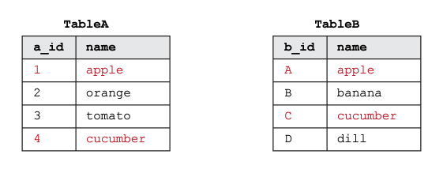

### 交叉连接 [#交叉连接]

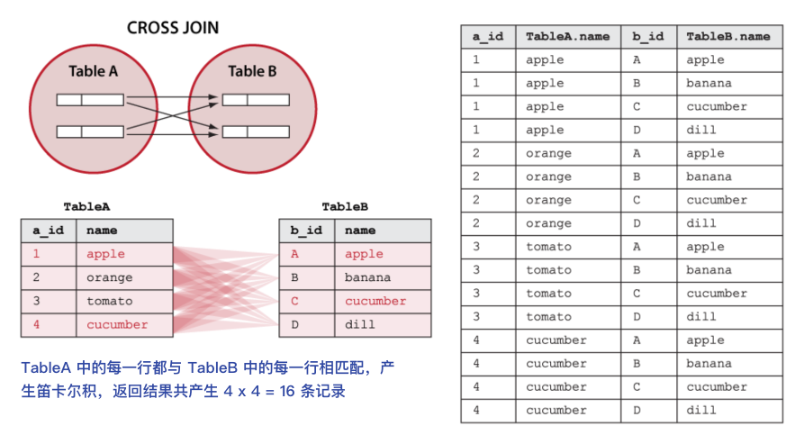

```sql 
SELECT
  a.a_id, a.name 'a_name', b.b_id, b.name 'b_name'
FROM
  tableA a
  CROSS JOIN tableB b;
```

### 内连接 [#内连接-1]

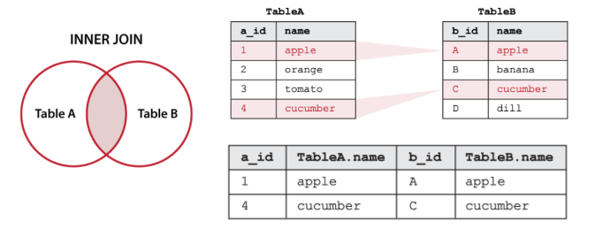

```sql 
SELECT
  a.a_id, a.name 'a_name', b.b_id, b.name 'b_name'
FROM
  tableA a
  INNER JOIN tableB b ON a.name = b.name;
```

### 左外连接 [#左外连接-1]

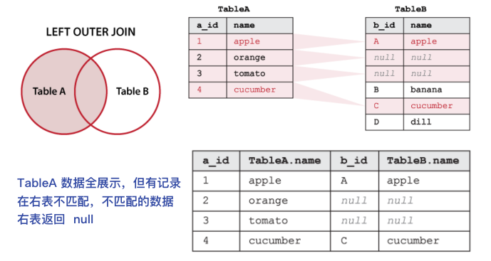

```sql 
SELECT
  a.a_id, a.name 'a_name', b.b_id, b.name 'b_name'
FROM
  tableA a
  LEFT OUTER JOIN tableB b ON a.name = b.name;
```

### 右外连接 [#右外连接-1]

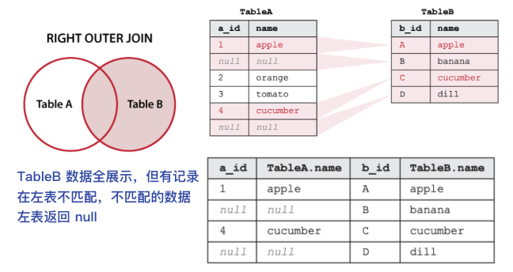

```sql 
SELECT
  a.a_id, a.name 'a_name', b.b_id, b.name 'b_name'
FROM
  tableA a
  RIGHT OUTER JOIN tableB b ON a.name = b.name;
```

### 左排除外连接(左表唯一) [#左排除外连接左表唯一]

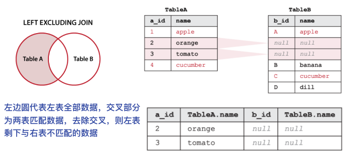

```sql 
SELECT
  a.a_id, a.name 'a_name', b.b_id, b.name 'b_name'
FROM
  tableA a
  LEFT OUTER JOIN tableB b ON a.name = b.name
WHERE
  b.name IS NULL;
```

> 相当于左外连接去除两表匹配部分，剩下的为左表与右表不匹配的数据，而这些数据由于不匹配的缘故，右表不存在则展示为`null`

### 右排除外连接(右表唯一) [#右排除外连接右表唯一]

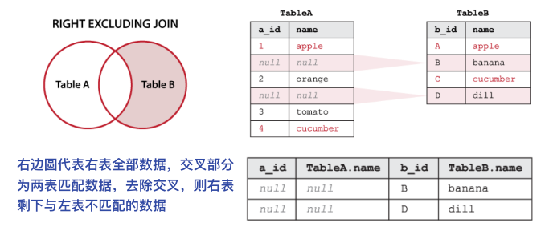

```sql 
SELECT
  a.a_id, a.name 'a_name', b.b_id, b.name 'b_name'
FROM
  tableA a
  RIGHT OUTER JOIN tableB b ON a.name = b.name
WHERE
  a.name IS NULL;
```

> 相当于右外连接去除两表匹配部分，剩下的为左表与右表不匹配的数据，而这些数据由于不匹配的缘故，左表不存在则展示为`null`

### 全外连接 [#全外连接]

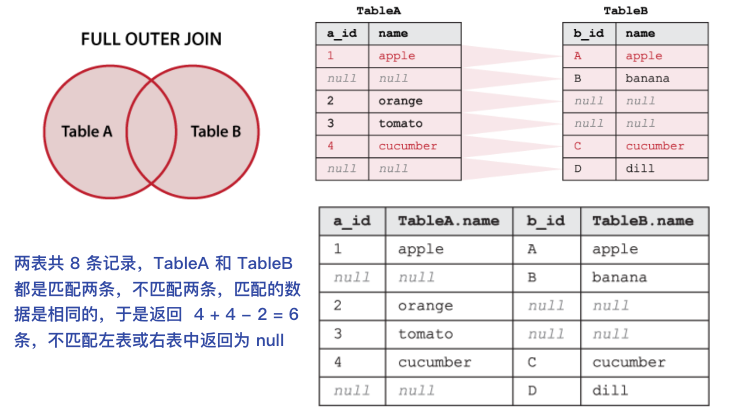

```sql 
SELECT
  a.a_id, a.name 'a_name', b.b_id, b.name 'b_name'
FROM
  tableA a
  FULL OUTER JOIN tableB b ON a.name = b.name;

# 由于MySQL不支持全外连接，可以使用UNION [根据8.9附图进行搭配]
-- 1.左外 union all 右表唯一
-- 2.右外 union all 左表唯一
-- 3.左表唯一 union all 右表唯一 union all 内连接
```

### 非交集连接 [#非交集连接]

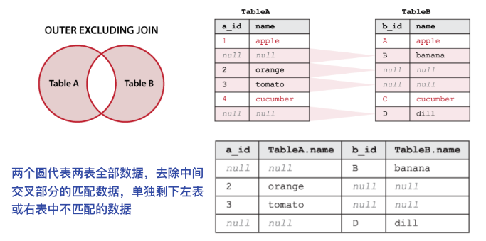

```sql 
SELECT
  a.a_id, a.name 'a_name', b.b_id, b.name 'b_name'
FROM
  tableA a
  FULL OUTER JOIN tableB b ON a.name = b.name
WHERE
  a.name IS NULL OR b.name IS NULL;

# 由于MySQL不支持全外连接，可以使用UNION [根据8.9附图进行搭配]
-- 左表唯一 union all 右表唯一
```

> 相当于全外连接去除两表匹配部分，剩下的为左表与右表不匹配的数据，而这些数据由于不匹配的缘故，左表或右表中不存在则展示为`null`


<Callout type="warn" title="注意">

我们要控制连接表的数量。多表连接就相当于嵌套 for 循环一样，非常消耗资源，会让 SQL 查询性能下降得很严重，因此不要连接不必要的表。在许多 DBMS 中，也都会有最大连接表的限制。

> 【强制】超过三个表禁止 join。需要 join 的字段，数据类型保持绝对一致；多表关联查询时， 保证被关联的字段需要有索引。  
> 说明：即使双表 join 也要注意表索引、SQL 性能。  
> 来源：阿里巴巴《Java 开发手册》

</Callout>


### 附图 SQL JOINS [#附图-sql-joins]

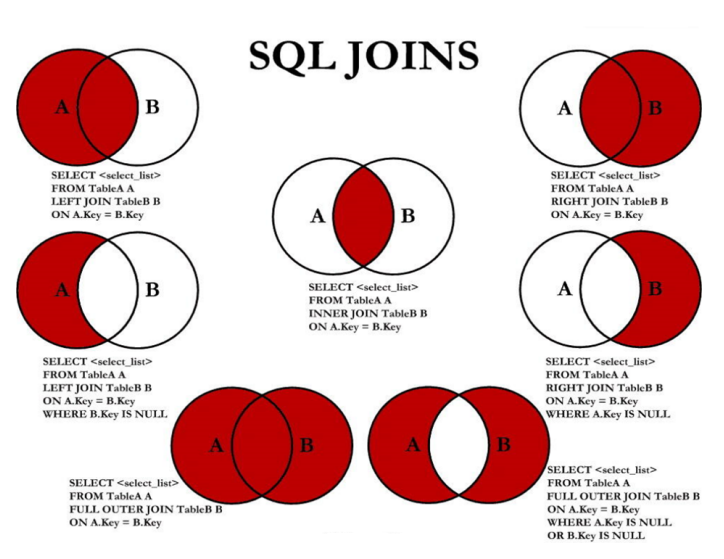
