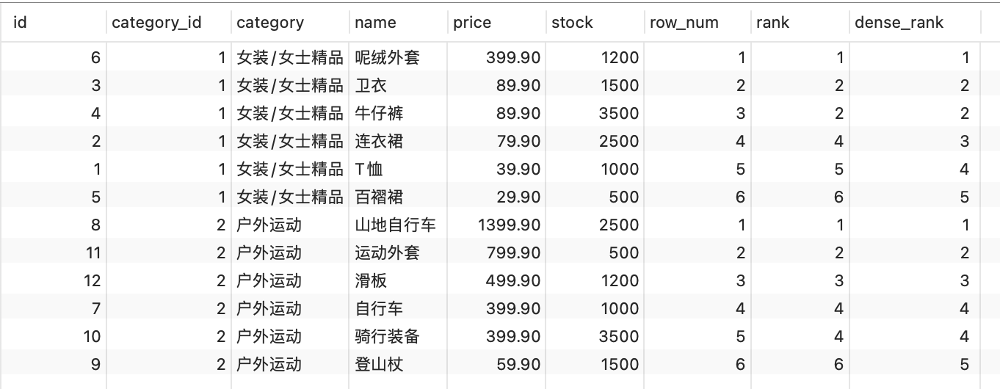
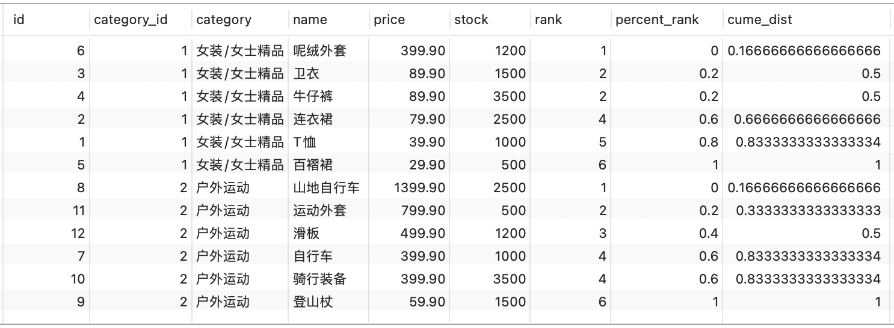
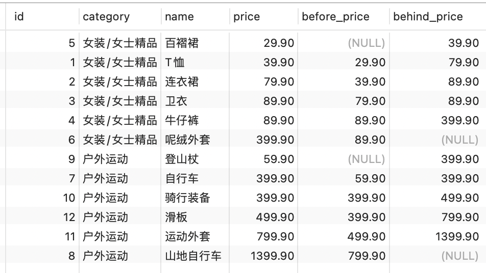
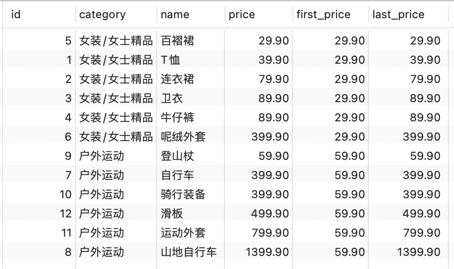
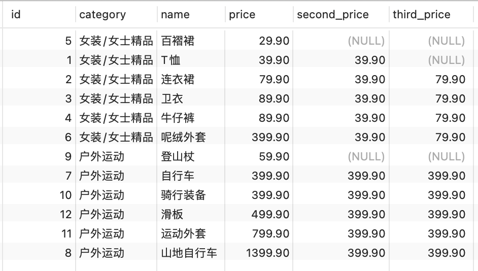
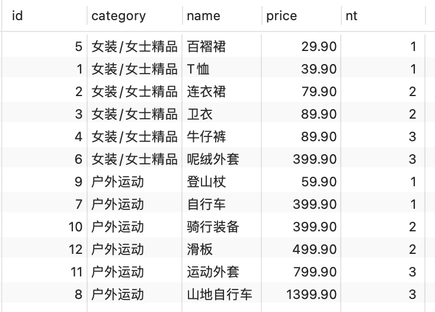

# MySQL 8.0其它新特性 (/docs/backend/database/base/new_features)

## MySQL 8 新特性概述 [#mysql-8-新特性概述]

&#8195;&#8195;MySQL 从 5.7 版本直接跳跃发布了 8.0 版本，可见这是一个令人兴奋的里程碑版本。MySQL 8 版本在功能上做了显著的改进与增强，开发者对 MySQL 的源代码进行了重构，最突出的一点是多 MySQL Optimizer 优化器进行了改进。不仅在速度上得到了改善，还为用户带来了更好的性能和更棒的体验。

### 新增特性 [#新增特性]

#### 更简便的 NoSQL 支持 [#更简便的-nosql-支持]

&#8195;&#8195;NoSQL 泛指非关系型数据库和数据存储。随着互联网平台的规模飞速发展，传统的关系型数据库已经越来越不能满足需求。从 5.6 版本开始，MySQL 就开始支持简单的 NoSQL 存储功能。MySQL 8 对这一功能做了优化，以更灵活的方式实现 NoSQL 功能，不再依赖模式(schema)。

#### 更好的索引 [#更好的索引]

&#8195;&#8195;在查询中，正确地使用索引可以提高查询的效率。MySQL 8 中新增了<mark>隐藏索引</mark>和<mark>降序索引</mark>。隐藏索引可以用来测试去掉索引对查询性能的影响。在查询中混合存在多列索引时，使用降序索引可以提高查询的性能。

#### 更完善的 JSON 支持 [#更完善的-json-支持]

&#8195;&#8195;MySQL 从 5.7 开始支持原生 JSON 数据的存储，MySQL 8 对这一功能做了优化，增加了聚合函数`JSON_ARRAYAGG()`和`JSON_OBJECTAGG()`，将参数聚合为 JSON 数组或对象，新增了行内操作符`->>`，是列路径运算符`->`的增强，对 JSON 排序做了提升，并优化了 JSON 的更新操作。

#### 安全和账户管理 [#安全和账户管理]

&#8195;&#8195;MySQL 8 中新增了`caching_sha2_password`授权插件、角色、密码历史记录和 FIPS 模式支持，这些特性提高了数据库的安全性和性能，使数据库管理员能够更灵活地进行账户管理工作。

#### InnoDB 的变化 [#innodb-的变化]

&#8195;&#8195;<mark>InnoDB 是 MySQL 默认的存储引擎</mark>，是事务型数据库的首选引擎，支持事务安全表（ACID），支持行锁定和外键。在 MySQL 8 版本中，InnoDB 在自增、索引、加密、死锁、共享锁等方面做了大量的改进和优化，并且支持原子数据定义语言（DDL），提高了数据安全性，对事务提供更好的支持。

#### 数据字典 [#数据字典]

&#8195;&#8195;在之前的 MySQL 版本中，字典数据都存储在元数据文件和非事务表中。从 MySQL 8 开始新增了事务数据字典，在这个字典里存储着数据库对象信息，这些数据字典存储在内部事务表中。

#### 原子数据定义语句 [#原子数据定义语句]

&#8195;&#8195;MySQL 8 开始支持原子数据定义语句（Automic DDL），即`原子DDL`。目前，只有 InnoDB 存储引擎支持原子 DDL。原子数据定义语句（DDL）将与 DDL 操作相关的数据字典更新、存储引擎操作、二进制日志写入结合到一个单独的原子事务中，这使得即使服务器崩溃，事务也会提交或回滚。使用支持原子操作的存储引擎所创建的表，在执行 DROP TABLE、CREATE TABLE、ALTER TABLE、RENAME TABLE、TRUNCATE TABLE、CREATE TABLESPACE、DROP TABLESPACE 等操作时，都支持原子操作，即事务要么完全操作成功，要么失败后回滚，不再进行部分提交。 对于从 MySQL 5.7 复制到 MySQL 8 版本中的语句，可以添加 IF EXISTS 或 IF NOT EXISTS 语句来避免发生错误。

#### 资源管理 [#资源管理]

&#8195;&#8195;MySQL 8 开始支持创建和管理资源组，允许将服务器内运行的线程分配给特定的分组，以便线程根据组内可用资源执行。组属性能够控制组内资源，启用或限制组内资源消耗。数据库管理员能够根据不同的工作负载适当地更改这些属性。 目前，CPU 时间是可控资源，由“虚拟 CPU”这个概念来表示，此术语包含 CPU 的核心数，超线程，硬件线程等等。服务器在启动时确定可用的虚拟 CPU 数量。拥有对应权限的数据库管理员可以将这些 CPU 与资源组关联，并为资源组分配线程。 资源组组件为 MySQL 中的资源组管理提供了 SQL 接口。资源组的属性用于定义资源组。MySQL 中存在两个默认组，系统组和用户组，默认的组不能被删除，其属性也不能被更改。对于用户自定义的组，资源组创建时可初始化所有的属性，除去名字和类型，其他属性都可在创建之后进行更改。 在一些平台下，或进行了某些 MySQL 的配置时，资源管理的功能将受到限制，甚至不可用。例如，如果安装了线程池插件，或者使用的是 macOS 系统，资源管理将处于不可用状态。在 FreeBSD 和 Solaris 系统中，资源线程优先级将失效。在 Linux 系统中，只有配置了 CAP_SYS_NICE 属性，资源管理优先级才能发挥作用。

#### 字符集支持 [#字符集支持]

&#8195;&#8195;MySQL 8 中默认的字符集由`latin1`更改为`utf8mb4`，并首次增加了日语所特定使用的集合，utf8mb4_ja_0900_as_cs。

#### 优化器增强 [#优化器增强]

&#8195;&#8195;MySQL 优化器开始支持隐藏索引和降序索引。隐藏索引不会被优化器使用，验证索引的必要性时不需要删除索引，先将索引隐藏，如果优化器性能无影响就可以真正地删除索引。降序索引允许优化器对多个列进行排序，并且允许排序顺序不一致。

#### 公用表表达式 [#公用表表达式]

&#8195;&#8195;公用表表达式（Common Table Expressions）简称为 CTE，MySQL 现在支持递归和非递归两种形式的 CTE。CTE 通过在 SELECT 语句或其他特定语句前使用 WITH 语句对临时结果集进行命名。

#### 窗口函数 [#窗口函数]

&#8195;&#8195;MySQL 8 开始支持窗口函数。在之前的版本中已存在的大部分聚合函数在 MySQL 8 中也可以作为窗口函数来使用。

#### 正则表达式支持 [#正则表达式支持]

&#8195;&#8195;MySQL 在 8.0.4 以后的版本中采用支持 Unicode 的国际化组件库实现正则表达式操作，这种方式不仅能提供完全的 Unicode 支持，而且是多字节安全编码。MySQL 增加了 REGEXP_LIKE()、EGEXP_INSTR()、REGEXP_REPLACE()和 REGEXP_SUBSTR()等函数来提升性能。另外，regexp_stack_limit 和 regexp_time_limit 系统变量能够通过匹配引擎来控制资源消耗。

#### 内部临时表 [#内部临时表]

&#8195;&#8195;<mark>TempTable 存储引擎取代 MEMORY 存储引擎成为内部临时表的默认存储引擎</mark>。TempTable 存储引擎为 VARCHAR 和 VARBINARY 列提供高效存储。internal_tmp_mem_storage_engine 会话变量定义了内部临时表的存储引擎，可选的值有两个，TempTable 和 MEMORY，其中 TempTable 为默认的存储引擎。temptable_max_ram 系统配置项定义了 TempTable 存储引擎可使用的最大内存数量。

#### 日志记录 [#日志记录]

&#8195;&#8195;在 MySQL 8 中错误日志子系统由一系列 MySQL 组件构成。这些组件的构成由系统变量 log_error_services 来配置，能够实现日志事件的过滤和写入。

#### 备份锁 [#备份锁]

&#8195;&#8195;新的备份锁允许在线备份期间执行数据操作语句，同时阻止可能造成快照不一致的操作。新备份锁由 LOCK INSTANCE FOR BACKUP 和 UNLOCK INSTANCE 语法提供支持，执行这些操作需要备份管理员特权。

#### 增强的 MySQL 复制 [#增强的-mysql-复制]

&#8195;&#8195;MySQL 8 复制支持对 JSON 文档进行部分更新的二进制日志记录，该记录使用紧凑的二进制格式，从而节省记录完整 JSON 文档的空间。当使用基于语句的日志记录时，这种紧凑的日志记录会自动完成，并且可以通过将新的 binlog_row_value_options 系统变量值设置为 PARTIAL_JSON 来启用。

### 移除的旧特性 [#移除的旧特性]


<Callout type="warn" title="注意">

在 MySQL 5.7 版本上开发的应用程序如果使用了 MySQL8.0 移除的特性，语句可能会失败，或者产生不同的执行结果。为了避免这些问题，对于使用了移除特性的应用，应当尽力修正避免使用这些特性，并尽可能使用替代方法。

</Callout>


#### 查询缓存 [#查询缓存]

查询缓存已被移除，删除的项有：  
(1) 语句：`FLUSH QUERY CACHE`和`RESET QUERY CACHE`  
(2) 系统变量：  
`query_cache_limit、query_cache_min_res_unit、query_cache_size、query_cache_type、query_cache_wlock_invalidate`  
(3) 状态变量：  
`Qcache_free_blocks、Qcache_free_memory、Qcache_hits、Qcache_inserts、Qcache_lowmem_prunes、Qcache_not_cached、Qcache_queries_in_cache、Qcache_total_blocks`  
(4) 线程状态：  
`checking privileges on cached query、checking query cache for query、invalidating query cache entries、sending cached result to client、storing result in query cache、waiting for query cache lock`

#### 加密相关 [#加密相关]

&#8195;&#8195;删除的加密相关的内容有：`ENCODE()、DECODE()、ENCRYPT()、DES_ENCRYPT()和 DES_DECRYPT()函数`，配置项 des-key-file，系统变量 have_crypt，FLUSH 语句的 DES_KEY_FILE 选项，HAVE_CRYPT CMake 选项。 对于移除的 ENCRYPT()函数，考虑使用 SHA2()替代，对于其他移除的函数，使用 AES_ENCRYPT()和 AES_DECRYPT()替代。

#### 空间函数相关 [#空间函数相关]

&#8195;&#8195;在 MySQL 5.7 版本中，多个空间函数已被标记为过时。这些过时函数在 MySQL 8 中都已被移除，只保留了对应的 ST\_和 MBR 函数。

#### `\N`和`NULL` [#n和null]

&#8195;&#8195;在 SQL 语句中，解析器不再将\N 视为 NULL，所以在 SQL 语句中应使用 NULL 代替\N。这项变化不会影响使用`LOAD DATA INFILE`或者`SELECT … INTO OUTFILE`操作文件的导入和导出。在这类操作中，NULL 仍等同于\N。

#### `mysql_install_db` [#mysql_install_db]

&#8195;&#8195;在 MySQL 分布中，已移除了 mysql_install_db 程序，数据字典初始化需要调用带着–initialize 或者–initialize-insecure 选项的 mysqld 来代替实现。另外，–bootstrap 和 INSTALL_SCRIPTDIR CMake 也已被删除。

#### 通用分区处理程序 [#通用分区处理程序]

&#8195;&#8195;通用分区处理程序已从 MySQL 服务中被移除。为了实现给定表分区，表所使用的存储引擎需要自有的分区处理程序。 提供本地分区支持的 MySQL 存储引擎有两个，即 InnoDB 和 NDB，而在 MySQL 8 中只支持 InnoDB。

#### 系统和状态变量信息 [#系统和状态变量信息]

&#8195;&#8195;在 INFORMATION_SCHEMA 数据库中，对系统和状态变量信息不再进行维护。GLOBAL_VARIABLES、SESSION_VARIABLES、GLOBAL_STATUS、SESSION_STATUS 表都已被删除。另外，系统变量 show_compatibility_56 也已被删除。被删除的状态变量有 Slave_heartbeat_period、Slave_last_heartbeat、Slave_received_heartbeats、Slave_retried_transactions、Slave_running。以上被删除的内容都可使用性能模式中对应的内容进行替代。

#### mysql_plugin 工具 [#mysql_plugin-工具]

&#8195;&#8195;mysql_plugin 工具用来配置 MySQL 服务器插件，现已被删除，可使用–plugin-load 或–plugin-load-add 选项在服务器启动时加载插件或者在运行时使用 INSTALL PLUGIN 语句加载插件来替代该工具。

## 新特性-窗口函数 [#新特性-窗口函数]

### 窗口函数分类 [#窗口函数分类]

&#8195;&#8195;MySQL 8.0 版本开始支持窗口函数。它的作用类型与在查询中对数据进行的分组，不同的是，分组操作会把分组的结果聚合成一条记录，而窗口函数是将结果置于每一条数据记录中。

窗口函数可以分为静态窗口函数和动态窗口函数：  
&#8195;静态窗口函数的窗口大小是固定的，不会因为记录的不同而不同  
&#8195;动态窗口函数的窗口大小会随记录的不同而变化

> 官网介绍：[https://dev.mysql.com/doc/refman/8.0/en/window-function-descriptions.html](https://dev.mysql.com/doc/refman/8.0/en/window-function-descriptions.html)

窗口函数总体可以分为：

| 分类     | 函数                 | 说明                                      |
| -------- | -------------------- | ----------------------------------------- |
| 序号函数 | `ROW_NUMBER()`       | 顺序排序                                  |
| 序号函数 | `RANK()`             | 并列排序，会跳过重复的序号，如：1、1、3   |
| 序号函数 | `DENSE_RANK()`       | 并列排序，不会跳过重复的序号，如：1、1、2 |
| 分布函数 | `PERCENT_RANK()`     | 等级值百分比                              |
| 分布函数 | `CUME_DIST()`        | 累计分布值                                |
| 前后函数 | `LAG(expr, n)`       | 返回当前行的前 n 行的 exper 的值          |
| 前后函数 | `LEAD(expr, n)`      | 返回当前行的后 n 行的 exper 的值          |
| 首尾函数 | `FIRST_VALUE(expr)`  | 返回第一个 expr 的值                      |
| 首尾函数 | `LAST_VALUE(expr)`   | 返回最后一个 expr 的值                    |
| 其它函数 | `NTH_VALUE(expr, n)` | 返回第 n 个 expr 的值                     |
| 其它函数 | `NTILE(n)`           | 将分区中的有序数据分为 n 个桶，记录桶编号 |

### 语法结构 [#语法结构]

```sql 
函数 OVER([PARTITION BY 字段名 ORDER BY 字段名 ASC|DESC])

# 或
函数 OVER 窗口名 ... WINDOW 窗口名 AS (PARTITION BY 字段名 ORDER BY 字段名 ASC|DESC])
```

#### 序号函数 [#序号函数]

```sql 
SELECT
  id,category_id,category,name,price,stock,
  ROW_NUMBER() OVER ( PARTITION BY category_id ORDER BY price DESC ) AS 'row_num',
  RANK() OVER ( PARTITION BY category_id ORDER BY price DESC ) AS 'rank',
  DENSE_RANK() OVER ( PARTITION BY category_id ORDER BY price DESC ) AS 'dense_rank'
FROM
  goods;

# 或
SELECT
  id,category_id,category,name,price,stock,
  ROW_NUMBER() OVER w AS 'row_num',
  RANK() OVER w AS 'rank',
  DENSE_RANK() OVER w AS 'dense_rank'
FROM
  goods WINDOW w AS ( PARTITION BY category_id ORDER BY price DESC );
```



#### 分布函数 [#分布函数]

```sql 
SELECT
  id,category_id,category,name,price,stock,
  RANK() OVER ( PARTITION BY category_id ORDER BY price DESC ) AS 'rank',
  PERCENT_RANK() OVER ( PARTITION BY category_id ORDER BY price DESC ) AS 'percent_rank',
  CUME_DIST() OVER ( PARTITION BY category_id ORDER BY price DESC ) AS 'cume_dist'
FROM
  goods;

# 或
SELECT
  id,category_id,category,name,price,stock,
  RANK() OVER w AS 'rank',
  PERCENT_RANK() OVER w AS 'percent_rank',
  CUME_DIST() OVER w AS 'cume_dist'
FROM
  goods WINDOW w AS ( PARTITION BY category_id ORDER BY price DESC );
```




<Callout type="success" title="提示">

`PERCENT_RANK() : (rank - 1) / (rows - 1)`  
上面第一行数据等于`(1-1)/(6-1)=0`，第二行数据等于`(2-1)/(6-1)=0.2`...

`CUME_DIST():`  
`ORDER BY ... DESC 查询大于或等于某个值的比例`  
`ORDER BY ... ASC 查询小于或等于某个值的比例`  
上面第一行价格大于等于当前值`1/6≈0.166667`，第二、三行数据等于`3/6=0.5`，第四行数据等于`4/6≈0.666667`...

</Callout>


#### 前后函数 [#前后函数]

```sql 
SELECT
  id,category,name,price,
  LAG( price, 1 ) OVER w AS before_price, # 当前价格的前一个值
  LEAD( price, 1 ) OVER w AS behind_price # 当前价格的后一个值
FROM
  goods WINDOW w AS (PARTITION BY category_id ORDER BY price);
```



#### 首尾函数 [#首尾函数]

```sql 
SELECT
  id,category,name,price,
  FIRST_VALUE( price ) OVER w AS first_price,
  LAST_VALUE( price ) OVER w AS last_price
FROM
  goods WINDOW w AS (PARTITION BY category_id ORDER BY price);
```



#### 其他函数 [#其他函数]

① NTH_VALUE(expr, n)

```sql 
SELECT
  id,category,name,price,
  NTH_VALUE( price, 2 ) OVER w AS second_price, # 排第二的价格信息
  NTH_VALUE( price, 3 ) OVER w AS third_price # 排第三的价格信息
FROM
  goods WINDOW w AS (PARTITION BY category_id ORDER BY price);
```



② NTILE(n)

```sql 
# 将goods表中的商品按照价格分为 3 组
SELECT
  id, category, name, price,
  NTILE( 3 ) OVER w AS nt
FROM goods WINDOW w AS (PARTITION BY category_id ORDER BY price);
```



### 小结 [#小结]

窗口函数的特点是可以分组，而且可以在分组内排序。另外，窗口函数不会因为分组而减少原表中的行数，这对我们在原表数据的基础上进行统计和排序非常有用。

## 新特性-公用表表达式 [#新特性-公用表表达式]

&#8195;&#8195;公用表表达式（或通用表表达式）简称为 CTE（Common Table Expressions）。CTE 是一个命名的临时结果集，作用范围是当前语句。CTE 可以理解成一个可以复用的子查询，当然跟子查询还是有点区别的，CTE 可以引用其他 CTE，但子查询不能引用其他子查询。所以可以考虑代替子查询。

> 依据语法结构和执行方式的不同，公用表表达式分为<mark>普通公用表表达式</mark>和<mark>递归公用表表达式</mark> 2 种。
>
> 官网介绍：[https://dev.mysql.com/doc/refman/8.0/en/with.html](https://dev.mysql.com/doc/refman/8.0/en/with.html)

### 普通公用表表达式 [#普通公用表表达式]

语法结构：

```sql 
WITH cte_name
AS (subquery)
SELECT | DELETE | UPDATE query;
```

示例：查询员工所在的部门的详细信息

```sql 
# 方式一
SELECT
  *
FROM departments
WHERE departmant_id IN (SELECT DISTINCT departmant_id FROM employees);

# 方式二
WITH emp_dept_id
AS (SELECT DISTINCT department_id FROM departments)
SELECT *
FROM departments d, emp_dept_id e
WHERE d.department_id = e.department_id;
```

&#8195;&#8195;公用表表达式可以起到子查询的作用。以后如果遇到需要使用子查询的场景，你可以在查询之前，先定义公用表表达式，然后在查询中用它来代替子查询。而且，跟子查询相比，公用表表达式有一个优点，就是定义过公用表表达式之后的查询，可以像一个表一样多次引用公用表表达式，而子查询则不能。

### 递归公用表表达式 [#递归公用表表达式]

语法结构：

```sql 
WITH RECURSIVE cte_name
AS (subquery)
SELECT | DELETE | UPDATE query;
```

> 递归公用表表达式由 2 部分组成，分别是种子查询和递归查询，中间通过关键字`UNION [ALL]`进行连接。这里的种子查询，意思就是获得递归的初始值。这个查询只会运行一次，以创建初始数据集，之后递归查询会一直执行，直到没有任何新的查询数据产生，递归返回。

**示例**：针对于我们常用的 employees 表，包含 employee_id，last_name 和 manager_id 三个字段。如果 a 是 b 的管理者，那么我们可以把 b 叫做 a 的下属，如果同时 b 又是 c 的管理者，那么 c 就是 b 的下属，是 a 的下下属。

**递归思想**：  
① 用递归公用表表达式中的种子查询，找出初代管理者。字段 n 表示代次，初始值为 1，表示是第一代管理者。  
② 用递归公用表表达式中的递归查询，查出以这个递归公用表表达式中的人为管理者的人，并且代次的值加 1。直到没有人以这个递归公用表表达式中的人为管理者了，递归返回。  
③ 在最后的查询中，选出所有代次大于等于 3 的人，他们肯定是第三代及以上代次的下属了，也就是下下属了。这样就得到了我们需要的结果集。

```sql 
WITH RECURSIVE cte
AS
(
SELECT employee_id,last_name,manager_id, 1 AS n FROM employees WHERE employee_id = 100 -- 种子查询，找到第一代领导
UNION ALL
SELECT a.employee_id,a.last_name,a.manager_id,n + 1 FROM employees a JOIN cte
ON a.manager_id = cte.employee_id -- 递归查询，找出以递归公用表表达式的人为领导的人)
)
SELECT employee_id,last_name FROM cte WHERE n >= 3;
```

> 总之，递归公用表表达式对于查询一个有共同的根节点的树形结构数据，非常有用。它可以不受层级的限制，轻松查出所有节点的数据。如果用其他的查询方式，就比较复杂了。

### 小结 [#小结-1]

&#8195;&#8195;公用表表达式的作用是可以替代子查询，而且可以被多次引用。递归公用表表达式对查询有一个共同根节点的树形结构数据非常高效，可以轻松搞定其它查询方式难以处理的查询。
