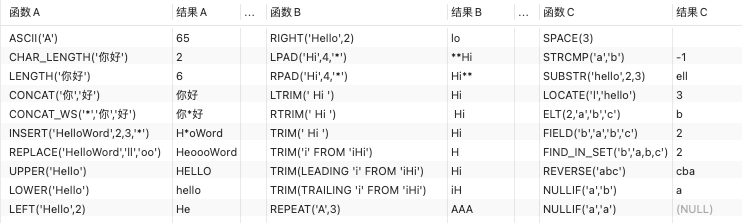
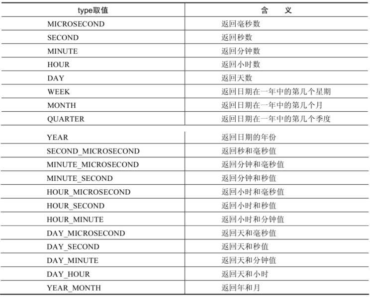
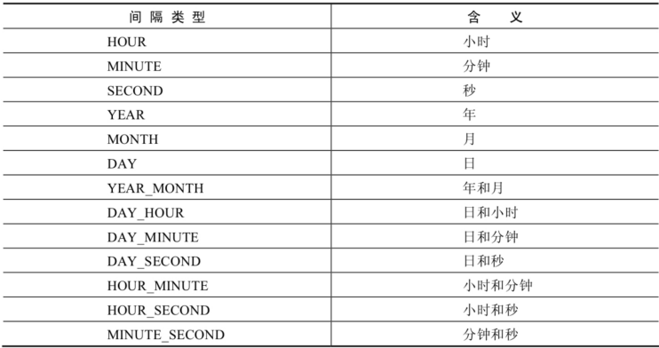
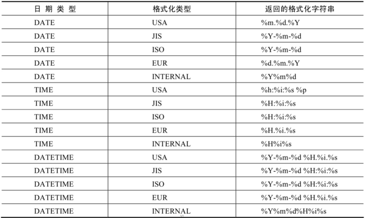

# 单行函数 (/docs/backend/database/base/one_line_function)

## 函数的理解 [#函数的理解]

&#8195;&#8195;函数是完成一定功能的代码集合。根据函数所操作数据行数的不同，可以将 SQL 函数分类两类，单行函数和多行函数。其中单行函数仅对单个行进行计算，并且每行返回一个结果；而多行函数可以操作成组的多个行，每个行组返回一个结果，这些函数又称组函数。

## 数值函数 [#数值函数]

### 基本函数 [#基本函数]

| 函数                   | 用法                                                                    |
| ---------------------- | ----------------------------------------------------------------------- |
| `ABS(x)`               | 返回 x 的绝对值                                                         |
| `SIGN(X)`              | 返回 X 的符号。正数返回 1 ，负数返回-1， 0 返回 0                       |
| `PI()`                 | 返回圆周率的值                                                          |
| `CEIL(x)` `CEILING(x)` | 返回大于或等于某个值的最小整数                                          |
| `FLOOR(x)`             | 返回小于或等于某个值的最大整数                                          |
| `LEAST(e1,e2,e3…)`     | 返回列表中的最小值                                                      |
| `GREATEST(e1,e2,e3…)`  | 返回列表中的最大值                                                      |
| `MOD(x,y)`             | 返回 X 除以 Y 后的余数                                                  |
| `RAND()`               | 返回 0~1 的随机值                                                       |
| `RAND(x)`              | 返回 0~1 的随机值，其中 x 的值用作种子值，相同的 X 值会产生相同的随机数 |
| `ROUND(x)`             | 返回一个对 x 的值进行四舍五入后，最接近于 X 的整数                      |
| `ROUND(x,y)`           | 返回一个对 x 的值进行四舍五入后最接近 X 的值，并保留到小数点后面 Y 位   |
| `TRUNCATE(x,y)`        | 返回数字 x 截断为 y 位小数的结果                                        |
| `SQRT(x)`              | 返回 x 的平方根。当 X 的值为负数时，返回 NULL                           |

```sql 
# 天花板函数：CEIL、CEILING
# 地板函数：FLOOR
mysql> SELECT CEIL(32.32), CEILING(-43.23), FLOOR(32.32), FLOOR(-43.23) FROM DUAL;
+-------------+-----------------+--------------+---------------+
| CEIL(32.32) | CEILING(-43.23) | FLOOR(32.32) | FLOOR(-43.23) |
+-------------+-----------------+--------------+---------------+
|          33 |             -43 |           32 |           -44 |
+-------------+-----------------+--------------+---------------+
1 row in set (0.04 sec)

# 指定种子值的随机为伪随机(有规律)
mysql> SELECT RAND(), RAND(), RAND(10), RAND(10), RAND(-1), RAND(-1) FROM DUAL;

mysql> SELECT ROUND(12.66), ROUND(12.624,2), ROUND(12.324,-1), TRUNCATE(12.66,1), TRUNCATE(12.66,-1) FROM DUAL;
+--------------+-----------------+------------------+-------------------+--------------------+
| ROUND(12.66) | ROUND(12.624,2) | ROUND(12.324,-1) | TRUNCATE(12.66,1) | TRUNCATE(12.66,-1) |
+--------------+-----------------+------------------+-------------------+--------------------+
| 13           | 12.62           | 10               | 12.6              | 10                 |
+--------------+-----------------+------------------+-------------------+--------------------+
1 row in set (0.14 sec)
```

### 角度与弧度互换函数 [#角度与弧度互换函数]

|     函数     | 用法                                  |
| :----------: | ------------------------------------- |
| `RADIANS(x)` | 将角度转化为弧度，其中参数 x 为角度值 |
| `DEGREES(x)` | 将弧度转化为角度，其中参数 x 为弧度值 |

```sql 
# 角度转弧度：(π/180)*角度
# 弧度转角度：(180/π)*弧度
mysql> SELECT RADIANS(180), RADIANS(90), DEGREES(2 * PI()) FROM DUAL;
+-------------------+--------------------+-------------------+
| RADIANS(180)      | RADIANS(90)        | DEGREES(2 * PI()) |
+-------------------+--------------------+-------------------+
| 3.141592653589793 | 1.5707963267948966 |               360 |
+-------------------+--------------------+-------------------+
1 row in set (0.04 sec)
```

### 三角函数 [#三角函数]

三角函数：[https://baike.baidu.com/item/%E4%B8%89%E8%A7%92%E5%87%BD%E6%95%B0%E5%85%AC%E5%BC%8F/4374733](https://baike.baidu.com/item/%E4%B8%89%E8%A7%92%E5%87%BD%E6%95%B0%E5%85%AC%E5%BC%8F/4374733)  
反三角函数：[https://baike.baidu.com/item/%E5%8F%8D%E4%B8%89%E8%A7%92%E5%87%BD%E6%95%B0/7004029](https://baike.baidu.com/item/%E5%8F%8D%E4%B8%89%E8%A7%92%E5%87%BD%E6%95%B0/7004029)

| 函数         | 用法                                                                                |
| ------------ | ----------------------------------------------------------------------------------- |
| `SIN(x)`     | 返回 x 的正弦值，其中，参数 x 为弧度值(对/斜)                                       |
| `ASIN(x)`    | 返回 x 的反正弦值，即获取正弦为 x 的值。如果 x 的值不在- 1 到 1 之间，则返回 NULL() |
| `COS(x)`     | 返回 x 的余弦值，其中，参数 x 为弧度值(邻/斜)                                       |
| `ACOS(x)`    | 返回 x 的反余弦值，即获取余弦为 x 的值。如果 x 的值不在- 1 到 1 之间，则返回 NULL   |
| `TAN(x)`     | 返回 x 的正切值，其中，参数 x 为弧度值(对/邻)                                       |
| `ATAN(x)`    | 返回 x 的反正切值，即返回正切值为 x 的值                                            |
| `ATAN2(m,n)` | 返回两个参数的反正切值                                                              |
| `COT(x)`     | 返回 x 的余切值，其中，X 为弧度值(邻/对)                                            |

### 指数和对数 [#指数和对数]

| 函数                    | 用法                                                       |
| ----------------------- | ---------------------------------------------------------- |
| `POW(x,y)` `POWER(X,Y)` | 返回 x 的 y 次方                                           |
| `EXP(X)`                | 返回 e 的 X 次方，其中 e 是一个常数，2.718281828459045     |
| `LN(X)，LOG(X)`         | 返回以 e 为底的 X 的对数，当 X &lt;= 0 时，返回的结果为 NULL  |
| `LOG10(X)`              | 返回以 10 为底的 X 的对数，当 X &lt;= 0 时，返回的结果为 NULL |
| `LOG2(X)`               | 返回以 2 为底的 X 的对数，当 X &lt;= 0 时，返回 NULL          |

### 进制间的转换 [#进制间的转换]

| 函数            | 用法                         |
| --------------- | ---------------------------- |
| `BIN(x)`        | 返回 x 的二进制编码          |
| `HEX(x)`        | 返回 x 的十六进制编码        |
| `OCT(x)`        | 返回 x 的八进制编码          |
| `CONV(x,f1,f2)` | 返回 f1 进制数变成 f2 进制数 |

## 字符串函数 [#字符串函数]

| 函数                             | 用法                                                                                                                   |
| -------------------------------- | ---------------------------------------------------------------------------------------------------------------------- |
| `ASCII(S)`                       | 返回字符串 S 中的第一个字符的 ASCII 码值                                                                               |
| `CHAR_LENGTH(s)`                 | 返回字符串 s 的字符数。作用与 CHARACTER_LENGTH(s)相同                                                                  |
| `LENGTH(s)`                      | 返回字符串 s 的字节数，和字符集有关                                                                                    |
| `CONCAT(s1,s2,……,sn)`            | 连接 s1, s2, ……, sn 为一个字符串                                                                                       |
| `CONCAT_WS(x,s1,……,sn)`          | 同 CONCAT(s1, s2, …)函数，但是每个字符串之间要加上 x                                                                   |
| `INSERT(str,idx,len,replacestr)` | 将字符串 str 从第 idx 位置开始，len 个字符长的子串替换为字符串 replacestr                                              |
| `REPLACE(str,a,b)`               | 用字符串 b 替换字符串 str 中所有出现的字符串 a                                                                         |
| `UPPER(s)` `UCASE(s)`            | 将字符串 s 的所有字母转成大写字母                                                                                      |
| `LOWER(s)` `LCASE(s)`            | 将字符串 s 的所有字母转成小写字母                                                                                      |
| `LEFT(str,n)`                    | 返回字符串 str 最左边的 n 个字符                                                                                       |
| `RIGHT(str,n)`                   | 返回字符串 str 最右边的 n 个字符                                                                                       |
| `LPAD(str,len,pad)`              | 用字符串 pad 对 str 最左边进行填充，直到 str 的长度为 len 个字符                                                       |
| `RPAD(str,len,pad)`              | 用字符串 pad 对 str 最右边进行填充，直到 str 的长度为 len 个字符                                                       |
| `LTRIM(s)`                       | 去掉字符串 s 左侧的空格                                                                                                |
| `RTRIM(s)`                       | 去掉字符串 s 右侧的空格                                                                                                |
| `TRIM(s)`                        | 去掉字符串 s 开始与结尾的空格                                                                                          |
| `TRIM(s1 FROM s)`                | 去掉字符串 s 开始与结尾的 s                                                                                            |
| `TRIM(LEADING s FROM s)`         | 去掉字符串 s 开始处的 s                                                                                                |
| `TRIM(TRAILING s FROM s)`        | 去掉字符串 s 结尾处的 s                                                                                                |
| `REPEAT(str,n)`                  | 返回 str 重复 n 次的结果                                                                                               |
| `SPACE(n)`                       | 返回 n 个空格                                                                                                          |
| `STRCMP(s1,s2)`                  | 比较字符串 s1, s2 的 ASCII 码值的大小                                                                                  |
| `SUBSTR(s,index,len)`            | 返回从字符串 s 的 index 位置其 len 个字符，作用与 SUBSTRING(s,n,len)、MID(s,n,len)相同                                 |
| `LOCATE(substr,str)`             | 返回字符串 substr 在字符串 str 中首次出现的位置，作用于 POSITION(substr IN str)、INSTR(str,substr)相同。未找到，返回 0 |
| `ELT(m,s1,s2,…,sn)`              | 返回指定位置的字符串，如果 m=1，则返回 s1，如果 m=2，则返回 s2，如果 m=n，则返回 sn                                    |
| `FIELD(s,s1,s2,…,sn)`            | 返回字符串 s 在字符串列表中第一次出现的位置                                                                            |
| `FIND_IN_SET(s1,s2)`             | 返回字符串 s1 在字符串 s2 中出现的位置。其中，字符串 s2 是一个以逗号分隔的字符串                                       |
| `REVERSE(s)`                     | 返回 s 反转后的字符串                                                                                                  |
| `NULLIF(value1,value2)`          | 比较两个字符串，如果 value1 与 value2 相等，则返回 NULL，否则返回 value1                                               |
| `FROM_BASE64(str)`               | BASE64 解码                                                                                                            |
| `TO_BASE64(str)`                 | 字符串转 BASE64 编码                                                                                                   |

> 注意：MySQL 中，字符串的索引是从 1 开始的



## 日期和时间函数 [#日期和时间函数]

### 获取日期、时间 [#获取日期时间]

| 函数                                                                           | 用法                           |
| ------------------------------------------------------------------------------ | ------------------------------ |
| `CURDATE()` `CURRENT_DATE()`                                                   | 返回当前日期，只包含年、月、日 |
| `CURTIME()` `CURRENT_TIME()`                                                   | 返回当前时间，只包含时、分、秒 |
| `NOW()` `SYSDATE()` `LOCALTIME()`<br /> `LOCALTIMESTAMP()` `CURRENT_TIMESTAMP()` | 返回当前系统日期和时间         |
| `UTC_DATE()`                                                                   | 返回 UTC（世界标准时间）日期   |
| `UTC_TIME()`                                                                   | 返回 UTC（世界标准时间）时间   |

```sql 
mysql> SELECT CURDATE(), CURRENT_DATE(), CURTIME(),CURRENT_TIME() FROM DUAL;
+------------+----------------+-----------+----------------+
| CURDATE()  | CURRENT_DATE() | CURTIME() | CURRENT_TIME() |
+------------+----------------+-----------+----------------+
| 2023-03-09 | 2023-03-09     | 21:54:28  | 21:54:28       |
+------------+----------------+-----------+----------------+
1 row in set (0.04 sec)

mysql>SELECT UTC_DATE(), UTC_TIME() FROM DUAL;
+------------+------------+
| UTC_DATE() | UTC_TIME() |
+------------+------------+
| 2023-03-09 | 13:54:28   |
+------------+------------+
1 row in set (0.03 sec)

mysql>SELECT LOCALTIMESTAMP() FROM DUAL;
+---------------------+
| LOCALTIMESTAMP()    |
+---------------------+
| 2023-03-09 21:54:28 |
+---------------------+
1 row in set (0.04 sec)
```

### 日期与时间戳的转换 [#日期与时间戳的转换]

| 函数                       | 用法                                     |
| -------------------------- | ---------------------------------------- |
| `UNIX_TIMESTAMP()`         | 以 UNIX 时间戳的形式返回当前时间         |
| `UNIX_TIMESTAMP(date)`     | 将时间 date 以 UNIX 时间戳的形式返回     |
| `FROM_UNIXTIME(timestamp)` | 将 UNIX 时间戳的时间转换为普通格式的时间 |

```sql 
mysql> SELECT UNIX_TIMESTAMP() FROM DUAL;
+------------------+
| UNIX_TIMESTAMP() |
+------------------+
|       1678370259 |
+------------------+
1 row in set (0.04 sec)

mysql> SELECT UNIX_TIMESTAMP('2023-03-09 21:57:39') FROM DUAL;
+---------------------------------------+
| UNIX_TIMESTAMP('2023-03-09 21:57:39') |
+---------------------------------------+
|                            1678370259 |
+---------------------------------------+
1 row in set (0.04 sec)

mysql> SELECT FROM_UNIXTIME(1678370259) FROM DUAL;
+---------------------------+
| FROM_UNIXTIME(1678370259) |
+---------------------------+
| 2023-03-09 21:57:39       |
+---------------------------+
1 row in set (0.04 sec)
```

### 获取月份、星期、星期数、天数等函数 [#获取月份星期星期数天数等函数]

| 函数                                       | 用法                                            |
| ------------------------------------------ | ----------------------------------------------- |
| `YEAR(date)` `MONTH(date)` `DAY(date)`     | 返回具体的日期值                                |
| `HOUR(time)` `MINUTE(time)` `SECOND(time)` | 返回具体的时间值                                |
| `MONTHNAME(date)`                          | 返回月份：January，…                            |
| `DAYNAME(date)`                            | 返回星期几：MONDAY，TUESDAY…..SUNDAY            |
| `WEEKDAY(date)`                            | 返回周几，注意，周 1 是 0，周 2 是 1，…周日是 6 |
| `QUARTER(date)`                            | 返回日期对应的季度，范围为 1 ～ 4               |
| `WEEK(date)` `WEEKOFYEAR(date)`            | 返回一年中的第几周                              |
| `DAYOFYEAR(date)`                          | 返回日期是一年中的第几天                        |
| `DAYOFMONTH(date)`                         | 返回日期位于所在月份的第几天                    |
| `DAYOFWEEK(date)`                          | 返回周几，注意：周日是 1 ，周一是 2 ，…周六是 7 |

### 日期的操作函数 [#日期的操作函数]

| 函数                      | 用法                                        |
| ------------------------- | ------------------------------------------- |
| `EXTRACT(type FROM date)` | 返回指定日期中特定的部分，type 指定返回的值 |



### 时间和秒钟转换的函数 [#时间和秒钟转换的函数]

| 函数                   | 用法                                          |
| ---------------------- | --------------------------------------------- |
| `TIME_TO_SEC(time)`    | 将 time 转化为秒并返回结果值                  |
| `SEC_TO_TIME(seconds)` | 将 seconds 描述转化为包含小时、分钟和秒的时间 |

```sql 
# TIME_TO_SEC(time)-公式：小时 * 3600 + 分钟 * 60 + 秒
# 22*3600+23*60+35 = 80615
mysql> SELECT TIME_TO_SEC(now()), SEC_TO_TIME(80615) FROM DUAL;
+--------------------+--------------------+
| TIME_TO_SEC(now()) | SEC_TO_TIME(80615) |
+--------------------+--------------------+
|              80615 | 22:23:35           |
+--------------------+--------------------+
1 row in set (0.04 sec)
```

### 计算日期和时间的函数 [#计算日期和时间的函数]

| 函数                                                                     | 用法                          |
| ------------------------------------------------------------------------ | ----------------------------- |
| `DATE_ADD(date, INTERVAL expr type)` `ADDDATE(date, INTERVAL expr type)` | 向日期/时间添加指定的时间间隔 |
| `DATE_SUB(date, INTERVAL expr type)` `SUBDATE(date, INTERVAL expr type)` | 从日期/时间减去指定的时间间隔 |

```sql 
SELECT
  DATE_ADD(now(), INTERVAL 24 MONTH ) '日期相加24月',
  DATE_SUB(now(), INTERVAL 1 SECOND ) '日期相减1秒',
  ADDDATE(now(), INTERVAL '1_1' YEAR_MONTH) '日期相加一年一月',
  SUBDATE(now(), INTERVAL '1_1' YEAR_MONTH) '日期相减一年一月';
```



| 函数                           | 用法                                                                          |
| ------------------------------ | ----------------------------------------------------------------------------- |
| `ADDTIME(time1,time2)`         | 返回 time1 加上 time2 的时间。当 time2 为一个数字时，代表的是秒，可以为负数   |
| `SUBTIME(time1,time2)`         | 返回 time1 减去 time2 后的时间。当 time2 为一个数字时，代表的是秒，可以为负数 |
| `DATEDIFF(date1,date2)`        | 返回 date1 - date2 的日期间隔天数                                             |
| `TIMEDIFF(time1, time2)`       | 返回 time1 - time2 的时间间隔                                                 |
| `FROM_DAYS(N)`                 | 返回从 0000 年 1 月 1 日起，N 天以后的日期                                    |
| `TO_DAYS(date)`                | 返回日期 date 距离 0000 年 1 月 1 日的天数                                    |
| `LAST_DAY(date)`               | 返回 date 所在月份的最后一天的日期                                            |
| `MAKEDATE(year,n)`             | 针对给定年份与所在年份中的天数返回一个日期                                    |
| `MAKETIME(hour,minute,second)` | 将给定的小时、分钟和秒组合成时间并返回                                        |
| `PERIOD_ADD(time,n)`           | 返回 time 加上 n 后的时间                                                     |

### 日期的格式化与解析 [#日期的格式化与解析]

| 函数                    | 用法                                           |
| ----------------------- | ---------------------------------------------- |
| `DATE_FORMAT(date,fmt)` | 按照字符串 fmt 格式化日期 date 值              |
| `TIME_FORMAT(time,fmt)` | 按照字符串 fmt 格式化时间 time 值              |
| `STR_TO_DATE(str,fmt)`  | 按照字符串 fmt 对 str 进行解析，解析为一个日期 |

**fmt 参数常用的格式符**：

| 格式      | 描述             |     | 格式      | 描述          |
| --------- | ---------------- | --- | --------- | ------------- |
| `%Y`      | 年`4位`          |     | `%y`      | 年`2位`       |
| `%M`      | 月名`eg:January` |     | `%b`      | 月名`eg:Jan`  |
| `%m`      | 月`01-12`        |     | `%c`      | 月`1-12`      |
| `%D`      | 月的天`1st,2nd`  |     | `%d`      | 月的天`01-31` |
| `%e`      | 月的天`1-31`     |     | `%f`      | 微秒          |
| `%H`      | 小时`00-23`      |     | `%k`      | 小时`0-23`    |
| `%h` `%I` | 小时`01-12`      |     | `%l`      | 小时`1-12`    |
| `%i`      | 分钟`00-59`      |     | `%S` `%s` | 秒`00-59`     |
| `%W`      | 星期名`Thursday` |     | `%a`      | 星期名`Thu`   |
| `%j`      | 年的天`001-366`  |     | `%p`      | `AM`或`PM`    |

| 格式 | 描述                                               |
| ---- | -------------------------------------------------- |
| `%r` | 时间，12-小时`hh:mm:ss AM 或 PM`                   |
| `%T` | 时间, 24-小时 `hh:mm:ss`                           |
| `%U` | 周 `01-53` 星期日是一周的第一天                    |
| `%u` | 周 `01-53` 星期一是一周的第一天                    |
| `%w` | 周的天`0 = 星期日, 6 = 星期六`                     |
| `%X` | 年，其中的<mark>星期日</mark>是周的第一天，4 位，与 %V 使用 |
| `%V` | 周 `01-53` <mark>星期日</mark>是周的第一天，与 %X 使用      |
| `%x` | 年，其中的<mark>星期一</mark>是周的第一天，4 位，与 %v 使用 |
| `%v` | 周 `01-53` <mark>星期一</mark>是周的第一天，与 %x 使用      |

| 函数                                | 用法                     |
| ----------------------------------- | ------------------------ |
| `GET_FORMAT(date_type,format_type)` | 返回日期字符串的显示格式 |



## 流程控制函数 [#流程控制函数]

| 函数                                                                      | 用法                                                |
| ------------------------------------------------------------------------- | --------------------------------------------------- |
| `IF(value,value1,value2)`                                                 | 如果 value 的值为 TRUE，返回 value1，否则返回 value |
| `IFNULL(value1, value2)`                                                  | 如果 value1 不为 NULL，返回 value1，否则返回 value  |
| `CASE WHEN 条件1 THEN 结果1 WHEN 条件2 THEN 结果 2 … [ELSE result n] END` | 相当于 Java 的 if…else if…else…                     |
| `CASE expr WHEN 常量值1 THEN 值1 WHEN 常量值1 THEN 值1 … [ELSE 值n] END`  | 相当于 Java 的 switch…case…                         |

```sql 
SELECT IF(1 > 0, '正确', '错误' ),IFNULL(NULL, 'Hello Word' ) FROM DUAL;
> | 正确 | Hello Word |

CASE
    WHEN condition THEN result
    [WHEN condition THEN result ...]
    [ELSE result]
END

CASE value
    WHEN compare_value THEN result
    [WHEN compare_value THEN result ...]
    [ELSE result]
END
```

## 加密与解密函数 [#加密与解密函数]

| 函数                          | 用法                                                                                                                |
| ----------------------------- | ------------------------------------------------------------------------------------------------------------------- |
| `PASSWORD(str)`               | 返回字符串 str 的加密版本， 41 位长的字符串。<mark>加密结果不可逆</mark>，常用于用户的密码加密 [MySQL 8.0 中启用]            |
| `MD5(str)`                    | 返回字符串 str 的 md5 加密后的值，也是一种加密方式。若参数为 NULL，则会返回 NULL，<mark>加密结果不可逆</mark>                |
| `SHA(str)`                    | 从原明文密码 str 计算并返回加密后的密码字符串，当参数为 NULL 时，返回 NULL。<mark>不可逆，SHA 加密算法比 MD5 更加安全</mark> |
| `ENCODE(value,password_seed)` | 返回使用 password_seed 作为加密密码加密 value [MySQL 8.0 中启用]                                                    |
| `DECODE(value,password_seed)` | 返回使用 password_seed 作为加密密码解密 value [MySQL 8.0 中启用]                                                    |

## MySQL 信息函数 [#mysql-信息函数]

| 函数                                                    | 用法                                                       |
| ------------------------------------------------------- | ---------------------------------------------------------- |
| `VERSION()`                                             | 返回当前 MySQL 的版本号                                    |
| `CONNECTION_ID()`                                       | 返回当前连接的唯一连接 ID                                  |
| `DATABASE()，SCHEMA()`                                  | 返回 MySQL 命令行当前所在的数据库                          |
| `USER()、CURRENT_USER()、SYSTEM_USER()、SESSION_USER()` | 返回当前连接 MySQL 的用户名，返回结果格式为"主机名@用户名" |
| `CHARSET(value)`                                        | 返回字符串 value 自变量的字符集                            |
| `COLLATION(value)`                                      | 返回字符串 value 的比较规则                                |

## 其它函数 [#其它函数]

| 函数                             | 用法                                                                         |
| -------------------------------- | ---------------------------------------------------------------------------- |
| `FORMAT(value,n)`                | 返回对数字 value 进行格式化后的结果数据。n 表示四舍五入后保留到小数点后 n 位 |
| `CONV(value,from,to)`            | 将 value 的值进行不同进制之间的转换                                          |
| `INET_ATON(ipvalue)`             | 将以点分隔的 IP 地址转化为一个数字                                           |
| `INET_NTOA(value)`               | 将数字形式的 IP 地址转化为以点分隔的 IP 地址                                 |
| `BENCHMARK(n,expr)`              | 将表达式 expr 重复执行 n 次。用于测试 MySQL 处理 expr 表达式所耗费的时间     |
| `CONVERT(value USING char_code)` | 将 value 所使用的字符编码修改为 char_code                                    |

## 附 函数参考 [#附-函数参考]

**MySQL 更多函数参考**：[https://www.sjkjc.com/mysql-ref/](https://www.sjkjc.com/mysql-ref/)
