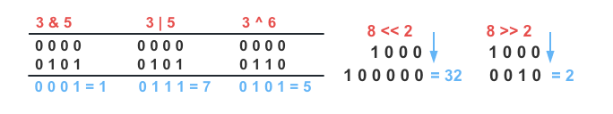
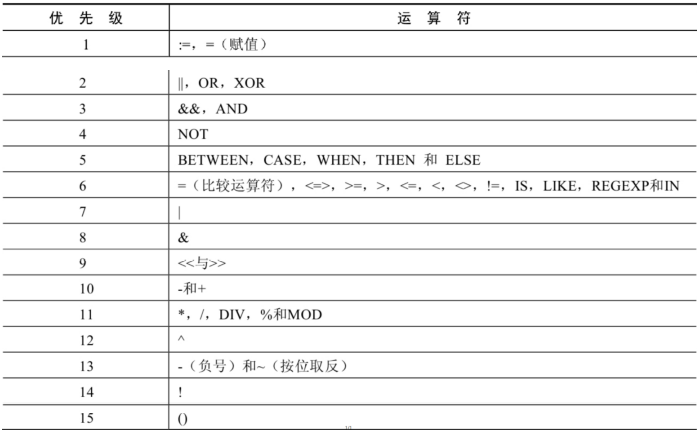
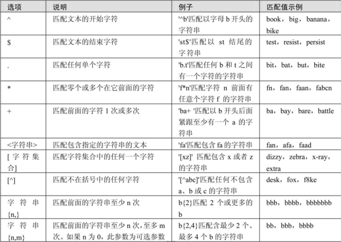

# 运算符 (/docs/backend/database/base/operator)

## 算数运算符 [#算数运算符]

|   运算符   | 名称             | 作用                     | 示例                                 |
| :--------: | ---------------- | ------------------------ | ------------------------------------ |
|    `+`     | 加法运算符       | 计算两个值或表达式的和   | `SELECT a + b;`                      |
|    `-`     | 减法运算符       | 计算两个值或表达式的差   | `SELECT a - b;`                      |
|    `*`     | 乘法运算符       | 计算两个值或表达式的乘积 | `SELECT a * b;`                      |
| `/`或`DIV` | 除法运算符       | 计算两个值或表达式的商   | `SELECT a / b;`<br />`SELECT a DIV b;` |
| `%`或`MOD` | 求模(求余)运算符 | 计算两个值或表达式的余数 | `SELECT a % b;`<br />`SELECT a MOD b;` |

### 加法与减法运算符 [#加法与减法运算符]

```sql 
mysql> SELECT 100 , 100 + 0 , 100 - 0 , 100 + 50 , 100 + 50 - 30 , 100 + 35.5, 100 - 35 FROM dual;
+-----+---------+---------+----------+---------------+------------+----------+
| 100 | 100 + 0 | 100 - 0 | 100 + 50 | 100 + 50 - 30 | 100 + 35.5 | 100 - 35 |
+-----+---------+---------+----------+---------------+------------+----------+
| 100 |     100 |     100 |      150 |           120 | 135.5      |       65 |
+-----+---------+---------+----------+---------------+------------+----------+
1 row in set (0.04 sec)
```

**由运算结果可以得出如下结论**：

> ① 一个整数类型的值对整数进行加法和减法操作，结果还是一个整数；  
> ② 一个整数类型的值对浮点数进行加法和减法操作，结果是一个浮点数；  
> ③ 加法和减法的优先级相同，进行先加后减操作与进行先减后加操作的结果是一样的；  
> ④ 在 Java 中，+的左右两边如果有字符串，那么表示字符串的拼接。但是在 MySQL 中+只表示数值相加。如果遇到非数值类型，先尝试转成数值，如果转失败，就按 0 计算。（补充：MySQL 中字符串拼接要使用字符串函数`CONCAT()`实现）

### 乘法与除法运算符 [#乘法与除法运算符]

```sql 
mysql> SELECT 100 , 100 * 1 , 100 * 1.0, 100 / 1.0, 100 / 2 , 100 + 2 * 5 / 2 , 100 /3, 100 DIV 0 FROM dual;
+-----+---------+-----------+-----------+---------+-----------------+---------+-----------+
| 100 | 100 * 1 | 100 * 1.0 | 100 / 1.0 | 100 / 2 | 100 + 2 * 5 / 2 | 100 /3  | 100 DIV 0 |
+-----+---------+-----------+-----------+---------+-----------------+---------+-----------+
| 100 |     100 | 100.0     | 100.0000  | 50.0000 | 105.0000        | 33.3333 | NULL      |
+-----+---------+-----------+-----------+---------+-----------------+---------+-----------+
1 row in set (0.04 sec)
```

**由运算结果可以得出如下结论**：

> ① 一个数乘以整数 1 和除以整数 1 后仍得原数；  
> ② 一个数乘以浮点数 1 和除以浮点数 1 后变成浮点数，数值与原数相等；  
> ③ 一个数除以整数后，不管是否能除尽，结果都为一个浮点数；  
> ④ 一个数除以另一个数，除不尽时，结果为一个浮点数，并保留到小数点后 4 位；  
> ⑤ 乘法和除法的优先级相同，进行先乘后除操作与先除后乘操作，得出的结果相同；  
> ⑥ 在数学运算中， 0 不能用作除数，在 MySQL 中，一个数除以 0 为 NULL。

### 求模(求余)运算符 [#求模求余运算符]

```sql 
mysql> SELECT 12 % 3 , 12 MOD 5, 12 % -5, -12 % 5, -12 % -5 FROM dual;
+--------+----------+---------+---------+----------+
| 12 % 3 | 12 MOD 5 | 12 % -5 | -12 % 5 | -12 % -5 |
+--------+----------+---------+---------+----------+
|      0 |        2 |       2 |      -2 |       -2 |
+--------+----------+---------+---------+----------+
1 row in set (0.04 sec)
```

## 比较运算符 [#比较运算符]

&#8195;&#8195;比较运算符用来对表达式左边的操作数和右边的操作数进行比较，比较的结果为真则返回 1 ，比较的结果为假则返回 0 ，其他情况则返回 NULL。

|   运算符   | 名称           | 作用                                             |
| :--------: | -------------- | ------------------------------------------------ |
|    `=`     | 等于运算符     | 判断两个值、字符串或表达式是否相等               |
|   `<=>`    | 安全等于运算符 | 安全的判断两个值、字符串或表达式是否相等         |
| `<>`或`!=` | 不等于运算符   | 判断两个值、字符串或表达式是否不相等             |
|    `<`     | 小于运算符     | 判断前面的是否小于后面的值、字符串或表达式       |
|    `<=`    | 小于等于运算符 | 判断前面的是否小于或等于后面的值、字符串或表达式 |
|    `>`     | 大于运算符     | 判断前面的是否大于后面的值、字符串或表达式       |
|    `>=`    | 大于等于运算符 | 判断前面的是否大于或等于后面的值、字符串或表达式 |

### 等号运算符 [#等号运算符]

（1）等号运算符(`=`)判断等号两边的值、字符串或表达式是否相等，如果相等则返回 1 ，不相等则返回 0；

（2）在使用等号运算符时，遵循如下规则：

- 如果等号两边的值、字符串或表达式都为字符串，则 MySQL 会按照字符串进行比较，其比较的是每个字符串中字符的 ANSI 编码是否相等；
- 如果等号两边的值都是整数，则 MySQL 会按照整数来比较两个值的大小；
- 如果等号两边的值一个是整数，另一个是字符串，则 MySQL 会将字符串转化为数字进行比较；
- 如果等号两边的值、字符串或表达式中有一个为 NULL，则比较结果为 NULL。

```sql 
mysql> SELECT 'a' = 'b', 1 = 1, 1 = 'a', '' = null, null = null FROM dual;
+-----------+-------+---------+-----------+-------------+
| 'a' = 'b' | 1 = 1 | 1 = 'a' | '' = null | null = null |
+-----------+-------+---------+-----------+-------------+
|         0 |     1 |       0 | NULL      | NULL        |
+-----------+-------+---------+-----------+-------------+
1 row in set (0.04 sec)
```

### 安全等于运算符 [#安全等于运算符]

&#8195;&#8195;安全等于运算符(`<=>`)与等于运算符(`=`)的作用是相似的，`==`唯一的区别是`<=>`可以用来对 NULL 进行判断。在两个操作数均为 NULL 时，其返回值为 1，而不为 NULL；当一个操作数为 NULL 时，其返回值为 0，而不为 NULL。

```sql 
mysql> SELECT 1 <=> '1', 1 <=> 0 , 'a' <=> 'a', '' <=> NULL,NULL <=> NULL FROM dual;
+-----------+---------+-------------+-------------+---------------+
| 1 <=> '1' | 1 <=> 0 | 'a' <=> 'a' | '' <=> NULL | NULL <=> NULL |
+-----------+---------+-------------+-------------+---------------+
|         1 |       0 |           1 |           0 |             1 |
+-----------+---------+-------------+-------------+---------------+
1 row in set (0.04 sec)
```

### 不等于运算符 [#不等于运算符]

&#8195;&#8195;不等于运算符(`<>`或`!=`)用于判断两边的数字、字符串或者表达式的值是否不相等，如果不相等则返回 1，相等则返回 0。不等于运算符不能判断 NULL 值，如果两边的值有任意一个为 NULL，或两边都为 NULL，则结果为 NULL。

```sql 
mysql> SELECT 1 <> 2, 1 != 2, '1' <> '1', null != null, null != 1 FROM dual;
+--------+--------+------------+--------------+-----------+
| 1 <> 2 | 1 != 2 | '1' <> '1' | null != null | null != 1 |
+--------+--------+------------+--------------+-----------+
|      1 |      1 |          0 | NULL         | NULL      |
+--------+--------+------------+--------------+-----------+
1 row in set (0.04 sec)
```

## 非符号运算符 [#非符号运算符]

|    运算符     | 名称             | 作用                         |
| :-----------: | ---------------- | ---------------------------- |
|   `IS NULL`   | 为空运算         | 判断值是否为空               |
| `IS NOT NULL` | 不为空运算       | 判断值是否不为空             |
|    `LEAST`    | 最小值运算符     | 在多值中返回最小值           |
|  `GREATEST`   | 最大值运算符     | 在多值中返回最大值           |
| `BETWEEN AND` | 两值之间的运算符 | 判断一个值是否存在两值之间   |
|   `ISNULL`    | 为空运算符       | 判断值是否为空               |
|     `IN`      | 属于运算符       | 判断列表是否包含值           |
|   `NOT IN`    | 不属于运算符     | 判断列表是否不包含值         |
|    `LIKE`     | 模糊匹配运算符   | 判断值是否模糊匹配规则       |
|   `REGEXP`    | 正则表达式运算符 | 判断值是否符合正则表达式规则 |
|    `RLIKE`    | 正则表达式运算符 | 判断值是否符合正则表达式规则 |

### 空 / 非空运算符 [#空--非空运算符]

```sql 
SELECT * FROM title_info WHERE remark IS NULL;
SELECT * FROM title_info WHERE ISNULL(remark);
SELECT * FROM title_info WHERE remark IS NOT NULL;
```

### 最小 / 最大值运算符 [#最小--最大值运算符]

`GREATEST`和`LEAST`函数都使用`N`个参数，并分别返回最大和最小值。  
语法：

```sql 
GREATEST(value1, value2, ...);
LEAST(value1,value2,...);
```

**以下比较规则适用于这两个函数**：

> ① 如果任何参数为 NULL，则两个函数都将立即返回 NULL，而不进行任何比较  
> ② 如果在 INT 或 REAL 上下文中使用函数，或者所有参数都是整数值或 REAL 值，那么它们将分别作为 INT 和 REAL 来比较  
> ③ 如果参数由数字和字符串组成，则函数将它们作为数字进行比较  
> ④ 如果至少一个参数是非二进制(字符)字符串，则函数将将参数作为非二进制字符串进行比较  
> ⑤ 在所有其他情况下，函数将参数作为二进制字符串进行比较

```sql 
mysql> SELECT LEAST('d','e','g','m') AS 'LEAST', GREATEST('d','e','g','m') AS 'GREATEST' FROM dual;
+-------+----------+
| LEAST | GREATEST |
+-------+----------+
| d     | m        |
+-------+----------+
1 row in set (0.04 sec)
```

### BETWEEN AND 运算符 [#between-and-运算符]

```sql 
# BETWEEN 条件一 AND 条件二 (查询条件一和条件二范围内的数据，包含边界)
SELECT employee_id, salary FROM employees WHERE salary BETWEEN 2000 AND 5000;
```

### IN / NOT IN 运算符 [#in--not-in-运算符]

```sql 
# IN 运算符
mysql> SELECT 'a' IN ('a','b','c'), 1 IN ( 2 , 3 ), NULL IN ('a','b'), 'a' IN ('a', NULL);
+----------------------+----------------+-------------------+--------------------+
| 'a' IN ('a','b','c') | 1 IN ( 2 , 3 ) | NULL IN ('a','b') | 'a' IN ('a', NULL) |
+----------------------+----------------+-------------------+--------------------+
|                    1 |              0 | NULL              |                  1 |
+----------------------+----------------+-------------------+--------------------+
1 row in set (0.04 sec)

SELECT * FROM title_info WHERE `type` IN ('S','D');

# NOT IN 运算符
mysql> SELECT 'a' NOT IN ('a','b','c'), 1 NOT IN ( 2 , 3 ), NULL NOT IN ('a','b'), 'a' NOT IN ('a', NULL);
+--------------------------+--------------------+-----------------------+------------------------+
| 'a' NOT IN ('a','b','c') | 1 NOT IN ( 2 , 3 ) | NULL NOT IN ('a','b') | 'a' NOT IN ('a', NULL) |
+--------------------------+--------------------+-----------------------+------------------------+
|                        0 |                  1 | NULL                  |                      0 |
+--------------------------+--------------------+-----------------------+------------------------+
1 row in set (0.04 sec)

SELECT * FROM title_info WHERE `type` NOT IN ('S','D');
```

### LIKE 运算符 [#like-运算符]

&#8195;&#8195;LIKE 运算符主要用来匹配字符串，通常用于模糊匹配，如果满足条件则返回 1，否则返回 0。如果给定的值或者匹配条件为 NULL，则返回结果为 NULL。

```sql 
% ：匹配 0 个或多个字符
_ ：只能匹配一个字符

# 查询包含'安全'的数据
SELECT * FROM title_info WHERE question LIKE '%安全%';
# 查询以'安全'结束的数据
SELECT * FROM title_info WHERE question LIKE '%安全';
# 查询以'安全'开始的数据
SELECT * FROM title_info WHERE question LIKE '安全%';
# 查询第二个字符是'安全'的数据
SELECT * FROM title_info WHERE question LIKE '_安%';
```


<Callout type="success" title="转义字符">

如果使用`\`表示转义，要省略`ESCAPE`；如果不是`\`，则要加上`ESCAPE`。

```sql 
# 查询以'安全_'开始的数据
SELECT * FROM title_info WHERE question LIKE '安全\_%';
SELECT * FROM title_info WHERE question LIKE '安全$_%' ESCAPE '$';
```

</Callout>


### REGEXP / RLIKE 运算符 [#regexp--rlike-运算符]

**语法格式**：`expr REGEXP / RLIKE 匹配条件`

如果`expr`满足匹配条件，返回 1；如果不满足，则返回 0。若`expr`或匹配条件任意一个为 NULL，则结果为 NULL。

```sql 
# 常用的有下面几种通配符
-- ^ 匹配以该字符后面的字符开头的字符串
-- $ 匹配以该字符前面的字符结尾的字符串
-- . 匹配任何一个单字符
-- * 匹配零个或多个在它前面的字符
-- [...] 匹配在方括号内的任何字符

SELECT 'Tweet' RLIKE '^Tw.*t$';
SELECT 'Tweet' REGEXP '^Tw.*t$';
```

## 逻辑运算符 [#逻辑运算符]

|    运算符    | 作用     | 示例                                    |
| :----------: | -------- | --------------------------------------- |
|  `NOT`或`!`  | 逻辑非   | `SELECT NOT A;`                         |
| `AND`或`&&`  | 逻辑与   | `SELECT A AND B;`<br />`SELECT A && B;`   |
| `OR`或`\|\|` | 逻辑或   | `SELECT A OR B;`<br />`SELECT A \|\| B;` |
|    `XOR`     | 逻辑异或 | `SELECT XOR A;`                         |

### 逻辑非运算符 [#逻辑非运算符]

```sql 
mysql> SELECT NOT 1 , NOT 0 , NOT( 1 + 1 ), ! 1 , NOT NULL;
+-------+-------+--------------+-----+----------+
| NOT 1 | NOT 0 | NOT( 1 + 1 ) | ! 1 | NOT NULL |
+-------+-------+--------------+-----+----------+
|     0 |     1 |            0 |   0 | NULL     |
+-------+-------+--------------+-----+----------+
1 row in set (0.04 sec)
```

### 逻辑与运算符 [#逻辑与运算符]

```sql 
mysql> SELECT 1 AND -1 , 0 AND 1 , 0 AND NULL, 1 AND NULL;
+----------+---------+------------+------------+
| 1 AND -1 | 0 AND 1 | 0 AND NULL | 1 AND NULL |
+----------+---------+------------+------------+
|        1 |       0 |          0 | NULL       |
+----------+---------+------------+------------+
1 row in set (0.04 sec)
```

### 逻辑或运算符 [#逻辑或运算符]

```sql 
mysql> SELECT 1 OR - 1 , 1 OR 0 , 1 OR NULL, 0 || NULL, NULL || NULL;
+----------+--------+-----------+-----------+--------------+
| 1 OR - 1 | 1 OR 0 | 1 OR NULL | 0 || NULL | NULL || NULL |
+----------+--------+-----------+-----------+--------------+
|        1 |      1 |         1 | NULL      | NULL         |
+----------+--------+-----------+-----------+--------------+
1 row in set (0.04 sec)
```

### 逻辑异或运算符 [#逻辑异或运算符]

```sql 
mysql> SELECT 1 XOR - 1 , 1 XOR 0 , 0 XOR 0 , 1 XOR NULL;
+-----------+---------+---------+------------+
| 1 XOR - 1 | 1 XOR 0 | 0 XOR 0 | 1 XOR NULL |
+-----------+---------+---------+------------+
|         0 |       1 |       0 | NULL       |
+-----------+---------+---------+------------+
1 row in set (0.04 sec)
```

> 相异为真

## 位运算符 [#位运算符]

| 运算符 | 作用     | 示例             |
| :----: | -------- | ---------------- |
|  `&`   | 按位与   | `SELECT A & B;`  |
|  `\|`  | 按位或   | `SELECT A \| B;` |
|  `^`   | 按位异或 | `SELECT A ^ B;`  |
|  `~`   | 按位取反 | `SELECT ~A;`     |
|  `<<`  | 按位左移 | `SELECT A << 2;` |
|  `>>`  | 按位右移 | `SELECT A >> 2;` |

> 位运算符是在<mark>二进制数</mark>上进行计算的运算符。位运算会先将操作数变成二进制数，进行位运算。然后再将计算结果从二进制数变回十进制数。

```sql 
mysql> SELECT 3 & 5, 3 | 5, 3 ^ 6, ~3, 8 << 2, 8 >> 2;
+-------+-------+-------+----------------------+--------+--------+
| 3 & 5 | 3 | 5 | 3 ^ 6 | ~3                   | 8 << 2 | 8 >> 2 |
+-------+-------+-------+----------------------+--------+--------+
|     1 |     7 |     5 | 18446744073709551612 |     32 |      2 |
+-------+-------+-------+----------------------+--------+--------+
1 row in set (0.04 sec)
```



## 运算符的优先级 [#运算符的优先级]




<Callout type="success" title="提示">

数字编号越大，优先级越高，优先级高的运算符先进行计算。可以看到，赋值运算符的优先级最低，使用`()`括起来的表达式的优先级最高。

</Callout>


## 扩展：使用正则表达式查询 [#扩展使用正则表达式查询]


