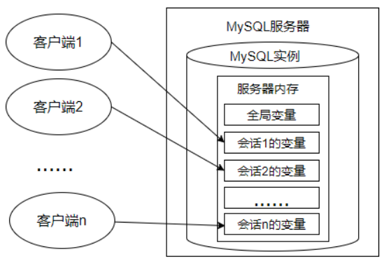

# 变量、流程控制与游标 (/docs/backend/database/base/variable_flow_cursor)

## 变量 [#变量]

&#8195;&#8195;在 MySQL 数据库的存储过程和函数中，可以使用变量来存储查询或计算的中间结果数据，或者输出最终的结果数据。在 MySQL 数据库中，变量分为`系统变量`以及用户`自定义变量`。

### 系统变量 [#系统变量]

&#8195;&#8195;变量由系统定义，不是用户定义，属于服务器层面。启动 MySQL 服务，生成 MySQL 服务实例期间，MySQL 将为 MySQL 服务器内存中的系统变量赋值，这些系统变量定义了当前 MySQL 服务实例的属性、特征。这些系统变量的值要么是编译 MySQL 时参数的默认值，要么是配置文件（例如 my.ini 等）中的参数值。

> 系统变量官方文档：  
> MySQL 5.7：[https://dev.mysql.com/doc/refman/5.7/en/server-system-variables.html](https://dev.mysql.com/doc/refman/5.7/en/server-system-variables.html)  
> MySQL 8.0：[https://dev.mysql.com/doc/refman/8.0/en/server-system-variables.html](https://dev.mysql.com/doc/refman/8.0/en/server-system-variables.html)

&#8195;&#8195;系统变量分为<mark>全局系统变量</mark>（需要添加 global 关键字）以及<mark>会话系统变量</mark>（需要添加 session 关键字），<u>有时也把全局系统变量简称为全局变量，有时也把会话系统变量称为 local 变量</u>。 如果不写，<mark>默认会话级别</mark>。 静态变量（在 MySQL 服务实例运行期间它们的值不能使用 set 动态修改）属于特殊的全局系统变量。  
&#8195;&#8195;在 MySQL 中有些系统变量只能是全局的，例如`max_connections`用于限制服务器的最大连接数；有些系统变量作用域既可以是全局又可以是会话，例如 `character_set_client`用于设置客户端的字符集；有些系统变量的作用域只能是当前会话，例如`pseudo_thread_id`用于标记当前会话的 MySQL 连接 ID。


<Callout type="success" title="提示">

每一个 MySQL 客户机成功连接 MySQL 服务器后，都会产生与之对应的会话。会话期间，MySQL 服务实例会在 MySQL 服务器内存中生成与该会话对应的会话系统变量，这些会话系统变量的初始值是全局系统变量值的复制。如下图：



① 全局系统变量针对于所有会话(连接)有效，但<mark>不能跨重启</mark>；

② 会话 1 对某个全局系统变量值的修改会导致会话 2 中同一个全局系统变量值的修改。

③ 会话系统变量仅针对于当前会话(连接)有效。会话期间，当前会话对某个会话系统变量值的修改，不会影响其他会话同一个会话系统变量的值。

</Callout>


---

**查看系统变量**：

```sql 
# GLOBAL：全局系统变量
# SESSION：会话系统变量
SHOW [GLOBAL | SESSION] VARIABLES [LIKE 'pattern' | WHERE expr];

# 省略[GLOBAL | SESSION]，默认查询会话变量
SHOW VARIABLES; # 查询所有的会话变量

# 例如
SHOW GLOBAL VARIABLES LIKE '%size%';
SHOW SESSION VARIABLES LIKE 'max_join_size';
SHOW VARIABLES LIKE 'max_join_size';
```

---

**查看指定系统变量**：

&#8195;&#8195;作为 MySQL 编码规范，MySQL 中的系统变量以两个`@`开头，其中`@@GLOBAL`仅用于标记全局系统变量，`@@SESSION`仅用于标记会话系统变量。`@@`首先标记会话系统变量，如果会话系统变量不存在，则标记全局系统变量。

```sql 
# 查看全局系统变量或会话系统变量的值
SELECT @@[GLOBAL. | SESSION.] var_name;

# 例如
SELECT @@GLOBAL.innodb_data_file_path; # 全局系统变量
SELECT @@SESSION.max_join_size; # 会话系统变量
SELECT @@max_join_size; # 会话系统变量
```

---

**修改系统变量的值**：

方式一：修改 MySQL 配置文件，继而修改 MySQL 系统变量的值（该方法需要重启 MySQL 服务）；

方式二：在 MySQL 服务运行期间，使用`SET`命令重新设置系统变量的值：

```sql 
# 修改会话系统变量
SET @@SESSION.var_name = value;
SET SESSION var_name = value;
SET var_name = value;
SET @@var_name = value;

# 修改全局系统变量
SET @@GLOBAL.var_name = value;
SET GLOBAL var_name = value;
```

**示例**：

```sql 
# 会话系统变量
SELECT @@SESSION.auto_increment_offset;

SET @@SESSION.auto_increment_offset = 2;
SET SESSION auto_increment_offset = 3;
SET auto_increment_offset = 4;
SET @@auto_increment_offset = 5;

# 全局系统变量
SELECT @@GLOBAL.auto_increment_offset;

SET @@GLOBAL auto_increment_offset = '2';
SET GLOBAL auto_increment_offset = '3';
```

### 用户变量 [#用户变量]

&#8195;&#8195;用户变量是用户自己定义的，作为 MySQL 编码规范，MySQL 中的用户变量以一个`@`开头。根据作用范围不同，又分为<mark>会话用户变量</mark>和<mark>局部变量</mark>。

> 会话用户变量：作用域和会话变量一样，只对当前连接会话有效  
> 局部变量：只在`BEGIN`和`END`语句块中有效。<mark>局部变量只能在存储过程和函数中使用</mark>

官方文档：  
MySQL 5.7：[https://dev.mysql.com/doc/refman/5.7/en/user-variables.html](https://dev.mysql.com/doc/refman/5.7/en/user-variables.html)  
MySQL 8.0：[https://dev.mysql.com/doc/refman/8.0/en/user-variables.html](https://dev.mysql.com/doc/refman/8.0/en/user-variables.html)

#### 用户会话变量 [#用户会话变量]

**变量的定义**：

```sql 
# 方式一： = 或 :=
SET @用户变量 = 值;
SET @用户变量 := 值;

# 方式二：:= 或 INTO关键字
SELECT @用户变量 := 表达式 [FROM 等子句];
SELECT 表达式 INTO @用户变量 [FROM 等子句];
```

**查看用户变量的值**：

```sql 
SELECT @用户变量;
```

---

**示例**：

```sql 
SET @a = 1; # 或 SET @a := 1;
SELECT @a;

SELECT @num := COUNT(*) FROM employees;
SELECT @num;

SELECT AVG(salary) INTO @avgsalary FROM employees;
SELECT @avgsalary;

SELECT @big; # 查看某个未声明的变量时，将得到NULL值
```

#### 局部变量 [#局部变量]

**定义**：可以使用`DECLARE`语句定义一个局部变量  
**作用域**：仅仅在定义它的`BEGIN...END`中有效  
**位置**：只能放在`BEGIN...END`中，并且只能放在第一句

```sql 
BEGIN
  # 声明局部变量
  DECLARE var_name1 [, var_name2] ... type [DEFAULT value];
  # 为局部变量赋值
  SET var_name1 = value;
  SELECT value INTO var_name2 [FROM ...];
  # 查看局部变量
  SELECT var_name1, var_name2;
END
```

---

##### 定义变量 [#定义变量]

```sql 
DECLARE var_name [, var_name] ... type [DEFAULT value]; # 如果没有DEFAULT子句，初始值为NULL

# 例如
DECLARE emp_name VARCHAR(20) DEFAULT 'Andy';
```

##### 变量赋值 [#变量赋值]

```sql 
SET var_name = value;
SET var_name := value;
SELECT exp|col INTO var_name FROM table_name;

# 例如
SET emp_name = 'Andy';
SET emp_name := 'Andy';
SELECT last_name INTO emp_name FROM employees WHERE employee_id = 101;
```

##### 使用变量 [#使用变量]

```sql 
SELECT var_name;
```

---

**示例**：

(1) 声明局部变量，并分别赋值为 employees 表中 employee_id 为 102 的 last_name 和 salary

```sql 
DELIMITER //

CREATE PROCEDURE set_value()
  BEGIN
    DECLARE emp_name VARCHAR(25);
    DECLARE sal DOUBLE(10,2);

    SELECT last_name, salary INTO emp_name, sal
    FROM employees
    WHERE employee_id = 102;

    SELECT emp_name, sal;
  END //

DELIMITER ;
```

(2) 声明两个变量，求和并打印 （分别使用会话用户变量、局部变量的方式实现）

```sql 
-- 会话用户变量
SET @a = 1;
SET @b = 2;
SET @sum = @a + @b;
SELECT @sum;

-- 局部变量
DELIMITER //

CREATE PROCEDURE add_value()
  BEGIN
    DECLARE a INT DEFAULT 1;
    DECLARE b INT;
    DECLARE sum INT;

    SET b = 2;
    SET sum = a + b;

    SELECT sum;

  END //

DELIMITER ;
```

(3) 创建存储过程 different_salary 查询某员工和他领导的薪资差距，并用 IN 参数 emp_id 接收员工 id，用 OUT 参数 dif_salary 输出薪资差距结果

```sql 
DELIMITER //

CREATE PROCEDURE different_salary(IN emp_id INT, OUT dif_salary DOUBLE)
  BEGIN
    DECLARE emp_sal, mgr_sal DOUBLE;

    SELECT a.salary, b.salary INTO emp_sal, mgr_sal
    FROM employees a, employees b
    WHERE a.employee_id = emp_id
    AND a.manager_id = b.employee_id;

    SET dif_salary = mgr_sal - emp_sal;
  END //

DELIMITER ;

# 调用
CALL different_salary(102, @dif_sal);

# 查看
SELECT @dif_sal;
```

#### 会话用户变量与局部变量对比 [#会话用户变量与局部变量对比]

|              | 作用域        | 定义位置            | 语法                      |
| ------------ | ------------- | ------------------- | ------------------------- |
| 会话用户变量 | 当前会话      | 会话的任何地方      | 加符号`@`，不用指定类型   |
| 局部变量     | `BEGIN...END` | `BEGIN...END`第一句 | 一般不加`@`，需要指定类型 |

## 定义条件与处理程序 [#定义条件与处理程序]

&#8195;&#8195;**定义条件**是事先定义程序执行过程中可能遇到的问题，**处理程序**定义了在遇到问题时应当采取的处理方式，并且保证存储过程或函数在遇到警告或错误时能继续执行。这样可以增强存储程序处理问题的能力，避免程序异常停止运行。

### 案例分析 [#案例分析]

(1) 创建一个名称为"UpdateDataNoCondition"的存储过程，代码如下：

```sql 
DELIMITER //

CREATE PROCEDURE UpdateDataNoCondition()
BEGIN
  SET @x = 1;
  UPDATE employees SET email = NULL WHERE last_name = 'Abel';
  SET @x = 2;
  UPDATE employees SET email = 'aabbel' WHERE last_name = 'Abel';
  SET @x = 3;
END //

DELIMITER ;
```

(2) 调用存储过程：

```sql 
mysql> CALL UpdateDataNoCondition();
ERROR 1048 (23000): Column 'email' cannot be null

mysql> select @x;
+------+
| @x   |
+------+
|    1 |
+------+
1 row in set (0.00 sec)
```

&#8195;&#8195;可以看到，此时变量`@x = 1`。结合创建存储过程的 SQL 语句代码可以得出：在存储过程中未定义条件和处理程序，且当存储过程中执行的 SQL 语句报错时，MySQL 数据库就会抛出错误，并退出当前 SQL 逻辑，不在向下继续执行。

### 定义条件 [#定义条件]

&#8195;&#8195;定义条件就是给 MySQL 中的错误码命名，这有助于存储的程序代码更清晰。它将一个错误名字和指定的错误条件关联起来，这个名字随后被用在定义处理程序的`DECLARE HANDLER`语句中。

定义条件使用`DECLARE`语句，语法格式如下：

```sql 
DECLARE condition_name CONDITION FOR condition_value

condition_value: {
    mysql_error_code
  | SQLSTATE [VALUE] sqlstate_value
}
```

说明：

`mysql_error_code`和`sqlstate_value`都可以表示 MySQL 的错误

> `mysql_error_code`：数值类型错误代码  
> `sqlstate_value`：字符串类型错误代码(长度为 5)  
> 例如：ERROR 1048 (23000)中，1048 是 mysql_error_code，23000 是 sqlstate_value


<Callout type="warn" title="注意">

`DECLARE`仅仅在定义它的`BEGIN...END`中有效，且只能放在第一句

</Callout>


示例一：定义"Field_Not_Be_NULL"错误名与 MySQL 中违反非空约束的错误类型是"ERROR 1048 (23000)"对应

```sql 
# mysql_error_code
DECLARE Field_Not_Be_NULL CONDITION FOR 1048;

# sqlstate_value
DECLARE Field_Not_Be_NULL CONDITION FOR SQLSTATE '23000';
```

示例二：定义"ERROR 1148(42000)"错误，名称为"command_not_allowed"

```sql 
# mysql_error_code
DECLARE command_not_allowed CONDITION FOR 1148;

# sqlstate_value
DECLARE command_not_allowed CONDITION FOR SQLSTATE '42000';
```

### 定义处理程序 [#定义处理程序]

可以为 SQL 执行过程中发生的某些类型的错误定义特殊的处理程序。定义处理程序时，可以使用`DECLARE`语句，语法如下：

```sql 
DECLARE handler_action HANDLER
    FOR condition_value [, condition_value] ...
    statement # 处理语句

# 处理方式
handler_action: {
    CONTINUE # 遇到错误不处理，继续执行
  | EXIT # 遇到错误马上退出
  | UNDO # 遇到错误后撤回之前的操作(MySQL 不支持)
}

# 错误类型(条件)
condition_value: {
    mysql_error_code # 数值类型错误代码
  | SQLSTATE [VALUE] sqlstate_value # 字符串类型错误代码
  | condition_name # 错误条件名称
  | SQLWARNING # 匹配所有以 01 开头的 SQLSTATE 错误代码
  | NOT FOUND # 匹配所有以 02 开头的 SQLSTATE 错误代码
  | SQLEXCEPTION # 匹配没有被 SQLWARNING 和 NOT FOUND 捕获的其他错误代码
}
```

定义处理程序的几种方式，如下：

```sql 
# mysql_error_code
DECLARE CONTINUE HANDLER FOR 1146 SET @info = 'NO_SUCH_TABLE';

# sqlstate_value
DECLARE CONTINUE HANDLER FOR SQLSTATE '42S02' SET @info = 'NO_SUCH_TABLE';

# condition_name
DECLARE NO_SUCH_TABLE CONDITION FOR 1146;
DECLARE CONTINUE HANDLER FOR NO_SUCH_TABLE SET @info = 'NO_SUCH_TABLE';

# SQLWARNING
DECLARE EXIT HANDLER FOR SQLWARNING SET @info = 'Warning';

# NOT FOUND
DECLARE EXIT HANDLER FOR NOT FOUND SET @info = 'Not Found';

# SQLEXCEPTION
DECLARE EXIT HANDLER FOR SQLEXCEPTION SET @info = 'Other Exception';
```

### 案例解决 [#案例解决]

在存储过程中，定义处理程序，捕获 sqlstate_value 值，当遇到 mysql_error_code 值为 1048 时，执行 CONTINUE 操作，并且将@proc_value 的值设置为-1

```sql 
DELIMITER //

CREATE PROCEDURE UpdateDataNoCondition()
BEGIN
  # 定义处理程序
  DECLARE CONTINUE HANDLER FOR 1048 SET @proc_value = -1;

  SET @x = 1;
  UPDATE employees SET email = NULL WHERE last_name = 'Abel';
  SET @x = 2;
  UPDATE employees SET email = 'aabbel' WHERE last_name = 'Abel';
  SET @x = 3;
END //

DELIMITER ;
```

调用：

```sql 
mysql> CALL UpdateDataNoCondition();
Query OK, 0 rows affected (0.00 sec)

mysql> SELECT @x, @proc_value;
+------+-------------+
| @x   | @proc_value |
+------+-------------+
|    3 |          -1 |
+------+-------------+
1 row in set (0.00 sec)
```

## 流程控制 [#流程控制]

&#8195;&#8195;解决复杂问题不可能通过一个 SQL 语句完成，我们需要执行多个 SQL 操作。流程控制语句的作用就是控制存储过程中 SQL 语句的执行顺序，我们完成复杂操作必不可少的一部分。

只要是执行的程序，流程就分为三大类：  
&#8195;① **顺序结构**：程序从上往下依次执行  
&#8195;② **分支结构**：程序按条件进行选择执行，从两条或多条路径中选择一条执行  
&#8195;③ **循环结构**：程序满足一定条件下，重复执行一组语句

针对于 MySQL 的流程控制语句主要有三类(<mark>注意：只能用于存储程序</mark>)：  
&#8195;① **条件判断语句**：IF 语句和 CASE 语句  
&#8195;② **循环语句**：LOOP、WHILE 和 REPEAT 语句  
&#8195;③ **跳转语句**：ITERATE 和 LEAVE 语句

### 分支结构(IF) [#分支结构if]

语法结构：

```sql 
IF search_condition THEN statement_list
    [ELSEIF search_condition THEN statement_list] ...
    [ELSE statement_list]
END IF
```

示例：

```sql 
DELIMITER //

CREATE FUNCTION SimpleCompare(n INT, m INT)
  RETURNS VARCHAR(20)

  BEGIN
    DECLARE s VARCHAR(20);

    IF n > m THEN SET s = '>';
    ELSEIF n = m THEN SET s = '=';
    ELSE SET s = '<';
    END IF;

    SET s = CONCAT(n, ' ', s, ' ', m);

    RETURN s;
  END //

DELIMITER ;

mysql> SELECT SimpleCompare(1, 5);

mysql> SELECT SimpleCompare(1, 5);
+---------------------+
| SimpleCompare(1, 5) |
+---------------------+
| 1 < 5               |
+---------------------+
1 row in set (0.00 sec)
```

### 分支结构(CASE) [#分支结构case]

语法结构：

```sql 
# 方式一
CASE case_value
    WHEN when_value THEN statement_list
    [WHEN when_value THEN statement_list] ...
    [ELSE statement_list]
END CASE

# 方式二
CASE
    WHEN search_condition THEN statement_list
    [WHEN search_condition THEN statement_list] ...
    [ELSE statement_list]
END CASE
```

> 与[流程控制函数](/docs/backend/database/base/one_line_function#流程控制函数)中的`CASE`稍微有点区别：结尾一个为`END`，一个为`END CASE`

示例：

```sql 
# 方式一
DELIMITER //

CREATE PROCEDURE test_case(IN num INT)
  BEGIN
    CASE num
      WHEN 1 THEN SELECT 'MySQL';
      WHEN 2 THEN SELECT 'Java';
      ELSE SELECT 'Redis';
    END CASE;
  END //

DELIMITER;

# 调用
CALL test_case(1);

# 方式二
DELIMITER //

CREATE PROCEDURE test_case(IN score INT)
  BEGIN
    CASE
      WHEN score >= 90  THEN SELECT '优秀';
      WHEN score > 60 AND score < 90 THEN SELECT '良好';
      ELSE SELECT '不及格';
    END CASE;
  END //

DELIMITER;

# 调用
CALL test_case(100);
```

### 循环结构(LOOP) [#循环结构loop]

语法结构：

```sql 
[loop_label:] LOOP
    statement_list
END LOOP [loop_label]
```

> LOOP 循环语句用来重复执行某些语句。LOOP 内的语句一直重复执行直到被退出(使用 LEAVE 子句)，跳出循环。

示例：使用 LOOP 语句进行循环操作，id 值小于 10 时将重复执行循环过程

```sql 
DELIMITER //

CREATE PROCEDURE loop_test()
BEGIN
  DECLARE id INT DEFAULT 0;
  add_loop: LOOP
    SET id = id + 1;
    IF id >= 10 THEN LEAVE add_loop;
    END IF;
  END LOOP add_loop;

  SELECT id;
END //

DELIMITER ;

mysql> CALL loop_test();
+----+
| id |
+----+
| 10 |
+----+
1 row in set (0.01 sec)
```

### 循环结构(WHILE) [#循环结构while]

语法结构：

```sql 
[while_label:] WHILE cycle_condition DO
    statement_list
END WHILE [while_label]
```

> WHILE 语句创建一个带条件判断的循环过程。WHILE 在执行语句执行时，先对指定的表达式进行判断，如果为真，就执行循环内的语句，否则退出循环。

示例：使用 WHILE 语句进行循环操作，id 值小于 10 时将重复执行循环过程

```sql 
DELIMITER //

CREATE PROCEDURE while_test()
BEGIN
  DECLARE id INT DEFAULT 0;
  while_loop: WHILE id < 10 DO
    SET id = id + 1;
  END WHILE while_loop;

  SELECT id;
END //

DELIMITER ;

mysql> CALL while_test();
+----+
| id |
+----+
| 10 |
+----+
1 row in set (0.01 sec)
```

### 循环结构(REPEAT) [#循环结构repeat]

语法结构：

```sql 
[repeat_label:] REPEAT
    statement_list
UNTIL end_condition
END REPEAT [repeat_label]
```

> REPEAT 语句创建一个带条件判断的循环过程。<mark>与 WHILE 循环不同的是，REPEAT 循环首先会执行一次循环</mark>，然后在 UNTIL 中进行表达式的判断，如果满足条件就退出，即 END REPEAT；如果条件不满足，则会就继续执行循环，直到满足退出条件为止。

示例：

```sql 
DELIMITER //

CREATE PROCEDURE repeat_test()
BEGIN
  DECLARE id INT DEFAULT 0;
  repeat_loop: REPEAT
    SET id = id + 1;
    UNTIL id >= 10
  END REPEAT repeat_loop;

  SELECT id;
END //

DELIMITER ;

mysql> CALL repeat_test();
+----+
| id |
+----+
| 10 |
+----+
1 row in set (0.01 sec)
```

---

#### 对比三种循环结构 [#对比三种循环结构]

| 关键字   | 说明                             |
| -------- | -------------------------------- |
| `LOOP`   | 一般用于实现简单的"死"循环       |
| `WHILE`  | 先判断后执行                     |
| `REPEAT` | 先执行后判断，无条件至少执行一次 |

> 这三种循环都可以省略名称，但如果循环中添加了循环控制语句(`LEAVE或ITERATE`)则必须添加名称

### 跳转语句(LEAVE) [#跳转语句leave]

语法结构：

```sql 
LEAVE label
```

> 可以用在循环语句内，或者以`BEGIN ... END` 包裹起来的程序体内，表示跳出循环或跳出程序题的操作。如果你有面向过程的编写语言的经验，可以把`LEAVE`理解为`break`。

示例：

当市场环境不好时，公司为了渡过难关，决定暂时降低大家的薪资。声明存储过程 leave_while()，声明 OUT 参数 num，输出循环次数，存储过程中使用 WHILE 循环给大家降低薪资为原来薪资的 90%，直到全公司的平均薪资小于等于 10000 ，并统计循环次数

```sql 
DELIMITER //

CREATE PROCEDURE leave_while(OUT num INT)
BEGIN
  DECLARE avg_sal DOUBLE;
  DECLARE while_count INT DEFAULT 0;

  SELECT AVG(salary) INTO avg_sal FROM employees; # ① 初始化条件

  while_label: WHILE TRUE DO # ② 循环条件
    # ③ 循环体
    IF avg_sal <= 10000 THEN
        LEAVE while_label;
    END IF;

    UPDATE employees SET salary = salary * 0.9;
    SET while_count = while_count + 1;
    SELECT AVG(salary) INTO avg_sal FROM employees; # ④ 迭代条件
  END WHILE;

  SET num = while_count;
END //

DELIMITER ;

# 调用
CALL leave_while(@num);
SELECT @num;
```

### 跳转语句(ITERATE) [#跳转语句iterate]

语法结构：

```sql 
ITERATE label
```

> 只能用在循环语句`LOOP`、`REPEAT` 和 `WHILE`语句内，表示重新开始循环，将执行顺序转到语句段开头处。如果你有面向过程的编程语言的使用经验，你可以把`ITERATE`理解为`continue`。

示例：

定义局部变量 num，初始值为 0。循环结构中执行 num + 1 操作：  
&#8195;如果 num &lt; 10，则继续执行循环；  
&#8195;如果 num > 15，则退出循环结构；

```sql 
DELIMITER //

CREATE PROCEDURE iterate_test()
BEGIN
  DECLARE num INT DEFAULT 0;
  loop_label: LOOP
    SET num = num + 1;
    IF num < 10 THEN
      ITERATE loop_label;
    ELSEIF num > 15 THEN
      LEAVE loop_label;
    END IF;

    SELECT 'Learning MySQL!';

  END LOOP loop_label;
END //

DELIMITER ;

# 调用：当 num >= 10 且 num <= 15 时打印"Learning MySQL!"
CALL iterate_test(); # 打印六次
```

## 游标 [#游标]

### 什么是游标 [#什么是游标]

&#8195;&#8195;游标又称光标，是 SQL 的一个内存工作区，由系统或用户以变量的形式定义，主要用于暂时存放受 SQL 语句影响到的所有数据。

### 使用游标步骤 [#使用游标步骤]

&#8195;&#8195;游标必须在声明处理程序之前被声明，并且变量和条件还必须在声明游标或处理程序之前被声明。如果我们在使用游标，一般需要经历下面四个步骤。需要注意的是不同的 DBMS 中，使用游标的语法可能略有不用。

---

#### 声明游标 [#声明游标]

```sql 
DECLARE cursor_name CURSOR FOR select_statement;
```

> 这个语法适用于 MySQL，SQL Server，DB2 和 MariaDB。如果是用 Oracle 或者 PostgreSQL，需要写成`DECLARE cursor_name CURSOR IS select_statement;`

#### 打开游标 [#打开游标]

```sql 
OPEN cursor_name;
```

#### 使用游标 [#使用游标]

```sql 
FETCH cursor_name INTO var_name [, var_name] ...
```

> 使用 cursor_name 这个游标来读取当前行，并且将数据保存到 var_name 这个变量中，游标指针指到下一行。如果游标读取的数据行有多个列名，则在 INTO 关键字后面赋值给多个变量名即可。

🔔 注意：游标的查询结果集中的字段数，必须跟 INTO 后面的变量数一致 ，否则，在存储过程执行的时候，MySQL 会提示错误。

#### 关闭游标 [#关闭游标]

```sql 
CLOSE cursor_name;
```

> 游标会占用系统资源，如果不及时关闭，游标会一直保持到存储过程结束，影响系统运行的效率，而关闭游标的操作，会释放游标占用的系统资源。

### 案例 [#案例]

&#8195;&#8195;创建存储过程 get_count_by_limit_total_salary()，声明 IN 参数 limit_total_salary，DOUBLE 类型；声明 OUT 参数 total_count，INT 类型。函数的功能可以实现累加薪资最高的几个员工的薪资值，直到薪资总和达到 limit_total_salary 参数的值，返回累加的人数给 total_count。

```sql 
DELIMITER //

CREATE PROCEDURE get_count_by_limit_total_salary(IN limit_total_salary DOUBLE, OUT total_count INT)
BEGIN
  DECLARE cursor_salary DOUBLE DEFAULT 0; # 游标取到的薪水值
  DECLARE sum_salary DOUBLE DEFAULT 0; # 薪水累加
  DECLARE emp_count INT DEFAULT 0; # 循环个数

  # 定义游标
  DECLARE emp_cursor CURSOR FOR SELECT salary FROM employees ORDER BY salary DESC;
  # 打开游标
  OPEN emp_cursor;
  REPEAT
    # 使用游标
    FETCH emp_cursor INTO cursor_salary;
    SET sum_salary = sum_salary + cursor_salary;
    SET emp_count = emp_count + 1;
    UNTIL sum_salary >= limit_total_salary
  END REPEAT;
  SET total_count = emp_count;
  # 关闭游标
  CLOSE emp_cursor;

END //

DELIMITER ;

# 调用
CALL get_count_by_limit_total_salary(150000,@total_count);
SELECT @total_count;
```

### 小结 [#小结]

&#8195;&#8195;游标是 MySQL 的一个重要的功能，为逐条读取结果集中的数据，提供了完美的解决方案。跟在应用层面实现相同的功能相比，游标可以在存储程序中使用，效率高，程序也更加简洁。但同时也会带来一些性能问题，比如在使用游标的过程中，会对数据行进行加锁，这样在业务并发量大的时候，不仅会影响业务之间的效率，还会消耗系统资源，造成内存不足，这是因为游标是在内存中进行的处理。


<Callout type="success" title="提示">

养成用完之后就关闭的习惯，这样才能提高系统的整体效率。

</Callout>


## 补充 MySQL 8.0 新特性 [#补充-mysql-80-新特性]

### 全局变量持久化 [#全局变量持久化]

&#8195;&#8195;在数据库中，全局变量可以通过`SET GLOBAL`语句来设置，但是设置的变量值只会<mark>临时生效</mark>，当数据库重启后，服务器又会从 MySQL 配置文件中读取变量的默认值。在 MySQL 8.0 中新增了`SET PERSIST`命令来进行持久化设置。使用该命令会将配置保存到数据目录下的`mysqld-auto.cnf`文件中，下次启动时会读取该文件，用其中的配置来覆盖默认配置。

例如：设置服务器的最大连接数为 1000

```sql 
SET PERSIST global max_connections = 1000 ;
SET @@PERSIST.max_connections = 1000;
```

删除持久化的全局系统变量设置：

```sql 
RESET PERSIST [[IF EXISTS] system_var_name]

# 例如
-- 删除所有持久化变量
RESET PERSIST;
-- 删除持久化变量max_connections
RESET PERSIST IF EXISTS max_connections;
```
