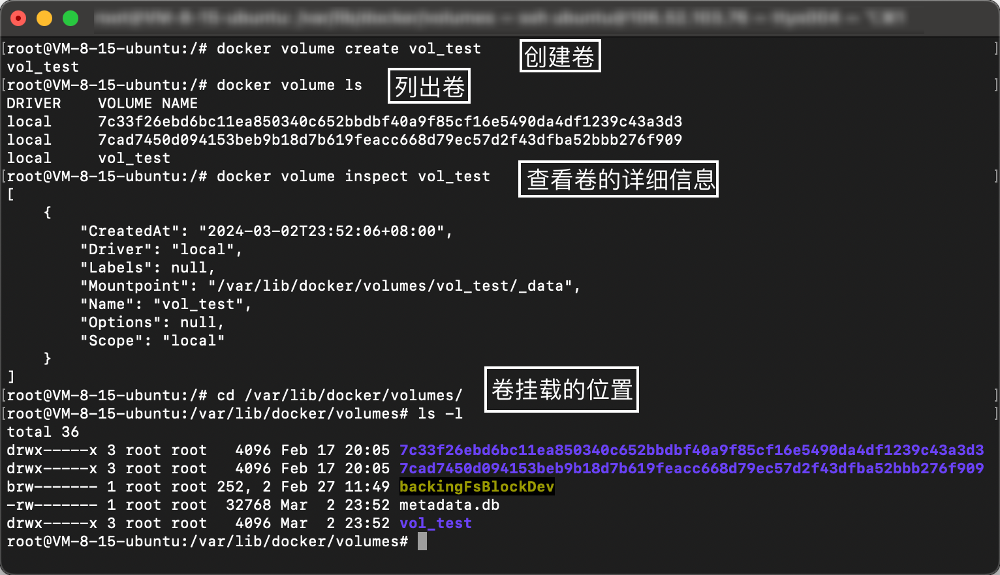
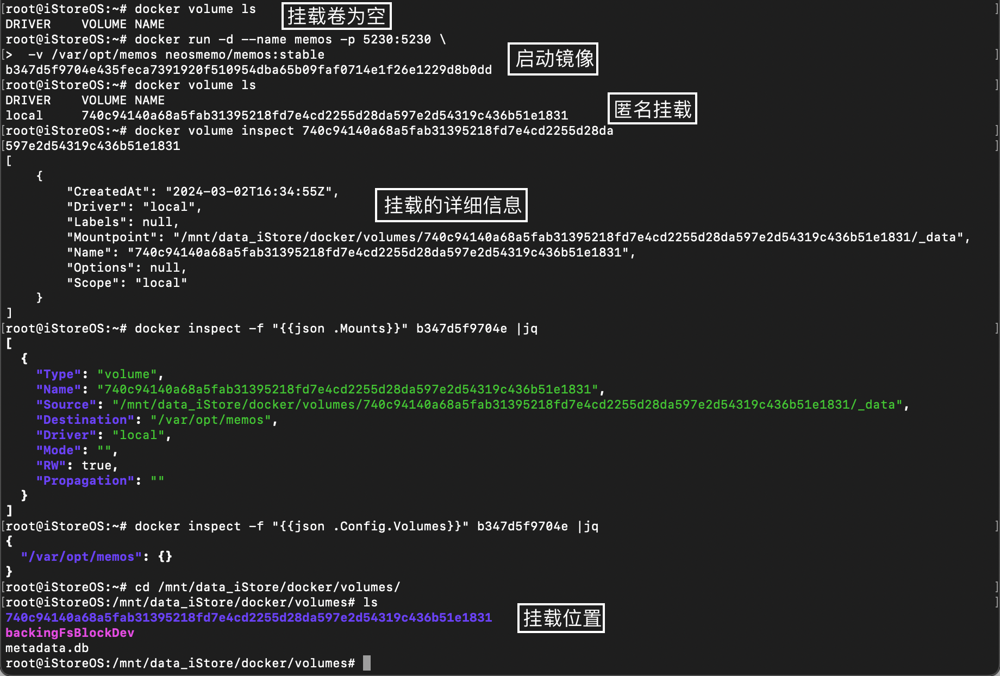
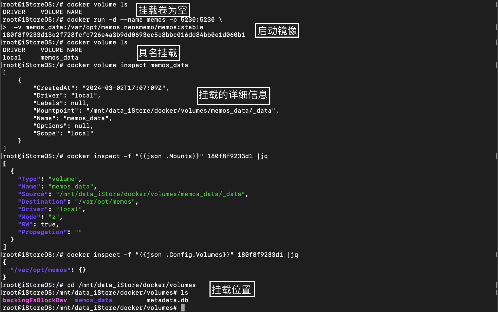
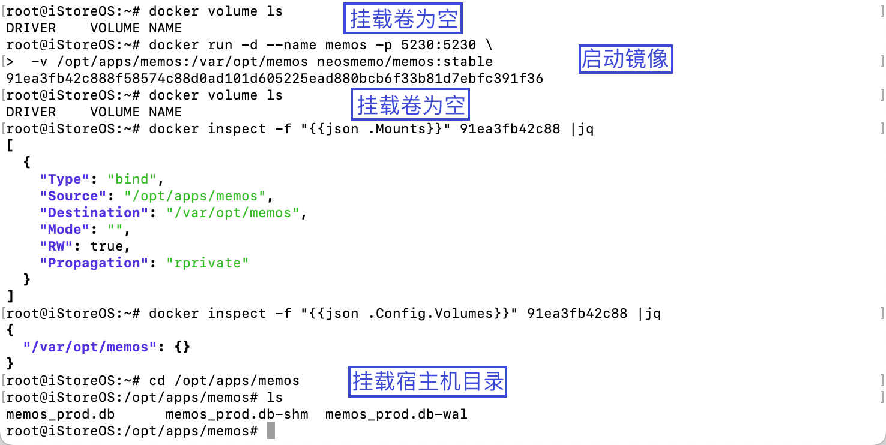
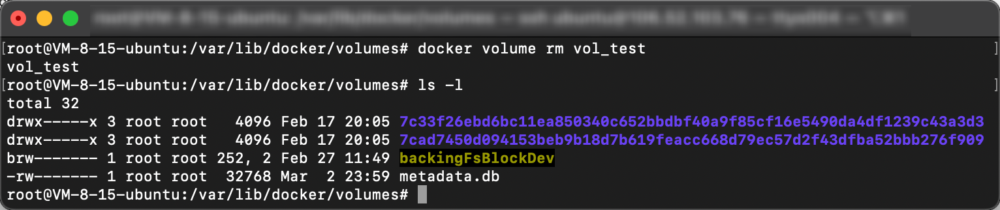
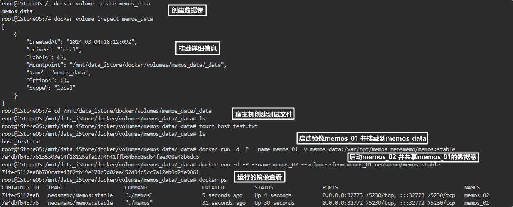

# 容器数据卷 (/docs/backend/docker/data_volume)

## 什么是容器数据卷 [#什么是容器数据卷]

&#8195;&#8195;如果数据都在容器中，假如容器删除数据就会丢失，这显然不是我们希望的，所以需要将数据持久化到本地。此外假如有一个配置，在多个容器中使用到了，假如某个地方需要修改，不使用数据卷就需要一个一个容器的去修改，期间可能还会涉及镜像重新构建与部署，使用数据卷就可以很好的解决这个问题。

&#8195;&#8195;卷的本质是文件或者目录，存在一个或者多个容器中，有 Docker 挂载到容器，但不属于联合文件系统。卷的概念不仅解决了数据持久化的问题，还解决了容器间共享数据的问题。


<Callout type="success" title="总结">

① 数据的持久化，当容器重启后保证数据不丢失；
② 如果数据存储于镜像中，主机上的其它进程不方便访问这些数据，数据卷解决了容器间数据共享问题。

</Callout>


**容器卷有哪些特点**：
&#8195;① 数据卷可在容器之间共享或重用数据
&#8195;② 数据卷中的更改不会包含在镜像的更新中
&#8195;③ 卷中的更改可以直接生效
&#8195;④ 数据卷的生命周期一直持续到没有容器使用它为止

## 卷的操作 [#卷的操作]

### 挂载数据卷 [#挂载数据卷]

```shell 
docker run -d --name memos -p 5230:5230 \
 -v /opt/apps/memos:/var/opt/memos neosmemo/memos:stable
```

查看挂载是否成功：
`docker inspect container_id`

```shell  {5-6}
{
    "Mounts": [
        {
            "Type": "bind",
            "Source": "/opt/apps/memos", # 宿主机目录
            "Destination": "/var/opt/memos", # 容器内的目录
            "Mode": "rw",
            "RW": true,
            "Propagation": "rprivate"
        }
    ]
}
```

### 管理 volume [#管理-volume]

```shell 
docker volume COMMAND

Commands:
  create      创建一个 volume
  inspect     显示一个或多个 volume 的详细信息
  ls          列出 volume
  prune       移除本地没用到的 volume
  rm          移除一个或多个 volume
```

#### 创建 volume [#创建-volume]

```shell 
# ① 创建volume
docker volume create vol_test

# ② 列出volume
docker volume ls

# ③ 查看volume
docker volume inspect vol_test
```



> &#8195;&#8195;上图中使用命令`docker volume inspect volume_name`，查看了指定卷的详细信息，`Mountpoint`展示的是挂载的路径，<u>所有的 Docker 容器内的卷，没有指定目录的情况下都是存放在其安装的`docker/volume/xxx/_data`下，例如：`/var/lib/docker/volume/(volume_name)/_data`</u>；在此路径下，如果没有指定挂载卷的名字，就会随机生成一个名字(<u>挂载时只写了容器内的路径，没有写容器外的路径</u>)，例如`7c33f...a3d3`、`7cad...f909`这样的也被称为**匿名挂载**，而我们创建的`vol_test`因为有自己的名字被称为**具名挂载**。

```sh 
# 匿名挂载
-v 容器内路径
docker run -d --name memos -p 5230:5230 \
 -v /var/opt/memos neosmemo/memos:stable

# 具名挂载
-v 卷名:容器内路径
docker run -d --name memos -p 5230:5230 \
 -v memos_data:/var/opt/memos neosmemo/memos:stable

# 指定路径挂载
-v 宿主机路径:容器内路径
docker run -d --name memos -p 5230:5230 \
 -v /opt/apps/memos:/var/opt/memos neosmemo/memos:stable

# 详细对比下方案例说明 👇🏻
```

**案例说明**：匿名挂载、具名挂载、指定路径挂载三者区别 ?


<Tabs items={["匿名挂载", "具名挂载", "指定路径挂载"]}>
<Tab value="匿名挂载">



</Tab>
<Tab value="具名挂载">



</Tab>
<Tab value="指定路径挂载">



</Tab>
</Tabs>


**总结**：
&#8195;① 具名挂载和匿名挂载，都是挂载到`/var/lib/docker/volume/(volume_name)/_data`下，具名挂载可以指定卷的名字；匿名挂载没有指定卷的名字，随机生成一个名字；
&#8195;② 指定路径挂载顾名思义，因为指定了路径，所以使用`docker volume ls`，没有挂载的信息，其数据存放指向已经改变；与匿名挂载和具名挂载不同，使用命令`docker inspect -f "{{json .Mounts}}" container_id`，返回的`Type`类型不同；
&#8195;③ 具名挂载和指定根路径挂载，注意挂载命令`-v /docker_data/memos_data:/var/opt/memos`，前面有`/`的是指定路径，否则就是具名挂载；
&#8195;④ 使用具名挂载，案例如下；如果用户不执行第一条命令而直接执行第二条命令，Docker 会代替用户来创建一个名为`vol_simple`的 volume，并将其挂载到`/_data`目录下；

```shell 
docker volume create vol_simple
docker run -d --name memos -p 5230:5230 \
 -v vol_simple:/var/opt/memos neosmemo/memos:stable
```

&#8195;⑤ 指定路径挂载，文件夹必须使用**绝对路径**，如果宿主机中不存在该路径，Docker 会自动创建；
&#8195;⑥ 创建新容器时，可以使用多个`-v`标签为容器添加多个 volume，例如：

```shell 
docker run -d --name vol_muti \
-v /host_folder_1:/container_folder_1 \
-v /host_folder_2:/container_folder_2:ro \
-v /host_file:/container_file centos
```

&#8195;⑦ volume 挂载时使用`z`和`Z`来指定该 volume 的权限，默认是`z`代表共享该 volume，`Z`该 volume 为私有卷；此外还有`ro`、`rw`；

```shell 
# ro read only   只读（只能通过宿主机来操作，容器内部无法操作）
docker run -d --name vol_ro -v /host_folder:/container_folder:ro centos
# rw read write  可读可写
docker run -d --name vol_rw -v /host_folder:/container_folder:rw centos
# z 共享卷
docker run -d --name vol_z -v /host_folder:/container_folder:z centos
# Z 私有卷
docker run -d --name vol_Z -v /host_folder:/container_folder:Z centos
```

---


<Callout type="success" title="指令路径挂载错误案例">

```shell 
# 宿主机路径前缺失 /
docker run -d --name memos -p 5230:5230 \
 -v opt/apps/memos:/var/opt/memos neosmemo/memos:stable
# docker: Error response from daemon: create opt/apps/memos: "opt/apps/memos" includes
#   invalid characters for a local volume name, only "[a-zA-Z0-9][a-zA-Z0-9_.-]" are
#   allowed. If you intended to pass a host directory, use absolute path.

# 宿主机路径后缺失 :
docker run -d --name memos -p 5230:5230 \
 -v /opt/apps/memos /var/opt/memos neosmemo/memos:stable
# docker: invalid reference format.
```

</Callout>


#### 删除 volume [#删除-volume]

```shell 
docker volume rm vol_test
```



### 使用 Dockerfile 添加 volume [#使用-dockerfile-添加-volume]

`Dockerfile`：

```shell 
# 挂载单个数据卷
VOLUME /data
# 挂载多个数据卷
VOLUME ["/data1", "/data2"]
```

> &#8195;&#8195;与使用`docker run -v`不同的是，VOLUME 指令不能挂载主机中指定的文件夹。这是为了保证 Dockerfile 的可移植性，因为不能保证所有的宿主机都有对应的文件夹。

### 共享 volume (--volume-from) [#共享-volume---volume-from]

&#8195;&#8195;在使用 docker run 或 docker create 创建新的容器时，可以使用`--volume-from`标签使得容器与已有容器共享 volume。

```shell 
# 启动容器 memos_01
docker run -d -P --name memos_01 -v memos_data:/var/opt/memos neosmemo/memos:stable
# 启动容器 memos_02 并使用 memos_01 的 volume
docker run -d -P --name memos_02 --volumes-from memos_01 neosmemo/memos:stable
```




<Callout type="success" title="注意事项">

① 如果被分享的容器有多个 volume，新容器也将有多个 volume，并且其挂载的目录相同；
② 容器挂载了 volume，且被共享了；即使这个容器停止运行或者删除，该 volume 仍然存在，其它容器的使用不受影响。

</Callout>


### 备份、恢复或迁移 volume [#备份恢复或迁移-volume]

&#8195;&#8195;volume 作为数据的载体，在很多情况下需要对其中的数据进行备份、迁移，或是从已有数据恢复。以上文中创建的`memos_01`为例，该容器在`/mnt/data_iStore/docker/volume/memos_data/_data`挂载了一个 volume。如果需要将这里面的数据备份，一个很简单方法就是使用`docker inspect`命令查找到挂载目录在宿主机上对应的路径位置，然后复制其中的内容或是使用 tar 进行打包；同样地，如果需要恢复某个 volume 中的数据，可以查找到 volume 对应的文件夹，将数据复制进这个文件夹或是使用 tar 从存档文件中恢复。
