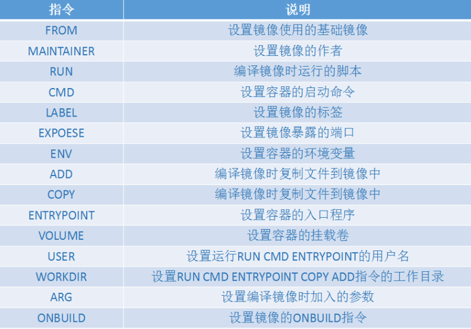

# Dockerfile (/docs/backend/docker/dockerfile)

## Dockerfile 介绍 [#dockerfile-介绍]

&#8195;&#8195;Dockerfile 是 Docker 用来构建镜像的文本文件，包含自定义的指令和格式。可以通过`docker build`命令从 Dockerfile 中构建镜像。用户可以用这些统一的语法命令来根据需求进行配置，通过这份统一的配置文件，在不同的平台上进行分发，需要使用时就可以根据配置文件自动化构建，这解决了开发人员构建镜像的复杂过程。同时 Dockerfile 与镜像配合使用，使 Docker 在构建时可以充分利用镜像的功能进行缓存，大大提升了 Docker 的使用率。

## Dockerfile 构建过程 [#dockerfile-构建过程]

&#8195;&#8195;Dockerfile 描述了组装镜像的步骤，其中每条指令都是单独执行的。除了 FROM 指令，其它每一条指令都会在上一条指令所生成镜像的基础上执行执行完后会生成一个新的镜像层，新的镜像层覆盖在原来的镜像之上从而形成了新的镜像。Dockerfile 所生成的最终镜像就是在基础镜像上面叠加一层层的镜像层组建的。

&#8195;&#8195;为了提高镜像构建的速度，Docker daemon 会缓存构建过程中的中间镜像。当从一个已在缓存中的基础镜像开始构建新镜像时，会将 Dockerfile 中的下一条指令和基础镜像的所有子镜像做比较，如果有一个镜像是由相同的指令生成的，则命中缓存，直接使用该镜像，而不用再生成一个新的镜像。

&#8195;&#8195;在寻找缓存的过程中，`COPY`和`ADD`指令与其它指令稍有不同，其它指令只对比生成镜像的指令字符串是否相同；而`COPY`和`ADD`指令还会对比源文件的内容是否相同，只有当源文件的内容与之前构建时完全一致时，才会命中缓存。

&#8195;&#8195;此外，镜像构建过程中，一旦缓存失效，则后续的指令都将生成新的镜像，而不再使用缓存。

## Dockerfile 指令 [#dockerfile-指令]

**基本格式**：

```shell 
# Comment
INSTRUCTION arguments
```

&#8195;&#8195;指令(INSTRUCTION)不区分大小写，但是为了与参数区分，推荐大写。Docker 会顺序执行 Dockerfile 中的指令，第一条指令必须是`FROM`指令，它用于指定构建镜像的基础镜像。在 Dockerfile 中以`#`开头的行是注释，而其它位置出现会被当做参数，示例如下：

```shell 
# Comment
RUN echo 'we are running some # of cool things'
```

&#8195;&#8195;Dockerfile 中的指令有 FROM、MAINTAINER、RUN、CMD、EXPOSE、ENV、ADD、COPY、ENTRYPOINT、VOLUME、USER、WORKDIR、ONBUILD 和 HEALTHCHECK 等。



### ENV [#env]

### FROM [#from]

### COPY [#copy]

### ADD [#add]

### RUN [#run]

### CMD [#cmd]

### ENTRYPOINT [#entrypoint]

### ONBUILD [#onbuild]
