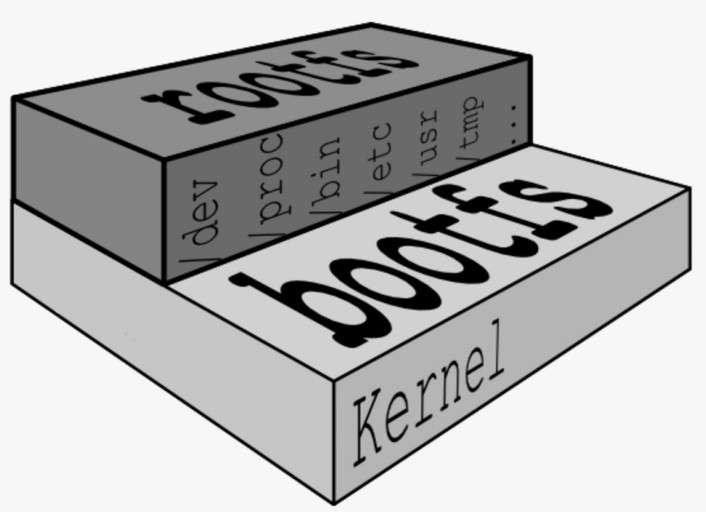
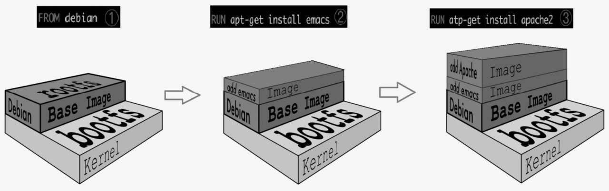
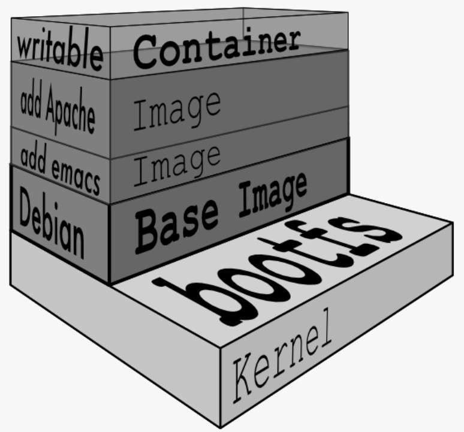

# 镜像原理 (/docs/backend/docker/image)

## 镜像是什么 [#镜像是什么]

&#8195;&#8195;镜像是一种轻量级、可执行的**独立软件包**，用来打包软件运行环境和基于运行环境开发的软件，它包含运行某个软件所需的所有内容，包括<u>代码、运行时、库、环境变量和配置文件</u>。

&#8195;&#8195;镜像是一个只读模版，带有创建 Docker 容器的书名。通常，一个镜像基于另一个镜像，并带有一些额外的定制。例如：可以构建一个基于 Ubuntu 的镜像，并在其上运行 Apache Web 服务器和你的应用程序，以及运行应用程序所需的配置细节。

&#8195;&#8195;Docker 镜像(Image)，就相当于是一个模板，其中包含创建 Docker 容器的说明，可以通过模板来创建容器服务，通过这个镜像我们可以创建多个容器，最终服务运行或项目运行都是在容器中的。


<Callout type="success" title="如何获取镜像?">

① 从 Docker HUb 上拉取镜像(常用)
② 自己构建镜像(Dockerfile)
③ 从别人那里拷贝

</Callout>


## 镜像加载原理 [#镜像加载原理]

(1) UnionFS 联合文件系统
&#8195;&#8195;Union 文件系统(UnionFS)是一种分层、轻量级并且高性能的文件系统，它支持对文件系统的修改作为一次提交，来一层层的叠加。
&#8195;&#8195;同时可以将不同目录，挂载到同一个虚拟文件系统下(unite several directories into a single virtual filesystem)。
&#8195;&#8195;Union 文件系统是 Docker 镜像的基础。
&#8195;&#8195;镜像可以通过分层来进行继承，基于基础镜像(没有父镜像的概念)，可以制作各种具体的应用镜像。


<Callout type="success" title="总结">

一次同时加载多个文件系统，但从外面看起来，只能看到一个文件系统，联合加载会把各层文件系统叠加起来，这样最终的文件系统会包含所有底层的文件和目录。

举例:

```shell 
root@learn ~ % docker pull neosmemo/memos
Using default tag: latest
latest: Pulling from neosmemo/memos
c30352492317: Already exists  # 分层下载（存在即共用）
d8ae814ab1c6: Pull complete # 一层一层下载
3fb4c2928579: Pull complete # 一层一层的叠加
53656755af84: Pull complete
ebf1d6d6b0e4: Pull complete
6a2cef4ab53d: Pull complete
Digest: sha256:84fe8465d1ec9ab729a37a7c6b93fd8efa1f1d190ed08dcc4a0b53f43530d64e
Status: Downloaded newer image for neosmemo/memos:latest
docker.io/neosmemo/memos:latest
```

</Callout>


(2) Docker 镜像加载原理
&#8195;&#8195;Docker 镜像实际上由一层一层的文件系统组成，这种层级的文件系统 UnionFS(联合文件系统)，分为两个部分：
① **bootfs(boot file system)**：主要包含 bootloader 和 kernel(Linux 内核)，bootloader 主要是引导加载 kernel，Linux 刚启动时会加载 bootfs 文件系统，在 Docker 镜像的最底层是 bootfs。这一层与我们典型的 Linux/Unix 系统是一样的，包含 bootloader 和 kernel。当 boot 加载完成之后整个内核就都在内存中了，此时内存的使用权已由 bootfs 转交给内核，此时系统也会卸载 bootfs。


<Callout type="success" title="提示">

即：系统启动时需要的引导加载，这个过程会需要一定的时间，就是黑屏到开机之间的这么一个过程。电脑、虚拟机、Docker 容器启动都需要这个过程。所以这一部分，无论什么镜像都是公用的。

</Callout>


② **rootfs(root file system)**：rootfs 在 bootfs 之上。包含的就是典型 Linux 系统中的`/dev`、`/proc`、`/bin`、`/etc` 等标准目录和文件。rootfs 就是各种不同的操作系统发行版，比如 Ubuntu，Centos 等等。


<Callout type="success" title="提示">

即：镜像启动之后的一个小的底层系统，这就是我们之前说的，容器就是一个小的虚拟机环境，这个小的虚拟机环境就相当于 rootfs。

> Linux 操作系统由内核空间和用户空间组成，如下图所示：
>
> 
> :::

`bootfs` 和 `rootfs` 关系如下图：




<Callout type="warn" title="平时虚拟机装的系统，比如 centos 都好几个 G，为什么 Docker 才几百 M？">

对于一个精简的 OS 系统，rootfs 可以很小，只需要包括最基本的命令、工具和程序库就可以了，因为底层直接用 Host(宿主机) 的 kernel，自己只需要提供 rootfs 就行了。由此可见对于不同的 OS，bootfs 基本是一致的，rootfs 会有差别，因此不同的 OS 可以公用 bootfs 这部分。**虚拟机的启动是分钟级的，容器的启动是秒级的**。

</Callout>


## 分层理解 [#分层理解]


<Callout type="success" title="为什么 Docker 镜像要采用这种分层的结构呢？">

最大的好处在于资源共享。比如：有多个镜像都从相同的 base 镜像构建而来，那么宿主机只需在磁盘上保存一份 base 镜像，其他镜像就可以共用宿主机的 base 镜像了。而且镜像的每一层都可以被共享。

查看镜像分层可以使用`docker images inspect images_name`:

```shell 
{
    "RootFS": {
        "Type": "layers",
        "Layers": [
            "sha256:cb42413394c4059335228c137fe884ff3ab8946a014014309676c25e3ac86864",
            "sha256:8e14cb7841faede6e42ab797f915c329c22f3b39026f8338c4c75de26e5d4e82",
            "sha256:1450b8f0019c829e638ab5c1f3c2674d117517669e41dd2d0409a668e0807e96",
            "sha256:f927192cc30cb53065dc266f78ff12dc06651d6eb84088e82be2d98ac47d42a0",
            "sha256:a24a292d018421783c491bc72f6601908cb844b17427bac92f0a22f5fd809665",
            "sha256:3480f9cdd491225670e9899786128ffe47054b0a5d54c48f6b10623d2f340632"
        ]
    }
}
```

</Callout>


&#8195;&#8195;所有的 Docker 镜像都起始于一个基础镜像层，当进行修改或者增加新的内容时，就会在当前镜像层之上，创建新的镜像层。


<Callout type="success" title="如果多个容器共享一份基础镜像，当某个容器修改了基础镜像的内容，这是其它容器是否也会被修改？">

不会，因为修改会被限制在单个容器内，这里利用的就是容器的 Copy-on-Write 特性。

</Callout>


&#8195;&#8195;Docker 镜像都是可读的，当容器启动时，一个新的可写层被加载到镜像的顶部，只有这个顶部是可写的。而这一层就是我们通常说的容器层，容器之下的都叫镜像层。如下所示：



## Commit 镜像 [#commit-镜像]

### commit 镜像的作用 [#commit-镜像的作用]

&#8195;&#8195;在运行的容器中，并在镜像的基础上做了一些修改，我们希望保存起来，封装成一个新的镜像，方便我们以后的使用，也就是提交容器副本，使之成为一个新的镜像。简单来说就是，从容器创建一个新的镜像。上述过程包含了三个步骤：
&#8195;① 运行容器；
&#8195;② 修改容器；
&#8195;③ 将容器保存为新的镜像。

> &#8195;&#8195;Docker 并不建议用户通过这种方式构建镜像，原因：① 容易出错，效率低且可重复性弱；② 无法对镜像进行审计，存在安全隐患。

### 命令说明 [#命令说明]

```shell 
docker commit [OPTIONS] CONTAINER [REPOSITORY[:TAG]]
# docker commit -m="提交的描述信息" -a="作者" 容器ID 要创建的目标镜像名:[标签名]
```

OPTIONS 说明：
`-a`: 作者 (eg:John [hannibal@a-team.com](mailto:hannibal@a-team.com))
`-c`: 使用 Dockerfile 指令来创建镜像
`-m`: 提交时的文字说明
`-p`: 在 commit 时，将容器暂停

</Callout>
