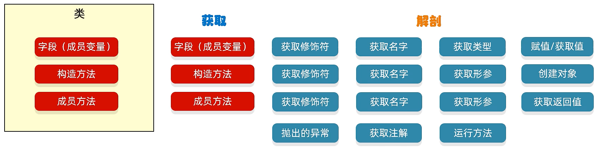

# 反射 (/docs/backend/java/java-reflect)

## 反射的概述 [#反射的概述]

&#8195;&#8195;在 Java 中的反射机制是指在运行状态中，对于任意一个类都能够知道这个类所有的属性和方法；并且对于任意一个对象，都能够调用它的任意一个方法；这种动态获取信息以及动态调用对象方法的功能称为 Java 语言的反射机制。

> 反射允许对封装类的字段、方法和构造函数的信息进行编程访问。
>
> 

## 反射机制的相关类在哪个包下？ [#反射机制的相关类在哪个包下]

`java.lang.reflect.*;`

---


<details>
<summary>演示用的 Person 类</summary>

```java 
package cn.test.reflect;

public class Person {
    private String name;
    private int age;
    public String gender;

    /**
     * 无参构造函数
     * 注意：当没有有参构造函数时，会隐式声明
     */
    public Person() {
    }

    public Person(String name) {
        this.name = name;
    }

    protected Person(int age) {
        this.age = age;
    }

    private Person(String name, int age) {
        this.name = name;
        this.age = age;
    }

    public String getName() {
        return name;
    }

    public void setName(String name) {
        this.name = name;
    }

    public int getAge() {
        return age;
    }

    public void setAge(int age) {
        this.age = age;
    }

    public String eat(String name) {
        System.out.println("Eating！");
        return name + " - eating!";
    }

    public String getGender() {
        return gender;
    }

    public void setGender(String gender) {
        this.gender = gender;
    }

    @Override
    public String toString() {
        return "Name:" + this.name + "," + "Age:" + this.age + "," + "Gender:" + this.gender;
    }
}
```

</details>


## 获取 Class 对象的三种方式 [#获取-class-对象的三种方式]

① `Class.forName("全类名")`<mark>源代码阶段</mark>

```java 
Class clazz = Class.forName("cn.test.reflect.Person");
```

> 最为常用

② `类名.class`<mark>加载阶段</mark>

```java 
Class clazz = Person.class;
```

> 一般更多的是当做参数进行传递

③ `对象.getClass()`<mark>运行阶段</mark>

```java 
Person person = new Person();
Class clazz = person.getClass();
```

> 当我们已经有了这个类的对象时，才能使用

## 反射获取构造方法(Constructor) [#反射获取构造方法constructor]

**Class 类中用于获取构造方法的方法**：

| 方法                                                                | 说明                                         |
| ------------------------------------------------------------------- | -------------------------------------------- |
| `Constructor<?>[] getConstructors()`                                | 返回所有 <mark>公共(public)</mark> 构造方法对象的数组 |
| `Constructor<?>[] getDeclaredConstructors()`                        | 返回所有构造方法对象的数组                   |
| `Constructor<T> getConstructor(Class<?>... parameterTypes)`         | 返回单个 <mark>公共(public)</mark> 构造方法对象       |
| `Constructor<T> getDeclaredConstructor(Class<?>... parameterTypes)` | 返回单个构造方法对象                         |

**创建对象的方法**：

> ① 通过 Class 类的 newInstance()方法
> ② 通过 Constructor 的 newInstance(Object[] args)方法

**Constructor 类中其他几个常用方法**：

| 方法                                | 说明                                     |
| ----------------------------------- | ---------------------------------------- |
| `int getModifiers()`                | 返回构造函数的修饰符 ①                   |
| `int getParameterCount()`           | 返回构造函数的参数数量                   |
| `Parameter[] getParameters()`       | 返回构造函数参数数组(在类`Executable`中) |
| `Class<?>[] getParameterTypes()`    | 返回构造函数参数类型数组(Class)②         |
| `Type[] getGenericParameterTypes()` | 返回构造函数参数类型数组(Type)           |

> ① 返回的修饰符一般配合`Modifier`类的`String toString(int mod)`使用
> ② 结果集一般配合`Class`类的`String getSimpleName()`方法使用

---

**示例代码**：


<details>
<summary>展开查看</summary>

<Tabs items={["App.java", "输出"]}>
<Tab value="App.java">

```java 
/**
 * 1.先获取classes字节码文件对象
 * 使用 Class 类中的 forName() 静态方法
 */
System.out.println("---1.获取Class对象---------------------------");
Class clazz_1 = Class.forName("cn.test.reflect.Person");
System.out.println("clazz_1 = " + clazz_1);

// 2.1 获取所有公共的构造方法
System.out.println("---2.1.获取所有公共的构造方法--------------------");
Constructor[] constructors = clazz_1.getConstructors();
for (Constructor constructor : constructors) {
    System.out.println("constructor = " + constructor);
}

// 2.2 获取单个公共的构造方法(无参)
System.out.println("---2.2 获取单个公共的构造方法(无参)---------------");
Constructor constructor_1 = clazz_1.getConstructor();
System.out.println("constructor_1 = " + constructor_1);

// 2.3 获取单个公共的构造方法(有参)
System.out.println("---2.3 获取单个公共的构造方法(有参)---------------");
Constructor constructor_2 = clazz_1.getConstructor(String.class);
System.out.println("constructor_2 = " + constructor_2);

// 3.1 获取所有的构造方法
System.out.println("---3.1 获取所有的构造方法------------------------");
Constructor[] declaredConstructors = clazz_1.getDeclaredConstructors();
for (Constructor declaredConstructor : declaredConstructors) {
    System.out.println("declaredConstructor = " + declaredConstructor);
}

// 3.2 获取所有的构造方法(无参)
System.out.println("---3.2 获取所有的构造方法(无参)---------------------");
Constructor declaredConstructor_1 = clazz_1.getDeclaredConstructor();
System.out.println("declaredConstructor_1 = " + declaredConstructor_1);

// 3.3 获取所有的构造方法(有参)
System.out.println("---3.3 获取所有的构造方法(有参)---------------------");
Constructor declaredConstructor_2 = clazz_1.getDeclaredConstructor(String.class, int.class);
System.out.println("declaredConstructor_2 = " + declaredConstructor_2);

// 4.获取权限修饰符
System.out.println("---4.获取权限修饰符--------------------------------");
int modifiers = declaredConstructor_2.getModifiers();
System.out.println("modifiers = " + modifiers);

// 5.获取参数数量
System.out.println("---5.获取参数数量----------------------------------");
int parameterCount = declaredConstructor_2.getParameterCount();
System.out.println("parameterCount = " + parameterCount);
// 6.获取参数
System.out.println("---6.获取参数--------------------------------------");
Parameter[] parameters = declaredConstructor_2.getParameters();
for (Parameter parameter : parameters) {
    System.out.println("parameter = " + parameter);
}
// 7.获取参数类型
System.out.println("---7.获取参数类型------------------------------------");
Class[] parameterTypes = declaredConstructor_2.getParameterTypes();
for (Class parameterType : parameterTypes) {
    System.out.println("parameterType = " + parameterType);
}
Type[] genericParameterTypes = declaredConstructor_2.getGenericParameterTypes();
for (Type genericParameterType : genericParameterTypes) {
    System.out.println("genericParameterType = " + genericParameterType);
}

// 8.1 使用 Constructor 的 newInstance(Object ... initargs) 方法创建对象
System.out.println("---8.1 使用 Constructor 的 newInstance(Object ... initargs) 方法创建对象----");
Person person_constructor = (Person) declaredConstructor_1.newInstance();
person_constructor.eat("张三");

// 8.2 使用 Class 类的 newInstance() 方法
System.out.println("---8.2 使用 Class 类的 newInstance() 方法--------------");
Person person_class = (Person) clazz_1.newInstance();
person_class.eat("李四");
```

</Tab>
<Tab value="输出">

```text 
---1.获取Class对象---------------------------
clazz_1 = class cn.test.reflect.Person

---2.1.获取所有公共的构造方法--------------------
constructor = public cn.test.reflect.Person()
constructor = public cn.test.reflect.Person(java.lang.String)

---2.2 获取单个公共的构造方法(无参)---------------
constructor_1 = public cn.test.reflect.Person()

---2.3 获取单个公共的构造方法(有参)---------------
constructor_2 = public cn.test.reflect.Person(java.lang.String)

---3.1 获取所有的构造方法------------------------
declaredConstructor = public cn.test.reflect.Person()
declaredConstructor = private cn.test.reflect.Person(java.lang.String,int)
declaredConstructor = public cn.test.reflect.Person(java.lang.String)
declaredConstructor = protected cn.test.reflect.Person(int)

---3.2 获取所有的构造方法(无参)---------------------
declaredConstructor_1 = public cn.test.reflect.Person()

---3.3 获取所有的构造方法(有参)---------------------
declaredConstructor_2 = private cn.test.reflect.Person(java.lang.String,int)

---4.获取权限修饰符--------------------------------
modifiers = 2

---5.获取参数数量----------------------------------
parameterCount = 2

---6.获取参数--------------------------------------
parameter = java.lang.String arg0
parameter = int arg1

---7.获取参数类型------------------------------------
parameterType = class java.lang.String
parameterType = int
genericParameterType = class java.lang.String
genericParameterType = int

---8.1 使用 Constructor 的 newInstance(Object ... initargs) 方法创建对象----
Eating！

---8.2 使用 Class 类的 newInstance() 方法--------------
Eating！
```

</Tab>
</Tabs>


## 反射获取成员变量(Field) [#反射获取成员变量field]

**Class 类中获取成员变量的方法**：

| 方法                                  | 说明                             |
| ------------------------------------- | -------------------------------- |
| `Field[] getFields()`                 | 返回所有 <mark>公共</mark> 变量对象的数组 |
| `Field getField(String name)`         | 返回单个 <mark>公共</mark> 成员变量对象   |
| `Field[] getDeclaredFields()`         | 返回所有成员变量对象的数组       |
| `Field getDeclaredField(String name)` | 返回单个成员变量对象             |

**Field 类中其它几个常用方法**:

| 方法                                 | 说明             |
| ------------------------------------ | ---------------- |
| `Class<?> getType()`                 | 返回属性类型 ①   |
| `String getName()`                   | 返回属性名名     |
| `int getModifiers()`                 | 返回属性修饰符 ② |
| `void set(Object obj, Object value)` | 设置属性值       |
| `Object get(Object obj)`             | 读取属性值       |

> ① 一般配合`Class`类的`String getSimpleName()`方法使用
> ② 返回的修饰符一般配合`Modifier`类的`String toString(int mod)`使用

---

**示例代码**：


<details>
<summary>展开查看</summary>

<Tabs items={["App.java", "输出"]}>
<Tab value="App.java">

```java 
/**
 * 1.先获取classes字节码文件对象
 * 使用 Class 类中的 forName() 静态方法
 */
System.out.println("---1.获取Class对象---------------------------");
Class clazz_1 = Class.forName("cn.test.reflect.Person");
System.out.println("clazz_1 = " + clazz_1);

// 2.1 获取所有公共成员变量数组
System.out.println("---2.1.获取所有公共成员变量数组--------------------");
Field[] fields = clazz_1.getFields();
for (Field field : fields) {
    System.out.println("field = " + field);
}

// 2.2 获取单个公共成员变量对象
System.out.println("---2.2.获取单个公共成员变量对象--------------------");
Field gender = clazz_1.getField("gender");
System.out.println("getField = " + gender);

// 2.3 获取所有成员变量对象数组
System.out.println("---2.3.获取所有成员变量对象数组------------------------");
Field[] declaredFields = clazz_1.getDeclaredFields();
for (Field declaredField : declaredFields) {
    System.out.println("declaredField = " + declaredField);
}

// 2.4 获取单个成员变量对象
System.out.println("---2.4.获取单个成员变量对象-------------------------");
Field name = clazz_1.getDeclaredField("name");
System.out.println("getDeclaredField = " + name);

// 3.获取变量类型
System.out.println("---3.获取变量类型----------------------------------");
Class type = name.getType();
System.out.println("name_type = " + type);
// 4.获取变量名字
System.out.println("---4.获取变量名字----------------------------------");
String parameterName = name.getName();
System.out.println("parameterName = " + parameterName);
// 5.获取变量修饰符
System.out.println("---5.获取变量修饰符----------------------------------");
int modifiers = name.getModifiers();
System.out.println("modifiers = " + modifiers);

// 6.获取成员变量记录的值
System.out.println("---6.获取成员变量记录的值------------------------------");
Person person = new Person("LiHua");
name.setAccessible(true);
Object o = name.get(person);
System.out.println("o = " + o);

// 7.修改对象里面记录的值
System.out.println("---7.修改对象里面记录的值------------------------------");
name.set(person, "Zhang");
System.out.println(person);
```

</Tab>
<Tab value="输出">

```text 
---1.获取Class对象---------------------------
clazz_1 = class cn.test.reflect.Person

---2.1.获取所有公共成员变量数组--------------------
field = public java.lang.String cn.test.reflect.Person.gender

---2.2.获取单个公共成员变量对象--------------------
getField = public java.lang.String cn.test.reflect.Person.gender

---2.3.获取所有成员变量对象数组------------------------
declaredField = private java.lang.String cn.test.reflect.Person.name
declaredField = private int cn.test.reflect.Person.age
declaredField = public java.lang.String cn.test.reflect.Person.gender

---2.4.获取单个成员变量对象-------------------------
getDeclaredField = private java.lang.String cn.test.reflect.Person.name

---3.获取变量类型----------------------------------
name_type = class java.lang.String

---4.获取变量名字----------------------------------
parameterName = name

---5.获取变量修饰符----------------------------------
modifiers = 2

---6.获取成员变量记录的值------------------------------
o = LiHua

---7.修改对象里面记录的值------------------------------
Name:Zhang,Age:0,Gender:null
```

</Tab>
</Tabs>


## 反射获取成员方法(Method) [#反射获取成员方法method]

**Class 类中获取成员变量的方法**：

| 方法                                                                | 说明                                       |
| ------------------------------------------------------------------- | ------------------------------------------ |
| `Method[] getMethods()`                                             | 返回所有 <mark>公共</mark> 方法对象数组(包括继承的) |
| `Method getMethod(String name, Class<?>... parameterTypes)`         | 返回单个 <mark>公共</mark> 方法对象                 |
| `Method[] getDeclaredMethods()`                                     | 返回所有成员方法对象对象数组               |
| `Method getDeclaredMethod(String name, Class<?>... parameterTypes)` | 返回单个成员方法对象                       |

**Method 类中其它几个常用方法**:

| 方法                                        | 说明                                   |
| ------------------------------------------- | -------------------------------------- |
| `int getModifiers()`                        | 返回方法的修饰符 ①                     |
| `Class<?> getReturnType()`                  | 返回方法的返回类型 ②                   |
| `int getParameterCount()`                   | 返回方法的形参数量                     |
| `Class<?>[] getParameterTypes()`            | 返回方法的形参类型数组 ③               |
| `Parameter[] getParameters()`               | 返回方法的形参数组(在类`Executable`中) |
| `String getName()`                          | 返回方法名                             |
| `Class<?>[] getExceptionTypes()`            | 返回异常类型列表                       |
| `Object invoke(Object obj, Object... args)` | 调用方法                               |

> ① 返回的修饰符一般配合`Modifier`类的`String toString(int mod)`使用
> ② 一般配合`Class`类的`String getSimpleName()`方法使用
> ③ 结果集一般配合`Class`类的`String getSimpleName()`方法使用

---

**示例代码**：


<details>
<summary>展开查看</summary>

<Tabs items={["App.java", "输出"]}>
<Tab value="App.java">

```java 
/**
 * 1.先获取classes字节码文件对象
 * 使用 Class 类中的 forName() 静态方法
 */
System.out.println("---1.获取Class对象---------------------------");
Class clazz_1 = Class.forName("cn.test.reflect.Person");
System.out.println("clazz_1 = " + clazz_1);

// 2.1 获取所有公共方法对象数组(包括继承的)
System.out.println("---2.1.获取所有公共方法对象数组(包括继承的)--------------------");
Method[] methods = clazz_1.getMethods();
for (Method method : methods) {
    System.out.println("method = " + method);
}

// 2.2 获取单个公共方法对象
System.out.println("---2.2.获取单个公共方法对象--------------------");
Method method = clazz_1.getMethod("setName", String.class);
System.out.println("method = " + method);

// 3.1 获取所有成员方法对象对象数组
System.out.println("---3.1.获取所有成员方法对象对象数组------------------------");
Method[] declaredMethods = clazz_1.getDeclaredMethods();
for (Method declaredMethod : declaredMethods) {
    System.out.println("declaredMethod = " + declaredMethod);
}

// 3.2 获取单个成员方法对象
System.out.println("---3.2.获取单个成员方法对象-------------------------");
Method declaredMethod = clazz_1.getDeclaredMethod("eat", String.class);
System.out.println("declaredMethod = " + declaredMethod);

// 4.获取成员方法的修饰符
System.out.println("---4.获取成员方法的修饰符----------------------------");
int modifiers = declaredMethod.getModifiers();
System.out.println("modifiers = " + modifiers);

// 5.获取成员方法的返回类型
System.out.println("---5.获取成员方法的返回类型----------------------------");
Class<?> returnType = declaredMethod.getReturnType();
System.out.println("returnType = " + returnType);

// 6.获取成员方法的形参数量
System.out.println("---6.获取成员方法的形参数量----------------------------");
int parameterCount = declaredMethod.getParameterCount();
System.out.println("parameterCount = " + parameterCount);

// 7.获取成员方法的参数类型列表
System.out.println("---7.获取成员方法的参数类型列表--------------------------");
Class<?>[] parameterTypes = declaredMethod.getParameterTypes();
for (Class parameterType : parameterTypes) {
    System.out.println("parameterType = " + parameterType);
}

// 8.获取成员方法的形参
System.out.println("---8.获取成员方法的形参-------------------------------");
Parameter[] parameters = declaredMethod.getParameters();
for (Parameter parameter : parameters) {
    String name = parameter.getName();
    System.out.println("parameter = " + parameter);
}

// 9.获取成员方法名
System.out.println("---9.获取成员方法名-----------------------------------");
String name = declaredMethod.getName();
System.out.println("name = " + name);

/**
 * 10.调用方法
 * 参数一：表示方法的调用者
 * 参数二：表示在调用方法时传递的实际参数
 */
System.out.println("---10.调用方法----------------------------------------");
Person person = new Person();
Object invoke = declaredMethod.invoke(person, "张三");
System.out.println("invoke = " + invoke);
```

</Tab>
<Tab value="输出">

```text
---1.获取Class对象---------------------------
clazz_1 = class cn.test.reflect.Person

---2.1.获取所有公共方法对象数组(包括继承的)--------------------
method = public void cn.test.reflect.Person.setGender(java.lang.String)
method = public java.lang.String cn.test.reflect.Person.getGender()
method = public int cn.test.reflect.Person.getAge()
method = public void cn.test.reflect.Person.setAge(int)
method = public java.lang.String cn.test.reflect.Person.eat(java.lang.String)
method = public java.lang.String cn.test.reflect.Person.toString()
method = public java.lang.String cn.test.reflect.Person.getName()
method = public void cn.test.reflect.Person.setName(java.lang.String)
method = public final void java.lang.Object.wait(long,int) throws java.lang.InterruptedException
method = public final native void java.lang.Object.wait(long) throws java.lang.InterruptedException
method = public final void java.lang.Object.wait() throws java.lang.InterruptedException
method = public boolean java.lang.Object.equals(java.lang.Object)
method = public native int java.lang.Object.hashCode()
method = public final native java.lang.Class java.lang.Object.getClass()
method = public final native void java.lang.Object.notify()
method = public final native void java.lang.Object.notifyAll()

---2.2.获取单个公共方法对象--------------------
method = public void cn.test.reflect.Person.setName(java.lang.String)

---3.1.获取所有成员方法对象对象数组------------------------
declaredMethod = public void cn.test.reflect.Person.setGender(java.lang.String)
declaredMethod = public java.lang.String cn.test.reflect.Person.getGender()
declaredMethod = public int cn.test.reflect.Person.getAge()
declaredMethod = public void cn.test.reflect.Person.setAge(int)
declaredMethod = public java.lang.String cn.test.reflect.Person.eat(java.lang.String)
declaredMethod = public java.lang.String cn.test.reflect.Person.toString()
declaredMethod = public java.lang.String cn.test.reflect.Person.getName()
declaredMethod = public void cn.test.reflect.Person.setName(java.lang.String)

---3.2.获取单个成员方法对象-------------------------
declaredMethod = public java.lang.String cn.test.reflect.Person.eat(java.lang.String)

---4.获取成员方法的修饰符----------------------------
modifiers = 1

---5.获取成员方法的返回类型----------------------------
returnType = class java.lang.String

---6.获取成员方法的形参数量----------------------------
parameterCount = 1

---7.获取成员方法的参数类型列表--------------------------
parameterType = class java.lang.String

---8.获取成员方法的形参-------------------------------
parameter = java.lang.String arg0

---9.获取成员方法名-----------------------------------
name = eat

---10.调用方法----------------------------------------
Eating！
invoke = 张三 - eating!
```

</Tab>
</Tabs>


## 小结 [#小结]

### 反射的作用 [#反射的作用]

① 获取任意一个类中的所有信息
② 结合配置文件动态创建对象

### 获取 class 字节码文件对象的三种方式 [#获取-class-字节码文件对象的三种方式]

① Class.forName("全类名");
② 类名.class;
③ 对象.getClass();

### 如何获取构造方法、成员方法、成员变量 [#如何获取构造方法成员方法成员变量]

| 方法简记    | 说明     |     | 方法简记  | 说明   |
| ----------- | -------- | --- | --------- | ------ |
| get         | 获取     |     | set       | 设置   |
| Constructor | 构造方法 |     | Parameter | 参数   |
| Field       | 成员变量 |     | Modifiers | 修饰符 |
| Method      | 方法     |     | Declared  | 私有的 |

</details>

</details>

</details>
