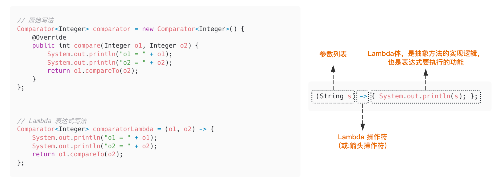

# Lambda 表达式 (/docs/backend/java/lambda)

## Lambda 表达式 [#lambda-表达式]

&#8195;&#8195;Lambda 是一个**匿名函数**，我们可以把 Lambda 表达式理解为是**一段可以传递的代码**（将代码像数据一样进行传递）。使用它可以写出更简洁、更灵活的代码。作为一种更紧凑的代码风格，使 Java 的语言表达能力得到了提升。



## 语法格式 [#语法格式]

① **无参，无返回值**

```java 
// 原始写法
Runnable runnable = new Runnable() {
    @Override
    public void run() {
        System.out.println("原始写法！");
    }
};
runnable.run();

// Lambda 表达式写法
Runnable runnableLambda = () -> {
    System.out.println("Lambda表达式！");
};
runnableLambda.run();
```

② **需要一个参数，但没有返回值**

```java 
// 原始写法
Consumer<String> consumer = new Consumer<String>() {
    @Override
    public void accept(String s) {
        System.out.println(s);
    }
};
consumer.accept("测试！");

// Lambda 表达式写法
Consumer<String> consumerLambda = (String s) -> {
    System.out.println(s);
};
consumerLambda.accept("Lambda表达式！");
```

③ **数据类型可以省略，因为可由编译器推断得出，称为"类型推断"**

```java 
// Lambda 表达式写法
Consumer<String> consumerLambda = (String s) -> {
    System.out.println(s);
};
consumerLambda.accept("Lambda表达式！");

// 省略上面的数据类型
Consumer<String> consumerLambda = (s) -> {
    System.out.println(s);
};
consumerLambda.accept("类型省略！");
```

> &#8195;&#8195;Lambda 表达式中无需指定类型，程序依然可以编译，这是因为 javac 根据程序的上下文，在后台推断出了参数的类型。Lambda 表达式的类型依赖于上下文环境，是由编译器推断出来的。这就是所谓的`类型推断`。

④ **若只需要一个参数时，参数的小括号可以省略**

```java 
// Lambda 表达式写法
Consumer<String> consumerLambda = (String s) -> {
    System.out.println(s);
};
consumerLambda.accept("Lambda表达式！");

// 省略上面的小括号
Consumer<String> consumerLambda = s -> {
    System.out.println(s);
};
consumerLambda.accept("小括号省略！");
```

⑤ **需要两个及以上参数，多条执行语句，并且可以有返回值**

```java 
// 原始写法
Comparator<Integer> comparator = new Comparator<Integer>() {
    @Override
    public int compare(Integer o1, Integer o2) {
        System.out.println("o1 = " + o1);
        System.out.println("o2 = " + o2);
        return o1.compareTo(o2);
    }
};

// Lambda 表达式写法
Comparator<Integer> comparatorLambda = (o1, o2) -> {
    System.out.println("o1 = " + o1);
    System.out.println("o2 = " + o2);
    return o1.compareTo(o2);
};
System.out.println("comparatorLambda.compare(12, 20) = " + comparatorLambda.compare(12, 20));
```

⑥ **当 Lambda 体只有一条语句时，return 与大括号若有，都可以省略**

```java 
// 原始写法
Comparator<Integer> comparator = new Comparator<Integer>() {
    @Override
    public int compare(Integer o1, Integer o2) {
        return o1.compareTo(o2);
    }
};

// Lambda 表达式写法
Comparator<Integer> comparatorLambda = (o1, o2) -> {
    return o1.compareTo(o2);
};
System.out.println("comparatorLambda.compare(12, 20) = " + comparatorLambda.compare(12, 20));

Comparator<Integer> comparatorLambdaOmit = (o1, o2) -> o1.compareTo(o2);
System.out.println("comparatorLambdaOmit.compare(12, 20) = " + comparatorLambdaOmit.compare(12, 20));

// 方法引用
Comparator<Integer> comparatorLambdaOmit = Integer::compareTo;
```

## Lambda 表达式的本质 [#lambda-表达式的本质]

① Lambda 表达式作为接口的实现类的对象；
② Lambda 表达式是一个匿名函数；

## Lambda 表达式是如何实现的？ [#lambda-表达式是如何实现的]

Labmda 表达式不是匿名内部类的语法糖，但是他也是一个语法糖。实现方式其实是依赖了几个 JVM 底层提供的 lambda 相关 API。

**代码举例**：


<Tabs items={["App.java", "反编译"]}>
<Tab value="App.java">

```java 
public class App {
    public static void main(String[] args) {
        String[] strList = {"你好", "Java"};
        List<String> list = Arrays.asList(strList);
        list.forEach(s -> System.out.println(s));
    }
}
```

</Tab>
<Tab value="反编译">

```java 
/*
 * Decompiled with CFR 0.152.
 */
public class App {
    public static void main(String[] args) {
        String[] strList = new String[]{"\u4f60\u597d", "Java"};
        List<String> list = Arrays.asList(strList);
        list.forEach((Consumer<String>)LambdaMetafactory.metafactory(null, null, null, (Ljava/lang/Object;)V, lambda$main$0(java.lang.String ), (Ljava/lang/String;)V)());
    }

    private static /* synthetic */ void lambda$main$0(String s) {
        System.out.println(s);
    }
}
```

</Tab>
</Tabs>


> &#8195;&#8195;为啥说他并不是内部类的语法糖呢？前面讲内部类我们说过，内部类在编译之后会有两个 class 文件，但是，<u>包含 lambda 表达式的类编译后只有一个文件</u>。
> &#8195;&#8195;可以看到，在 forEach 方法中，其实是调用了 java.lang.invoke.LambdaMetafactory#metafactory 方法，该方法的第 5 个参数 implMethod 指定了方法实现。可以看到这里其实是调用了一个 lambda$main$0 方法进行了输出。

再来看一个稍微复杂一点的，先对 List 进行过滤，然后再输出：


<Tabs items={["App.java", "反编译"]}>
<Tab value="App.java">

```java 
public class App {
    public static void main(String[] args) {
        String[] strList = {"你好", "Java"};
        List<String> list = Arrays.asList(strList);

        List out = list.stream().filter(string -> string.contains("Java")).collect(Collectors.toList());

        out.forEach(s -> System.out.println(s));
    }
}
```

</Tab>
<Tab value="反编译">

```java 
/*
 * Decompiled with CFR 0.152.
 */
public class App {
    public static void main(String[] args) {
        String[] strList = new String[]{"\u4f60\u597d", "Java"};
        List<String> list = Arrays.asList(strList);
        List<Object> out = list.stream().filter((Predicate<String>)LambdaMetafactory.metafactory(null, null, null, (Ljava/lang/Object;)Z, lambda$main$0(java.lang.String ), (Ljava/lang/String;)Z)()).collect(Collectors.toList());
        out.forEach((Consumer<Object>)LambdaMetafactory.metafactory(null, null, null, (Ljava/lang/Object;)V, lambda$main$1(java.lang.Object ), (Ljava/lang/Object;)V)());
    }

    private static /* synthetic */ void lambda$main$1(Object s) {
        System.out.println(s);
    }

    private static /* synthetic */ boolean lambda$main$0(String string) {
        return string.contains("Java");
    }
}
```

</Tab>
</Tabs>


> 两个 lambda 表达式分别调用了 lambda\$main$1 和 lambda\$main$0 两个方法。

&#8195;&#8195;所以，lambda 表达式的实现其实是依赖了一些底层的 api，在编译阶段，编译器会把 lambda 表达式进行解糖，转换成调用内部 api 的方式。

## 函数式接口 [#函数式接口]

如果接口中只声明一个抽象方法，则此接口就称为函数式接口。因为只有给函数式接口提供实现类的对象时，才可以使用 Lambda 表达式。

## API 中函数式接口所在的包 [#api-中函数式接口所在的包]

JDK8 中声明的函数式接口在`java.util.function`包下

**四大核心函数式接口**：

| <div>函数式接口</div> | <div>称谓</div> | <div>参数类型</div> | 用途                                                                                 |
| ----------------------------------------- | ---------------------------------- | -------------------------------------- | ------------------------------------------------------------------------------------ |
| `Consumer<T>`                             | 消费型接口                         | T                                      | 对类型 T 的对象应用操作，包含方法：`void accept(T t)`                                |
| `Supplier<T>`                             | 供给型接口                         | 无                                     | 返回类型为 T 的对象，包含方法：`T get()`                                             |
| `Function<T, R>`                          | 函数型接口                         | T                                      | 对类型为 T 的对象应用操作，并返回结果。结果是 R 类型的对象，包含方法：`R apply(T t)` |
| `Predicate<T>`                            | 判断型接口                         | T                                      | 确定类型为 T 的对象是否满足某约束，并返回 boolean 值，包含方法：`boolean test(T t)`  |
