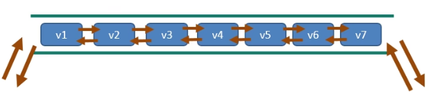
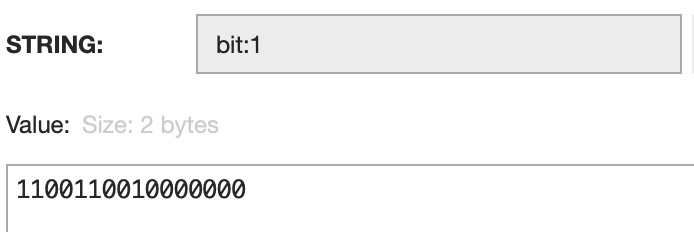

# 数据类型 (/docs/backend/redis/data_types)

&#8195;&#8195;数据类型参考(官方)：[https://redis.io/docs/data-types/](https://redis.io/docs/data-types/)
&#8195;&#8195;Java 学习笔记：[https://mrjokersince1997.github.io/My-Notes/#/%E5%85%B6%E5%AE%83/%E6%95%B0%E6%8D%AE%E5%BA%93/Redis](https://mrjokersince1997.github.io/My-Notes/#/%E5%85%B6%E5%AE%83/%E6%95%B0%E6%8D%AE%E5%BA%93/Redis)
&#8195;&#8195;Redis 教程(Runoob)：[https://www.runoob.com/redis/redis-tutorial.html](https://www.runoob.com/redis/redis-tutorial.html)

## 基础 [#基础]

① 在 Redis 中单个指令都是原子性操作，通过指令操作 Redis 数据时无需担心线程安全问题。
② Redis 以 key-value 的形式保存数据：key 值一定为 string 类型，而 value 值支持多种类型。

### 存储区域 [#存储区域]

&#8195;&#8195;Redis 将数据存储分为多个相互独立的区域，将 Redis 操作局限在自己的存储区域内。通常划分为 16 个（编号 0-15），默认使用编号 0 。

```sh 
select 1          # 改用 1 号存储区域

dbsize            # 返回当前区域 key 数量
move key 2        # 将当前 key 迁移到 2 号存储区域
flushdb           # 清空当前存储区域(慎重)
flushall          # 清空全部存储区域(慎重)
```

### key 操作 [#key-操作]

#### 基本操作 [#基本操作]

```sh 
keys pattern            # 返回与匹配的所有键名
del key                 # 删除 key
exists key              # 判断是否存在 key
type key                # 返回 key 对应的 value 类型

rename key newkey       # 重命名
renamenx key newkey     # 重命名（返回 1），新名称已存在则失败（返回 0）
sort key                # 对 key 排序
```

#### 时效性操作 [#时效性操作]

Redis 中可以为 key 设置有效期，key 过期后会由 Redis 执行删除策略回收内存空间。

```sh 
expire key 10           # key 10s 内有效
expireat key 1355292000 # key 截至时间戳有效
persist key             # key 永久有效

ttl key                 # 返回 key 剩余有效时间，若不存在返回 -2 ，永久返回 -1
```

#### 查询操作 [#查询操作]

Redis 支持查询存储区域内含有的 key，且允许使用以下通配符：

`-` 表示任意数量字符
`?` 表示任意一个字符
`[]` 表示一个指定字符

```sh 
keys *                # 查询所有 key
keys user:*           # 查询所有 user 的 key
keys id:75??          # 查询 ID 为 7500-7599 的 key
keys id:7[2345]55     # 查询 ID 为 7255/7355/7455/7555 的 key
```

## 字符串(String) [#字符串string]

&#8195;&#8195;string 是 redis 最基本的数据类型，一个 key 对应一个 value。它是二进制安全的，意思是 redis 的 string 可以包含任何数据，比如 jpg 图片或者序列化对象等；一个 redis 中字符串 value 最多可以是 512M。

### 汇总 [#汇总]

| 命令                                                                                   | 描述                                                                                                |
| -------------------------------------------------------------------------------------- | --------------------------------------------------------------------------------------------------- |
| [`SET key value`](https://www.runoob.com/redis/strings-set.html)                       | 设置指定 key 的值                                                                                   |
| [`GET key`](https://www.runoob.com/redis/strings-get.html)                             | 获取指定 key 的值                                                                                   |
| [`GETRANGE key start end`](https://www.runoob.com/redis/strings-getrange.html)         | 返回 key 中字符串值的子字符                                                                         |
| [`GETSET key value`](https://www.runoob.com/redis/strings-getset.html)                 | 将给定 key 的值设为 value ，并返回 key 的旧值(old value)                                            |
| [`GETBIT key offset`](https://www.runoob.com/redis/strings-getbit.html)                | 对 key 所储存的字符串值，获取指定偏移量上的位(bit)                                                  |
| [`MGET key1 [key2..]`](https://www.runoob.com/redis/strings-mget.html)                 | 获取所有(一个或多个)给定 key 的值                                                                   |
| [`SETBIT key offset value`](https://www.runoob.com/redis/strings-setbit.html)          | 对 key 所储存的字符串值，设置或清除指定偏移量上的位(bit)                                            |
| [`SETEX key seconds value`](https://www.runoob.com/redis/strings-setex.html)           | 将值 value 关联到 key ，并将 key 的过期时间设为 seconds (以秒为单位)                                |
| [`SETNX key value`](https://www.runoob.com/redis/strings-setnx.html)                   | 只有在 key 不存在时设置 key 的值                                                                    |
| [`SETRANGE key offset value`](https://www.runoob.com/redis/strings-setrange.html)      | 用 value 参数覆写给定 key 所储存的字符串值，从偏移量 offset 开始                                    |
| [`STRLEN key`](https://www.runoob.com/redis/strings-strlen.html)                       | 返回 key 所储存的字符串值的长度                                                                     |
| [`MSET key value [key value ...]`](https://www.runoob.com/redis/strings-mset.html)     | 同时设置一个或多个 key-value 对                                                                     |
| [`MSETNX key value [key value ...]`](https://www.runoob.com/redis/strings-msetnx.html) | 同时设置一个或多个 key-value 对，当且仅当所有给定 key 都不存在                                      |
| [`PSETEX key milliseconds value`](https://www.runoob.com/redis/strings-psetex.html)    | 这个命令和 SETEX 命令相似，但它以毫秒为单位设置 key 的生存时间，而不是像 SETEX 命令那样，以秒为单位 |
| [`INCR key`](https://www.runoob.com/redis/strings-incr.html)                           | 将 key 中储存的数字值增一                                                                           |
| [`INCRBY key increment`](https://www.runoob.com/redis/strings-incrby.html)             | 将 key 所储存的值加上给定的增量值（increment）                                                      |
| [`INCRBYFLOAT key increment`](https://www.runoob.com/redis/strings-incrbyfloat.html)   | 将 key 所储存的值加上给定的浮点增量值（increment）                                                  |
| [`DECR key`](https://www.runoob.com/redis/strings-decr.html)                           | 将 key 中储存的数字值减一                                                                           |
| [`DECRBY key decrement`](https://www.runoob.com/redis/strings-decrby.html)             | key 所储存的值减去给定的减量值（decrement）                                                         |
| [`APPEND key value`](https://www.runoob.com/redis/strings-append.html)                 | 如果 key 已经存在并且是一个字符串， APPEND 命令将指定的 value 追加到该 key 原来值（value）的末尾    |

#### 最常用 [#最常用]

```sh 
SET key value [NX | XX] [GET] [EX seconds | PX milliseconds |
  EXAT unix-time-seconds | PXAT unix-time-milliseconds | KEEPTTL]
```

**参数说明**：
&#8195;`EX seconds`：以秒为单位设置过期时间
&#8195;`PX milliseconds`：以毫秒为单位设置过期时间
&#8195;`EXAT unix-time-seconds`：设置以秒为单位的 UNIX 时间戳所对应的时间为过期时间
&#8195;`PXAT unix-time-milliseconds`：设置以毫秒为单位的 UNIX 时间戳所对应的时间为过期时间
&#8195;`KEEPTTL`：保留设置前指定键的生存时间
&#8195;`NX`：键不存在的时候设置键值
&#8195;`XX`：键存在的时候设置键值
&#8195;`GET`：返回指定键原本的值，若键不存在时返回`nil`

> `SET`命令使用 EX、PX、NX 参数，其效果等同于 SETEX、PSETEX、SETNX 命令。根据官方文档的描述，未来的版本中 SETEX、PSETEX、SETNX 命令可能会被淘汰。

---

**示例**：

<details>
<summary>展开查看</summary>

```sh 
# 设置name的值为 LiHua
set name LiHua            --> OK
# 获取name的值
get name                  --> "LiHua"
# 若name不存在设置其值为Zhangsan(因为存在，返回为nil)
set name Zhangsan NX      --> (nil)
# 若name存在设置其值为Zhangsan
set name Zhangsan XX      --> OK
# 获取name的值(修改成功)
get name                  --> "Zhangsan"
# 设置age为23且30s后过期
set age 23 EX 30          --> OK
# 查看剩余有效时间
ttl age                   --> (integer) 23
# 查看剩余有效时间(-2 过期)
ttl age                   --> (integer) -2
# 设置age为20且300s后过期
set age 20 EX 300         --> OK
# 查看剩余有效时间
ttl age                   --> (integer) 296
# 若age存在设置其值为20
set age 20 XX             --> OK
# 查看剩余有效时间(-1 用不过期，原来的过期时间没了)
ttl age                   --> (integer) -1
# 若age存在设置其值为21(假设set age 20 EX 300，设置了300s过期)
set age 21 XX KEEPTTL     --> OK
# 查看剩余有效时间(前面设置的过期时间被保留)
ttl age                   --> (integer) 233
```

</details>


#### 同时设置/获取多个键值 [#同时设置获取多个键值]

```sh 
# 语法
MSET key value [key value ...]
MGET key [key ...]

# 示例
redis> mset k1 hello k2 world
OK
redis> mget k1 k2 k3
1) "hello"
2) "world"
3) (nil)

# 语法
MSETNX key value [key value ...]

# 示例
redis> mset k1 hello k2 world
OK
redis> msetnx k1 hi k4 redis # k1 上面已经存在了
(integer) 0 # 失败

redis> msetnx k3 learn k4 redis # k3 k4均不存在
(integer) 1 # 成功
```

#### 获取指定区间范围内的值 [#获取指定区间范围内的值]

```sh 
# 语法
SETRANGE key offset value
GETRANGE key start end

redis> set k1 "Hello World"
OK
redis> setrange k1 6 Redis
(integer) 11
redis> get k1
"Hello Redis"

redis> getrange k1 0 -1 # 获取全部
"Hello Redis"
redis> getrange k1 0 8 # 字符串截取
"Hello Red"
```

#### 数值增减 [#数值增减]

> 注意：一定要是数字才能进行加减
> 应用场景：阅读数、点赞数等等

```sh 
# 语法
INCR key                # 递增
INCRBY key increment    # 增加指定的整数
DECR key                # 递减
DECRBY key decrement    # 减少指定的整数

# 示例
redis> set num 3      --> OK            # 给 num 初始值3
redis> incr num       --> (integer) 4   # 递增 num + 1
redis> incr num       --> (integer) 5   # 递增 num + 1
redis> get num        --> "5"
redis> incrby num 10  --> (integer) 15  # 给 num + 10
redis> get num        --> "15"
redis> decr num       --> (integer) 14  # 递减 num - 1
redis> decrby num 5   --> (integer) 9   # 给 num - 5
redis> get num        --> "9"
```

#### 获取字符串长度和内容追加 [#获取字符串长度和内容追加]

```sh 
# 语法
STRLEN key
APPEND key value

# 示例
redis> set str "Hello Redis" --> OK
redis> strlen str            --> (integer) 11
redis> append str Good       --> (integer) 15
redis> get str               --> "Hello RedisGood"
```

#### 分布式锁 [#分布式锁]

```sh 
SETEX key value   # setex(set with expire)
SETNX key value   # setnx(set if not exist)
```

#### getset(先 get 再 set) [#getset先-get-再-set]

```sh 
# 语法
GETSET key value  # 先返回之前的值在设置新的值

# 示例
redis> getset k1 Hello  --> (nil)     # k1开始不存在所以返回 nil
redis> get k1           --> "Hello"   # k1在上一步被设置为 Hello
redis> getset k1 Redis  --> "Hello"   # 返回上一步的 Hello，然后设置其为 Redis
redis> get k1           --> "Redis"   # 获取k1的值
```

## 列表(List) [#列表list]

&#8195;&#8195;列表是简单的字符串列表(单值多 value)，按照插入顺序排列。你可以添加一个元素到列表的头部(左边)或者尾部(右边)。它的底层实际是个双端链表，最多可以包含 2<sup>32</sup>-1 个元素(4294967295，每个列表超过 40 亿个元素)。主要功能有 pop/push 等，一般用在栈、队列、消息队列等场景。
&#8195;&#8195;所谓的双端就是它的左侧和右侧都可以插入添加，如果键不存在，则创建新的链表，如果键已经存在，则新增内容，如果值全移除，对应的键也就消失了。对两端的操作性能很高，通过索引下标的操作中间的节点性能会较差。



### 汇总 [#汇总-1]

| 命令                                                                                          | 描述                                                                                                                      |
| --------------------------------------------------------------------------------------------- | ------------------------------------------------------------------------------------------------------------------------- |
| [`BLPOP key1 [key2 ] timeout`](https://www.runoob.com/redis/lists-blpop.html)                 | 移出并获取列表的第一个元素， 如果列表没有元素会阻塞列表直到等待超时或发现可弹出元素为止                                   |
| [`BRPOP key1 [key2 ] timeout`](https://www.runoob.com/redis/lists-brpop.html)                 | 移出并获取列表的最后一个元素， 如果列表没有元素会阻塞列表直到等待超时或发现可弹出元素为止                                 |
| [`BRPOPLPUSH source destination timeout`](https://www.runoob.com/redis/lists-brpoplpush.html) | 从列表中弹出一个值，将弹出的元素插入到另外一个列表中并返回它； 如果列表没有元素会阻塞列表直到等待超时或发现可弹出元素为止 |
| [`LINDEX key index`](https://www.runoob.com/redis/lists-lindex.html)                          | 通过索引获取列表中的元素                                                                                                  |
| [`LINSERT key BEFORE`](https://www.runoob.com/redis/lists-linsert.html)                       | 在列表的元素前或者后插入元素                                                                                              |
| [`LLEN key`](https://www.runoob.com/redis/lists-llen.html)                                    | 获取列表长度                                                                                                              |
| [`LPOP key`](https://www.runoob.com/redis/lists-lpop.html)                                    | 移出并获取列表的第一个元素                                                                                                |
| [`LPUSH key value1 [value2]`](https://www.runoob.com/redis/lists-lpush.html)                  | 将一个或多个值插入到列表头部                                                                                              |
| [`LPUSHX key value`](https://www.runoob.com/redis/lists-lpushx.html)                          | 将一个值插入到已存在的列表头部                                                                                            |
| [`LRANGE key start stop`](https://www.runoob.com/redis/lists-lrange.html)                     | 获取列表指定范围内的元素                                                                                                  |
| [`LREM key count value`](https://www.runoob.com/redis/lists-lrem.html)                        | 移除列表元素                                                                                                              |
| [`LSET key index value`](https://www.runoob.com/redis/lists-lset.html)                        | 通过索引设置列表元素的值                                                                                                  |
| [`LTRIM key start stop`](https://www.runoob.com/redis/lists-ltrim.html)                       | 对一个列表进行修剪(trim)，就是说，让列表只保留指定区间内的元素，不在指定区间之内的元素都将被删除                          |
| [`RPOP key`](https://www.runoob.com/redis/lists-rpop.html)                                    | 移除列表的最后一个元素，返回值为移除的元素                                                                                |
| [`RPOPLPUSH source destination`](https://www.runoob.com/redis/lists-rpoplpush.html)           | 移除列表的最后一个元素，并将该元素添加到另一个列表并返回                                                                  |
| [`RPUSH key value1 [value2]`](https://www.runoob.com/redis/lists-rpush.html)                  | 在列表中添加一个或多个值到列表尾部                                                                                        |
| [`RPUSHX key value`](https://www.runoob.com/redis/lists-rpushx.html)                          | 为已存在的列表添加值                                                                                                      |

#### LPUSH / RPUSH / LRANGE [#lpush--rpush--lrange]

```sh 
# 语法
LPUSH key element [element ...]
RPUSH key element [element ...]
LRANGE key start stop

# 示例
redis> lpush left_list 1 2 3 4 5   --> (integer) 5 # 左侧插入
redis> type left_list              --> list
redis> lrange left_list 0 -1  # 遍历left_list的值
1) "5"
2) "4"
3) "3"
4) "2"
5) "1"

redis> rpush right_list 1 2 3 4 5   --> (integer) 5 # 右侧插入
redis> lrange right_list 0 -1 # 遍历right_list的值
1) "1"
2) "2"
3) "3"
4) "4"
5) "5"
```

#### LPOP / RPOP [#lpop--rpop]

```sh 
# 语法
LPOP key [count] # 返回列表中删除后的第一个元素。如果最后一个元素被弹出，则删除列表
RPOP key [count] # 返回并删除列表的最后元素。如果最后一个元素被弹出，则删除列表

# 示例
## LPOP
redis> lrange right_list 0 -1   # right_list 初始值设置如下
1) "1"
2) "2"
3) "3"
4) "4"
5) "5"
redis> lpop right_list          --> "1"  # 弹出第一个元素
redis> lrange right_list 0 -1  # 第一个元素 1 已经不在了
1) "2"
2) "3"
3) "4"
4) "5"
redis> lpop right_list 2       # 从左侧开始弹出两个元素
1) "2"
2) "3"
redis> lrange right_list 0 -1  # 2 3 被弹出 剩下 4 5
1) "4"
2) "5"

## RPOP
redis> lrange right_list 0 -1   # right_list 初始值设置如下
1) "1"
2) "2"
3) "3"
4) "4"
5) "5"
redis> rpop right_list          --> "1"  # 弹出最后一个元素
redis> lrange right_list 0 -1  # 最后一个元素 5 已经不在了
1) "1"
2) "2"
3) "3"
4) "4"
redis> rpop right_list 2       # 从右侧开始弹出两个元素
1) "4"
2) "3"
redis> lrange right_list 0 -1  # 4 3 被弹出 剩下 1 2
1) "1"
2) "2"
```

#### LINDEX [#lindex]

```sh 
LINDEX key index # 按照索引下标获得元素(从上到下)

# 示例
redis> rpush list 1 2 3 4     --> (integer) 4
redis> lrange list 0 -1
1) "1"
2) "2"
3) "3"
4) "4"

redis> lindex list 3          --> "4" # 返回下标为3的元素
```

#### LLEN [#llen]

```sh 
LLEN key # 获取列表中的元素个数

# 示例
redis> rpush list 1 2 3 4     --> (integer) 4
redis> llen list              --> (integer) 4  # 4个元素
```

#### LREM [#lrem]

```sh 
LREM key count element  # 从list中删除count个为element的元素

# 示例
redis> rpush list 1 1 2 1 2 3   --> (integer) 6
redis> lrem list 2 1            --> (integer) 2
redis> lrange list 0 -1         # 上一步删除了2个为1的元素，所以剩下 2 1 2 3
1) "2"
2) "1"
3) "2"
4) "3"
```

#### LTRIM [#ltrim]

```sh 
# 语法
LTRIM key start stop # 截取指定范围内的元素再复制给 key

#示例
redis> rpush list 1 1 2 1 2 3   --> (integer) 6  # 初始值
redis> ltrim list 2 4           --> OK           # 截取第2至第4的元素
redis> lrange list 0 -1
1) "2"
2) "1"
3) "2"
```

#### RPOPLPUSH [#rpoplpush]

```sh 
# 语法
RPOPLPUSH source destination  # 返回弹出列表最后一个元素并将其移到另一个列表的开始

# 示例
redis> rpush list:1 One Two Three      --> (integer) 3
redis> rpush list:2 1 2 3              --> (integer) 3
redis> rpoplpush list:1 list:2         --> "Three"
redis> lrange list:1 0 -1
1) "One"
2) "Two"
redis> lrange list:2 0 -1
1) "Three"
2) "1"
3) "2"
4) "3"
```

#### LSET [#lset]

```sh 
# 语法
LSET key index element # 通过索引设置列表中元素的值

# 示例
redis> rpush list One Two Three   --> (integer) 3
redis> lset list 1 2              --> OK  # 将 list 列表的第一个元素设置为 2
redis> lrange list 0 -1
1) "One"
2) "2"
3) "Three"
```

#### LINSERT [#linsert]

```sh 
# 语法
LINSERT key BEFORE|AFTER pivot element # 在列表中的另一个元素之前或之后插入一个元素

# 示例
redis> rpush list One Two Three   --> (integer) 3
redis> lrange list 0 -1
1) "One"
2) "Two"
3) "Three"
redis> linsert list before Two 2  --> (integer) 4 # 在列表 list 元素Two 前面插入 2
redis> lrange list 0 -1
1) "One"
2) "2"
3) "Two"
4) "Three"
```

## 哈希表(Hash) [#哈希表hash]

&#8195;&#8195;redis hash 是一个 string 类型的 field(字段)和 value(值)的映射表(KV 模式不变，但 V 是一个键值对，即 Map&lt;String, Map&lt;Object, Object>>)，hash 特别适合用于存储对象。redis 中每个 hash 可以存储 2<sup>32</sup>-1 键值对(40 多亿)。

### 汇总 [#汇总-2]

| 命令                                                                                               | 描述                                                  |
| -------------------------------------------------------------------------------------------------- | ----------------------------------------------------- |
| [`HDEL key field1 [field2]`](https://www.runoob.com/redis/hashes-hdel.html)                        | 删除一个或多个哈希表字段                              |
| [`HEXISTS key field`](https://www.runoob.com/redis/hashes-hexists.html)                            | 查看哈希表 key 中，指定的字段是否存在                 |
| [`HGET key field`](https://www.runoob.com/redis/hashes-hget.html)                                  | 获取存储在哈希表中指定字段的值                        |
| [`HGETALL key`](https://www.runoob.com/redis/hashes-hgetall.html)                                  | 获取在哈希表中指定 key 的所有字段和值                 |
| [`HINCRBY key field increment`](https://www.runoob.com/redis/hashes-hincrby.html)                  | 为哈希表 key 中的指定字段的整数值加上增量 increment   |
| [`HINCRBYFLOAT key field increment`](https://www.runoob.com/redis/hashes-hincrbyfloat.html)        | 为哈希表 key 中的指定字段的浮点数值加上增量 increment |
| [`HKEYS key`](https://www.runoob.com/redis/hashes-hkeys.html)                                      | 获取哈希表中的所有字段                                |
| [`HLEN key`](https://www.runoob.com/redis/hashes-hlen.html)                                        | 获取哈希表中字段的数量                                |
| [`HMGET key field1 [field2]`](https://www.runoob.com/redis/hashes-hmget.html)                      | 获取所有给定字段的值                                  |
| [`HMSET key field1 value1 [field2 value2 ]`](https://www.runoob.com/redis/hashes-hmset.html)       | 同时将多个 field-value (域-值)对设置到哈希表 key 中   |
| [`HSET key field value`](https://www.runoob.com/redis/hashes-hset.html)                            | 将哈希表 key 中的字段 field 的值设为 value            |
| [`HSETNX key field value`](https://www.runoob.com/redis/hashes-hsetnx.html)                        | 只有在字段 field 不存在时，设置哈希表字段的值         |
| [`HVALS key`](https://www.runoob.com/redis/hashes-hvals.html)                                      | 获取哈希表中所有值                                    |
| [`HSCAN key cursor [MATCH pattern] [COUNT count]`](https://www.runoob.com/redis/hashes-hscan.html) | 迭代哈希表中的键值对                                  |

#### HSET / HGET / HMSET / HMGET / HGETALL / HDEL [#hset--hget--hmset--hmget--hgetall--hdel]

```sh 
# 语法
HSET key field value [field value ...]  # 创建或修改哈希表中字段的值
HGET key field                          # 返回哈希表中指定字段的值
HMSET key field value [field value ...] # 同时将多个键值对设置到哈希表 key 中
HMGET key field [field ...]             # 获取所有给定字段的值
HGETALL key                             # 获取在哈希表中指定 key 的所有字段和值
HDEL key field [field ...]              # 删除一个或多个哈希表字段

# 示例
redis> hset student:001 name LiHua age 20      --> (integer) 2
redis> hget student:001 name                   --> "LiHua"
redis> hmget student:001 name age
1) "LiHua"
2) "20"

redis> hmset student:001 name ZhangSan age 18  --> OK
redis> hmget student:001 name age
1) "ZhangSan"
2) "18"

redis> hgetall student:001
1) "name"
2) "ZhangSan"
3) "age"
4) "18"
redis> hdel student:001 age                   --> (integer) 1 # 删除 age
redis> hgetall student:001
1) "name"
2) "ZhangSan"
```


<Callout type="success" title="HSET / HMSET 都可以设置多个键值对，有什么区别？">

&#8195;&#8195;开始 HSET 仅支持设置单个键值对，如果想设置多个就需要使用 HMSET；但是现在根据[官方文档](https://redis.io/commands/hmset/)，HMSET 自 Redis 4.0.0 开始弃用，如果需要设置多个键值对可以使用 HSET 代替。

</Callout>


#### HLEN [#hlen]

```sh 
# 语法
HLEN key # 获取哈希表中字段的数量

# 示例
redis> hgetall student:002
1) "name"
2) "ZhangSan"
3) "age"
4) "18"
redis> hlen student:002      --> (integer) 2 # 两组
```

#### HEXISTS [#hexists]

```sh 
# 语法
HEXISTS key field # 查看哈希表 key 中，指定的字段是否存在

# 示例
redis> hgetall student:002
1) "name"
2) "ZhangSan"
3) "age"
4) "18"
redis> hexists student:002 nage  --> (integer) 0 # 不存在 nage
redis> hexists student:002 name  --> (integer) 1 # 存在 name
```

#### HKEYS / HVALS [#hkeys--hvals]

```sh 
# 语法
HKEYS key # 获取哈希表中的所有字段
HVALS key # 获取哈希表中的所有值

# 示例
redis> hgetall student:002
1) "name"
2) "ZhangSan"
3) "age"
4) "18"

redis> hkeys student:002
1) "name"
2) "age"
redis> hvals student:002
1) "ZhangSan"
2) "18"
```

#### HINCRBY / HINCRBYFLOAT [#hincrby--hincrbyfloat]

```sh 
# 语法
HINCRBY key field increment       # 为哈希表 key 中的指定字段的整数值加上增量 increment
HINCRBYFLOAT key field increment  # 为哈希表 key 中的指定字段的浮点数值加上增量 increment

# 示例
redis> hgetall student:002
1) "name"
2) "ZhangSan"
3) "age"
4) "18"
redis> hincrby student:002 age -3         --> (integer) 15 # age - 3
redis> hincrbyfloat student:002 age 2.5   --> "17.5"       # age + 2.5
redis> hgetall student:002
1) "name"
2) "ZhangSan"
3) "age"
4) "17.5"
```

#### HSETNX [#hsetnx]

```sh 
# 语法
HSETNX key field value # 仅当哈希中的字段不存在时设置该字段的值

# 示例
redis> hgetall student:001
1) "name"
2) "ZhangSan"
redis> hsetnx student:001 name LiHua    --> (integer) 0  # name 存在 修改不成功
redis> hsetnx student:001 age 20        --> (integer) 1  # age 不存在 修改成功
redis> hgetall student:001
1) "name"
2) "ZhangSan"
3) "age"
4) "20"
```

## 集合(Set) [#集合set]

&#8195;&#8195;redis 的 Set 是 String 类型的无序集合。集合成员是唯一的，这就意味着集合中不能出现重复的数据。集合对象的编码可以是 intset 或者 hashtable。

&#8195;&#8195;redis 中集合是通过哈希表实现的，所以添加，删除，查找的复杂度都是 O(1)。集合中最大的成员数为 2<sup>32</sup>-1 (每个集合可存储 40 多亿个成员)。

### 汇总 [#汇总-3]

| 命令                                                                                             | 描述                                                |
| ------------------------------------------------------------------------------------------------ | --------------------------------------------------- |
| [`SADD key member1 [member2]`](https://www.runoob.com/redis/sets-sadd.html)                      | 向集合添加一个或多个成员                            |
| [`SCARD key`](https://www.runoob.com/redis/sets-scard.html)                                      | 获取集合的成员数                                    |
| [`SDIFF key1 [key2]`](https://www.runoob.com/redis/sets-sdiff.html)                              | 返回第一个集合与其他集合之间的差异                  |
| [`SDIFFSTORE destination key1 [key2]`](https://www.runoob.com/redis/sets-sdiffstore.html)        | 返回给定所有集合的差集并存储在 destination 中       |
| [`SINTER key1 [key2]`](https://www.runoob.com/redis/sets-sinter.html)                            | 返回给定所有集合的交集                              |
| [`SINTERSTORE destination key1 [key2]`](https://www.runoob.com/redis/sets-sinterstore.html)      | 返回给定所有集合的交集并存储在 destination 中       |
| [`SISMEMBER key member`](https://www.runoob.com/redis/sets-sismember.html)                       | 判断 member 元素是否是集合 key 的成员               |
| [`SMEMBERS key`](https://www.runoob.com/redis/sets-smembers.html)                                | 返回集合中的所有成员                                |
| [`SMOVE source destination member`](https://www.runoob.com/redis/sets-smove.html)                | 将 member 元素从 source 集合移动到 destination 集合 |
| [`SPOP key`](https://www.runoob.com/redis/sets-spop.html)                                        | 移除并返回集合中的一个随机元素                      |
| [`SRANDMEMBER key [count]`](https://www.runoob.com/redis/sets-srandmember.html)                  | 返回集合中一个或多个随机数                          |
| [`SREM key member1 [member2]`](https://www.runoob.com/redis/sets-srem.html)                      | 移除集合中一个或多个成员                            |
| [`SUNION key1 [key2]`](https://www.runoob.com/redis/sets-sunion.html)                            | 返回所有给定集合的并集                              |
| [`SUNIONSTORE destination key1 [key2]`](https://www.runoob.com/redis/sets-sunionstore.html)      | 所有给定集合的并集存储在 destination 集合中         |
| [`SSCAN key cursor [MATCH pattern] [COUNT count]`](https://www.runoob.com/redis/sets-sscan.html) | 迭代集合中的元素                                    |

#### SADD / SMEMBERS [#sadd--smembers]

```sh 
# 语法
SADD key member [member ...]  # 向集合中添加一个或多个成员，如果 key 不存在，则创建
SMEMBERS key                  # 返回集合中的所有成员
SREM key member [member ...]  # 移除集合中的一个或多个成员

# 示例
redis> sadd set One Two Two One Three  --> (integer) 3
redis> smembers set  # 重复元素无法被添加进去
1) "One"
2) "Two"
3) "Three"

redis> srem set One                   --> (integer) 1 # 移除元素 One
redis> smembers set
1) "Two"
2) "Three"
```

#### SISMEMBER [#sismember]

```sh 
# 语法
SISMEMBER key member # 判断 member 元素是否是集合 key 的成员

# 示例
redis> smembers set
1) "One"
2) "Two"
3) "Three"

redis> sismember set One   --> (integer) 1  # set 中存在 One
redis> sismember set Four  --> (integer) 0  # set 中不存在 Four
```

#### SCARD [#scard]

```sh 
# 语法
SCARD key # 返回集合中的成员数量

# 示例
redis> smembers set
1) "One"
2) "Two"
3) "Three"

redis> scard set  --> (integer) 3
```

#### SRANDMEMBER [#srandmember]

```sh 
# 语法
SRANDMEMBER key [count]  # 从集合中获取一个或多个随机成员

# 示例
redis> smembers set
1) "One"
2) "Two"
3) "Three"

redis> srandmember set 2  # 随机返回集合中的两个成员
1) "One"
2) "Three"
redis> srandmember set 2
1) "Two"
2) "Three"
redis> srandmember set 2
1) "Two"
2) "Three"
redis> srandmember set 2
1) "One"
2) "Two"
```

#### SPOP [#spop]

```sh 
# 语法
# 从集合中删除一个或多个随机成员后返回这些成员。如果弹出最后一个成员，则删除该集合。
SPOP key [count]

# 示例
redis> smembers set
1) "One"
2) "Two"
3) "Three"

redis> spop set 2   # 随机移除两个成员
1) "One"
2) "Two"
redis> smembers set # 移除后剩下元素 Three
1) "Three"
```

#### SMOVE [#smove]

```sh 
# 语法
SMOVE source destination member # 将成员从一个集合移动到另一个集合

# 示例
redis> sadd set:1 One Two Three   --> (integer) 3
redis> sadd set:2 1 2 3           --> (integer) 3
redis> smove set:1 set:2 Two      --> (integer) 1 # 将 set:1 中的 Two 移动到 set:2

redis> smembers set:1
1) "One"
2) "Three"
redis> smembers set:2
1) "1"
2) "2"
3) "3"
4) "Two"
```

#### 集合运算 [#集合运算]

```sh 
# 语法
SDIFF key [key ...]                             # 返回多个集合的差值（差集）
SUNION key [key ...]                            # 返回所有给定集合的并集
SINTER key [key ...]                            # 返回多个集合的交集
SINTERCARD numkeys key [key ...] [LIMIT limit]  # 返回多个集合的交集的成员数

# 示例
redis> sadd set:1 a b c 1 2          --> (integer) 5   # A 的初始值
redis> sadd set:2 1 2 3 a x          --> (integer) 5   # B 的初始值

# 差集
redis> sdiff set:1 set:2 # set:1 有，但 set:2 没有的
1) "b"
2) "c"
redis> sdiff set:2 set:1 # set:2 有，但在 set:1 没有的
1) "3"
2) "x"

# 并集
redis> sunion set:1 set:2
1) "a"
2) "b"
3) "c"
4) "1"
5) "2"
6) "3"
7) "x"

# 交集
redis> sinter set:1 set:2
1) "a"
2) "1"
3) "2"

# 只有两个set 写3报错
redis> sintercard 3 set:1 set:2           --> (error) ERR Number of keys can't be greater than number of args
redis> sintercard 2 set:1 set:2           --> (integer) 3 # set:1 与 set:2 交集的个数
redis> sintercard 2 set:1 set:2 LIMIT 1   --> (integer) 1 # 限制返回一个
redis> sintercard 2 set:1 set:2 LIMIT 2   --> (integer) 2 # 限制返回两个
redis> sintercard 2 set:1 set:2 LIMIT 3   --> (integer) 3 # 限制返回三个
redis> sintercard 2 set:1 set:2 LIMIT 4   --> (integer) 3 # 限制返回四个(但是最多只有3个，因此为3)
```

##### 应用场景 [#应用场景]

**抽奖**：

| 说明                               | 命令                                                                             |
| ---------------------------------- | -------------------------------------------------------------------------------- |
| 用户 ID，立即参与按钮              | `sadd key 用户ID`                                                                |
| 显示有多少人参与                   | `scard key`                                                                      |
| 抽奖(从 set 中随机选取 N 个人中奖) | `srandmember key 2` 随机抽两个，元素不删除<br />`spop key 3` 随机抽三个，元素删除 |

**微信朋友圈点赞**：

| 说明                         | 命令                                                       |
| ---------------------------- | ---------------------------------------------------------- |
| 新增点赞                     | `sadd pub:msgID 点赞用户ID1 点赞用户ID2 ... [点赞用户IDn]` |
| 取消点赞                     | `srem pub:msgID 点赞用户ID1`                               |
| 展示所有点赞过的用户         | `smember pub:msgID`                                        |
| 点赞用户数统计               | `scard pub:msgID`                                          |
| 判断某个朋友是否对楼主点赞过 | `sismember pub:msgID 用户ID`                               |

**QQ 可能认识的人**：差集
**QQ 共同好友**：并集

## 有序集合(ZSet) [#有序集合zset]

&#8195;&#8195;Redis 有序集合和集合一样也是 string 类型元素的集合，且不允许重复。不同的是每个元素都会关联一个 double 类型的分数。Redis 正是通过分数来为集合中的成员进行从小到大的排序。
&#8195;&#8195;有序集合的成员是唯一的，但分数(score)缺可以重复。
&#8195;&#8195;集合是通过哈希表实现的，所以添加、删除、查找的复杂度都是 O(1)。集合中最大的成员数为 2<sup>32</sup>-1 (每个集合可以存放 40 多亿个成员)。

### 汇总 [#汇总-4]

| 命令                                                                                                            | 描述                                                                        |
| --------------------------------------------------------------------------------------------------------------- | --------------------------------------------------------------------------- |
| [`ZADD key score1 member1 [score2 member2]`](https://www.runoob.com/redis/sorted-sets-zadd.html)                | 向有序集合添加一个或多个成员，或者更新已存在成员的分数                      |
| [`ZCARD key`](https://www.runoob.com/redis/sorted-sets-zcard.html)                                              | 获取有序集合的成员数                                                        |
| [`ZCOUNT key min max`](https://www.runoob.com/redis/sorted-sets-zcount.html)                                    | 计算在有序集合中指定区间分数的成员数                                        |
| [`ZINCRBY key increment member`](https://www.runoob.com/redis/sorted-sets-zincrby.html)                         | 有序集合中对指定成员的分数加上增量 increment                                |
| [`ZINTERSTORE destination numkeys key [key ...]`](https://www.runoob.com/redis/sorted-sets-zinterstore.html)    | 计算给定的一个或多个有序集的交集并将结果集存储在新的有序集合 destination 中 |
| [`ZLEXCOUNT key min max`](https://www.runoob.com/redis/sorted-sets-zlexcount.html)                              | 在有序集合中计算指定字典区间内成员数量                                      |
| [`ZRANGE key start stop [WITHSCORES]`](https://www.runoob.com/redis/sorted-sets-zrange.html)                    | 通过索引区间返回有序集合指定区间内的成员                                    |
| [`ZRANGEBYLEX key min max [LIMIT offset count]`](https://www.runoob.com/redis/sorted-sets-zrangebylex.html)     | 通过字典区间返回有序集合的成员                                              |
| [`ZRANGEBYSCORE key min max [WITHSCORES] [LIMIT]`](https://www.runoob.com/redis/sorted-sets-zrangebyscore.html) | 通过分数返回有序集合指定区间内的成员                                        |
| [`ZRANK key member`](https://www.runoob.com/redis/sorted-sets-zrank.html)                                       | 返回有序集合中指定成员的索引                                                |
| [`ZREM key member [member ...]`](https://www.runoob.com/redis/sorted-sets-zrem.html)                            | 移除有序集合中的一个或多个成员                                              |
| [`ZREMRANGEBYLEX key min max`](https://www.runoob.com/redis/sorted-sets-zremrangebylex.html)                    | 移除有序集合中给定的字典区间的所有成员                                      |
| [`ZREMRANGEBYRANK key start stop`](https://www.runoob.com/redis/sorted-sets-zremrangebyrank.html)               | 移除有序集合中给定的排名区间的所有成员                                      |
| [`ZREMRANGEBYSCORE key min max`](https://www.runoob.com/redis/sorted-sets-zremrangebyscore.html)                | 移除有序集合中给定的分数区间的所有成员                                      |
| [`ZREVRANGE key start stop [WITHSCORES]`](https://www.runoob.com/redis/sorted-sets-zrevrange.html)              | 返回有序集中指定区间内的成员，通过索引，分数从高到低                        |
| [`ZREVRANGEBYSCORE key max min [WITHSCORES]`](https://www.runoob.com/redis/sorted-sets-zrevrangebyscore.html)   | 返回有序集中指定分数区间内的成员，分数从高到低排序                          |
| [`ZREVRANK key member`](https://www.runoob.com/redis/sorted-sets-zrevrank.html)                                 | 返回有序集合中指定成员的排名，有序集成员按分数值递减(从大到小)排序          |
| [`ZSCORE key member`](https://www.runoob.com/redis/sorted-sets-zscore.html)                                     | 返回有序集中，成员的分数值                                                  |
| [`ZUNIONSTORE destination numkeys key [key ...]`](https://www.runoob.com/redis/sorted-sets-zunionstore.html)    | 计算给定的一个或多个有序集的并集，并存储在新的 key 中                       |
| [`ZSCAN key cursor [MATCH pattern] [COUNT count]`](https://www.runoob.com/redis/sorted-sets-zscan.html)         | 迭代有序集合中的元素（包括元素成员和元素分值）                              |

#### ZADD / ZREM / ZRANGE [#zadd--zrem--zrange]

```sh 
# 语法
# 向有序集合添加一个或多个成员，或者更新已存在成员的分数
ZADD key [NX|XX] [GT|LT] [CH] [INCR] score member [score member ...]
ZREM key member [member ...]  # 移除有序集合中的一个或多个成员
# 返回索引范围内已排序集合中的成员
ZRANGE key start stop [BYSCORE|BYLEX] [REV] [LIMIT offset count] [WITHSCORES]

# 示例
redis> zadd zset:1 10 v1 20 v2 30 v3 40 v4 50 v5 50 v6  --> (integer) 6
redis> zrem zset:1 v3                                   --> (integer) 1 # 移除元素 v3
redis> zrange zset:1 0 -1
1) "v1"
2) "v2"
3) "v4"
4) "v5"
5) "v6"

redis> zrange zset:1 0 -1 withscores # 带着分数返回
 1) "v1"
 2) "10"
 3) "v2"
 4) "20"
 5) "v4"
 6) "40"
 7) "v5"
 8) "50"
 9) "v6"
10) "50"
```

#### ZREVRANGE [#zrevrange]

```sh 
# 语法
ZREVRANGE key start stop [WITHSCORES] # 返回有序集中指定区间内的成员，分数从高到低

# 示例
redis> zadd zset:1 10 v1 30 v2 20 v3 40 v4 70 v5 50 v6  --> (integer) 6
redis> zrevrange zset:1 0 -1 withscores
 1) "v5"
 2) "70"
 3) "v6"
 4) "50"
 5) "v4"
 6) "40"
 7) "v2"
 8) "30"
 9) "v3"
10) "20"
11) "v1"
12) "10"
```

#### ZRANGEBYSCORE [#zrangebyscore]

```sh 
# 语法
# 通过分数返回有序集合指定区间内的成员
ZRANGEBYSCORE key min max [WITHSCORES] [LIMIT offset count]

# 示例
redis> zadd zset:1 1 One 2 Two 3 Three 4 Four    --> (integer) 4
redis> zrange zset:1 0 -1 # 返回全部元素
1) "One"
2) "Two"
3) "Three"
4) "Four"
redis> zrangebyscore zset:1 -inf +inf # 返回全部元素
1) "One"
2) "Two"
3) "Three"
4) "Four"

redis> zrangebyscore zset:1 1 3  # 返回 1 <= score <= 3 的元素
1) "One"
2) "Two"
3) "Three"
redis> zrangebyscore zset:1 (1 (3 # 返回 1 < score < 3 的元素
1) "Two"

# limit 类似于分页
redis> zrangebyscore zset:1 1 4 limit 0 2
1) "One"
2) "Two"
redis> zrangebyscore zset:1 1 4 limit 2 2
1) "Three"
2) "Four"
```

#### ZSCORE [#zscore]

```sh 
# 语法
ZSCORE key member # 返回排序集中的成员的分数

# 示例
redis> zadd zset:1 1 One 2 Two 3 Three 4 Four   --> (integer) 4
redis> zscore zset:1 Two                        --> "2"
```

#### ZCARD [#zcard]

```sh 
# 语法
ZCARD key   # 返回排序集中的成员数

# 示例
redis> zadd zset:1 1 One 2 Two 3 Three 4 Four   --> (integer) 4
redis> zcard zset:1                             --> (integer) 4
```

#### ZINCRBY [#zincrby]

```sh 
# 语法
ZINCRBY key increment member   # 递增排序集中成员的分数

# 示例
redis> zadd zset:1 1 One 2 Two 3 Three 4 Four   --> (integer) 4
redis> zincrby zset:1 10 Two                    --> "12"  # 给 Two 分数递增 10
redis> zrange zset:1 0 -1 withscores
1) "One"
2) "1"
3) "Three"
4) "3"
5) "Four"
6) "4"
7) "Two"
8) "12"
```

#### ZCOUNT [#zcount]

```sh 
# 语法
ZCOUNT key min max  # 返回指定分数范围内的元素个数

# 示例
redis> zadd zset:1 1 One 2 Two 3 Three 4 Four   --> (integer) 4
redis> zcount zset:1 1 3                        --> (integer) 3 # 1 <= score <= 3 的元素个数
```

#### ZMPOP [#zmpop]

```sh 
# 语法
ZMPOP numkeys key [key ...] MIN|MAX [COUNT count] # 从键名列表中的第一个非空排序中弹出一个或多个元素，它们是成员分数对

# 示例
redis> zadd zset:1 1 One 2 Two 3 Three 4 Four   --> (integer) 4

redis> zmpop 1 zset:1 min count 2   # 弹出最小的两个
1) "zset:1"
2) 1) 1) "One"
      2) "1"
   2) 1) "Two"
      2) "2"
redis> zrange zset:1 0 -1 withscores
1) "Three"
2) "3"
3) "Four"
4) "4"
```

#### ZRANK [#zrank]

```sh 
# 语法
ZRANK key member [WITHSCORE] # 返回按分数升序排列的排序集中成员的索引

# 示例
redis> zadd zset:1 1 One 2 Two 3 Three 4 Four    --> (integer) 4
redis> zrank zset:1 Two                          --> (integer) 1
redis> zrank zset:1 One                          --> (integer) 0
```

#### ZREVRANK [#zrevrank]

```sh 
# 语法
ZREVRANK key member [WITHSCORE] # 返回按分数降序排列的排序集中成员的索引

# 示例
redis> zadd zset:1 1 One 2 Two 3 Three 4 Four    --> (integer) 4
redis> zrank zset:1 Two                          --> (integer) 2
redis> zrank zset:1 One                          --> (integer) 3
```

#### 应用场景 [#应用场景-1]

根据商品销售对商品进行排序显示

| 说明                                 | 命令                                   |
| ------------------------------------ | -------------------------------------- |
| 商品编号 1001 的销量是 9，1002 是 15 | `zadd goods:sellsort 9 1001 15 1002`   |
| 有一个客户又买了两件 1001 商品       | `zincrby goods:sellsort 2 1001`        |
| 求商品销量前十名                     | `zrange goods:sellsort 0 9 withscores` |

## 位图(bitmap) [#位图bitmap]

&#8195;&#8195;Bitmap，即位图，是一串连续的二进制数组（0 和 1），可以通过偏移量（offset）定位元素。它是基于 string 数据类型的按位的操作。bitmap 支持的最大位数是 2<sup>32</sup>位，它可以极大的节省存储空间，使用 512M 内存就可以存储多达 42.9 亿的字节信息。

### 汇总 [#汇总-5]

| 命令                                                    | 描述                                     |
| ------------------------------------------------------- | ---------------------------------------- |
| `SETBIT key offset value`                               | 设置或清除字符串值偏移处的位             |
| `GETBIT key offset`                                     | 按偏移量返回位值                         |
| `STRLEN key`                                            | 返回字符串值的长度                       |
| `BITCOUNT key [start end [BYTE\| BIT]]`                 | 对字符串中设置的位数 (填充计数) 进行计数 |
| `BITOP AND\|OR\|XOR\|NOT destkey key [key ...]`         | 对多个字符串执行按位运算，并存储结果     |
| [`BITFIELD`](https://redis.io/commands/bitfield/)       | 对字符串执行任意位字段整数运算           |
| [`BITFIELD_RO`](https://redis.io/commands/bitfield_ro/) | 对字符串执行任意只读位字段整数运算       |

> 偏移量（offset）下标从 0 开始

```sh  {17,21,23}
# 示例
redis> setbit bit:1 0 1   --> (integer) 0 # 第一位置 1
redis> setbit bit:1 1 1   --> (integer) 0 # 第二位置 1
redis> setbit bit:1 2 0   --> (integer) 0 # 第三位置 0

redis> getbit bit:1 0     --> (integer) 1 # 获取第一位的值
redis> getbit bit:1 1     --> (integer) 1 # 获取第二位的值
redis> getbit bit:1 2     --> (integer) 0 # 获取第三位的值
redis> getbit bit:1 3     --> (integer) 0 # 获取第四位的值

# 每8位一个字节 大于则 +1 （数据见下图）
redis> setbit bit:1 0 1   --> (integer) 0
redis> setbit bit:1 1 1   --> (integer) 0
redis> setbit bit:1 2 0   --> (integer) 0
redis> setbit bit:1 3 0   --> (integer) 0
redis> setbit bit:1 4 1   --> (integer) 0
redis> strlen bit:1       --> (integer) 1
redis> setbit bit:1 5 1   --> (integer) 0
redis> setbit bit:1 6 0   --> (integer) 0
redis> setbit bit:1 7 0   --> (integer) 0
redis> strlen bit:1       --> (integer) 1
redis> setbit bit:1 8 1   --> (integer) 0
redis> strlen bit:1       --> (integer) 2

redis> bitcount bit:1     --> (integer) 5 # 下图中填充了5个1
```



**BITOP**：

```sh 
# 示例
redis> set key1 "foobar"            --> OK
redis> set key2 "abcdef"            --> OK
redis> bitop and dest key1 key2     --> (integer) 6
redis> get dest                     --> "`bc`ab"
```

### 应用场景 [#应用场景-2]

每日签到

## 基数统计(HyperLogLog) [#基数统计hyperloglog]

&#8195;&#8195;Redis 在 2.8.9 版本中添加了 HyperLogLog 结构。它是用来做基数统计的算法，其优点是在输入元素的数量或者体积非常非常大时，计算基数所需的空间总是固定的，并且是很小的。
&#8195;&#8195;在 Redis 中，每个 HyperLogLog 键只需花 12KB 内存，就可以计算接近 2<sup>64</sup>个不同元素的基数，这和计算基数时，元素越多耗费内存就越多的集合形成鲜明对比。但是，因为 HyperLogLog 只会根据输入元素来计算基数，而不会存储输入元素本身，所以 HyperLogLog 不能像集合那样，返回输入的各个元素。

### 汇总 [#汇总-6]

| 命令                                                                                                 | 描述                                      |
| ---------------------------------------------------------------------------------------------------- | ----------------------------------------- |
| [`PFADD key element [element ...]`](https://www.runoob.com/redis/hyperloglog-pfadd.html)             | 添加指定元素到 HyperLogLog 中。           |
| [`PFCOUNT key [key ...]`](https://www.runoob.com/redis/hyperloglog-pfcount.html)                     | 返回给定 HyperLogLog 的基数估算值。       |
| [`PFMERGE destkey sourcekey [sourcekey ...]`](https://www.runoob.com/redis/hyperloglog-pfmerge.html) | 将多个 HyperLogLog 合并为一个 HyperLogLog |

```sh 
# 示例
redis> pfadd hyper1 1 2 3 4 5 4 1   --> (integer) 1
redis> pfadd hyper2 2 3 8 9 0 1 1   --> (integer) 1
redis> pfcount hyper1               --> (integer) 5 # 7个元素4和1重复，即7-2=5
redis> pfcount hyper2               --> (integer) 6 # 7个元素1重复，即7-1=6

redis> pfmerge megreResult hyper1 hyper2   --> OK
redis> pfcount megreResult                 --> (integer) 8 # 去重后剩下8个:1 2 3 4 5 8 9 0
```

**扩展**:
① UV：Unique View（独立访客），需要去重
② PV：Page View（页面浏览量），不需要去重
③ DAU：Daily Active User（日活跃用户量）
④ MAU：Monthly Active User（月活跃用户量）

## 地理空间(GEO) [#地理空间geo]

&#8195;&#8195;Redis GEO 主要用于存储地理位置信息，并对存储的信息进行操作。

### 汇总 [#汇总-7]

| 命令                                                                | 描述                                                         |
| ------------------------------------------------------------------- | ------------------------------------------------------------ |
| [`GEOADD`](https://redis.io/commands/geoadd/)                       | 添加地理位置的坐标                                           |
| [`GEOPOS`](https://redis.io/commands/geopos/)                       | 获取地理位置的坐标                                           |
| [`GEODIST`](https://redis.io/commands/geodist/)                     | 计算两个位置之间的距离                                       |
| [`GEORADIUS`](https://redis.io/commands/georadius/)                 | 根据用户给定的经纬度坐标来获取指定范围内的地理位置集合       |
| [`GEORADIUSBYMEMBER`](https://redis.io/commands/georadiusbymember/) | 根据储存在位置集合里面的某个地点获取指定范围内的地理位置集合 |
| [`GEOHASH`](https://redis.io/commands/geohash/)                     | 返回一个或多个位置对象的 geohash 值                          |

```sh  {8}
# 示例
# GEOADD key [NX|XX] [CH] longitude latitude member [longitude latitude member ...]
redis> geoadd ShenZhen 113.959995 22.535688 company           --> (integer) 1
redis> geoadd ShenZhen 113.843305 22.593597 home              --> (integer) 1
redis> geoadd ShenZhen 113.820172 22.631136 airport           --> (integer) 1
redis> geoadd ShenZhen 114.035576 22.615275 "north station"   --> (integer) 1

redis> type ShenZhen    --> zset # 类型 zset
redis> zrange ShenZhen 0 -1 withscores
1) "company"
2) "4046431705582669"
3) "home"
4) "4046523336514764"
5) "airport"
6) "4046523391439367"
7) "shenzhen north station"
8) "4046615756675492"

# GEOPOS key [member [member ...]]
redis> geopos ShenZhen company # 获取坐标
1) 1) "113.95999342203140259"
   2) "22.53568747720552778"

# GEOHASH key [member [member ...]]
redis> geohash ShenZhen company home
1) "ws101nrpuk0"
2) "ws0bw941jr0"

# GEODIST key member1 member2 [M|KM|FT|MI] （FT:英尺 MI:英里）
redis> geodist ShenZhen company home KM   --> "13.6063" # 13.6063 公里

# GEORADIUS key longitude latitude radius M|KM|FT|MI \
#   [WITHCOORD] [WITHDIST] [WITHHASH] [COUNT count [ANY]] \
#   [ASC|DESC] [STORE key|STOREDIST key]
# 返回指定坐标方圆10KM在ShenZhen的坐标集合
redis> georadius ShenZhen 113.888645 22.550112 10 KM WITHCOORD WITHDIST COUNT 5 DESC
1) 1) "company"
   2) "7.5030"
   3) 1) "113.95999342203140259"
      2) "22.53568747720552778"
2) 1) "home"
   2) "6.7140"
   3) 1) "113.84330660104751587"
      2) "22.59359825153294565"

#  GEORADIUSBYMEMBER key member radius M|KM|FT|MI \
#     [WITHCOORD] [WITHDIST] [WITHHASH] [COUNT count [ANY]] \
#     [ASC|DESC] [STORE key|STOREDIST key]
# 已存储点方圆10KM的坐标集合
redis> georadiusbymember ShenZhen home 10 KM WITHCOORD WITHDIST COUNT 5 DESC 
1) 1) "airport"
   2) "4.8036"
   3) 1) "113.82016986608505249"
      2) "22.6311349371815993"
2) 1) "home"
   2) "0.0000"
   3) 1) "113.84330660104751587"
      2) "22.59359825153294565"

# GEOSEARCH key FROMMEMBER member|FROMLONLAT longitude latitude \
#     BYRADIUS radius M|KM|FT|MI|BYBOX width height M|KM|FT|MI [ASC|DESC] \
#     [COUNT count [ANY]] [WITHCOORD] [WITHDIST] [WITHHASH]
redis> geosearch ShenZhen frommember home byradius 10 KM ASC WITHCOORD WITHDIST WITHHASH
1) 1) "home"
   2) "0.0000"
   3) (integer) 4046523336514764
   4) 1) "113.84330660104751587"
      2) "22.59359825153294565"
2) 1) "airport"
   2) "4.8036"
   3) (integer) 4046523391439367
   4) 1) "113.82016986608505249"
      2) "22.6311349371815993"

redis> geosearch ShenZhen fromlonlat 113.888645 22.550112 bybox 10 10 KM ASC WITHCOORD WITHDIST WITHHASH
1) 1) "home"
   2) "6.7140"
   3) (integer) 4046523336514764
   4) 1) "113.84330660104751587"
      2) "22.59359825153294565"
```

> 中文乱码解决：`redis-cli --raw`

### 应用场景 [#应用场景-3]

例如：打车软件，附近的网约车；地图上附近的核酸点......

## 位域(bitfield) [#位域bitfield]

## 流(Stream) [#流stream]
