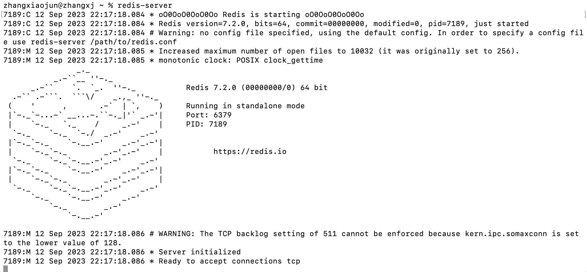

# 安装配置 (/docs/backend/redis/install_and_config)

&#8195;&#8195;笔者处于学习阶段，使用的系统为 M1 的 macOS，故参考使用 Homebrew 在本地安装 Redis。安装参考地址：[https://redis.io/docs/getting-started/installation/install-redis-on-mac-os/](https://redis.io/docs/getting-started/installation/install-redis-on-mac-os/)，在这里你也可以找到自己系统的安装方式，或者你也可以从其它地方学习如何安装。

## Redis 数据库 [#redis-数据库]

Redis 是一种基于内存的数据库技术。底层采用 C 语言开发，默认端口号 6379。

① Redis 数据库作为数据缓存，将业务数据直接存储在内存中进行读写，单机读/写速度可达 110000/84000 QPS，可以满足高速响应的需求。
② Redis 数据库只负责存储数据，数据之间不具有任何关联，易于扩容和伸缩。

## Redis 应用场景 [#redis-应用场景]

受限于内存的高昂成本，一般我们只使用 Redis 存储高频读写的关键数据。比如：

**热点数据**：如热点商品信息。
**任务队列**：如秒杀队列、抢购队列。
**实时更新信息**：如商品排行榜、公交到站信息。
**时效性信息**：如手机验证码、session 、 心跳(heartbeat)。

> Redis 主要适用于内部系统的高频数据。在线上环境负载极大的情况下，使用 Redis 也不足以满足对数据读写的速度要求。

## 先决条件 [#先决条件]

&#8195;&#8195;确保你的 macOS 安装了 Homebrew。在终端中输入`brew --version`执行，正常会返回版本信息，如果没有你需要先安装 Homebrew。

## 安装 [#安装]

&#8195;&#8195;在终端中执行`brew install redis`将会在你的系统上进行 Redis 的安装。

## 启动与停止 Redis [#启动与停止-redis]

&#8195;&#8195;验证 Redis 的安装，你可以在终端输入命令行`redis-server`。如果成功你将看到 Redis 的启动日志(**如下图**)，并且 Redis 将在前台运行。如果需要停止，你可以输入<kbd>Control</kbd>+<kbd>C</kbd>



> ```sh :no-line-numbers
> redis-server                            # 启动 Redis 数据库
> redis-server --port 6380                # 启动 Redis 数据库，在指定端口
> redis-server redis-6379.conf            # 启动 Redis 数据库，使用指定配置文件
> ```

### 启动与停止 Redis(后台启动方式) [#启动与停止-redis后台启动方式]

&#8195;&#8195;作为在前台运行 Redis 的替代方案，也可以使用 launchd 在后台启动进程。

```sh 
brew services start redis     # 后台启动Redis
brew services info redis      # 检查Redis运行状态
brew services stop redis      # 停止Redis
```

**终端命令执行演示**：

```sh 
% brew services start redis # 启动
==> Successfully started `redis` (label: homebrew.mxcl.redis)

% brew services info redis # 状态查看
redis (homebrew.mxcl.redis)
Running: ✔
Loaded: ✔
Schedulable: ✘
User: zhangxiaojun
PID: 63122

% brew services stop redis # 停止
Stopping `redis`... (might take a while)
==> Successfully stopped `redis` (label: homebrew.mxcl.redis)
```

## 连接 Redis [#连接-redis]

输入`redis-cli`连接到本机的 Redis，再打开的客户端中，尝试输入一些命令

```sh 
127.0.0.1:6379> lpush demos redis-macOS-demo
(integer) 1
127.0.0.1:6379> rpop demos
"redis-macOS-demo"
```

**连接 Redis**：

> ```sh :no-line-numbers
> redis-cli                 # 进入 Redis 控制台，在默认端口
> redis-cli -p 6380         # 进入 Redis 控制台，在指定端口
> ```

## 关闭 [#关闭]

```sh 
# 单实例
redis-cli -a passwd shutdown

# 多实例（指定端口）
redis-cli -h 127.0.0.1 -a passwd -p 6379 shutdown
```

> 注意：完整的格式：`redis-cli -h 127.0.0.1 -p 6379`

## 配置文件 [#配置文件]

&#8195;&#8195;终端输入命令行`brew list redis`可以得到 Redis 的安装路径，查看`homebrew.mxcl.redis.plist`文件信息，可以获取 redis.conf 配置文件的路径。

### 基本配置 [#基本配置]

**重要参数说明**：

```sh 
daemonize no                # 守护线程，打开后启动 Redis 控制台不提示
protected-mode yes          # 安全模式(如果需要其他主机连接Redis改为 no)
databases 16                # 存储区域数量
port 6379                   # 端口号
bind 127.0.0.1 ::1          # 绑定(注释或者改为本机IP地址，否则影响远程IP连接)
requirepass your_password   # 添加redis密码
# 使用客户端连接：redis-cli -h 127.0.0.1 -p 6379 -a your_password
```

> 上面的配置启动 Redis 数据库时默认加载；若修改配置文件，需要重启！

### 日志配置 [#日志配置]

&#8195;&#8195;Redis 总共支持四个日志级别：debug / verbose / notice / warning ，从前往后日志记录信息逐渐减少。通常情况下开发环境设为 verbose ，生产环境设为 notice 。

```sh 
loglevel verbose                 # 日志级别
logfile 6379.log                 # 日志文件名
```

### 持久化配置 [#持久化配置]

默认使用 RDB 方式持久化数据，相关配置如下：

```sh 
save 900 1            # 自动同步数据条件，900s 内变更 1 个 key 值则持久化
save 300 10           # 自动同步数据条件，300s 内变更 10 个 key 值则持久化

rdbcompression yes    # 是否压缩数据，压缩后节省空间但读取较慢
rdbchecksum yes       # 是否格式校验（默认开启），校验降低文件损坏风险但读取较慢

dbfilename dump.rdb   # 保存文件名
dir ./                # 保存文件位置
```

可以在配置文件中改用 AOF 方式持久化数据，刷新文件条件有三种类型： always / everysec / no

```sh 
appendonly yes            # 选用 AOF 方式持久化
appendsync everysec       # 刷新文件条件，每秒更新一次操作日志
```

### 容量配置 [#容量配置]

对 Redis 数据库占用空间和客户链接做出限制。

```sh 
maxclients 100                    # 客户连接数上限，超出后拒绝客户访问，为 0 表示不限制
timeout 300                       # 客户闲置时长，超出后关闭连接，为 0 表示不关闭

maxmemory 50                      # Redis 最大占用内存比例，为 0 表示全部可用
maxmemory-samples                 # Redis 随机选取数据数量
maxmemery-policy volatile-lru     # Redis 逐出策略
```

### 多机配置 [#多机配置]

如果我们要设置集群，则需要进行以下配置：

```sh 
cluster enabled yes                # 开启集群
cluster-config-file nodes.conf     # 集群配置文件
```

如果我们要设置主从服务器，则需要进行以下配置：

```sh 
# 主服务器
requirepass 123456                    # 主服务器设置密码（可选）
repl-backlog-size 1mb                 # 缓冲区大小

# 从服务器
slaveof 127.0.0.1 6379                # 主服务器套接字，设置后自动连接
masterauth 123456                     # 主服务器密码
slave-serve-stale-data no             # 同步数据时是否允许读数据
```

## 卸载 [#卸载]

```sh 
brew uninstall redis
```
