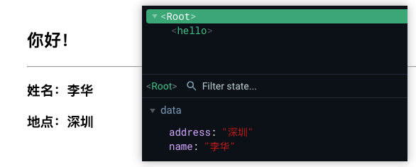
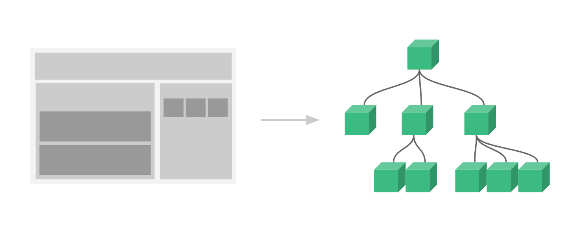
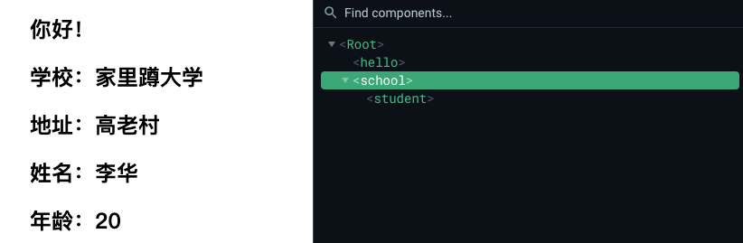
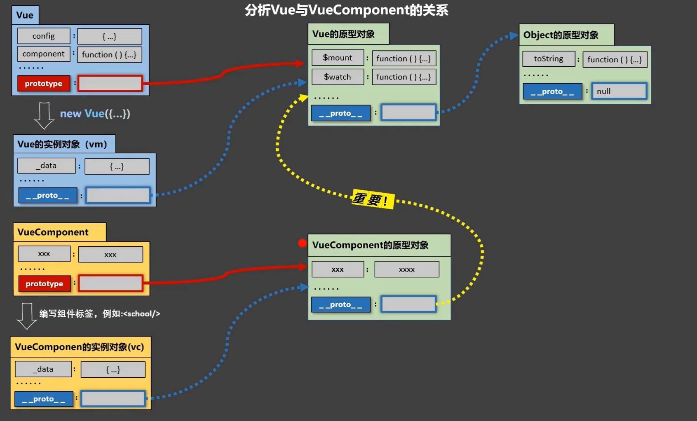

# 组件化编程 (/docs/frontend/vue/component_programming)

## 模块与组件、模块化与组件化 [#模块与组件模块化与组件化]

_**模块**_：  
（1）理解：向外提供特定功能的 js 程序，一般就是一个 js 文件  
（2）为什么：js 文件很多很复杂  
（3）作用：复用、简化 js 的编写，提高 js 运行效率

_**组件**_：  
（1）定义：用来实现<mark>局部</mark>功能的<mark>代码和资源的集合</mark>(html / css / js / image...)  
（2）为什么：一个界面的功能很复杂  
（3）作用：复用编码，简化项目编码，提高运行效率

_**模块化**_：当应用中的 js 都以模块来编写，那这个应用就是一个模块化的应用；

_**组件化**_：当应用中的功能都是多组件的方式来编写，那这个应用就是一个组件化的应用；

## 非单文件组件 [#非单文件组件]


<Callout type="success" title="提示">

**非单文件组件**：一个文件中包含 n 个组件

</Callout>


### 基本使用 [#基本使用]

**Vue 中使用组件的三大步骤**：

（1）定义组件

> 使用`Vue.extend(options)`创建，其中`options`和`new Vue(options)`时传入的`options`几乎一样，但也有些许区别：
>
> ```txt :no-line-numbers
> ① el 不要写，因为最终所有的组件都要经过一个 vm 的管理，由 vm 中的 el 来决定服务于哪个容器；
> ② data 必须写成函数，避免组件被复用时，数据存在引用关系；
> 备注: 使用 template 可以配置组件结构
> ```

（2）注册组件

```js  
// 局部注册
new Vue() 的时候 options 传入 components 选项

// 全局注册
Vue.component('组件名', 组件);
```

（3）使用组件（写组件标签）：直接写组件标签，如：`<school></school>`


<details>
<summary>代码示例</summary>

```html 
<!DOCTYPE html>
<html lang="en">
  <head>
    <meta charset="UTF-8" />
    <meta http-equiv="X-UA-Compatible" content="IE=edge" />
    <meta name="viewport" content="width=device-width, initial-scale=1.0" />
    <title>组件</title>
    <script src="https://cdn.jsdelivr.net/npm/vue@2.5.16/dist/vue.js"></script>
  </head>

  <body>
    <div id="root">
      <!-- ③ 使用组件 -->
      <hello></hello>
      <hr />
      <h3>姓名：{{name}}</h3>
      <h3>地点：{{address}}</h3>
    </div>
    <script>
      Vue.config.productionTip = false;

      // ① 定义组件
      const hello = Vue.extend({
        template: `<h2>{{msg}}</h2>`,
        data() {
          return {
            msg: '你好！'
          };
        }
      });

      // ② 注册组件（全局）
      //   Vue.component('hello', hello);

      new Vue({
        // ② 注册组件（局部）
        components: {
          hello
        },
        el: '#root',
        data: {
          name: '李华',
          address: '深圳'
        }
      });
    </script>
  </body>
</html>
```

</details>





<Callout type="warn" title="注意事项">

<span>① 关于组件名</span>

一个单词：`hello`(首字母小写) 或 `Hello`(首字母大写)

多个单词：`my-school`(kebab-case 命名) 或 `MySchool`(CamelCase 命名)，后者需要 Vue 脚手架支持

⚠️：组件中尽可能回避 HTML 中已有的元素名称，例如 h2、H2 都不行，此外可以使用`name`配置项指定组件在开发者工具中呈现的名字

<span>② 关于组件标签</span>

`<school></school>`或`<school/>`，后者不使用脚手架时，会导致后续组件不渲染

<span>③ 简写方式</span>

```js  
const school = Vue.extend(options);
// 可以简写为下面这样
const school = options;
```

</Callout>


### 组件的嵌套 [#组件的嵌套]




<details>
<summary>代码示例</summary>

```html 
<!DOCTYPE html>
<html lang="en">
  <head>
    <meta charset="UTF-8" />
    <meta http-equiv="X-UA-Compatible" content="IE=edge" />
    <meta name="viewport" content="width=device-width, initial-scale=1.0" />
    <title>组件的嵌套</title>
    <script src="https://cdn.jsdelivr.net/npm/vue@2.5.16/dist/vue.js"></script>
  </head>

  <body>
    <div id="root">
      <hello></hello>
      <school></school>
    </div>
    <script>
      Vue.config.productionTip = false;

      const hello = Vue.extend({
        template: `<h2>{{msg}}</h2>`,
        data() {
          return {
            msg: '你好！'
          };
        }
      });

      const student = Vue.extend({
        template: `
        <div>
          <h2>姓名：{{name}}</h2>
          <h2>年龄：{{age}}</h2>
        </div>
      `,
        data() {
          return {
            name: '李华',
            age: 20
          };
        }
      });

      const school = Vue.extend({
        template: `
        <div>
          <h2>学校：{{name}}</h2>
          <h2>地址：{{address}}</h2>
          <student></student>
        </div>
      `,
        data() {
          return {
            name: '史莱克学院',
            address: '史莱克城'
          };
        },
        components: {
          student
        }
      });

      new Vue({
        el: '#root',
        data: {
          name: '唐三',
          address: '斗罗大陆'
        },
        components: {
          hello,
          school
        }
      });
    </script>
  </body>
</html>
```

</details>




### VueComponent [#vuecomponent]

（1）组件的本质是一个名为`VueComponent`的构造函数，它不是程序员定义的，而是`Vue.extend()`生成的  
（2）我们只需要写组件标签(如:`<school/>`)，Vue 解析时会帮我们创建组件的实例对象，即 Vue 帮我们执行的`new VueComponent(options)`  
（3）每次调用`Vue.extend()`，返回的都是一个全新的`VueComponent`，即不同组件是不同的对象  
（4）关于 this 的指向：

> ① **组件配置中**：data 函数、methods 中的函数、watch 中的函数、computed 中的函数，它们的 this 均为<mark>VueComponent 实例对象</mark>  
> ② **new Vue()配置中**：data 函数、methods 中的函数、watch 中的函数、computed 中的函数，它们的 this 均为<mark>Vue 实例对象</mark>

（5）VueComponent 的实例对象（组件实例对象）简称 `vc`；Vue 的实例对象简称 `vm`

### 一个重要的内置关系 [#一个重要的内置关系]




<Callout type="success" title="提示">

① 一个重要的内置关系：`VueComponent.prototype.__proto__ === Vue.prototype`

② 为什么要有这个关系：让组件实例对象 `vc` 可以访问到 `Vue` 原型上的属性、方法

</Callout>


## 单文件组件 [#单文件组件]


<Callout type="success" title="提示">

**单文件组件**：一个文件中只包含 1 个组件

</Callout>


**单文件组件简单示例**:


<Tabs items={["index.html", "main.js", "App.vue", "School.vue", "Student.vue"]}>
<Tab value="index.html">

```html 
<!DOCTYPE html>
<html lang="en">
  <head>
    <meta charset="UTF-8" />
    <meta http-equiv="X-UA-Compatible" content="IE=edge" />
    <meta name="viewport" content="width=device-width, initial-scale=1.0" />
    <title>单文件组件练习</title>
  </head>
  <body>
    <div id="root"></div>
    <script src="https://cdn.jsdelivr.net/npm/vue@2.5.16/dist/vue.js"></script>
    <script src="./main.js"></script>
  </body>
</html>
```

</Tab>
<Tab value="main.js">

```js 
import App from './App.vue';

new Vue({
  template: `<App></App>`,
  el: '#root',
  components: { App }
});
```

</Tab>
<Tab value="App.vue">

```vue 
<template>
  <div>
    <School></School>
    <Student></Student>
  </div>
</template>

<script>
  import School from './School.vue';
  import Student from './Student.vue';

  export default {
    name: 'App',
    components: {
      School,
      Student
    }
  };
</script>
```

</Tab>
<Tab value="School.vue">

```vue 
<template>
  <div id="Demo">
    <h2>学校名称：{{ name }}</h2>
    <h2>学校地址：{{ address }}</h2>
    <button @click="showName">点我提示学校名</button>
  </div>
</template>

<script>
  export default {
    name: 'School',
    data() {
      return {
        name: '史莱克学院',
        address: '史莱克城'
      };
    },
    methods: {
      showName() {
        alert(this.name);
      }
    }
  };
</script>

<style>
  #Demo {
    background: orange;
  }
</style>
```

</Tab>
<Tab value="Student.vue">

```vue 
<template>
  <div>
    <h2>学生姓名：{{ name }}</h2>
    <h2>学生年龄：{{ age }}</h2>
  </div>
</template>

<script>
  export default {
    name: 'Student',
    data() {
      return {
        name: '唐三',
        age: 20
      };
    }
  };
</script>
```

</Tab>
</Tabs>
