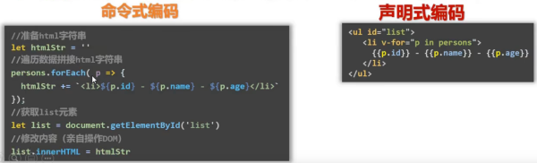
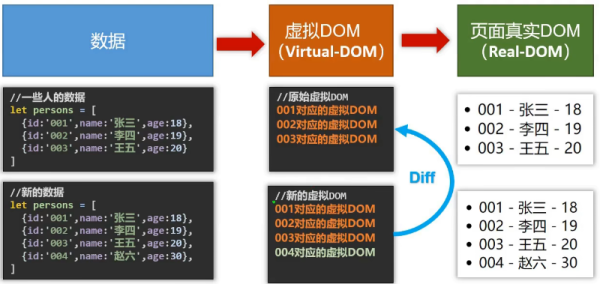

# Vue简介 (/docs/frontend/vue/intro)

## 官网 [#官网]

英文：[`https://vuejs.org/`](https://vuejs.org)

中文：[`https://cn.vuejs.org/`](https://cn.vuejs.org/)

## 介绍与描述 [#介绍与描述]

（1）Vue 是一套用来动态**构建用户界面**[^1]的**渐进式**[^2]`JavaScript`框架；

（2）作者：尤雨溪

[^1]: 把数据通过某种办法变成用户界面
[^2]: `Vue`可以自底而上逐层的应用，简单的应用只需要一个轻量小巧的核心库，复杂应用可以引入各式各样的`Vue`插件

## Vue 的特点 [#vue-的特点]

（1）遵循`MVVM`模式；

（2）编码简洁，体积小，运行效率高，适合移动/PC 端开发；

（3）它本身只关注 UI，可以引入其他第三方库开发项目；

（4）采用**组件化**模式，提高代码复用率，且让代码便于维护；

（5）**声明式**编码，让编码人员无需直接操作`DOM`，提升开发效率；

<Callout type="success" title="使用虚拟 DOM 和 Diff 算法，尽量复用 DOM 节点">

</Callout>

## 与其他 JS 框架的关联 [#与其他-js-框架的关联]

（1）借鉴 Angular 的**模板**和**数据绑定**技术

（2）借鉴 React 的**组件化**和**虚拟 DOM** 技术

## Vue 周边库 [#vue-周边库]

（1）vue-cli：vue 脚手架

（2）vue-router：路由

（3）vuex：状态管理

（4）element-ui：基于 vue 的 UI 组件库(PC 端)

（5）......
