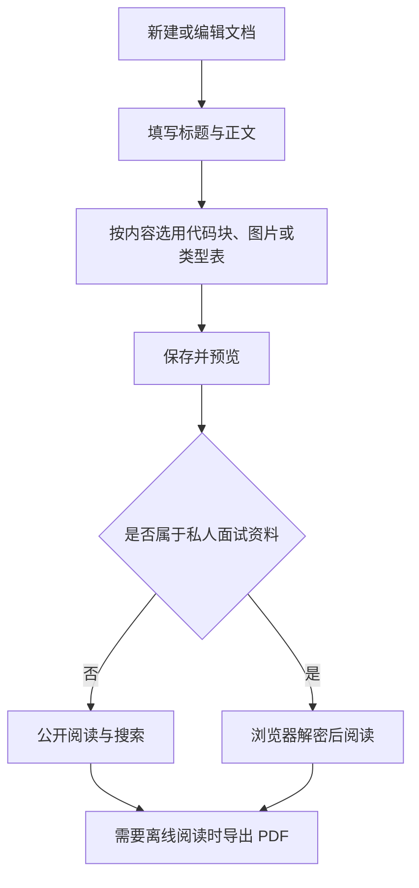
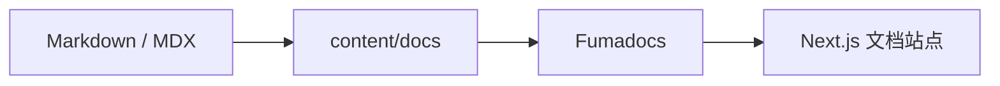

# 文档写作指南 (/docs/guide)

<div className="not-prose my-7 flex items-center gap-4 rounded-2xl border bg-fd-card p-5">
  
  <div>
    <p className="text-xs font-medium tracking-[0.16em] text-fd-primary uppercase">Knowledge Stack</p>
    <p className="mt-1 text-xl font-semibold">知栈</p>
    <p className="mt-1 text-sm text-fd-muted-foreground">把技术知识，叠成自己的栈。</p>
  </div>
</div>

本站使用 **Next.js + Fumadocs + MDX** 构建，主题样式基于 `fumadocs-ui/css/vitepress.css`。写作时优先使用标准 Markdown；需要分栏导航、提示、标签页等结构时，再使用 Fumadocs 原生 MDX 组件。

## 新功能速查 [#新功能速查]

| 功能 | 怎么使用 | 详细示例 |
| --- | --- | --- |
| Highlighter | 标注代码语言，用 `{2,4-6}` 高亮指定行 | [代码高亮](#代码块) |
| 脚注与上下标 | `[^note]` 配合文末定义；上下标用 `sup` / `sub` | [角标与换行](#脚注上下标与分点换行) |
| Type Table | 用 `TypeTable` 手写字段、类型、默认值和说明 | [手动类型表](#手动维护-type-table) |
| Auto Type Table | 用 `AutoTypeTable` 读取 TypeScript 类型文件 | [自动类型表](#自动生成-auto-type-table) |
| Remark Image | 普通 Markdown 图片自动识别本地固有尺寸 | [图片尺寸](#图片) |
| Zoomable Image | 点击正文图片放大；方向键切换，Esc 关闭 | [图片查看](#图片) |
| Last Modified Time | 保存文档后自动更新文章底部时间，无需手写 | [更新时间](#最后修改时间last-modified-time) |
| Lazy Loading | 已启用 Async 模式；正常打开文章即可，无需修改笔记写法 | [延迟加载](#延迟加载lazy-loading) |
| Export PDF | 标题旁导出图标 → 保存为 PDF → 选择存储为 PDF | [导出步骤](#导出-pdfexport-pdf) |
| Export EPUB | 标题旁书本下载图标 → 当前文章或当前专题 | [电子书导出](#专题电子书epub) |
| Access Control | 正文构建时加密，在私人入口输入密码；用“立即锁定”结束会话 | [访问设置](#私人内容访问) |

左上角的分类下拉在写作指南页同样可用，可直接前往 AI、前端、后端、面试等分类。各分类和写作指南使用独立图标，便于快速辨认。



## 文件放在哪里 [#文件放在哪里]

全部文档位于 `content/docs/`。文件的路径就是页面的 URL：

<Files>
  <Folder name="content/docs" defaultOpen>
    <File name="meta.json" />
    <Folder name="frontend" defaultOpen>
      <File name="meta.json" />
      <File name="index.mdx" />
      <Folder name="vue" defaultOpen>
        <File name="meta.json" />
        <File name="index.mdx" />
        <File name="component_programming.mdx" />
      </Folder>
    </Folder>
    <Folder name="guide">
      <File name="index.mdx" />
    </Folder>
  </Folder>
</Files>

例如 `content/docs/frontend/vue/component_programming.mdx` 会生成：

```text
/docs/frontend/vue/component_programming
```

<Callout type="info" title="普通 Markdown 与 MDX 怎么选">

纯文字、列表、表格、代码块使用 `.md` 或 `.mdx` 都可以。需要 `<Cards>`、`<Tabs>`、`<Steps>` 等组件时使用 `.mdx`。页面必须使用 MDX 时，也不要把普通 Markdown 全部改写成 JSX。

</Callout>

## 新建一篇文档 [#新建一篇文档]

每篇文档至少包含 `title`，建议同时写一句 `description`。标题由 frontmatter 生成，不要再在正文中重复写一级标题。

````mdx
---
title: Vue 响应式原理
description: 从依赖收集到触发更新的完整过程。
---

## 一句话理解

Vue 通过 Proxy 和依赖映射追踪数据变化。

## 最小示例

```js
const state = reactive({ count: 0 })
```
````

保存后开发服务器会自动刷新。新建文件没有出现在侧栏时，检查所在目录的 `meta.json` 是否包含它，或是否由 `...` 自动收录。

## Markdown 常用写法 [#markdown-常用写法]

### 标题层级 [#标题层级]

页面标题来自 frontmatter，因此正文从二级标题开始。正文中的 H2、H3、H4 会自动生成分级编号，右侧目录同步显示：

```md
## 二级标题

### 三级标题

#### 四级标题
```

右侧“本页目录”会根据这些标题自动生成，不需要手工维护目录。

### 列表、引用与强调 [#列表引用与强调]

```md
- 无序列表
- 第二项

1. 有序步骤
2. 第二步

> 引用一段说明。

**粗体**、*斜体*、`行内代码`。
```

实际效果：

- 无序列表
- 第二项

> 引用一段说明。

**粗体**、*斜体*、`行内代码`。

### 表格 [#表格]

```md
| 类型 | 用途 | 推荐场景 |
| --- | --- | --- |
| `.md` | 标准文档 | 普通笔记 |
| `.mdx` | Markdown + React 组件 | 卡片、标签页、交互示例 |
```

| 类型 | 用途 | 推荐场景 |
| --- | --- | --- |
| `.md` | 标准文档 | 普通笔记 |
| `.mdx` | Markdown + React 组件 | 卡片、标签页、交互示例 |

### 代码块 [#代码块]

在代码围栏后填写语言名称即可启用语法高亮：

```ts
type Note = {
  title: string;
  tags: string[];
};
```

```bash
pnpm dev
pnpm build
```

常见语言值：`js`、`ts`、`tsx`、`java`、`python`、`sql`、`bash`、`json`、`yaml`、`mermaid`。

围栏结束行只写反引号；包含三反引号示例时，外层使用四反引号。语言名与行高亮之间用空格，行高亮写 `{2,4-6}`，不要写 `:{2,4-6}`。

````md
```python {2}
name = "知栈"
print(name)
```
````

实际效果：

```python {2}
name = "知栈"
print(name)
```

语法高亮负责显示代码的词法颜色；不会修复 Python、Java 等代码中的语法错误。`text`、`txt` 代码块用于日志和纯文本，本来就没有语言颜色。

Highlighter 已全站启用，不需要在每篇文档中导入组件。还可以给代码块加文件名和行号：

````md
```python title="hello.py" lineNumbers {2}
name = "知栈"
print(name)
```
````

```python title="hello.py" lineNumbers {2}
name = "知栈"
print(name)
```

如果颜色或后续段落异常，先检查围栏是否闭合、语言名是否正确，再检查代码自身的引号和括号。不要把新文章继续写进未关闭的代码块里。

### 脚注、上下标与分点换行 [#脚注上下标与分点换行]

脚注使用 `[^编号]`，并在文末定义说明；它和数学上标是两种语法。

```md
正文中的说明[^note]。

[^note]: 脚注说明。
```

脚注示例[^guide-note]；上标使用 `x<sup>2</sup>`，下标使用 `H<sub>2</sub>O`。实际效果：x<sup>2</sup>、H<sub>2</sub>O。

[^guide-note]: 点击脚注编号可跳到这里，再点击返回箭头回到正文。

兼容旧笔记：行首的 ①、②、③ 即使中间没有空行也会分行。普通段落中的自动折行仍按标准 Markdown 处理。新文档优先使用 `1.`、`2.`、`3.` 有序列表。

① 第一条说明
② 第二条说明
③ 第三条说明

### 站内链接 [#站内链接]

优先使用以 `/docs` 开头的绝对路径：

```md
[FastAPI 概览](/docs/ai/fastapi)
[指定章节](/docs/ai/fastapi/01-快速入门与核心概念#依赖注入)
```

实际链接：[FastAPI 概览](/docs/ai/fastapi)。

### 图片 [#图片]

图片放到 `public/` 下，通过 `/` 路径引用：

```md

```

普通截图建议使用 PNG、WebP 或 SVG，并为图片提供准确的替代文本。

**Remark Image 的用法：**直接使用上面的 Markdown 图片写法，不需要导入插件。文件 `/images/notes.svg` 对应 `public/images/notes.svg`；编译时自动获取本地图片宽高，帮助保持比例。当前配置不在编译时请求外部图片尺寸。

点击正文图片可放大，同一篇文章中的图片可以在查看器中切换。Markdown 图片由 Remark Image 自动读取本地图片尺寸。需要限制展示大小时使用 `DocImage`，宽度以像素为单位，窄屏自动缩小：

```mdx
<DocImage src="/images/notes.svg" alt="知识库结构" width={480} />
```

<DocImage src="/images/notes.svg" alt="知识库结构" width={480} />

原来设置了 300、500、700 等宽度的图片会保留尺寸限制。自动识别的固有宽高用于保持图片比例，不代表必须铺满正文。

也可在 `DocImage` 上设置 `title` 和 `style`。例如只限制最大宽度，并居中显示：

```mdx
<DocImage
  src="/images/notes.svg"
  alt="知识库结构"
  title="知识库结构示意"
  width={480}
  style={{ maxWidth: '100%', marginInline: 'auto' }}
/>
```

**Zoomable Image 的用法：**点击图片打开查看器；同一文章有多张图片时可用左右方向键或切换按钮浏览，按 Esc 或关闭按钮返回正文。普通 Markdown 图片与 `DocImage` 都已自动接入。

## 类型说明表 [#类型说明表]

`TypeTable` 手工填写字段，适合接口参数、Java/Python 配置项、组件属性说明。`AutoTypeTable` 读取 TypeScript 类型或类型文件，自动生成说明表，适合有真实类型源码的组件或工具库。两者都不是把普通 Markdown 表格自动转换成类型表。

### 手动维护 Type Table [#手动维护-type-table]

```mdx
<TypeTable type={{
  title: { type: 'string', required: true, description: '文档标题' },
  imageWidth: { type: 'number', default: '480', description: '图片最大宽度，单位像素' },
}} />
```

<TypeTable type={{
  title: { type: 'string', required: true, description: '文档标题' },
  imageWidth: { type: 'number', default: '480', description: '图片最大宽度，单位像素' },
}} />

常用字段：`type` 写类型，`description` 写说明，`required: true` 表示必填，`default` 写默认值，`deprecated: true` 标记已弃用。类型表用于解释接口或配置字段，不会自动校验业务代码。

### 自动生成 Auto Type Table [#自动生成-auto-type-table]

```mdx
<AutoTypeTable path="./examples/note-options.ts" name="NoteOptions" />
```

<AutoTypeTable path="./examples/note-options.ts" name="NoteOptions" />

路径相对于项目根目录。修改类型文件后，表格随下次编译更新。该组件在服务端生成，不能放入客户端组件。

上述示例读取的是项目中的 `examples/note-options.ts`，文件内容如下：

```ts title="examples/note-options.ts"
export interface NoteOptions {
  /** 文档标题 */
  title: string;
  /** 是否显示章节编号 */
  numbered?: boolean;
  /** 图片最大宽度，单位像素 */
  imageWidth?: number;
}
```

类型名需要导出，`name` 必须与导出的名称一致。字段上的 JSDoc 会成为说明；`?` 会生成可选字段。没有独立类型文件时，也可直接传入类型：

```mdx
<AutoTypeTable type="{ title: string; imageWidth?: number }" />
```

## 更新时间与 PDF [#更新时间与-pdf]

### 最后修改时间（Last Modified Time） [#最后修改时间last-modified-time]

文章底部显示“最后更新”，目前来自文档文件的真实修改时间。项目迁入 Git 后可以改成 Git 提交时间，避免把复制文件时间当成内容更新时间。

直接修改并保存 `.md` / `.mdx` 文件即可；开发预览编译后显示新时间。生产预览需要重新构建、重启后才显示本次更新。frontmatter 中的 `date` 表示文章日期，不控制这里的“最后更新”。

### 导出 PDF（Export PDF） [#导出-pdfexport-pdf]

点击文章标题右侧的“导出 PDF”图标，打开专用打印视图，再点击“保存为 PDF”。打印视图会展示全部标签页、手风琴和折叠内容，等待图片与 Mermaid 图表就绪后打开打印窗口。保存时选择“存储为 PDF”。

1. 打开需要导出的文章，点击标题右侧的文件下载图标。
2. 在新打开的打印视图检查内容，再点击“保存为 PDF”。
3. 在系统打印窗口选择“存储为 PDF”或“另存为 PDF”，选择纸张和保存位置。
4. 需要保留提示块、代码块的底色时，在浏览器打印设置中启用“背景图形”。

导出的是当前文章；标签页与折叠内容会全部展开。私人文章需要先在入口解锁，再点击解密后页面顶部的“打印 / PDF”，使用浏览器打印窗口保存。

### 专题电子书（EPUB） [#专题电子书epub]

点击文章标题旁的书本下载图标，可选择“当前文章”或“当前专题”。专题按当前文章所在文件夹确定，例如在 Docker 的文章中导出整个 Docker 专题，在 Java 的文章中导出 Java 专题；目录首页也可以使用这个入口。

下载的 `.epub` 包含章节目录、代码、表格与本地图片，标签页和折叠内容会全部展开。可以导入 Apple Books、支持 EPUB 的手机阅读器或电子书阅读器离线阅读。文件名会使用专题名称。

Mermaid 图表在 EPUB 中保留为源码，交互演示以在线链接保留；需要保留浏览器中渲染后的图表外观时使用 PDF。EPUB 文件在构建时生成，公开专题始终排除私人资料；私人文章目前使用浏览器打印保存 PDF。

### 图片对齐与旧笔记分点 [#图片对齐与旧笔记分点]

正文图片统一居中，同时保留原有宽度限制；提示框正文与左右边界保持相同间距。旧笔记里以 `&#8195;`、`&emsp;`、`&nbsp;` 等空格开头的 ①②③ 分点会保留原有换行。

## 延迟加载（Lazy Loading） [#延迟加载lazy-loading]

本站已启用 Fumadocs MDX 的 Async 模式。分类、标题和文章简介使用轻量元数据，文章正文、右侧目录与最后修改时间在需要阅读正文时通过异步导入加载。写笔记仍使用原来的 Markdown / MDX，无需额外添加组件。

站点配置位于 `source.config.ts`：

```ts
export const docs = defineDocs({
  dir: 'content/docs',
  docs: {
    async: true,
    // 保留现有 schema、postprocess 等设置。
  },
});
```

维护页面组件时，标题和简介可以直接读取；正文与编译产生的数据需要先等待 `load()`：

```tsx
const page = source.getPage(slug);
if (!page) notFound();

const { body: MDX, toc, lastModified } = await page.data.load();
return <MDX components={getMDXComponents()} />;
```

打印视图也按需加载相应文章。私人内容先验证访问权限，再加载正文。公开搜索索引和 LLM 全文导出在构建时仍需读取全部公开文章，普通阅读不会主动加载全部正文。

当前项目使用 Next.js Turbopack；官方说明 Async 模式改善服务端加载，但 Turbopack 仍可能提前编译文章，因此不要把它理解成所有文件都延迟到首次点击才编译。这里也没有启用受功能限制更多的 Dynamic 模式。

## 私人内容访问 [#私人内容访问]

“面试 → AI”在构建时使用访问密码派生密钥，正文、标题和目录都加密后发布。未解锁时页面直接显示密码输入框；验证成功后的八小时内可阅读并打印，顶部的“立即锁定”可提前清除浏览器中的解密密钥。AI 分类下的 Python、FastAPI、LangChain、LangGraph 等教程仍然公开。

私人资料不进入静态 HTML、公共搜索、Markdown、打印路由或 LLM 全文导出。公开产物中只保留 AES-256-GCM 密文；密码由构建环境提供，不应写在 Markdown 或前端代码里。GitHub Pages 没有服务端鉴权，因此密码强度决定离线暴力破解的难度。

### 阅读与重新锁定 [#阅读与重新锁定]

从“面试”进入私人 AI 入口，页面会显示“访问密码”输入框。验证成功后在本地解密正文；刷新页面会恢复八小时内的解密密钥。完成阅读后，点击“立即锁定”会删除浏览器保存的密钥。

### 站点所有者设置密码 [#站点所有者设置密码]

在项目根目录的 `.env.local` 设置构建期密码：

```dotenv title=".env.local（示例，不要使用示例值）"
INTERVIEW_ACCESS_PASSWORD=替换为你自己的访问密码
```

可以用以下命令生成随机密码：

```bash
openssl rand -base64 24
```

保存配置后运行 `pnpm build:pages` 重新生成密文。GitHub Actions 使用私有源码仓库的 `INTERVIEW_ACCESS_PASSWORD` Secret。修改密码后必须重新发布，旧浏览器中的解密密钥也会失效。`.env.local` 与真实 Secret 不进入文章或公开仓库。

当前限制固定作用于 `content/docs/interview/ai/` 目录，新增到这个目录的文章自动受保护。普通 AI 教程目录 `content/docs/ai/` 仍然公开；给任意其他文章加一个 frontmatter 字段并不会自动启用访问限制。

## 提示块 [#提示块]

`Callout` 适合放提示、警告、成功结果和补充思考。

```mdx
<Callout type="warning" title="注意">

这里写需要用户特别注意的内容。

</Callout>
```

<Callout type="info" title="信息">

`info` 用于普通补充说明。

</Callout>

<Callout type="success" title="完成">

`success` 用于操作成功或推荐做法。

</Callout>

<Callout type="warning" title="注意">

`warning` 用于可能出错、容易踩坑的内容。

</Callout>

<Callout type="error" title="不要这样做">

`error` 用于明确禁止或高风险操作。

</Callout>

<Callout type="idea" title="思路">

`idea` 适合放设计思路、复盘和延伸阅读。

</Callout>

## 卡片与分类入口 [#卡片与分类入口]

分类首页和专题目录最适合使用 `Cards`：

```mdx
<Cards>
  <Card title="FastAPI" href="/docs/ai/fastapi" description="请求参数、依赖注入与流式响应。" />
  <Card title="LangGraph" href="/docs/ai/langgraph" description="状态、持久化与中断恢复。" />
</Cards>
```

<Cards>
  <Card title="FastAPI" href="/docs/ai/fastapi" description="请求参数、依赖注入与流式响应。" />
  <Card title="LangGraph" href="/docs/ai/langgraph" description="状态、持久化与中断恢复。" />
</Cards>

每个目录的 `index.mdx` 会直接成为该目录的首页：侧栏只显示父级目录名称，点击父级即可进入首页，因此不要再把 `index` 写进 `meta.json` 的 `pages`，否则会额外出现一个重复的“概览”子项。

普通子目录的首页会被自动识别：

```json
{
  "title": "FastAPI",
  "pages": ["01-快速入门与核心概念", "..."]
}
```

需要在顶部作为独立分类展示的根目录，保留 `root`，并显式声明首页：

```json
{
  "title": "AI",
  "root": true,
  "pagesIndex": "index",
  "pages": ["python", "fastapi", "..."]
}
```

## 多语言或并列方案 [#多语言或并列方案]

同一主题存在多个技术方案时使用 `Tabs`：

```mdx
<Tabs items={["Java", "Python"]}>
  <Tab value="Java">Java 实现。</Tab>
  <Tab value="Python">Python 实现。</Tab>
</Tabs>
```

<Tabs items={["Java", "Python"]}>
  <Tab value="Java">
    Java 使用 `CompletableFuture` 组合异步任务。
  </Tab>
  <Tab value="Python">
    Python 使用 `asyncio.gather()` 并发执行协程。
  </Tab>
</Tabs>

适合使用标签页的内容包括：不同语言实现、操作系统差异、客户端与服务端示例。内容很短时直接使用列表即可。

## 连续操作步骤 [#连续操作步骤]

有明确先后顺序的安装、配置和排查过程使用 `Steps`：

```mdx
<Steps>
  <Step>
    ### 安装依赖

    运行 `pnpm install`。
  </Step>
  <Step>
    ### 启动预览

    运行 `pnpm dev`。
  </Step>
</Steps>
```

<Steps>
  <Step>
    ### 安装依赖 [#安装依赖]

    在项目根目录运行 `pnpm install`。
  </Step>
  <Step>
    ### 启动预览 [#启动预览]

    运行 `pnpm dev`，访问 `http://localhost:3210/docs`。
  </Step>
  <Step>
    ### 发布前检查 [#发布前检查]

    运行生产构建与回归检查。
  </Step>
</Steps>

## 折叠内容 [#折叠内容]

答案较长、补充资料不要求所有人阅读时，可以使用手风琴折叠块：

<Accordions>
  <Accordion title="为什么不使用 VuePress 的 ::: tip 语法？">
    当前站点由 Fumadocs 渲染 MDX。原先 Hope 主题的自定义容器、`@tab` 和 `::: projects` 语法不会再被解析，应改用本站的 `Callout`、`Tabs` 和 `Cards`。
  </Accordion>
  <Accordion title="什么时候需要修改 meta.json？">
    需要固定侧栏顺序、给目录改名或排除特殊文件时修改。普通新增文件通常可以被 `...` 自动收录。
  </Accordion>
</Accordions>

## 图表与公式 [#图表与公式]

Mermaid 使用 `mermaid` 代码块：



公式支持行内 `$O(n\log n)$` 和独立公式：

$$
T(n) = 2T\left(\frac{n}{2}\right) + O(n)
$$

复杂架构图、时序图和状态图优先使用 Mermaid，保证后续修改可追踪；不适合 Mermaid 的界面截图使用图片。

## 目录与侧栏排序 [#目录与侧栏排序]

每个目录可通过 `meta.json` 控制名称、顺序和收录规则：

```json
{
  "title": "前端",
  "pages": ["index", "vue", "typescript", "css", "..."],
  "root": true
}
```

常用规则：

- `index` 表示当前目录的概览页，页面标题统一写为“概览”。
- `...` 自动把没有显式列出的文件追加到末尾。
- `!index` 可把某个页面从文档树中排除，本站的根 `index.mdx` 使用这一规则隐藏重复总览。
- `root: true` 会将该目录作为独立文档根节点展示。
- 调整顺序时只修改 `pages` 数组，不需要移动真实文件。

<Callout type="warning" title="链接检查">

改名或移动文件后需要同步所有站内链接。运行生产构建与 `pnpm test`，并在生产预览中检查页面、资源和标题锚点。

</Callout>

## 写作约定 [#写作约定]

为了让迁移后的内容长期可维护，建议遵循以下约定：

- 优先写标准 Markdown，避免为了视觉效果堆叠自定义 HTML。
- 页面标题只写在 frontmatter，正文从 `##` 开始。
- 分类概览页使用卡片，正文中的章节标题保持名词化和可搜索。
- 命令、路径、环境变量和代码标识使用反引号。
- 代码块必须标注语言，方便高亮、复制和全文检索。
- 外部资料链接到原文，结论和摘录说明来源语境。
- 图片、图表和表格都要有清楚的上下文，不能只贴结果。
- 不使用 VuePress 的 `::: tip`、`@tab`、`::: projects` 等旧语法。
- 不再手工维护右侧目录，标题结构就是二级导航的唯一来源。

## 本地检查与发布 [#本地检查与发布]

<Tabs items={["开发预览", "生产构建"]}>
  <Tab value="开发预览">
    ```bash
    pnpm dev
    ```

    默认地址：`http://localhost:3210/docs`。
  </Tab>
  <Tab value="生产构建">
    ```bash
    pnpm build
    pnpm test
    pnpm start
    ```

    服务端生产预览地址：`http://localhost:3211/docs`。
  </Tab>
</Tabs>

发布前至少确认：构建成功、没有缺失链接、代码块正常高亮、Mermaid 可渲染、桌面与移动端布局都可用。
