# Java 基础 (/docs/interview/java/java-foundation)

## Java 基础知识 [#java-基础知识]

### Java 和 C++主要区别有哪些？各有哪些优缺点？ [#java-和-c主要区别有哪些各有哪些优缺点]

<u>Java 和 C++分别代表了两种类型的语言：</u>
① **C++是编译型语言**
&#8195;&#8195;首先将源代码编译生成机器语言，再由机器运行机器码。执行速度快、效率高；依赖编译器、跨平台性差些。

② **Java 是解释型语言**
&#8195;&#8195;源代码不是直接翻译成机器语言，而是先翻译成中间代码，再由解释器对中间代码进行解释运行。执行速度慢、效率低；依赖解释器、跨平台性好。

> 也有说 Java 是半编译、半解释型语言。Java 编译器(javac)现将源程序编译成 Java 字节码(.class)，JVM 负责解释执行字节码文件。

---

<u>二者的主要区别：</u>
&#8195;① C++ 是<mark>平台相关</mark>的，Java 是<mark>平台无关</mark>的；
&#8195;② C++ 对所有的数字类型有标准的范围限制，但字节长度是跟具体实现相关的，同一个类型在不同操作系统可能长度不一样。Java 在所有平台上对所有的基本数据类型都有标准的范围限制和字节长度。
&#8195;③ C++ 除了一些比较少见的情况之外和 C 语言兼容。Java 没有对任何之前的语言向前兼容，但是在语法上受 C/C++ 的影响很大。
&#8195;④ C++ 允许直接调用本地的系统库。Java 要通过 JNI 或者 JNA 调用。
&#8195;⑤ C++ 允许<u>过程式程序设计和面向对象程序设计</u>。Java 必须使用面向对象的程序设计方式。
&#8195;⑥ C++ 支持指针、引用、传值调用。Java 只有值传递。
&#8195;⑦ C++ 需要显式的内存管理，但有第三方的框架可以提供垃圾搜集的支持，支持析构函数。Java 是自动垃圾收集的，也没有析构函数的概念。
&#8195;⑧ C++ 支持多重继承，包括虚拟继承。Java 只允许单继承，需要多继承的情况要使用接口。

---


<details>
<summary>知识扩展：Java 与 C 的参数方法有什么区别？</summary>

① C 语言是通过指针的引用传递
② Java 会拷贝当前栈中的值传递过去

⭐️ 编程语言中需要进行方法间的参数传递，这个传递的策略叫做<mark>求值策略</mark>。
⭐️ 在程序设计中，求值策略有很多种，比较常见的就是<u>值传递和引用传递</u>，还有一种值传递的特例——共享对象传递。
⭐️ 值传递和引用传递的最大区别是传递过程中有没有复制出一个副本来，<u>如果是传递副本，那就是值传递，否则就是引用传递。</u>
⭐️ Java 对象的传递，是通过复制的方式把引用关系传递了，因为有复制的过程，所以是值传递，只不过对于 Java 对象的传递，传递的内容是对象的引用。

</details>


### JDK、JRE、JVM 的区别(必会) [#jdkjrejvm-的区别必会]

> **JDK**：JDK(Java Development Kit)即 Java 开发工具包，是整个 Java 的核心，其包括了 Java 运行环境(JRE)、Java 工具和 Java 基础类库。
>
> ---
>
> **JRE**：JRE(Java Runtime Environment)即 Java 运行环境，它是运行 Java 程序所必须得环境的集合，包含 Java 虚拟机和 Java 程序的一些核心类库。
>
> ---
>
> **JVM**：JVM(Java Virtual Machine)即 Java 虚拟机，是整个 Java 实现跨平台的最核心部分，能够运行以 Java 语言写的软件程序。

### 说一下 JAVA 的三种注释 [#说一下-java-的三种注释]

```txt 
// 单行注释
/*...*/ 多行注释
/**...*/ 文档注释
```

### Java 的数据类型 [#java-的数据类型]


<Callout type="success" title="数据类型">

&#8195;&#8195;Java 数据类型包括两大类：基本数据类型和引用数据类型；其中八个基本数据类型包括整型(byte、short、int、long)、浮点型(float、double)、字符型(char)、布尔型(boolean)；除此之外的都为引用数据类型，比如类、接口、数组。

</Callout>

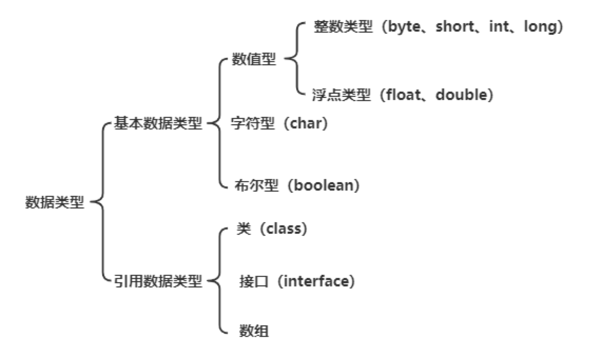

| 数据类型 | 字节数 | 位数 | 默认值       | 包装类型  | 使用说明[取值范围]                    |
| -------- | ------ | ---- | ------------ | --------- | ------------------------------------- |
| byte     | 1      | 8    | 0            | Byte      | -128~127                              |
| short    | 2      | 16   | 0            | Short     | -2<sup>15</sup>~2<sup>15</sup>-1      |
| int      | 4      | 32   | 0            | Integer   | -2<sup>31</sup>~2<sup>31</sup>-1      |
| long     | 8      | 64   | 0L 或 0l     | Long      | -2<sup>63</sup>~2<sup>63</sup>-1      |
| float    | 4      | 32   | 0.0F 或 0.0f | Float     | 1.4E-45~3.4E38                        |
| double   | 8      | 64   | 0.0d         | Double    | 4.9E-324~1.8E308                      |
| char     | 2      | 16   | 空           | Character | 使用 Unicode 编码(2 个字节)，可存汉字 |
| boolean  | -      | -    | false        | Boolean   | 只有 true 和 false 两个取值           |

### 整型的默认数据类型是什么，浮点型的数据类型是什么？ [#整型的默认数据类型是什么浮点型的数据类型是什么]

> 整型默认数据类型：int
> 浮点型默认数据类型：double

### 为什么不能用浮点型表示金额？ [#为什么不能用浮点型表示金额]

> &#8195;&#8195;因为<u>不是所有的小数都能用二进制表示</u>，所以为了解决这个问题，IEEE 提出了一种使用近似值表示小数的方式，并且引入了精度的概念，这就是浮点数。<u>浮点数只是近似值，并不是精确值，所以不能用来表示金额，否则会有精度丢失。</u>  
> &#8195;&#8195;为了解决精度问题，可以使用`BigDecimal`。

---

**数据库涉及金额时，同样需要注意**：


<Cards>
  <Card title="MySQL数据类型-浮点类型" href="/docs/backend/database/base/data_type#浮点类型" description="精度误差说明" />
</Cards>


---

### Java 中有了基本类型为什么还需要包装类？ [#java-中有了基本类型为什么还需要包装类]

&#8195;&#8195;Java 是一个面向对象的编程语言，但是 Java 中的八种基本数据类型却是不面向对象的 <mark>(比如：集合类中，无法将 int、double 等类型放进去，因为集合的容器要求是 Object 类型。)</mark>，为了使用方便和解决这个不足，在设计类时为每个基本数据类型设计了一个对应的类进行代表，这样八种基本数据类型对应的类统称为包装类(Wrapper Class)，包装类均位于 java.lang 包。

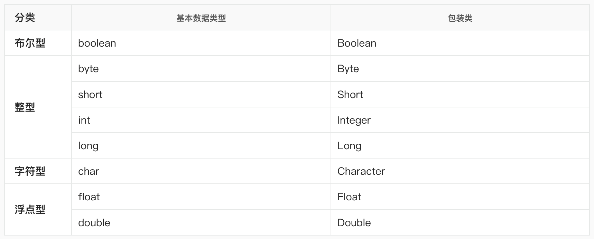


<details>
<summary>知识扩展</summary>

① **基本类型和包装类型的区别**
（1）默认值不同，基本类型的默认值为`0`、`false`或`\u0000`等，包装类默认为`null`
（2）初始化方式不同，一个需要 new，一个不需要
（3）存储方式不同，基本类型保存在栈上，包装类对象保存在堆上（通常情况下，在没有 JIT 优化栈上分配时）

② **如何理解拆装箱**
&#8195;&#8195;包装类是对基本类型的包装，所以，<u>把基本数据类型转换成包装类的过程就是装箱</u>；反之，<u>把包装类转换成基本数据类型的过程就是拆箱</u>。在 Java SE5 中，为了减少开发人员的工作，Java 提供了自动拆箱与自动装箱功能。

```java 
// Java SE5 之前
Integer i = new Integer(10);

// Java SE5 之后
Integer integer = 10; // 自动装箱
int i = integer;      // 自动拆箱
```

利用工具`JD-GUI`查看`class`字节码文件：

```java 
Integer integer = Integer.valueOf(10);
int i = integer.intValue();
```

通过分析上面的代码，可以看出<u>自动装箱都是通过<mark>包装类</mark>的`valueOf()`方法实现；自动拆箱都是通过<mark>包装类对象</mark>的`xxxValue()`来实现。</u>

③ **哪些地方涉及自动拆装箱**

&#8195;场景一：将基本数据类型放入集合类(自动装箱)


<Tabs items={["App.java", "反编译"]}>
<Tab value="App.java">

```java 
List<Integer> list = new ArrayList<>();
for (int i = 1; i < 10; i++) {
    list.add(i);
}
```

</Tab>
<Tab value="反编译">

```java 
List<Integer> list = new ArrayList<>();
for (int i = 1; i < 10; i++)
    list.add(Integer.valueOf(i));
```

</Tab>
</Tabs>


&#8195;场景二：包装类型和基本类型的大小比较


<Tabs items={["App.java", "反编译"]}>
<Tab value="App.java">

```java 
Integer a = 1;
System.out.println(a == 1 ? "等于" : "不等于");

Boolean bool = false;
System.out.println(bool ? "真" : "假");
```

</Tab>
<Tab value="反编译">

```java 
Integer a = Integer.valueOf(1);
System.out.println((a.intValue() == 1) ? "等于" : "不等于");

Boolean bool = Boolean.valueOf(false);
System.out.println(bool.booleanValue() ? "真" : "假");
```

</Tab>
</Tabs>


> ⭐️ 包装类与基本数据类型进行比较运算，是先将包装类进行拆箱成基本数据类型，然后进行比较的。

&#8195;场景三：包装类型的运算


<Tabs items={["App.java", "反编译"]}>
<Tab value="App.java">

```java 
Integer i = 10;
Integer j = 20;

System.out.println(i + j);
```

</Tab>
<Tab value="反编译">

```java 
Integer i = Integer.valueOf(10);
Integer j = Integer.valueOf(20);
System.out.println(i.intValue() + j.intValue());
```

</Tab>
</Tabs>


> ⭐️ 两个包装类型之间的运算，会被自动拆箱成基本类型进行。

&#8195;场景四：三目运算符的使用


<Tabs items={["App.java", "反编译"]}>
<Tab value="App.java">

```java 
boolean flag = true;
Integer i = 0;
int j = 1;
int k = flag ? i : j;
System.out.println("k = " + k);
```

</Tab>
<Tab value="反编译">

```java 
boolean flag = true;
Integer i = Integer.valueOf(0);
int j = 1;
int k = flag ? i.intValue() : j;
System.out.println("k = " + k);
```

</Tab>
</Tabs>


> ⭐️ 三目运算符的语法规范：当第二、第三位操作数分别为基本类型和对象时，其中的对象就会拆箱为基本类型进行操作。假如此处的`i`为`null`，自动拆箱就会出现 NPE 异常(空指针)。

&#8195;场景五：函数参数与返回值

```java 
// 自动拆箱：num.intValue()
public int getNum1(Integer num) {
 return num;
}

// 自动装箱：Integer.valueOf(num)
public Integer getNum2(int num) {
 return num;
}
```

④ **自动拆装箱与缓存**

```java 
Integer a = 100; // Integer.valueOf(100);
Integer b = 100; // Integer.valueOf(100);
Integer c = 200; // Integer.valueOf(200);
Integer d = 200; // Integer.valueOf(200);
System.out.println(a == b); // 打印true
System.out.println(c == d); // 打印false
```

> ⭐️ 在 Java 中，`==`比较的是对象的引用，而`equals`比较的是值。所以，在这个例子中，不同的对象有不同的引用，那么应该都返回 false。但是结果与我们预想的不一致，这里和 Integer 中的缓存机制有关。在 Java5 中，在 Integer 的操作上引入了一个新功能来节省内存和提高性能。整型对象通过使用相同的对象引用实现了缓存和重用 <mark>（适用于整数-128 ~ 127，且只适用于自动装箱）</mark>。当需要进行自动装箱时，如果数字在-128 ~ 127 之间，会直接使用缓存中的对象，而不是重新创建一个对象。
> ⭐️ 在 Java5 中引入这个功能时，这个范围是固定的，后面在 Java6 中，可以通过`-XX:AutoBoxCacheMax=<size>`或者在 VM 初始化期间使用`java.lang.Integer.IntegerCache.high`设置最大值。

</details>


### 如何将一个整型转为字符串，反之，将一个字符串类型的数据转为整型 [#如何将一个整型转为字符串反之将一个字符串类型的数据转为整型]

> 整型 → 字符串：String.valueOf(int parameter)
> 字符串 → 整型：Interger.parseInt(String parameter)

### 重载(overload)与重写(override)的区别 [#重载overload与重写override的区别]

> **重载**：同一个类中，方法名相同，方法的参数的<u>类型、顺序、数量</u>不同的一组方法 <mark>(返回值不同，但是方法名和参数列表都相同的两个方法，不是重载。)</mark>
> **重写**：子类对父类中的同名方法进行覆盖

### Java 中`==`与`equals`的区别(必会) [#java-中与equals的区别必会]

> `==`：
> &#8195;&#8195;基本类型：比较的就是值是否相同
> &#8195;&#8195;引用类型：比较的就是内存中的存放地址(堆内存地址)是否相同
>
> `equals`：
> &#8195;&#8195;此方法是 Object 类中定义方法，只能实现两个引用类型的变量进行比较，默认比较的是两个对象的内存地址值；在 String 类，对此方法进行了重写，实现的是比较两个字符串的值是否相同；

### 为什么不能用 BigDecimal 的 equals 方法做等值比较？ [#为什么不能用-bigdecimal-的-equals-方法做等值比较]

> 因为 BigDecimal 的 equals 方法和 compareTo 并不一样，equals 方法会比较两个部分的内容，分别是值(value)和标度(scale)，比如 0.1 和 0.10 这两个数字，它们的值虽然一样，但是由于精度不一样，所以使用 equals 会返回 false。

---

**知识扩展(阿里巴巴 Java 开发手册)**：

<span>【强制】</span>如上所示 BigDecimal 的等值比较应使用 compareTo()方法，而不是 equals()方法。
<span>说明：equals()方法会比较值和精度(1.0 与 1.00 返回结果为 false)，而 compareTo()则会忽略精度。</span>

---

### BigDecimal(double)和 BigDecimal(String)有什么区别？ [#bigdecimaldouble和-bigdecimalstring有什么区别]

> 因为 double 是不精确的，所以使用一个不精确的数字来创建 BigDecimal，得到的数字也是不精确的。如 0.1 这个数，double 只能表示它的近似值。而对于 BigDecimal(String)，创建出来的值就是精确的。

---

**知识扩展(阿里巴巴 Java 开发手册)**：

<span>【强制】</span>禁止使用构造方法 BigDecimal(double)的方式把 double 转化为 BigDecimal 对象。
<span>说明：BigDecimal(double)存在精度损失风险，在精度计算或值比较的场景中可能会导致业务逻辑异常。</span>
<span>如：BigDecimal g = new BigDecimal(0.1F)；实际的存储值为：0.10000000149</span>
<span>正例：优先推荐入参为 String 的构造方法，或使用 BigDecimal 类的 valueOf 方法，此方法内部其实执行了 Double 的 toString，而 Double 的 toString 按 double 的实际能表达的精度对尾数进行了截断。</span>
<span>BigDecimal recommand1 = new BigDecimal("0.1");</span>
<span>BigDecimal recommand2 = BigDecimal.valueOf (0.1);</span>

---

### 为什么对 Java 中的负数取绝对值结果不一定是正数？ [#为什么对-java-中的负数取绝对值结果不一定是正数]

> &#8195;&#8195;<u>使用`Math.abs`对一个 Interger 取绝对值的时候，可能出现负数情况</u>。int 的取值范围是 -2<sup>31</sup> ~ 2<sup>31</sup>-1，即-2147483648 ~ 2147483647。假设对-2147483648 取绝对值，正数就大于了 int 的最大取值范围，这时候就会发生越界。2147483647 用二进制的补码表示是：`01111111 11111111 11111111 11111111`，这个数 + 1 得到`10000000 00000000 00000000 00000000`，这个二进制称为-2147483648 的补码。针对这种情况可以把 int 类型转成 long 类型，就不会出现越界了。

### String、StringBuffer 与 StringBuilder 的区别(必会) [#stringstringbuffer-与-stringbuilder-的区别必会]

> **String**：字符串常量
> **StringBuffer**：字符串变量(线程安全)
> **StringBuilder**：字符串变量(非线程安全)

&#8195;&#8195;String 构建一个不可变的字符序列，StringBuffer 和 StringBuilder 都是构建一个可变的字符序列。在对字符串进行追加操作时 StringBuffer 比 String 效率高。

&#8195;&#8195;此外 StringBuffer 是线程安全的，而 StringBuilder 是线程非安全的，在对字符串进行修改操作时，StringBuilder 效率优于 StringBuffer。


<Callout type="success" title="提示">

&#8195;&#8195;String 在 String 类中使用 final 关键字修饰字符数组来保存字符串，`private final char value[]`，String 对象是不可变的，也就可以理解为常量，线程安全。

&#8195;&#8195;AbstractStringBuilder 是 StringBuffer 与 StringBuilder 的公共父类，定义了一些字符串的基本操作，如：expandCapacity、append、insert、indexOf 等公共方法。

&#8195;&#8195;StringBuffer 对方法加了同步锁或者对调用的方法加了同步锁，所以是线程安全的。

&#8195;&#8195;StringBuilder 并没有对方法进行加同步锁，所以是非线程安全的。

</Callout>


**小结**：
① 如果要操作少量的数据用 String；
② 多线程操作字符串缓冲区下操作大量数据用 StringBuffer；
③ 单线程操作字符串缓冲区下操作大量数据用 StringBuilder。

---


<details>
<summary>知识扩展</summary>

① **String 为什么不可变，我的代码中经常改变 String 的值**

```java 
String s = "abcd";
s = s.concat("ef");
```

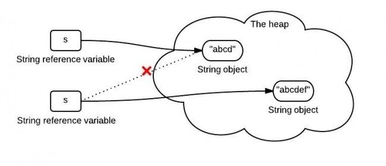

&#8195;&#8195;虽然字符串内容看上去从"abcd"变成了"abcdef"，但是实际上，我们得到的已经是一个新的字符串了(<mark>在堆中重新创建了一个"abcdef"字符串，和"abcd"并不是同一个对象</mark>)。
&#8195;&#8195;所以，一旦一个 string 对象在内存(堆)中被创建出来，它就无法被修改。而且，String 类的所有方法都没有改变字符串本身的值，都是返回了一个新的对象。

② **String 的"+"是如何实现的**
&#8195;&#8195;使用`+`拼接字符串，其实只是 Java 提供的一个语法糖，内部原理到底是如何实现的。

<Tabs items={["App.java", "反编译"]}>
<Tab value="App.java">

```java 
String hello = "Hello";
String java = "Java";
String out = hello + "," + java;
```

</Tab>
<Tab value="反编译">

```java 
String hello = "Hello";
String java = "Java";
(new StringBuilder()).append(hello).append(",").append(java).toString();
```

</Tab>
</Tabs>


> 字符串常量在拼接过程中，是将 String 转成了 StringBuilder 后，使用其 append 方法进行处理的。

③ **不要在 for 循环中使用+拼接字符串**

<Tabs items={["App.java", "反编译"]}>
<Tab value="App.java">

```java 
long t1 = System.currentTimeMillis();
String str = "java";
for (int i = 0; i < 50000; i++) {
    String s = String.valueOf(i);
    str += s;
}
long t2 = System.currentTimeMillis();
System.out.println("Time:" + (t2 - t1));
```

</Tab>
<Tab value="反编译">

```java 
long t1 = System.currentTimeMillis();
String str = "java";
for(int i = 0; i &lt; 50000; i++)
{
    String s = String.valueOf(i);
    str = (new StringBuilder()).append(str).append(s).toString();
}

long t2 = System.currentTimeMillis();
System.out.println((new StringBuilder()).append("Time:").append(t2 - t1).toString());
```

</Tab>
</Tabs>

&#8195;&#8195;在 for 循环中，每次都是 new 了一个 StringBuilder，然后再把 String 转成 StringBuilder，再进行 append。
&#8195;&#8195;而频繁的新建对象当然要耗费很多时间了，不仅仅会耗费时间，频繁的创建对象，还会造成内存资源的浪费。

---

**阿里巴巴 Java 开发手册**：

【推荐】循环体内，字符串的连接方式，使用 StringBuilder 的 append 方法进行扩展。
<span>说明：下例中，反编译出的字节码文件显示每次循环都会 new 出一个 StringBuilder 对象，然后进行 append 操作，最后通过 toString 方法返回 String 对象，造成内存资源浪费。</span>

<div>反例：</div>

```text
String str = "start";
for (int i = 0; i < 100; i++) {
    str = str + "hello";
}
```

</details>


---

### String 为什么设计成不可变的？ [#string-为什么设计成不可变的]

① **缓存**
&#8195;&#8195;字符串是使用最广泛的数据结构。大量的字符串的创建是非常耗费资源的，所以 Java 提供了对字符串的缓存功能，可以大大的节省堆空间。
&#8195;&#8195;JVM 中专门开辟了一部分空间来存储 Java 字符串，那就是<mark>字符串池</mark>。
&#8195;&#8195;通过字符串池，两个内容相同的字符串变量，可以从池中指向同一个字符串对象，从而节省了关键的内存资源。

```java 
String s = "abcd";
String s2 = s;
```

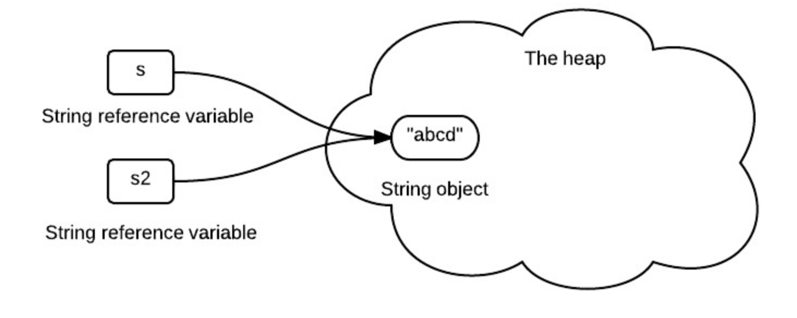

> &#8195;&#8195;对于这个例子，s 和 s2 都表示"abcd"，所以它们会指向字符串池中的同一个字符串对象。之所以可以这么做，主要是因为字符串的不变性。如果字符串是可变的，我们一旦修改了 s 的内容，那必然导致 s2 的内容也被动的改变了，这显然不是我们想看到的。

② **安全性**
&#8195;&#8195;字符串在 Java 应用程序中广泛用于存储敏感信息，如用户名、密码、连接 url、网络连接等。JVM 类加载器在加载类的时也广泛地使用它。
&#8195;&#8195;因此，保护 String 类对于提升整个应用程序的安全性至关重要。
&#8195;&#8195;当我们在程序中传递一个字符串的时候，如果这个字符串的内容是不可变的(<u>这里所说的不可变是指字符串对象本身的内容不可变，而不是引用指向的对象</u>)，那么我们就可以相信这个字符串中的内容。
&#8195;&#8195;但是，如果是可变的，那么这个字符串内容就可能随时都被修改。那么这个字符串内容就完全不可信了。这样整个系统就没有安全性可言了。
举例：

```java 
// 上面提到了字符串常量池的概念，下面的变量a、b都指向同一个123
// 假如String可变的，改变a的值，那么b也一起变了
String a = "123";
String b = "123";
a = "456";
```

③ **线程安全**
&#8195;&#8195;不可变会自动使字符串成为线程安全的，因为当从多个线程访问它们时，它们不会被更改。
&#8195;&#8195;一般来说，不可变对象可以在同时运行的多个线程之间共享。它们也是线程安全的，因为如果线程更改了值，那么将在字符串池中创建一个新的字符串，而不是修改相同的值。因此，字符串对于多线程来说是安全的。

④ **hashcode 缓存**
&#8195;&#8195;由于字符串对象被广泛地用作数据结构，它们也被广泛地用于哈希实现，如 HashMap、HashTable、HashSet 等。在对这些散列实现进行操作时，经常调用 hashCode()方法。
&#8195;&#8195;不可变性保证了字符串的值不会改变。因此，hashCode()方法在 String 类中被重写，以方便缓存，这样在第一次 hashCode()调用期间计算和缓存散列，并从那时起返回相同的值。

在 String 类中，有以下代码：

```java 
private int hash;//this is used to cache hash code.
```

⑤ **性能**
&#8195;&#8195;前面提到了的字符串池、hashcode 缓存等，都是提升性能的体现。
&#8195;&#8195;因为字符串不可变，所以可以用字符串池缓存，可以大大节省堆内存。而且还可以提前对 hashcode 进行缓存，更加高效。
&#8195;&#8195;由于字符串是应用最广泛的数据结构，提高字符串的性能对提高整个应用程序的总体性能有相当大的影响。

### String 能被继承吗？ [#string-能被继承吗]

> String 被 final 关键字修饰属于最终类，不能被继承。
> ⭐️ 底层源码：`public final class String implements java.io.Serializable, Comparable<String>, CharSequence {...}`

### String a = "ab"; String b = "a" + "b"; a == b 吗？ [#string-a--ab-string-b--a--b-a--b-吗]

> ⭐️ 在 Java 中，对于字符串使用`==`比较的是字符串对象的引用地址是否相同。
> ⭐️ 因为 a 和 b 都是由字面量组成的字符串，它们的引用地址在编译时就已经确定了，并且在编译之后，会把字面量直接组合在一起。因此，`a == b`的结果是`true`，因为它们指向的是同一个字符串对象。
> 编译后代码：
>
> ```java :no-line-numbers
> String a = "ab";
> String b = "ab";
> System.out.println("(a==b) = " + (a == b));
> ```

### String str=new String("Hello")创建了几个对象？ [#string-strnew-stringhello创建了几个对象]

创建的对象数应该是一个或者两个。
情况一：如果 String 的字符串常量池中有了 Hello 这个对象，那么就只创建一个对象。

> 因为字符串常量池中有 Hello，字符串就会用已有的 Hello 对象，所以不会在创建 Hello 对象了，只会创建一个 new String 对象。

情况二：如果 String 的字符串常量池中没有 Hello 这个对象，那么就会创建两个对象。

> 只要是 new 了就一定会创建一个新的对象，而字符串常量池中没有 Hello，所以会在字符串常量池中创建一个 Hello 对象。

```java 
String str = new String("Hello");
// 等价于
String s1 = "abc";
String str = new String(s1);
```

---

**知识扩展**：
创建了几个对象？

```java 
String str = "a";
String str1 = "a" + "b"; // 2个，一个是str对象a，一个是str1对象ab

String str = "a";
String str1 = str + "b"; // 3个，一个是str对象a，一个是b对象，一个是str1对象ab
```

---

### String 有长度限制吗？是多少？ [#string-有长度限制吗是多少]

> &#8195;&#8195;有限制，并且编译期和运行期不一样。
> &#8195;&#8195;编译期需要用`CONSTANT_Utf8_info`结构用于表示字符串常量的值，而这个结构是有长度限制，它的限制是 65535。<u>(理论上 65535，实际 65534)</u>  
> &#8195;&#8195;运行期，String 的 length 参数是 int 类型的，那么也就是说，String 定义的时候，最大支持的长度就是 int 的最大范围值。根据 Integer 类的定义，`java.lang.Integer#MAX_VALUE` 的最大值是 2<sup>31</sup> - 1 (大概 4G);

### 说一下字符串操作常见的 API ？(10 个左右即可) [#说一下字符串操作常见的-api-10-个左右即可]

| 方法                                                                       | 描述                                     |
| -------------------------------------------------------------------------- | ---------------------------------------- |
| `+`、`concat(String str)`                                                  | 字符串连接                               |
| `==`、`equals(Object anObject)`、`equalsIgnoreCase(String another String)` | 字符串比对                               |
| `charAt(index)`                                                            | 获取指定位置字符值                       |
| `length()`                                                                 | 获取字符串长度                           |
| `indexOf(String str)`                                                      | 获取指定字符串第一次出现的下标值         |
| `replace(char oldChar, char newChar)`                                      | 字符串替换                               |
| `startsWith(String prefix)`、`endsWith(String prefix)`                     | 判断是否以指定字符串开始\|结束           |
| `toLowerCase()`、`toUpperCase()`                                           | 所有字符转换为小写\|大写                 |
| `substring(index)`                                                         | 字符串截取                               |
| `trim()`                                                                   | 去除左右空格                             |
| `String.valueOf(int i)`                                                    | 将整型转为字符串                         |
| `contains(String str)`                                                     | 判断字符串是否包含某子字符串             |
| `isEmpty()`                                                                | 判断字符串是否为空                       |
| `split(String regex)`                                                      | 指定分隔符返回分割后的字符数组           |
| `toCharArray()`                                                            | 将字符串转为字符数组                     |
| `getBytes()`、`getBytes(String charsetName)`                               | 返回字符串的 byte 类型数组(可指定字符集) |

### 自增(如下代码的运行结果) [#自增如下代码的运行结果]


<Tabs items={["代码", "输出结果"]}>
<Tab value="代码">

```java {4}
public class Test {
    public static void main(String[] args) {
        int i = 1;
        i = i++;
        int j = i++;
        int k = i + ++i * i++;
        System.out.println("i=" + i);
        System.out.println("j=" + j);
        System.out.println("k=" + k);
    }
}
```

</Tab>
<Tab value="输出结果">

```text
i=4
j=1
k=11
```

</Tab>
</Tabs>


<Callout type="success" title="解析">

**行 4**：先将 1 压入操作数栈，然后局部变量表中的 i 自增变为 2，最后操作树栈中的 1 赋值给 i，2 被覆盖；

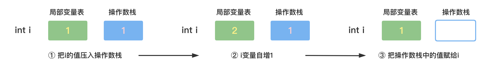

**总结**：  
① 先赋值再自增、自减(i = i++ 、i = i--)，先自增、自减再赋值(i = ++i 、i = --i)  
② = 右边的从左到右加载值依次压入操作数栈  
③ 实际先算哪个，看运算符优先级  
④ 自增、自减操作都是<mark>直接修改变量的值，不经过操作数栈</mark>  
⑤ 最后的赋值之前，临时结果也是存储在操作数栈中

</Callout>


### RPC 接口返回中，使用基本类型还是包装类？ [#rpc-接口返回中使用基本类型还是包装类]

> ⭐️ 使用<mark>包装类</mark>，不要使用基本类型，比如某个字段表示费率的`Float rate`，在接口中返回时，如果出现接口异常的情况，那么可能会返回默认值，float 的默认值为 0.0，而 Float 的默认值是 null。
> ⭐️ 在接口中，为了避免发生歧义，建议使用对象，因为它的默认值是 null，当看到 null 的时候，可以知道是出错了，但是看到 0.0，就无法分辨是出错返回的，还是真的返回 0.0，虽然也可以用其它字段，比如错误码这些来判断，但还是尽量减少歧义的可能。

**知识扩展**：在接口定义的时候，如何定义一个字段表示是否成功？

```java 
boolean success
Boolean success
boolean isSuccess
Boolean isSuccess
```

> 建议使用第一种。作为接口返回对象的参数，这个字段不应该有不确定的 null 值，而 Boolean 类型的默认值为 null，boolean 的默认值为 false，所以建议使用 boolean 来定义参数。关于参数名称的命令，阿里巴巴开发手册有明确规定和解释。

<span>【强制】</span>POJO 类中布尔类型的变量，都不要加 is，否则部分框架解析会引起序列化错误。
<span>反例：定义为基本数据类型`Boolean isDeleted;`的属性，它的方法也是`isDeleted()`，RPC 框架在反向解析的时候，"以为"对应的属性名称是 deleted，导致属性获取不到，进而抛出异常。</span>

---

### 常见的字符编码有哪些？有什么区别？ [#常见的字符编码有哪些有什么区别]

> ⭐️ 计算机只认识 0 和 1 两种字符，但是人类的文字是多种多样的，如何把人类的文字转换成计算机认识的 0 和 1 呢，这个过程需要通过**字符编码**。
> ⭐️ 上个世纪 60 年代，美国制定了一套字符编码，对英语字符与二进制位之间的关系做了统一的规定，这被称为 ASCII 码，一直沿用至今。
> ⭐️ 由于 ASCII 只有 128 个字符，虽然对于英文字符都可以表示了，但是世界上很多其它的文字无法表示，于是后面出现了 Unicode 字符集(常见的 Unicode Transformation Format 有 UTF-7、UTF-7.5、UTF-8、UTF-16 以及 UTF-32)，除此之外还有一些常用的中文编码如 GBK、GB2312、GB18030 等。

**知识扩展**：
① **Unicode 和 UTF-8 有啥关系？**
&#8195;&#8195;首先 Unicode 和 UTF-8 都是字符编码方案。它们的目的都是为了统一字符的表示方式，以便在不同的计算机系统和软件中进行字符的交换和处理。

&#8195;&#8195;Unicode 是一个字符集，它为每个字符分配了唯一的编号(码点)，包括了世界上几乎所有的字符，但是却没有规定如何存储。假如 Unicode 统一规定，每个符号就要用三个或四个字节表示(因为字符太多，只能用这么多字节才能表示完全)。一旦这么规定，那么每个英文字母前都必然有二到三个字节是 0，因为所有英文字母在 ASCII 中都有，都可以用一个字节表示，剩余字节位置就要补充 0。如果这样，文本文件的大小会因此大出二三倍，这对于存储来说是极大的浪费。

&#8195;&#8195;为了解决这个问题就出现了一些中间格式的字符集，它们被称为通用转换格式，即 UTF（Unicode Transformation Format）。

&#8195;&#8195;UTF-8 是一种针对 Unicode 的<mark>可变长度字符编码</mark>方案。它使用一到四个字节来表示一个 Unicode 字符，根据字符的不同范围，采用不同长度的编码。UTF-8 是一种通用的字符编码方案，它能够表示 Unicode 字符集中的任意字符，并且兼容 ASCII 编码。

&#8195;&#8195;此外 UTF-16 使用二或四个字节为每个字符编码，UTF-32 使用四个字节为每个字符编码。它们都是 Unicode 的一种实现方式。

② **有了 UTF-8，为什么要出现 GBK？**
&#8195;&#8195;GBK（Guo Biao Kang）是中国的一种字符集编码方式，它是国家标准局于 1995 年发布的一种汉字编码标准。采用双字节编码，能够表示简体和繁体中文字符以及日韩等扩展字符，总计收录了 21886 个汉字。使用 GBK <u>主要还是处于节省存储空间考虑</u>，例如一个中国的网站，更多的是使用中文和一些英文字符，很少会出现其它语言字符。


<Callout type="success" title="常用的中文编码有 GBK，GB2312，GB18030 等，最常用的是 GBK。">

GB2312（1980 年）：16 位字符集，收录有 6763 个简体汉字，682 个符号，共 7445 个字符；
&#8195;优点：适用于简体中文环境，属于中国国家标准，通行于大陆，新加坡等地也使用此编码；
&#8195;缺点：不兼容繁体中文，其汉字集合过少。

GBK（1995 年）：16 位字符集，收录有 21003 个汉字，883 个符号，共 21886 个字符；
&#8195;优点：适用于简繁中文共存的环境，为简体 Windows 所使用，向下完全兼容 gb2312，向上支持 ISO-10646 国际标准 ；所有字符都可以一对一映射到 unicode2.0 上；
&#8195;缺点：不属于官方标准，和 big5 之间需要转换；很多搜索引擎都不能很好地支持 GBK 汉字。

GB18030（2000 年）：32 位字符集；收录了 27484 个汉字，同时收录了藏文、蒙文、维吾尔文等主要的少数民族文字。
&#8195;优点：可以收录所有你能想到的文字和符号，属于中国最新的国家标准；
&#8195;缺点：目前支持它的软件较少。

</Callout>


③ **为什么会出现乱码？**
&#8195;&#8195;文件里面的内容归根结底都是由 0 和 1 组成的，至于它们的组合如何转成可以理解的字符串，则需要通过规定好的字符编码标准来进行转换。如果我们把通过 UTF-8 编码的一串中文字符串传给别人，假如他通过 GBK 进行解码，就会出现`锟届瀿锟斤拷雮傡锟斤拷直锟斤拷锟`，这就是乱码。

---

### 单例设计模式 [#单例设计模式]


<Callout type="success" title="什么是 Singleton ？">

**Singleton** : 在 Java 中即指单例设计模式，它是软件开发中最常用的设计模式之一。单例设计模式，即某个类在整个系统中<mark>只能有一个实例对象</mark>可被获取和使用的代码模式。例如：代表 JVM 运行环境的 Runtime 类

**要点**：

① 某个类只能有一个实例【构造器私有化】  
② 它必须自行创建这个实例【含有一个该类的静态变量来保存这个唯一的实例)】  
③ 它必须自行向整个系统提供这个实例【对外提供获取该实例对象的方式：(1)直接暴露 (2)用静态变量的 get 方法获取】

</Callout>


#### 饿汉式 [#饿汉式]

```java
// 直接实例化(简洁直观)
public class Singleton {
    public static final Singleton INSTANCE = new Singleton();
    private Singleton() {}
}

// 枚举式(最简洁)
public enum Singleton {
    INSTANCE
}

// 静态代码块(适合复杂实例化)
public class Singleton {
    public static final Singleton INSTANCE;

    static {
        INSTANCE = new Singleton();
    }

    private Singleton() {}
}

// 调用
Singleton s = Singleton.INSTANCE;
```

> 在类初始化时直接创建实例对象，不管是否需要这个对象，不存在线程安全问题

#### 懒汉式 [#懒汉式]

```java
// 静态内部类形式(适用于多线程)
public class Singleton {
    private Singleton() {}

    private static class Inner {
        public static final Singleton INSTANCE = new Singleton();
    }

    public static Singleton getInstance() {
        return Inner.INSTANCE;
    }
}

// 调用
Singleton s = Singleton.getInstance();
```

> 延迟创建对象  
> 线程不安全(适用于单线程)、线程安全(适用于多线程)

### 说几个常见的语法糖？ [#说几个常见的语法糖]

&#8195;&#8195;语法糖(Syntactic sugar)，指在计算机语言中添加的某种语法，这种语法对语言的功能并没有影响，但是更方便程序员使用。

&#8195;&#8195;虽然 Java 中有很多语法糖，但是 Java 虚拟机并不支持这些语法糖，所以<u>这些语法糖在编译阶段就会被还原成简单的基础语法结构</u>，这样才能被虚拟机识别，这个过程就是解语法糖。

&#8195;&#8195;如果看过 Java 虚拟机的源码，就会发现在编译过程中有一个重要的步骤就是调用`desugar()`，这个方法就是负责解语法糖的实现。

&#8195;&#8195;常见的语法糖有 switch 支持枚举及字符串、泛型、条件编译、断言、可变参数、自动装箱/拆箱、枚举、内部类、增强 for 循环、try-with-resources 语句、lambda 表达式等。

**知识扩展：**


<Cards>
  <Card title="语法糖" href="/docs/backend/java/syntactic-sugar" description="Java-语法糖" />
</Cards>


---

### Lambda 表达式是如何实现的？ [#lambda-表达式是如何实现的]


<Cards>
  <Card title="Lambda 表达式" href="/docs/backend/java/lambda#lambda-表达式是如何实现的" description="Lambda 表达式是如何实现的？" />
</Cards>


### 什么是泛型？有什么好处？ [#什么是泛型有什么好处]

&#8195;&#8195;Java 泛型(generics)是 JDK5 中引入的一个新特性，允许在定义类和接口的时候使用类型参数(type parameter)。声明的类型参数在使用时用具体的类型来替换。泛型最主要的应用是在 JDK 5 中的新集合类框架中。

**泛型的好处**：

&#8195;① 方便：可以提高代码的复用性。以 List 接口为例，我们可以将 String、Integer 等类型放入 List 中，如不用泛型，存放 String 类型要写一个 List 接口，存放 Integer 要写另外一个 List 接口，泛型可以很好的解决这个问题
&#8195;② 安全：在泛型出现之前，通过 Object 实现的类型转换需要在运行时检查，如果类型转换出错，程序直接 GG，可能会带来毁灭性打击。而泛型的作用就是在编译时做类型检查，这无疑增加程序的安全性


<details>
<summary>知识扩展</summary>

① **泛型是如何实现的**
&#8195;&#8195;Java 中的泛型通过类型擦除的方式来实现，是通过语法糖的形式。在`.java` → `.class` 转换的阶段，如：将 List\&lt;String\>擦出调整为 List。换句话说，Java 的泛型是在编译器，JVM 是不会感知到泛型的。

② **类型擦除的缺点有哪些**
（1）泛型不可以重载
（2）泛型异常类不可以多次 catch
（3）泛型类中的静态变量也只有一份，不会有多份

③ **List&lt;?>、List\&lt;Object\>、List 之间的区别**
（1）List\&lt;?\>是一个未知类型的 List，而 List\&lt;Object\>其实是任意类型的 List。可以把 List\&lt;String\>、List\&lt;Integer\>赋值给 List\&lt;?\>，却不能把 List\&lt;String\>赋值给 List\&lt;Object\>
（2）可以把任何带参数的类型传递给原始类型 List，但却不能把 List\&lt;String>赋值给 List\&lt;Object>，因为会产生编译错误(不支持协变)

④ **在泛型为 Integer 的 ArrayList 中存放一个 String 类型的对象**

```java 
public class App {
    public static void main(String[] args) throws Exception {
        ArrayList<Integer> list = new ArrayList<Integer>();
        Method method = list.getClass().getMethod("add", Object.class);
        method.invoke(list, "Java反射机制实例");
        System.out.println(list.get(0));
    }
}
```

⑤ **对数组协变和泛型非协变的理解**
&#8195;&#8195;所谓协变，可以简单理解为因为 Object 是 String 的父类，所以 Object[]同样是 String[]的父类，这种情况 Java 是允许的；但是对于泛型类说，List\&lt;Object>和 List\&lt;String>半毛钱关系都没有。
为什么要这么设计，如果泛型允许协变，考虑个例子：

```java 
List<Object> list = new List<String>();
list.add(1); // 允许协变，可以装进来
String str = list.get(0); // 运行时异常
```

但是为什么泛型不允许协变，而数组允许呢：
（1）因为数组设计之初没有泛型，为了兼容考虑，如：`Array.equlas(Object[], Object[])`方法，是时代无奈的产物
（2）数组也属于对象，它记录了引用实际的类型，在放入数组的时候，如果类型不一样就会报错，而不是等到拿出来的时候才发现问题，相对来说安全一点

</details>


### 什么是类型擦除？ [#什么是类型擦除]

类型擦除是 Java 在处理泛型的一种方式，如 Java 的编译器在编译一下代码时：


<Tabs items={["App.java", "反编译"]}>
<Tab value="App.java">

```java 
Map<String, Object> map = new HashMap();
map.put("name", "LiHua");
map.put("age", 20);
System.out.println("map = " + map);
```

</Tab>
<Tab value="反编译">

```java 
// Decompiled by Jad v1.5.8e. Copyright 2001 Pavel Kouznetsov.
Map map = new HashMap();
map.put("name", "LiHua");
map.put("age", Integer.valueOf(20));
System.out.println((new StringBuilder()).append("map = ").append(map).toString());
```

</Tab>
</Tabs>


### 泛型中 K T V E ？ Object 等分别代表什么含义 [#泛型中-k-t-v-e--object-等分别代表什么含义]

| 泛型 | 说明                                  |
| ---- | ------------------------------------- |
| `K`  | Key (键)                              |
| `T`  | Type (Java 类)                        |
| `V`  | Value (值)                            |
| `E`  | Element (集合元素)                    |
| `N`  | Number (数组类型)                     |
| `?`  | 不确定的 Java 类型 (无限制通配符类型) |

&#8195;&#8195;Object 是所有类的根类，任何类的对象都可以设置给该 Object 引用变量，使用的时候可能需要类型强制转换，但是用使用了泛型 T、E 等这些标识符后，在实际用之前类型就已经确定了，不需要再进行类型强制转换。


<details>
<summary>泛型示例</summary>

```java 
// 示例1：使用T作为泛型类型参数，表示任何类型
public class MyGenericClass<T> {
    private T myField;

    public MyGenericClass(T myField) {
        this.myField = myField;
    }

    public T getMyField() {
        return myField;
    }
}

// 示例2：使用K、V作为泛型类型参数，表示键值对中的键和值的类型
public class MyMap<K, V> {
    private List<Entry<K, V>> entries;

    public MyMap() {
        entries = new ArrayList<>();
    }

    public void put(K key, V value) {
        Entry<K, V> entry = new Entry<>(key, value);
        entries.add(entry);
    }

    public V get(K key) {
        for (Entry<K, V> entry : entries) {
            if (entry.getKey().equals(key)) {
                return entry.getValue();
            }
        }
        return null;
    }

    private class Entry<K, V> {
        private K key;
        private V value;

        public Entry(K key, V value) {
            this.key = key;
            this.value = value;
        }

        public K getKey() {
            return key;
        }

        public V getValue() {
            return value;
        }
    }
}

// 示例3：使用E作为泛型类型参数，表示集合中的元素类型
public class MyList<E> {
    private List<E> elements;

    public MyList() {
        elements = new ArrayList<>();
    }

    public void add(E element) {
        elements.add(element);
    }

    public E get(int index) {
        return elements.get(index);
    }
}

// 示例4：使用Object作为泛型类型参数，表示可以接受任何类型
public class MyGenericClass {
    private Object myField;

    public MyGenericClass(Object myField) {
        this.myField = myField;
    }

    public Object getMyField() {
        return myField;
    }
}
```

</details>


### 泛型中上下界限定符 extends 和 super 有什么区别？ [#泛型中上下界限定符-extends-和-super-有什么区别]

`<? extends T>` 表示类型的上界，表示参数化类型的可能是 T 或是 T 的子类
`<? super T>` 表示类型下界（Java Core 中叫超类型限定），表示参数化类型是此类型的超类型（父类型），直至 Object

|                          `<? extends T>`                          |                          `<? super T>`                          |
| :---------------------------------------------------------------: | :-------------------------------------------------------------: |
|            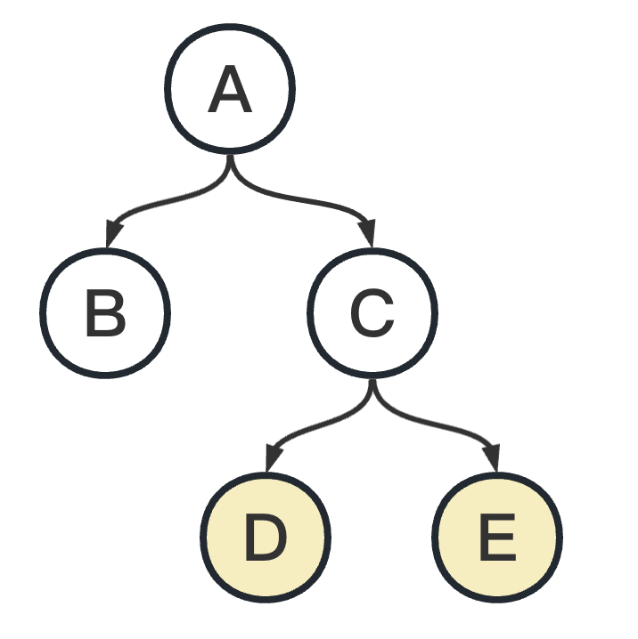            |            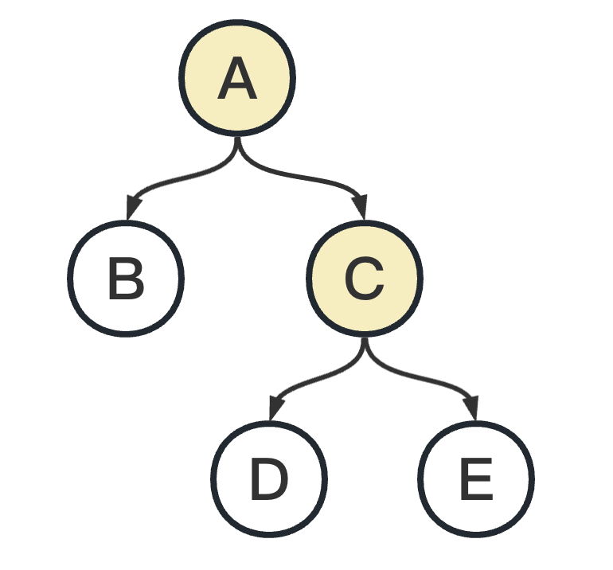            |
| 如果是`<? extends C>`，那么只有 D 和 E 允许被传入，否则会编译报错 | 如果是`<? super D>`，那么只有 C 和 A 允许被传入，否则会编译报错 |

### 什么是 SPI，和 API 有啥区别？ [#什么是-spi和-api-有啥区别]

&#8195;&#8195;Java 中区分 API 和 SPI，通俗的讲：API 和 SPI 都是相对的概念，它们的差别只在语义上，API 直接被应用开发人员使用，SPI 被框架扩展人员使用。

`API(Application Programming Interface)`：大多数情况下，都是实现方来制定接口并完成对接口的不同实现，调用方仅仅依赖却无权选择不同实现。

`SPI(Service Provider Interface)`：如果是调用方来制定接口，实现方来针对接口来实现不同的实现。调用方来选择自己需要的实现方。


<details>
<summary>如何定义一个 SPI？</summary>

<Tabs items={["App.java", "AnimalService.java", "CatServiceImpl.java", "DogServiceImpl.java"]}>
<Tab value="App.java">

```java 
package cn.test.spi;

import java.util.ServiceLoader;

public class App {
    public static void main(String[] args) {
        ServiceLoader<AnimalService> serviceLoader = ServiceLoader.load(AnimalService.class);

        // 遍历实现类并调用方法
        for (AnimalService service : serviceLoader) {
            service.doSomething();
        }
    }
}
```

</Tab>
<Tab value="AnimalService.java">

```java 
package cn.test.spi;

public interface AnimalService {
    void doSomething();
}
```

</Tab>
<Tab value="CatServiceImpl.java">

```java 
package cn.test.spi;

public class CatServiceImpl implements AnimalService {
    @Override
    public void doSomething() {
        System.out.println("Cat doing something...");
    }
}
```

</Tab>
<Tab value="DogServiceImpl.java">

```java 
package cn.test.spi;

public class DogServiceImpl implements AnimalService {
    @Override
    public void doSomething() {
        System.out.println("Dog doing something...");
    }
}
```

</Tab>
</Tabs>


<Tabs items={["cn.test.spi.AnimalService", "输出", "文件目录结构"]}>
<Tab value="cn.test.spi.AnimalService">

```txt 
cn.test.spi.CatServiceImpl
cn.test.spi.DogServiceImpl
```

</Tab>
<Tab value="输出">

```txt 
Cat doing something...
Dog doing something...
```

</Tab>
<Tab value="文件目录结构">

```txt 
src
└── main
    ├── java
    │   └── cn
    │       └── test
    │           └── spi
    │               ├── App.java // 程序运行入口
    │               ├── AnimalService.java  // 接口
    │               ├── CatServiceImpl.java // 接口实现类
    │               └── DogServiceImpl.java // 接口实现类
    └── resources
        └── META-INF
            └── services
                └── cn.test.spi.AnimalService
```

</Tab>
</Tabs>


**SPI 的实现原理**：

```java 
public final class ServiceLoader<S> implements Iterable<S>{
    private static final String PREFIX = "META-INF/services/";
    // 代表被加载的类或者接口
    private final Class<S> service;
    // 用于定位，加载和实例化providers的类加载器
    private final ClassLoader loader;
    // 创建ServiceLoader时采用的访问控制上下文
    private final AccessControlContext acc;
    // 缓存providers，按实例化的顺序排列
    private LinkedHashMap<String,S> providers = new LinkedHashMap<>();
    // 懒查找迭代器
    private LazyIterator lookupIterator;
    ......
}
```

1️⃣ 应用程序调用`ServiceLoader.load`方法，`ServiceLoader.load`方法内先创建一个新的`ServiceLoader`，并实例化该类中的成员变量，包括：
&#8195;&#8195;loader(ClassLoader 类型，类加载器)
&#8195;&#8195;acc(AccessControlContext 类型，访问控制器)
&#8195;&#8195;providers(LinkedHashMap 类型，用于缓存加载成功的类)
&#8195;&#8195;lookupIterator(实现迭代器功能)

2️⃣ 应用程序通过迭代器接口获取对象实例
① `ServiceLoader`先判断成员变量`providers`对象中(LinkedHashMap 类型)是否有缓存实例对象，如果有缓存，直接返回。

② 如果没有缓存，执行类的装载：
ⅰ 读取`META-INF/services/`下的配置文件，获得所有能被实例化的类的名称
ⅱ 通过反射方法`Class.forName()`加载类对象，并用`instance()`方法将类实例化
ⅲ 把实例化后的类缓存到`providers`对象中(LinkedHashMap 类型）
ⅳ 然后返回实例对象

**SPI 的应用场景**：
概括地说，适用于：调用者根据实际使用需要，启用、扩展、或者替换框架的实现策略。比较常见的例子：
&#8195;数据库驱动加载接口实现类的加载
&#8195;JDBC 加载不同类型数据库的驱动
&#8195;日志门面接口实现类加载
&#8195;SLF4J 加载不同提供商的日志实现类

</details>


### 反射(了解) [#反射了解]

&#8195;&#8195;在 Java 中的反射机制是指在运行状态中，对于任意一个类都能够知道这个类所有的属性和方法；并且对于任意一个对象，都能够调用它的任意一个方法；这种动态获取信息以及动态调用对象方法的功能称为 Java 语言的反射机制。

&#8195;&#8195;反射的好处是可以提升程序的灵活性和扩展性，比较容易在运行期间干很多事情。但是带来的问题更多，主要有：
&#8195;&#8195;&#8195;① 代码可读性及可维护性
&#8195;&#8195;&#8195;② 反射代码执行的性能低
&#8195;&#8195;&#8195;③ 反射破坏了封装性
&#8195;&#8195;所以，在业务代码中应该尽量避免使用反射，但是也要读懂中间件、框架中的反射代码。在有些场景下，要知道可以使用反射解决部分问题。

**获取 Class 对象的 3 种方法**：
① 调用某个对象的 getClass()方法

```java 
Person p = new Person();
Class clzz = p.getClass();
```

② 调用某个类的 class 属性来获取该类对应的 Class 对象

```java 
Class clazz = Person.class;
```

③ 使用 Class 类中的 forName()静态方法(最安全/性能最好)

```java 
// 最常用
Class clazz = Class.forName("类的全路径");
```

---

**扩展**：为什么反射慢？
① 由于反射涉及动态解析类型，因此不能执行某些 Java 虚拟机优化，如 JIT 优化
② 在使用反射时，参数需要包装成 Object[]类型，但是真正方法执行的时候，有需要再拆包成真正的类型，这些动作不仅消耗时间，而且过程中也会产生很多对象，对象一多就容易导致 GC，GC 会导致应用变慢
③ 反射调用方法时会从方法数组中遍历查找，并且会检查可见性，这些动作都是耗时的
④ 不仅方法的可见性要做检查，参数也需要做很多额外的检查

### 通过反射如何创建对象？ [#通过反射如何创建对象]

> ① 通过 Class 类的 newInstance()方法
> ② 通过 Constructor 的 newInstance(Object[] args)方法

**代码示例**：


<details>
<summary>通过反射如何创建对象(代码示例)</summary>

<Tabs items={["App.java", "Person.java", "输出"]}>
<Tab value="App.java">

```java 
package cn.bt66;

import java.lang.reflect.Constructor;
import java.lang.reflect.Field;
import java.lang.reflect.InvocationTargetException;

/**
 * @author zhangxiaojun
 */
public class App {
    public static void main(String[] args) throws ClassNotFoundException, NoSuchMethodException, InstantiationException, IllegalAccessException, InvocationTargetException {
        // 调用某个对象的 getClass() 方法
        Person person = new Person();
        Class clazz_1 = person.getClass();
        System.out.println("clazz_1 = " + clazz_1);

        // 调用某个类的 class 属性来获取该类对应的 Class 对象
        Class clazz_2 = Person.class;
        System.out.println("clazz_2 = " + clazz_2);

        // 使用 Class 类中的 forName() 静态方法
        Class clazz_3 = Class.forName("cn.bt66.Person");
        System.out.println("clazz_3 = " + clazz_3);

        // 比较
        System.out.println("clazz_1 == clazz_2 : " + (clazz_1 == clazz_2));
        System.out.println("clazz_1 == clazz_3 : " + (clazz_1 == clazz_3));

        // 通过 Class 类的 newInstance()方法
        Person p = (Person) clazz_1.newInstance();
        p.setAge(10);
        p.setName("Zhang");
        String pString = p.toString();
        System.out.println("pString = " + pString);

        // 通过 Constructor 的 newInstance(Object[] args)方法
        Constructor con = clazz_1.getConstructor();
        Person o = (Person) con.newInstance();
        o.setAge(20);
        o.setName("Li");
        String oString = o.toString();
        System.out.println("oString = " + oString);
    }
}
```

</Tab>
<Tab value="Person.java">

```java 
package cn.bt66;

/**
 * @author zhangxiaojun
 */
public class Person {
    private String name;
    private int age;

    /**
     * 无参构造函数
     * 注意：当没有有参构造函数时，会隐式声明
     */
    public Person() {
    }

    public Person(String name) {
        this.name = name;
    }

    private Person(String name, int age) {
        this.name = name;
        this.age = age;
    }

    public String getName() {
        return name;
    }

    public void setName(String name) {
        this.name = name;
    }

    public int getAge() {
        return age;
    }

    public void setAge(int age) {
        this.age = age;
    }

    public void eat() {
        System.out.println("Eating！");
    }

    @Override
    public String toString() {
        return "Name:" + this.name + "," + "Age:" + this.age;
    }
}
```

</Tab>
<Tab value="输出">

```text 
clazz_1 = class cn.bt66.Person
clazz_2 = class cn.bt66.Person
clazz_3 = class cn.bt66.Person
clazz_1 == clazz_2 : true
clazz_1 == clazz_3 : true
pString = Name:Zhang,Age:10
oString = Name:Li,Age:20
```

</Tab>
</Tabs>


---

**反射更多介绍**：


<Cards>
  <Card title="反射" href="/docs/backend/java/java-reflect" description="Java-反射" />
</Cards>


---

### Java 中创建对象有哪些种方式？ [#java-中创建对象有哪些种方式]

① 使用 new 关键字
② 使用反射机制
③ 使用 clone 方法
④ 使用反序列化
⑤ 使用方法句柄
⑥ 使用 Unsafe 分配内存

### 如何理解面向对象和面向过程？ [#如何理解面向对象和面向过程]

> ① 面向过程把问题分解成一个一个步骤，每个步骤用函数实现，依次调用。
> ② 面向对象将问题分解成一个一个步骤，对每个步骤进行相应的抽象，形成对象，通过不同对象之间的调用，组合解决问题。


<details>
<summary>知识扩展：面向对象的五大基本原则？</summary>

五大基本原则：
&#8195;单一职责原则(Single-Responsibility Principle)：一个类最好只做一件事
&#8195;开放封闭原则(Open-Closed principle)：对扩展开放、对修改封闭
&#8195;里氏替换原则(Liskov-Substituion Principle)：子类必须能够替换其基类
&#8195;依赖倒置原则(Dependency-Inversion Principle)：程序要依赖于抽象接口，而不是具体的实现
&#8195;接口隔离原则(Interface-Segregation Principle)：使用多个小的专门的接口，而不要使用一个大的总接口

</details>


### 面向对象的特征(了解) [#面向对象的特征了解]

**面向对象的特征**：<u>封装、继承、多态、抽象</u>

> **封装**：把对象的属性和方法结合成一个独立的整体，隐藏实现细节，但提供对外访问的接口。由于隐藏了实现细节，同时又可以对属性赋值进行校验，所以增加了安全性；另外封装的各种方法，可以任意调用，不需要关心实现细节，提高了代码复用性。
>
> ---
>
> **继承**：子类继承父类的数据属性和行为，并能根据自己的需求扩展出新的行为，提高了代码的复用性。
>
> ---
>
> **多态**：多态是同一个行为具有多个不同表现形式或形态的能力（<mark>多态是父类行为的多面性。---子类重写造成的</mark>）
>
> ---
>
> **抽象**：表示对问题领域进行分析、设计中得出的抽象的概念，是对一系列看上去不同，但是本质上相同的具体概念的抽象。在 Java 中抽象用 abstract 关键字来修饰，用此关键字修饰类时，此类就不能被实例化，这里可以看出，抽象类(接口)就是为了继承而存在的。

### Java 中的多态三个条件？ [#java-中的多态三个条件]

> ① 要有继承；
> ② 要有重写；
> ③ 必须通过父类的对象调用(即：父类的引用指向子类的对象 `Animal cat = new Cat();`)。

### 解释一下向上转型与向下转型 [#解释一下向上转型与向下转型]

> 向上转型：通过子类对象 (小范围) 实例化父类对象 (大范围)， 这种属于自动转换
> 向下转型：通过父类对象 (大范围) 实例化子类对象 (小范围)， 这种属于强制转换

**代码示例**：

<details>
<summary>展开查看</summary>

<Tabs items={["向上转型", "向下转型"]}>
<Tab value="向上转型">

```java 
class Animal {
    public void sound() {
        System.out.println("Animal makes sound");
    }
}

class Dog extends Animal {
    public void sound() {
        System.out.println("Dog barks");
    }

    public void playFetch() {
        System.out.println("Dog plays fetch");
    }
}

public class Main {
    public static void main(String[] args) {
        Dog dog = new Dog();
        Animal animal = dog; // 向上转型
        animal.sound(); // 输出 "Dog barks"
        // animal.playFetch(); 编译错误，无法访问子类新增的方法
    }
}
```

</Tab>
<Tab value="向下转型">

```java 
class Animal {
    public void sound() {
        System.out.println("Animal makes sound");
    }
}

class Dog extends Animal {
    public void sound() {
        System.out.println("Dog barks");
    }

    public void playFetch() {
        System.out.println("Dog plays fetch");
    }
}

class Cat extends Animal { }

public class Main {
    public static void main(String[] args) {
        Animal animal = new Dog();
        if (animal instanceof Dog) {
            Dog dog = (Dog) animal; // 向下转型
            dog.sound(); // 输出 "Dog barks"
            dog.playFetch(); // 输出 "Dog plays fetch"
        }

        Cat Cat = (Cat) animal; // ClassCastException：Dog cannot be cast to Cat
        Cat.sound();
    }
}
```

</Tab>
</Tabs>


> ⭐️ 向上转型(Upcasting)：将一个子类的实例赋值给其父类的引用变量。这个操作是安全的，因为子类继承了父类的所有属性和方法。在向上转型中，只能访问父类中定义的属性和方法，无法访问子类新增的属性和方法。
> ⭐️ 向下转型(Downcasting)：将一个父类的引用变量转换为其子类的引用变量。这个操作需要显式地将父类的引用转换为子类的引用，因为编译器无法确定父类引用所指向的对象是否是子类的实例。如果转换不正确，会引发 ClassCastException 异常。

### final 关键字作用？ [#final-关键字作用]

> ① final 修饰变量，表示该变量为常量，只能赋值一次;
> ② final 修饰方法，表示该方法不能被重写;
> ③ final 修饰类，表示该类不能被继承。

### 说一下 java 中类的四种封装？ [#说一下-java-中类的四种封装]

| 修饰符    | 类内部 | 同一个包中 | 子类 | 任何地方 |
| :-------- | :----: | :--------: | :--: | :------: |
| private   |   ✔️   |            |      |          |
| default   |   ✔️   |     ✔️     |      |          |
| protected |   ✔️   |     ✔️     |  ✔️  |          |
| public    |   ✔️   |     ✔️     |  ✔️  |    ✔️    |

### java 中如何实现继承？java 中能实现多重继承吗？ [#java-中如何实现继承java-中能实现多重继承吗]

> 📖 继承概念：继承就是子类继承父类的特征和行为，使得子类对象(实例)具有父类的实例域和方法，或子类从父类继承方法，使得子类具有父类相同的行为。
> 📖 如何实现继承：使用 extends 关键字;一个子类只有一个直接父类。

### 为什么 Java 不支持多继承？ [#为什么-java-不支持多继承]

> &#8195;&#8195;因为如果要实现多继承，就会像 C++ 中一样，存在<mark>菱形继承</mark>的问题，C++ 为了解决菱形继承问题，又引入了<mark>虚继承</mark>。而经过分析，发现我们需要使用多继承的情况并不多，所以在 Java 中，不允许多继承，即一个类不允许继承多个父类。
> &#8195;&#8195;在 Java 8 之前，接口中是不能有方法的实现的，所以一个类同时实现多个接口的话，也不会出现 C++ 中歧义问题。因为所有方法都没有方法体，真正的实现还是在子类中。但是，Java8 中支持了默认函数(default method)，即接口中可以定义一个有方法体的方法了。
> &#8195;&#8195;而又因为 Java 支持同时实现多个接口，这就相当于通过 implements 就可以从多个接口中继承到多个方法。但是 Java8 中为了避免菱形继承的问题，在实现的多个接口中如果有相同方法，就会要求该类必须重写这个方法。


<details>
<summary>知识扩展</summary>

① **菱形继承问题**
&#8195;&#8195;Java 创始人詹姆斯·高斯林(James Gosling)曾经回答过：<u>"Java 之所以不支持一个类继承多个类，主要是因为在设计之初我们听取了来自 C++和 Objective-C 等阵营的人的意见。因为多继承会产生很多歧义问题。"</u>
&#8195;&#8195;这里提到的歧义，其实就是 C++ 因为支持多继承之后带来的菱形继承问题。

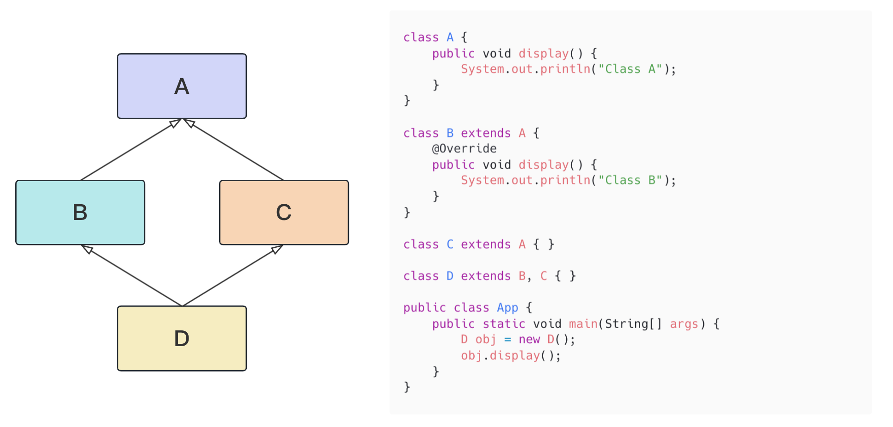

&#8195;&#8195;结合上图，假设我们有类 B 和类 C，它们都继承了相同的类 A，另外还有类 D，它通过多重继承的机制继承了类 B 和类 C。此时 D 就具有了 B 和 A 分别的`display()`方法，那么编译器无法确定应该调用哪个父类的方法，从而产生歧义。

&#8195;&#8195;因为这样的继承关系的形状类似于菱形，因此被称为菱形继承问题。而 C++ 为了解决这个问题，又引入了<mark>虚继承</mark>。

&#8195;&#8195;所以，在 Java 中，不允许声明多继承，即一个类不允许继承多个父类。但是 Java 允许"实现多继承"，即一个类可以实现多个接口，一个接口也可以继承多个父接口。由于接口只允许有方法声明而不允许有方法实现(Java 8 之前)，这就避免了 C++ 中多继承的歧义问题。

② **Java8 中的多继承**
&#8195;&#8195;Java 不支持多继承，但是可以支持多实现，也就是说，同一个类可以同时实现多个接口。
&#8195;&#8195;我们知道，在 Java8 之前，接口中是不能有方法实现的，所以一个类同时实现多个接口的话，也不会出现 C++ 中的歧义问题。因为所有方法都没有方法体，真正的实现还是在子类中的。
&#8195;&#8195;但是，在 Java8 中支持了默认函数(default method)，即接口中可以定义一个有方法体的方法。而又因为 Java 支持同时实现多个接口，这就相当于通过 implements 就可以从多个接口继承到多个方法，这就相当于变相支持了多继承。假如被实现的类中有同名方法，实现类中就必须进行重写，否则编译报错。

下面通过代码配合注释可以更直观的理解上面的内容：

```java 
interface Animal {
    void eat();

    void breath();
}

interface Mammal {
    default void run() { // Java 8 支持默认函数，实现类可以重写，也可以不重写
        System.out.println("Mammal-Run");
    }

    void eat();
}

class Dog implements Animal, Mammal {
    @Override
    public void eat() { // 被实现的类中都存在同名方法，必须重写
        System.out.println("Dog-eat");
    }

    @Override
    public void breath() { // 相当于 Java 8 以前 实现类必须重写
        System.out.println("Dog-breath");
    }
}

public class App {
    public static void main(String[] args) {
        Dog dog = new Dog();
        dog.eat();
        dog.run();
        dog.breath();
    }
}

// 输出
Dog-eat
Mammal-Run
Dog-breath
```

&#8195;&#8195;所以可以看到，Java 并没有帮我们解决多继承的歧义问题，而是把这个问题留给开发者，通过重写方法的方式自己解决。

</details>


### Java 的动态代理如何实现？ [#java-的动态代理如何实现]

**在 Java 中，实现动态代理有两种方式**：
① JDK 动态代理：`java.lang.reflect`包中的 Proxy 类和 InvocationHandler 接口提供了生成动态代理类的能力。
② Cglib 动态代理：Cglib (Code Generation Library )是一个第三方代码生成类库，运行时在内存中动态生成一个子类对象从而实现对目标对象功能的扩展。

**JDK 动态代理和 Cglib 动态代理的区别**：
JDK 的动态代理有一个限制，就是使用动态代理的对象必须实现一个或多个接口。如果想代理没有实现接口的类，就可以使用 Cglib 实现。

Cglib 是一个强大的高性能的代码生成包，它可以在运行期扩展 Java 类与实现 Java 接口。它广泛的被许多 AOP 的框架使用，例如 Spring AOP 和 dynaop，为他们提供方法的 interception（拦截）。

Cglib 包的底层是通过使用一个小而快的字节码处理框架 ASM，来转换字节码并生成新的类。不鼓励直接使用 ASM，因为它需要你对 JVM 内部结构包括 class 文件的格式和指令集都很熟悉。

所以，使用 JDK 动态代理的对象必须实现一个或多个接口；而使用 cglib 代理的对象则无需实现接口，达到代理类无侵入。

### 请解释一下 this 与 super 关键字？ [#请解释一下-this-与-super-关键字]

> this: ① 本类的对象；② 本类的构造函数。
> super: ① 父类的对象；② 父类的构造函数。

### 说一下类与对象的区别 [#说一下类与对象的区别]

> 类是具有相同属性和行为的一个群体，而对象则是这个群体中的一个个体；我们在使用时，先设计类，在创建对象，也就是说，类是创建对象的模板。

### 类与抽象类的区别 [#类与抽象类的区别]

> 类和抽象类的本质是一样的，都是类；但是抽象类一般是以基类的身份出现的，服务于子类的，可以包含抽象方法，普通类不可以，换句话说，抽象类可以不含抽象方法，但含抽象方法的类一定是抽象类。抽象类不可以被实例化，而普通类则可以。

### 什么是接口？ [#什么是接口]

> 接口是一系列方法的声明，是一些抽象方法的集合，是对类的行为定制的一套标准、一套规范、一套约束

### 接口中能定义的主要成员有哪些？ [#接口中能定义的主要成员有哪些]

> 属性和方法

### 抽象类与接口的区别？ [#抽象类与接口的区别]

**相同点**：不能实例化;
**不同点**：
&#8195;① **定义**：抽象类用`abstract`关键字，接口用`interface`；
&#8195;② **实现**：抽象类的子类使用`extends`来继承；接口必须使用`implements`来实现接口；
&#8195;③ **本质**：抽象类的本质为类，接口的本质是给类的行为定制规范；
&#8195;④ **实现数量**：类可以实现很多个接口；但是只能继承一个抽象类；
&#8195;⑤ **main 方法**：jdk1.8 之前，接口中不能有 main 方法，jdk1.8 中二者都可以有；
&#8195;⑥ **构造函数**：抽象类可以有构造函数；接口不能有；
&#8195;⑦ **访问权限**：

|             | 抽象类         | 接口           |
| ----------- | -------------- | -------------- |
| jdk1.8 之前 | protected      | public         |
| jdk1.8      | default/public | public/default |

&#8195;⑧ 抽象类中除了有抽象方法外，还可以有普通类中有的所有类成员，但接口中只能有抽象方法与属性(jdk8 做了扩展，可以有默认方法与静态方法)

### 说一下 break 与 continue 作用 [#说一下-break-与-continue-作用]

> `break`语句有两个作用：一是跳出当前循环体，执行循环之外的语句；二是跳出 switch 语句，而 continue 语句表示中止本次循环，继续执行下一次循环。

### Java 注解的作用？ [#java-注解的作用]

&#8195;&#8195;Java 注解用于为 Java 代码提供元数据。作为元数据，注解不直接影响你的代码执行，但也有一些类型的注解实际上可以用于这一目的。Java 注解是从 JDK5 开始加入的。

&#8195;&#8195;Java 的注解，可以说是一种标识，标识一个类或者一个字段，常常和反射、AOP 结合起来使用。中间件一般会定义注解，如果某些类或字段符合条件，就执行某些能力。


<details>
<summary>知识扩展</summary>

① **什么是元注解？**
说简单点就是定义其它注解的注解。

一如说`Override`这个注解，就不是一个元注解，而是通过元注解定义出来的。

```java 
package java.lang;
import java.lang.annotation.*;

@Target(ElementType.METHOD)
@Retention(RetentionPolicy.SOURCE)
public @interface Override {
}
```

这里的`@Target`、`@Retention`就是元注解。
元注解有四个：`@Target`(表示该注解可以用于什么地方)、`@Retention`(表示再什么级别保存该注解信息)、`@Documented`(将此注解包含再 JavaDoc 中)、`@Inherited`(允许子类继承父类中的注解)

`@Documented`：用于指示注解是否会出现在生成 Java 文档。如果一个注解被其修饰，则该注解的信息会出现在 API 文档中，方便开发者查阅。

`@Retention`：指定被修饰的注解的生命周期，即注解在源代码、编译时还是运行时保留。它有三个可选的枚举值：SOURCE、CLASS 和 RUNTIME。默认为 CLASS。

```java 
import java.lang.annotation.Retention;
import java.lang.annotation.RetentionPolicy;

@Retention(RetentionPolicy.RUNTIME)
public @interface Annotation {
    // some elements and values
}

// 枚举
public enum RetentionPolicy {
    SOURCE, // 源代码期间
    CLASS, // 编译期间(默认)
    RUNTIME // 运行期间
}

```

`@Target`：指定被修饰的注解可以应用于的元素类型，如：类、方法、字段等。这样可以限制注解的使用范围，避免错误使用。

```java 
import java.lang.annotation.ElementType;
import java.lang.annotation.Target;

@Target({ElementType.TYPE, ElementType.METHOD})
public @interface Annotation {
    // some elements and values
}

// 枚举
public enum ElementType {
    TYPE, // 类、接口(包括注释类型)或枚举声明
    FIELD, // 字段声明(包括枚举常量)
    METHOD, // 方法声明
    PARAMETER, // 形参声明
    CONSTRUCTOR, // 构造函数声明
    LOCAL_VARIABLE, // 局部变量声明
    ANNOTATION_TYPE, // 注解类型声明
    PACKAGE, // 包声明
    TYPE_PARAMETER, // 类型参数声明
    TYPE_USE // 类型的使用
}
```

`@Inherited`：指示被该注解修饰的注解是否可以被继承。默认情况下，注解不会被继承，即子类不会继承父类的注解。但如果将一个注解用其修饰，那么它就可以被子类继承。

```java 
import java.lang.annotation.Inherited;

@Inherited
public @interface MyInheritedAnnotation {
    // some elements and values
}
```

② **如何判断注解**
可以通过反射来判断类，方法，字段上是否有某个注解以及获取注解中的值, 获取某个类中方法上的注解代码示例如下：

```java 
Class clz = bean.getClass();
Method[] methods = clz.getMethods();
for (Method method : methods) {
if (method.isAnnotationPresent(EnableAuth.class)) {
    String name = method.getAnnotation(EnableAuth.class).name();
    }
}
```

</details>


### Java 序列化的原理 [#java-序列化的原理]

&#8195;&#8195;序列化是将对象转化为可传输格式的过程，是一种数据的持久化手段。一般广泛应用于网络传输，RMI 和 RPC 等场景中。几乎所有的商用编程语言都有序列化的能力，不管是数据存储到硬盘，还是通过网络的微服务传输，都需要序列化能力。

&#8195;&#8195;在 Java 的序列化机制中，如果是 String、枚举或者实现了 Serializable 接口的类，均可以通过 Java 的序列化机制，将类序列化为符合编码的数据流，然后通过 InputStream 和 OutputStream 将内存中的类持久化到硬盘或者网络中；同时，也可以通过反序列化机制将磁盘中的字节码再转换成内存中的类。

&#8195;&#8195;如果一个类想被序列化，需要实现 Serializable 接口。否则将抛出 NotSerializableException 异常。Serializable 接口没有方法或字段，仅用于标识可序列化的语义。

&#8195;&#8195;自定义类通过实现 Serializable 接口做标识，进而在 IO 中实现序列化和反序列化，具体的执行路径如下：
`#writeObject -> #writeObject0(判断类是否是自定义类) -> #writeOrdinaryObject(区分Serializable和Externalizable) -> writeSerialData(序列化fields) -> invokeWriteObject(反射调用类自己的序列化策略)`

&#8195;&#8195;其中，在 invokeWriteObject 的阶段，系统就会处理自定义类的序列化方案。

&#8195;&#8195;这是因为，在序列化操作过程中会对类型进行检查，要求被序列化的类必须属于 Enum、Array 和 Serializable 类型其中的任何一种。

### serialVersionUID 有何用途? 如果没定义会有什么问题？ [#serialversionuid-有何用途-如果没定义会有什么问题]

&#8195;&#8195;序列化是将对象的状态信息装换为可存储或可传输的形式的过程。Java 对象是保存在 JVM 的堆内存中的，也就是说，如果 JVM 堆不在了，那么对象也就跟着消失了。

&#8195;&#8195;而序列化提供了一种方案，可以让你在即使 JVM 停机的情况下也能把对象保存下来的方案。

&#8195;&#8195;把 Java 对象序列化成可存储或传输的形式(如二进制流)，比如保存在文件中。这样，当每次需要这个对象时，从文件中读取出二进制流，再从二进制流中反序列出对象。

&#8195;&#8195;但是虚拟机是否允许反序列化，不仅取决于类数据和功能代码是否一致，一个非常重要的一点就是两个类的序列化 ID 是否一致，即 serialVersionUID 要求一致。

&#8195;&#8195;在进行反序列化时，JVM 会把传来的字节流中的 serialVersionUID 与本地相应实体类的 serialVersionUID 进行比较，如果相同就认为是一致的，可以进行反序列化，否则就会出现序列化版本不一致的异常，即是 InvalidCastException。这样做是为了保证安全，因为文件存储中的内容可能被篡改。

&#8195;&#8195;当实现 java.io.Serializable 接口的类没有显式地定义一个 serialVersionUID 变量时候，Java 序列化机制会根据编译的 Class 自动生成一个 serialVersionUID 作序列化版本比较用，这种情况下，如果 Class 文件没有发生变化，就算再编译多次，serialVersionUID 也不会变化的。但是，如果发生了变化，那么这个文件对应的 serialVersionUID 也就会发生变化。

&#8195;&#8195;基于以上原理，如果我们一个类实现了 Serializable 接口，但是没有定义 serialVersionUID，然后序列化。在序列化之后，由于某些原因，我们对该类做了变更，重新启动应用后，我们相对之前序列化过的对象进行反序列化的话就会报错。

### fastjson 的反序列化漏洞 [#fastjson-的反序列化漏洞]

&#8195;&#8195;当使用 fastjson 进行反序列的时候，当一个类中包含了一个接口(或抽象类)的时候，会将子类型抹去，只保留接口(抽象类)的类型，使得反序列化时无法拿到原始类型。

&#8195;&#8195;那么为了解决这个问题，fastjson 引入了 AutoType，即在序列化的时候，把原始类型记录下来。

&#8195;&#8195;因为有了 AutoType 功能，那么 fastjson 在对 JSON 字符串进行反序列的时候，就会读取`@type`到内容，试图把 JSON 内容反序列成这个对象，并且会调用这个类的 setter 方法。

&#8195;&#8195;那么这个特性就可能被利用，攻击者自己构造一个 JSON 字符串，并且使用`@type`指定一个自己想要使用的攻击类库实现攻击。

### Java 是值传递还是引用传递？ [#java-是值传递还是引用传递]

**引用传递**：指在调用方法时将实际参数的地址直接传递到方法中，那么在方法中对参数所进行的修改，将影响到实际参数。

**值传递**：指在调用方法时将实际参数拷贝一份传递到方法中，这样在方法中如果对参数进行修改，将不会影响到实际参数。

&#8195;&#8195;Java 中的参数传递是<u>值传递</u>，对于基本数据类型，传递的是值的副本；对于引用类型，传递的是引用的副本，但实际上仍然是按值传递。

```java 
public class Main {
    public static void main(String[] args) {
        int x = 5;
        modifyPrimitive(x);
        System.out.println(x); // Output: 5

        int[] arr = {1, 2, 3};
        modifyArray(arr);
        System.out.println(arr[0]); // Output: 100
    }

    public static void modifyPrimitive(int value) {
        value = 10;
    }

    public static void modifyArray(int[] array) {
        array[0] = 100;
    }
}
```

> 在上面的示例中，`modifyPrimitive`方法并没有改变原始的`x`的值，而`modifyArray`方法却改变了原始数组`arr`中的值。

### 什么是深拷贝和浅拷贝？ [#什么是深拷贝和浅拷贝]

&#8195;&#8195;在计算机内存中，每个对象都有一个地址，这个地址指向对象在内存中存储的位置。当我们使用变量引用一个对象时，实际上是将该对象的地址赋值给变量。因此，如果我们将一个对象复制到另一个变量中，实际上是将对象的地址复制到了这个变量中。

**浅拷贝**：指将一个对象复制到另一个变量中，但是<u>只复制对象的地址，而不是对象本身</u>。也就是说，原始对象和复制对象实际上是共享同一个内存地址的。因此，如果我们修改了复制对象中的属性或元素，原始对象中对应的属性或元素也会被修改。

**深拷贝**：指将一个对象及其所有子对象都复制到另一个变量中，也就是说，<u>它会创建一个全新的对象，并将原始对象中的所有属性或元素都复制到新的对象中</u>。因此，如果我们修改复制对象中的属性或元素，原始对象中对应的属性或元素不会受到影响。

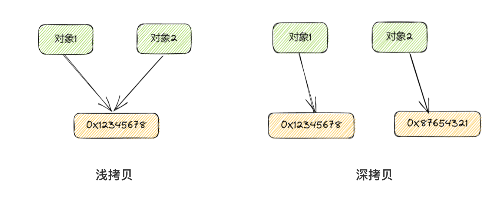

---

**代码示例**：

```java 
class Person {
    String name;
    int age;

    public Person(String name, int age) {
        this.name = name;
        this.age = age;
    }
}

public class Main {
    public static void main(String[] args) {
        Person john = new Person("John", 25);

        // 浅拷贝
        Person copy = john;
        copy.age = 30;
        System.out.println(john.age); // Output: 30

        // 深拷贝
        Person deepCopy = new Person(john.name, john.age);
        deepCopy.age = 35;
        System.out.println(john.age); // Output: 30
    }
}
```

> ⭐️ 在上面的示例中，通过`copy = john`进行浅拷贝，修改 `copy` 的属性会影响到 `john` 的属性值。而通过手动创建一个新的 `Person` 对象并将属性值复制到新对象中进行深拷贝，修改 `deepCopy` 的属性不会影响到 `john` 的属性值。
> ⭐️ 需要注意的是，进行深拷贝可能会导致性能上的开销，特别是在对象结构较大或嵌套层级较深时。因此，在实际使用时，需要根据需求和对象结构来选择使用浅拷贝还是深拷贝。

### SimpleDateFormat 是线程安全的吗？使用时应该注意什么？ [#simpledateformat-是线程安全的吗使用时应该注意什么]

<span>【强制】</span>SimpleDateFormat 是线程不安全的类，一般不要定义为 static 变量，如果定义为 static，必须加锁，或者使用 DateUtils 工具类。

<div>正例：注意线程安全，使用 DateUtils。亦推荐如下处理：</div>

```text
private static final ThreadLocal<DateFormat> df = new ThreadLocal<DateFormat>() {
    @Override
    protected DateFormat initialValue() {
        return new SimpleDateFormat("yyyy-MM-dd");
    }
};
```

<span>说明：如果是 JDK8 的应用，可以使用 Instant 代替 Date，LocalDateTime 代替 Calendar，DateTimeFormatter 代替 SimpleDateFormat，官方给出的解释：simple beautiful strong immutable thread-safe。</span>

---

&#8195;&#8195;SimpleDateFormat 是非线程安全的，所以在多线程场景中，不能使用 SimpleDateFormat 作为共享变量。
&#8195;&#8195;因为 SimpleDateFormat 中的 format 方法在执行过程中，会使用一个成员变量 calendar 来保存时间。
&#8195;&#8195;如果我们在声明 SimpleDateFormat 的时候，使用的是 static 定义的。那么这个 SimpleDateFormat 就是一个共享变量，随之，SimpleDateFormat 中的 calendar 也就可以被多个线程访问到。

### 如何获取数组元素的数量 [#如何获取数组元素的数量]

```txt 
数组-属性：length
字符串-方法：length()
```

### 写出数组排序(冒泡法排序) [#写出数组排序冒泡法排序]


<Callout type="success" title="提示">

&#8195;&#8195;冒泡排序就是依次比较相邻的两个数，以升序为例，就是将小数放前面，大数放后面；假设需要排序的序列个数为 n，则需要经过 n-1 轮，最终完成排序。在第一轮中，比较的次数是 n-1 次，之后每轮次数减一。

</Callout>


```java 
/* 冒泡排序 */
public static void bubleSort(int[] arr) {
    int temp;// 临时变量
    for (int i = 0; i < arr.length - 1; i++) {// 需要比较n-1轮
        for (int j = 0; j < arr.length - i - 1; j++) {// 每轮需要比较的次数逐轮减少1次
            if (arr[j] > arr[j + 1]) {// 相邻元素比较，符合条件交换
                temp = arr[j];
                arr[j] = arr[j + 1];
                arr[j + 1] = temp;
            }
        }
    }
}
```

### 说一下你知道的 java 中常见的包 [#说一下你知道的-java-中常见的包]

```txt 
java.lang：系统基础类库。比如:String、Math、System、Thread等等;
java.util：Java工具类，包含对集合的操作、日期时间设置等等各种使用工具类;
java.io：io流文件的读写操作;
java.net：为实现网络应用程序而提供的类;
java.awt/javax.swing：用于窗体开发的类;
java.sql：数据库操作类库。
```

### final 、finally、finalize 的区别？ [#final-finallyfinalize-的区别]

`final` 三个作用：修饰变量、方法、类；
`finally`是 java 的一种异常处理机制，通常放在 try、catch 后面，正常情况下此结构体使代码[总会执行]，(虚拟机终止，语句块终止、打断其实不会执行)而不管异常是否发生；
`finalize`是 java.lang.Object 类中的一个方法，用于垃圾回收机制中资源的释放。

### 说一下 JAVA 中的异常分类 [#说一下-java-中的异常分类]

> 异常包括：Error 和 Exception
> Exception：RuntimeException(运行时异常)和 CheckedException(检查时异常)

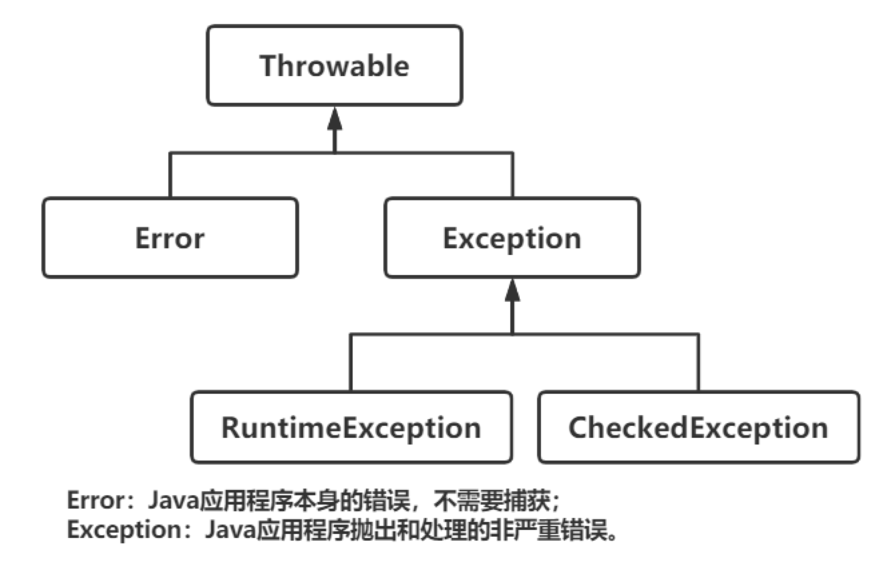

### JAVA 中异常父类(根父类)是哪一个？ [#java-中异常父类根父类是哪一个]

`java.lang.Throwable`

### 说出常见的几个运行时异常？(5 个以上) [#说出常见的几个运行时异常5-个以上]

```txt 
运行时异常 - RuntimeException:
    NullPointerException - 空指针异常
    ClassCastException - 类型转换异常
    IndexOutOfBoundsException - 角标越界异常
    ArithmeticException - 数学运算异常  /əˈrɪθmətɪk/
    IllegalArgumentException - 不合法参数异常
    SystemException - 系统异常
    NumberFormatException - 数字格式化异常

检查时异常 - CheckedExcption:
    IOException - IO异常
    ClassNotFoundException - 类没找到异常
    FileNotFoundException - 文件找不到异常
    SQLException - SQL异常
```

### ClassNotFoundException 和 NoClassDefFoundError 的区别是什么？ [#classnotfoundexception-和-noclassdeffounderror-的区别是什么]

`ClassNotFoundException`：它是一个 CheckedExcption 异常。通常在运行时，在类加载阶段尝试加载类的过程中，找不到类的定义时触发。通过是有 Class.forName()或类加载器 loadClass 或者 findSystemClass 时，在类路径中没有找到指定名称的类时会抛出异常。表示所需的类在类路径中不存在。

`NoClassDefFoundError`：它是一个 Error。表示运行时尝试加载一个类的定义时，虽然找到了类文件，但在加载、解析或链接类的过程中发生了问题。通常是由于依赖问题或类定义文件(.class 文件)损坏导致的。也就是说这个类在编译时存在，但是在运行时丢失了，就会引发这个异常。

### throw 与 throws 区别？ [#throw-与-throws-区别]

`throw` 关键字表示手动抛异常
`throws` 关键字表示声明异常(在定义方法，同时给方法声明一个异常)

**举例**：

```java 
public void start() throws IOException, RuntimeException{
    throw new RuntimeException("Not able to Start");
}
```

### 异常处理的基本结构？ [#异常处理的基本结构]

```txt 
① try / catch
② try / catch / finally
③ try / finally
```

### finally 中代码一定会执行吗？ [#finally-中代码一定会执行吗]

通常情况下，finally 的代码一定会被执行，但是这个有前提：① 对应 try 语句块被执行；② 程序正常运行。

下面这些情况都会导致 finally 无法被执行：
&#8195;① `System.exit()`方法被执行
&#8195;② `Runtime.getRuntime().halt()`方法被执行
&#8195;③ try 或者 catch 中有死循环
&#8195;④ 操作系统强制杀掉了 JVM 进程，如执行了`kill -9`
&#8195;⑤ 其他原因导致的虚拟机崩溃了
&#8195;⑥ 虚拟机所运行的环境挂了，如计算机电源断了
&#8195;⑦ 如果一个 finally 是由守护线程执行的，那么是不保证一定能执行的，如果这时候 JVM 要退出，JVM 会检查其他非守护线程，如果都执行完了，那么就直接退出了。这时候 finally 可能就没办法执行完。

### Java 中的枚举有什么特点和好处 [#java-中的枚举有什么特点和好处]

枚举类型是指由一组固定的常量组成合法的类型。Java 中由关键字`enum`来定义一个枚举类型:

```java 
public enum Season {
    SPRING, SUMMER, AUTUMN, WINER;
}
```

Java 中枚举的好处如下：
&#8195;① 枚举的 valueOf 可以自动对入参进行非法参数的校验
&#8195;② 可以调用枚举中的方法，相对于普通的常量来说操作性更强
&#8195;③ 枚举实现接口的话，可以很容易的实现策略模式
&#8195;④ 枚举可以自带属性，扩展性更强

### 什么是 AIO、BIO 和 NIO？ [#什么是-aiobio-和-nio]

`BIO(Blocking I/O)`：**同步阻塞 I/O**，是 JDK1.4 之前的传统 IO 模型。 线程发起 IO 请求后，一直阻塞，直到缓冲区数据就绪后，再进入下一步操作。

`NIO(Non-Blocking I/O)`：**同步非阻塞 I/O**，线程发起 IO 请求后，不需要阻塞，立即返回。用户线程不原地等待 IO 缓冲区，可以先做一些其他操作，只需要定时轮询检查 IO 缓冲区数据是否就绪即可。

`AIO(Asynchronous I/O)`：**异步非阻塞 I/O**。线程发起 IO 请求后，不需要阻塞，立即返回，也不需要定时轮询检查结果，异步 IO 操作之后会回调通知调用方。

### JDK 1.8 新特性 [#jdk-18-新特性]

① **Lambda 表达式**
&#8195;&#8195;允许把函数作为一个方法的参数。

② **方法引用**
&#8195;&#8195;方法引用允许直接引用已有 Java 类或对象的方法或构造方法。

③ **函数式接口**
&#8195;&#8195;有且仅有一个抽象方法的接口叫做函数式接口，函数式接口可以被隐式转换为 Lambda 表达式。通常函数式接口上会添加`@FunctionalInterface`注解。

④ **接口允许定义默认方法和静态方法**
&#8195;&#8195;从 JDK8 开始，允许接口中存在一个或多个默认非抽象方法和静态方法。

⑤ **Stream API**
&#8195;&#8195;新添加的 Stream API（java.util.stream）把真正的函数式编程风格引入到 Java 中。这种风格将要处理的元素集合看作一种流，流在管道中传输，并且可以在管道的节点上进行处理，比如筛选、排序、聚合等。

⑥ **日期/时间类改进**
&#8195;&#8195;之前的 JDK 自带的日期处理类非常不方便，我们处理的时候经常是使用的第三方工具包，比如 commons-lang 包等。不过 JDK8 出现之后这个改观了很多，比如日期时间的创建、比较、调整、 格式化、时间间隔等。这些类都在 java.time 包下，LocalDate/LocalTime/LocalDateTime。

⑦ **Optional 类**
&#8195;&#8195;Optional 类是一个可以为 null 的容器对象。如果值存在则 isPresent()方法会返 回 true，调用 get()方法会返回该对象。

⑧ **Java 8 Base64 实现**
&#8195;&#8195;Java 8 内置了 Base64 编码的编码器和解码器。


<details>
<summary>JDK 新版本中都有哪些新特性？</summary>

&#8195;&#8195;目前 Java 的发布周期是每半年发布一次，大概在每年的 3 月份和 9 月份都会发布新版本。在 2023 年 3 月份的时候发布了 JDK 20。

> JDK 8 中推出了 Lambda 表达式、Stream、Optional、新的日期 API 等
> JDK 9 中推出了模块化
> JDK 10 中推出了本地变量类型推断
> JDK 12 中增加了 switch 表达式
> JDK 13 中增加了 text block
> JDK 14 中增加了 Records、instance 模式匹配
> JDK 15 中增加了封闭类
> JDK 17 中扩展了 switch 模式匹配
> JDK 19 中增加了协程

① **本地变量类型推断**
&#8195;&#8195;在 JDK10 之前的版本中，我们想要定义局部变量时，需要在赋值的左侧提供显示类型，并在赋值的右侧提供实现类型：

```java 
// JDK10之前
MyObject value = new MyObject();

// JDK10 提供了本地变量类型推断的功能，可以通过var声明变量
var value = new MyObject();
```

&#8195;&#8195;本地变量类型推断将引入`var`关键字，而不需要显式的规范变量的类型。

&#8195;&#8195;它是 Java 10 提供给开发者的语法糖。虽然我们在代码中使用 `var` 进行了定义，但是对于虚拟机来说他是不认识这个 `var` 的，在 java 文件编译成 class 文件的过程中，会进行解糖，使用变量真正的类型来替代 `var`。

② **switch 表达式**
&#8195;&#8195;在 [JDK12](https://openjdk.org/jeps/325) 中引入了 switch 表达式作为预览特性，并在 [JDK13](https://openjdk.org/jeps/354) 中修改了这个特性，引入了 yield 语句，用于返回值；而在之后的 [JDK14](https://openjdk.org/jeps/361) 中，这一功能正式作为标准功能提供出来。


<Tabs items={["旧的写法", "新的写法"]}>
<Tab value="旧的写法">

```java 
char grade = 'A';
switch (grade) {
    case 'A': System.out.println("优秀"); break;
    case 'B': System.out.println("良好"); break;
    case 'D': System.out.println("及格"); break;
    default: System.out.println("未知等级");
}

String desc;
switch (grade) {
    case 'A': desc = "优秀"; break;
    case 'B': desc = "良好"; break;
    case 'D': desc = "及格"; break;
    default: desc = "未知等级";
}
System.out.println("desc = " + desc);
```

</Tab>
<Tab value="新的写法">

```java 
char grade = 'A';
switch (grade) {
    case 'A' -> System.out.println("优秀");
    case 'B' -> System.out.println("良好");
    case 'D' -> System.out.println("及格");
    default -> System.out.println("未知等级");
}

String desc = switch (grade) {
    case 'A' -> "优秀";
    case 'B' -> "良好";
    case 'D' -> "及格";
    default -> "未知等级";
};

// 或者
String desc = switch (grade) {
    case 'A' : yield "优秀";
    case 'B' : yield "良好";
    case 'D' : yield "及格";
    default : yield "未知等级";
};

System.out.println("desc = " + desc);
```

</Tab>
</Tabs>


③ **Text Blocks**

&#8195;&#8195;在 [JDK13](https://openjdk.org/jeps/355) 中提供了一个 Text Blocks 的预览特性，并且在 [JDK14](https://openjdk.org/jeps/368) 中提供了第二个版本的预览。在[JDK15](https://openjdk.org/jeps/378)中这一功能正式作为标准功能提供出来。


<Tabs items={["复制的字符串", "复制到 Java 中", "新特性"]}>
<Tab value="复制的字符串">

```java 
<html>
    <body>
        <p>Hello, world</p>
    </body>
</html>
```

</Tab>
<Tab value="复制到 Java 中">

```java 
 "<html>\n" +
 "    <body>\n" +
 "        <p>Hello, world</p>\n" +
 "    </body>\n" +
 "</html>\n";
```

</Tab>
<Tab value="新特性">

```java 
"""
<html>
    <body>
        <p>Hello, world</p>
    </body>
</html>
""";
```

</Tab>
</Tabs>


④ **Records**
&#8195;&#8195;在 [JDK14](https://openjdk.org/jeps/359) 中提供了一个 Records 的预览特性，并且在 [JDK15](https://openjdk.org/jeps/384) 中提供了第二个版本的预览。在[JDK16](https://openjdk.org/jeps/395)中这一功能正式作为标准功能提供出来。

&#8195;&#8195;Records 的目标是扩展 Java 语言语法，Records 为声明类提供了一种紧凑的语法，用于创建一种类中是"字段，只是字段，除了字段什么都没有的类。


<Tabs items={["新特性", "反编译"]}>
<Tab value="新特性">

```java 
record Person(String firstName, String lastName) {}
```

</Tab>
<Tab value="反编译">

```java 
record Person(String firstName, String lastName) {
    Person(String firstName, String lastName) {
        this.firstName = firstName;
        this.lastName = lastName;
    }

    public String firstName() {
        return this.firstName;
    }

    public String lastName() {
        return this.lastName;
    }
}
```

</Tab>
</Tabs>


⑤ **instanceof 模式匹配**
&#8195;&#8195;`instanceof` 是 Java 中的一个关键字，我们在对类型做强制转换之前，会使用 instanceof 做一次判断，例如：

```java 
if (animal instanceof Cat) {
    Cat cat = (Cat) animal;
    cat.miaow();
} else if (animal instanceof Dog) {
    Dog dog = (Dog) animal;
    dog.bark();
}
```

&#8195;&#8195;[JDK14](https://openjdk.org/jeps/305) 带来了改进版的 instanceof 操作符，这意味着我们可以用更简洁的方式写出之前的代码例子：

```java 
if (animal instanceof Cat cat) {
    cat.miaow();
} else if(animal instanceof Dog dog) {
    dog.bark();
}
```

⑥ **switch 模式匹配**
基于 instanceof 模式匹配这个特性，我们可以使用如下方式来对对象 o 进行处理：

```java 
static String formatter(Object o) {
    String formatted = "unknown";
    if (o instanceof Integer i) {
        formatted = String.format("int %d", i);
    } else if (o instanceof Long l) {
        formatted = String.format("long %d", l);
    } else if (o instanceof Double d) {
        formatted = String.format("double %f", d);
    } else if (o instanceof String s) {
        formatted = String.format("String %s", s);
    }
    return formatted;
}
```

&#8195;&#8195;在[JDK17](https://openjdk.org/jeps/406)中，Java 的工程师们扩展了 switch 语句和表达式，使其可以适用于任何类型，并允许 case 标签中不仅带有变量，还能带有模式匹配。我们就可以更清楚、更可靠地重写上述代码，例如：

```java 
static String formatterPatternSwitch(Object o) {
    return switch (o) {
        case Integer i -> String.format("int %d", i);
        case Long l    -> String.format("long %d", l);
        case Double d  -> String.format("double %f", d);
        case String s  -> String.format("String %s", s);
        default        -> o.toString();
    };
}
```

⑦ **封闭类**

&#8195;&#8195;在 JDK15 之前，Java 认为"代码重用"始终是一个终极目标，所以一个类和接口都可以被任意的类实现或继承。但是，在很多场景中，这样做是容易造成错误的，而且也不符合物理世界的真实规律。
&#8195;&#8195;例如，假设一个业务领域只适用于汽车和卡车，而不适用于摩托车。在 Java 中创建 Vehicle 抽象类时，应该只允许 Car 和 Truck 类扩展它。通过这种方式，我们希望确保在域内不会出现误用 Vehicle 抽象类的情况。
&#8195;&#8195;为了解决类似的问题，在[JDK15](https://openjdk.org/jeps/360) 中引入了一个新的特性——密闭。

```java 
// 接口
public sealed interface Expr permits ConstantExpr, PlusExpr {...}

public final class ConstantExpr implements Expr {...}
public final class PlusExpr     implements Expr {...}

// 抽象类
public abstract sealed class Shape permits Circle, Rectangle {...}

public final class Circle extends Shape {...}
public final class Rectangle extends Shape {...}
```

⑧ **虚拟线程**

</details>


### 什么是 UUID，能保证唯一吗？ [#什么是-uuid能保证唯一吗]

&#8195;&#8195;UUID(Universally Unique Identifier，全局唯一标识符)是指在一台机器上生成的数字，它的目标是保证对在同一时空中的所有机器都是唯一的。

&#8195;&#8195;UUID 的生成基于一定的算法，通常使用的是随机数生成器或者基于时间戳的方式，生成的 UUID 有 32 为 16 进制数表示，共 128 位（标准格式：`xxxxxxxx-xxxx-xxxx-xxxx-xxxxxxxxxxxx` (8-4-4-4-12)，共 32 个字符）

&#8195;&#8195;由于 UUID 是由 MAC 地址、时间戳、随机数等信息生成的，因此 UUID 具有极高的唯一性，可以说几乎不可能重复，但是是在实际实现过程中，UUID 有多种实现版本，它们唯一性指标也不尽相同。UUID 在具体实现上，有多个版本，例如基于时间的 UUID V1，基于随机数的 UUID V4；Java 中的`java.util.UUID`生成的 UUID 是 V3 和 V4 两种。

### char 能存储中文吗？ [#char-能存储中文吗]

&#8195;&#8195;在 Java 中，char 类型是用来表示一个 16 位的 Unicode 字符，它可以存储任何 Unicode 字符集中的字符，当然也包括中文字符。

### while(true) 和 for(;\;) 哪个性能好？ [#whiletrue-和-for-哪个性能好]

```java 
for (; ; ) {
    System.out.println("for(;;) test...");
}

while (true) {
    System.out.println("while(true) test...");
}
```

反编译后，两个文件内容一模一样，有的人用前者是因为能够清晰的看出是个无限循环，而有的人有后者是因为前者在 IDE 会给出警告。

## 集合 ⭐️ [#集合-️]

### Java 中的集合类有哪些？如何分类的？ [#java-中的集合类有哪些如何分类的]

&#8195;&#8195;Java 的整个集合框架中，主要分为 List、Set、Queue、Stack、Map 等五种数据结构。其中，前四种数据结构都是单一元素的集合，而最后的 Map 则是以 KV 对的形式使用。

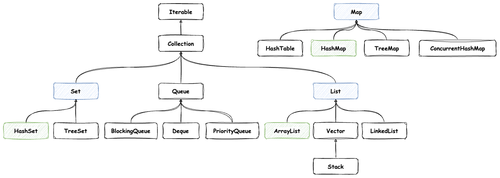

&#8195;&#8195;从继承关系上讲，List、Set、Queue 都是 Collection 的子接口，Collection 有继承了 Iterable 接口，说明这几种集合都是可以遍历的。

&#8195;&#8195;从功能上讲，List 代表一个容器，可以是先进先出，也可以是先进后出。而 Set 相对于 List 来说，是无序的，同时也是一个去重的列表，既然会去重，就一定会通过 equals、compareTo、hashCode 等方法进行比较。Map 则是 KV 的映射，也会涉及到 Key 值的查询等能力。

&#8195;&#8195;从实现上讲，List 可以有链表实现或者数组实现，两者各有优劣，链表增删快，数组查询快。Queue 则可以分为优先队列，双端队列等等。Map 则可以分为普通的 HashMap 和可以排序的 TreeMap 等等。

### Collection 与 Collections 的区别？ [#collection-与-collections-的区别]

Collection 是集合的父接口：它提供了对集合对象进行基本操作的通用接口方法。
Collections 是集合工具类：它包含有各种有关集合操作的静态多态方法。

### 遍历 List 有哪些不同的方式？ [#遍历-list-有哪些不同的方式]

for 循环、增强 for 循环、iterator 迭代器

### 集合迭代器的接口？ [#集合迭代器的接口]

`iterator`

### 什么是 fail-fast？什么是 fail-safe？ [#什么是-fail-fast什么是-fail-safe]

&#8195;&#8195;fail-fast 和 fail-safe 是多线程并发操作集合时的一种失败处理机制。

**fail-fast (快速失败)**：
&#8195;&#8195;在做系统设计时候先考虑异常情况，一旦异常发生，直接停止并上报。这样做的好处就是可以预先识别出一些错误情况，一方面可以避免执行重复的其它代码，另一方面，这种异常情况被识别之后也可以针对性的做一些单独处理。

举个最简单的 fail-fast 的例子：

```java 
public int divide(int dividend, int divisor) {
    if (divisor == 0) {
        throw new RuntimeException("divisor can't be zero");
    }
    return dividend / divisor;
}
```

> 上面的代码是一个对两个整数做除法的方法，在 divide 方法中，我们对被除数做了个简单的检查，如果其值为 0，那么就直接抛出一个异常，并明确提示异常原因。这其实就是 fail-fast 理念的实际应用。

&#8195;&#8195;在 Java 中，集合类中有用到 fail-fast 机制进行设计，一旦使用不当，触发 fail-fast 机制设计的代码，就会发生非预期情况。

&#8195;&#8195;在使用迭代器遍历一个集合对象时，比如增强 for，如果遍历过程中对集合对象的内容进行了修改(增删改)，会抛出`ConcurrentModificationException`异常。
&#8195;&#8195;查看`ArrayList`源代码，在`next()`方法执行的时候，会执行`checkForComodification()`方法。

```java 
@SuppressWarnings("unchecked")
public E next() {
    checkForComodification();
    int i = cursor;
    if (i >= size)
        throw new NoSuchElementException();
    Object[] elementData = ArrayList.this.elementData;
    if (i >= elementData.length)
        throw new ConcurrentModificationException();
    cursor = i + 1;
    return (E) elementData[lastRet = i];
}

final void checkForComodification() {
    if (modCount != expectedModCount)
        throw new ConcurrentModificationException();
}
```

**原理**：
① 迭代器在遍历时直接访问集合中的内容，并且在遍历过程中使用一个`modCount`变量(表示该集合实际被修改的次数)；
② 集合中在被遍历期间如果内容发生变化，就会改变`modCount`的值；
③ 每当迭代器使用`hashNext()/next()`遍历下一个元素之前，都会检测`modCount`变量和`expectedmodCount`值(表示这个迭代器预期该集合被修改的次数)是否相等；
④ 如果相等就返回遍历，否则抛出异常，终止遍历。

**注意**：
&#8195;&#8195;这里异常的抛出条件时检测到 `modCount = expectedmodCount` 这个条件。

---

**fail-safe (安全失败)**：
&#8195;&#8195;采用安全失败机制的集合容器，在遍历时不是直接在集合内容上访问的，而是先 copy 原有集合内容，在拷贝的集合上进行遍历。

**原理**：
由于迭代时是对原集合的拷贝的值进行遍历，所以在遍历过程中对原集合所作的修改并不能被迭代器检测到，所以不会出`ConcurrentModificationException`。

**缺点**：
&#8195;&#8195;基于拷贝内容的优点是避免了`ConcurrentModificationException`，但同样地， 迭代器并不能访问到修改后的内容 (简单来说就是， 迭代器遍历的是开始遍历那一刻拿到的集合拷贝，在遍历期间原集合发生的修改迭代器是不知道的)。

---

<span>【强制】</span>不要在 foreach 循环里进行元素的 remove/add 操作。remove 元素请使用 Iterator 方式，如果并发操作，需要对 Iterator 对象加锁。

<div>反例：</div>

```text
for (String item : list) {
    if ("1".equals(item)) {
        list.remove(item);
    }
}
```

<div>正例：</div>

```text
List<String> list = new ArrayList<>();
list.add("1");
list.add("2");
Iterator<String> iterator = list.iterator();
while (iterator.hasNext()) {
    String item = iterator.next();
    if (删除元素的条件) {
        iterator.remove();
    }
}
```


---

### 遍历的同时修改一个 List 有几种方式？ [#遍历的同时修改一个-list-有几种方式]

① 普通的 for 循环

```java 
List<String> list = new ArrayList<>(Arrays.asList("Hello", "Java", "Hi"));

for (int i = 0; i < list.size(); i++) {
    if ("Hi".equals(list.get(i))) {
        list.remove(list.get(i)); // 删除当前元素（需要注意索引变化）
        i--; // 索引减1以处理删除后下一个元素的索引
        System.out.println("list.get(i) = " + list.get(i));
    }
}
System.out.println("list = " + list);

// Console Out
list.get(i) = Java
list = [Hello, Java]
```

② 迭代器循环

```java 
List<String> list = new ArrayList<>(Arrays.asList("Hello", "Java", "Hi"));

Iterator<String> iterator = list.iterator();
// Iterator<String> iterator = list.listIterator(); // listIterator也行
while (iterator.hasNext()) {
    String next = iterator.next();
    if ("Hi".equals(next)) {
        // 使用iterator的remove()移除当前对象，若使用List的remove()，还是会出现CME异常
        iterator.remove();
    }
}
System.out.println("list = " + list);

// Console Out
list = [Hello, Java]
```

③ 将原来的 copy 一份副本，遍历原来的 list，然后删除副本(fail-fast)

④ 使用并发安全的集合类

```java 
List<String> list = new CopyOnWriteArrayList<>(Arrays.asList("Hello", "Java", "Hi"));

for (String str : list) {
    if ("Hi".equals(str)) {
        list.remove(str);
    }
}
System.out.println("list = " + list);

// Console Out
list = [Hello, Java]
```

⑤ 通过 Stream 的过滤方法，因为 Stream 每次处理后都会生成一个新的 Stream，不存在并发问题，所以 Stream 的 filter 也可以修改 list 集合

```java 
List<String> list = new ArrayList<>(Arrays.asList("Hello", "Java", "Hi"));

List<String> collect = list.stream().filter((data) -> {
    return !"Hi".equals(data);
}).collect(Collectors.toList());
System.out.println("list = " + collect);

// Console Out
list = [Hello, Java]
```

⑥ 通过 removeIf 方法，实现元素的过滤删除。removeIf()方法用于删除所有满足特定条件的数据元素

```java 
List<String> list = new ArrayList<>(Arrays.asList("Hello", "Java", "Hi"));

list.removeIf("Hi"::equals);
System.out.println("list = " + list);

// Console Out
list = [Hello, Java]
```

### Set 是如何保证元素不重复的？ [#set-是如何保证元素不重复的]

在 Java 中的 Set 体系中，根据实现方式的不同可以分为：TreeSet 和 HashSet
&#8195;① TreeSet 是二叉树实现的，TreeSet 中的数据是自动排好序的，不允许放入 null 值；底层基于 TreeMap
&#8195;② HashSet 是哈希表实现的，HashSet 中的数据是无序的，可以放入 null，但只能放入一个；底层基于 HashMap

&#8195;&#8195;在 HashSet 中，基本的操作都是由 HashMap 底层实现的，因为 HashSet 底层是用 HashMap 存储数据的。当向 HashSet 中添加元素的时候，首先<u>计算元素的 hashCode 值，然后通过**扰动计算**和**按位与**的方式计算出这个元素的存储位置</u>，如果这个位置为空，就将元素添加进去；如果不为空，则用 equals 方法比较元素是否相等，相等就不添加，否则找一个空位添加。

&#8195;&#8195;TreeSet 的底层是 TreeMap 的 keySet()，而 TreeMap 是基于红黑树实现的，红黑树是一种平衡二叉查找树，它能保证任何一个节点的左右子树的高度差不会超过较矮的那棵的一倍。
&#8195;&#8195;TreeMap 是按 key 排序的，元素在插入 TreeSet 时 compareTo()方法要被调用，所以 TreeSet 中的元素要实现 Comparable 接口。TreeSet 作为一种 Set，它不允许出现重复元素。<u>TreeSet 是用 compareTo()来判断重复元素的</u>。

### 栈与队列的区别？ [#栈与队列的区别]

> 队列(Queue)：先进先出(FIFO)，它只允许在前端进行删除操作，在后端进行插入操作。
> 栈(Stack)：先进后出，它只能在一端进行插入和删除操作。

### 顺序存储结构与链式存储结构的优缺点 [#顺序存储结构与链式存储结构的优缺点]

**顺序存储结构**:
&#8195;优：一是节省存储空间；二是访问速度快；
&#8195;缺：进行插入、删除元素时效率低。

**链式存储结构**:
&#8195;优：进行插入、删除元素时效率高；
&#8195;缺：一是对空间的占用比较大；二是访问速度慢。

### List 与 Set 的区别 [#list-与-set-的区别]

List 集合元素按进入先后有序保存，可重复；
Set 集合仅接收一次，无序，不可重复；

### ArrayList、LinkedList 与 Vector 区别 [#arraylistlinkedlist-与-vector-区别]

&#8195;&#8195;List 主要有 ArrayList、LinkedList 与 Vector 几种实现。这三者都实现了 List 接口，使用方式也很相似，主要区别在于因为实现方式的不同，所以对不同的操作具有不同的效率。

&#8195;&#8195;ArrayList 是基于**数组**(可改变大小)来实现的，比较节省存储空间，在查询时访问元素速度快效率高，但在进行修改操作时性能差；
&#8195;&#8195;LinkedList 是基于**双向链表**来实现的，在进行修改操作时性能好，效率高，但对空间的占用大，在查询时访问速度慢。
&#8195;&#8195;Vector 和 ArrayList 类似，但属于强同步类。 ArrayList 是线程非安全的，Vector 是线程安全的；所以如果程序本身是线程安全的，没有在多个线程之间共享同一个集合/对象，那么使用 ArrayList 更好。

### ArrayList 的 subList 方法有什么需要注意的地方吗？ [#arraylist-的-sublist-方法有什么需要注意的地方吗]

&#8195;&#8195;List 的 subList 方法并没有创建一个新的 List，而是使用了原 List 的视图，这个视图使用内部类 SubList 表示。所以，我们不能把 subList 方法返回的 List 强制转换成 ArrayList 等类，因为它们之间没有继承关系。

另外，视图和原 List 修改还需要注意一下几点，尤其是它们之间的相互影响：

① 对父(sourceList)子(subList)做的非结构性修改(none-structural changes)，都会影响到彼此；


<details>
<summary>代码示例</summary>

```java 
List<String> sourceList = new ArrayList<>(Arrays.asList("Hello", "Java", "Hi", "Study"));

List<String> subList = sourceList.subList(1, 3); // subList = [Java, Hi]

System.out.println("sourceList = " + sourceList);
System.out.println("subList    = " + subList);

System.out.println("--- 非结构性修改subList ---");
subList.set(1, "Python"); // subList = [Java, Python]

System.out.println("subList    = " + subList);
System.out.println("sourceList = " + sourceList);

System.out.println("--- 非结构性修改sourceList ---");
sourceList.set(2, "GoLang"); // sourceList = [Hello, Java, GoLang, Study]

System.out.println("sourceList = " + sourceList);
System.out.println("subList    = " + subList);

// Console Out
sourceList = [Hello, Java, Hi, Study]
subList    = [Java, Hi] // sourceList.subList(1, 3)
--- 非结构性修改subList ---
subList    = [Java, Python] // subList.set(1, "Python")
sourceList = [Hello, Java, Python, Study]
--- 非结构性修改sourceList ---
sourceList = [Hello, Java, GoLang, Study] // sourceList.set(2, "GoLang")
subList    = [Java, GoLang]
```

</details>


② 对子 List 做的结构性修改，操作同样会反映到父 List 上；对父 List 做结构性修改，会抛出 `ConcurrentModificationException` 异常。

<details>
<summary>代码示例</summary>

```java 
List<String> sourceList = new ArrayList<>(Arrays.asList("Hello", "Java", "Hi", "Study"));

List<String> subList = sourceList.subList(1, 3); // subList = [Java, Hi]

System.out.println("sourceList = " + sourceList);
System.out.println("subList    = " + subList);

System.out.println("--- 结构性修改subList ---");
subList.add(1, "Python"); // subList = [Java, Python, Hi]

System.out.println("subList    = " + subList);
System.out.println("sourceList = " + sourceList);

System.out.println("--- 结构性修改sourceList ---");
sourceList.add(2, "GoLang");

System.out.println("sourceList = " + sourceList);
System.out.println("subList    = " + subList); // java.util.ConcurrentModificationException

// Console Out
sourceList = [Hello, Java, Hi, Study]
subList    = [Java, Hi] // sourceList.subList(1, 3)
--- 结构性修改subList ---
subList    = [Java, Python, Hi] // subList.add(1, "Python")
sourceList = [Hello, Java, Python, Hi, Study]
--- 结构性修改sourceList ---
sourceList = [Hello, Java, GoLang, Python, Hi, Study]
Exception in thread "main" java.util.ConcurrentModificationException
    at java.util.ArrayList$SubList.checkForComodification(ArrayList.java:1241)
    at java.util.ArrayList$SubList.listIterator(ArrayList.java:1101)
    at java.util.AbstractList.listIterator(AbstractList.java:299)
    at java.util.ArrayList$SubList.iterator(ArrayList.java:1097)
    at java.util.AbstractCollection.toString(AbstractCollection.java:454)
    at java.lang.String.valueOf(String.java:2994)
    at java.lang.StringBuilder.append(StringBuilder.java:137)
    at cn.test.spi.App.main(App.java:30)
```

</details>


---

<span>【强制】</span>ArrayList 的 subList 结果不可强转成 ArrayList，否则会抛出 ClassCastException 异常，即 java.util.RandomAccessSubList cannot be cast to java.util.ArrayList。

<div>说明：subList 返回的是 ArrayList 的内部类 SubList，并不是 ArrayList 而是 ArrayList 的一个视图，对于 SubList 子列表的所有操作最终会反映到原列表上。</div>
<div>注意：不只是强转成 ArrayList 会报错，强转成 LinkedList、Vector 等 List 的实现类同样会报错。</div>

---

### ArrayList 的序列化是怎么实现的？ [#arraylist-的序列化是怎么实现的]

&#8195;&#8195;在序列化过程中，如果被序列化的类中定义了 writeObject 和 readObject 方法，虚拟机会试图调用对象类里的 writeObject 和 readObject 方法，进行用户自定义的序列化和反序列化。
&#8195;&#8195;如果没有这样的方法，则默认调用是 ObjectOutputStream 的 defaultWriteObject 方法以及 ObjectInputStream 的 defaultReadObject 方法。
&#8195;&#8195;用户自定义的 writeObject 和 readObject 方法可以允许用户控制序列化的过程，比如可以在序列化的过程中动态改变序列化的数值。

&#8195;&#8195;ArrayList 底层是通过 Object 数组完成数据存储的，但是这个数组被声明成了 transient，说明在默认的序列化策略中并没有序列化数组字段。
`transient Object[] elementData; // non-private to simplify nested class access`


<details>
<summary>为什么底层数组要使用 transient ?</summary>

&#8195;&#8195;ArrayList 实际上是动态数组，每次在放满以后自动增长设定的长度值，如果数组自动增长长度设为 100，而实际只放了一个元素，那就会序列化 99 个 null 元素。为了保证在序列化的时候不会将这么多 null 同时进行序列化，ArrayList 把元素数组设置为 transient。

</details>


**ArrayList 重写了 writeObject 和 readObject 方法，如下所示**：


<details>
<summary>展开查看</summary>

```java 
/**
 * Save the state of the <tt>ArrayList</tt> instance to a stream (that
 * is, serialize it).
 *
 * @serialData The length of the array backing the <tt>ArrayList</tt>
 *             instance is emitted (int), followed by all of its elements
 *             (each an <tt>Object</tt>) in the proper order.
 */
private void writeObject(java.io.ObjectOutputStream s)
    throws java.io.IOException{
    // Write out element count, and any hidden stuff
    int expectedModCount = modCount;
    s.defaultWriteObject();

    // Write out size as capacity for behavioural compatibility with clone()
    s.writeInt(size);

    // Write out all elements in the proper order.
    for (int i=0; i<size; i++) {
        s.writeObject(elementData[i]);
    }

    if (modCount != expectedModCount) {
        throw new ConcurrentModificationException();
    }
}

/**
 * Reconstitute the <tt>ArrayList</tt> instance from a stream (that is,
 * deserialize it).
 */
private void readObject(java.io.ObjectInputStream s)
    throws java.io.IOException, ClassNotFoundException {
    elementData = EMPTY_ELEMENTDATA;

    // Read in size, and any hidden stuff
    s.defaultReadObject();

    // Read in capacity
    s.readInt(); // ignored

    if (size > 0) {
        // be like clone(), allocate array based upon size not capacity
        int capacity = calculateCapacity(elementData, size);
        SharedSecrets.getJavaOISAccess().checkArray(s, Object[].class, capacity);
        ensureCapacityInternal(size);

        Object[] a = elementData;
        // Read in all elements in the proper order.
        for (int i=0; i<size; i++) {
            a[i] = s.readObject();
        }
    }
}
```

</details>


### hash 冲突通常怎么解决？ [#hash-冲突通常怎么解决]

常见的四种方法：
① **开放定址法**
&#8195;&#8195;开放定址法也称为再散列法，当哈希冲突出现时，会将上一次 hash 的结果和增量序列相加，然后对 hash 表的长度取模，进行再散列。只要散列表足够大，空的散列地址总能找到，并将记录存入。

② **链地址法**
&#8195;&#8195;将哈希表的每个单元作为链表的头结点，所有哈希地址为 i 的元素构成一个同义词链表。即发生冲突时就把该关键字链在以该单元为头结点的链表的尾部。

> HashMap 采用该方法，当出现 hash 冲突时，会使用同一个 hash 的所有值形成一个链表。查询的时候，首先通过 hash 定位到该链表，然后在遍历链表获得结果。

③ **再哈希法**
&#8195;&#8195;当哈希冲突发生时，用其它函数计算另一个哈希函数地址，直到冲突不再产生为止。

④ **建立公共溢出区**
&#8195;&#8195;将哈希表分为基本表和溢出表两部分，发生冲突的元素都放入溢出表中。

### HashMap 的数据结构是怎样的？ [#hashmap-的数据结构是怎样的]

&#8195;&#8195;在 Java 中，保存数据有两种比较简单的数据结构：数组和链表。数组的特点是：寻址容易，插入和删除困难；而链表的特点是：寻址困难，插入和删除容易。

&#8195;&#8195;常用的哈希函数的冲突解决方法中有一种叫做链地址法，其实就是将数组和链表组合在一起，发挥了两者的优势，我们可以将其理解为链表的数组。在 JDK1.8 之前，HashMap 就是通过这种结构来存储数据的。

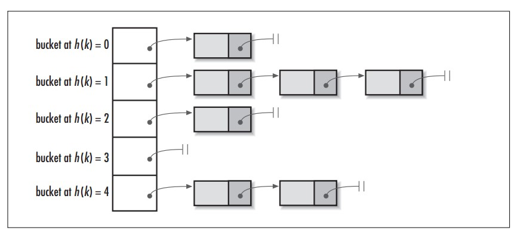

&#8195;&#8195;上图中，左侧是个数组，数组的每个成员是一个链表。该数据结构所容纳的所有元素均包含一个指针，用于元素间的链接。我们根据元素的自身特征把元素分配到不同的链表去，反过来我们也正是通过这些特征找到正确的链表，再从链表中找到正确的元素。其中，根据元素特征计算元素数组下标的方法就是哈希算法，即 hash()函数。

&#8195;&#8195;在 JDK 1.8 中为了解决因 hash 冲突导致某个链表长度过长，影响 put 和 get 的效率，引入了红黑树。

### HashMap、Hashtable 与 ConcurrentHashMap 区别？ [#hashmaphashtable-与-concurrenthashmap-区别]

&#8195;&#8195;HashMap 集合中的 key 可以为 null(只能由一个 key 为 null)，值也可以是 null，它是线程非安全的;

&#8195;&#8195;Hashtable 集合中的 key-value 都不能为空，它是线程安全的。

&#8195;&#8195;ConcurrentHashMap 在 JDK 1.8 之前使用分段锁保证线程安全，ConcurrentHashMap 默认情况下将 hash 表分为 16 个桶（分片），在加锁的时候，针对每个单独的分片进行加锁，其他分片不受影响。锁的粒度更细，所以他的性能更好。
&#8195;&#8195;ConcurrentHashMap 在 JDK 1.8 中，采用了一种新的方式来实现线程安全，即使用了 CAS+synchronized，这个实现被称为"分段锁"的变种，也被称为"锁分离"，它将锁定粒度更细，把锁的粒度从整个 Map 降低到了单个桶。

| 特性/集合类        | HashMap     | Hashtable      | ConcurrentHashMap          |
| ------------------ | ----------- | -------------- | -------------------------- |
| 线程安全           | 否          | 是，基于方法锁 | 是，基于分段锁             |
| 继承关系           | AbstractMap | Dictionary     | AbstractMap，ConcurrentMap |
| 允许 null 值       | K-V 都允许  | K-V 都不允许   | K-V 都不允许               |
| 默认初始容量       | 16          | 11             | 16                         |
| 默认加载因子       | 0.75        | 0.75           | 0.75                       |
| 扩容后容量         | 原来的两倍  | 原来的两倍加 1 | 原来的两倍                 |
| 是否支持 fail-fast | 支持        | 不支持         | fail-safe                  |

### HashMap 在 get 和 put 时经过哪些步骤？ [#hashmap-在-get-和-put-时经过哪些步骤]

&#8195;&#8195;对于 HashMap 来说，底层是基于散列算法实现，散列算法为散列再探测和拉链式。HashMap 则使用了拉链式的散列算法，即采用数组+链表/红黑树来解决 hash 冲突，数组是 HashMap 的主体，链表主要用来解决哈希冲突。这个数组是 Entry 类型，它是 HashMap 的内部类，每一个 Entry 包含一个 key-value 键值对。

**get 方法**：
&#8195;&#8195;对于 get 方法来说，会先查找桶，如果 hash 值相同并且 key 值相同，则返回该 node 节点，如果不同，则当`node.next != null`时，判断是红黑树还是链表，之后根据相应的方法进行查找。

**put 方法**：
对于 put 方法来说，一般经历以下几步：
① 如果数组没有被初始化，先初始化数组
② 首先通过定位到要 put 的 key 在哪个桶中，如果该桶中没有元素，则将该要 put 的 entry 放置在该桶中
③ 如果该桶中已经有元素，则遍历该桶所属的链表：
&#8195;&#8195;1) 如果该链表已经树化，则执行红黑树的插入流程
&#8195;&#8195;2) 如果仍然是链表，则执行链表的插入流程，如果插入后链表的长度大于等于 8，并且桶数组的容量大于等于 64，则执行链表的树化流程
&#8195;&#8195;注意：上面的步骤中，如果元素和要 put 的元素相同，则直接替换
④ 检验是新增 KV 还是替换老的 KV，如果是后者，则设置 callback 扩展(LinkedHashMap 的 LRU 即通过此实现)
⑤ 校验`++size`是否超过 threshold，如果超过，则执行扩容流程

### 为什么 HashMap 的 Cap 是 2<sup>n</sup>，如何保证？ [#为什么-hashmap-的-cap-是-2n如何保证]

**为什么是 2<sup>n</sup>**?

**如何保证**？

### HashMap 与 TreeMap 区别？ [#hashmap-与-treemap-区别]

TreeMap 相对 HashMap，多了一个排序的功能

### HashSet 和 TreeSet 的区别 [#hashset-和-treeset-的区别]

```txt 
TreeSet相对于HashSet，多了一个排序的功能;
```

### 数据查找：遍历、二分查找，说一下二分查找的条件 [#数据查找遍历二分查找说一下二分查找的条件]

必须是有序数组

### 什么是 Properties 类？ [#什么是-properties-类]


<Callout type="success" title="提示">

该类主要用于读取 Java 的配置文件，不同的编程语言有自己所支持的配置文件，配置文件中很多变量是经常改变的，为了方便用户的配置，能让用户够脱离程序本身去修改相关的变量设置。就像在 Java 中，其配置文件常为\*.properties 文件，是以键值对的形式进行参数配置的。

</Callout>


### JAVA 中有几种类型的流？ [#java-中有几种类型的流]

```txt 
①数据单位:字节流、字符流
②流向:输入流、输出流
③角色:节点流、处理流
```

### 字节流与字符流的区别？ [#字节流与字符流的区别]

```txt 
对于文本文件(.txt，.java，.c，.c++)，使用字符流处理;
对于非文本文件(.jpg，.mp3，.mp4，.avi，.doc，.ppt)，使用字节流处理。
```

### BufferedReader 流的作用？ [#bufferedreader-流的作用]


<Callout type="success" title="提示">

BufferedReader 属于输入字符缓冲流，缓冲流是一种装饰器类，目的是让原字节流、字符流新增缓冲的功能。缓冲流作用是把数据先写入内存缓冲区，等缓冲区满了，再把数据写到文件里。读内存比读硬盘速度快很多倍，所以这样效率就大大提高了。

</Callout>


### 什么是序列化，什么是反序列化？ [#什么是序列化什么是反序列化]

```txt 
序列化:将对象转为流，用来存贮或者网络传输;
反序列化:将流中的数据转为对象。
```

### 什么是 XML？ [#什么是-xml]


<Callout type="success" title="提示">

XML 是可扩展标记语言(eXtensible [/ɪkˈstensəbl/] Markup Language)的简称。它是一个纯文本格式的文件，相对于文本，文档的内容一般用标签包裹;XML 在项目中主要用来存放配置信息。

</Callout>


## 多线程 ⭐️ [#多线程-️]

### 什么是线程、什么是进程？ [#什么是线程什么是进程]

```txt 
进程:运行中的程序称为进程;
线程:进程中的一条执行流(进程中可以同时由多个执行流-多线程，多线程的应用程序，程序可以并行执行多个任务，相对单线程应用程序，效率要高很多)
> 线程是进程的子集，一个进程可以有多个线程
> 额外知识理解:
 并行:多个CPU同时执行多个任务，如:多个人同时做不同的事
 并发:一个CPU同时执行多个任务，如:多个人做同一件事
```

### 如何创建一个线程？ [#如何创建一个线程]

```txt 
① 继承于Thread类
② 实现Runnable接口
③ 实现Callable接口
④ 使用线程池
```

### 如何启动一个线程？ [#如何启动一个线程]

```txt 
调用start()方法;
```

### start()方法与 run()方法的区别？ [#start方法与-run方法的区别]

```txt 
start()方法是启动当前线程，并调用run()方法;(只能调用一次，否则抛出"IllegalThreadStateException"异常)
run()方法通常需要重写，要执行的代码声明在此方法中。
```

### 什么是线程池，为什么要使用线程池？ [#什么是线程池为什么要使用线程池]

```txt 
线程池就是存放多个线程的容器;可以重用线程，减少创建和销毁线程带来的消耗。
```

### 什么是线程同步？ [#什么是线程同步]

```txt 
当多个线程访问同一资源，就需要解决数据一致性的问题，这时候就需要线程同步来解决这个问题。
线程同步:一次只允许某一个线程对某一资源进行访问称为线程同步。
```

### java 中的线程锁？ [#java-中的线程锁]

```txt 
线程锁(synchronized)作为并发共享数据，保证一致性的工具。
```

### 说一下线程的几种状态 [#说一下线程的几种状态]

```txt 
新建--就绪--运行--阻塞--死亡
```

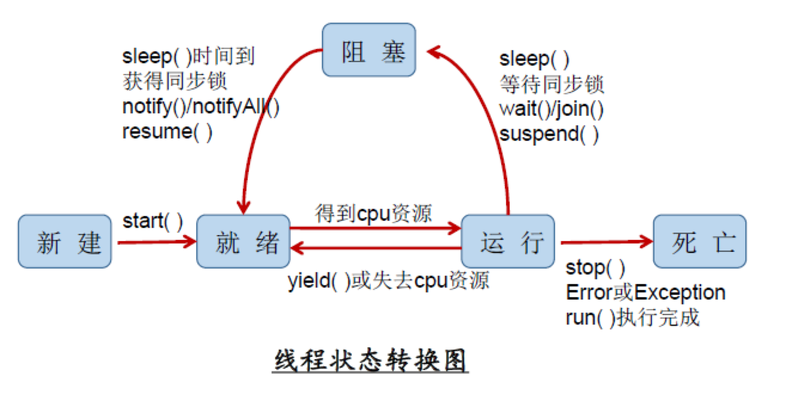

### 线程操作常见的 API [#线程操作常见的-api]

```txt 
 start():①启动当前线程;②调用run();
 run():线程在被调度时执行的操作
 currentThread():静态方法，返回执行当前代码的线程
 getName():获取当前线程名字
 setName():设置当前线程名字
 yield():释放当前CPU的执行权
 join():在线程a中调用线程b的join()，此时线程a就进入阻塞状态，直到线程b完全执行完以后，线程a才结束阻塞状态
 stop():已过时。当执行此方法时，强制结束当前线程
 sleep(long mills):让当前线程“睡眠”--阻塞(毫秒)
 isAlive():判断线程还存活
```

### sleep 与 wait 区别 [#sleep-与-wait-区别]

```txt 
① sleep()的父类是Thread类，wait()的父类是Object()类;
② wait()方法使当前线程进入等待状态，直到另一线程对该对象发出notify/notifyAll来唤醒，sleep()方法是让线程处于休眠，预设值结束自动结束休眠。
③ sleep()不释放同步锁，wait()释放同步锁。
④ wait()通常放在同步代码块里，而sleep()则不受限制。
```

## 线程池 [#线程池]

## JVM [#jvm]

</details>

</details>
