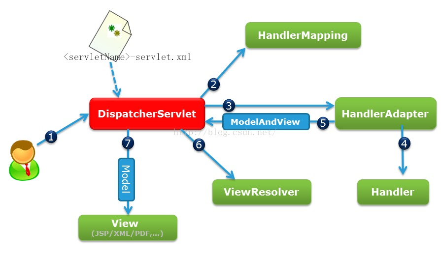

# 框架 (/docs/interview/java/java-frame)

## 框架 [#框架]

### 说一下 mybatis 工作原理? [#说一下-mybatis-工作原理]

```java
// 1.加载Mybatis的核心配置文件
String resource = "mybatis-config.xml";
InputStream inputStream = Resources.getResourceAsStream(resource);
// 2.根据配置文件中的数据库连接信息，得到一个工厂对象
SqlSessionFactory sqlSessionFactory = new SqlSessionFactoryBuilder().build(inputStream);
// 3.通过工厂对象得到会话对象
SqlSession session = sqlSessionFactory.openSession();
// 4.通过session拿数据
User user = session.selectOne("us.get"， 5);// namespace:映射文件必须配置 <mapper namespace="us">
// 5.关闭对象
session.close();
inputStream.close();
System.out.println(user);
```

### mybaits 核心配置文件中常见的配制有哪些? [#mybaits-核心配置文件中常见的配制有哪些]

```txt 
-configuration(配置)
 --properties(属性)
 --settings(设置)
 --typeAliases(类型别名)   alias/ˈeɪliəs/
 --typeHandlers(类型处理器)
 --objectFactory(对象工厂)
 --plugins(插件)
 --environments(环境配置)
  --environment(环境变量)
            --transactionManager(事务管理器)
            --dataSource(数据源)
 --databaseIdProvider(数据库厂商标识)
 --mappers(映射器)
```

### 映射文件常用节点有哪些? [#映射文件常用节点有哪些]

```txt 
select、delete、insert、update
```

### 映射文件中节点的常用属性有哪些? [#映射文件中节点的常用属性有哪些]


<Callout type="success" title="提示">

`namespace`：mapper 文件路径

`id`：在命名空间中的唯一标识符

`parameterType`：将会传入这条语句的参数的类全限定名或别名 /pəˈræmɪtə(r)/

`resultType`：期望从这条语句中返回结果的类全限定名或别名

`resultMap`：对外部 resultMap 的命名引用

</Callout>


### 什么是 IOC? [#什么是-ioc]

```txt 
Inversion of Control--控制反转 (将对象创建的控制由用户转移给Spring框架的IOC容器实现)
```

### IOC 核心组件有哪些? [#ioc-核心组件有哪些]

```txt 
BeanFactory、ApplicationContext
```

### 什么是 AOP? [#什么是-aop]


<Callout type="success" title="提示">

Aspect Oriented Program--面向切面编程 (面向切面编程解决的是将组件功能的扩展通过动态植入的方式添加进来。

AOP 是横向切割机制，将组件的非核心业务从核心业务中剥立出来，在需要时，动态植入(AOP 的原理利用的是动态代理模式)

</Callout>


### 什么是连接点、切点、增强、切面? [#什么是连接点切点增强切面]

```txt 
连接点(joinpoint)  :类中所有能被增强(植入非核心业务)的方法都称为连接点
切点(pointcut)    :真正增强的方法称为切点
增强/通知(advice)  :植入的功能实现称为增强
  --前置增强
 --后置增强
 --最终增强
 --环绕增强
 --异常增强
切面(Aspect): 将增强植入到切入点的过程称为切面(切面 = 切点 + 增强)
```

### 请说出你对 spring 框架的理解? [#请说出你对-spring-框架的理解]


<Callout type="success" title="提示">

Spring 是一个轻量级的开源框架，是一个分层的一站式开发框架(持久层:JdbcTemplate 技术、业务层:IOC、表示层:Sprng MVC);

它的两个核心功能分别是 IOC 和 AOP：  
`IOC`：控制反转--将对象创建的控制由用户转移给 Spring 框架的 IOC 容器实现

`AOP`：面向切面编程--将组件功能的扩展通过动态植入的方式添加进来

</Callout>


### 在 spring 框架中，如何创建一个 bean 对象? [#在-spring-框架中如何创建一个-bean-对象]

```txt 
① 使用构造方法
② 使用静态工厂
③ 使用实例工厂
```

### 说一下 bean 的作用域? [#说一下-bean-的作用域]

```txt 
singleton、prototype、request、session、application、websocket
```

### spring 框架的常用注解? [#spring-框架的常用注解]

```txt 
@Component:  将一个类注入spring框架
@Repository: 在数据访问层使用(dao层)   /rɪˈpɒzətri/
@Service:   在业务逻辑层使用(service层)
@Controller: 在展现层使用(Controller)
@Autowired:  根据类型注入
@Resource:  根据名称注入
```

### springmvc 的工作原理? [#springmvc-的工作原理]



```txt 
① 一个HTTP请求首先到达前端控制器(DispacherServlet)
② 前端控制器请求处理器映射器(HandlerMapping)来解析请求
③ 前端控制器拿到处理器映射器结果后，再次请求处理器适配器(HandlerAdapter)
④ 处理器适配器根据适配规则决定执行哪一个Handler
⑤ 处理器适配器将结果(ModelAndView)返回给前端控制器
⑥ 前端控制器接收到数据后，再次请求视图解析器(ViewResolver)，将数据解析为浏览器可识别的静态数据
⑦ 前端控制器将视图解析器解析的纯静态数据返回给用户(view)
```

### springmvc 方法的返回值有哪些? [#springmvc-方法的返回值有哪些]

```txt 
ModelAndView、String、void、JSON
```

### Springmvc 如何得到一个 JSON 格式的数据? [#springmvc-如何得到一个-json-格式的数据]

```txt 
@ResponseBody
```

### springmvc 如何向页面传数据? [#springmvc-如何向页面传数据]

```txt 
①给方法添加一个Model类型的参数
②给方法添加一个Map类型的参数
③给方法添加一个ModelMap类型的参数
- 以上参数将数据放到request域对象中
```

### 附加:Springmvc 如何接收参数值 [#附加springmvc-如何接收参数值]

```txt 
@RequestParam:接参数值
@PathVariable:RESTFUL风格URL获取参数值
```

### 为什么在开发中大家都使用 Springboot? [#为什么在开发中大家都使用-springboot]

```txt 
① Springboot简化了Spring的开发过程，可以帮助开发者快速搭建项目框架;
② Springboot继承了原有Spring框架的优秀基因;
③ Springboot不需要过多配置文件的配置;
④ Springboot可以构建微服务，项目部署发布简单。
```

### SpringBoot 工作原理? [#springboot-工作原理]


<Callout type="success" title="提示">

① 在 pom.xml 中父依赖下配置了大部分的第三方依赖包，在开发时只需导入相关的启动器(starter)依赖;

② 在启动类中@SpringBootApplication 在启动时会通过@EnableAutoConfiguration 去找到 META-INF/spring.factories 配置文件中的所有自动配置类，只有在 pom.xml 中配置了相应的启动器，该自动配置类才会生效并帮我们进行自动配置工作;

③ 启动类下 main()方法中，SpringApplication.run()方法，实例化后调用 run()启动项目;

</Callout>
