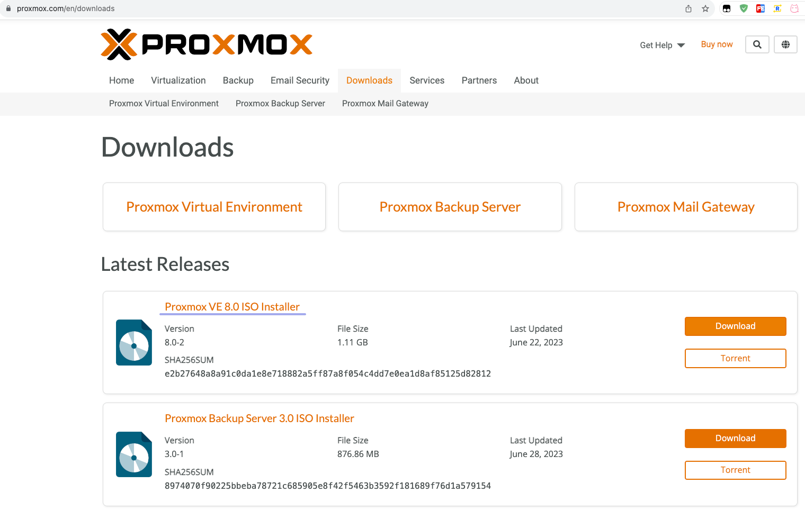
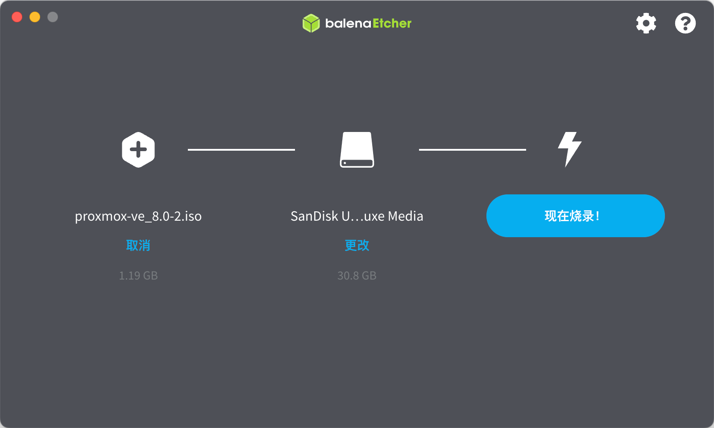
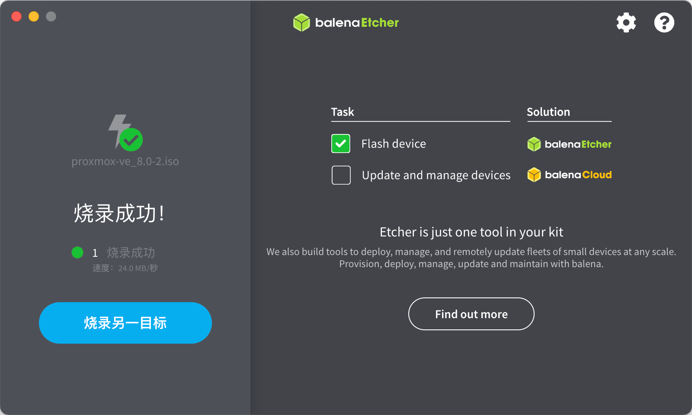
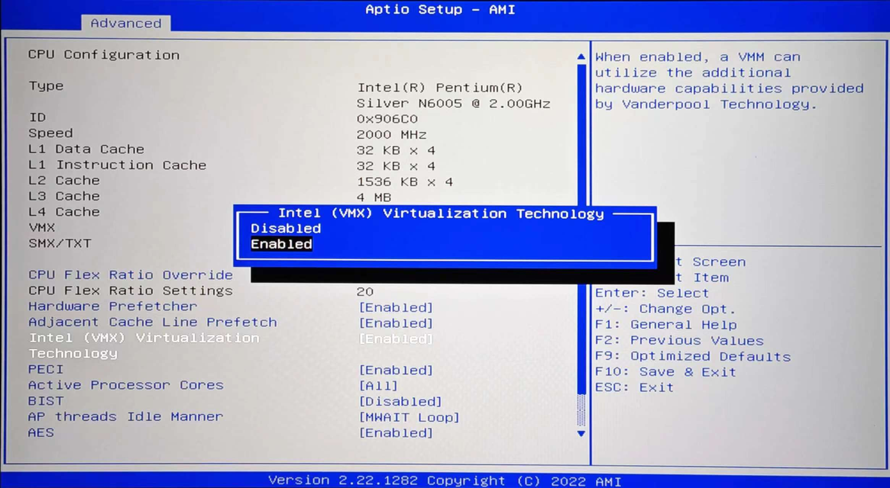
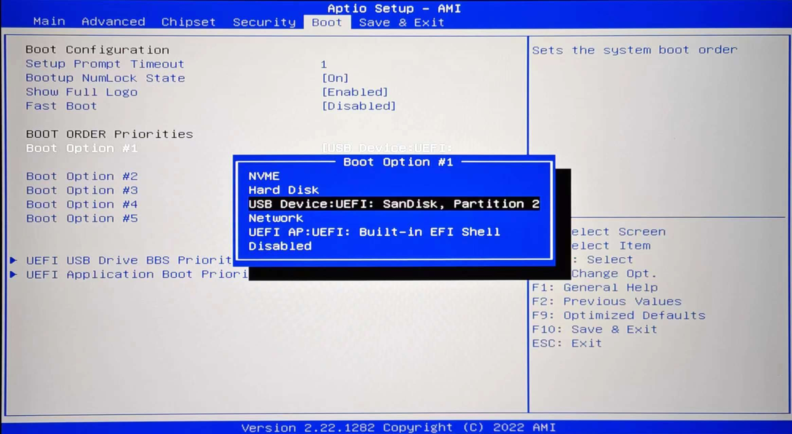
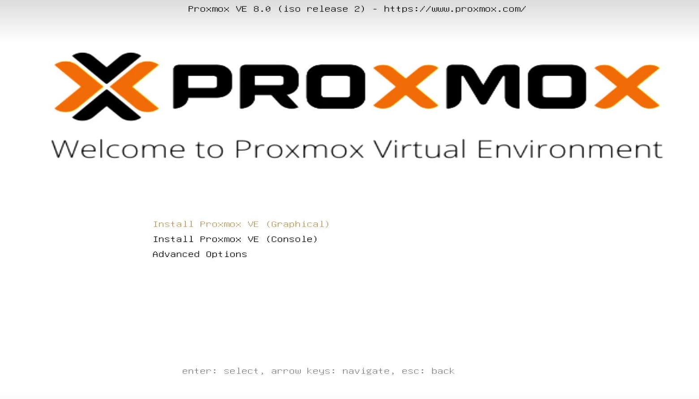
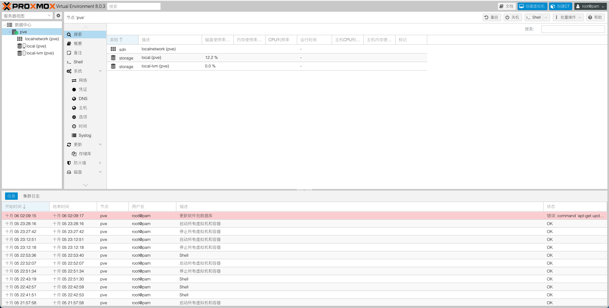

# PVE 系统安装 (/docs/others/pve)

## PVE 镜像下载 [#pve-镜像下载]

&#8195;&#8195;本次使用的 PVE 镜像为最新的 8.0，下载地址：[Proxmox VE 8.0-2](https://www.proxmox.com/en/downloads)



## 制作 PVE 的 U 盘启动盘 [#制作-pve-的-u-盘启动盘]

① 准备一个容量大于 2GB 的 U 盘，并对其进行格式化

② 打开烧录工具 [balenaEtcher](https://github.com/balena-io/etcher/releases)

③ 选择镜像 → 选择烧录的 U 盘 → 开始烧录






## 开启主机虚拟化功能 [#开启主机虚拟化功能]

> &#8195;&#8195;开启**虚拟化**功能的作用是让 CPU 的虚拟化技术能应用在 PVE 系统上，其实在 intel 4 代 CPU 后基本上都支持该技术，特别老的可能不支持，请根据自己的硬件进行判别。另外一点是**硬件直通**功能，也是需要硬件支持的。

① 主机<u>关机</u>的情况下插入 U 盘，接着开机，进入 BIOS 设置界面，一般就是开机过程中连续按 <kbd>Delete</kbd> 键，每个电脑主板可能不同，视情况而定；

② 进入 BIOS 后， 进入`Advanced`选项，找到 CPU 相关的内容，将虚拟化和硬件直通打开选择`Enabled`使能；



③ 更改启动项



> &#8195;&#8195;Mac 系统制作 U 盘启动盘不建议在虚拟机里操作，制作出来的启动盘可能存在问题。如果你是 Win 系统可以使用 balenaEtcher 或者 UltraISO，建议使用前者，它支持 Win 和 Mac 并且操作更简单！

## 安装 PVE 系统 [#安装-pve-系统]

> 注意：此时启动主机时，需要保持插入 U 盘，并且主机 HDMI 接显示器。

① 选择 `Install Proxmox VE (Graphical)` ，使用图形化的方式安装；



② 选择安装的硬盘，点击`Options`可设置大小(hsize = 64)；

③ 本地时区选择，`Country → China`、`Time zone → Asia/Shanghai`、`Keyboard Layout → U.S. English`；

④ 设置密码和邮箱地址，邮箱地址可以随便设置，但是格式得对；

⑤ 网络配置

> 笔者是将此当做是旁路由使用，所以下面配置仅供参考：
>
> |配置项|参数|备注|
> |--|--|--|
> |Management Interface|enp2s0|网卡选择，视自己情况而定|
> |Hostname(FQDN)|pve\.me|按格式随意|
> |IP Address|192.168.8.187/24|主路由下闲置的 IP|
> |Gateway|192.168.8.1|网关，主路由|
> |DNS Server|192.168.8.1|DNS 服务器，主路由|

⑥ 确认配置开始安装，当安装完毕，界面显示如下内容，说明安装完成

```sh 
----------------------------------------------------------------------------
Welcome to the Proxmox Virtual Environment. Please use your web browser to
configure this server - connect to:
  https://192.168.8.187:8006/
----------------------------------------------------------------------------
pve login:
```

> web 访问的地址就是前面网络配置分配的 IP 地址，注意是 <u>**https**</u>

⑦ web 管理界面

&#8195;&#8195;此时给主机相应网口接上网线，使用任意同一局域网的设备，浏览器输入 web 管理地址，并输入用户名和密码，登录后如下，此后我们的所有管理操作都是再此进行。



## PVE 一键优化脚本 [#pve-一键优化脚本]

PVE 一键优化脚本可以做一些简单的优化和辅助设置，教程参考：[https://github.com/ivanhao/pvetools](https://github.com/ivanhao/pvetools)

① 删除企业源

```sh 
rm /etc/apt/sources.list.d/pve-enterprise.list
```

② 安装优化工具

> 可以参考优化脚本地址里教程中的安装方式，由于我存在网络不通的问题，故下载 zip 放服务器下，手动执行`./pvetools.sh`进行相关优化。

---

## 参考资料 [#参考资料]

① [PVE 的简单使用教程、调优、常见问题汇总](https://zhuanlan.zhihu.com/p/614820460)
