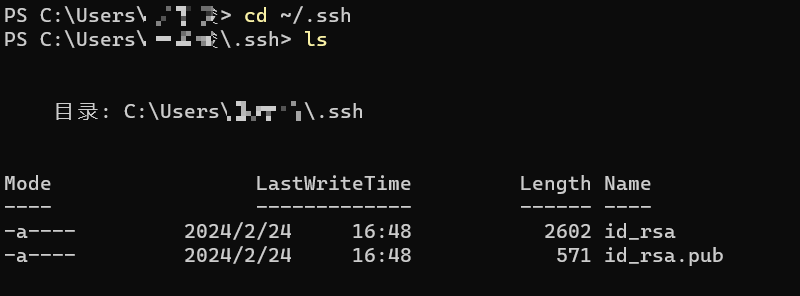
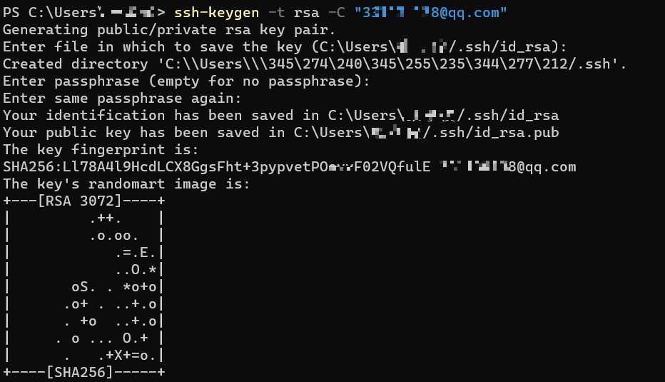
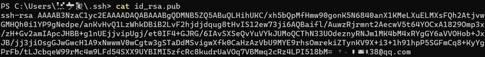
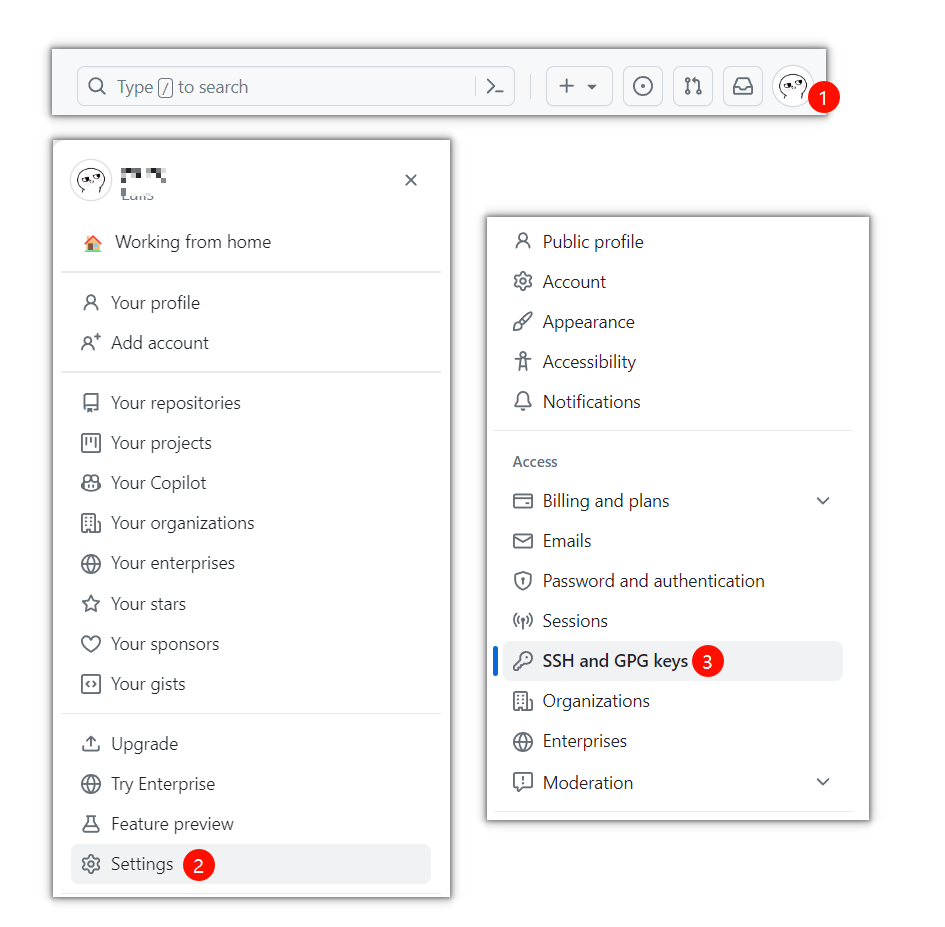
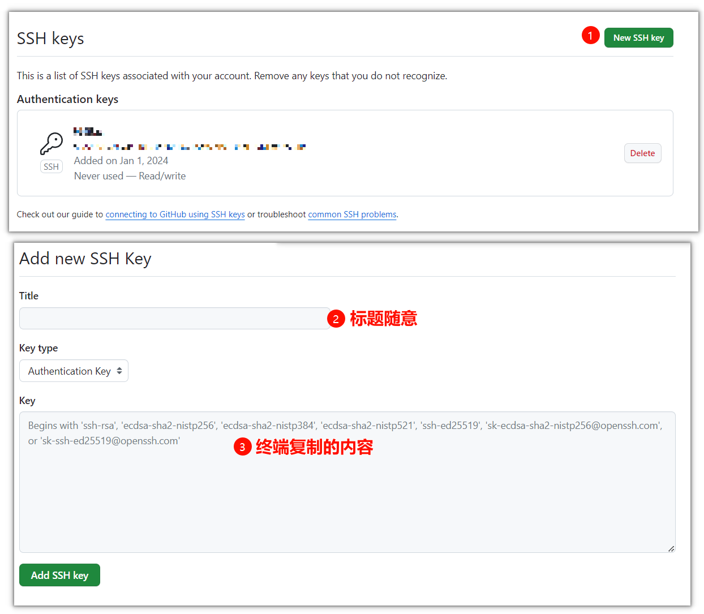
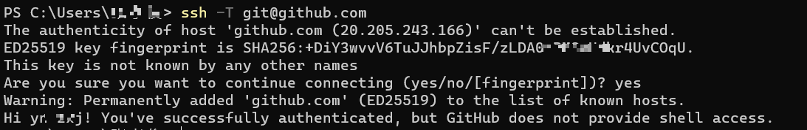

# Git (/docs/snippet/Git)

## git 基本配置 [#git-基本配置]

```sh 
# 生成密钥对
ssh-keygen -t rsa -C "youremail@example.com"

# 秘钥查看
cat ~/.ssh/id_rsa.pub

# 查看配置信息
git config --list

# 全局配置
git config --global user.name "你的名字"
git config --global user.email "你的邮箱"

# 局部配置
git config --local user.name "你的名字"
git config --local user.email "你的邮箱"
```

## git 创建版本库 [#git-创建版本库]

```sh 
git init # 将本地文件夹变为一个git仓库
git clone <url> # 仓库克隆
```

## git 修改与提交 [#git-修改与提交]

```sh 
git add <file> # 将单个文件从工作区添加到暂存区
git add . # 将所有文件添加到暂存区
git commit -m "messenge" # 将暂存区文件提交到本地仓库
git status # 查看工作区状态，显示有变更的文件
git diff # 比较文件的不同，即暂存区和工作区的差异
```

## git 远程操作 [#git-远程操作]

```sh 
git push origin master # 将本地的master分支推送到远程对应的分支
git pull  # 下载远程代码并合并
git fetch   # 从远程获取代码库，但不进行合并操作

git remote add origin <url> # 将远程仓库与本地仓库关联起来
git remote -v # 查看远程库信息
```

## git 分支管理 [#git-分支管理]

```sh 
git branch <name> # 创建分支
git checkout <name> # 切换分支
git checkout -b <name> # 创建并切换到新分支
git branch -a # 查看所有分支
git branch -d <name> # 删除分支
git merge <name> # 合并某个分支到当前分支
```

## git 移出跟踪 [#git-移出跟踪]

```sh 
git rm -r --cached 文件名
```

## git 撤销提交/回滚版本 [#git-撤销提交回滚版本]

```sh 
git reset --hard HEAD^ # 撤销上一次
git push -f # 强制推送到远程

# 撤销某次提交,产生新的提交,代码向前
git revert HEAD # 撤销最近一次
git revert HEAD~1 # 撤销上上次,从0开始
git revert 0ffaacc # 撤销0ffaacc这次提交
```

## git 文件误删本地找回 [#git-文件误删本地找回]

```sh 
git reflog # 找到要回退版本的commit id

git reset --hard <commit id> # 版本回退
# 或者
git checkout <commit id> # 版本回退
```

## 批量删除分支 [#批量删除分支]

**示例**：

```sh 
# ① 查找需要删除的分支
git branch -r | grep -v -E 'master|test|release' | sed 's/origin\///g' | awk '{print ":"$1}'

# ② 删除远程分支
git branch -r | grep -v -E 'master|test|release' | sed 's/origin\///g' | xargs -I {} git push origin :{}

# ③ 删除本地分支
git branch -a | grep -v -E 'master|test|release' | xargs git branch -D
```

---

**命令浅析**：

`git branch -r`：查看远程分支

`git branch -a`：查看所有分支(包括本地、远程)

`git -v -E 'master|test|release'`：排除 master、test、release 分支（<mark>适自己情况而定</mark>）  
 &#8195;`-v`：排除  
 &#8195;`-E`：使用正则表达式

`sed 's/origin\///g'`：分支开头过滤得到实际分支名，如：`origin/A -> A`

`awk '{print ":"$1}'`：打印对应的分支名，如：`:A`

`xargs -I {} git push origin :{}`：将 A 这个分支作为参数传给下一个命令，`-l {}`使用占位符来构造后面的命令，也就是接收上面命令的执行结果 A，然后执行`git push origin :A`

`xargs git branch -D`：强制删除本地分支，如：`git branch -D A`

> 核心命令`|`和`xargs`：
>
> `|`：把前一个命令的输出作为后一个命令的输入
>
> `xargs`：把输出作为后一个命令的参数

## 批量删除标签 [#批量删除标签]

**示例**：

```sh 
# ① 查找标签
git tag -l | awk '/^2/{print}'

# ② 删除标签
git push origin --delete tag $(git tag -l | awk '/^2/{print}')

# ③ 删除本地标签
git tag -l | xargs git tag -d
git fetch origin --prune
git fetch origin --tags
```

> 步骤 ② 后远程 tag 删除了，但是本地项目的 tag 还存在，如果 push 这个 tag 到远程，那么此 tag 将永远不会被删除，是为了避免这种情况出现，需要执行步骤 ③

---

**命令浅析**：

`git tag -l`：列出标签

`awk '/^2/{print}'`：打印符合条件的标签

`git push origin --delete tag`：删除远程标签

`git push origin --delete tag $(git tag -l | awk '/^2/{print}')`：删除符合条件的远程标签

`git tag -l | xargs git tag -d`：删除本地所有标签

`git fetch origin --prune`：从远程拉取所有信息

`git fetch origin --tags`：同步远程标签到本地

## 取消文件跟踪 [#取消文件跟踪]

```sh 
# 查看文件状态
git status

# 移除文件跟踪，但文件保留在本地
git rm --cached /java/OrderManage.java

# 移除文件跟踪，同时删除本地文件
git rm --f /java/OrderManage.java
```

## 附:SSH 密钥配置 [#附ssh-密钥配置]

### 检查本地主机是否已经存在 ssh key [#检查本地主机是否已经存在-ssh-key]

```sh 
cd ~/.ssh
ls
```



> 如果存在`id_rsa`和`id_rsa.pub`文件，则说明已经存在 SSH Key。存在则可以直接跳到第三步。

### 生成 ssh key [#生成-ssh-key]

```sh 
ssh-keygen -t rsa -C "xxx@xxx.com"
```

> [xxx@xxx.com](mailto:xxx@xxx.com) 为 github 邮箱地址，上面命令执行后一路回车即可。



### 获取 ssh key 公钥内容（id_rsa.pub） [#获取-ssh-key-公钥内容id_rsapub]

```sh 
cd ~/.ssh
cat id_rsa.pub
```



> 复制上面内容。

### Github 上添加公钥 [#github-上添加公钥]

#### SSH and GPG keys [#ssh-and-gpg-keys]



#### 添加公钥 [#添加公钥]



### 验证 [#验证]

```sh 
ssh -T git@github.com
```



> 如上说明设置成功。
